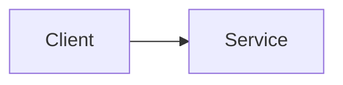

---
# Topic template — the app's build pipeline parses this exact structure.
# Copy to content/<group>/<id>.md. The file name must equal `id`, the folder must equal `group`.
id: example-topic                  # kebab-case, unique across all topics
title: "Example Topic"
group: architecture-design         # a group id from content/groups.json
tags: [example, patterns]
level: Senior                      # Foundation | Senior | Architect
estimatedMinutes: 60
related: [system-design]           # topic ids; each must exist
lastReviewed: 2026-11-19           # YYYY-MM-DD
status: draft                      # stub | draft | complete
---

<!--
RULES THE BUILD ENFORCES
- Use exactly these nine "## " headings (any order; the app shows them in this order).
- stub: no sections required. draft: missing sections are warnings. complete: everything below is required.
- Plain Markdown only (GitHub-flavoured: tables, task lists). No JSX/MDX, no raw HTML (it is stripped).
- Diagrams: fenced code blocks with the language `mermaid`.
- Mark any fact you are not sure of with "VERIFY:" — the app counts and flags these.
-->

## TL;DR

- 3–5 bullets a busy architect could read in 30 seconds.

## Core Concepts

### First concept

Explanation with the *why*, not just the *what*.

```ts
// Code samples in TypeScript where relevant.
```

## How It Works



## When to Use / Trade-offs

| Option | Use when | Avoid when | Cost |
|---|---|---|---|
| A | ... | ... | ... |

## Common Pitfalls & Anti-patterns

- **Pitfall name** — what goes wrong and how to spot it.

## Real-world Scenario

A short case study: context, constraints, decision, outcome, what you'd do differently.

## Interview Questions

<!--
Each question is an H3 ending in a stable {#id} (kebab-case, unique in this file).
Review history is keyed on the id, so keep it when you reword the question.
Fields are bold labels followed by a colon, in this order:
  **Level:** Foundation | Senior | Architect          (required)
  **Model answer:**                                     (required)
  **What the interviewer is looking for:**              (required)
  **Follow-ups:**  bullet list                          (required for complete)
  **Red flags:**   bullet list                          (required for complete)
Target mix for a complete topic: 4 Foundation, 6 Senior, 5 Architect, at least 3 scenario/design questions.
-->

### What problem does this solve? {#what-problem}

**Level:** Foundation

**Model answer:**
Concise but complete. Paragraphs, lists, code and tables are all fine here.

**What the interviewer is looking for:**
What separates a good answer from a great one.

**Follow-ups:**
- A likely follow-up question.
- Another.

**Red flags:**
- An answer that should worry the interviewer.

## Cheat Sheet

<!-- Every bullet in "**Front** — back" form becomes a flashcard. Group with "### " sub-headings if useful. -->

- **Term or question** — the one-line answer.

## Further Reading

- [Official documentation title](https://example.com) — why it is worth reading.
