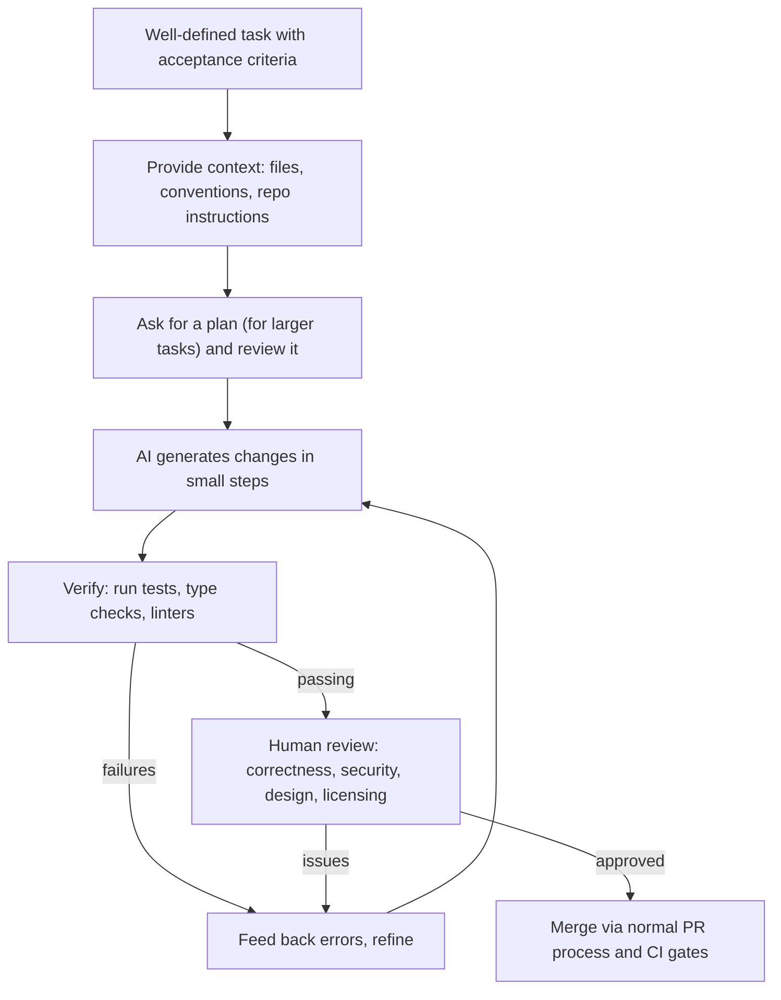
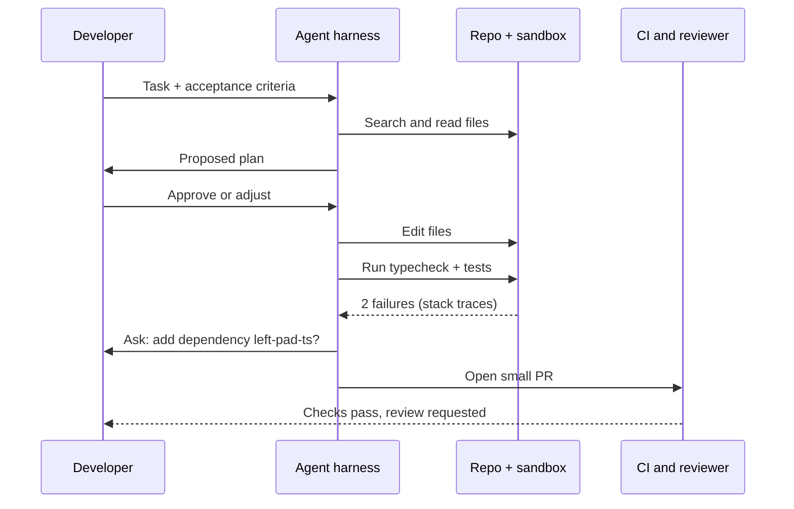

## TL;DR

- AI coding tools range from **autocomplete** to **chat assistants** to **agents** that read the codebase, run commands and make multi-file changes. They accelerate well-specified work; they don't replace judgement, design or accountability.
- Results depend on **context**: clear tasks, relevant files, conventions, tests and repository instructions. "Context engineering" matters more than clever prompts.
- **You own the output.** Review AI-generated code like a junior colleague's PR: correctness, edge cases, security, licensing, maintainability — and keep tests as the arbiter.
- Biggest wins: boilerplate, tests, refactors with clear patterns, exploring unfamiliar code, migrations, documentation, debugging hypotheses. Biggest risks: plausible-but-wrong code, security flaws, hidden complexity, skill atrophy, data leakage.
- Organisations should roll out with **policy, guardrails, training and measurement** of outcomes (lead time, quality, developer experience) — not lines of AI-generated code.

## Core Concepts

### The tool spectrum

| Mode | What it does | Good for | Watch out |
|---|---|---|---|
| Inline completion | Predicts the next lines as you type | Boilerplate, obvious patterns, tests | Accepting without reading |
| Chat in IDE | Q&A and edits on selected code | Explaining code, small refactors, regexes, SQL | Missing wider context |
| Agentic coding tools | Plan, read/search the repo, edit many files, run tests/commands, iterate | Multi-step tasks, migrations, bug fixes with reproduction, scaffolding | Scope creep, unsafe commands, large diffs, cost |
| AI code review | Comments on PRs | Catching bugs, inconsistencies, missing tests | False positives; not a substitute for human review |
| AI in CI/ops | Triage failures, summarise incidents, propose fixes | Toil reduction | Permissions, trust boundaries |

### What AI assistants are good and bad at

**Strong:** well-known languages and frameworks, boilerplate, translating between languages/formats, writing tests for clear behaviour, explaining code, generating first drafts of docs, refactoring to a stated pattern, scripting, regexes and queries, summarising large diffs or logs.

**Weak or risky:** novel architecture decisions, subtle concurrency and security, domain rules not written down, very large contexts without guidance, up-to-date APIs released after training, performance tuning without measurement, anything requiring knowledge of production behaviour.

### Context engineering

The quality of AI output tracks the quality of context:
- **Task framing:** goal, constraints, acceptance criteria, what *not* to change.
- **Relevant code:** point to the files, interfaces and examples to follow.
- **Repository instructions:** a checked-in instructions file (many tools support one — e.g. `CLAUDE.md`, `AGENTS.md`, `.github/copilot-instructions.md`) describing architecture, conventions, commands to build/test, and do's and don'ts.
- **Tools and data:** connecting agents to tests, linters, documentation and internal systems (e.g. via the Model Context Protocol, MCP) so they can verify their work.
- **Feedback loops:** agents that run tests and type checks produce far better results than ones that can't.

```markdown
<!-- Example repository instructions for AI tools -->
# Project conventions
- TypeScript strict; no `any`. Validate external input with zod at boundaries.
- Run `npm run typecheck && npm test` before proposing changes.
- Domain logic lives in src/domain (no imports from src/infrastructure).
- Never edit generated files under src/gen/. Never commit secrets or .env files.
- Prefer small PRs; ask before adding new dependencies.
```

### Working effectively

1. **Decompose:** ask for one well-defined change at a time; for bigger tasks, ask for a plan first and review it.
2. **Specify with examples and tests:** write or ask for failing tests first, then implementation.
3. **Verify:** run the code and tests; read diffs carefully; check edge cases and error handling.
4. **Iterate with feedback:** paste errors and test failures back; be specific about what's wrong.
5. **Keep changes reviewable:** small diffs, clear commits; don't let an agent rewrite 40 files unreviewed.
6. **Know when to stop:** if the assistant loops or produces worse code, take over.

### Risks

- **Correctness:** plausible code that's subtly wrong; invented APIs ("hallucinated" methods or packages).
- **Security:** injection, missing authorisation, insecure defaults, secrets in code; dependency confusion with non-existent package names an attacker can register ("slopsquatting").
- **Licensing and IP:** generated code resembling licensed code; enterprise tools offer filters and indemnities — check terms.
- **Data protection:** sending proprietary code or customer data to tools without approved agreements.
- **Prompt injection for agents:** malicious instructions in files, issues or web pages influencing an agent with tool access.
- **Maintainability:** bloated, inconsistent code; duplicated logic; nobody understands it.
- **Skills:** juniors not learning fundamentals; over-reliance.

## How It Works



AI changes go through the **same** pipeline and review standards as human changes — tests, scanners, code review, progressive delivery.

### Inside one agent session

An agentic tool is a loop: the model proposes an action, a harness executes it (read a file, run a command), and the result goes back into the context. The safety properties live in the **harness**, not the model — what it may run without asking, what it can reach, and what untrusted text it reads. Step through the session below.



### Example: a CI guard against hallucinated dependencies

Assistants sometimes suggest packages that don't exist, or that were registered last week by someone who noticed the hallucination ("slopsquatting"). A cheap guard is to fail CI when a PR adds a dependency that is missing from the registry or very new, unless someone approves it explicitly.

```ts
// scripts/check-new-deps.ts: run in CI on PRs that touch package.json
import { execSync } from 'node:child_process';

const MIN_AGE_DAYS = 30;
const base = JSON.parse(execSync('git show origin/main:package.json', { encoding: 'utf8' }));
const head = JSON.parse(execSync('cat package.json', { encoding: 'utf8' }));
const deps = (p: any) => ({ ...p.dependencies, ...p.devDependencies });
const added = Object.keys(deps(head)).filter((name) => !(name in deps(base)));

let failed = false;
for (const name of added) {
  const res = await fetch(`https://registry.npmjs.org/${encodeURIComponent(name)}`);
  if (res.status === 404) {
    console.error(`✗ ${name} does not exist on npm: likely hallucinated`);
    failed = true;
    continue;
  }
  const meta = await res.json();
  const ageDays = (Date.now() - Date.parse(meta.time.created)) / 86_400_000;
  if (ageDays < MIN_AGE_DAYS) {
    console.error(`✗ ${name} was first published ${ageDays.toFixed(0)} days ago: needs explicit approval`);
    failed = true;
  }
}
process.exit(failed ? 1 : 0);
```

Pair it with an allow-list or an internal registry proxy for stricter environments. The point is that the guard is **deterministic**: it doesn't depend on a reviewer noticing an unfamiliar name.

## When to Use / Trade-offs

| Task | AI help level | Notes |
|---|---|---|
| Boilerplate, CRUD endpoints, DTOs | High | Follow existing patterns; review naming and validation |
| Unit tests for clear behaviour | High | Check assertions are meaningful, not tautological |
| Explaining unfamiliar code | High | Verify claims against the code |
| Large mechanical migrations (API version bumps, framework upgrades) | High with agents + tests | Do in batches; rely on test suite and type checker |
| Bug fixing | Medium–high | Reproduce with a failing test first |
| Security-sensitive code (auth, crypto, payments) | Low–medium | Expert review mandatory; prefer vetted libraries |
| Architecture and domain modelling | Low (as a sparring partner) | Use for options and critique, decide yourself |
| Performance optimisation | Medium | Only with profiling data and benchmarks |

## Common Pitfalls & Anti-patterns

- **Accept-all coding** — merging code you don't understand.
- **Huge AI-generated PRs** that reviewers can't meaningfully review.
- **No tests** — trusting output because it "looks right".
- **Unapproved tools with company code or customer data.**
- **Letting agents run with broad permissions** (production credentials, unrestricted shell, auto-merge).
- **Measuring success by % of code written by AI.**
- **Skipping fundamentals for juniors** — no learning, fragile teams.
- **Prompting instead of fixing context** — repeating the same instructions instead of writing repository guidance once.
- **Trusting suggested dependencies** without checking they exist and are reputable.

## Real-world Scenario

**Context:** A 60-engineer organisation piloted AI coding assistants. Early enthusiasm turned mixed: some PRs ballooned, reviewers complained about inconsistent code, and a suggested npm package name turned out not to exist (a squatting risk).

**Decision:** Introduced an AI usage policy (approved tools with enterprise data terms, no customer data in prompts, human accountability for all code), repository instruction files with architecture rules and test commands, PR size limits, a dependency allow-list check in CI, and training sessions on "plan → test → implement → verify" workflows. Agents ran in sandboxed environments with no production credentials. Measured lead time, change failure rate, PR review time and a developer survey before and after.

**Outcome:** After three months, median lead time for small changes dropped noticeably, test coverage of new code rose (assistants were used to write tests first), change failure rate stayed flat, and developer satisfaction increased. Large-diff complaints largely disappeared after PR size limits and planning steps.

**What I'd do differently:** Write the repository instruction files and test commands before the pilot — teams with good instructions and fast tests saw much better results.

## Interview Questions

### What are AI coding assistants good at, and where do they fail? {#strengths-weaknesses}

**Level:** Foundation

**Model answer:**
**Good at:**
- Boilerplate and repetitive patterns, scaffolding, configuration.
- Writing tests for clearly specified behaviour.
- Explaining unfamiliar code, summarising diffs and logs.
- Translating between languages/formats, regexes, SQL, scripts.
- Mechanical refactors and migrations when guided by tests.
- First drafts of documentation.

**Weak or risky:**
- Novel design and architecture trade-offs; domain rules not written anywhere.
- Subtle correctness: concurrency, edge cases, numeric precision, time zones.
- Security-sensitive code — they can produce insecure patterns confidently.
- Very recent APIs or internal libraries without context — they may invent methods.
- Performance claims without measurement.

The pattern: strong where the problem is well-specified and verifiable; weak where judgement, hidden context or verification is missing.

**What the interviewer is looking for:**
Balanced, concrete view tied to specification and verifiability.

**Follow-ups:**
- Give an example where an assistant misled you.
- How do you verify AI-generated code quickly?

**Red flags:**
- "AI writes all my code now" without verification.
- Dismissing the tools entirely.

### How do you prompt effectively for coding tasks? {#prompting-for-code}

**Level:** Foundation

**Model answer:**
- **State the goal and constraints:** what to build or change, acceptance criteria, what must not change, performance or security constraints.
- **Give context:** relevant files, interfaces, an example of the pattern to follow, error messages verbatim.
- **Specify the output:** "Return only the changed function", "Add tests using Vitest following tests/orders.test.ts".
- **Break down big tasks:** ask for a plan first, then implement step by step.
- **Use tests as specification:** provide failing tests or ask the assistant to write tests first, then make them pass.
- **Iterate with precise feedback:** "This fails when the list is empty; handle that and add a test."
- **Ask for reasoning or alternatives** for design choices, then decide.
- **Prefer durable context** (repository instruction files) over repeating conventions in every prompt.

**What the interviewer is looking for:**
Goal/constraints/context/output, decomposition, tests as spec and iterative feedback.

**Follow-ups:**
- How would you ask an assistant to refactor a 600-line function?
- What do you put in a repository instructions file?

**Red flags:**
- One-line vague prompts and accepting the first answer.

### How should you review AI-generated code? {#reviewing-ai-code}

**Level:** Foundation

**Model answer:**
Treat it like code from a fast but inexperienced colleague — **you are accountable** for it:
- **Understand every line** you merge; if you can't explain it, don't ship it.
- **Correctness:** run it; check edge cases (empty, null, large inputs, time zones, concurrency), error handling and that tests assert meaningful behaviour.
- **APIs and dependencies:** verify methods exist in the versions you use; check suggested packages exist, are reputable and needed.
- **Security:** input validation, authorisation checks, injection, secrets, logging of sensitive data.
- **Consistency:** follows the codebase's patterns, naming and architecture; no duplicated utilities.
- **Simplicity:** remove unnecessary abstractions or verbose code.
- **Licensing:** watch for large verbatim-looking snippets; use tools' public-code filters where available.
- Keep AI-assisted PRs **small** so reviewers can review properly; the normal CI and review gates apply.

**What the interviewer is looking for:**
Accountability, concrete review checklist, dependency and security checks and small PRs.

**Follow-ups:**
- Should AI-generated code be labelled in PRs?
- How do you review tests written by AI?

**Red flags:**
- "The AI wrote it, so it's probably fine."

### What data protection and IP concerns apply to AI coding tools? {#data-and-ip}

**Level:** Foundation

**Model answer:**
- **Data sent to providers:** code, prompts and context leave your environment. Use **approved tools with enterprise agreements** that specify retention, no training on your data, security certifications and data residency where needed.
- **Sensitive data:** never paste customer data, credentials or secrets into prompts; exclude sensitive files from context (tool ignore files); be careful with production logs.
- **Licensing/IP:** generated code might resemble licensed open-source code. Mitigations: tools' filters for public-code matches, vendor IP indemnification terms, and review for large verbatim blocks. Check your organisation's policy on ownership of AI-generated code.
- **Regulated environments:** some codebases (defence, health) may require on-premise or private deployments, or prohibit external tools.
- **Agents with tool access:** consider what systems they can reach and what data they can read or exfiltrate.

**What the interviewer is looking for:**
Awareness of data flows, enterprise terms, secrets hygiene, licensing and regulated contexts.

**Follow-ups:**
- How would you prevent secrets from being sent to an AI tool?
- Who owns copyright in AI-generated code in your jurisdiction?

**Red flags:**
- Using personal accounts of AI tools with company code.

### How do you use AI effectively for writing tests? {#ai-for-testing}

**Level:** Senior

**Model answer:**
- **Tests as specification first:** describe behaviours and edge cases, ask the assistant to write failing tests, review them, then implement (or have the assistant implement) until they pass.
- **Characterisation tests for legacy code:** ask it to generate tests capturing current behaviour across inputs before refactoring.
- **Edge-case brainstorming:** ask "what edge cases am I missing?" — then decide which matter.
- **Property-based tests:** have it propose invariants and generators.
- **Review quality carefully:** AI-written tests often test implementation details, mock everything, or assert tautologies (`expect(fn(x)).toEqual(fn(x))`); check they'd fail if the code were wrong — mutation testing helps.
- **Follow conventions:** point to an example test file for structure, fixtures and naming.
- **Maintainability:** avoid giant snapshot tests and brittle mocks.

**What the interviewer is looking for:**
Test-first use, characterisation tests, edge cases, critical review of test quality and maintainability.

**Follow-ups:**
- How do you detect weak AI-generated tests?
- Would you let AI update failing tests automatically?

**Red flags:**
- Letting the assistant "fix" failing tests by changing assertions to match buggy output.

### How do you work with agentic coding tools safely and productively? {#agentic-workflows}

**Level:** Senior

**Model answer:**
**Productive workflow:**
- Give a clear task with acceptance criteria; ask the agent to **explore and plan first**; review the plan.
- Let it work in small steps, running **tests, type checks and linters** itself; iterate on failures.
- Keep diffs reviewable; commit in logical chunks; open PRs for human review.
- Use repository instruction files and tools (test runners, docs, issue trackers via MCP) so the agent has the right context.

**Safety:**
- Run agents in **sandboxed environments** (dev containers, isolated VMs) with least-privilege credentials — **no production access**, no broad cloud credentials.
- Require approval for risky actions (installing dependencies, network calls, destructive commands, pushing to shared branches).
- Be wary of **prompt injection** from untrusted content the agent reads (issues, web pages, dependencies' files).
- Normal CI gates and human review still apply; no auto-merge to main without review.
- Track cost and time; stop agents that loop.

**What the interviewer is looking for:**
Plan-then-execute, verification loops, small diffs, sandboxing, approvals and injection awareness.

**Follow-ups:**
- What tasks would you delegate fully to an agent?
- How would you let an agent fix CI failures automatically?

**Red flags:**
- Agents with production credentials or unrestricted auto-merge.

### What is "context engineering" for AI tools, and how do you do it well? {#context-engineering}

**Level:** Senior

**Model answer:**
Context engineering means deliberately providing AI tools with the information they need to produce correct, consistent results — beyond the prompt itself:
- **Repository instruction files** (supported by many tools under names like `CLAUDE.md`, `AGENTS.md`, Copilot instructions): architecture overview, module boundaries, coding conventions, commands to build/test/lint, things never to do, how to add dependencies.
- **Well-structured code and docs:** clear module boundaries, good names, README per package, ADRs — AI tools (like humans) do better in a navigable codebase.
- **Examples to imitate:** point to canonical implementations ("follow src/orders/api.ts").
- **Tool access:** let agents run tests, type checks, search docs and query internal systems through approved integrations (MCP servers), so they verify rather than guess.
- **Scoping:** include only relevant files; too much irrelevant context degrades results.
- **Maintenance:** keep instruction files updated in PRs like any documentation.

**What the interviewer is looking for:**
Concrete mechanisms (instruction files, examples, tools, scoping) and treating context as maintained infrastructure.

**Follow-ups:**
- What would you put in an instruction file for a monorepo?
- What is MCP?

**Red flags:**
- Relying on ad-hoc prompts with no shared guidance.

### How can AI help with legacy code and large migrations? {#ai-for-legacy}

**Level:** Senior

**Model answer:**
- **Understanding:** explain unfamiliar modules, trace data flows, summarise what a 2,000-line class does, generate diagrams from code, find where a business rule is implemented — then verify against the code.
- **Characterisation tests:** generate tests capturing current behaviour before changing anything.
- **Mechanical migrations:** framework or language version upgrades, API changes, replacing deprecated libraries, converting callbacks to async/await, JavaScript to TypeScript — done in batches by agents, guided by type checkers and tests. Codemods (deterministic transforms) remain preferable where a rule can be expressed precisely; AI handles the irregular cases.
- **Documentation:** draft docs and ADRs for undocumented systems, reviewed by people who know them.
- **Translation between languages** (e.g. COBOL to Java) for analysis and drafts — with heavy verification, because semantics differ subtly.

Guardrails: work incrementally, keep behaviour identical (compare outputs), review diffs in manageable chunks and measure progress.

**What the interviewer is looking for:**
Practical uses with verification, combination with codemods and tests, incremental approach.

**Follow-ups:**
- How would you migrate 300 files from one ORM to another using AI?
- What could go wrong translating legacy code with AI?

**Red flags:**
- "AI can rewrite the legacy system for us" with no tests.

### What security risks come with AI-generated code, and how do you mitigate them? {#ai-code-security}

**Level:** Senior

**Model answer:**
Risks:
- **Insecure patterns:** SQL built by concatenation, missing authorisation checks, weak crypto, permissive CORS, disabled certificate validation, logging secrets.
- **Hallucinated or malicious dependencies:** suggested package names that don't exist can be registered by attackers ("slopsquatting"); typosquats.
- **Outdated practices** from training data (deprecated APIs, vulnerable versions).
- **Secrets** pasted into prompts or generated into code.
- **Prompt injection** against agents with tool access, causing harmful actions or data exfiltration.

Mitigations:
- Same security gates as all code: SAST, SCA, secret scanning, code review with security checklists.
- Dependency allow-lists or checks for package age/reputation in CI.
- Repository instructions encoding secure patterns (validation library, auth middleware).
- Use secure, vetted libraries for auth and crypto rather than generated implementations.
- Sandboxed agents with least privilege and approval for risky actions.
- Training developers on these specific failure modes.

**What the interviewer is looking for:**
Specific risks including slopsquatting and injection, and layered mitigations.

**Follow-ups:**
- What's slopsquatting?
- How would you detect an agent being manipulated by injected instructions?

**Red flags:**
- Assuming AI code is more secure than human code.

### How do you make sure engineers — especially juniors — keep learning when using AI tools? {#skills-and-learning}

**Level:** Senior

**Model answer:**
- **Use AI as a tutor, not just a generator:** ask it to explain code, compare approaches, quiz you, and review your code — not only to write it.
- **Understand before merging:** a team norm that authors can explain every line in review; reviewers ask "why this approach?".
- **Deliberate practice:** juniors implement some tasks without AI (or write a first version, then compare), work through fundamentals (debugging, algorithms, system design) with mentors.
- **Pairing and mob sessions** where seniors demonstrate how they use AI critically — verifying, rejecting suggestions, debugging.
- **Code review as learning:** explain the reasoning behind feedback.
- **Progression expectations** that still require demonstrated understanding (design docs, incident handling, debugging production issues).

Teams that only accept generated code without understanding become fragile — nobody can debug the system at 3 a.m.

**What the interviewer is looking for:**
Concrete practices balancing productivity with learning and understanding.

**Follow-ups:**
- Would you restrict AI tools for new graduates?
- How do you assess skills in interviews now?

**Red flags:**
- No concern for skill development.

### How would you roll out AI development tools across an engineering organisation? {#org-rollout}

**Level:** Architect

**Model answer:**
1. **Goals and baseline:** what you want to improve (lead time, developer experience, onboarding, toil) and current metrics (DORA, PR cycle time, survey).
2. **Policy and procurement:** approved tools with enterprise terms (data retention, no training on your code, security, residency, IP indemnity); acceptable use (no customer data, accountability for output); agent permission guidelines.
3. **Pilot:** a few volunteer teams with diverse stacks; instrument usage and outcomes; gather qualitative feedback.
4. **Enablement:** training on effective workflows (plan, test, verify), security risks, and context engineering; repository instruction templates; internal champions and a community of practice.
5. **Guardrails:** CI checks (security scanning, dependency allow-lists), PR size guidance, sandboxed agent environments, audit logs.
6. **Scale:** roll out to all teams with support; share playbooks and examples per stack.
7. **Measure and iterate:** outcomes, quality (change failure rate, escaped defects), developer satisfaction, cost per seat/usage; adjust tools and practices.

**What the interviewer is looking for:**
Baseline and goals, policy and procurement, pilot, enablement, guardrails and outcome measurement.

**Follow-ups:**
- How do you handle teams that refuse to use the tools?
- How do you control the cost of agent usage?

**Red flags:**
- Mandating usage quotas.
- Rolling out with no policy or training.

### How do you measure the impact of AI-assisted development? {#measuring-ai-impact}

**Level:** Architect

**Model answer:**
Avoid vanity metrics (lines generated, acceptance rate of suggestions) as success measures — they say little about value.

Measure outcomes with baselines and comparisons:
- **Delivery:** PR cycle time, lead time for changes, deployment frequency (DORA), time to complete comparable tasks.
- **Quality:** change failure rate, escaped defects, incident trends, code review rework, test coverage of new code.
- **Developer experience:** surveys on productivity, flow, cognitive load and satisfaction; onboarding time for new engineers.
- **Maintainability signals:** code churn/rework shortly after merge, duplication, complexity trends.
- **Cost:** licences and usage vs time saved.

Methods: before/after with comparable teams, pilot vs control groups, task-level studies; combine quantitative and qualitative data, and watch for confounders (seasonality, team changes). Report honestly — perceived speed-ups often don't match measured outcomes, so measure rather than assume. Two well-known data points:
- **METR (July 2025):** a randomised controlled trial with experienced open-source developers working in their own mature repositories. They were about **19% slower** with early-2025 AI tools, while *believing* they had been about 20% faster.
- **DORA 2024:** higher AI adoption correlated with better self-reported productivity and documentation quality, but also with slightly *lower* delivery throughput and stability. One plausible cause is larger batch sizes.

Neither result means "AI doesn't help". Both mean the benefit depends on the task, the codebase and the workflow, so you have to measure it in your own context.

**What the interviewer is looking for:**
Outcome-based metrics, quality and maintainability signals, rigorous comparison and scepticism.

**Follow-ups:**
- Developers feel faster but lead time hasn't changed. What could explain it?
- How do you measure maintainability effects over a year?

**Red flags:**
- "40% of our code is AI-generated" as the headline success metric.

### What should an AI usage policy for engineering include? {#ai-usage-policy}

**Level:** Architect

**Model answer:**
- **Approved tools and accounts:** enterprise agreements only; no personal accounts with company code.
- **Data rules:** what may be shared (code in approved repos) and what may not (customer data, secrets, credentials, regulated data); file exclusion configuration.
- **Accountability:** engineers own and must understand all code they submit; normal review and testing standards apply.
- **Security:** dependencies must be verified; security-sensitive areas need expert review; agents run sandboxed with least privilege; no production credentials.
- **IP and licensing:** use public-code filters; guidance on attribution and open-source contributions.
- **Agents and automation:** permitted actions, approvals, audit logging, cost limits.
- **Customer-facing AI features** are governed separately (responsible AI review).
- **Transparency:** whether and how AI assistance is disclosed (e.g. in PRs for significant generated changes).
- **Training and support** resources, and a process to propose new tools.
- **Review cadence:** update the policy as tools and regulations evolve.

**What the interviewer is looking for:**
Comprehensive coverage of tools, data, accountability, security, IP, agents and evolution.

**Follow-ups:**
- How do you enforce the data rules technically?
- Should open-source contributions made with AI follow different rules?

**Red flags:**
- A blanket ban or no policy at all.

### Should AI be part of your code review process? {#ai-code-review}

**Level:** Architect

**Model answer:**
AI review can add value as an **additional reviewer**, not a replacement:
- **Strengths:** fast first pass on every PR; catches common bugs (null handling, off-by-one, missing awaits), inconsistent naming, missing tests, obvious security smells; summarises large PRs for human reviewers; helps reviewers in unfamiliar areas.
- **Limitations:** false positives (noise), lack of domain context, can't judge architecture or product intent well; can be manipulated by content in the PR (prompt injection in comments or code).

Design:
- Configure with repository conventions and rules; tune to reduce noise; allow dismissing comments easily.
- Keep **human approval mandatory** (also for compliance/segregation of duties).
- Use it to prioritise reviewer attention (risk summaries) rather than to gate merges.
- Measure: defects caught, false-positive rate, review cycle time, reviewer satisfaction.

**What the interviewer is looking for:**
Balanced use as an aid, configuration and noise control, human approval and measurement.

**Follow-ups:**
- Could AI approvals satisfy segregation-of-duties requirements?
- How would you handle noisy AI review comments?

**Red flags:**
- Replacing human review with AI approval.

### How should codebases and architecture evolve to work well with AI tools? {#ai-friendly-codebase}

**Level:** Architect

**Model answer:**
Practices that help humans also help AI tools — and AI amplifies their value:
- **Clear module boundaries and small, cohesive files** so relevant context fits in a window and changes stay local.
- **Strong typing and contracts** (TypeScript strict, schemas, OpenAPI) so tools get feedback from type checkers and generate correct integrations.
- **Fast, reliable tests and one-command verification** (`npm run check`) — the agent's feedback loop.
- **Consistent conventions** and canonical examples; fewer competing patterns.
- **Documentation in the repo:** READMEs, ADRs, architecture overviews and instruction files for AI tools.
- **Good naming** that encodes domain language.
- **Deterministic tooling:** codemods and linters for rules that can be automated, leaving AI for irregular work.
- **Guardrails in CI:** architecture tests, dependency rules and security scans catch AI mistakes automatically.

These investments make AI tools more effective and reduce the risk of inconsistent generated code spreading through the codebase.

**What the interviewer is looking for:**
Concrete codebase properties that improve AI effectiveness and safety, framed as good engineering.

**Follow-ups:**
- Would you restructure a monolith to make it more AI-friendly?
- How do architecture tests help with AI-generated code?

**Red flags:**
- Expecting AI tools to compensate for a chaotic codebase.

### When would you reach for completion, chat or an agent? {#choosing-the-mode}

**Level:** Foundation

**Model answer:**
Choose by the **size of the task** and by **how much verification the tool can do itself**:
- **Inline completion:** you already know what you're writing and want to type less, e.g. the next test case or a mapper between two DTOs. The feedback loop is your eyes, line by line.
- **Chat:** you need an explanation, a sketch or a focused edit to code you've selected, e.g. "why does this regex backtrack?" or "convert this callback chain to async/await". You still choose what context it sees.
- **Agent:** a multi-step task that spans files and can be **checked by running something**: "upgrade to the new SDK and keep the tests green", or "reproduce issue #412 with a failing test, then fix it". The agent gathers its own context and iterates against the tests.

Rule of thumb: the more autonomy you give the tool, the more you need a machine-checkable definition of done (tests, types, a linter) and a sandbox. Without those, an agent produces a large diff you can't trust.

**What the interviewer is looking for:**
Choosing by task scope and verifiability rather than habit, and linking autonomy to guardrails.

**Follow-ups:**
- What would make you stop an agent and switch to doing it by hand?
- Which mode do you use for code you're unfamiliar with?

**Red flags:**
- Using an agent for everything, including one-line changes, or never trying one.

### How do you protect an agent with tool access from prompt injection? {#agent-prompt-injection}

**Level:** Senior

**Model answer:**
Assume the model **cannot reliably tell instructions from data**. Any text the agent reads can try to steer it: an issue, a README in a dependency, a web page, a code comment, a tool's output. So defend at the **harness and permission** layer, not by asking the model to be careful.

The dangerous combination is sometimes called the **"lethal trifecta"**: the agent has (1) access to private data, (2) exposure to untrusted content, and (3) a way to communicate externally (network calls, opening PRs or issues, even rendering an image URL). Remove at least one leg for any given task:
- **Least privilege:** scoped, short-lived tokens. No production credentials. Read-only access where possible.
- **Egress control:** sandbox with network off, or allow-listed only to the package registry and the docs.
- **Human approval** for consequential actions: pushes, deploys, sending messages, installing packages, running unknown scripts.
- **Separate contexts:** an agent that browses the web shouldn't hold secrets. Summarise untrusted content in a quarantined step that has no tools.
- **Audit logs** of every tool call. Alert on unusual patterns, such as reading `.env` and then making an outbound request.

**What the interviewer is looking for:**
Treating injection as an architectural property, the private-data + untrusted-input + exfiltration framing, and concrete harness controls.

**Follow-ups:**
- An agent triages GitHub issues and can comment on them. What could an attacker do?
- Why doesn't "ignore instructions in documents" in the system prompt solve this?

**Red flags:**
- "We tell the model not to follow injected instructions" as the main defence.

### How would you use AI to help debug a production incident? {#ai-for-debugging}

**Level:** Senior

**Model answer:**
Use it to **widen and speed up hypothesis generation**, never as the source of truth:
1. **Summarise the evidence:** paste or connect (through approved tooling) the error logs, traces and the diff of recent deploys. Ask "what changed, and which of these errors are new?" Scrub customer data first, or use a tool approved for production data.
2. **Generate hypotheses:** "given this stack trace and this diff, list plausible causes ranked by likelihood, with how to confirm each". Then check them yourself against the dashboards.
3. **Reproduce:** ask for a minimal failing test or a script that reproduces the issue locally. A reproduction turns guessing into engineering.
4. **Fix and verify:** the fix goes through the normal pipeline. For a hotfix, still require a test and a reviewer.
5. **Post-incident:** draft the timeline and the post-incident review from the chat and the logs, then have humans edit it.

The watch-outs are confident but wrong explanations, mitigations that are risky under time pressure, and leaking production data into unapproved tools.

**What the interviewer is looking for:**
AI as a hypothesis and summarisation engine, evidence-led confirmation, reproduction first, and data handling.

**Follow-ups:**
- The assistant is confident the database is the cause, but your metrics disagree. What do you do?
- Would you let an agent run commands against production during an incident?

**Red flags:**
- Applying an AI-suggested fix to production without reproducing or understanding the failure.

### Developers say AI makes them faster, but lead time hasn't moved. What's going on, and what do you do? {#faster-but-not-faster}

**Level:** Architect

**Model answer:**
This is common, and there are usually several causes:
- **Coding wasn't the bottleneck.** If writing code is about 20% of lead time, even doubling coding speed saves about 10% (Amdahl's law). The time goes to waiting for review, for CI, for environments, and on unclear requirements.
- **Work moved downstream.** Bigger AI-generated PRs take longer to review and are more likely to be reworked. Reviewer load goes up and the review queue becomes the new constraint.
- **Perception versus measurement.** The METR 2025 trial found experienced developers felt faster while measuring slower. Flow and reduced tedium are real benefits, but they aren't throughput.
- **Quality debt.** Speed now, rework later: churn on recently merged code goes up, and so do escaped defects.

What to do:
1. **Map the value stream** (time in coding, review, CI and deployment) and find the real constraint.
2. **Point AI at the constraint:** AI-assisted review summaries, faster and less flaky tests, automated environment setup and better specs.
3. **Enforce small batches:** PR size limits and plan-first workflows.
4. **Track quality signals** next to speed: change failure rate, rework rate and churn.

**What the interviewer is looking for:**
Systems thinking (constraints, Amdahl), awareness of the perception gap, and redirecting effort to the actual bottleneck.

**Follow-ups:**
- How would you measure review load before and after the rollout?
- Is "feeling faster" worth paying for on its own?

**Red flags:**
- Concluding the tools are useless, or buying more licences to push adoption.

### How would you run AI agents in CI to fix failing builds or dependency updates automatically? {#agents-in-ci}

**Level:** Architect

**Model answer:**
Treat the agent as an **untrusted contributor with a bot account**:
- **Trigger narrowly:** for example, dependency-bump PRs whose tests fail, or flaky-test quarantine. Don't trigger on every red build.
- **Isolated runner:** ephemeral container, no deploy credentials, network limited to the registries. The token can push only to its own branch, never to `main`.
- **Bounded work:** a cap on iterations, tokens and wall-clock time. If it doesn't converge, it gives up and leaves a summary for a human.
- **Output is a PR, never a merge:** the change goes through the same required checks, plus a human approval (segregation of duties). Label it clearly.
- **Guard the inputs:** PR titles, branch names and issue text are untrusted content, so watch for injection, especially on public repositories with forked PRs.
- **Measure it:** acceptance rate of agent PRs, time saved, reverts and cost per fix. Turn off the job types that don't pay off.

Start with high-volume, low-risk work such as minor version bumps and lint fixes. Expand only when the acceptance rate and revert rate support it.

**What the interviewer is looking for:**
A threat-modelled design (bot identity, isolation, bounded autonomy, PR-not-merge) and evidence-based expansion.

**Follow-ups:**
- How do you stop the agent "fixing" a test by weakening its assertion?
- Who is on the hook when an agent-authored change causes an incident?

**Red flags:**
- Giving the agent the same token as the release pipeline, or letting it merge its own PRs.

## Cheat Sheet

### Using the tools
- **Tool spectrum** — completion, chat, agents, AI review, AI in CI/ops.
- **Good at** — boilerplate, tests, explanations, mechanical refactors, translations.
- **Weak at** — novel design, hidden domain rules, subtle concurrency/security, very new APIs.
- **Plan → test → implement → verify** — the reliable workflow for non-trivial tasks.
- **Context engineering** — repository instruction files, examples, tool access, scoped context.
- **Small diffs** — keep AI-assisted PRs reviewable.

### Risks and guardrails
- **You own the output** — understand every line you merge.
- **Hallucinated APIs and packages** — verify methods and dependencies exist and are reputable.
- **Slopsquatting** — attackers registering package names that AI tools invent.
- **Prompt injection** — untrusted content steering agents with tool access.
- **Sandboxed agents** — least privilege, no production credentials, approvals for risky actions.
- **Data rules** — approved enterprise tools only; no customer data or secrets in prompts.

### Organisation
- **Measure outcomes** — lead time, quality, developer experience; not % of AI-written code.
- **AI review** — an extra reviewer; human approval stays mandatory.
- **Learning** — use AI as a tutor; require understanding; deliberate practice for juniors.

### Revisit
- **Lethal trifecta** — private data + untrusted content + a way to send data out; remove one leg per task.
- **METR 2025 RCT** — experienced devs were ~19% slower with early-2025 AI tools but believed they were ~20% faster.
- **DORA 2024 on AI** — more AI adoption: better self-reported productivity, slightly lower delivery throughput and stability.
- **Amdahl's law for AI coding** — speeding up coding only helps as much as coding's share of lead time.
- **Agent safety lives in the harness** — permissions, sandbox, egress and approvals, not the system prompt.
- **Codemod vs AI** — deterministic codemods for rules you can express; AI for the irregular leftovers.
- **Agent in CI** — a bot account: ephemeral runner, own branch only, bounded iterations, opens PRs, never merges.

## Further Reading

- [DORA research: AI-assisted software development](https://dora.dev/ai/) — research on AI adoption and delivery outcomes.
- [GitHub Copilot documentation](https://docs.github.com/en/copilot) — features, custom instructions and enterprise policies.
- [Claude Code documentation](https://code.claude.com/docs/en/overview) — agentic coding workflows and repository instruction files.
- [Model Context Protocol](https://modelcontextprotocol.io/) — the open protocol for connecting AI tools to data and systems.
- [OWASP Top 10 for LLM Applications](https://genai.owasp.org/llm-top-10/) — prompt injection and other risks relevant to agents.
