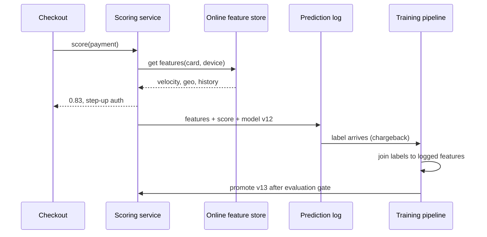

## TL;DR

- **Machine learning** learns patterns from data instead of hand-written rules. Main types: **supervised** (labelled examples → predictions), **unsupervised** (structure without labels), **reinforcement learning** (actions optimised for rewards). Modern **foundation models / LLMs** are large neural networks pre-trained on huge datasets and adapted to many tasks.
- The workflow: define the problem and metric → collect and prepare data → train → **evaluate on held-out data** → deploy → **monitor for drift** → retrain.
- Most failures come from **data**, not algorithms: leakage, label quality, unrepresentative samples, class imbalance and drift.
- Choose metrics that match the business cost of errors — **precision vs recall**, calibration, and fairness across groups — not just accuracy.
- Production ML is an engineering discipline (**MLOps**): versioned data and models, reproducible pipelines, evaluation gates, monitoring and rollback.

## Core Concepts

### Types of learning

| Type | Input | Output | Examples |
|---|---|---|---|
| Supervised – classification | Labelled examples | Class/probability | Fraud yes/no, spam, churn risk |
| Supervised – regression | Labelled examples | Number | Delivery time, demand forecast, price |
| Unsupervised | Unlabelled data | Clusters, embeddings, anomalies | Customer segments, anomaly detection |
| Self-supervised | Data generates its own labels (predict the next token / masked word) | Representations | Pre-training language and vision models |
| Reinforcement learning | Environment + reward | Policy (actions) | Robotics, games, recommendation optimisation, RLHF for LLMs |

### Core vocabulary

- **Features:** input variables (numeric, categorical, text, embeddings). **Label/target:** what we predict.
- **Model:** a function with parameters learned from data (linear/logistic regression, decision trees, gradient-boosted trees, neural networks).
- **Training:** adjusting parameters to minimise a **loss function** on training data (e.g. via gradient descent).
- **Inference:** using the trained model to predict on new data.
- **Hyperparameters:** settings chosen before training (tree depth, learning rate), tuned on validation data.

### Generalisation and overfitting

- Split data into **training**, **validation** (tuning) and **test** (final, untouched) sets; for time-dependent data split **by time** (train on the past, test on the future).
- **Overfitting:** great on training data, poor on new data (memorising noise). **Underfitting:** too simple to capture the pattern.
- **Bias–variance trade-off:** simple models have high bias; complex models have high variance. Regularisation, more data, cross-validation and early stopping help.

### Evaluation metrics

For classification:

| Metric | Meaning | Use when |
|---|---|---|
| Accuracy | % correct | Balanced classes and equal error costs only |
| Precision | Of predicted positives, % truly positive | False positives are costly (blocking legit payments) |
| Recall | Of actual positives, % found | Missing positives is costly (fraud, disease) |
| F1 | Harmonic mean of precision and recall | Need a single balance metric |
| ROC-AUC / PR-AUC | Ranking quality across thresholds | Comparing models; PR-AUC for imbalanced data |
| Calibration | Predicted probabilities match observed frequencies | Using probabilities for decisions |

Regression: MAE, RMSE, MAPE. Ranking/recommendation: precision@k, NDCG. Always compare with a **baseline** (simple heuristic or current process).

### Worked example: choosing a threshold by cost, not by F1

A model outputs a fraud probability, and the **threshold** turns that into an action. The right threshold comes from the business costs and the team's capacity, not from a default of 0.5. Suppose a missed fraud costs £200, a manual review costs £4, and the review team can handle 300 cases a day:

```ts
type Scored = { p: number; isFraud: boolean };

const COST_FN = 200; // missed fraud: chargeback + fees
const COST_REVIEW = 4; // analyst time per flagged case (true or false positive)
const CAPACITY = 300; // reviews per day

function bestThreshold(scored: Scored[]) {
  let best = { threshold: 1, cost: Infinity, flagged: 0, recall: 0 };
  const positives = scored.filter((s) => s.isFraud).length;
  for (let t = 0.01; t < 1; t += 0.01) {
    const flagged = scored.filter((s) => s.p >= t);
    if (flagged.length > CAPACITY) continue; // over capacity, so the excess goes unreviewed
    const caught = flagged.filter((s) => s.isFraud).length;
    const cost = (positives - caught) * COST_FN + flagged.length * COST_REVIEW;
    if (cost < best.cost) best = { threshold: t, cost, flagged: flagged.length, recall: caught / positives };
  }
  return best;
}
```

Run on a day of validation data, this typically picks a threshold well below 0.5, because one missed fraud costs as much as fifty reviews. The capacity constraint then caps how low it can go. Two things make this trustworthy: the probabilities must be **calibrated** (see the questions below), and you must choose the threshold on validation data, never on the test set.

```text
Confusion matrix (fraud model, 10,000 transactions, 100 frauds)
                Predicted fraud   Predicted legit
Actual fraud          80 (TP)          20 (FN)     → recall = 80%
Actual legit         120 (FP)        9,780 (TN)    → precision = 80/200 = 40%
Accuracy = 98.6% — misleading: "always legit" scores 99%.
```

### Common model families

- **Linear/logistic regression:** simple, interpretable baselines.
- **Decision trees and ensembles** (random forests, gradient boosting such as XGBoost/LightGBM): often the best choice for **tabular data**.
- **Neural networks:** excel with unstructured data (images, audio, text). **Transformers** (attention-based) power modern language and vision models.
- **Embeddings:** dense vector representations of items (text, users, products) used for similarity search, clustering and as features.
- **Foundation models / LLMs:** pre-trained at scale, adapted via prompting, retrieval (RAG) or fine-tuning.

### Data problems that sink projects

- **Data leakage:** information unavailable at prediction time sneaks into training (e.g. a "refund issued" field when predicting fraud at checkout) → unrealistically good offline results.
- **Label quality:** noisy or biased labels (labels reflect past human decisions and their biases).
- **Class imbalance:** rare positives — use appropriate metrics, resampling, class weights, threshold tuning.
- **Unrepresentative data:** training population differs from production (new markets, seasons).
- **Drift:** data drift (input distribution changes) and concept drift (relationship between inputs and outcome changes) after deployment.

## How It Works

```mermaid
flowchart LR
  A["Business problem and success metric"] --> B["Data collection and labelling"]
  B --> C["Exploration, cleaning, feature engineering"]
  C --> D["Split: train / validation / test (by time if needed)"]
  D --> E["Train candidate models + baseline"]
  E --> F["Evaluate: metrics, error analysis, fairness"]
  F -->|"good enough"| G["Deploy: batch or online inference"]
  F -->|"not yet"| C
  G --> H["Monitor: drift, performance, latency, cost"]
  H -->|"degradation or new data"| I["Retrain and re-evaluate"]
  I --> F
```



### One prediction, end to end

The lifecycle above repeats over weeks. The sequence below is one online prediction, and how its label eventually comes back to improve the next model. The important detail is that features are **logged at prediction time** and the label is joined later, which keeps training data point-in-time correct.



## When to Use / Trade-offs

| Approach | Use when | Avoid when | Trade-off |
|---|---|---|---|
| Rules / heuristics | Logic is known, stable and explainable; little data | Patterns are complex or changing | Transparent, cheap vs brittle, hard to scale |
| Classical ML (trees, regression) | Tabular data, clear labels, need explainability and low cost | Unstructured data at scale | Strong, cheap, interpretable vs feature engineering effort |
| Deep learning | Images, audio, text, very large datasets | Small tabular datasets | Powerful vs data, compute and explainability costs |
| Pre-trained/foundation models via API | Language/vision tasks, fast time to value | Strict data residency, very high volume cost, niche domains | Fast vs cost, vendor dependency |
| Fine-tuned models | Consistent domain-specific behaviour, high volume narrow task | Little labelled data, fast-changing knowledge (use RAG) | Specialisation vs training and maintenance effort |

## Common Pitfalls & Anti-patterns

- **No clear business metric** — optimising accuracy when the business cares about cost of false declines.
- **Leakage** — features that won't exist at prediction time, or random splits on time-series data.
- **Accuracy on imbalanced data** — a useless model looks excellent.
- **No baseline** — a complex model that barely beats a simple rule.
- **Training–serving skew** — features computed differently in training and production.
- **Ignoring drift** — models silently decay after launch.
- **Notebook-to-production by hand** — unreproducible models, no versioning.
- **Treating predictions as facts** — no human review for high-stakes decisions, no uncertainty handling.
- **Unexamined bias** — models replicating historical discrimination in labels.

## Real-world Scenario

**Context:** An e-commerce company built a churn prediction model that achieved 0.94 AUC offline but failed to reduce churn after launch.

**Investigation:** The model used "number of support tickets in the last 30 days" computed including the days *after* the churn label date — leakage that inflated offline performance. In production, the feature was computed differently (training–serving skew). And the retention team could only act on 500 customers per week; the model wasn't evaluated on **precision at that capacity** or on whether contacted customers could be saved (uplift).

**Decision:** Rebuilt features with point-in-time correctness using a feature store; split data by time; evaluated precision@500 and ran an A/B test of interventions; added drift monitoring and monthly retraining.

**Outcome:** Offline AUC dropped to 0.81 (honest), but the intervention programme reduced churn among targeted customers by a measurable margin in the A/B test.

**What I'd do differently:** Start with the decision process (who acts, capacity, cost of actions) and the evaluation design before modelling, and build point-in-time features from day one.

## Interview Questions

### What are supervised, unsupervised and reinforcement learning? {#learning-types}

**Level:** Foundation

**Model answer:**
- **Supervised learning:** learn a mapping from inputs to known outputs using labelled examples. Classification predicts categories (spam/not spam, fraud); regression predicts numbers (delivery time, price).
- **Unsupervised learning:** find structure in unlabelled data — clustering (customer segments), dimensionality reduction, anomaly detection, embeddings.
- **Reinforcement learning:** an agent learns actions in an environment to maximise cumulative reward through trial and error — robotics, games, some recommendation and control problems; RLHF uses it to align language models with human preferences.
- **Self-supervised learning** (central to modern LLMs) creates labels from the data itself — predicting the next token or masked words — enabling pre-training on huge unlabelled corpora.

**What the interviewer is looking for:**
Clear definitions with examples, and awareness of self-supervised pre-training.

**Follow-ups:**
- Which type would you use for fraud detection with few labelled cases?
- How are LLMs trained at a high level?

**Red flags:**
- Confusing classification with clustering.

### What is overfitting, and how do you detect and prevent it? {#overfitting}

**Level:** Foundation

**Model answer:**
Overfitting is when a model learns noise and specifics of the training data rather than general patterns — it performs well on training data and poorly on new data.

**Detect:** compare training vs validation performance (large gap = overfitting); learning curves; cross-validation; final check on an untouched test set.

**Prevent:**
- More (and more representative) data.
- Simpler models or regularisation (L1/L2, tree depth limits, dropout in neural networks).
- Early stopping on validation loss.
- Feature selection; removing leaky or noisy features.
- Proper splits: keep the test set untouched; split by time for temporal data; group splits to avoid the same user appearing in train and test.
- Cross-validation for robust estimates on small datasets.

**What the interviewer is looking for:**
Definition, detection via train/validation gaps, prevention techniques and proper splitting.

**Follow-ups:**
- Why must the test set stay untouched until the end?
- What's underfitting?

**Red flags:**
- Tuning hyperparameters on the test set.

### Explain precision, recall and when each matters. {#classification-metrics}

**Level:** Foundation

**Model answer:**
- **Precision** = TP / (TP + FP): of the items the model flagged, how many were truly positive.
- **Recall** = TP / (TP + FN): of all real positives, how many the model found.
- **F1** balances them (harmonic mean).

Which matters depends on error costs:
- **Precision** when false positives are expensive: blocking legitimate payments, flagging innocent users, sending costly interventions.
- **Recall** when missing positives is expensive: fraud losses, medical screening, safety issues.

You trade one for the other by moving the **decision threshold**; choose it based on business costs and operational capacity (e.g. reviewers can handle 500 alerts/day). **Accuracy** is misleading with imbalanced classes — with 1% fraud, predicting "never fraud" is 99% accurate. Use PR-AUC/ROC-AUC to compare models across thresholds.

**What the interviewer is looking for:**
Correct definitions, cost-based choice, threshold trade-off and the accuracy trap.

**Follow-ups:**
- How would you choose a threshold for a fraud model?
- What's the difference between ROC-AUC and PR-AUC?

**Red flags:**
- Reporting accuracy for a rare-event problem.

### What are features, and what is feature engineering? {#features}

**Level:** Foundation

**Model answer:**
**Features** are the input variables a model uses — e.g. for fraud: transaction amount, time since last purchase, distance from usual location, merchant category, device fingerprint, number of attempts in the last hour.

**Feature engineering** creates informative features from raw data:
- Aggregations over time windows (count of transactions in 1h/24h).
- Ratios and differences (amount vs customer's average).
- Encoding categories (one-hot, target encoding with care), handling missing values.
- Text and images converted to embeddings.
- Domain knowledge encoded as features (business rules as inputs).

Key requirement: **point-in-time correctness** — compute features using only data available at prediction time, and compute them **identically in training and serving** to avoid skew (feature stores help). Deep learning learns some features automatically from raw data, but feature design still matters for tabular problems.

**What the interviewer is looking for:**
Examples, techniques, and point-in-time/consistency requirements.

**Follow-ups:**
- What's training–serving skew?
- How do you handle a categorical feature with 100,000 values?

**Red flags:**
- Features that use future information.

### Explain the bias–variance trade-off. {#bias-variance}

**Level:** Senior

**Model answer:**
Prediction error has (conceptually) three parts:
- **Bias:** error from overly simple assumptions — the model can't capture the true pattern (underfitting). E.g. a linear model on a non-linear relationship.
- **Variance:** error from sensitivity to the specific training sample — the model changes a lot with different data (overfitting). E.g. a very deep tree.
- **Irreducible noise.**

Increasing model complexity typically reduces bias but increases variance. The goal is the sweet spot that minimises validation error. Tools: regularisation, ensembles (bagging reduces variance — random forests; boosting reduces bias), more data (reduces variance), feature engineering (reduces bias), cross-validation for model selection.

Note: very large neural networks show "double descent" behaviours where classical intuitions don't fully apply, but the trade-off remains a useful mental model for most practical work.

**What the interviewer is looking for:**
Definitions, relationship to complexity, remedies and nuance.

**Follow-ups:**
- How do bagging and boosting relate to bias and variance?
- How does more data help?

**Red flags:**
- Unable to connect the concept to practical choices.

### How do you handle class imbalance? {#class-imbalance}

**Level:** Senior

**Model answer:**
When positives are rare (fraud 0.1%, failures, churn):
- **Use appropriate metrics:** precision, recall, PR-AUC, precision@k, cost-weighted metrics — not accuracy.
- **Resampling:** undersample the majority or oversample the minority (including synthetic methods like SMOTE), applied only to training data.
- **Class weights** in the loss function to penalise minority errors more.
- **Threshold tuning** based on business costs and capacity.
- **Better features and more positive examples** (labelling programmes, active learning).
- **Anomaly detection** approaches when labels are extremely scarce.
- **Stratified splits** so validation/test contain enough positives.
- **Calibrate** probabilities if resampling distorts them and you use probabilities downstream.

**What the interviewer is looking for:**
Metrics first, resampling/weights, threshold tuning, stratification and calibration.

**Follow-ups:**
- Why must resampling happen only on training data?
- When does SMOTE hurt?

**Red flags:**
- Celebrating 99.9% accuracy on a 0.1% problem.

### What is data leakage, and how do you prevent it? {#data-leakage}

**Level:** Senior

**Model answer:**
Leakage is when training data contains information that wouldn't be available at prediction time, making offline performance unrealistically good and production performance poor.

Examples:
- **Target leakage:** features derived from the outcome (e.g. "chargeback filed" when predicting fraud at checkout; "account closed date" when predicting churn).
- **Temporal leakage:** random splits on time-series data, or aggregates computed over windows including future events.
- **Train–test contamination:** the same customer in both sets, preprocessing (scaling, imputation, target encoding) fitted on the full dataset before splitting, duplicates across splits.

Prevention:
- Define the **prediction moment** and build features with point-in-time logic.
- Split by time and by entity (group splits).
- Fit preprocessing inside the training pipeline only (pipelines in scikit-learn etc.).
- Be suspicious of features with surprisingly high importance; do error analysis.
- Validate with a forward-looking backtest or shadow deployment before launch.

**What the interviewer is looking for:**
Types of leakage with examples and concrete prevention practices.

**Follow-ups:**
- A model shows 0.99 AUC offline. What do you check?
- How does a feature store help prevent leakage?

**Red flags:**
- Random splits for forecasting problems.

### What are neural networks and transformers, at a high level? {#neural-networks}

**Level:** Senior

**Model answer:**
A **neural network** is layers of simple units that apply weighted sums followed by non-linear activation functions. Training adjusts the weights via **backpropagation** and gradient descent to minimise a loss. Deep networks learn hierarchical representations — edges → shapes → objects in images; characters → words → meaning in text.

**Transformers** (introduced in "Attention Is All You Need", 2017) use **self-attention**: each token's representation is updated by attending to all other tokens, weighted by learned relevance. This captures long-range relationships and parallelises well on GPUs, enabling training on enormous datasets. Transformers underpin modern LLMs (decoder-only models predicting the next token), vision transformers and multimodal models.

**Embeddings** — vectors produced by these models — represent meaning so that similar items are close together, enabling semantic search, clustering and retrieval-augmented generation.

**What the interviewer is looking for:**
Intuitive understanding of layers, training, attention and embeddings; connection to LLMs.

**Follow-ups:**
- Why did transformers replace RNNs for language?
- What is a context window in terms of attention?

**Red flags:**
- Treating models as magic with no mental model.

### How do you deploy and monitor ML models in production? {#model-monitoring}

**Level:** Senior

**Model answer:**
**Deployment patterns:**
- **Batch scoring** (nightly predictions written to a table) — simple, cheap, when freshness isn't critical.
- **Online inference** (API/service with latency SLOs) — real-time decisions.
- **Streaming** — features and predictions on event streams.
- Safe rollout: **shadow mode** (predict without acting), canary/A-B tests against the current model or rules.

**Monitoring:**
- **Operational:** latency, errors, throughput, cost.
- **Data quality and drift:** input feature distributions vs training (PSI, KS tests), missing values, schema changes.
- **Prediction drift:** distribution of outputs over time.
- **Model performance:** compare predictions with actual outcomes once labels arrive (often delayed), by segment.
- **Fairness metrics** across groups where relevant.
- **Business KPIs:** fraud losses, conversion, false-decline rate.

**Response:** alerts with owners, retraining pipelines (scheduled or triggered), model registry with versions for rollback, and documentation of each model (model cards).

**What the interviewer is looking for:**
Deployment options, safe rollout, multi-layer monitoring including delayed labels, and retraining/rollback.

**Follow-ups:**
- Labels arrive 60 days later. How do you monitor performance meanwhile?
- What's the difference between data drift and concept drift?

**Red flags:**
- "Deploy and forget."

### How do you decide between rules, traditional ML and an LLM for a problem? {#ml-vs-rules-vs-llm}

**Level:** Senior

**Model answer:**
- **Rules** when logic is known, stable, needs to be fully explainable, or data is scarce — e.g. eligibility checks, simple validations. Cheap and auditable, but brittle as patterns grow complex.
- **Traditional ML** when you have labelled structured data and the pattern is complex or changing — fraud scoring, churn prediction, demand forecasting. Efficient, cheap at inference, measurable, often more accurate than LLMs on tabular tasks.
- **LLMs/foundation models** for language and unstructured content — summarisation, extraction from documents, classification of free text with few labels, conversational interfaces, code. Fast to prototype via prompting; costs per call, latency, non-determinism and hallucination risks.

Often **combinations** win: rules as guardrails, ML for scoring, LLMs for unstructured inputs or explanations. Decide using: data availability, required accuracy and explainability, latency and cost at volume, regulatory needs and maintenance effort — and always compare against a simple baseline.

**What the interviewer is looking for:**
Criteria-based choice, strengths of each and hybrid designs.

**Follow-ups:**
- Would you use an LLM to classify 10 million support tickets a day?
- How do you combine rules and ML in fraud detection?

**Red flags:**
- "Use an LLM for everything."

### What does an MLOps architecture look like? {#mlops}

**Level:** Architect

**Model answer:**
Components:
- **Data platform:** versioned, quality-checked datasets; lineage; access controls.
- **Feature management:** feature pipelines with point-in-time correctness; a feature store for consistent offline training and online serving.
- **Experimentation:** tracked experiments (parameters, metrics, artefacts) — MLflow, Weights & Biases or cloud equivalents.
- **Training pipelines:** reproducible, orchestrated (Kubeflow, Airflow, cloud ML pipelines), triggered by schedule or drift.
- **Model registry:** versioned models with metadata, evaluation results, approvals and stage transitions.
- **Evaluation gates:** automated checks against baselines, fairness and robustness tests before promotion.
- **Serving:** batch jobs, online endpoints with autoscaling, or embedded models; canary/shadow deployments.
- **Monitoring:** operational, drift, performance with delayed labels, fairness, cost; alerting and retraining triggers.
- **Governance:** model cards, documentation, audit logs, approvals for high-risk models, data privacy controls.

Maturity grows from manual notebooks → automated training pipelines → CI/CD for models with continuous training.

**What the interviewer is looking for:**
End-to-end components, reproducibility, gates, serving options, monitoring and governance.

**Follow-ups:**
- How does CI/CD for ML differ from software CI/CD?
- Which components would you build first?

**Red flags:**
- Models trained in notebooks and copied to production manually.

### Should you build custom ML models or use pre-built AI services? {#build-vs-buy-ml}

**Level:** Architect

**Model answer:**
- **Pre-built APIs and foundation models** (vision, speech, translation, LLMs, document extraction) when the task is generic, time to value matters, and volumes/costs are acceptable. Low ML expertise needed; vendor dependency, data handling terms and per-call cost are the trade-offs.
- **Fine-tuning or adapting foundation models** when generic performance is insufficient but labelled data is limited and the task is language/vision-centric.
- **Custom models** when the problem is core to differentiation, uses proprietary structured data (fraud, pricing, recommendations), needs low-latency/low-cost inference at high volume, or requires strict control and explainability.

Decision factors: strategic differentiation, data availability and labelling cost, accuracy needs, latency and cost at volume, privacy/residency, team skills, and maintenance (retraining, monitoring). Start with the simplest option that meets the bar (often an API or baseline), measure, then invest where evidence justifies it.

**What the interviewer is looking for:**
Clear options, decision criteria and evidence-driven escalation.

**Follow-ups:**
- How would you estimate total cost for an LLM-based feature at 1M requests/day?
- What skills do you need to maintain custom models?

**Red flags:**
- Building custom models for commodity tasks.

### Design a real-time fraud detection system for card payments. {#fraud-detection-design}

**Level:** Architect

**Model answer:**
**Requirements:** decision within ~100 ms in the payment path; high recall on fraud with acceptable false-decline rate; explainability for disputes and regulators; adaptivity to new fraud patterns.

**Architecture:**
- **Event ingestion:** payment authorisation requests stream into the decision service; events also go to a streaming platform for features and analytics.
- **Feature computation:** real-time aggregates (transactions per card/device/IP in the last minute/hour, velocity, geo distance, merchant risk) from a low-latency feature store or stream processor; batch features (customer history) precomputed — with identical definitions offline and online.
- **Decisioning:** rules for hard constraints and known patterns (blocklists, velocity limits) + a gradient-boosted model producing a risk score + thresholds producing **approve / decline / step-up (3-D Secure) / manual review**.
- **Feedback loop:** labels from chargebacks (delayed weeks), manual reviews and customer confirmations; training pipelines with point-in-time correctness; champion–challenger testing.
- **Monitoring:** fraud rate, false-decline rate, review queue size, drift, latency SLOs; alerts on sudden pattern changes.
- **Explainability and governance:** reason codes (top features), audit logs, model documentation, fairness checks.
- **Resilience:** fallback rules if the model service is unavailable; strict timeouts.

**What the interviewer is looking for:**
Latency-aware design, real-time features, rules + ML hybrid, step-up actions, delayed-label feedback, monitoring and fallbacks.

**Follow-ups:**
- How do you handle fraudsters adapting to your model?
- How do you evaluate a new model safely?

**Red flags:**
- Ignoring label delay and feature consistency.

### What is a feature store, and when do you need one? {#feature-store}

**Level:** Architect

**Model answer:**
A feature store is a system for defining, computing, storing and serving ML features consistently:
- **Offline store:** historical feature values for training, with **point-in-time correct** joins (features as of each training example's timestamp).
- **Online store:** low-latency access to the latest feature values for real-time inference.
- **Feature definitions** shared and versioned, with lineage, ownership and monitoring.
- **Materialisation pipelines** (batch and streaming) keeping both stores consistent.

Benefits: prevents training–serving skew and leakage, reuse of features across models and teams, faster model development.

You need one when: multiple models share features, real-time inference requires fresh aggregates, or you've been bitten by skew/leakage. You don't when: a single batch model with simple features — a well-designed data pipeline suffices. Options: managed (cloud ML platforms), open source (Feast), or built into data platforms.

**What the interviewer is looking for:**
Offline/online stores, point-in-time correctness, consistency benefits and when it's overkill.

**Follow-ups:**
- How do you compute a "transactions in the last 10 minutes" feature online?
- What's point-in-time correctness?

**Red flags:**
- Re-implementing feature logic separately in training notebooks and production code.

### How would you structure ML capability in an engineering organisation? {#ml-team-structure}

**Level:** Architect

**Model answer:**
It depends on maturity and the role ML plays in the product:
- **Early stage:** a small central team (data scientists + ML engineer + data engineer) working on 1–2 high-value use cases end to end with product teams — prove value first.
- **Growing:** **embed** ML engineers/data scientists in product teams owning ML-powered features, supported by a central **ML platform team** (data, feature store, training/serving infrastructure, MLOps tooling) and a community of practice for standards.
- **Mature:** platform as a product with self-service, plus governance (model risk management, responsible AI review) for high-impact models.

Key roles: data engineers (pipelines, quality), data scientists (problem framing, modelling, experimentation), ML engineers (productionisation, serving, MLOps), product managers who understand ML, and analysts. Common failure: hiring data scientists without data engineering and MLOps support — models never reach production.

Prioritise use cases by business value, data readiness and feasibility; measure outcomes (business KPIs), not models built.

**What the interviewer is looking for:**
Stage-appropriate structures, platform + embedded model, roles and the data/MLOps foundations.

**Follow-ups:**
- How do you choose the first ML use case?
- How does the rise of LLM APIs change team needs?

**Red flags:**
- Isolated data science teams producing notebooks no one deploys.

### What is cross-validation, and when is ordinary k-fold the wrong choice? {#cross-validation}

**Level:** Foundation

**Model answer:**
**k-fold cross-validation** splits the training data into k folds. It trains on k−1 of them and validates on the remaining one, rotating k times, and averages the scores. This gives a more stable estimate than one validation split, especially on small datasets, and the spread across folds shows how sensitive the model is to the data.

Ordinary k-fold assumes the rows are **independent and identically distributed**, so it is wrong when:
- **Time matters** (forecasting, fraud, churn). Use **forward-chaining / time-series splits**: train on the past and validate on the next period, rolling forward. Random folds let the model peek at the future.
- **Rows are grouped** (many rows per customer, patient or device). Use **group k-fold**, so the same entity never appears in both the training and validation folds.
- **Classes are imbalanced.** Use **stratified** folds, so every fold has positives.

Preprocessing (scaling, imputation, target encoding) must be fitted **inside** each fold. Fitting it on the full dataset first leaks information.

**What the interviewer is looking for:**
Mechanics, plus knowing when the IID assumption breaks: time, groups and imbalance.

**Follow-ups:**
- How many folds would you use, and what does it cost?
- Why is a final held-out test set still needed?

**Red flags:**
- Random k-fold on a time-series forecasting problem.

### How do you choose the decision threshold for a classifier? {#choosing-threshold}

**Level:** Senior

**Model answer:**
The model gives a score. The **threshold** is a business decision about what to do with it:
1. **Price the errors:** what a false positive costs (a blocked good customer, a wasted review) and what a false negative costs (a fraud loss, a missed churner).
2. **Add constraints:** review capacity per day, a maximum false-decline rate agreed with the business, and any regulatory limits.
3. **Sweep thresholds on validation data** and pick the one that minimises expected cost within the constraints. Then confirm it on the untouched test set.
4. **Use more than one threshold** when there are more than two actions: auto-approve below *a*, step-up authentication between *a* and *b*, decline or review above *b*.
5. **Revisit it.** Costs, capacity and the score distribution drift, and so does the best threshold. Monitor the flag rate as an early warning.

Calibration matters: if a score of 0.3 doesn't mean "about a 30% chance", expected-cost reasoning breaks.

**What the interviewer is looking for:**
Cost- and capacity-based selection, multiple action bands, validation discipline and ongoing review.

**Follow-ups:**
- The fraud team can review 300 cases a day but the model flags 900. What do you do?
- Would you use a different threshold per market?

**Red flags:**
- "0.5, because that's the default."

### What is model calibration, and when does it matter? {#calibration}

**Level:** Senior

**Model answer:**
A model is **calibrated** when its predicted probabilities match observed frequencies: of all the cases scored around 0.2, roughly 20% are positive. A model can **rank** well (high AUC) and still be badly calibrated. Gradient-boosted trees, models trained on resampled data, and neural networks trained with some losses are often over- or under-confident.

It matters when you **use the number itself**, not just the order:
- expected-cost decisions and thresholds;
- pricing and risk (an expected loss is probability × exposure);
- combining scores from several models, or comparing them across segments;
- showing probabilities to users or regulators.

**Check it** with a reliability diagram (predicted against observed, per bin) or with the Brier score / expected calibration error. **Fix it** with Platt scaling (a logistic fit on the scores) or isotonic regression, fitted on a held-out calibration set. After resampling or class weighting, recalibrate to the real base rate.

**What the interviewer is looking for:**
The distinction between ranking and calibration, when it matters, and how to measure and fix it.

**Follow-ups:**
- You oversampled fraud 10× in training. What happens to the predicted probabilities?
- Can calibration differ between demographic groups? Why would that matter?

**Red flags:**
- Treating raw model scores as probabilities without checking.

### Labels arrive 60 days after the prediction. How do you monitor and retrain the model in the meantime? {#delayed-labels}

**Level:** Architect

**Model answer:**
You can't measure accuracy in real time, so use **leading indicators** and **proxy labels**, and design the retraining process around the delay:
- **Input drift:** feature distributions against the training baseline (PSI, KS tests), per segment. A PSI above about 0.25 on an important feature deserves a look.
- **Prediction drift:** the score distribution, the flag rate and the share in each action band. A sudden jump usually means an upstream data problem, not a change in the world.
- **Data quality:** nulls, schema changes, stale features, and the freshness of feature pipelines.
- **Proxy and early labels:** manual review outcomes, customer confirmations and the first chargebacks (partial but early). Track performance on these and correct for the bias of seeing only the early ones.
- **Operational KPIs:** false-decline complaints, review-queue backlog and approval rate.
- **When labels mature:** compute the true metrics by cohort (prediction week) and backfill the dashboards.
- **Retraining:** train on mature cohorts only, so immature negatives aren't mislabelled. Keep a holdout or champion–challenger so you can compare models fairly.

**What the interviewer is looking for:**
Layered monitoring without labels, awareness of label-maturity bias, and cohort-based evaluation and retraining.

**Follow-ups:**
- Your model blocks fraud, so you never see the outcome of blocked transactions. How does that bias training?
- What alert would you page someone for, and what would you just ticket?

**Red flags:**
- Waiting 60 days to find out the model broke, or training on unlabelled recent rows as negatives.

### A churn model predicts well, but contacting high-risk customers doesn't reduce churn. Why, and what would you build instead? {#uplift-and-experiments}

**Level:** Architect

**Model answer:**
**Prediction is not causation.** A churn model finds customers likely to leave, not customers whose minds you can change. Some will leave whatever you do ("lost causes"), some would have stayed anyway ("sure things"), and some are *annoyed* by being contacted ("sleeping dogs"). Targeting by risk spends the budget on the wrong people.

What to do:
- **Measure with an experiment:** randomly hold out part of the high-risk group and compare retention between the contacted and uncontacted groups. That difference is the real effect of the intervention.
- **Model uplift**, not risk: estimate the *change* in the probability of churning if the customer is contacted, using experiment data (two-model or meta-learner approaches such as T-learners). Target the "persuadables".
- **Optimise the decision:** expected value = uplift × customer value − cost of the offer, within the capacity limit.
- **Keep a permanent holdout,** so you can keep measuring the incremental effect as the offers and the population change.

**What the interviewer is looking for:**
Separating prediction from causal impact, randomised holdouts, uplift modelling and value-based targeting.

**Follow-ups:**
- How big does the holdout group need to be?
- The business won't accept a holdout ("we're losing customers"). How do you argue for it?

**Red flags:**
- Judging the programme by the model's AUC rather than by incremental retention.

## Cheat Sheet

### Concepts
- **Supervised / unsupervised / RL** — labelled predictions / structure without labels / actions for reward.
- **Self-supervised pre-training** — the data supplies its own labels (next token); basis of LLMs.
- **Train / validation / test** — fit, tune, final unbiased check; split by time for temporal data.
- **Overfitting** — great on training, poor on new data; regularise, simplify, get more data.
- **Bias–variance** — too simple vs too sensitive; find the validation-error sweet spot.

### Evaluation
- **Precision** — of flagged items, how many were right; matters when false positives are costly.
- **Recall** — of real positives, how many were caught; matters when misses are costly.
- **Accuracy trap** — useless on imbalanced data.
- **PR-AUC** — preferred over ROC-AUC for rare-event problems.
- **Baseline first** — compare every model with a simple rule or current process.

### Production
- **Data leakage** — future or outcome information in features; split by time and entity.
- **Training–serving skew** — features computed differently offline and online; feature stores help.
- **Data drift vs concept drift** — input distribution changes vs input–outcome relationship changes.
- **Shadow mode** — run a model alongside production without acting, to evaluate safely.
- **MLOps** — versioned data and models, pipelines, registries, evaluation gates, monitoring.
- **Tabular data** — gradient-boosted trees are often the strongest choice.

### Revisit
- **k-fold vs time-series split** — random folds for IID data; forward-chaining when time matters; group k-fold for repeated entities.
- **Threshold choice** — minimise expected cost (FP cost × FP + FN cost × FN) within capacity, on validation data.
- **Calibration** — predicted 0.2 should mean ~20% positive; check with a reliability diagram; fix with Platt or isotonic.
- **PSI rule of thumb** — below 0.1 stable, 0.1–0.25 moderate shift, above 0.25 significant shift worth investigating.
- **Label maturity** — with delayed labels, train and evaluate only on cohorts old enough for their labels to be final.
- **Uplift vs risk** — target the people an action changes (persuadables), not the people most likely to churn.
- **Champion–challenger** — a new model earns promotion by beating the current one on live or held-out traffic.

## Further Reading

- [Google Machine Learning Crash Course](https://developers.google.com/machine-learning/crash-course) — practical introduction to core concepts and metrics.
- [scikit-learn User Guide](https://scikit-learn.org/stable/user_guide.html) — models, evaluation, pipelines and cross-validation.
- [Attention Is All You Need (Vaswani et al., 2017)](https://arxiv.org/abs/1706.03762) — the original transformer paper.
- [Google: Rules of Machine Learning](https://developers.google.com/machine-learning/guides/rules-of-ml) — engineering best practices for production ML.
- [Hidden Technical Debt in Machine Learning Systems (Sculley et al., 2015)](https://papers.nips.cc/paper/2015/hash/86df7dcfd896fcaf2674f757a2463eba-Abstract.html) — why ML systems accumulate technical debt.
