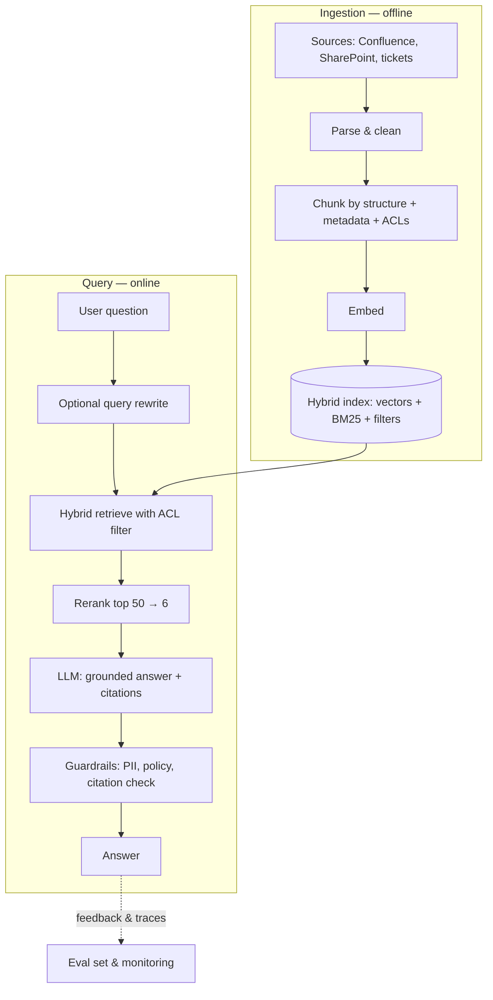

## TL;DR

- An LLM predicts tokens; everything useful (grounding, tools, memory, safety) is **system design around the model**. Most production quality comes from retrieval, context engineering and evaluation, not model choice.
- **RAG** grounds answers in your data at query time: ingest → chunk → embed → index → retrieve (hybrid) → rerank → generate with citations. Retrieval quality caps answer quality.
- **Agents** are LLMs calling tools in a loop. Use them when the path to a goal is open-ended; use **deterministic workflows** when the steps are known. They're cheaper, faster and easier to test.
- **Evals are the unit tests of AI systems.** Without a versioned eval set you're changing prompts blind.
- Treat model output and retrieved content as **untrusted input**: prompt injection is a real attack surface, especially for agents with tools.

## Core Concepts

### Model fundamentals that drive design

- **Tokens**: the unit of input/output and of billing; roughly ¾ of an English word.
- **Context window**: the maximum tokens per request (prompt + output). Larger windows help, but long contexts cost more, add latency, and models can under-use information buried in the middle.
- **Sampling**: temperature and top-p trade determinism for diversity. Use low temperature for extraction and classification.
- **Structured output**: JSON schema / tool definitions constrain responses; validate them anyway.
- **Prompt caching**: providers can cache a long, stable prompt prefix (system prompt, documents), cutting cost and latency on repeated calls. Put stable content first.

### RAG pipeline

1. **Ingest and normalise**: parse PDFs, HTML and tickets; keep metadata (source, owner, ACL, updated date).
2. **Chunk**: split by structure (headings, sections), typically a few hundred tokens with small overlap. Store the parent document and heading path with each chunk.
3. **Embed**: an embedding model maps text to vectors where semantic similarity becomes geometric closeness.
4. **Index**: a vector index (HNSW etc.) plus a keyword index (BM25) and metadata filters.
5. **Retrieve**: **hybrid search** (vector + keyword, fused e.g. with reciprocal rank fusion) catches both paraphrases and exact terms like error codes and product names.
6. **Rerank**: a cross-encoder reranker re-scores the top ~50 candidates for precision.
7. **Generate**: a prompt with instructions, retrieved passages (with ids), and the question; require citations, and allow "I don't know".

```ts
interface Chunk { id: string; text: string; source: string; acl: string[]; score?: number }

export async function answer(question: string, user: { id: string; groups: string[] }) {
  // 1. Retrieve with permission filtering *inside* the search, never after generation.
  const candidates = await search.hybrid({
    query: question,
    vectorTopK: 40,
    keywordTopK: 40,
    filter: { aclAnyOf: user.groups },
  });

  // 2. Rerank for precision and keep a token budget.
  const top = (await reranker.rank(question, candidates)).slice(0, 6);
  if (top.length === 0 || top[0]!.score! < 0.3) return { text: "I couldn't find this in the knowledge base.", citations: [] };

  // 3. Generate a grounded answer with citations to chunk ids.
  const context = top.map((c) => `<doc id="${c.id}" source="${c.source}">\n${c.text}\n</doc>`).join('\n');
  const result = await llm.generate({
    system: 'Answer only from the documents. Cite doc ids like [doc:ID]. If the documents do not contain the answer, say so.',
    messages: [{ role: 'user', content: `${context}\n\nQuestion: ${question}` }],
    temperature: 0,
  });
  return { text: result.text, citations: top.map(({ id, source }) => ({ id, source })) };
}
```

### Agents and tool use

An agent is a loop: the model chooses an action (call a tool with arguments), your code executes it, the result goes back into context, and the loop repeats until the model answers or a limit is hit.

```ts
type ToolCall = { name: string; input: unknown };
const MAX_STEPS = 8;

export async function runAgent(goal: string, tools: Record<string, (input: unknown) => Promise<string>>) {
  const messages: Message[] = [{ role: 'user', content: goal }];
  for (let step = 0; step < MAX_STEPS; step++) {
    const reply = await llm.generate({ messages, tools: describe(tools) });
    messages.push(reply.message);
    if (reply.toolCalls.length === 0) return reply.text; // done

    for (const call of reply.toolCalls) {
      const tool = tools[call.name];
      const output = tool ? await tool(validateInput(call)) : `Unknown tool ${call.name}`;
      messages.push({ role: 'tool', toolCallId: call.id, content: output });
    }
  }
  throw new Error('Agent exceeded step budget'); // budgets: steps, tokens, wall-clock, cost
}
```

Common workflow patterns (from simplest): **prompt chaining**, **routing**, **parallelisation**, **orchestrator–workers**, **evaluator–optimiser**, then fully autonomous agents. Start with the simplest that works.

### Model Context Protocol (MCP)

An open protocol (introduced by Anthropic in late 2024 and adopted widely) that standardises how applications expose **tools, resources and prompts** to LLM clients. Write an integration once as an MCP server, and any MCP-capable client can use it. Treat third-party MCP servers like any dependency: review, pin and sandbox them.

### Evaluation

- **Retrieval metrics**: recall@k, MRR, and whether the gold passage is in the top k.
- **Answer metrics**: faithfulness (grounded in context), relevance, correctness against references, citation accuracy.
- **Methods**: golden Q&A sets from real user questions, LLM-as-judge with rubrics (calibrated against human labels), pairwise comparisons, and production feedback (thumbs, escalation rate).
- Run evals in CI on every prompt, model or retrieval change. Track cost and latency alongside quality.

### Security

- **Prompt injection** (OWASP LLM Top 10 #1): instructions hidden in user input or *retrieved content* hijack the model. No prompt fully prevents it. Design for it:
  - least-privilege tools
  - human approval for consequential actions
  - separate data from instructions
  - output filtering
  - never let model output directly authorise anything
- **Data leakage**: enforce document ACLs at retrieval time; redact PII before indexing where appropriate.
- **Excessive agency**: limit tool scopes, rate limits, spend caps and audit logs.

## How It Works



## When to Use / Trade-offs

| Approach | Use when | Avoid when | Cost |
|---|---|---|---|
| Prompting only | Task needs general knowledge/skills; small context | Answers depend on private or fresh data | Lowest |
| Long context (stuff docs in) | Small, bounded corpus per request | Large or permissioned corpora | Tokens and latency per call |
| RAG | Large, changing, permissioned knowledge; need citations | Task is about style or format, not knowledge | Retrieval infra, ingestion pipeline, evals |
| Fine-tuning | Consistent format, tone or domain-specific behaviour; distil for cost/latency | Injecting facts that change | Training data, retraining, eval |
| Deterministic workflow | Steps are known; reliability matters | Open-ended exploration | Less flexible |
| Autonomous agent | Open-ended multi-step tasks with tools | Predictable processes; high-risk actions without oversight | Latency, cost, unpredictability, security surface |

## Common Pitfalls & Anti-patterns

- **No evals** — tweaking prompts based on three examples; regressions ship silently.
- **Naive chunking** — fixed 500-character splits break tables and lose headings, so retrieval returns fragments without context.
- **Vector-only search** — misses exact identifiers (error codes, SKUs); use hybrid.
- **Filtering permissions after generation** — the model has already seen confidential text.
- **Agents for everything** — a 12-step agent where a 3-step workflow would be cheaper, faster and testable.
- **Trusting tool output and retrieved docs** — injected instructions in a web page or email take control of the agent.
- **Ignoring cost/latency budgets** — a demo at $0.40 per query becomes a six-figure monthly bill at scale.
- **Model lock-in in code** — provider-specific calls scattered everywhere; wrap behind an interface and keep evals portable.

## Real-world Scenario

**Context:** A 9,000-person engineering organisation wanted an assistant over internal docs, runbooks and incident postmortems. The pilot (vector-only, fixed-size chunks) answered ~55% of a golden set correctly and once quoted a restricted security document to a contractor.

**Decision:**
1. Enforced ACLs as **search-time filters** synced from the source systems.
2. Structure-aware chunking with heading paths; hybrid retrieval + reranker.
3. Built a 400-question **golden set** from real Slack questions with SME-written answers; ran evals in CI on every change.
4. Required citations and an explicit "not found" path; added thumbs feedback and an escalate-to-human button.
5. Read-only tools only (search, fetch runbook); no write actions.

**Outcome:** Correctness on the golden set rose to ~84%, with no permission leaks in red-team testing, and a median latency of 2.8 s. Escalations to platform on-call for "how do I" questions dropped ~30%.

**What I'd do differently:** Invest earlier in content freshness. A third of the bad answers came from outdated docs, which no retrieval tuning can fix.

## Interview Questions

### What is retrieval-augmented generation and why use it instead of fine-tuning? {#what-is-rag}

**Level:** Foundation

**Model answer:**
RAG retrieves relevant passages from your own data at query time and includes them in the prompt, so the model answers from that context, ideally with citations. Compared with fine-tuning, it keeps knowledge fresh (update the index, not the model), respects permissions per user, makes answers traceable to sources, and needs no training pipeline. Fine-tuning is better for teaching consistent behaviour, format or style, or distilling a smaller, cheaper model. It's poor at injecting facts that change.

**What the interviewer is looking for:**
Knowledge vs behaviour as the deciding axis, plus freshness, permissions and traceability.

**Follow-ups:**
- When would you combine RAG and fine-tuning?
- What does a long context window change about this decision?

**Red flags:**
- "Fine-tune the model on our documents so it knows them."
- Not mentioning grounding or citations.

### How would you chunk a corpus of mixed technical documents for RAG? {#chunking}

**Level:** Senior

**Model answer:**
Chunk by **structure**, not fixed length: split on headings and sections, keep tables and code blocks intact, aim for a few hundred tokens with modest overlap, and attach metadata to each chunk (document title, heading path, source URL, updated date, ACL). Store a parent reference so you can expand a hit to its surrounding section ("small-to-big" retrieval). For specific formats: split FAQs per Q&A and tickets per resolution, and parse PDFs carefully. Then **measure** retrieval recall on a golden set and tune chunk size and overlap empirically.

**What the interviewer is looking for:**
Structure-awareness, metadata, the parent/child idea, and an empirical tuning loop.

**Follow-ups:**
- How do you handle tables and images?
- How do you keep the index in sync when documents change or are deleted?

**Red flags:**
- "Split every 1,000 characters."
- No metadata or source tracking.

### How do you evaluate a RAG system before and after launch? {#rag-evaluation}

**Level:** Senior

**Model answer:**
Separate **retrieval** from **generation**:
- **Retrieval**: recall@k and MRR against labelled relevant passages.
- **Generation**: faithfulness (claims supported by the retrieved context), answer correctness vs reference answers, citation accuracy, and refusal correctness ("don't know" when the answer isn't there).

Build a golden set from real user questions with SME answers, including adversarial and out-of-scope questions. Use LLM-as-judge with explicit rubrics, calibrated against human labels on a sample. Run it in CI for every change to prompts, models, chunking or retrieval, and track cost and latency.

After launch: user feedback, escalation rate, sampled human review, and drift monitoring. Feed failures back into the golden set.

**What the interviewer is looking for:**
Component-level metrics, a golden set grounded in real usage, and evals as a continuous engineering practice.

**Follow-ups:**
- What are the failure modes of LLM-as-judge?
- How big should the golden set be?

**Red flags:**
- "We tried some questions and it looked good."
- Only end-to-end vibes with no retrieval metrics.

### How do you defend an LLM application against prompt injection? {#prompt-injection}

**Level:** Senior

**Model answer:**
Assume it cannot be fully prevented by prompting, and limit what a successful injection can do:
- **Least privilege**: tools scoped to the user's permissions; read-only by default.
- **Human-in-the-loop** for consequential actions (payments, sending emails, deleting data).
- **Treat retrieved and tool content as data**: delimit it, instruct the model to ignore instructions inside it, and never let model output directly authorise actions.
- **Validate outputs**: schema validation, allow-lists for URLs and commands, egress controls to stop data exfiltration (e.g. via rendered image URLs).
- **Monitor and red-team**: log tool calls, detect anomalies, run injection test suites in CI.

**What the interviewer is looking for:**
Recognising indirect injection via retrieved content and the defence-in-depth mindset of limiting blast radius.

**Follow-ups:**
- How does an attacker exfiltrate data through a markdown image?
- How do you sandbox an agent that can run code?

**Red flags:**
- "Add 'ignore malicious instructions' to the system prompt."
- Giving agents broad credentials "for convenience".

### Design an internal knowledge assistant for 10,000 employees with strict document permissions. {#enterprise-assistant}

**Level:** Architect

**Model answer:**
**Requirements first:** users, sources (SharePoint, Confluence, Jira), freshness SLA, permission model, latency target (< 5 s), languages, compliance (data residency, retention), and budget per query.

**Ingestion:** connectors per source with incremental sync, ACL capture, structure-aware chunking with metadata, embeddings, and a hybrid index with security filters (e.g. Azure AI Search). Deletions and permission changes propagate within the SLA.

**Query path:** authenticate (SSO) → resolve the user's groups → optional query rewrite → hybrid retrieval *filtered by ACL* → rerank → grounded generation with citations → guardrails (PII, policy) → response. Cache embeddings and use prompt caching for system prompts.

**Quality:** golden set per domain, evals in CI, feedback loop, content-owner dashboards for poorly answered topics.

**Ops and security:**
- A model gateway: routing, quotas, logging, fallbacks between models.
- Cost and latency monitoring.
- Red-teaming.
- Audit logs.
- Read-only tools initially.

**Rollout:** pilot with one department, measure deflection and correctness, then expand.

**What the interviewer is looking for:**
End-to-end ownership: permissions designed in, evaluation strategy, cost and latency budgets, governance and phased rollout.

**Follow-ups:**
- How do you handle a document whose permissions change mid-day?
- What would you do if costs come in at 3x the forecast?
- How would you add write actions (e.g. raise a ticket) safely?

**Red flags:**
- Retrieving everything and filtering in the prompt.
- No evaluation plan.
- One giant model call with all documents.

### When should you build an agent rather than a deterministic LLM workflow? {#agents-vs-workflows}

**Level:** Architect

**Model answer:**
Use a **workflow** (code-defined steps such as prompt chaining or routing, with LLM calls at specific points) when the steps are known. It's cheaper, faster, testable and auditable. Use an **agent** when the path can't be predetermined: exploration, debugging, research, multi-tool tasks where the next step depends on what was found. Even then:
- bound it with step, token, time and cost budgets
- give it least-privilege tools with good descriptions
- add checkpoints for human approval
- trace every step for evaluation

Often the best design is hybrid: a deterministic workflow with an agentic step where flexibility is needed.

**What the interviewer is looking for:**
Preferring the simplest reliable design, articulated criteria, and the guardrails agents need in production.

**Follow-ups:**
- How do you evaluate an agent whose trajectory varies run to run?
- What does MCP change about building agent tools?

**Red flags:**
- "Agents are the future, so everything should be an agent."
- No budgets or limits on loops.

## Cheat Sheet

- **Token** — unit of model input/output and billing; ~¾ of an English word.
- **Context window** — max tokens per request (prompt + output); bigger isn't free.
- **Embedding** — vector representation where semantic similarity ≈ vector closeness.
- **Hybrid search** — vector + keyword (BM25), fused; catches paraphrases and exact terms.
- **Reranker** — cross-encoder that re-scores top candidates for precision.
- **RAG vs fine-tuning** — RAG for knowledge (fresh, permissioned, cited); fine-tuning for behaviour/format.
- **Faithfulness** — are the answer's claims supported by the retrieved context?
- **Agent** — LLM choosing tool calls in a loop until done; needs budgets and guardrails.
- **Workflow patterns** — chaining, routing, parallelisation, orchestrator–workers, evaluator–optimiser.
- **MCP** — open protocol for exposing tools, resources and prompts to LLM clients.
- **Prompt injection** — instructions hidden in input or retrieved content; limit blast radius.
- **Prompt caching** — reuse a stable prompt prefix to cut cost and latency; put static content first.

## Further Reading

- [Anthropic: Building effective agents](https://www.anthropic.com/engineering/building-effective-agents) — workflow patterns vs agents, with design guidance.
- [Model Context Protocol](https://modelcontextprotocol.io/) — specification and SDKs.
- [OWASP Top 10 for LLM Applications](https://owasp.org/www-project-top-10-for-large-language-model-applications/) — prompt injection, excessive agency and more.
- [Azure AI Search: RAG overview](https://learn.microsoft.com/en-us/azure/search/retrieval-augmented-generation-overview) — hybrid search, semantic ranking and security trimming.
- [NIST AI Risk Management Framework](https://www.nist.gov/itl/ai-risk-management-framework) — governance for AI systems.
