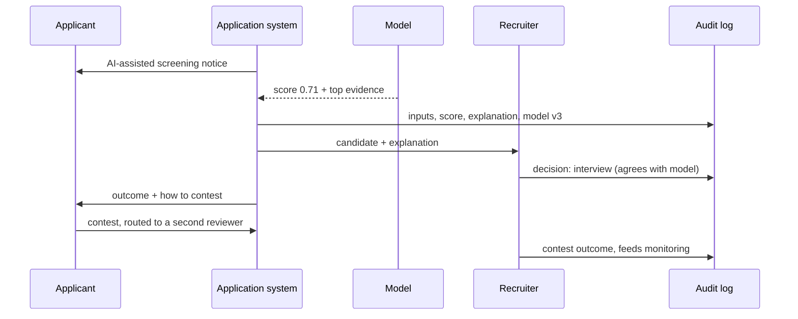
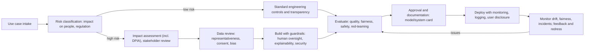

## TL;DR

- Responsible AI means building and operating AI systems that are **fair, reliable and safe, private and secure, transparent, accountable and inclusive** — across the whole lifecycle, not as a final checkbox.
- Risk depends on **use case**, not technology: a model recommending playlists and one screening job applicants need very different controls. Classify use cases by impact and apply proportionate requirements.
- Key practices: impact assessments, representative data, **evaluation for bias and harmful outputs** (including red-teaming), human oversight for consequential decisions, transparency to users, documentation (model/system cards), monitoring and incident response.
- Regulation is now real: the **EU AI Act** (risk-based tiers with phased obligations), sector rules (finance, health, employment), data protection law (GDPR), and frameworks such as **NIST AI RMF** and **ISO/IEC 42001**.
- Engineers and architects own much of this in practice: data pipelines, evaluation, guardrails, logging, access control and the ability to explain and roll back.

## Core Concepts

### Principles

Most frameworks (OECD, Microsoft, Google, NIST) converge on:
- **Fairness:** avoid unjustified differences in outcomes or quality of service across groups.
- **Reliability and safety:** perform as intended, robust to errors and misuse, fail safely.
- **Privacy and security:** protect personal data, resist attacks (prompt injection, data poisoning, model extraction).
- **Transparency and explainability:** people know when AI is used and can understand key factors behind outcomes that affect them.
- **Accountability:** clear human ownership, governance, audit trails and redress.
- **Inclusiveness:** works for diverse users, languages and abilities.

### Sources of bias

| Source | Example |
|---|---|
| Historical bias | Labels reflect past discriminatory decisions (hiring, lending) |
| Representation bias | Underrepresented groups in training data (accents in speech recognition) |
| Measurement bias | Proxies that correlate with protected attributes (postcode for ethnicity) |
| Aggregation bias | One model for groups with different relationships |
| Evaluation bias | Test sets that don't reflect deployed populations |
| Deployment/feedback bias | Model decisions shape future data (predictive policing loops) |

### Fairness metrics (and their tension)

- **Demographic parity:** equal positive-outcome rates across groups.
- **Equal opportunity:** equal true positive rates (recall) across groups.
- **Equalised odds:** equal true and false positive rates.
- **Calibration within groups:** a score of 0.7 means 70% likelihood for every group.

These generally **cannot all be satisfied at once** when base rates differ (impossibility results), so choosing a fairness definition is a **values and legal decision** made with stakeholders, documented and monitored.

### Worked example: the same model, two verdicts

A screening model shortlists applicants. Here are its results for two groups on a labelled audit sample:

| Group | Applicants | Actually qualified | Shortlisted | Shortlisted and qualified |
|---|---|---|---|---|
| A | 1,000 | 400 | 300 | 240 |
| B | 1,000 | 200 | 180 | 150 |

```ts
const g = {
  A: { n: 1000, qualified: 400, selected: 300, tp: 240 },
  B: { n: 1000, qualified: 200, selected: 180, tp: 150 },
};
const selectionRate = (x: typeof g.A) => x.selected / x.n; // A 0.30, B 0.18
const tpr = (x: typeof g.A) => x.tp / x.qualified;          // A 0.60, B 0.75
const precision = (x: typeof g.A) => x.tp / x.selected;     // A 0.80, B 0.83

selectionRate(g.B) / selectionRate(g.A); // 0.60: fails the four-fifths (0.8) screen
tpr(g.B) - tpr(g.A);                     // +0.15: qualified B applicants are MORE likely to be shortlisted
```

Judged by **demographic parity**, the model looks biased against group B: its selection rate is only 60% of group A's. Judged by **equal opportunity**, it favours group B: a qualified B applicant has a 75% chance of being shortlisted, against 60% for A. Both statements are true at once, because the base rates differ (40% against 20% qualified). Which matters, and whether "qualified" in the audit labels is itself biased, is the decision for legal, domain experts and affected people. Engineers make that conversation possible by computing all the views, per group and for intersections.

### Oversight and contest, step by step



### Explainability

- **Global:** which features matter overall (feature importance, partial dependence).
- **Local:** why this decision (SHAP values, counterfactuals: "if income were £5k higher, the loan would be approved").
- **Inherently interpretable models** (scorecards, small trees) for high-stakes decisions where possible.
- For LLM systems: cite sources (RAG), show the evidence used, log prompts and tool calls; model internals remain largely opaque.

### Generative AI-specific risks

Hallucinations, harmful or biased content, prompt injection and jailbreaks, leakage of sensitive data (training or context), copyright and IP concerns, over-reliance by users, impersonation/deepfakes, and agents taking harmful actions. Mitigations: grounding, output filters and classifiers, red-teaming, evaluation suites, tool permissions in code, human-in-the-loop, user disclosures and content provenance (e.g. C2PA).

### Regulation and frameworks

- **EU AI Act:** risk tiers — **prohibited** practices (e.g. social scoring by public authorities, certain manipulative techniques), **high-risk** systems (e.g. employment, credit scoring, education, critical infrastructure, certain biometrics) with requirements for risk management, data governance, documentation, logging, human oversight, accuracy and robustness; **transparency** obligations (e.g. disclosing chatbots, labelling deepfakes); and obligations for **general-purpose AI** model providers. Obligations phase in: prohibitions and AI literacy from 2 February 2025, general-purpose AI obligations from 2 August 2025, most transparency obligations from 2 August 2026. The 2026 Digital Omnibus on AI delayed high-risk obligations to 2 December 2027 for stand-alone (Annex III) systems and 2 August 2028 for AI in regulated products (Annex I).
- **GDPR:** lawful basis, data minimisation, rights regarding automated decision-making (Article 22), DPIAs.
- **NIST AI Risk Management Framework:** Govern, Map, Measure, Manage.
- **ISO/IEC 42001:** AI management system standard (certifiable).

## How It Works



## When to Use / Trade-offs

| Control | Use when | Avoid when | Trade-off |
|---|---|---|---|
| Full impact assessment and governance review | Decisions affecting rights, livelihoods, safety (credit, hiring, health) | Low-impact internal productivity tools | Protection and compliance vs time |
| Human-in-the-loop approval | Consequential or irreversible actions | High-volume low-risk decisions | Safety vs cost and latency |
| Interpretable model over black box | Regulated decisions needing explanations | Perception tasks where interpretability is impossible | Explainability vs some accuracy |
| Fairness constraints in training | Measured disparities with clear fairness definition | Without stakeholder agreement on the definition | Equity vs possible accuracy trade-off |
| Red-teaming | Public-facing generative AI, agents with tools | Internal prototypes (lighter testing) | Finds real harms vs effort |
| Content filters / classifiers | User-generated prompts and outputs at scale | Where over-blocking harms legitimate use badly | Safety vs false positives |

## Common Pitfalls & Anti-patterns

- **Ethics as a final review** — concerns raised after launch when changes are expensive.
- **"We removed the protected attribute, so it's fair"** — proxies still encode it.
- **Aggregate metrics only** — good overall accuracy hiding poor performance for subgroups.
- **No owner** — nobody accountable for the model's behaviour in production.
- **Human-in-the-loop theatre** — reviewers rubber-stamp hundreds of decisions per hour (automation bias).
- **Opaque users** — people don't know they're interacting with AI or how to contest outcomes.
- **One-time testing** — no monitoring for drift or emerging harms.
- **Over-restriction** — blanket bans that push usage to unapproved tools.

## Real-world Scenario

**Context:** A recruitment platform planned an AI feature to rank applicants for employers. Under the EU AI Act, AI for recruitment and candidate evaluation is listed as high-risk, and GDPR's rules on automated decision-making applied.

**Decision:** The team ran an impact assessment with legal, HR experts and candidate representatives. They redesigned the feature from "rank and filter" to "assist recruiters": the model highlighted relevant experience with explanations, never auto-rejected candidates, and recruiters made decisions. Training data was audited (historical hiring decisions showed gender skew in some roles); they removed features acting as proxies and evaluated selection-rate ratios and recall across groups. They added candidate-facing transparency notices, a contest process, logging for audits, model cards, quarterly fairness monitoring and a kill switch.

**Outcome:** The feature launched to employers with documented compliance evidence; fairness metrics stayed within agreed bounds; employer adoption was strong because explanations made recommendations trustworthy.

**What I'd do differently:** Involve candidate representatives even earlier — their feedback reshaped the explanations and contest process significantly.

## Interview Questions

### What are the core principles of responsible AI? {#principles}

**Level:** Foundation

**Model answer:**
Commonly: **fairness** (no unjustified disparities across groups), **reliability and safety** (works as intended, robust, fails safely), **privacy and security** (protects data, resists attacks), **transparency and explainability** (people know AI is used and understand key reasons for outcomes), **accountability** (clear human ownership, governance, audit and redress) and **inclusiveness** (works for diverse users).

Principles only matter when turned into practices: impact assessments, data reviews, evaluation for bias and safety, human oversight, documentation, monitoring, incident response and clear ownership — applied proportionately to the risk of each use case.

**What the interviewer is looking for:**
The principles and the emphasis on operationalising them proportionately.

**Follow-ups:**
- Which principle is hardest to implement in practice?
- How do these apply to an internal coding assistant vs a credit model?

**Red flags:**
- Principles recited with no practices.

### What are the main sources of bias in AI systems? {#bias-types}

**Level:** Foundation

**Model answer:**
- **Historical bias:** training labels reflect past human decisions that were biased (hiring, lending, policing).
- **Representation bias:** some groups are underrepresented in data, so the model performs worse for them (speech recognition for certain accents, skin-tone variation in vision).
- **Measurement bias:** proxies or features measured differently across groups (postcode as a proxy for ethnicity; arrests as a proxy for crime).
- **Aggregation bias:** one model for populations with different relationships between features and outcomes.
- **Evaluation bias:** test data not representative of real users.
- **Deployment and feedback loops:** model outputs influence future data, reinforcing patterns.

Removing protected attributes doesn't fix bias because of proxies; you need measurement across groups and design choices.

**What the interviewer is looking for:**
Several sources with examples and the proxy insight.

**Follow-ups:**
- How would you detect representation bias?
- What's a feedback loop example?

**Red flags:**
- "Algorithms are objective."

### Why does explainability matter, and how can you provide it? {#explainability}

**Level:** Foundation

**Model answer:**
Explainability supports **trust**, **debugging** (finding spurious correlations), **compliance** (regulations may require meaningful information about automated decisions), and **contestability** (people can challenge outcomes).

Approaches:
- **Interpretable models** for high-stakes decisions (scorecards, small trees, linear models) where accuracy is comparable.
- **Global explanations:** feature importance, partial dependence plots.
- **Local explanations:** SHAP values, counterfactuals ("you'd be approved if X"), reason codes in credit decisions.
- **For LLM/RAG systems:** citations to sources, showing retrieved evidence, logging prompts and tool calls; acknowledging that model internals aren't truly explained.
- **User-facing explanations** written for the audience — what factors mattered and how to contest.

**What the interviewer is looking for:**
Why it matters and suitable techniques for different model types and audiences.

**Follow-ups:**
- What are the limits of SHAP explanations?
- How do you explain a decision made with an LLM?

**Red flags:**
- Treating post-hoc explanations as perfect truth.

### What makes human oversight of AI effective rather than token? {#human-oversight}

**Level:** Foundation

**Model answer:**
Effective oversight requires:
- **Authority and ability to intervene:** humans can override, pause or reject outputs, and the system supports it (kill switches, approval steps).
- **Information to judge:** explanations, confidence, source evidence, the relevant context — not just a score.
- **Manageable workload:** reviewers aren't expected to approve hundreds of decisions per hour; otherwise **automation bias** turns review into rubber-stamping.
- **Training** on the system's limitations and failure modes.
- **Risk-based placement:** humans decide on high-impact or low-confidence cases; automation handles low-risk ones.
- **Monitoring the humans too:** override rates, agreement rates, time per review — signs of rubber-stamping or over-reliance.
- **Accountability:** clear ownership of outcomes.

**What the interviewer is looking for:**
Real authority, information, workload, training, risk-based design and monitoring of automation bias.

**Follow-ups:**
- What is automation bias?
- How would you design oversight for an AI that drafts insurance claim decisions?

**Red flags:**
- "A human clicks approve" as sufficient oversight.

### How do you choose and apply fairness metrics? {#fairness-metrics}

**Level:** Senior

**Model answer:**
Common metrics:
- **Demographic parity:** similar selection rates across groups.
- **Equal opportunity:** similar true positive rates (qualified people equally likely to be selected).
- **Equalised odds:** similar true and false positive rates.
- **Predictive parity / calibration:** a given score means the same probability across groups.

When base rates differ, these conflict — you can't satisfy them all simultaneously. Choosing which matters is a **context, values and legal** decision: e.g. in lending, calibration and equal opportunity may be prioritised; in hiring, selection-rate ratios (e.g. the "four-fifths rule" used in some US contexts) are often examined.

Practice:
- Agree definitions with legal, domain experts and affected stakeholders; document why.
- Measure across relevant groups and intersections (where you lawfully have or can estimate group data).
- Mitigate via data improvements, re-weighting, constraints during training, or threshold adjustments (with legal review).
- Monitor in production; re-evaluate after drift.

**What the interviewer is looking for:**
Metric definitions, impossibility trade-off, stakeholder/legal choice, measurement and mitigation.

**Follow-ups:**
- What if you don't collect demographic data?
- Is group-specific thresholding legal in your context?

**Red flags:**
- Claiming a model is "fair" without specifying the definition.

### How do you evaluate a generative AI system for harmful outputs? {#red-teaming}

**Level:** Senior

**Model answer:**
- **Define harms for the use case:** hallucinated facts, unsafe advice (medical, financial), toxic or biased content, privacy leaks, copyrighted output, prompt injection leading to data exfiltration or unwanted actions, jailbreaks of policy.
- **Evaluation datasets:** curated prompts covering normal use, edge cases and adversarial attempts; automated scoring (classifiers, LLM-as-judge calibrated against human labels) plus human review.
- **Red-teaming:** structured adversarial testing by internal teams and diverse external testers (domain experts, people from affected communities), especially before launch and after major changes.
- **Measure rates** of harmful outputs, refusal rates for legitimate requests (over-blocking), and severity.
- **Mitigate:** grounding and citations, system prompts and policies, input/output filters, tool permission controls, human review for high-stakes outputs, user reporting mechanisms.
- **Continuous evaluation:** regression suites in CI for prompt/model changes, production sampling and incident tracking.

**What the interviewer is looking for:**
Use-case-specific harms, systematic evaluation plus red-teaming, balanced metrics and continuous testing.

**Follow-ups:**
- How do you red-team an agent with tool access?
- How do you avoid over-blocking legitimate requests?

**Red flags:**
- Testing a few prompts manually before launch.

### What privacy issues arise with AI systems? {#ai-privacy}

**Level:** Senior

**Model answer:**
- **Training data:** lawful basis and purpose limitation for using personal data to train models; data minimisation; consent where required; sensitive data categories.
- **Memorisation and leakage:** models can reproduce training data; RAG systems can surface documents users shouldn't see (enforce permission filtering at retrieval).
- **Prompts and logs:** users paste personal data; logs retain it — define retention, redaction and access controls; vendor terms on data use.
- **Inference of sensitive attributes:** models can infer health, ethnicity or orientation from innocuous data.
- **Rights:** access, erasure and objection — hard to honour for data embedded in trained models (prefer not training on personal data, or design for retraining/unlearning where feasible).
- **Automated decision-making:** GDPR Article 22 restrictions and transparency rights for decisions with legal or similarly significant effects.

Practices: DPIAs for high-risk processing, pseudonymisation, privacy-enhancing techniques (differential privacy, federated learning where appropriate), vendor due diligence and data residency.

**What the interviewer is looking for:**
Training data legality, leakage, logging, inference risks, data subject rights and automated decisions, with practices.

**Follow-ups:**
- A user asks you to delete their data from a fine-tuned model. What do you do?
- What is a DPIA?

**Red flags:**
- Training on customer data without checking lawful basis.

### What should model or system documentation include? {#model-documentation}

**Level:** Senior

**Model answer:**
**Model cards / system cards** document:
- **Intended use and out-of-scope uses.**
- **Training data:** sources, time range, preprocessing, known gaps and biases.
- **Evaluation:** metrics overall and by relevant subgroups, datasets used, limitations.
- **Fairness and safety assessments,** red-teaming results.
- **Human oversight and guardrails** in the deployed system.
- **Dependencies:** base models, third-party components, versions.
- **Monitoring plan:** drift, performance, incidents; retraining policy.
- **Ownership and contacts;** approval history and review dates.
- **User-facing information** where relevant.

**Datasheets for datasets** document data provenance, collection, consent and composition. Keep documentation versioned with the model in the registry and update it with each significant change — regulators (e.g. EU AI Act technical documentation for high-risk systems) increasingly require it.

**What the interviewer is looking for:**
Comprehensive contents, data documentation, versioning and regulatory relevance.

**Follow-ups:**
- Who should read a model card?
- How do you keep documentation current?

**Red flags:**
- Documentation written once for approval and never updated.

### How should AI use be disclosed to users? {#user-transparency}

**Level:** Senior

**Model answer:**
- **Tell people when they interact with AI** (chatbots, voice agents) and when content is AI-generated — increasingly a legal requirement (e.g. EU AI Act transparency obligations for certain systems; labelling of deepfakes).
- **Explain the role of AI** in decisions affecting them: what it does, the main factors, and the human involvement.
- **Set expectations about limitations:** "AI-generated answers may be inaccurate; check sources", with citations where possible.
- **Provide control and recourse:** opt-outs where appropriate, ways to reach a human, and to contest decisions.
- **Content provenance** for generated media (watermarking/metadata standards like C2PA where feasible).
- **Clear, accessible language** — not legalese buried in terms of service.

**What the interviewer is looking for:**
Disclosure, explanation, limitations, recourse and provenance, in accessible form.

**Follow-ups:**
- How would you design the UI disclosure for an AI support agent?
- When must a user be able to reach a human?

**Red flags:**
- Hiding AI use to avoid scrutiny.

### How do you handle incidents caused by AI systems? {#ai-incidents}

**Level:** Senior

**Model answer:**
AI incidents include harmful outputs, discriminatory outcomes, privacy leaks, unsafe agent actions or significant performance degradation.

- **Detect:** monitoring (quality, fairness, safety classifiers), user reports, red-team findings, regulator or media reports.
- **Respond:** an owner and severity levels like other incidents; **kill switches/feature flags** to disable or degrade the AI feature to a safe fallback; preserve logs (prompts, outputs, model versions) for investigation.
- **Assess impact:** who was affected, how, scale; legal obligations (data breach notification, regulatory serious-incident reporting for high-risk systems).
- **Communicate** with affected users and stakeholders appropriately.
- **Fix and learn:** root cause (data, model, prompt, guardrail gap), blameless postmortem, add regression tests to evaluation suites, update documentation and controls.

**What the interviewer is looking for:**
Detection sources, kill switches and fallbacks, logging, legal obligations, communication and learning.

**Follow-ups:**
- Your chatbot gave harmful medical advice that went viral. What do you do in the first hour?
- What logs do you need to investigate?

**Red flags:**
- No ability to switch off an AI feature quickly.

### How would you set up AI governance in an organisation? {#ai-governance}

**Level:** Architect

**Model answer:**
- **Principles and policy** aligned with law and company values; an acceptable-use policy for staff tools.
- **Inventory** of AI systems and use cases (including vendor AI features), with owners.
- **Risk classification** (e.g. aligned to EU AI Act tiers and internal impact criteria) determining required controls.
- **Proportionate review process:** lightweight self-assessment for low-risk; cross-functional review board (engineering, legal, privacy, security, domain experts, ethics) for high-risk; time-boxed decisions.
- **Standards and tooling:** evaluation and fairness testing templates, model/system cards, logging and monitoring requirements, approved platforms (model gateway with logging and guardrails).
- **Lifecycle controls:** approvals before launch, monitoring, periodic reviews, retirement.
- **Frameworks:** NIST AI RMF (Govern, Map, Measure, Manage) and ISO/IEC 42001 for a management-system approach and possible certification.
- **Training and culture:** for builders and users; channels to raise concerns.
- **Metrics:** inventory coverage, reviews completed, incidents, time to approve.

**What the interviewer is looking for:**
Inventory, risk tiers, proportional review, standards and tooling, lifecycle, frameworks and culture.

**Follow-ups:**
- How do you avoid governance blocking innovation?
- Who should sit on the review board?

**Red flags:**
- Governance as a single ethics committee with no tooling or inventory.

### What does the EU AI Act mean for engineering teams? {#eu-ai-act}

**Level:** Architect

**Model answer:**
The EU AI Act is a risk-based regulation applying to providers and deployers of AI systems placed on or used in the EU market:
- **Prohibited practices** (e.g. certain manipulative techniques, social scoring, some biometric uses) — must not be built or used.
- **High-risk systems** (listed areas such as employment and worker management, education, access to essential services like credit scoring, critical infrastructure, certain biometrics, law enforcement) — providers need a risk management system, data governance (quality, representativeness), technical documentation, record-keeping/logging, transparency to deployers, human oversight, accuracy/robustness/cybersecurity, conformity assessment and post-market monitoring; deployers have obligations too (human oversight, monitoring, impact assessments in some cases).
- **Transparency obligations:** disclose AI interaction (chatbots), label deepfakes and certain AI-generated content.
- **General-purpose AI models:** obligations for model providers (documentation, copyright policy, training data summaries; extra duties for systemic-risk models).

Obligations phase in from 2025; the 2026 Digital Omnibus pushed high-risk obligations back to December 2027 (stand-alone systems such as hiring or credit scoring) and August 2028 (AI inside regulated products). Engineering implications: inventory and classify use cases, build logging and traceability, evaluation and documentation pipelines, human-oversight features, and change management that keeps compliance evidence current — designing these in is far cheaper than retrofitting.

**What the interviewer is looking for:**
Risk tiers, high-risk obligations, transparency, GPAI obligations, phased timing and engineering implications.

**Follow-ups:**
- Is an internal HR tool that ranks employees for promotion high-risk?
- What's the difference between provider and deployer obligations?

**Red flags:**
- Assuming it doesn't apply to non-EU companies serving EU users.

### How would you assess the risk of a proposed high-impact AI use case? {#ai-risk-assessment}

**Level:** Architect

**Model answer:**
1. **Describe the system and context:** purpose, users, affected people, decisions influenced, degree of automation, deployment context.
2. **Classify** against regulation (e.g. EU AI Act high-risk categories, sector rules, GDPR automated decisions) and internal impact criteria (severity, scale, reversibility, vulnerability of affected people).
3. **Identify harms** with stakeholders: unfair outcomes, errors, privacy breaches, safety issues, manipulation, security attacks, over-reliance, environmental cost.
4. **Data assessment:** provenance, legality, representativeness, label quality, proxies.
5. **Design mitigations:** reduce automation (assistive vs decisive), human oversight, explainability, fairness evaluation, guardrails, security controls, user transparency and contest mechanisms.
6. **Evaluation plan:** metrics including subgroup performance, red-teaming, pilot with monitoring.
7. **Decision:** proceed, proceed with conditions, or don't build — documented with owner and review date.
8. **Post-deployment:** monitoring, incident response and periodic reassessment.

**What the interviewer is looking for:**
Structured assessment covering context, classification, harms, data, mitigations, evaluation and a documented decision including "don't build".

**Follow-ups:**
- When would you recommend not building the system?
- How do you involve affected communities?

**Red flags:**
- Risk assessment as paperwork after build.

### How do you perform due diligence on third-party AI vendors? {#vendor-ai-due-diligence}

**Level:** Architect

**Model answer:**
- **Data handling:** what data is sent, retention, whether it's used for training, sub-processors, residency, encryption, deletion; contractual terms (DPA).
- **Security:** certifications (SOC 2, ISO 27001), penetration testing, access controls, incident notification commitments, protections against prompt injection and data leakage.
- **Model information:** documentation (model/system cards), evaluation results, known limitations, bias testing, update cadence and change notification.
- **Compliance:** support for your regulatory obligations (EU AI Act roles, logging, transparency features), IP indemnification, copyright policies.
- **Reliability and lock-in:** SLAs, versioning and deprecation policies, portability of prompts/fine-tunes, exit plans.
- **Your own evaluation:** test the vendor's system on your use cases and subgroups — don't rely solely on their claims.
- **Ongoing monitoring:** re-assess on major model updates.

**What the interviewer is looking for:**
Data, security, model transparency, compliance support, reliability/lock-in and independent evaluation.

**Follow-ups:**
- A vendor won't disclose training data sources. How do you proceed?
- How do you handle silent model updates by a vendor?

**Red flags:**
- Choosing vendors on demo quality alone.

### How do you balance AI innovation with risk management? {#innovation-vs-risk}

**Level:** Architect

**Model answer:**
- **Proportionality:** most AI use cases are low risk — give them a fast path (approved tools, standard guardrails, self-assessment), and reserve deep review for high-impact uses.
- **Paved roads:** a shared AI platform (model gateway, logging, evaluation tooling, PII redaction, approved models) makes the safe way the easy way, speeding teams up.
- **Sandboxes:** safe environments with synthetic or approved data for experimentation; promotion criteria to production.
- **Time-boxed reviews** with clear criteria so governance isn't an indefinite blocker.
- **Assistive before autonomous:** start with human-in-the-loop designs and expand autonomy as evidence accumulates.
- **Measure both sides:** value delivered and incidents/near misses; adjust controls based on evidence.
- **Culture:** encourage raising concerns early; treat responsible AI as quality, not bureaucracy.

**What the interviewer is looking for:**
Risk-proportionate processes, platforms that accelerate safely, staged autonomy and evidence-based adjustment.

**Follow-ups:**
- A team built a prototype using an unapproved tool with customer data. What do you do?
- How do you decide when to grant more autonomy to an AI agent?

**Red flags:**
- Either "move fast and ignore risk" or "ban until fully understood".

### What does "proportionate" AI governance look like in practice? {#proportionate-controls}

**Level:** Foundation

**Model answer:**
Controls should scale with the **impact on people**, not with how impressive the technology is. Three illustrative tiers:
- **Low risk:** an internal tool that summarises meeting notes, or a coding assistant. Approved tools, the data rules in the acceptable-use policy, standard security review, and a short self-assessment. Shipping takes days.
- **Medium risk:** a customer-facing support chatbot. Add disclosure that users are talking to AI, grounding and citations, output filters, an evaluation suite and red-teaming before launch, a route to a human, and monitoring with a kill switch.
- **High risk:** credit decisions, hiring, health triage. Add a formal impact assessment (DPIA, plus the EU AI Act duties where they apply), fairness evaluation by subgroup, meaningful human oversight, explanations and a contest route, technical documentation, logging for audit, sign-off by a review board, and periodic re-review.

The point is to make the low-risk path **fast**, so teams don't route around governance, and to spend scarce expert review where harm is possible.

**What the interviewer is looking for:**
Impact-based tiers with concrete examples and controls, and awareness that over-governing low-risk use pushes people to shadow tools.

**Follow-ups:**
- Who decides which tier a use case is in?
- A low-risk tool starts being used for a high-risk purpose. How would you notice?

**Red flags:**
- One heavyweight process for every AI use, or no process at all.

### How can you measure fairness if you don't collect demographic data? {#fairness-without-demographics}

**Level:** Senior

**Model answer:**
Not collecting the data doesn't make the model fair. It only makes unfairness invisible. The options, each with trade-offs:
- **Voluntary, purpose-limited collection** for fairness monitoring only: kept separate from the model's inputs, access-controlled, and with a clear lawful basis. Under GDPR, special-category data needs an Article 9 condition, so involve privacy and legal early.
- **Audit studies with a consenting panel or a third party** that holds the attributes and runs the analysis, so the product team never sees individual-level demographics.
- **Proxy estimation**, such as inferring likely group membership from names and geography (BISG is used in US lending audits). It works for aggregate auditing only, is noisy, and must never be used for decisions about individuals.
- **Outcome-based checks** that need no attributes: error rates by region, language, device, or by accessibility features in use, plus qualitative research with affected communities.
- **Synthetic or counterfactual tests:** swap names or pronouns in otherwise identical inputs and compare the outputs. This is especially useful for LLM systems.

Document which approach you chose and its limitations, and revisit it as the law and the product change.

**What the interviewer is looking for:**
Recognising that absence of data isn't fairness, legal awareness about special-category data, and practical alternatives with their caveats.

**Follow-ups:**
- What are the risks of proxy estimation?
- How would you run a counterfactual name-swap test on a CV-screening LLM?

**Red flags:**
- "We don't store gender or ethnicity, so the model can't discriminate."

### Under the EU AI Act, what's the difference between a provider and a deployer, and when can a company become a provider without meaning to? {#provider-vs-deployer}

**Level:** Senior

**Model answer:**
- **Provider:** develops an AI system (or has one developed) and places it on the market or puts it into service **under its own name**. For high-risk systems, the provider carries the heaviest duties: risk management, data governance, technical documentation, logging capability, instructions for use, conformity assessment, CE marking and registration, and post-market monitoring.
- **Deployer:** uses an AI system under its authority in a professional capacity. Its duties include using the system according to the instructions, assigning competent human oversight, making sure input data is relevant, monitoring and keeping the logs, informing affected workers and people, and (for public bodies and certain credit and insurance uses) carrying out a **fundamental rights impact assessment**.

You can **become the provider** of a high-risk system if you:
- put your name or trademark on a high-risk system;
- make a **substantial modification** to one;
- change the intended purpose of a system (including a general-purpose one) so that it becomes high-risk. Taking a general chatbot and using it to rank job applicants is the classic example.

Engineering implication: the classification follows the **use**, so product changes need a compliance check, not only the initial launch.

**What the interviewer is looking for:**
Accurate roles and duties, and the repurposing and modification traps.

**Follow-ups:**
- You fine-tune a general-purpose model for credit scoring. Which obligations do you now have?
- How would you catch an intended-purpose change in your product process?

**Red flags:**
- Believing that buying a vendor's model moves all the obligations to the vendor.

### Design the guardrail architecture for a customer-facing generative AI assistant. {#guardrail-architecture}

**Level:** Architect

**Model answer:**
Use layers, with each one cheap enough to run on every request and each one assumed to fail sometimes:
1. **Before the model:** authentication and rate limits, input classifiers (abuse, self-harm signals, prompt-injection heuristics), PII detection and redaction where the use case doesn't need it, and topic scoping (refusing to give legal or medical advice if it's out of scope).
2. **Shaping the model's behaviour:** a system prompt that states the policy and persona, **grounding** in approved content with citations, and tools with least privilege and server-side authorisation. Consequential actions require confirmation.
3. **After the model:** output classifiers (toxicity, PII leakage, policy violations), citation and grounding checks, schema validation for structured output, and blocklists for specific claims (prices, legal promises).
4. **Around the system:** disclosure and feedback in the UI, an easy route to a human, logging with redaction, dashboards for blocked and flagged rates, sampled human review, and a kill switch per feature.
5. **Lifecycle:** red-teaming before launch and after major changes, regression evals in CI, an incident process, and regular review of over-blocking (refusals of legitimate requests are a harm too).

Trade-offs: every layer adds latency and cost, so run classifiers in parallel where possible, tune their thresholds with real data, and measure false positives as carefully as misses.

**What the interviewer is looking for:**
Defence in depth across input, model, output and operations, with over-blocking and latency treated as first-class concerns.

**Follow-ups:**
- Your output filter adds 400 ms. What do you do?
- How do you stop guardrails from being bypassed in a different language?

**Red flags:**
- Relying on the system prompt alone, or on one filter with no monitoring.

### How do you decide how much autonomy to give an AI agent, and when to increase it? {#agent-autonomy}

**Level:** Architect

**Model answer:**
Think of autonomy as a **ladder** that is climbed with evidence, separately for each type of action:
1. **Suggest:** the agent drafts and a human acts (it writes the refund email, a human sends it).
2. **Act with approval:** the agent prepares the action and a human approves each one.
3. **Act within limits:** the agent acts alone below thresholds (refunds under £50, reversible changes) and escalates otherwise.
4. **Act, with oversight after the fact:** the agent acts and humans review samples and exceptions.

What decides the rung:
- **Severity and reversibility:** moving money, deleting data or messaging customers sit low on the ladder for a long time. Tagging tickets can climb fast.
- **Measured reliability:** the error rate on an evaluation set and in shadow mode, compared with the human baseline.
- **Detectability:** whether a mistake would be noticed and corrected quickly.
- **Regulatory context:** some decisions need meaningful human involvement by law.

Climb when the evidence is good: a sustained error rate below the agreed bar, no serious incidents, monitoring and rollback in place. Descend immediately on incidents. Enforce the limits **in code** (API-level thresholds and permissions), not in the prompt.

**What the interviewer is looking for:**
A graduated, per-action model tied to severity, reversibility and measured performance, with enforcement in code.

**Follow-ups:**
- What metrics would convince you to move refunds from rung 2 to rung 3?
- How do you prevent automation bias at rung 2?

**Red flags:**
- Granting full autonomy because a demo went well, or never revisiting the level.

## Cheat Sheet

- **Responsible AI principles** — fairness, reliability and safety, privacy and security, transparency, accountability, inclusiveness.
- **Risk is use-case specific** — apply controls proportionate to impact on people.
- **Proxy bias** — removing protected attributes doesn't remove bias; proxies remain.
- **Fairness metrics** — demographic parity, equal opportunity, equalised odds, calibration; they conflict when base rates differ.
- **Explainability** — interpretable models, SHAP, counterfactuals, citations for RAG.
- **Automation bias** — humans over-trusting AI; makes token oversight ineffective.
- **Red-teaming** — structured adversarial testing for harms before and after launch.
- **Model/system card** — intended use, data, evaluation by subgroup, limitations, oversight, owners.
- **Kill switch** — ability to disable or degrade an AI feature to a safe fallback quickly.
- **EU AI Act** — prohibited, high-risk, transparency and GPAI obligations, phased in from 2025.
- **High-risk examples** — employment, credit scoring, education, critical infrastructure, certain biometrics.
- **GDPR Article 22** — limits on solely automated decisions with legal or similarly significant effects.
- **NIST AI RMF** — Govern, Map, Measure, Manage.
- **ISO/IEC 42001** — certifiable AI management system standard.

### Revisit
- **Four-fifths rule** — a selection-rate ratio below 0.8 between groups is a common screen for adverse impact (US guidance).
- **Parity vs equal opportunity** — the same model can fail one and pass the other when base rates differ.
- **Counterfactual explanation** — "you'd have been approved if X were different"; actionable for the affected person.
- **Provider vs deployer** — builds and markets the system vs uses it professionally; repurposing can make you the provider.
- **FRIA** — fundamental rights impact assessment; required of certain deployers of high-risk AI (public bodies, credit, insurance).
- **AI literacy (EU AI Act Art. 4)** — providers and deployers must ensure staff have sufficient AI literacy, since February 2025.
- **Autonomy ladder** — suggest → act with approval → act within limits → act with after-the-fact oversight; climb with evidence.

## Further Reading

- [NIST AI Risk Management Framework](https://www.nist.gov/itl/ai-risk-management-framework) — the Govern, Map, Measure, Manage framework and playbook.
- [EU AI Act (EUR-Lex)](https://eur-lex.europa.eu/eli/reg/2024/1689/oj) — the official regulation text.
- [OECD AI Principles](https://oecd.ai/en/ai-principles) — internationally adopted principles for trustworthy AI.
- [ISO/IEC 42001](https://www.iso.org/standard/81230.html) — AI management system standard.
- [Model Cards for Model Reporting (Mitchell et al., 2019)](https://arxiv.org/abs/1810.03993) — the original model card proposal.
- [ICO: Guidance on AI and data protection](https://ico.org.uk/for-organisations/uk-gdpr-guidance-and-resources/artificial-intelligence/) — UK regulator guidance on GDPR and AI.
