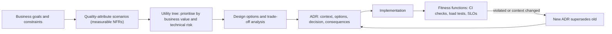
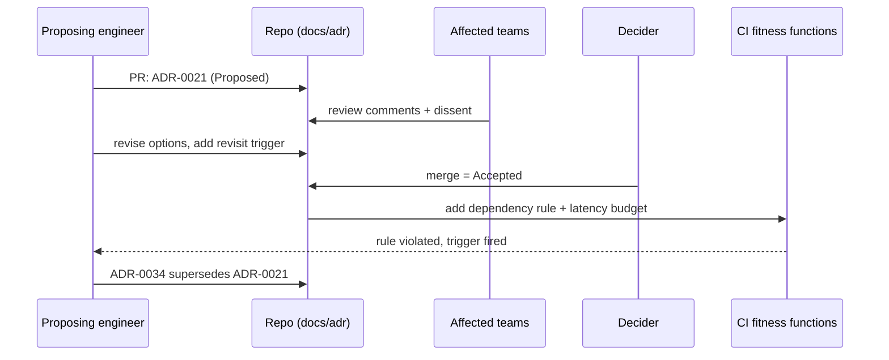

## TL;DR

- An **Architecture Decision Record (ADR)** is a short, immutable note of one significant decision: context, decision, consequences. Its value is the *why*, preserved for people who join after the meeting.
- **Non-functional requirements (NFRs)**, or quality attributes, such as availability, latency, security, scalability, operability and cost, drive architecture far more than features do. Two systems with identical features but different NFRs have different architectures.
- Vague NFRs ("fast", "secure", "scalable") are useless. Write them as **measurable quality-attribute scenarios**: stimulus, environment, response, measure.
- NFRs trade off against each other and against cost. Architecture is choosing which to optimise. Record those trade-offs in ADRs.
- Keep both close to the code and alive: ADRs in the repo, reviewed like code; NFRs verified continuously with **fitness functions** (tests, SLOs, budgets in CI).

## Core Concepts

### What makes a decision "architecturally significant"

A decision deserves an ADR when it is **costly to reverse**, **affects multiple teams or components**, or **constrains future choices**. Examples are the primary datastore, sync vs async integration, multi-tenancy model, authentication approach, build-vs-buy of a core capability, and cloud region strategy. Choosing a date-formatting library doesn't qualify.

A useful test is Bezos's one-way and two-way doors. One-way (hard to reverse) decisions need ADRs and broader review. Two-way door decisions should be made quickly, with a lightweight note at most.

### ADR anatomy

Michael Nygard's 2011 format is still the core. Most templates (MADR, Y-statements) add explicit options and decision drivers:

```markdown
# ADR-0017: Use PostgreSQL with row-level tenancy for the billing service

- Status: Accepted (2026-03-04) · Supersedes: ADR-0009
- Deciders: billing tech lead, platform architect · Consulted: security, SRE

## Context
Billing must support ~2,000 tenants (largest 4% of rows), strict tenant isolation for audit,
and monthly batch invoicing within a 2-hour window. Team knows PostgreSQL; we run it managed.

## Decision drivers
- Tenant isolation verifiable by auditors
- Operational cost: one cluster, not 2,000 databases
- Reporting across tenants for finance

## Options considered
1. Database per tenant — strongest isolation; ops cost and cross-tenant reporting are poor.
2. Schema per tenant — medium isolation; migrations across 2,000 schemas are slow and risky.
3. Shared tables + tenant_id + PostgreSQL row-level security (RLS) — chosen.

## Decision
Option 3. Every table has tenant_id; RLS policies enforce isolation using a session variable
set by the connection middleware. Largest tenants can be moved to a dedicated cluster later.

## Consequences
+ One schema to migrate; cross-tenant reports are simple.
− A missing RLS policy is a data leak: CI test asserts every table has a policy.
− Noisy-neighbour risk: per-tenant query budgets and monitoring required.
Revisit if: any tenant exceeds 20% of rows, or a regulator requires physical separation.
```

Key properties:
- **Immutable once accepted.** To change a decision, write a new ADR that *supersedes* the old one and link the two. The history of reasoning is the point.
- **Short:** 1–2 pages. Detail goes in linked design documents.
- **Options and consequences, including negative ones.** An ADR with no downsides is advertising, not a decision record.
- **Revisit triggers** make it explicit when the context has changed enough to reconsider.

### Where ADRs live and how they flow

- Store them in the repository they affect (`docs/adr/0017-billing-tenancy.md`), or in a central architecture repository for cross-cutting decisions. Number them sequentially.
- Propose an ADR as a pull request. Review comments become the discussion record, and merging means "Accepted". Tools: `adr-tools`, Log4brains, or plain Markdown and an index.
- Link ADRs from the code (`// See ADR-0017`), from C4 diagrams and from runbooks.

### Non-functional requirements as quality attributes

Common categories (ISO/IEC 25010 is the formal model; its 2023 revision renamed some characteristics, for example usability to interaction capability and portability to flexibility, and added safety):

| Attribute | Example measurable requirement |
|---|---|
| Availability | 99.9% of checkout requests succeed per 30 days, measured at the load balancer |
| Latency / performance | p95 search API < 300 ms at 1,500 req/s |
| Scalability | Handles 5× Black Friday peak with < 10% latency degradation; scale-out within 5 min |
| Durability / recovery | RPO 5 min, RTO 1 h for the orders database; quarterly restore test |
| Security | All PII encrypted at rest and in transit; access to production data via just-in-time approval, logged |
| Privacy / compliance | EU customer data stays in EU regions; erasure requests completed in 30 days |
| Operability | Any service deployable in < 15 min; mean time to detect < 5 min for SEV1 |
| Maintainability | New engineer ships to production in week 1; build < 10 min |
| Cost | Infra cost per 1,000 orders < £0.40 |
| Accessibility | WCAG 2.2 AA for all customer-facing pages |

### Worked example: availability arithmetic

Availability targets only mean something once you account for **dependencies**. Components in series multiply their availabilities; redundant replicas in parallel multiply their *unavailabilities*:

```ts
const serial = (...a: number[]) => a.reduce((x, y) => x * y, 1);
const parallel = (a: number, n: number) => 1 - (1 - a) ** n; // independent failures assumed

// Checkout path: CDN → API → payments provider → database
serial(0.9999, 0.999, 0.9995, 0.999);       // ≈ 0.9974, i.e. ~1.9 h of downtime a month
// Two API instances across zones, database with a synchronous standby
serial(0.9999, parallel(0.999, 2), 0.9995, parallel(0.999, 2)); // ≈ 0.9994
```

Three lessons:
- **The weakest serial dependency caps you.** Here the payments provider (99.95%) dominates once the rest is redundant. You can't promise 99.99% on top of a 99.95% dependency without a fallback, such as a second provider or queue-and-retry.
- **Redundancy only helps for independent failures.** Two replicas behind one shared config, one region or one deploy pipeline fail together. Correlated failure is why real numbers are worse than the formula.
- **Per-month budgets make it concrete:** 99.9% is about 43 minutes, 99.95% about 22 minutes and 99.99% about 4.3 minutes.

### Quality-attribute scenarios

The SEI's format from *Software Architecture in Practice* makes requirements testable. It has six parts: **source, stimulus, artefact, environment, response, response measure**.

> *Source:* 10,000 concurrent users · *Stimulus:* submit search queries · *Artefact:* search service · *Environment:* normal operation, one availability zone down · *Response:* results returned · *Measure:* p95 < 400 ms, error rate < 0.1%.

Scenarios expose the hidden parts of an NFR: under *what conditions* (one zone down? peak? during deploys?) and *how measured*.

### Fitness functions

Borrowed from *Building Evolutionary Architectures* (Ford, Parsons, Kua): automated checks that an architectural characteristic still holds.

- **Performance budgets** in CI: load test p95 regression > 10% fails the build. Frontend bundle size and Core Web Vitals budgets.
- **Dependency rules:** `dependency-cruiser` or ArchUnit tests ("domain must not import infrastructure").
- **Security:** dependency and container scanning gates, policy-as-code (OPA) for infrastructure.
- **Production:** SLOs with error-budget alerts are fitness functions that run continuously.

```ts
// ArchUnit-style rule with dependency-cruiser (.dependency-cruiser.cjs)
module.exports = {
  forbidden: [
    {
      name: 'domain-is-pure',
      severity: 'error',
      from: { path: '^src/domain' },
      to: { path: '^src/(infrastructure|api)' },
    },
  ],
};
```

## How It Works



A lightweight cadence that works in practice:

1. At project start, run a short **quality-attribute workshop** with product, engineering, security and operations. Brainstorm scenarios, then rank them by business importance and technical difficulty (an ATAM-style utility tree). The top 5–8 scenarios shape the architecture.
2. Record each significant design choice as an ADR that references the scenarios it serves.
3. Turn scenarios into automated checks where possible, and into SLOs in production.
4. Revisit at milestones, or when a revisit trigger fires.

### An ADR's life, step by step



## When to Use / Trade-offs

| Approach | Use when | Avoid when | Cost |
|---|---|---|---|
| ADR per significant decision (in repo) | Decisions are hard to reverse or affect several teams | Trivial, easily reversed choices | 30–60 min per decision |
| Lightweight decision log (one line each) | Fast-moving early product, many small decisions | Regulated systems needing an audit trail | Minimal; loses the reasoning |
| Big up-front architecture document | Contractual or regulatory deliverables | Most product development; it goes stale | High; rarely read |
| Formal ATAM evaluation | High-risk, high-cost systems; multiple stakeholders with conflicting needs | Small systems, tight deadlines | Days of workshops |
| Quality-attribute scenarios | Any system where NFRs drive design | Never really. Even a few are valuable | A workshop and ongoing upkeep |
| Fitness functions in CI | Characteristics that drift silently (performance, dependencies, security) | Characteristics only measurable in production; use SLOs there | Build time and maintenance |

NFR trade-offs to make explicit:
- **Consistency vs availability vs latency** (see CAP and PACELC).
- **Security vs usability** (MFA friction, session length).
- **Performance vs cost** (over-provisioning, caching layers).
- **Time-to-market vs maintainability** (taking on debt deliberately, recorded in an ADR).
- **Flexibility vs simplicity** (configurability and plug-in systems add complexity).

## Common Pitfalls & Anti-patterns

- **Unmeasurable NFRs** — "must be fast and highly available" gives no design guidance and can't be tested. Ask "how fast, for whom, under what load, measured where?"
- **Copy-paste NFRs** — 99.99% availability on every system, including the internal admin tool. Over-specification costs real money.
- **ADRs written after the fact** to justify a decision already made, with straw-man alternatives.
- **Editing accepted ADRs** — rewriting history. Supersede instead.
- **ADR graveyards** — written once, never linked or found. Index them, link them from code and diagrams, and reference them in reviews.
- **Decision by document** — an ADR is not a substitute for talking to the affected teams. It records consensus, it doesn't create it.
- **NFRs owned by nobody** — product owns features, engineering assumes NFRs. Agree explicit owners and include NFR work in the backlog.
- **Testing NFRs only before launch** — performance and security decay. Without fitness functions and SLOs, you find out from customers.

## Real-world Scenario

**Context:** A logistics company was building a shipment-tracking platform. Early decisions (Cosmos DB, an event-driven design, a multi-region setup) were made in meetings. Eighteen months later, a new architect asked why tracking cost £45k a month and why multi-region was active-active. Nobody who made the decisions remained, and the original reasons (an enterprise customer requirement that had since lapsed) were lost.

**Decision:**
- Ran a 2-day quality-attribute workshop that produced 14 scenarios. The top three were p95 tracking-page latency under 500 ms, 99.9% ingestion availability and a cost per tracked parcel.
- Reconstructed 11 "retro-ADRs" from Slack, tickets and interviews, marked as reconstructed.
- From then on, required an ADR for any decision that met the significance test, reviewed as a pull request.

**Outcome:**
- The workshop showed that active-active multi-region was no longer needed. RPO and RTO targets could be met with active-passive. A new ADR superseded the old one and cut cost by 38%.
- Load-test fitness functions caught two latency regressions in CI over the next six months.
- New joiners cited the ADR log as the most useful onboarding document.

**What I'd do differently:** Start the ADR log on day one. Reconstructing reasoning cost far more than writing it down would have. Also, put the cost NFR in from the start. Without a cost target, nobody had challenged the spend.

## Interview Questions

### What is an Architecture Decision Record and what should it contain? {#what-is-adr}

**Level:** Foundation

**Model answer:**
An ADR is a short document capturing one architecturally significant decision. Minimum contents (Nygard's format):
- **Title and status:** proposed, accepted, deprecated or superseded, with links to related ADRs.
- **Context:** the forces at play, meaning requirements, constraints, team skills and deadlines, as they were *at the time*.
- **Decision:** what we will do, stated clearly.
- **Consequences:** positive and negative, including the risks we accept and the work this creates.

Good additions: the options considered with their pros and cons, decision drivers (the NFRs that mattered), deciders and consulted parties, and revisit triggers. Accepted ADRs are immutable. Changes come as new ADRs that supersede old ones, so the reasoning history survives.

**What the interviewer is looking for:**
The structure, the emphasis on context and consequences (especially negative ones) and the immutability and supersession convention.

**Follow-ups:**
- Where do you store ADRs?
- How long should an ADR be?

**Red flags:**
- ADRs that only state the decision without the context.
- Editing accepted ADRs in place.

### What is the difference between functional and non-functional requirements? Give examples. {#functional-vs-nonfunctional}

**Level:** Foundation

**Model answer:**
- **Functional requirements** describe *what* the system does: "A customer can refund an order within 30 days", "The system emails an invoice when payment succeeds."
- **Non-functional requirements (quality attributes)** describe *how well* it does it, and under what constraints. Examples: "Refunds are processed within 2 s at p95", "The system is available 99.9% monthly", "Card data never leaves the PCI-scoped service", "Infrastructure cost below £0.40 per 1,000 orders."

NFRs matter disproportionately for architecture. You can implement the same features as a monolith on one VM or as a multi-region event-driven system. The NFRs decide which is appropriate. They are also the requirements most often left implicit, discovered only when they're violated in production.

**What the interviewer is looking for:**
A clear distinction, measurable examples and the insight that NFRs drive architecture.

**Follow-ups:**
- Who is responsible for defining NFRs?
- Is "the system must use Kubernetes" an NFR?

**Red flags:**
- Treating NFRs as an afterthought for operations.
- Examples that aren't measurable.

### How do you turn a vague requirement like "the system must be fast" into something useful? {#measurable-nfrs}

**Level:** Foundation

**Model answer:**
Ask questions until it becomes a **quality-attribute scenario**:
- **Which operation?** Search, checkout or report generation? Each will differ.
- **For whom and from where?** Mobile users on 4G in India or office users on fibre?
- **Under what load and conditions?** Normal day, Black Friday peak, one availability zone down, during deploys?
- **Measured how and where?** p95 or p99 (not averages), server-side or real-user monitoring, over what window?
- **What happens if we miss it?** Is it a hard requirement (contract, regulation) or a target?

The result reads like: "Product search returns results in under 300 ms at p95, measured server-side, at 1,500 requests per second, including during deployments." That is testable, guides design (caching, indexing, capacity) and becomes an SLO and a load-test threshold.

Also find out the **business reason**. "Fast" might really mean "conversion drops when search takes over 1 s", which tells you where to focus.

**What the interviewer is looking for:**
The questioning technique, percentiles, load and conditions, and connecting the requirement to tests and SLOs.

**Follow-ups:**
- Why percentiles rather than the average?
- How would you verify this requirement before launch and after?

**Red flags:**
- Accepting "fast" and moving on.
- Measuring latency only as an average in a quiet test environment.

### What makes a decision architecturally significant enough to need an ADR? {#adr-significance}

**Level:** Foundation

**Model answer:**
Write an ADR when a decision is:
- **Hard or expensive to reverse:** datastore, programming language, integration style, identity provider, tenancy model, cloud provider or region strategy.
- **Cross-cutting:** affects several teams, services or the platform (API standards, event schema conventions).
- **Constraining:** narrows future options or commits money (vendor contracts, build versus buy).
- **Contentious or surprising:** a choice a reasonable newcomer would question ("Why aren't we using Kafka here?").
- **Accepting a risk or debt deliberately:** recording it so it's a known trade-off, not an accident.

Skip it for easily reversed, local choices. Bezos's one-way versus two-way door framing helps decide.

**What the interviewer is looking for:**
Clear criteria centred on reversibility and blast radius, plus restraint to avoid documentation overhead.

**Follow-ups:**
- Should library choices ever have ADRs?
- Who decides whether an ADR is needed?

**Red flags:**
- "Every decision needs an ADR."
- "We just discuss it in Slack."

### How do you get a team to actually write and use ADRs? {#adr-adoption}

**Level:** Senior

**Model answer:**
- **Make it cheap:** a one-page template in the repository, a CLI or snippet to create a new numbered file, and ADRs proposed as pull requests, so review happens where engineers already work.
- **Lead by example:** write the first few yourself for live decisions, not as homework.
- **Make them useful:** link ADRs from the code, from C4 diagrams and from onboarding docs, and cite them in design reviews ("Does this conflict with ADR-0012?"). People write what gets read.
- **Fit the process:** the design review checklist asks "Is there an ADR?" for significant changes. Architecture forums review proposed ADRs asynchronously and meet only for contentious ones.
- **Keep it light:** 1–2 pages, done in under an hour. Long templates kill adoption.
- **Celebrate their value:** when an ADR saves a debate or explains a decision to a new joiner, mention it.
- **Back-fill selectively:** write reconstructed ADRs for the 5–10 most-questioned existing decisions.

**What the interviewer is looking for:**
Low friction, integration with existing workflows, visible usefulness and leadership by example.

**Follow-ups:**
- How do you handle ADRs for decisions spanning many repositories?
- What would you do if ADRs became bureaucratic?

**Red flags:**
- Mandating a heavy template and a review board.
- ADRs stored somewhere nobody looks (an unlinked wiki page).

### NFRs conflict, for example strong consistency against low latency across regions. How do you resolve the trade-off? {#nfr-tradeoffs}

**Level:** Senior

**Model answer:**
1. **Make the conflict explicit** with numbers. "Strongly consistent cross-region writes add around 70–150 ms of round-trip latency per write. Our p95 target is 200 ms."
2. **Go back to the business need behind each NFR.** Which data actually needs strong consistency? Often only a small part, such as account balances or inventory reservation. Profile updates and product views tolerate eventual consistency.
3. **Look for designs that satisfy both where it matters:**
   - Partition by home region, so each user's writes are local.
   - Strong consistency within a region, asynchronous replication across regions.
   - Synchronous paths only for the operations that need them.
   - Optimistic UI.
4. **Prioritise when you can't satisfy both.** Use the utility tree (business importance multiplied by difficulty) and agree with stakeholders which NFR wins in which scenario.
5. **Record it in an ADR** with the consequences, and turn the accepted trade-off into SLOs so you can see whether it holds.

**What the interviewer is looking for:**
Quantifying the conflict, decomposing by data or operation, creative design options and explicit stakeholder agreement documented in an ADR.

**Follow-ups:**
- Give an example where you chose availability over consistency and what you did about anomalies.
- How do you explain this trade-off to a product manager?

**Red flags:**
- Picking a technology before understanding which data needs which guarantee.
- Pretending there's no trade-off.

### What are architectural fitness functions? Give examples you'd implement. {#fitness-functions}

**Level:** Senior

**Model answer:**
A fitness function is an **automated, objective check** that an architectural characteristic still holds as the system evolves. The term comes from *Building Evolutionary Architectures*. It turns NFRs and architectural rules from documents into tests.

Examples:
- **Structure:** dependency rules (ArchUnit, dependency-cruiser), such as "domain doesn't import infrastructure" or "no service reads another service's database schema"; cyclic dependency checks.
- **Performance:** a CI load test (k6) failing on a p95 regression above 10%; a frontend bundle-size budget; Lighthouse or Core Web Vitals thresholds.
- **Security and compliance:** dependency vulnerability gates, container image scanning, OPA or Conftest policies on Terraform ("no public storage buckets", "encryption at rest enabled").
- **Resilience:** scheduled chaos experiments with pass criteria.
- **Operability:** every service exports the standard health endpoint and the RED metrics (checked by a platform scorecard).
- **In production:** SLO error-budget burn alerts are continuous fitness functions.

Choose a few that protect your top-priority quality attributes. Every check has maintenance and build-time cost.

**What the interviewer is looking for:**
The concept, concrete examples across categories and the link back to prioritised NFRs.

**Follow-ups:**
- How do you keep performance fitness functions from being flaky?
- Which would you implement first in a new system?

**Red flags:**
- Only manual architecture reviews.
- Dozens of rules nobody understands, failing intermittently.

### Who should own non-functional requirements, and how do they get into the backlog? {#nfr-ownership}

**Level:** Senior

**Model answer:**
**Ownership is shared but explicit.** The product owner owns the *business* expectations (availability promised to customers, compliance, acceptable cost). Engineering owns translating them into measurable scenarios and designs, and advises on feasibility and cost. Security, SRE and compliance specialists are consulted for their areas.

Getting NFRs into the work:
- **Definition of done:** cross-cutting NFRs every story must meet (accessibility AA, structured logs, no new high-severity vulnerabilities, performance budget respected).
- **Acceptance criteria on stories** for feature-specific NFRs ("export of 100k rows completes within 60 s").
- **Explicit backlog items** for NFR capabilities (multi-region failover, rate limiting), prioritised like features, with the risk and cost of not doing them made visible.
- **SLOs and error budgets** that trigger reliability work automatically when breached.
- **Regular review** in planning: quality-attribute scenarios revisited each quarter as the business changes.

**What the interviewer is looking for:**
A clear division of responsibilities and concrete mechanisms (definition of done, acceptance criteria, backlog items, SLOs).

**Follow-ups:**
- The product owner keeps deprioritising NFR work. What do you do?
- How do you estimate NFR work?

**Red flags:**
- "Non-functional requirements are the architect's job."
- NFRs captured once in a document and never revisited.

### How do you write an ADR when the team is split between two options? {#contentious-adr}

**Level:** Senior

**Model answer:**
- **Agree the decision drivers first,** before debating options: the NFRs and constraints that matter, ideally with weights. Many disagreements are really about priorities, not solutions.
- **Describe each option fairly:** ask the proponents of each to write their option's section, and check that the other side agrees it's a fair representation.
- **Compare against the drivers explicitly:** a table, with evidence where possible (benchmarks, a spike, experience from other teams).
- **Name the decider and the deadline.** If consensus doesn't emerge, the decider chooses. Record the dissent in the ADR ("Considered: option B; concerns raised by X about Y"), and add revisit triggers that address the dissenters' main risk.
- **Prefer reversibility:** if one option is easier to back out of, that is often decisive.

This turns the ADR into a record of a fair process. People commit more readily when they can see their view was represented.

**What the interviewer is looking for:**
Drivers before options, fair representation, evidence, a clear decider and recorded dissent with revisit triggers.

**Follow-ups:**
- What if the decider is clearly biased?
- How do you handle a decision that needs a long spike to resolve?

**Red flags:**
- Writing the ADR to favour your own option.
- Endless consensus seeking with no decision owner.

### Design an architecture decision-making process for an engineering organisation of 300 people. {#decision-governance}

**Level:** Architect

**Model answer:**
Goals: decisions are made **close to the work**, quickly, with cross-cutting consistency where it matters and a durable record.

- **Decision tiers:**
  - *Team-level* (inside a service boundary): the team decides and writes ADRs in its repository. No approval needed.
  - *Cross-team or platform* (API standards, shared infrastructure, new datastore technology): an RFC is reviewed asynchronously by affected teams and an architecture group, with a time-box (for example two weeks).
  - *Strategic* (cloud provider, core platform build versus buy, major vendor contracts): decided by engineering leadership, backed by an RFC and an ADR.
- **The architecture group** is a rotating forum of principal and staff engineers from product teams, not an ivory tower. Its role is advice and consistency, ruling on what a team "must" do only for cross-cutting standards. It publishes the decisions.
- **Guardrails over approvals:**
  - A short list of standards and a technology radar (adopt, trial, assess, hold).
  - Paved roads that make compliance easy.
  - Fitness functions that automate checks.
  - Teams are free inside the guardrails.
- **Records:** all ADRs indexed in a searchable catalogue (Backstage, or a docs site that aggregates repository ADRs), linked to the systems they affect.
- **Feedback:** quarterly review of decision lead time, reversed decisions and team satisfaction with the process.

**What the interviewer is looking for:**
Tiered decision rights, asynchronous RFCs with time-boxes, guardrails rather than gates, a discoverable record and measuring the process itself.

**Follow-ups:**
- How do you stop the architecture group becoming a bottleneck?
- A team adopted a database on the "hold" list without asking. What happens?

**Red flags:**
- A central architecture review board approving every change.
- No record of cross-team decisions.

### You're starting a new platform with vague requirements. How do you elicit and prioritise NFRs? {#nfr-workshop}

**Level:** Architect

**Model answer:**
1. **Gather context:** business goals, users and their geography, expected growth, regulatory environment, budget, team skills, existing systems and contracts.
2. **Run a quality-attribute workshop** (inspired by the SEI's QAW and ATAM utility tree) with product, engineering, security, operations, support and, if possible, a customer-facing person.
   - Brainstorm **scenarios** per attribute: "During a regional outage, customers can still view their orders within 5 minutes."
   - Make each one measurable.
   - Rate each scenario on **business importance** (high, medium, low) and **technical difficulty or risk** (high, medium, low).
3. **Focus on the high-high scenarios.** These drive the architecture and deserve spikes, prototypes and ADRs early. High importance with low difficulty becomes standard practice. Low importance with high difficulty gets challenged ("Do we really need this?").
4. **Validate with numbers:** back-of-envelope capacity and cost estimates, and quick load tests of risky components.
5. **Write the results down:** an NFR catalogue (in arc42 section 10 or similar) linked to ADRs and to SLOs.
6. **Revisit them** at each major milestone as real usage data replaces assumptions.

**What the interviewer is looking for:**
A structured elicitation technique, scenario-based and measurable output, prioritisation by value and risk, and early validation of the riskiest assumptions.

**Follow-ups:**
- Stakeholders say every NFR is "high". How do you force prioritisation?
- How would you handle NFRs from a customer contract that seem unrealistic?

**Red flags:**
- Copying NFRs from a previous project.
- Starting technology selection before understanding the quality drivers.

### An enterprise prospect demands 99.99% availability in the contract. How do you respond? {#availability-contract}

**Level:** Architect

**Model answer:**
1. **Translate it:** 99.99% allows about 4.3 minutes of downtime a month. Is that measured monthly or yearly, per region or globally? Does planned maintenance count? Are partial outages counted?
2. **Assess where we are:** current measured availability, dependency SLAs (cloud services, identity provider, payment provider), and the arithmetic. A serial chain of 99.95% dependencies cannot deliver 99.99% without redundancy.
3. **Estimate the cost of meeting it:**
   - Multi-region active-active or hot standby.
   - Zero-downtime deployments and database migrations.
   - 24/7 on-call with faster response.
   - Chaos testing.
   - Often 2–5× infrastructure and significant engineering time.
4. **Understand the customer's real need.** Which capabilities do they need to be that available? Often it's one API (for example order submission), not the whole product. Their own architecture may tolerate brief outages with retries.
5. **Propose options:**
   - A tiered SLA (99.95% for the platform, 99.99% for one critical API with dedicated architecture).
   - Premium pricing that funds the higher tier.
   - Service credits rather than an unrealistic guarantee.
   - A roadmap to the higher target.
6. **Align commercially:** work with sales and legal on the contract wording (measurement method, exclusions, credits). Record the commitment and its architectural consequences in an ADR and in SLOs set *tighter* than the contract.

**What the interviewer is looking for:**
Quantifying the requirement, dependency arithmetic, cost transparency, uncovering the real need and creative commercial and technical options.

**Follow-ups:**
- What internal SLO would you set to protect a 99.95% contractual SLA?
- Sales already signed it. What now?

**Red flags:**
- Agreeing without assessment.
- A flat refusal without options.

### How do you keep architecture documentation and ADRs from going stale in a fast-moving organisation? {#living-documentation}

**Level:** Senior

**Model answer:**
- **Document less, and only what lasts:** decisions (ADRs, which are historical by design so they can't go stale), C4 context and container diagrams, NFRs and SLOs, runbooks. Skip detailed component designs that the code expresses better.
- **Keep docs next to code** (Markdown in the repository, diagrams as code with Mermaid or Structurizr), so changes go through the same pull requests.
- **Generate what you can:** API docs from OpenAPI, dependency diagrams from code or a service catalogue, infrastructure diagrams from Terraform state.
- **Ownership and review:** each doc has an owning team. A service catalogue (Backstage) shows the last-updated date. Stale docs, untouched for a year, are flagged for review or deletion.
- **Embed it in workflows:**
  - Pull request templates ask "Does this change an ADR or diagram?"
  - Architecture reviews start from the current docs.
  - Incident reviews check whether the docs helped.
- **Use fitness functions** to check reality against the documented rules, so violations surface automatically.
- **Delete aggressively:** wrong documentation is worse than none.

**What the interviewer is looking for:**
A minimal, durable documentation set, docs-as-code, generation, ownership, workflow integration and automated verification.

**Follow-ups:**
- How would you measure whether documentation is useful?
- What belongs in an architecture overview for new joiners?

**Red flags:**
- A 200-page architecture document maintained by one person.
- Diagrams in slide decks as the source of truth.

### How would you assess the architecture of an existing system against its quality requirements? {#architecture-assessment}

**Level:** Architect

**Model answer:**
An approach inspired by ATAM, scaled to the situation:

1. **Clarify the business drivers** and the quality-attribute scenarios that matter now. Even if they were never documented, reconstruct and prioritise them with stakeholders.
2. **Understand the architecture as built:** C4 diagrams (draw them if missing), deployment topology, data flows, key ADRs, incident history, and metrics (SLOs, cost, deploy frequency).
3. **Analyse each top scenario against the architecture:**
   - *Sensitivity points:* decisions that strongly affect one attribute.
   - *Trade-off points:* decisions that affect several attributes in opposite directions.
   - *Risks:* decisions likely to cause problems.
   - *Non-risks:* sound decisions worth keeping.
4. **Validate with evidence:** load tests, failure injection, cost analysis and code-structure analysis (coupling metrics, dependency graphs).
5. **Report** a prioritised list of risks with impact and likelihood, linked to the scenarios they threaten, plus recommended actions with effort estimates, risk themes and what's working well.
6. **Follow up:** turn the accepted actions into backlog items and ADRs, and the critical scenarios into fitness functions or SLOs.

**What the interviewer is looking for:**
A structured, scenario-driven method, evidence over opinion, a balanced report and follow-through into actions.

**Follow-ups:**
- How long would you spend on this for a mid-sized system?
- How do you present findings without alienating the team that built it?

**Red flags:**
- An assessment based only on personal preference ("I'd have used microservices").
- A report with no prioritisation or actions.

### How do NFRs differ for a startup MVP and a mature enterprise platform, and how do you avoid both over- and under-engineering? {#nfrs-by-stage}

**Level:** Architect

**Model answer:**
**MVP stage:**
- The dominant quality attributes are **time-to-learn and changeability**. Availability around 99.5%, modest scale and cost efficiency are usually fine.
- Security and privacy basics are *not* negotiable at any stage: authentication done properly, encryption, secrets management, least privilege, and data protection compliance. A breach can kill a startup.
- Choose boring, managed technology and a modular monolith. Record the conscious debts in ADRs with revisit triggers ("revisit when we exceed 50 req/s or sign the first enterprise customer").

**Scale-up and enterprise:**
- Availability, scalability, compliance (SOC 2, ISO 27001, industry regulation), multi-tenancy isolation, auditability, disaster recovery and cost efficiency become contractual and existential.
- Operability across many teams (observability standards, paved roads) matters as much as raw performance.

Avoiding the extremes:
- **Tie each NFR to a business driver and a time horizon.** "Needed now", "needed at 10× load" or "needed for enterprise sales" decide what you build now versus prepare for.
- **Design for change** (clear module boundaries, interfaces around volatile parts), so later NFRs can be met without rewriting, rather than building them early.
- **Watch leading indicators** (traffic growth, sales pipeline requirements) and act on revisit triggers.

**What the interviewer is looking for:**
Stage-appropriate prioritisation, non-negotiable baselines, revisit triggers in ADRs and designing for change rather than for imagined scale.

**Follow-ups:**
- What would make you invest early in scalability at MVP stage?
- How do you handle the transition when the first enterprise customer arrives?

**Red flags:**
- Kubernetes, microservices and multi-region for a product with 100 users.
- Treating security as something to add later.

### What's the difference between an ADR and an RFC or design doc? {#adr-vs-rfc}

**Level:** Foundation

**Model answer:**
- **An RFC or design doc** is a **proposal** used to explore a problem before deciding. It describes the problem, goals and non-goals, a proposed design, alternatives and open questions. It's long-ish, invites wide comment, and its job ends once the decision is made. After that it's a historical artefact and drifts out of date as the implementation evolves.
- **An ADR** is the **record of the decision**: short, focused on one choice, its context, the options and the consequences. It is immutable and superseded rather than edited, so it stays accurate as history.

They work together: a big change usually starts as an RFC, and the decisions that come out of it are captured as one or more ADRs that link back to the RFC for detail. Small decisions can skip the RFC and go straight to an ADR pull request.

**What the interviewer is looking for:**
Proposal versus record, the different lifecycles, and how they link.

**Follow-ups:**
- Should an RFC be updated after implementation?
- When is an RFC overkill?

**Red flags:**
- Using one 40-page design doc as both the proposal and the permanent record.

### Your service depends on four others. How do you work out what availability you can promise? {#availability-math}

**Level:** Senior

**Model answer:**
1. **Map the critical path:** which dependencies must succeed for the user journey to succeed, and which are optional (recommendations, analytics) and can degrade gracefully.
2. **Multiply the serial dependencies:** 99.9% × 99.95% × 99.99% × 99.9% ≈ 99.74%. That's the ceiling before you add your own failures, and it's lower than any single component.
3. **Use measured numbers, not SLA pages:** a provider's 99.95% SLA is a credit threshold, not a forecast. Your measured reliability of that dependency is what counts.
4. **Raise the ceiling with design:**
   - Remove dependencies from the critical path (asynchronous processing, caching with stale-if-error).
   - Add redundancy for independent failures (multi-zone).
   - Add fallbacks (a second provider, accepting orders and retrying payment later).
   - Set timeouts and circuit breakers so slow dependencies don't cascade.
5. **Set your SLO** a little inside what the architecture achieves, and the contractual SLA looser still.

Also account for **correlated failures** (a shared region, DNS, an identity provider), which the multiplication hides.

**What the interviewer is looking for:**
Critical-path thinking, serial multiplication, measured versus contractual numbers, and design levers to improve the ceiling.

**Follow-ups:**
- How does accepting orders asynchronously change the availability of checkout?
- Why might two "independent" replicas not be independent?

**Red flags:**
- Promising your own SLA without accounting for dependencies.

### How do you make cost a first-class non-functional requirement? {#cost-as-nfr}

**Level:** Senior

**Model answer:**
- **Express it as a unit cost tied to business value:** "infrastructure cost per 1,000 orders below £0.40", or "cost per active tenant per month below £3". Absolute monthly budgets alone hide whether growth is efficient.
- **Make it measurable:** tag resources by service and tenant, allocate shared costs, and publish a cost dashboard per team (FinOps showback).
- **Design to it:** cost appears in ADRs as a decision driver alongside latency and availability (for example "active-passive meets the RTO at 40% of the active-active cost").
- **Check it continuously:** cost anomaly alerts, a cost estimate in infrastructure pull requests (Infracost-style tools), and review when unit cost drifts above the target.
- **Trade it off explicitly:** sometimes higher cost buys reliability or speed to market. Record that choice rather than letting spend creep.

**What the interviewer is looking for:**
Unit economics, attribution, cost in design decisions and continuous checks.

**Follow-ups:**
- The cost per order doubled after a migration. How do you investigate?
- Who should own the cost NFR: product, engineering or finance?

**Red flags:**
- Treating cost as finance's problem discovered from the monthly invoice.

### The business sets an RPO of 5 minutes and an RTO of 1 hour for the orders database. What architecture follows? {#rto-rpo-design}

**Level:** Architect

**Model answer:**
First, the definitions: **RPO** (recovery point objective) is the maximum acceptable data loss, measured in time. **RTO** (recovery time objective) is the maximum time to restore service.

- **RPO 5 min** rules out nightly backups alone. You need continuous protection: point-in-time recovery from write-ahead log or transaction log shipping (managed databases typically offer about 5 minutes or better), or asynchronous replication to another region whose lag is monitored and alerted well inside 5 minutes.
- **RTO 1 h** rules out "restore a multi-terabyte backup into a new region from scratch" unless it has been tested to finish in time. That points to a **warm standby or pilot light**: a replica database already running in the recovery region, infrastructure defined as code, and application capacity that can scale up quickly.
- **Active-active** would beat both targets but costs much more and brings conflict-resolution complexity. It isn't justified by these numbers.

Then make it real:
- runbooks and automated failover steps;
- DNS or traffic-manager switching;
- **regular restore and failover drills** that measure the actual RPO and RTO;
- alerting on replication lag;
- an ADR that records the choice and its cost.

Also confirm what's in scope: the database alone, or also queues, caches, object storage and third-party integrations? Each needs its own answer.

**What the interviewer is looking for:**
Correct definitions, mapping the numbers to DR tiers, cost awareness, and insisting on tested drills.

**Follow-ups:**
- Replication lag spikes to 12 minutes during batch jobs. What do you do?
- How do you test failover without risking production?

**Red flags:**
- "We have backups" with no tested restore time.

### A decision recorded two years ago (say, event sourcing for the core domain) now looks wrong. How do you lead reversing it? {#decision-reversal}

**Level:** Architect

**Model answer:**
1. **Re-read the original ADR fairly.** What context and drivers justified it? Has the context changed (new requirements, team turnover, scale), or was it a mistake? People defend decisions more fiercely when they feel blamed, so frame it as "the context changed".
2. **Gather evidence:** the costs it's causing now (delivery speed, incidents, onboarding time, operational load) and what it still provides that you'd lose (audit history, temporal queries).
3. **Explore the options,** including partial ones: keep it for the subdomain where it earns its keep and use CRUD plus an audit log elsewhere, or freeze it and migrate gradually.
4. **Estimate the reversal cost and risk honestly:** data migration, dual-running, and the opportunity cost of not building features.
5. **Write a superseding ADR** through the normal review, with the original authors involved if they're still around.
6. **Plan an incremental migration** (strangler-style) with checkpoints and a way to stop halfway if the value isn't showing up.

The leadership part is sponsorship and narrative: explain why reversing now is good engineering rather than an admission of failure, and protect the people who made the original call.

**What the interviewer is looking for:**
Evidence-based re-evaluation, partial options, honest cost of reversal, psychological safety, and incremental execution.

**Follow-ups:**
- The original author is now your VP and disagrees. How do you proceed?
- How do you know when to stop a migration halfway?

**Red flags:**
- A big-bang rewrite, or blaming the original decision-makers.

## Cheat Sheet

### ADRs
- **ADR** — short, immutable record of one significant decision: context, decision, consequences.
- **Supersede, don't edit** — a changed decision gets a new ADR linking to the old one.
- **Significance test** — hard to reverse, cross-team, constraining, contentious or accepting a known risk.
- **MADR** — Markdown ADR template that adds decision drivers and options considered.
- **Revisit trigger** — the condition under which the ADR should be reconsidered.

### NFRs
- **NFR / quality attribute** — how well the system works (availability, latency, security, cost), not what it does.
- **Quality-attribute scenario** — source, stimulus, artefact, environment, response, response measure.
- **Utility tree** — rank scenarios by business importance and technical risk (ATAM).
- **Percentiles, not averages** — specify latency as p95/p99 under defined load and conditions.
- **99.99% availability** — about 4.3 minutes of downtime per month.
- **Serial availability** — dependencies multiply: five 99.9% services in series ≈ 99.5%.
- **Fitness function** — automated check that an architectural characteristic still holds.
- **ATAM** — SEI method to evaluate architecture against prioritised quality scenarios.
- **ISO/IEC 25010** — the standard quality model listing product quality characteristics.

### Revisit
- **Parallel availability** — 1 − (1 − a)ⁿ for n independent replicas; two 99.9% replicas ≈ 99.9999% before correlated failure.
- **Downtime budgets** — 99.9% ≈ 43 min/month, 99.95% ≈ 22 min, 99.99% ≈ 4.3 min.
- **RPO vs RTO** — maximum data loss (time) vs maximum time to restore service.
- **DR tiers** — backup and restore → pilot light → warm standby → active-active: rising cost, falling RTO and RPO.
- **ADR vs RFC** — the RFC proposes and explores; the ADR records the decision and is never rewritten.
- **Y-statement** — "In the context of…, facing…, we decided for… and neglected…, to achieve…, accepting…".
- **Unit-cost NFR** — cost per order or tenant, not just a monthly total; it shows whether growth is efficient.

## Further Reading

- [Documenting Architecture Decisions (Michael Nygard, 2011)](https://cognitect.com/blog/2011/11/15/documenting-architecture-decisions) — the original ADR blog post and format.
- [ADR GitHub organisation](https://adr.github.io/) — templates (including MADR), tools and guidance for decision records.
- [arc42 template](https://arc42.org/overview) — a widely used architecture documentation structure with sections for quality requirements and decisions.
- [SEI: Architecture Tradeoff Analysis Method](https://www.sei.cmu.edu/library/architecture-tradeoff-analysis-method-collection/) — the primary source for ATAM and quality-attribute scenarios.
- [Azure Well-Architected Framework](https://learn.microsoft.com/en-us/azure/well-architected/) — quality pillars (reliability, security, cost, operations, performance) with design checklists.
- [AWS Well-Architected Framework](https://docs.aws.amazon.com/wellarchitected/latest/framework/welcome.html) — the AWS equivalent, useful for structured NFR reviews.
