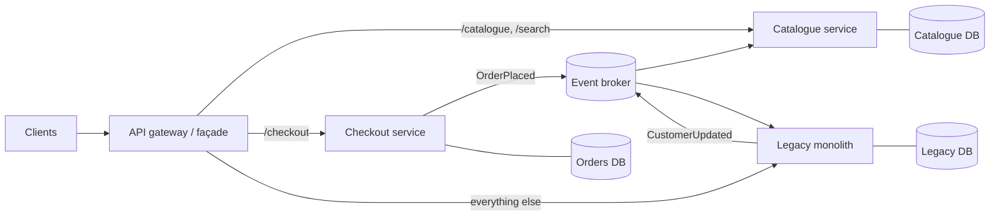
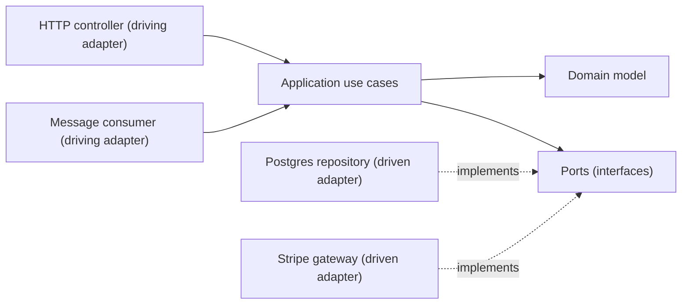
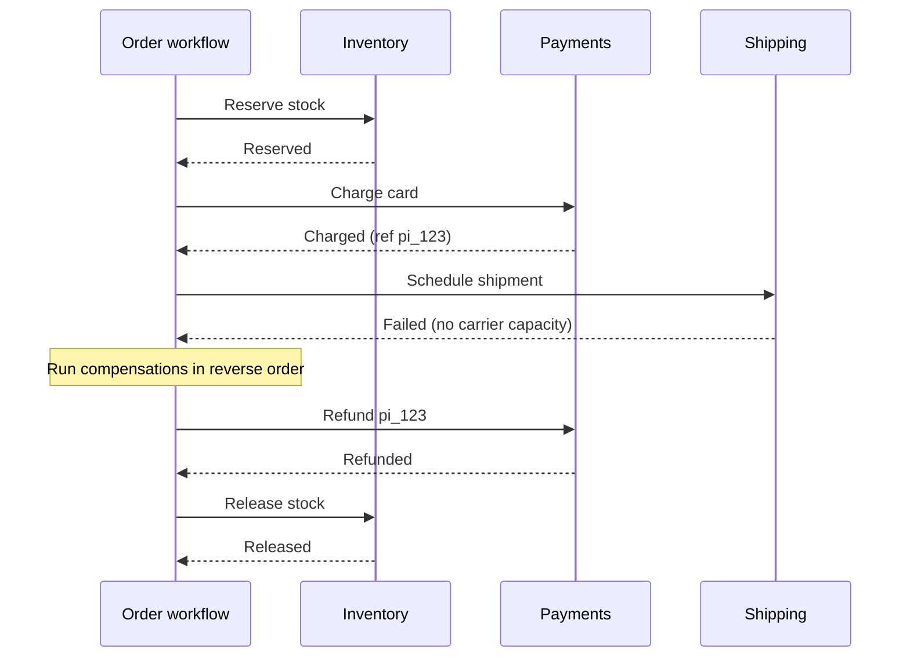
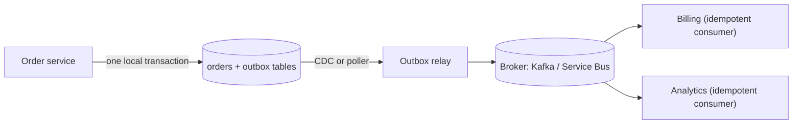

## TL;DR

- Architecture patterns are **trade-off packages**: each buys some qualities (independent deployability, scalability, simplicity) by paying with others (operational cost, consistency, latency). Name the qualities you are optimising for before naming a pattern.
- The **modular monolith** is the right default for most new products. Strong, *enforced* module boundaries give you most of the design benefit of microservices without the distributed-systems tax, and keep extraction cheap later.
- Microservices are primarily an **organisational scaling** pattern (Conway's law): many teams deploying independently. They are not a performance optimisation, and every network hop adds latency and a failure mode.
- **Hexagonal / clean architecture** is about *dependency direction*: domain logic depends on nothing; infrastructure depends on the domain. Integration across boundaries needs the **outbox** and **sagas**, not distributed transactions.
- Migrate incrementally with the **strangler fig**; big-bang rewrites fail far more often than they succeed, because the old system keeps changing while you rebuild it.

## Core Concepts

### The main styles

| Style | Core idea | Primary benefit | Primary cost |
|---|---|---|---|
| Layered (n-tier) | Presentation → business → data | Familiar, simple | Logic leaks across layers; "anaemic" domain; the database schema tends to drive the design |
| Hexagonal (ports & adapters) | Domain at the centre, I/O via ports | Testability, swap infrastructure | Indirection |
| Modular monolith | One deployable, enforced internal module boundaries | Simplicity + clear boundaries | Single scaling/deploy unit |
| Microservices | Independently deployable services owning their data | Team autonomy, independent scaling | Distributed complexity, eventual consistency |
| Event-driven | Components react to events via a broker | Loose coupling, extensibility | Harder to reason about flows, debugging |
| Serverless | Functions/managed services, pay-per-use | No servers, scale to zero | Cold starts, vendor coupling, limits |
| Space-based | Processing units with replicated in-memory data grids; the DB is updated asynchronously | Extreme, elastic throughput (ticketing, auctions) | Data consistency and complex operations |
| Cell-based | Many identical, isolated copies ("cells") of the stack, each serving a partition of customers | Blast-radius isolation, predictable scale units | Routing layer, partitioning, cross-cell features |

Space-based and cell-based are often confused. Space-based architecture is about removing the database as a bottleneck; cell-based architecture is about limiting how many customers one failure can affect.

### Architecture characteristics drive the choice

A pattern is a means, not a goal. Start from the few quality attributes that genuinely matter for this system (pick three to five, not twenty) and record them as NFRs:

- **Deployability and team autonomy** → pushes towards services.
- **Simplicity, cost and speed of change** → pushes towards a monolith.
- **Elastic scaling of one part** → pushes towards extracting that part.
- **Fault isolation** → pushes towards cells, bulkheads and async integration.
- **Auditability** → may justify event sourcing for one bounded context.

The architect's job is to make the trade-off explicit (in an ADR), not to find a pattern without costs.

### Hexagonal architecture in code

The domain defines **ports** (interfaces) it needs; **adapters** implement them. Dependencies point inward.

```ts
// domain/ports.ts — owned by the domain, no infrastructure imports
export interface PaymentGateway {
  charge(orderId: string, amountMinor: number): Promise<{ reference: string }>;
}
export interface OrderRepository {
  get(id: string): Promise<Order | undefined>;
  save(order: Order): Promise<void>;
}

// application/pay-order.ts — pure use case, trivially unit-testable with fakes
export function makePayOrder(deps: { orders: OrderRepository; payments: PaymentGateway }) {
  return async (orderId: string) => {
    const order = await deps.orders.get(orderId);
    if (!order) throw new Error(`Order ${orderId} not found`);
    const { reference } = await deps.payments.charge(order.id, order.totalMinor);
    await deps.orders.save(order.markPaid(reference));
  };
}

// adapters/stripe-gateway.ts — infrastructure depends on the domain port
export class StripeGateway implements PaymentGateway {
  async charge(orderId: string, amountMinor: number) { /* call Stripe SDK */ return { reference: 'pi_...' }; }
}

// composition root (main.ts) — the only place that knows about concrete adapters
const payOrder = makePayOrder({ orders: new PostgresOrderRepository(pool), payments: new StripeGateway() });
```

Clean Architecture (Robert C. Martin, 2012) and Onion Architecture (Jeffrey Palermo, 2008) are variations on the same dependency rule, with more prescribed rings. The test for all three is the same: can you run the use cases with no database, framework or network?

### Modular monolith

One deployable, but modules interact only through public APIs (in-process interfaces or internal events), each module owns its tables (or schema), and boundaries are **enforced** by tooling (lint rules on imports, ArchUnit-style tests, separate packages). Done well, extracting a module into a service later is a mechanical change.

```ts
// src/modules/billing/index.ts — the ONLY file other modules may import
export { createInvoice } from './application/create-invoice';
export type { InvoiceId, InvoiceSummary } from './domain/invoice';
// Nothing from ./infrastructure or ./domain internals is exported.
```

```js
// .dependency-cruiser.js — fail the build when a module reaches into another module's internals
module.exports = {
  forbidden: [
    {
      name: 'no-cross-module-internals',
      severity: 'error',
      from: { path: '^src/modules/([^/]+)/' },
      to: {
        path: '^src/modules/[^/]+/',
        pathNot: ['^src/modules/$1/', '^src/modules/[^/]+/index\\.ts$'],
      },
    },
  ],
};
```

Equivalent tools: Nx `enforce-module-boundaries` (TypeScript monorepos), ArchUnit (Java), NetArchTest (.NET), Packwerk (Shopify's Ruby tool for its modular monolith), and Spring Modulith (Spring, 1.0 released 2023), which also verifies module structure and supports internal events between modules.

Data boundaries matter as much as code boundaries: one schema per module, and no joins across module schemas. A module that needs another's data asks through its API or keeps a local read copy updated by internal events.

### Microservices essentials

- **Own your data**: no shared database between services.
- **Independent deployability** is the litmus test. If services must deploy together, you have a distributed monolith.
- **Communication**: synchronous (REST/gRPC) for queries; asynchronous events for state changes across boundaries.
- **Cross-cutting needs**: service discovery, observability, resilience (timeouts, retries, circuit breakers), API gateway, platform team.
- **The "microservice premium"** (Martin Fowler, 2015): the productivity cost you pay before you get any benefit. It's only worth paying when the system is complex enough that a monolith is slowing teams down.

The latency and availability maths is unforgiving: five synchronous services in series, each 99.9% available, give at most 0.999⁵ ≈ **99.5%** for the chain, roughly 3.6 hours of downtime a month instead of 43 minutes.

### Reliable integration: the transactional outbox

A service that updates its database and then publishes an event has a **dual-write problem**: if it crashes between the two, the event is lost (or, if it publishes first, an event is sent for a change that rolled back). The outbox makes both one local transaction.

```ts
await db.transaction(async (tx) => {
  await tx.query('UPDATE orders SET status = $1 WHERE id = $2', ['PAID', orderId]);
  await tx.query(
    'INSERT INTO outbox (id, aggregate_id, type, payload, occurred_at) VALUES ($1, $2, $3, $4, now())',
    [randomUUID(), orderId, 'OrderPaid', JSON.stringify({ orderId, amountMinor })],
  );
});
// A relay publishes outbox rows to the broker: either CDC on the outbox table
// (e.g. Debezium's outbox event router) or a poller. Delivery is at-least-once,
// so consumers must be idempotent (dedupe on the event id).
```

### Sagas: choreography vs orchestration

Distributed business transactions are modelled as a **saga**: a sequence of local transactions with **compensating actions** on failure.

- **Choreography**: each service reacts to events and emits its own. Loosely coupled, but the flow is implicit and hard to see.
- **Orchestration**: a coordinator (workflow engine such as Temporal, Durable Functions or Step Functions) tells participants what to do. The flow is explicit, observable and testable; the coordinator is a dependency.

```ts
// Temporal workflow (TypeScript SDK): durable orchestration with compensation.
import { proxyActivities } from '@temporalio/workflow';
import type * as activities from './activities';

const { reserveStock, releaseStock, chargePayment, refundPayment, scheduleShipment } =
  proxyActivities<typeof activities>({
    startToCloseTimeout: '30 seconds',
    retry: { maximumAttempts: 5 },
  });

export async function placeOrder(order: OrderInput): Promise<void> {
  const compensations: Array<() => Promise<void>> = [];
  try {
    await reserveStock(order);
    compensations.unshift(() => releaseStock(order));

    const payment = await chargePayment(order);
    compensations.unshift(() => refundPayment(payment.reference));

    await scheduleShipment(order);
  } catch (err) {
    for (const compensate of compensations) await compensate();
    throw err;
  }
}
```

The workflow's state survives process crashes because the engine persists its event history, so "step 2 succeeded, step 3 is pending" is never lost. Compensations are business operations (a refund, a cancellation notice), not rollbacks, and they must themselves be idempotent and retryable.

### CQRS and event sourcing

- **CQRS** separates the write model (commands, invariants) from read models (denormalised projections). It is useful when read and write shapes or scale differ greatly. It does **not** require event sourcing.
- **Event sourcing** stores state as an append-only sequence of events and derives current state by replaying them. It gives a perfect audit trail and temporal queries, at the cost of schema evolution of events, projections and a steep learning curve. Snapshots keep replay times bounded; upcasters translate old event versions into new ones.

Apply event sourcing per bounded context (a ledger, a claims history), never as a system-wide default.

### Event-driven: three different things

Martin Fowler's 2017 distinction is worth using precisely in interviews:

- **Event notification**: "something happened", minimal payload; consumers call back for details. Low coupling, but callbacks add load.
- **Event-carried state transfer**: the event includes the data consumers need, so they keep local copies and don't call back. More resilient, but data is duplicated and eventually consistent.
- **Event sourcing**: events are the system of record (see above).

### Strangler fig

Put a routing façade (API gateway, reverse proxy, BFF) in front of the legacy system. Move one capability at a time to the new implementation and route its traffic there, until the legacy system can be switched off. Supporting techniques: an **anti-corruption layer** so the new model isn't polluted by the legacy one, **parallel run** (call both, compare results, serve the legacy answer) to build confidence, and **feature flags** for gradual traffic shifting.

## How It Works

### Strangler fig migration in progress



The façade routes migrated capabilities to new services; events keep data in sync during the transition. Each new service owns its own data store.

### Hexagonal dependency direction



Every arrow points towards the domain. Adapters know about ports; the domain never knows about adapters.

### Orchestrated saga with compensation



### Transactional outbox



## When to Use / Trade-offs

| Pattern | Use when | Avoid when | Cost |
|---|---|---|---|
| Layered | Simple line-of-business apps, small teams | Rich domain logic that must stay independent of the DB | Anaemic domain, schema-driven design |
| Hexagonal | Rich domain logic, long-lived systems, many integrations | Thin CRUD services | Indirection, more files |
| Modular monolith | Up to a few teams, domain still being discovered, startup or new product | Parts need radically different scaling or tech stacks | Discipline to keep boundaries |
| Microservices | Many teams need independent release cadence, clear domain boundaries | Small team, unclear domain, no platform maturity | Ops, observability, consistency, latency |
| Event-driven integration | Many consumers of state changes, need decoupling and extensibility | Simple request/response, need immediate consistency | Debuggability, eventual consistency |
| Orchestrated saga | Complex multi-step processes, need visibility and timeouts | Two-step flows | Workflow engine dependency |
| CQRS | Read/write asymmetry, complex queries over a rich domain | CRUD apps | Two models, sync lag |
| Event sourcing | Audit/temporal requirements are core (ledgers, compliance) | Most business apps | Event versioning, rebuilds, team skills |
| Serverless | Spiky or event-triggered workloads, small teams | Long-running, latency-critical, steady high load | Cold starts, limits, cost at scale |
| Cell-based | Large multi-tenant SaaS where one failure must not affect all customers | Early-stage products, small customer base | Cell router, tooling to deploy and observe N cells |
| Space-based | Extreme bursty concurrency (ticket sales, auctions) | Strong consistency needs, modest load | In-memory grid operations, data-loss risk |

### Signals for extracting a service from a modular monolith

| Signal | Why it justifies extraction |
|---|---|
| Very different scaling profile (50x spikes in one module) | Scale it without scaling everything |
| Different availability or security requirements (PCI scope) | Shrink the blast radius or compliance scope |
| A team blocked by shared release trains | Independent deployability is the benefit you are buying |
| Different technology needs (ML inference in Python) | One runtime can't serve both well |
| **Not** a signal: "the code is messy" | Fix the module boundaries first; a network won't help |

## Common Pitfalls & Anti-patterns

- **Distributed monolith** — services that share a database or must be deployed together; all the cost, none of the benefit.
- **Microservices first** — splitting before the domain is understood creates wrong boundaries that are expensive to move. Fowler's "MonolithFirst" (2015) argues the same.
- **Entity services** — `CustomerService`, `OrderService` as CRUD wrappers; business logic ends up in orchestrators and chatty calls.
- **Nanoservices** — one function per service; the network and deployment overhead dwarfs the logic.
- **Synchronous call chains** — A → B → C → D over HTTP multiplies latency and failure probability.
- **Shared libraries with domain logic** — couple every service's release to a common package.
- **Dual writes** — "update the DB, then publish the event" with no outbox; events silently go missing on crashes and deploys.
- **Event soup** — dozens of event types with no owner, schema or versioning policy; nobody knows who consumes what. Use a schema registry or AsyncAPI contracts.
- **Event sourcing everywhere** — applied to CRUD domains for "flexibility", then crippled by event versioning.
- **Unenforced modular monolith** — boundaries drawn on a diagram but not checked in CI erode within months into a big ball of mud.
- **Serverless orchestration for heavy data flows** — Amazon Prime Video's 2023 write-up described moving a video-quality monitoring service from Step Functions and Lambda to a single ECS application, cutting that service's infrastructure cost by about 90%. The lesson is "match the pattern to the workload", not "serverless is bad".
- **Big-bang rewrite** — years without delivering value while the old system keeps changing.
- **Microservices without a platform** — every team re-inventing CI/CD, logging and service templates; productivity drops for a year.

## Real-world Scenario

**Context:** An insurance company had a 15-year-old .NET monolith (about 1.2M lines), 6 teams, quarterly releases, and a policy-quoting module that needed 50x scale during campaign spikes. Every release needed a weekend change window and a full regression cycle of about three weeks.

**Constraints:** Regulatory audit of policy decisions, no appetite for a multi-year freeze on features, and a platform team of only two people.

**Options considered:**
- Full rewrite to microservices: rejected; estimated at 3+ years with no value delivered until the end.
- Lift-and-shift to bigger VMs: solved nothing except the campaign spikes, at a very high cost.
- Modularise, then extract only where the signals justified it: chosen.

**Decision:** Not a full microservices rewrite. Instead:
1. Restructured the monolith into a **modular monolith** with enforced module boundaries (separate projects, NetArchTest rules in CI, no cross-module DB access), over 6 months.
2. **Strangled** the quoting module into its own service behind the existing API gateway, because it had a genuinely different scaling profile. Ran it in **parallel** with the legacy quoting engine for four weeks, comparing results, before switching traffic.
3. Integrated via events (`PolicyIssued`, `CustomerUpdated`) through Azure Service Bus with an outbox.
4. Recorded each decision in ADRs, including the decision *not* to extract claims and billing.

**Outcome:** Releases went from quarterly to weekly for the monolith and daily for quoting. Quoting scaled independently through campaigns (autoscaling from 4 to 120 instances) while the rest of the estate stayed flat. Two other modules were later extracted in weeks because the boundaries were already clean. Change failure rate fell because most changes now touched one module.

**What I'd do differently:** Invest in contract tests between the monolith and the new service earlier. Our first two incidents were integration-schema mismatches. I'd also have put a versioning policy for events in place on day one, and staffed the platform team before the first extraction rather than after it.

## Interview Questions

### When would you choose a monolith over microservices? {#monolith-vs-microservices}

**Level:** Foundation

**Model answer:**
Choose a (modular) monolith when the team is small to medium, the domain is still evolving, or operational maturity (CI/CD, observability, on-call) isn't there yet. It is simpler to develop, test, deploy and debug, and refactoring boundaries is cheap. Choose microservices when multiple teams need independent deployment, parts of the system have very different scaling, availability or technology needs, and the organisation can absorb distributed-systems complexity. Many successful systems start as a modular monolith and extract services where there's a clear reason. Shopify, for example, runs a very large modular monolith, and Segment publicly moved over 100 microservices back into a monolith in 2018.

**What the interviewer is looking for:**
Context-driven reasoning (team size, domain clarity, ops maturity) and awareness of the modular-monolith middle ground.

**Follow-ups:**
- How would you enforce module boundaries inside a monolith?
- What signals tell you it's time to extract a service?

**Red flags:**
- "Microservices are always better / more modern."
- Equating monolith with "big ball of mud".

### What is a layered architecture, and why does it often lead to an anaemic domain model? {#layered-architecture}

**Level:** Foundation

**Model answer:**
A layered architecture stacks presentation, business (service) and data-access layers, and each layer calls only the one below. It's familiar and easy to start with. The problem is that the bottom layer is the database: entities mirror tables, the "business layer" becomes service classes full of procedural logic, and domain objects become property bags with getters and setters (Fowler's *anaemic domain model*). Business rules then scatter across services, and changing the schema ripples upwards.

Hexagonal architecture fixes the dependency direction: the domain sits at the centre and persistence becomes an adapter, so behaviour can live with the data it protects.

**What the interviewer is looking for:**
Knowing that the issue is dependency direction and where logic ends up, not layering itself. Great answers say layered is fine for simple CRUD.

**Follow-ups:**
- Is an anaemic domain model always wrong?
- How would you refactor a layered service towards hexagonal without a rewrite?

**Red flags:**
- Treating "layered" and "hexagonal" as the same thing with different names.
- Saying layered architecture is never appropriate.

### What does Conway's law mean for software architecture? {#conways-law}

**Level:** Foundation

**Model answer:**
Melvin Conway observed in 1968 that organisations design systems that mirror their communication structures. In practice: if three teams build a compiler, you get a three-pass compiler. Architecture and team structure are therefore one decision, not two. If two teams must coordinate on every change to a component, the boundary between them is in the wrong place.

The **inverse Conway manoeuvre** uses this deliberately: shape teams around the architecture you want (for example, one stream-aligned team per bounded context, as described in *Team Topologies*, 2019), and the system tends to follow.

**What the interviewer is looking for:**
Understanding that microservices are an organisational choice, and that changing the architecture without changing the teams usually fails.

**Follow-ups:**
- How would you organise teams for a platform of 30 services?
- What happens when one team owns ten services?

**Red flags:**
- Treating it as trivia with no practical implication.
- Designing service boundaries without asking who will own them.

### What are the different kinds of event-driven architecture, and why does the distinction matter? {#event-driven-styles}

**Level:** Foundation

**Model answer:**
"Event-driven" covers at least three distinct patterns:
- **Event notification**: a thin event ("Order 123 was paid"); consumers call back for details. Low coupling on the event schema, but callbacks recreate runtime coupling and load.
- **Event-carried state transfer**: the event carries the data consumers need, so they keep local copies. More resilient and faster, but data is duplicated and eventually consistent, and the event schema becomes a public contract.
- **Event sourcing**: events are the system of record for an aggregate, and state is derived by replay.

They differ in coupling, consistency and how hard they are to change. Mixing them up leads to designs where, for example, a "notification" event quietly becomes a contract every consumer depends on.

**What the interviewer is looking for:**
Precise vocabulary and the coupling trade-off between thin and fat events. Great answers mention schema ownership and versioning.

**Follow-ups:**
- How do you version an event that ten consumers depend on?
- When would you prefer a thin event?

**Red flags:**
- "Event-driven means using Kafka."
- Treating event sourcing as required for event-driven integration.

### What problem does hexagonal (ports and adapters) architecture solve? {#hexagonal}

**Level:** Senior

**Model answer:**
It isolates domain logic from infrastructure by inverting dependencies. The domain defines ports (interfaces for what it needs, like `PaymentGateway` or `OrderRepository`), and adapters implement them (Stripe, Postgres, HTTP controllers). The benefits: the domain is testable with fast in-memory fakes, infrastructure can be swapped or upgraded without touching business rules, and the code's structure communicates the business. Driving adapters (HTTP, CLI, message consumers) call into the application; driven adapters (DB, APIs) are called by it. A composition root wires concrete adapters to ports at startup.

**What the interviewer is looking for:**
Dependency direction as the core idea; practical benefits; awareness of the cost (indirection) for simple CRUD.

**Follow-ups:**
- How does this relate to Clean Architecture and Onion Architecture?
- Would you use it for a small CRUD admin service?

**Red flags:**
- Describing it only as "folders named ports and adapters".
- Domain code importing ORM entities or HTTP types.

### Compare choreography and orchestration for a multi-service order process. Which would you choose? {#saga-choreography-orchestration}

**Level:** Senior

**Model answer:**
In choreography, services publish and react to events (`OrderPlaced` → Payment charges → `PaymentCaptured` → Inventory reserves...). It's loosely coupled and easy to extend with new subscribers, but the end-to-end flow exists only implicitly, making it hard to see, change, time out or debug. In orchestration, a coordinator invokes each step and handles compensation (refund if reservation fails). The flow is explicit and testable, with timeouts and retries in one place, at the cost of a central component and somewhat tighter coupling.

I use choreography for simple fan-out notifications and orchestration (Temporal, Durable Functions) for business-critical multi-step processes with compensation.

**What the interviewer is looking for:**
Concrete trade-offs, compensation handling, and a pragmatic mixed approach.

**Follow-ups:**
- How do you implement compensation when a step is not reversible (an email was sent)?
- How do you observe a choreographed flow end to end?

**Red flags:**
- Suggesting 2PC across services.
- Not mentioning compensating actions.

### Does CQRS require event sourcing? When is CQRS worth it? {#cqrs}

**Level:** Senior

**Model answer:**
No. CQRS just separates the model used to change state (commands enforcing invariants) from models used to read it (projections optimised per query). The read side can be updated synchronously in the same transaction, via change data capture, or from domain events. Event sourcing is a separate choice about *storing* state as events.

CQRS is worth it when reads and writes differ a lot in shape or scale (complex dashboards over a transactional domain, search), or when different teams own read experiences. It's overkill for CRUD, where the same model serves both well.

**What the interviewer is looking for:**
Separating the two concepts and articulating when the complexity pays off.

**Follow-ups:**
- How do you handle a user who doesn't see their change because the read model lags?
- What are the operational costs of event sourcing?

**Red flags:**
- Treating CQRS and event sourcing as inseparable.
- Recommending CQRS for every service.

### How do you enforce module boundaries in a modular monolith so they don't erode? {#enforce-module-boundaries}

**Level:** Senior

**Model answer:**
Boundaries that are only on a diagram erode within months. Enforce them at several levels:
- **Code**: each module exposes one public entry point (an `index.ts` or public package); internals are unimportable. Check this in CI with dependency-cruiser or Nx `enforce-module-boundaries` (TypeScript), ArchUnit (Java), NetArchTest (.NET), Packwerk (Ruby) or Spring Modulith.
- **Data**: one schema per module, separate DB users or permissions where possible, and no cross-module joins or foreign keys.
- **Communication**: synchronous calls through the public API, and in-process domain events for side effects, so modules don't call each other's internals.
- **Ownership**: a code-owners file mapping modules to teams, so cross-module changes need the owning team's review.
- **Measurement**: track cross-module dependency counts over time and treat increases as design debt.

**What the interviewer is looking for:**
Automated enforcement for both code and data, not just good intentions. Great answers mention data ownership and the path to extraction.

**Follow-ups:**
- How do you handle a module that genuinely needs another module's data for a report?
- What would you do with an existing codebase that has thousands of violations?

**Red flags:**
- "We rely on code review."
- Shared tables across modules treated as acceptable.

### How do you reliably publish an event when a service updates its database? {#outbox-pattern}

**Level:** Senior

**Model answer:**
The naïve approach (commit, then publish) is a **dual write**: a crash, timeout or deploy between the two steps loses the event, and publishing first can announce a change that then rolls back. Distributed transactions (XA/2PC) across the DB and broker are usually unavailable or too costly.

The **transactional outbox** writes the business change and an outbox row in the same local transaction. A relay then publishes the rows: either CDC on the outbox table (Debezium's outbox event router) or a poller using `SELECT ... FOR UPDATE SKIP LOCKED`. Delivery is at-least-once, so consumers must be **idempotent**, typically by recording processed event ids (an "inbox") in the same transaction as their own change. Ordering is per aggregate: partition the topic by aggregate id.

Alternatives: **listen to yourself** (publish only, and update your own state from the event), or **event sourcing**, where the event store *is* the outbox.

**What the interviewer is looking for:**
Clear statement of the failure mode, the outbox, and the consumer-side idempotency that makes it correct. Great answers address ordering and outbox table clean-up.

**Follow-ups:**
- How do you keep the outbox table from growing without bound?
- What ordering guarantees can you give, and to whom?

**Red flags:**
- "Wrap the DB write and the publish in a try/catch."
- Assuming the broker delivers exactly once end to end.

### Your team is facing cascading failures: one slow downstream service takes out five others through synchronous call chains. What do you do? {#sync-call-chains}

**Level:** Senior

**Model answer:**
**Immediately (resilience):**
- **Timeouts** on every call, set from the downstream's p99 and the caller's latency budget, not library defaults (often 30–100 s).
- **Circuit breakers** so callers fail fast instead of queuing threads behind a dead dependency.
- **Bulkheads**: separate connection pools or concurrency limits per dependency, so one slow dependency can't exhaust everything.
- **Retries with exponential backoff and jitter, with a budget**, and only for idempotent operations; uncontrolled retries amplify the outage.
- **Fallbacks**: cached or default responses for non-critical data (recommendations, reviews).

**Structurally:**
- Map the call graph (distributed tracing) and find the chains on the critical path.
- Replace queries across services with **local read models** fed by events (event-carried state transfer), so the request path doesn't need the other service at all.
- Move state changes to **asynchronous commands/events** where the user doesn't need the result immediately.
- Reconsider boundaries: if two services are always called together, they may belong in one service.

**What the interviewer is looking for:**
Stabilise first, then remove the coupling. Great answers do the availability maths (chains multiply failure) and question the service boundaries.

**Follow-ups:**
- How do you choose timeout values across a chain of four calls?
- What's the risk of adding retries at every layer?

**Red flags:**
- "Add more instances of the slow service" as the only answer.
- Retries everywhere with no backoff or budget.

### You're asked to move a 12-year-old monolith to a cloud-native architecture. How do you approach it? {#strangler-migration}

**Level:** Architect

**Model answer:**
1. **Clarify goals and constraints**: why migrate (release speed, scaling, cost, end of life)? Turn them into measurable outcomes and NFRs.
2. **Understand the domain**: event storming or context mapping to find bounded contexts, and analysis of change frequency and coupling (which modules change together?).
3. **Modularise first** where possible: enforce boundaries inside the monolith; this is cheap and reduces risk.
4. **Strangler fig**: a façade in front; extract the capability with the best value/risk ratio first (different scaling, high change rate, clear boundary). Use an anti-corruption layer and parallel runs.
5. **Data**: give each extracted service its own store; sync via events/CDC during transition; plan who owns which data.
6. **Platform enablers**: CI/CD, observability, IaC and a paved road before scaling out to many services.
7. **Govern with ADRs and metrics**: DORA metrics, incident rates, cost; review and adjust quarterly.

Avoid the big-bang rewrite. Deliver value with every extraction and keep the option to stop.

**What the interviewer is looking for:**
Goal-driven, incremental, data-aware migration; organisational alignment (team topology mirrors the target architecture); risk management.

**Follow-ups:**
- How do you pick the first capability to extract?
- How do you handle shared tables used by five modules?
- How do you keep the business on board during a multi-year migration?

**Red flags:**
- "Rewrite it in microservices."
- Ignoring data migration and ownership.

### What are the symptoms of a distributed monolith, and how would you fix one? {#distributed-monolith}

**Level:** Architect

**Model answer:**
Symptoms:
- Services must be released together (lockstep versions).
- A shared database or schema.
- Long synchronous call chains, where one service's outage takes many down.
- Shared libraries containing domain logic.
- Changes routinely touch multiple services.
- A single team owns many services, or many teams must coordinate every change.

Fixes:
- **Re-draw boundaries** around business capabilities (DDD bounded contexts), merging services that change together.
- **Split shared data** by ownership, using events/CDC for read copies.
- **Replace sync chains** with async events or local read models.
- **Version APIs** and use contract tests.
- **Align team ownership** to services (inverse Conway manoeuvre).

Sometimes the right move is to *merge* services back into a modular monolith.

**What the interviewer is looking for:**
Diagnosis from observable signals, willingness to merge services, and treating it as a socio-technical issue.

**Follow-ups:**
- How would you measure coupling between services?
- How do you convince leadership that merging services is progress?

**Red flags:**
- "Add an API gateway" as the fix.
- Unwillingness to consider consolidation.

### How do you decide where service or module boundaries should go? {#service-boundaries}

**Level:** Architect

**Model answer:**
Boundaries should follow **business capabilities and language**, not technical layers or database tables:
- **Domain discovery**: event storming and context mapping to find bounded contexts, where the same word ("policy", "customer") means different things to different parts of the business.
- **Change coupling**: mine version control to see which files change together; things that change together belong together.
- **Data ownership and invariants**: an invariant that must hold transactionally ("stock can't go negative on reservation") should sit inside one boundary.
- **Team cognitive load**: a boundary one team can own end to end.
- **Volatility and NFRs**: separate fast-changing or differently-scaled parts from stable ones.

Heuristics: prefer fewer, larger services early; a boundary that requires a synchronous call for most requests is probably wrong; and validate with "can this team ship a typical feature without coordinating with anyone?". Boundaries are hypotheses, so record them in ADRs and revisit them.

**What the interviewer is looking for:**
A method combining domain analysis, data invariants, change data from real code and team structure. Great answers accept that boundaries will be wrong at first and design to make moving them cheap (start in a modular monolith).

**Follow-ups:**
- Two teams both claim "Customer". How do you resolve it?
- What evidence would make you merge two services?

**Red flags:**
- One service per database table or per noun.
- Boundaries chosen by technology ("the Java service" and "the Node service").

### How would you design a cell-based architecture to limit the blast radius of failures for a multi-tenant SaaS? {#cell-based-architecture}

**Level:** Architect

**Model answer:**
A **cell** is a complete, independent copy of the stack (services, data stores, queues) serving a subset of tenants. A failure, bad deploy or noisy tenant affects one cell, not everyone. AWS uses this widely and published guidance on it in 2023, and Slack described migrating to a cellular architecture the same year.

Design:
- **Partition key**: usually tenant id. Assign tenants to cells with a mapping table, not a hash, so you can move large tenants and rebalance.
- **Cell router**: a thin, highly available layer that looks up the cell and forwards the request. Keep it as simple as possible, because it's the shared component that can still take everything down.
- **Cell size**: fixed maximum capacity (e.g. N tenants or X RPS), tested to that limit. Grow by adding cells, not by growing cells.
- **No cross-cell calls** on the request path. Global data (billing, identity, the cell map) lives in a small control plane that cells can survive without temporarily.
- **Deployment**: roll out cell by cell, starting with a canary cell, so a bad release reaches a few percent of customers.
- **Migration**: tooling to move a tenant between cells (copy, dual-write or replay, cut over).

Costs: duplicated infrastructure (efficiency drops), cross-tenant features (global search, analytics) need a separate aggregation path, and you need strong automation to operate tens of cells.

**What the interviewer is looking for:**
Clear statement of the goal (blast radius, not raw scale), the router and control plane as the remaining shared risks, and the operational cost. Great answers discuss cell sizing, tenant placement and cell-by-cell deploys.

**Follow-ups:**
- How do you handle a single tenant too large for one cell?
- How do you deliver features that need data from every cell?
- What would make you decide cells are too early for this company?

**Red flags:**
- Confusing cells with ordinary horizontal scaling or availability zones.
- A router that calls into cells for business logic.

### When is serverless the right architecture, and when does it become a liability? {#serverless-fit}

**Level:** Architect

**Model answer:**
**Good fit:** spiky or unpredictable load, event-driven glue (file uploads, webhooks, queue consumers), scheduled jobs, low-traffic APIs, and small teams that want minimal operations. Scale-to-zero and pay-per-use make the economics excellent at low or bursty utilisation.

**Liability when:**
- **Load is steady and high**: per-invocation pricing overtakes reserved containers or VMs. Amazon Prime Video's 2023 write-up reported a ~90% cost cut after moving one monitoring workload from Step Functions and Lambda to ECS.
- **Latency-critical paths**: cold starts (hundreds of ms to seconds, worse for JVM and .NET; mitigated by provisioned concurrency or Lambda SnapStart, which AWS introduced for Java in 2022 and extended to Python and .NET in 2024).
- **Hard limits**: Lambda caps execution at 15 minutes, along with payload and concurrency limits.
- **Fine-grained functions** turn a simple flow into a distributed system that's hard to test locally and debug.
- **Downstream protection**: thousands of concurrent functions can exhaust a relational DB's connections (use a connection proxy and concurrency limits).

The architect's answer is usually hybrid: serverless at the edges and for event glue, containers for steady core services, with the decision revisited as the load profile changes.

**What the interviewer is looking for:**
Workload-driven reasoning with cost maths, awareness of limits, and no ideology. Great answers mention downstream effects (DB connections) and that the right answer changes over time.

**Follow-ups:**
- How would you estimate the break-even point between Lambda and containers?
- How do you keep serverless code portable?

**Red flags:**
- "Serverless is always cheaper."
- Citing the Prime Video case as proof that serverless or microservices are bad.

## Cheat Sheet

### Styles

- **Modular monolith** — one deployable with enforced module boundaries; the default starting point.
- **Microservices** — independently deployable services owning their data; an org-scaling pattern.
- **Distributed monolith** — services that must deploy together or share a DB; the worst of both worlds.
- **Hexagonal** — domain defines ports; adapters implement them; dependencies point inward.
- **Cell-based architecture** — isolated copies of the full stack, each serving a subset of tenants, to limit blast radius.

### Integration and consistency

- **Saga** — a sequence of local transactions with compensating actions on failure.
- **Choreography** — services react to each other's events; implicit flow.
- **Orchestration** — a coordinator drives the steps; explicit flow, central dependency.
- **Outbox pattern** — write the change and the event in one local transaction, then relay; fixes dual writes.
- **CQRS** — separate write and read models; doesn't require event sourcing.
- **Event sourcing** — store events as the source of truth; derive state by replay.

### Migration and organisation

- **Strangler fig** — route capabilities one by one from legacy to new behind a façade.
- **Conway's law** — systems mirror the communication structure of the organisations that build them.
- **Inverse Conway manoeuvre** — shape teams around the architecture you want, so the system follows.
- **BFF** — Backend for Frontend: an API tailored to one client type.

## Further Reading

- [Azure Architecture Center: architecture styles](https://learn.microsoft.com/en-us/azure/architecture/guide/architecture-styles/) — styles, constraints and when to use each.
- [Azure Architecture Center: cloud design patterns](https://learn.microsoft.com/en-us/azure/architecture/patterns/) — strangler fig, saga, CQRS, event sourcing and more.
- [Martin Fowler: Microservices](https://martinfowler.com/articles/microservices.html) — the original characteristics article.
- [Martin Fowler: What do you mean by "Event-Driven"?](https://martinfowler.com/articles/201701-event-driven.html) — the distinction between notification, state transfer and event sourcing.
- [Alistair Cockburn: Hexagonal Architecture](https://alistair.cockburn.us/hexagonal-architecture/) — the pattern from its author.
- [microservices.io patterns](https://microservices.io/patterns/) — Chris Richardson's pattern language for microservices, including the transactional outbox.
- [Spring Modulith documentation](https://spring.io/projects/spring-modulith) — verifiable module boundaries and internal events in a modular monolith.
- [Temporal documentation](https://docs.temporal.io/) — durable workflow orchestration for sagas.
- VERIFY: [Debezium: outbox event router](https://debezium.io/documentation/reference/stable/transformations/outbox-event-router.html) — CDC-based relay for the outbox pattern.
- VERIFY: [AWS Well-Architected: Reducing the scope of impact with cell-based architecture](https://docs.aws.amazon.com/wellarchitected/latest/reducing-scope-of-impact-with-cell-based-architecture/reducing-scope-of-impact-with-cell-based-architecture.html) — AWS guidance on cell design, routing and sizing.
- VERIFY: [Melvin Conway: How Do Committees Invent?](http://www.melconway.com/Home/Committees_Paper.html) — the 1968 paper behind Conway's law.
