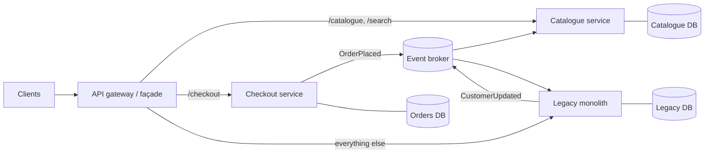

## TL;DR

- Architecture patterns are **trade-off packages**: each buys some qualities (independent deployability, scalability, simplicity) by paying with others (operational cost, consistency, latency).
- The **modular monolith** is the right default for most new products. Strong module boundaries give you most of the design benefit of microservices without the distributed-systems tax.
- Microservices are primarily an **organisational scaling** pattern (Conway's law): many teams deploying independently. They are not a performance optimisation.
- **Hexagonal / clean architecture** is about *dependency direction*: domain logic depends on nothing; infrastructure depends on the domain.
- Migrate incrementally with the **strangler fig**; big-bang rewrites fail far more often than they succeed.

## Core Concepts

### The main styles

| Style | Core idea | Primary benefit | Primary cost |
|---|---|---|---|
| Layered (n-tier) | Presentation → business → data | Familiar, simple | Logic leaks across layers; "anaemic" domain |
| Hexagonal (ports & adapters) | Domain at the centre, I/O via ports | Testability, swap infrastructure | Indirection |
| Modular monolith | One deployable, enforced internal module boundaries | Simplicity + clear boundaries | Single scaling/deploy unit |
| Microservices | Independently deployable services owning their data | Team autonomy, independent scaling | Distributed complexity, eventual consistency |
| Event-driven | Components react to events via a broker | Loose coupling, extensibility | Harder to reason about flows, debugging |
| Serverless | Functions/managed services, pay-per-use | No servers, scale to zero | Cold starts, vendor coupling, limits |
| Space-based / cell-based | Partition the system into independent cells | Blast-radius isolation, scale | Routing, data partitioning |

### Hexagonal architecture in code

The domain defines **ports** (interfaces) it needs; **adapters** implement them. Dependencies point inward.

```ts
// domain/ports.ts — owned by the domain, no infrastructure imports
export interface PaymentGateway {
  charge(orderId: string, amountMinor: number): Promise<{ reference: string }>;
}
export interface OrderRepository {
  get(id: string): Promise<Order | undefined>;
  save(order: Order): Promise<void>;
}

// domain/place-order.ts — pure use case, trivially unit-testable with fakes
export function makePayOrder(deps: { orders: OrderRepository; payments: PaymentGateway }) {
  return async (orderId: string) => {
    const order = await deps.orders.get(orderId);
    if (!order) throw new Error(`Order ${orderId} not found`);
    const { reference } = await deps.payments.charge(order.id, order.totalMinor);
    await deps.orders.save(order.markPaid(reference));
  };
}

// adapters/stripe-gateway.ts — infrastructure depends on the domain port
export class StripeGateway implements PaymentGateway {
  async charge(orderId: string, amountMinor: number) { /* call Stripe SDK */ return { reference: 'pi_...' }; }
}
```

### Modular monolith

One deployable, but modules interact only through public APIs (in-process interfaces or internal events), each module owns its tables (or schema), and boundaries are **enforced** by tooling (lint rules on imports, ArchUnit-style tests, separate packages). Done well, extracting a module into a service later is a mechanical change.

### Microservices essentials

- **Own your data**: no shared database between services.
- **Independent deployability** is the litmus test. If services must deploy together, you have a distributed monolith.
- **Communication**: synchronous (REST/gRPC) for queries; asynchronous events for state changes across boundaries.
- **Cross-cutting needs**: service discovery, observability, resilience (timeouts, retries, circuit breakers), API gateway, platform team.

### Sagas: choreography vs orchestration

Distributed business transactions are modelled as a **saga**: a sequence of local transactions with **compensating actions** on failure.

- **Choreography**: each service reacts to events and emits its own. Loosely coupled, but the flow is implicit and hard to see.
- **Orchestration**: a coordinator (workflow engine such as Temporal, Durable Functions or Step Functions) tells participants what to do. The flow is explicit, observable and testable; the coordinator is a dependency.

### CQRS and event sourcing

- **CQRS** separates the write model (commands, invariants) from read models (denormalised projections). It is useful when read and write shapes or scale differ greatly. It does **not** require event sourcing.
- **Event sourcing** stores state as an append-only sequence of events and derives current state by replaying them. It gives a perfect audit trail and temporal queries, at the cost of schema evolution of events, projections and a steep learning curve.

### Strangler fig

Put a routing façade (API gateway, reverse proxy, BFF) in front of the legacy system. Move one capability at a time to the new implementation and route its traffic there, until the legacy system can be switched off.

## How It Works



The façade routes migrated capabilities to new services; events keep data in sync during the transition. Each new service owns its own data store.

## When to Use / Trade-offs

| Pattern | Use when | Avoid when | Cost |
|---|---|---|---|
| Modular monolith | Up to a few teams, domain still being discovered, startup or new product | Parts need radically different scaling or tech stacks | Discipline to keep boundaries |
| Microservices | Many teams need independent release cadence, clear domain boundaries | Small team, unclear domain, no platform maturity | Ops, observability, consistency, latency |
| Event-driven integration | Many consumers of state changes, need decoupling and extensibility | Simple request/response, need immediate consistency | Debuggability, eventual consistency |
| Orchestrated saga | Complex multi-step processes, need visibility and timeouts | Two-step flows | Workflow engine dependency |
| CQRS | Read/write asymmetry, complex queries over a rich domain | CRUD apps | Two models, sync lag |
| Event sourcing | Audit/temporal requirements are core (ledgers, compliance) | Most business apps | Event versioning, rebuilds, team skills |
| Serverless | Spiky or event-triggered workloads, small teams | Long-running, latency-critical, steady high load | Cold starts, limits, cost at scale |

## Common Pitfalls & Anti-patterns

- **Distributed monolith** — services that share a database or must be deployed together; all the cost, none of the benefit.
- **Microservices first** — splitting before the domain is understood creates wrong boundaries that are expensive to move.
- **Entity services** — `CustomerService`, `OrderService` as CRUD wrappers; business logic ends up in orchestrators and chatty calls.
- **Synchronous call chains** — A → B → C → D over HTTP multiplies latency and failure probability.
- **Shared libraries with domain logic** — couple every service's release to a common package.
- **Event sourcing everywhere** — applied to CRUD domains for "flexibility", then crippled by event versioning.
- **Big-bang rewrite** — years without delivering value while the old system keeps changing.

## Real-world Scenario

**Context:** An insurance company had a 15-year-old .NET monolith, 6 teams, quarterly releases, and a policy-quoting module that needed 50x scale during campaign spikes.

**Decision:** Not a full microservices rewrite. Instead:
1. Restructured the monolith into a **modular monolith** with enforced module boundaries (separate projects, no cross-module DB access), over 6 months.
2. **Strangled** the quoting module into its own service behind the existing API gateway, because it had a genuinely different scaling profile.
3. Integrated via events (`PolicyIssued`, `CustomerUpdated`) through Azure Service Bus with an outbox.
4. Recorded each decision in ADRs.

**Outcome:** Releases went from quarterly to weekly for the monolith and daily for quoting. Quoting scaled independently through campaigns. Two other modules were later extracted in weeks because the boundaries were already clean.

**What I'd do differently:** Invest in contract tests between the monolith and the new service earlier. Our first two incidents were integration-schema mismatches.

## Interview Questions

### When would you choose a monolith over microservices? {#monolith-vs-microservices}

**Level:** Foundation

**Model answer:**
Choose a (modular) monolith when the team is small to medium, the domain is still evolving, or operational maturity (CI/CD, observability, on-call) isn't there yet. It is simpler to develop, test, deploy and debug, and refactoring boundaries is cheap. Choose microservices when multiple teams need independent deployment, parts of the system have very different scaling, availability or technology needs, and the organisation can absorb distributed-systems complexity. Many successful systems start as a modular monolith and extract services where there's a clear reason.

**What the interviewer is looking for:**
Context-driven reasoning (team size, domain clarity, ops maturity) and awareness of the modular-monolith middle ground.

**Follow-ups:**
- How would you enforce module boundaries inside a monolith?
- What signals tell you it's time to extract a service?

**Red flags:**
- "Microservices are always better / more modern."
- Equating monolith with "big ball of mud".

### What problem does hexagonal (ports and adapters) architecture solve? {#hexagonal}

**Level:** Senior

**Model answer:**
It isolates domain logic from infrastructure by inverting dependencies. The domain defines ports (interfaces for what it needs, like `PaymentGateway` or `OrderRepository`), and adapters implement them (Stripe, Postgres, HTTP controllers). The benefits: the domain is testable with fast in-memory fakes, infrastructure can be swapped or upgraded without touching business rules, and the code's structure communicates the business. Driving adapters (HTTP, CLI, message consumers) call into the application; driven adapters (DB, APIs) are called by it.

**What the interviewer is looking for:**
Dependency direction as the core idea; practical benefits; awareness of the cost (indirection) for simple CRUD.

**Follow-ups:**
- How does this relate to Clean Architecture and Onion Architecture?
- Would you use it for a small CRUD admin service?

**Red flags:**
- Describing it only as "folders named ports and adapters".
- Domain code importing ORM entities or HTTP types.

### Compare choreography and orchestration for a multi-service order process. {#saga-choreography-orchestration}

**Level:** Senior

**Model answer:**
In choreography, services publish and react to events (`OrderPlaced` → Payment charges → `PaymentCaptured` → Inventory reserves...). It's loosely coupled and easy to extend with new subscribers, but the end-to-end flow exists only implicitly, making it hard to see, change, time out or debug. In orchestration, a coordinator invokes each step and handles compensation (refund if reservation fails). The flow is explicit and testable, with timeouts and retries in one place, at the cost of a central component and somewhat tighter coupling.

I use choreography for simple fan-out notifications and orchestration (Temporal, Durable Functions) for business-critical multi-step processes with compensation.

**What the interviewer is looking for:**
Concrete trade-offs, compensation handling, and a pragmatic mixed approach.

**Follow-ups:**
- How do you implement compensation when a step is not reversible (an email was sent)?
- How do you observe a choreographed flow end to end?

**Red flags:**
- Suggesting 2PC across services.
- Not mentioning compensating actions.

### Does CQRS require event sourcing? When is CQRS worth it? {#cqrs}

**Level:** Senior

**Model answer:**
No. CQRS just separates the model used to change state (commands enforcing invariants) from models used to read it (projections optimised per query). The read side can be updated synchronously in the same transaction, via change data capture, or from domain events. Event sourcing is a separate choice about *storing* state as events.

CQRS is worth it when reads and writes differ a lot in shape or scale (complex dashboards over a transactional domain, search), or when different teams own read experiences. It's overkill for CRUD, where the same model serves both well.

**What the interviewer is looking for:**
Separating the two concepts and articulating when the complexity pays off.

**Follow-ups:**
- How do you handle a user who doesn't see their change because the read model lags?
- What are the operational costs of event sourcing?

**Red flags:**
- Treating CQRS and event sourcing as inseparable.
- Recommending CQRS for every service.

### You're asked to move a 12-year-old monolith to a cloud-native architecture. How do you approach it? {#strangler-migration}

**Level:** Architect

**Model answer:**
1. **Clarify goals and constraints**: why migrate (release speed, scaling, cost, end of life)? Turn them into measurable outcomes and NFRs.
2. **Understand the domain**: event storming or context mapping to find bounded contexts, and analysis of change frequency and coupling (which modules change together?).
3. **Modularise first** where possible: enforce boundaries inside the monolith; this is cheap and reduces risk.
4. **Strangler fig**: a façade in front; extract the capability with the best value/risk ratio first (different scaling, high change rate, clear boundary).
5. **Data**: give each extracted service its own store; sync via events/CDC during transition; plan who owns which data.
6. **Platform enablers**: CI/CD, observability, IaC and a paved road before scaling out to many services.
7. **Govern with ADRs and metrics**: DORA metrics, incident rates, cost; review and adjust quarterly.

Avoid the big-bang rewrite. Deliver value with every extraction and keep the option to stop.

**What the interviewer is looking for:**
Goal-driven, incremental, data-aware migration; organisational alignment (team topology mirrors the target architecture); risk management.

**Follow-ups:**
- How do you pick the first capability to extract?
- How do you handle shared tables used by five modules?
- How do you keep the business on board during a multi-year migration?

**Red flags:**
- "Rewrite it in microservices."
- Ignoring data migration and ownership.

### What are the symptoms of a distributed monolith, and how would you fix one? {#distributed-monolith}

**Level:** Architect

**Model answer:**
Symptoms:
- Services must be released together (lockstep versions).
- A shared database or schema.
- Long synchronous call chains, where one service's outage takes many down.
- Shared libraries containing domain logic.
- Changes routinely touch multiple services.
- A single team owns many services, or many teams must coordinate every change.

Fixes:
- **Re-draw boundaries** around business capabilities (DDD bounded contexts), merging services that change together.
- **Split shared data** by ownership, using events/CDC for read copies.
- **Replace sync chains** with async events or local read models.
- **Version APIs** and use contract tests.
- **Align team ownership** to services (inverse Conway manoeuvre).

Sometimes the right move is to *merge* services back into a modular monolith.

**What the interviewer is looking for:**
Diagnosis from observable signals, willingness to merge services, and treating it as a socio-technical issue.

**Follow-ups:**
- How would you measure coupling between services?
- How do you convince leadership that merging services is progress?

**Red flags:**
- "Add an API gateway" as the fix.
- Unwillingness to consider consolidation.

## Cheat Sheet

- **Modular monolith** — one deployable with enforced module boundaries; the default starting point.
- **Microservices** — independently deployable services owning their data; an org-scaling pattern.
- **Distributed monolith** — services that must deploy together or share a DB; the worst of both worlds.
- **Hexagonal** — domain defines ports; adapters implement them; dependencies point inward.
- **Saga** — a sequence of local transactions with compensating actions on failure.
- **Choreography** — services react to each other's events; implicit flow.
- **Orchestration** — a coordinator drives the steps; explicit flow, central dependency.
- **CQRS** — separate write and read models; doesn't require event sourcing.
- **Event sourcing** — store events as the source of truth; derive state by replay.
- **Strangler fig** — route capabilities one by one from legacy to new behind a façade.
- **Conway's law** — systems mirror the communication structure of the organisations that build them.
- **BFF** — Backend for Frontend: an API tailored to one client type.

## Further Reading

- [Azure Architecture Center: architecture styles](https://learn.microsoft.com/en-us/azure/architecture/guide/architecture-styles/) — styles, constraints and when to use each.
- [Azure Architecture Center: cloud design patterns](https://learn.microsoft.com/en-us/azure/architecture/patterns/) — strangler fig, saga, CQRS, event sourcing and more.
- [Martin Fowler: Microservices](https://martinfowler.com/articles/microservices.html) — the original characteristics article.
- [Alistair Cockburn: Hexagonal Architecture](https://alistair.cockburn.us/hexagonal-architecture/) — the pattern from its author.
- [microservices.io patterns](https://microservices.io/patterns/) — Chris Richardson's pattern language for microservices.
