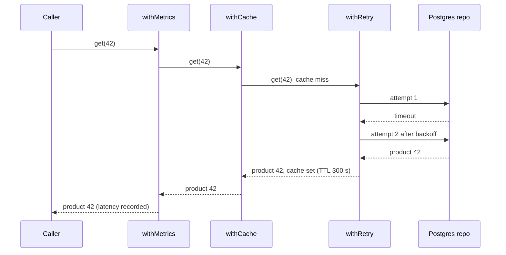
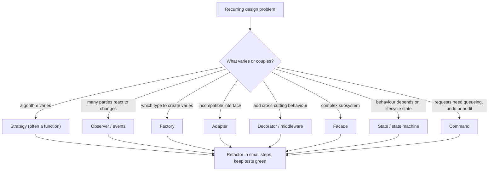

## TL;DR

- Design patterns are **named, reusable solutions to recurring design problems**. Their biggest value is a **shared vocabulary**: "use a strategy here" communicates a whole design in three words.
- The classic Gang of Four (1994) catalogue groups 23 patterns into **creational** (how objects are made), **structural** (how they're composed) and **behavioural** (how they interact). A handful — strategy, observer, factory, adapter, decorator, facade, command, state — cover most everyday use.
- In TypeScript and modern languages many patterns collapse into **functions, closures and modules**: a strategy is often just a function parameter.
- Patterns solve specific forces (variation, coupling, extensibility). Applied without those forces they add indirection and complexity — **refactor towards a pattern when the need appears**.
- Architecture-level patterns (circuit breaker, saga, outbox, CQRS) apply the same thinking to distributed systems.

## Core Concepts

### The three families

| Family | Problem | Common patterns |
|---|---|---|
| Creational | Decouple code from how objects are created | Factory method, abstract factory, builder, singleton, prototype |
| Structural | Compose objects and interfaces | Adapter, decorator, facade, proxy, composite, bridge, flyweight |
| Behavioural | Distribute responsibilities and communication | Strategy, observer, command, state, template method, chain of responsibility, iterator, mediator, visitor, memento |

### Strategy — swap algorithms behind one interface

```ts
type ShippingStrategy = (order: Order) => Money;

const standard: ShippingStrategy = (o) => (o.total.minor >= 5000 ? Money.zero('GBP') : Money.of(395, 'GBP'));
const express: ShippingStrategy = () => Money.of(995, 'GBP');
const strategies: Record<ShippingMethod, ShippingStrategy> = { standard, express };

export const shippingCost = (order: Order) => strategies[order.shippingMethod](order);
```

Replaces growing `if/else` or `switch` chains; new variants don't touch existing code (open–closed principle). In TypeScript, a function type is usually enough — no class hierarchy needed.

### Observer — notify subscribers of changes

The subject keeps a list of observers and notifies them on change; observers don't know about each other. Modern forms: event emitters, DOM events, RxJS observables, signals, and — at system scale — publish/subscribe messaging.

```ts
type Listener<T> = (value: T) => void;
export function createStore<T>(initial: T) {
  let value = initial;
  const listeners = new Set<Listener<T>>();
  return {
    get: () => value,
    set(next: T) { value = next; listeners.forEach((l) => l(value)); },
    subscribe(l: Listener<T>) { listeners.add(l); return () => listeners.delete(l); }, // always offer unsubscribe
  };
}
```

Watch for memory leaks (forgotten subscriptions), update ordering and cascading updates.

### Factory — centralise creation decisions

Factory functions or methods decide which concrete type to create based on input or configuration, hiding constructors and dependencies:

```ts
export function createPaymentGateway(cfg: Config): PaymentGateway {
  switch (cfg.provider) {
    case 'stripe': return new StripeGateway(cfg.stripe);
    case 'adyen': return new AdyenGateway(cfg.adyen);
    case 'fake': return new FakeGateway(); // tests and local development
  }
}
```

**Abstract factory** creates families of related objects (e.g. UI widgets per platform). **Builder** constructs complex objects step by step (useful for test data builders and query builders).

### Structural patterns: adapter, decorator, facade, proxy

- **Adapter:** converts one interface into another the client expects — wrapping a third-party SDK behind your own port.
- **Decorator:** wraps an object with the same interface to add behaviour — caching, retries, logging, metrics — composable in layers.
- **Facade:** a simple interface over a complex subsystem — a `CheckoutService` orchestrating pricing, tax and payments.
- **Proxy:** same interface, controls access — lazy loading, remote proxies, access control, caching.

```ts
// Decorator: add caching without changing the underlying repository
export function withCache(repo: ProductRepository, cache: Cache): ProductRepository {
  return {
    async get(id) {
      const hit = await cache.get<Product>(`product:${id}`);
      if (hit) return hit;
      const product = await repo.get(id);
      await cache.set(`product:${id}`, product, { ttlSeconds: 300 });
      return product;
    },
  };
}
```

### Decorators in motion

Each wrapper has the same interface as the thing it wraps, so they stack. A call travels inward through every layer and the result travels back out. That's why **order matters**: here the metrics layer sees the time the cache saves, and retries happen inside the cache, so a cached value is never retried.



### Behavioural patterns: command, state, template method, chain of responsibility

- **Command:** encapsulate a request as an object — queueing, retries, undo/redo, audit logs.
- **State:** behaviour depends on internal state; each state is an object (or explicit state machine) defining allowed transitions.
- **Template method:** a fixed algorithm skeleton with overridable steps (in TS often replaced by passing functions).
- **Chain of responsibility:** pass a request along handlers until one handles it — HTTP middleware pipelines are the everyday example.

### Worked example: visitor without the boilerplate

The classic visitor lets you add operations over a fixed set of types without editing them, at the cost of double dispatch and `accept` methods everywhere. In TypeScript, a **discriminated union plus an exhaustive switch** gives the same benefit, and the compiler tells you every place to update when you add a variant:

```ts
type Discount =
  | { kind: 'percentage'; percent: number }
  | { kind: 'fixed'; amountMinor: number }
  | { kind: 'buyXgetY'; buy: number; free: number; unitPriceMinor: number };

function assertNever(x: never): never {
  throw new Error(`Unhandled variant: ${JSON.stringify(x)}`);
}

// One "visitor" = one function. Adding an operation never touches the types.
function savingMinor(d: Discount, subtotalMinor: number, qty: number): number {
  switch (d.kind) {
    case 'percentage': return Math.round((subtotalMinor * d.percent) / 100);
    case 'fixed': return Math.min(d.amountMinor, subtotalMinor);
    case 'buyXgetY': return Math.floor(qty / (d.buy + d.free)) * d.free * d.unitPriceMinor;
    default: return assertNever(d); // add a 4th kind and this line stops compiling
  }
}

function describe(d: Discount): string {
  switch (d.kind) {
    case 'percentage': return `${d.percent}% off`;
    case 'fixed': return `£${(d.amountMinor / 100).toFixed(2)} off`;
    case 'buyXgetY': return `Buy ${d.buy}, get ${d.free} free`;
    default: return assertNever(d);
  }
}
```

The trade-off flips depending on what changes more often. If you add **operations** often, unions and switches are ideal. If you add **types** often (plugins from other teams), polymorphism, where each type implements the interface, scales better. This is the "expression problem".

### Singleton — and why it's usually avoided

Ensures one instance with global access. Problems: hidden global state, tight coupling, hard testing, concurrency issues. Prefer creating one instance at the composition root and **injecting** it. In JavaScript, a module-level instance is effectively a singleton — fine for things like a logger, risky for mutable state.

### Dependency injection

Objects receive their dependencies rather than creating them, usually wired at a **composition root** (application start). Enables swapping implementations (fakes in tests, different providers) and makes dependencies explicit. Containers (NestJS, InversifyJS, .NET DI) automate wiring; plain constructor/function parameters are often enough.

## How It Works



Start from the concrete problem and the force driving it; reach for a pattern only when it reduces the cost of change you're actually experiencing.

## When to Use / Trade-offs

| Pattern | Use when | Avoid when | Trade-off |
|---|---|---|---|
| Strategy | Several interchangeable algorithms; variants grow over time | Only one or two stable variants | Extensibility vs indirection |
| Observer / events | Loose coupling between producers and many consumers | Strict ordering or a single consumer | Decoupling vs harder control flow and debugging |
| Factory | Creation logic varies or needs hiding | Simple `new` suffices | Flexibility vs another layer |
| Adapter | Integrating third-party or legacy interfaces | Interfaces already match | Isolation vs translation code |
| Decorator | Composable cross-cutting concerns | Deep stacks obscure behaviour | Composition vs debugging complexity |
| Facade | Simplifying a complex subsystem for clients | It becomes a god object | Simplicity vs hidden coupling |
| State machine | Entities with lifecycles and rules on transitions | Two trivial states | Correctness vs upfront modelling |
| Command | Undo, queueing, retries, audit | Simple direct calls | Capabilities vs boilerplate |
| Singleton | Truly single, stateless resources | Mutable shared state | Convenience vs testability |

## Common Pitfalls & Anti-patterns

- **Pattern-first design** — adding factories and strategies "for future flexibility" that never comes.
- **Class-heavy translations in TypeScript** — Java-style hierarchies where a function or object literal would do.
- **Singleton abuse** — global mutable state disguised as a pattern.
- **Observer leaks** — subscriptions never removed; cascades of updates.
- **God facades** — a facade that accumulates all business logic.
- **Deep decorator stacks** — behaviour hidden in layers nobody can trace.
- **Naming without meaning** — `AbstractManagerFactoryImpl` obscures what the code does.
- **Copying patterns mechanically** without the problem they solve.

## Real-world Scenario

**Context:** A checkout service computed shipping, tax and discounts in a 900-line function with nested conditionals for 6 countries and 4 shipping methods. Each new market took two weeks and frequently broke existing countries.

**Decision:** Refactored in small steps under characterisation tests: extracted **strategies** for shipping and tax per country (registered in a map), a **chain of responsibility** for discount rules (each rule decides whether it applies and passes the order on), and an **adapter** around the third-party tax API. A **factory** wired strategies from market configuration. No class hierarchies — functions and small modules.

**Outcome:** Adding a market dropped to two days, mostly configuration plus a strategy; incidents from cross-market regressions stopped; the code read in the domain's language.

**What I'd do differently:** Introduce the patterns at the second market rather than the sixth — the cost of the big refactor was mostly accumulated conditionals.

## Interview Questions

### What are design patterns, and why are they useful? {#what-are-patterns}

**Level:** Foundation

**Model answer:**
Design patterns are named, reusable solutions to recurring design problems in a context. The Gang of Four book (Gamma, Helm, Johnson, Vlissides, 1994) catalogued 23, grouped as:
- **Creational:** how objects are created (factory, builder, singleton).
- **Structural:** how objects are composed (adapter, decorator, facade, proxy, composite).
- **Behavioural:** how objects interact and divide responsibilities (strategy, observer, command, state).

Value:
- **Shared vocabulary** for discussing designs quickly.
- **Proven trade-offs** — known consequences, so you don't reinvent solutions.
- **Guidance towards loose coupling and extensibility** where variation is expected.

They're not goals in themselves; use one when its problem is present.

**What the interviewer is looking for:**
Definition, categories with examples, and pragmatic use.

**Follow-ups:**
- Which patterns do you use most, and where?
- Are design patterns still relevant in functional or modern TypeScript code?

**Red flags:**
- Listing patterns with no sense of the problems they solve.

### Explain the strategy pattern with an example. {#strategy-pattern}

**Level:** Foundation

**Model answer:**
Strategy defines a family of interchangeable algorithms behind a common interface and lets the caller choose one at runtime. It replaces conditionals that switch on a type or mode.

Example: shipping cost calculation with standard, express and click-and-collect strategies. Each implements `(order) => Money`; a map selects the strategy by shipping method. Adding a new method means adding a new strategy, not editing existing logic (open–closed principle). Each strategy can be tested independently.

In TypeScript, a strategy is often simply a function type, passed as a parameter or looked up in a record — no class hierarchy needed. Related ideas: dependency injection of behaviour, and policy objects.

**What the interviewer is looking for:**
Clear purpose, concrete example, benefits and a modern functional take.

**Follow-ups:**
- How is strategy different from state?
- When would a simple `switch` be better?

**Red flags:**
- Strategy for a single, never-changing algorithm.

### What is the observer pattern, and where do you see it today? {#observer-pattern}

**Level:** Foundation

**Model answer:**
Observer lets a subject notify a list of dependents (observers) when its state changes, without knowing who they are. Observers subscribe and unsubscribe.

Where it appears:
- DOM events and `EventEmitter` in Node.js.
- UI state libraries (stores with subscriptions, signals), RxJS observables.
- Webhooks and pub/sub messaging — the same idea at system scale.

Considerations: always provide unsubscribe to avoid **memory leaks**; beware **cascading updates** and ordering assumptions; error handling in one observer shouldn't break others; for many events, consider batching. In distributed systems, observers become asynchronous event consumers with delivery guarantees to think about.

**What the interviewer is looking for:**
Mechanics, modern examples, and pitfalls such as leaks and cascades.

**Follow-ups:**
- How does observer relate to publish/subscribe?
- How do you avoid leaks in a React component that subscribes to a store?

**Red flags:**
- No mention of unsubscribing.

### When and why would you use a factory? {#factory-pattern}

**Level:** Foundation

**Model answer:**
A factory encapsulates object creation, so callers don't need to know which concrete type to build or how to construct it.

Use when:
- The concrete type depends on input or configuration (payment provider by country, storage backend by environment).
- Construction is complex (many dependencies, validation, defaults).
- You want to swap implementations easily (fakes in tests).

Variants:
- **Factory function/method:** returns an instance based on parameters.
- **Abstract factory:** creates families of related objects that must be used together.
- **Builder:** step-by-step construction of complex objects — e.g. test data builders (`anOrder().withLines(3).paid().build()`).

Don't add a factory if `new Thing()` (or an object literal) is clear and the type never varies.

**What the interviewer is looking for:**
Purpose, variants, concrete uses and restraint.

**Follow-ups:**
- How do test data builders help tests?
- Factory vs dependency injection container?

**Red flags:**
- Factories wrapping every class by default.

### Compare adapter, decorator, facade and proxy. {#structural-patterns}

**Level:** Senior

**Model answer:**
All wrap something, but for different reasons:
- **Adapter:** changes an interface into one the client expects. Example: wrapping the Stripe SDK behind your `PaymentGateway` port. Same behaviour, different shape.
- **Decorator:** keeps the same interface and **adds behaviour** — caching, retries, logging, metrics — and can be stacked. Example: `withRetry(withCache(repo))`.
- **Facade:** provides a **simpler interface over a subsystem** of several components — e.g. `OrderPlacement` hiding pricing, tax and inventory calls. Clients depend on one entry point.
- **Proxy:** same interface, **controls access** to the real object — lazy loading, remote calls, access control, rate limiting.

The distinction is intent: translate (adapter), enhance (decorator), simplify (facade), control (proxy). Middleware pipelines and HTTP clients with interceptors are everyday decorator/proxy implementations.

**What the interviewer is looking for:**
Clear intent-based distinctions with examples.

**Follow-ups:**
- Is a caching layer a decorator or a proxy?
- How do decorators affect debugging?

**Red flags:**
- Treating them as interchangeable names.

### Why is the singleton pattern often considered an anti-pattern? {#singleton}

**Level:** Senior

**Model answer:**
Singleton guarantees one instance with a global access point. Problems:
- **Hidden dependencies:** code reaches for the global instead of declaring what it needs.
- **Testing difficulty:** global state leaks between tests; hard to replace with fakes.
- **Tight coupling** to a concrete class.
- **Concurrency and lifecycle issues** (initialisation order, thread safety in some languages).
- **Mutable global state** causing action-at-a-distance bugs.

Alternatives: create a single instance at the **composition root** and pass it in (dependency injection); scope instances explicitly (per request, per application).

It's acceptable for truly stateless or infrastructure-level objects created once (a logger, a connection pool), ideally still injected. In JavaScript, a module-level instance is effectively a singleton — be deliberate about what state it holds.

**What the interviewer is looking for:**
Specific problems, DI as alternative, and nuance about legitimate uses.

**Follow-ups:**
- How would you test code that uses a module-level singleton?
- Is a database connection pool a singleton?

**Red flags:**
- Singletons holding mutable business state.

### How do the state pattern and state machines help model behaviour? {#state-pattern}

**Level:** Senior

**Model answer:**
When behaviour depends on an object's lifecycle state (order: draft → placed → paid → shipped, with cancellations and refunds), conditionals scattered across methods become error-prone.

- **State pattern:** each state is an object implementing the same interface; the context delegates to the current state, and states decide transitions.
- **Explicit state machines:** define states, events and allowed transitions declaratively (e.g. XState, or a transition table), often with guards and side effects. Benefits: impossible transitions are rejected, the model can be visualised and reviewed with domain experts, and tests can cover every transition.

In TypeScript, **discriminated unions** model states with data specific to each state, and the compiler enforces exhaustive handling.

```ts
const transitions: Record<OrderStatus, Partial<Record<OrderEvent, OrderStatus>>> = {
  draft: { place: 'placed', cancel: 'cancelled' },
  placed: { pay: 'paid', cancel: 'cancelled' },
  paid: { ship: 'shipped', refund: 'refunded' },
  shipped: { deliver: 'delivered' },
  delivered: { refund: 'refunded' }, cancelled: {}, refunded: {},
};
```

**What the interviewer is looking for:**
The problem, both approaches, explicit transitions and type-level modelling.

**Follow-ups:**
- How do you persist and migrate state machines?
- State vs strategy — what's the difference?

**Red flags:**
- Status strings updated freely from anywhere.

### What is dependency injection, and what are its benefits? {#dependency-injection}

**Level:** Senior

**Model answer:**
Dependency injection means a component **receives** its dependencies (via constructor, function parameters or properties) instead of creating or looking them up itself. Wiring happens in a **composition root** — the application's entry point — manually or with a container.

Benefits:
- **Testability:** pass fakes or stubs in tests.
- **Flexibility:** swap implementations by configuration (payment providers, storage).
- **Explicit dependencies:** constructors show what a component needs; too many parameters reveals too many responsibilities.
- **Lifecycle control:** decide scope (singleton, per request) centrally.

Containers (NestJS, .NET, Spring) automate wiring but can hide complexity; in many TypeScript codebases, simple factory functions with parameters are clearer. DI is the practical application of the **dependency inversion principle** — depend on abstractions (ports) owned by the domain.

**What the interviewer is looking for:**
Definition, composition root, benefits and container trade-offs.

**Follow-ups:**
- When is a DI container worth it?
- How does DI relate to hexagonal architecture?

**Red flags:**
- Service locator pattern presented as DI.

### Where is the command pattern useful? {#command-pattern}

**Level:** Senior

**Model answer:**
Command encapsulates a request as an object containing everything needed to perform it. Uses:
- **Undo/redo:** commands store what they did and how to reverse it (editors, design tools).
- **Queueing and scheduling:** commands placed on queues and executed later or elsewhere — the same idea as messaging commands (`ReserveStock`).
- **Retries and idempotency:** serialisable commands with ids can be retried safely.
- **Audit logs:** recording executed commands gives a history of who did what.
- **Macro/batch operations:** composite commands.
- **Decoupling UI from logic:** buttons and shortcuts trigger commands; CQRS command handlers are the server-side equivalent.

In TypeScript, commands can be plain data objects (`{ type: 'RenameFile', from, to }`) handled by functions — similar to Redux actions.

**What the interviewer is looking for:**
Concrete uses and the link to messaging, CQRS and actions.

**Follow-ups:**
- How would you implement undo for a collaborative editor?
- How do commands differ from events?

**Red flags:**
- Unable to give practical uses.

### How do classic patterns translate to functional and TypeScript code? {#functional-patterns}

**Level:** Senior

**Model answer:**
Many GoF patterns exist to work around limitations of class-only languages; with first-class functions, closures and modules they simplify:
- **Strategy → function parameter** or a record of functions.
- **Template method → higher-order function** taking the varying steps as callbacks.
- **Command → data object + handler function** (actions/reducers).
- **Decorator → function composition** / higher-order functions (`withRetry(fn)`), middleware.
- **Factory → factory function** returning object literals or closures.
- **Observer → callbacks, event emitters, observables, signals.**
- **Singleton → module-level value** (with care).
- **Visitor → pattern matching on discriminated unions** with exhaustive `switch`.
- **Iterator → generators** (`function*`, async iterators).

The underlying ideas — separating what varies, composing behaviour, decoupling — remain; the implementation becomes lighter. Classes still make sense for encapsulating state with invariants (aggregates) or when frameworks expect them.

**What the interviewer is looking for:**
Concrete mappings and judgement about when classes still help.

**Follow-ups:**
- Show the visitor pattern with discriminated unions.
- When would you still write a class in TypeScript?

**Red flags:**
- Translating Java-style hierarchies one-to-one into TypeScript.

### When do design patterns make code worse? {#pattern-overuse}

**Level:** Architect

**Model answer:**
Patterns add indirection; they pay off only when the force they address exists:
- **Speculative generality:** factories, strategies and plugin systems for variations that never come — more code, harder navigation.
- **Wrong abstraction:** forcing different things into one interface; later variants don't fit and the abstraction gets riddled with special cases ("duplication is far cheaper than the wrong abstraction").
- **Indirection without benefit:** five files to follow a simple flow; debugging through layers of decorators and proxies.
- **Pattern names as status:** naming that describes mechanism instead of domain (`OrderProcessorStrategyFactory`).

Guidance: write the simple version first; refactor towards a pattern when a second or third variant appears (rule of three) or when change becomes painful; keep code in domain language; remove patterns that no longer earn their keep. In reviews, ask "what change does this make easier, and is that change likely?"

**What the interviewer is looking for:**
Awareness of costs, YAGNI, wrong abstraction, and evidence-driven refactoring.

**Follow-ups:**
- How do you push back on over-engineered designs in code review?
- What's the rule of three?

**Red flags:**
- Believing more patterns mean better design.

### How would you design a plugin or extension architecture? {#extensibility}

**Level:** Architect

**Model answer:**
Goals: third parties or internal teams extend the product without modifying the core, safely and with stable contracts.

Design:
- **Explicit extension points** (ports/interfaces) with **stable, versioned contracts** — e.g. `PaymentMethodPlugin`, `ExportFormatPlugin`, lifecycle hooks, event subscriptions.
- **Registration and discovery:** a registry (strategy map) populated by configuration, manifests or package discovery.
- **Isolation:** run untrusted plugins in sandboxes (separate processes, WebAssembly, iframes, serverless functions) with least privilege and resource limits; trusted internal plugins may run in-process.
- **Communication:** in-process interfaces for performance, or webhooks/events/APIs for out-of-process extensions.
- **Lifecycle and compatibility:** semantic versioning of the plugin API, deprecation policy, compatibility tests, feature detection.
- **Failure handling:** timeouts, circuit breakers, plugins can't take down the core.
- **Governance:** review process, marketplace policies, observability per plugin.

Patterns involved: strategy, adapter, observer/events, chain of responsibility (hook pipelines), facade (SDK for plugin authors).

**What the interviewer is looking for:**
Extension points, contracts and versioning, isolation for untrusted code, lifecycle and failure handling.

**Follow-ups:**
- How do VS Code extensions or browser extensions isolate plugins?
- How would you evolve a plugin API without breaking existing plugins?

**Red flags:**
- Exposing internal classes as the plugin API.

### How do GoF patterns relate to patterns in distributed systems? {#distributed-patterns}

**Level:** Architect

**Model answer:**
The same design thinking appears at system scale, with new forces — network failures, latency, partial failure, independent deployment:
- **Observer → publish/subscribe** messaging and event-driven architecture (with delivery guarantees, ordering and idempotency).
- **Command → message commands and queues** (with retries, DLQs).
- **Proxy → API gateways, service mesh sidecars**, caching proxies.
- **Decorator → middleware/interceptors and sidecars** adding retries, auth, telemetry.
- **Adapter → anticorruption layers** and integration adapters.
- **Facade → backend-for-frontend** and API composition.
- **State machine → sagas/process managers and workflow engines.**
- **Memento → snapshots in event sourcing.**

New, distributed-specific patterns: circuit breaker, bulkhead, retry with backoff and jitter, timeout, outbox, saga, CQRS, strangler fig, leader election, sharding. The difference: you must design for failure and eventual consistency, not just code structure.

**What the interviewer is looking for:**
Mapping between levels and awareness of distributed-specific concerns.

**Follow-ups:**
- What does a circuit breaker add beyond retries?
- When is a service mesh the right place for cross-cutting concerns?

**Red flags:**
- Treating distributed calls like local method calls.

### How do you refactor legacy code towards patterns safely? {#refactoring-to-patterns}

**Level:** Architect

**Model answer:**
1. **Pin behaviour** with characterisation tests (approval tests over many inputs) before changing structure.
2. **Identify the force:** where does change hurt? Growing conditionals (→ strategy/state), duplicated creation logic (→ factory), third-party leakage (→ adapter), cross-cutting concerns mixed in (→ decorator/middleware).
3. **Small, mechanical refactoring steps** with tool support: extract function, introduce parameter, replace conditional with polymorphism or a lookup table, move method — committing frequently with tests green.
4. **Strangle incrementally:** new variants use the new structure; migrate old branches over time; feature flags to switch paths and compare outputs.
5. **Keep domain language** in names.
6. **Stop when the pain is gone** — don't refactor everything to the pattern ideal.

Joshua Kerievsky's *Refactoring to Patterns* and Fowler's *Refactoring* catalogue the steps.

**What the interviewer is looking for:**
Tests first, force-driven choice, small steps, incremental migration and restraint.

**Follow-ups:**
- How do you replace a 900-line switch statement?
- How do you convince the team the refactor is worth it?

**Red flags:**
- Big-bang rewrites to impose patterns.

### How do you build shared design understanding — including patterns — across many teams? {#patterns-in-teams}

**Level:** Architect

**Model answer:**
- **Document chosen patterns in context:** a short engineering handbook with the patterns your codebase actually uses (e.g. ports and adapters, repository, outbox, strategy for market rules) with canonical examples in real code, not textbook ones.
- **Reference implementations and templates** so new services start with the right structure.
- **ADRs** for architectural pattern decisions, explaining forces and trade-offs.
- **Design reviews and code reviews** as teaching moments — ask about forces and alternatives rather than enforcing patterns mechanically.
- **Architecture tests** (dependency rules) to keep structural patterns intact.
- **Communities of practice:** reading groups, internal talks, refactoring katas.
- **Discourage pattern cargo-culting:** praise simplicity; review for over-engineering as much as under-engineering.

**What the interviewer is looking for:**
Contextual documentation, examples, ADRs, reviews as teaching, automated guardrails and a culture valuing simplicity.

**Follow-ups:**
- How do you handle a team that over-uses abstractions?
- What belongs in an engineering handbook?

**Red flags:**
- Mandating a pattern catalogue without context.

### What is the composite pattern, and where does it show up? {#composite-pattern}

**Level:** Foundation

**Model answer:**
Composite lets you treat **individual objects and groups of objects uniformly**: a leaf and a container implement the same interface, and the container delegates to its children. Clients don't need to know whether they're dealing with one item or a tree.

Everyday examples:
- **UI component trees:** React elements, the DOM and layout engines.
- **Product bundles:** a price is computed the same way for a single SKU and for a bundle of SKUs and sub-bundles.
- **File systems:** files and folders both have a size, and a folder's size is the sum of its children.
- **Organisation charts, permission groups, and expression trees** in rule engines and query builders.

```ts
type Item = { kind: 'sku'; priceMinor: number } | { kind: 'bundle'; items: Item[]; discountPercent: number };
const price = (i: Item): number =>
  i.kind === 'sku' ? i.priceMinor : Math.round(i.items.reduce((s, c) => s + price(c), 0) * (1 - i.discountPercent / 100));
```

Watch for deep recursion on very large trees, cycles if the structure can be user-defined, and operations that only make sense for leaves.

**What the interviewer is looking for:**
The uniform-treatment idea, recognisable examples and practical caveats.

**Follow-ups:**
- How would you prevent cycles in a user-built group hierarchy?
- How does composite combine with visitor?

**Red flags:**
- Type checks at every call site to tell leaves from containers.

### When do Repository and Unit of Work help, and when do they get in the way? {#repository-unit-of-work}

**Level:** Senior

**Model answer:**
- **Repository** gives the domain a **collection-like interface** for aggregates (`orders.get(id)`, `orders.save(order)`), hiding the persistence technology. It's the port in hexagonal architecture.
- **Unit of Work** tracks the changes made during a business operation and commits them in **one transaction**, in the right order.

They help when:
- there is a rich domain model with invariants, and you want use cases testable with in-memory fakes;
- you need aggregate-level loading rules (load the whole aggregate, save it atomically);
- persistence may change, or several stores are involved.

They get in the way when:
- the ORM already *is* a repository plus unit of work (Entity Framework's `DbContext`, Hibernate's session) and you wrap it in a thin generic `IRepository<T>` that only forwards calls. That adds layers and hides useful features (projections, eager loading);
- the service is mostly CRUD or reporting. Query directly, or use a query object, rather than forcing reads through aggregate repositories;
- generic repositories leak queries (`find(predicate)`), so the abstraction no longer hides anything.

Rule of thumb: one repository **per aggregate root**, with domain-named methods (`findOverdueInvoices`), and a separate read path for queries (a light form of CQRS).

**What the interviewer is looking for:**
Purpose, aggregate alignment, awareness that ORMs already implement these patterns, and separate read paths.

**Follow-ups:**
- How do you test a repository implementation?
- Where does the transaction boundary live in a hexagonal application?

**Red flags:**
- A generic `Repository<T>` with `getAll()` wrapping every table "for testability".

### How would you design a middleware pipeline, and why does the order of middleware matter? {#middleware-pipeline}

**Level:** Senior

**Model answer:**
A pipeline is **chain of responsibility plus decorator**: each middleware receives the request and a `next` function, can act before and after calling `next`, or can short-circuit by not calling it.

```ts
type Handler = (req: Req) => Promise<Res>;
type Middleware = (next: Handler) => Handler;
const compose = (...mws: Middleware[]) => (h: Handler) => mws.reduceRight((acc, mw) => mw(acc), h);
const app = compose(requestId, logging, errors, auth, rateLimit, validate)(handler);
```

Order is behaviour:
- **Request id and tracing first,** so everything after them, including errors, is correlated.
- **The error handler outside the business layers,** so it catches their failures, but inside logging, so the error response is logged.
- **Auth before rate limiting by user** (you need the identity), but a coarse IP rate limit *before* auth protects the auth service from floods.
- **Validation before the handler,** and **caching** placed where it can short-circuit expensive work but after authorisation, so you never serve one user's cached data to another.
- **Compression and response transforms** on the way out.

Keep each middleware single-purpose, make it testable in isolation, and document the order as a deliberate decision.

**What the interviewer is looking for:**
The composition mechanics, before/after/short-circuit, and concrete ordering reasoning, especially around caching and auth.

**Follow-ups:**
- Where would you put a response cache relative to authentication, and why?
- How do you test the composed pipeline rather than each middleware?

**Red flags:**
- Caching before authorisation, or treating the order as arbitrary.

### How do you design error handling across a large codebase: exceptions, Result types, or both? {#error-handling-design}

**Level:** Architect

**Model answer:**
Separate **expected domain outcomes** from **unexpected failures**:
- **Expected outcomes** (insufficient funds, validation failure, item out of stock) are part of the business contract. Model them explicitly: a `Result<T, E>` or a discriminated union return type, so callers *must* handle them and the compiler helps. They're not exceptional, and using exceptions for them hides control flow.
- **Unexpected failures** (bugs, a database down, broken invariants) should throw. Let them propagate to a boundary (the HTTP middleware, the message consumer) that logs with context, maps them to a 500 or a retry, and keeps the process healthy.

Conventions that make this work at scale:
- a small set of **error types with stable codes** that map to HTTP status codes and to problem details (RFC 9457) at the edge;
- **never swallow errors**: wrap them with context (`cause`) when rethrowing;
- **retryable versus non-retryable** marked explicitly, so retry decorators and message consumers behave correctly;
- **no exceptions across asynchronous boundaries without handling**: unhandled promise rejections crash Node.js by default;
- **logging once**, at the boundary, not at every layer (avoids duplicated stack traces).

**What the interviewer is looking for:**
Expected versus unexpected, type-checked domain outcomes, boundary handling, stable error codes, and the retry classification.

**Follow-ups:**
- How do Result types interact with async/await ergonomics?
- How would you migrate a codebase that throws strings everywhere?

**Red flags:**
- Exceptions for control flow everywhere, or catching and ignoring errors.

### The business keeps adding pricing and eligibility rules. Strategy pattern, rules engine, or a DSL? {#rules-engine-vs-code}

**Level:** Architect

**Model answer:**
It depends on **who changes the rules, how often, and how risky a mistake is**:
- **Code plus strategy or specification patterns:** engineers change the rules and ship through the pipeline. You get type safety, tests, code review and versioning for free. It's the best default when rules change weekly or less and need engineering judgement.
- **Configuration-driven rules** (tables of thresholds, eligibility matrices in a database with an admin UI): for parameters that change often (prices, limits, regional toggles) while the logic stays the same. Validate configuration changes and keep an audit history.
- **A rules engine or decision tables** (DMN-based tools, Drools, cloud decision services): when business analysts must author complex logic themselves, at high frequency, under compliance audit. You pay in tooling, testing difficulty, performance and a second "programming language" that's hard to version and debug.
- **A custom DSL:** rarely worth it. Only when the domain is stable, the authors are expert, and nothing off-the-shelf fits.

Whatever you choose, give rules **tests and an audit trail**: every rule change versioned, with a record of which rule version produced each decision (needed for disputes and regulators). Also provide a **simulation mode** that replays last month's orders against proposed rules before they go live.

**What the interviewer is looking for:**
A decision driven by authorship, change rate and risk; the hidden costs of rules engines; and testing, audit and simulation whichever approach is chosen.

**Follow-ups:**
- How do you test rules that business users edit in production?
- How would you migrate 400 hard-coded rules into configuration?

**Red flags:**
- Buying a rules engine because "the business wants flexibility", with no plan for testing or ownership.

## Cheat Sheet

### Families
- **Creational** — factory, abstract factory, builder, singleton, prototype.
- **Structural** — adapter, decorator, facade, proxy, composite.
- **Behavioural** — strategy, observer, command, state, template method, chain of responsibility.

### Everyday patterns
- **Strategy** — interchangeable algorithms behind one interface; often just a function.
- **Observer** — subscribers notified of changes; always offer unsubscribe.
- **Factory** — centralises which concrete type to create and how.
- **Builder** — step-by-step construction; great for test data.
- **Adapter vs decorator vs facade vs proxy** — translate, enhance, simplify, control.
- **Command** — request as an object: queueing, retries, undo, audit.
- **State machine** — explicit states and allowed transitions; discriminated unions in TypeScript.
- **Chain of responsibility** — middleware pipelines.

### Judgement
- **Singleton** — hidden global state; prefer one instance injected from the composition root.
- **Dependency injection** — receive dependencies; wire at the composition root.
- **Rule of three** — refactor towards a pattern when variation actually appears.
- **Wrong abstraction** — costlier than duplication; patterns must earn their indirection.

### Revisit
- **Composite** — leaves and containers share one interface; containers delegate to children.
- **Repository** — collection-like access per aggregate root; don't wrap an ORM in a generic `Repository<T>`.
- **Unit of Work** — tracks changes in one business operation and commits them in one transaction.
- **Exhaustive switch** — discriminated union + `never` default; the compiler flags every unhandled variant.
- **Expression problem** — unions make new operations cheap; polymorphism makes new types cheap.
- **Middleware order** — tracing first, error handler outside business layers, caching after authorisation.
- **Result vs exception** — expected domain outcomes as typed results; unexpected failures throw to a boundary.

## Further Reading

- [Refactoring Guru: Design Patterns](https://refactoring.guru/design-patterns) — clear explanations and examples of the GoF patterns.
- [Martin Fowler: Refactoring catalog](https://refactoring.com/catalog/) — the mechanical steps for moving code towards better structure.
- [Patterns of Enterprise Application Architecture (Fowler)](https://martinfowler.com/eaaCatalog/) — repository, unit of work, service layer and more.
- [XState documentation](https://stately.ai/docs) — state machines and statecharts in TypeScript.
- [Azure Architecture Center: Cloud design patterns](https://learn.microsoft.com/en-us/azure/architecture/patterns/) — the distributed-systems counterparts.
