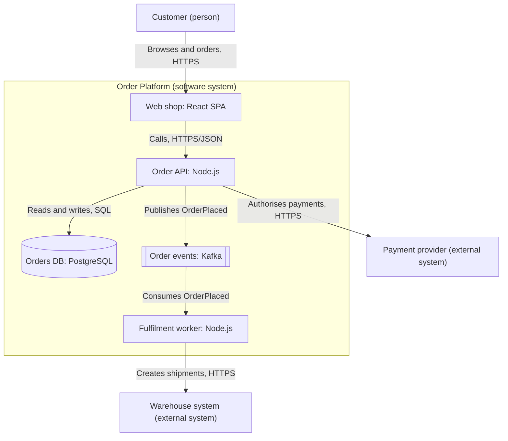
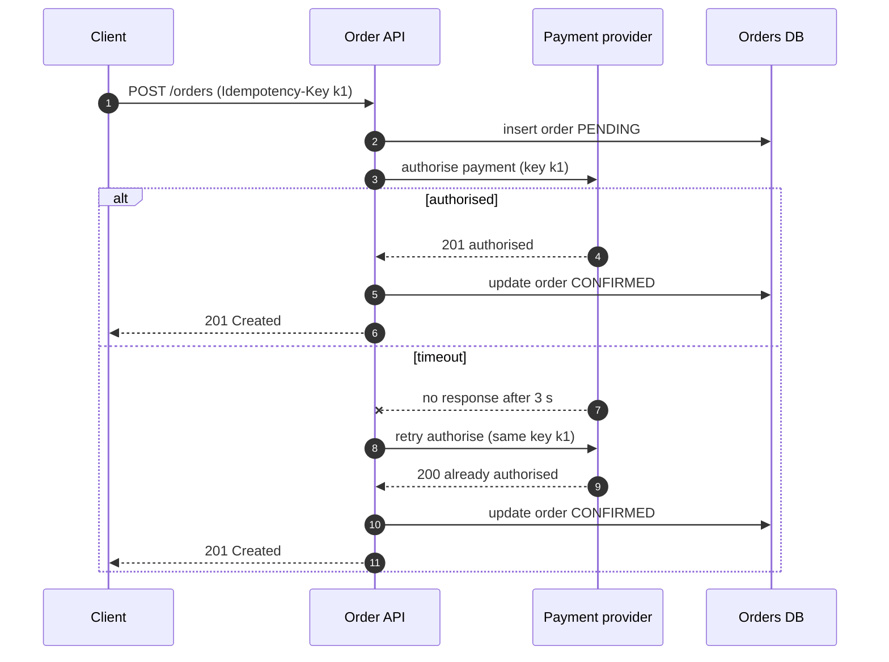
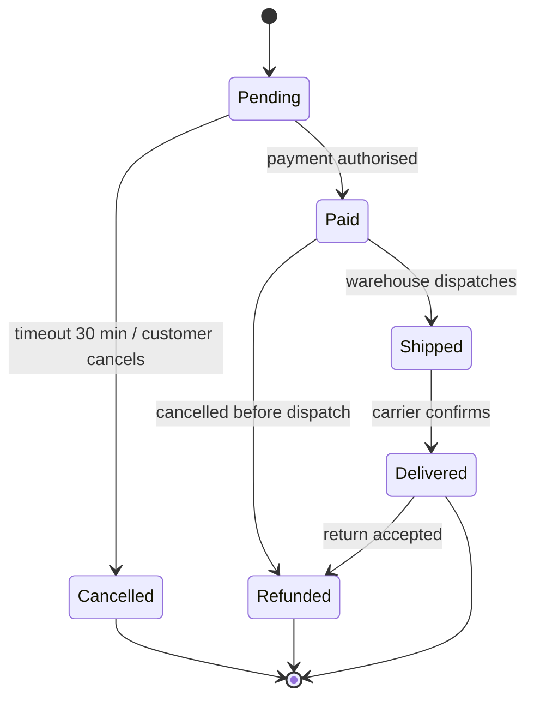
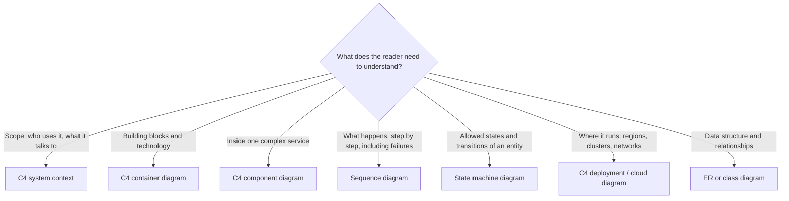

## TL;DR

- Diagrams exist to **communicate with a specific audience**. Pick the level of abstraction for the reader, not to show everything you know.
- **C4** (Simon Brown) gives four zoom levels: **Context → Containers → Components → Code**. Most teams need only the first two, kept current.
- **Sequence diagrams** are the best tool for explaining behaviour over time: request flows, retries, async messaging and failure paths.
- **UML** is a toolbox, not a religion. Sequence, state machine and (sometimes) class or deployment diagrams remain useful. Few teams need the rest.
- Prefer **diagrams as code** (Mermaid, PlantUML, Structurizr DSL) stored next to the source, reviewed in pull requests and with a **legend**. A diagram without a key is ambiguous.

## Core Concepts

### Why diagrams go wrong

Most architecture diagrams fail in predictable ways:
- **Mixed abstraction levels:** a Kubernetes pod next to "Billing" next to a Java class.
- **Unlabelled arrows:** does the arrow mean calls, depends on, sends data to? Sync or async?
- **Unexplained shapes and colours:** no legend.
- **Out of date** the week after they're drawn.

C4 addresses the first two problems with a small, consistent vocabulary. Diagrams as code addresses the last.

### C4 model: abstractions first, notation second

C4 defines **abstractions**, then diagrams at different zoom levels:

| Element | Meaning | Example |
|---|---|---|
| Person | A user role or actor | Customer, Support agent |
| Software system | Highest level: something that delivers value, owned by one team or org | "Order Platform", "Stripe" |
| Container | A separately deployable or runnable unit, or a data store (*not* a Docker container specifically) | SPA, API service, PostgreSQL DB, Kafka topic group, mobile app |
| Component | A grouping of related functionality inside a container, behind an interface | `PaymentController`, `PricingEngine` |
| Code | Classes, functions | Rarely drawn by hand; generate if needed |

The four core diagrams:
1. **System context:** your system as one box, its users and the external systems it interacts with. For everyone, including non-technical stakeholders.
2. **Container:** zoom into your system and show the deployable units, their technology choices and how they communicate. For engineers, architects and operations staff. Usually the most valuable diagram.
3. **Component:** zoom into one container. Useful for complex containers and onboarding. Optional.
4. **Code:** UML class or ER diagrams. Mostly generated, rarely worth maintaining by hand.

Supplementary diagrams:
- **System landscape:** many systems across the organisation.
- **Dynamic:** numbered interactions for one scenario, similar to a collaboration diagram.
- **Deployment:** containers mapped onto infrastructure such as regions, clusters and managed services.

Rules that make C4 diagrams readable:
- Every element has a **name, type, technology** (for containers and components) and a short **description**.
- Every relationship is **labelled with intent and protocol**: "Places orders using [HTTPS/JSON]", "Publishes OrderPlaced to [Kafka]".
- Include a **title and a key or legend**, and state the scope ("Container diagram for Order Platform").

### C4 in Mermaid (diagram as code)

Mermaid also has dedicated `C4Context` and `C4Container` syntax (PlantUML-compatible, with limited control over layout). Structurizr DSL lets you define the **model once** and generate several consistent views from it, which matters once you have many diagrams.

### Sequence diagrams

Sequence diagrams show **interactions over time** between participants. Use them for:
- Request flows across services, including auth handshakes (OAuth, OIDC).
- Async messaging, with distinct arrows for sync calls, async messages and replies.
- **Failure and retry paths:** `alt`, `opt`, `loop` and `par` blocks make edge cases explicit.
- Explaining a race condition or an incident timeline.

Tips: keep to around 6–8 participants and one scenario per diagram, label messages with intent and the important data, and show the failure cases. That's usually why the diagram exists.

### Other UML diagrams worth knowing

- **State machine diagrams:** lifecycle of an entity (order: `Pending → Paid → Shipped → Delivered`, with `Cancelled` and `Refunded` branches). Excellent for finding missing transitions and for aligning product and engineering. They map directly onto code (XState, a status enum with transition rules).
- **Class diagrams:** domain models in DDD discussions (aggregates, value objects). Keep them conceptual, not every field.
- **Entity-relationship diagrams:** data models and cardinalities.
- **Activity diagrams or flowcharts:** business processes with decisions and parallel branches. BPMN is the specialist standard for business process modelling.
- **Deployment diagrams:** largely replaced in practice by C4 deployment diagrams or cloud-specific diagrams.

UML 2.5 defines 14 diagram types (7 structural and 7 behavioural). You don't need most of them day to day, but you should recognise the notation (open versus filled arrowheads, multiplicities) when you see it.

## How It Works

Choosing the right diagram for the question being asked:

Workflow for diagrams that stay useful:
1. Write the diagram as code in the repository (`docs/architecture/`), rendered in pull requests and the docs site.
2. Link it from the README, ADRs and runbooks.
3. Include a "last reviewed" date and an owner. Review it at architecture changes or every few months.
4. Where possible, generate the model from reality (service catalogue, infrastructure state) and hand-draw only the views.

## When to Use / Trade-offs

| Tool / approach | Use when | Avoid when | Cost |
|---|---|---|---|
| Whiteboard / Excalidraw sketch | Exploring options live, workshops | It must be maintained or reviewed | Very low; disposable |
| Mermaid in Markdown | Docs in Git, renders in GitHub/GitLab and many doc sites | Very large diagrams needing precise layout | Low; limited layout control |
| PlantUML | Rich UML coverage, C4-PlantUML library | Teams without a rendering pipeline | Low–medium; needs rendering server/plugin |
| Structurizr DSL | Many consistent C4 views from one model | A single small diagram | Medium; model upkeep |
| draw.io / Lucidchart / Visio | Polished diagrams for executives or customers | Diagrams that change often | Drift from reality; manual updates |
| Generated from code/infra | Dependency graphs, infra topology, ER from schema | Communicating intent and design rationale | Tooling setup; often too detailed |

## Common Pitfalls & Anti-patterns

- **No legend:** colours and shapes with private meanings. Every diagram needs a key, or should stick to one obvious convention.
- **Unlabelled or bidirectional arrows:** "A ↔ B" hides who initiates, the protocol and whether it's synchronous.
- **Mixing levels:** pods, services, classes and business capabilities on one canvas.
- **Everything diagram:** 60 boxes, crossing lines. Split it by audience and question.
- **Technology logos instead of responsibilities:** a Kafka logo tells you nothing about *what* flows.
- **Happy path only:** sequence diagrams without the timeout, retry or compensation branches that matter in production.
- **Stale diagrams treated as truth:** worse than no diagram. Date them, own them, or delete them.
- **Drawing to impress:** 3D icons and gradients for an engineering audience that needs clarity.

## Real-world Scenario

**Context:** A fintech scale-up had 40 services and one huge architecture diagram in Lucidchart, last updated 14 months earlier. During a SEV1 involving a payment-reconciliation failure, responders spent 25 minutes working out which services consumed the settlement events, because the diagram didn't show event flows and was wrong about two services.

**Decision:**
- Adopted C4 with **Structurizr DSL** in a central architecture repository: one model, a system context, one container diagram per domain, and deployment views.
- Each team owned its domain's DSL file, changed through pull requests.
- Critical flows (payments, settlement, onboarding) got Mermaid sequence diagrams with failure paths, stored in the owning service's repository and linked from runbooks.
- A CI check compared the services in the model with the service catalogue and flagged missing ones.

**Outcome:** In the next payment incident, responders followed the settlement sequence diagram from the runbook and identified the failing consumer within minutes. New engineers reported the container diagrams as the most useful onboarding material. Diagram freshness was visible in the catalogue.

**What I'd do differently:** Start with just context and container diagrams for every domain before adding component views. Some teams over-modelled components that then drifted. Also, agree the relationship-labelling conventions (sync versus async, protocol) on day one.

## Interview Questions

### What is the C4 model, and what does each level show? {#c4-levels}

**Level:** Foundation

**Model answer:**
C4 is Simon Brown's approach to visualising software architecture as a set of hierarchical diagrams, like zooming into a map:
1. **System context:** the system as a single box, the people who use it and the external systems it depends on. The audience is everyone.
2. **Container:** the deployable or runnable units inside the system (web app, API, database, message broker, mobile app), with technology and communication. The audience is technical people.
3. **Component:** the major structural building blocks inside one container and their responsibilities.
4. **Code:** classes and functions. Usually generated or skipped.

It also defines supplementary diagrams: system landscape, dynamic and deployment. Its strength is a small set of abstractions (person, software system, container, component) that make diagrams consistent across teams, independent of notation.

**What the interviewer is looking for:**
The four levels, their audiences and the fact that "container" doesn't mean Docker container.

**Follow-ups:**
- Which levels do you maintain in practice?
- Is a Lambda function a container in C4 terms?

**Red flags:**
- Equating C4 containers with Docker containers.
- Unable to say who each level is for.

### When should you use a sequence diagram instead of a box-and-arrow diagram? {#when-sequence}

**Level:** Foundation

**Model answer:**
Box-and-arrow (structural) diagrams show **what exists and what connects to what**, but not order, timing or conditions. Use a **sequence diagram** when the question is **"what happens, in what order?"**:
- A request crossing several services, including authentication flows (OAuth authorisation code with PKCE).
- Asynchronous messaging, where it matters that the reply comes later, or a message is published and consumed by others.
- **Alternative and failure paths:** timeouts, retries, compensations, using `alt`, `opt`, `loop` and `par` fragments.
- Debugging and explaining race conditions or incident timelines.
- Designing APIs: walking through the calls a client needs to make.

Structural diagrams answer "where"; sequence diagrams answer "how and when".

**What the interviewer is looking for:**
Structure versus behaviour, and concrete use cases, especially failure paths.

**Follow-ups:**
- How do you show async messages in a sequence diagram?
- How many participants is too many?

**Red flags:**
- Using sequence diagrams for static structure.
- Only ever drawing happy paths.

### What makes an architecture diagram good? {#good-diagram}

**Level:** Foundation

**Model answer:**
- **A clear audience and question:** "for new backend engineers: how does checkout work?"
- **A title and scope** stating the type of diagram and what it covers.
- **One level of abstraction** per diagram.
- **Elements with a name, type, technology and short responsibility.** "Order API, Node.js, handles order placement and status queries", not just "API".
- **Labelled, directional relationships** with intent and protocol: "publishes OrderPlaced via Kafka", sync versus async distinguished.
- **A legend or key** for shapes, colours and line styles.
- **Manageable size:** around 20 elements or fewer. Split otherwise.
- **Up to date and owned:** a date, an owner, and kept with the code.

A good test: can someone who wasn't in the room understand it without the author explaining?

**What the interviewer is looking for:**
Audience-first thinking and concrete hygiene rules: labels, legend, single abstraction level.

**Follow-ups:**
- What's wrong with an arrow that says only "uses"?
- How do you show sync and async calls differently?

**Red flags:**
- "As detailed as possible."
- No mention of labels or a legend.

### Which UML diagrams are still useful today, and why? {#useful-uml}

**Level:** Foundation

**Model answer:**
In modern practice a few earn their place:
- **Sequence diagrams:** interactions over time, especially distributed flows and failure handling.
- **State machine diagrams:** entity lifecycles (orders, payments, subscriptions). They expose missing transitions and impossible states and map directly onto code.
- **Class diagrams (conceptual):** domain modelling of aggregates, entities, value objects and their relationships. Leave out every field and method.
- **Activity diagrams:** workflows with decisions and parallelism, though BPMN or simple flowcharts often serve business audiences better.
- **Deployment diagrams** have largely been replaced by C4 deployment diagrams or cloud-provider diagrams.

UML's value now is as a **shared notation** for these few diagrams, not as model-driven development or exhaustive specification. Sketches that use UML notation loosely are fine, as long as there's a legend.

**What the interviewer is looking for:**
Pragmatism: knowing which diagrams give value, especially state machines, and why heavy UML fell out of favour.

**Follow-ups:**
- Draw the state machine for a subscription with trials and failed payments.
- Why did model-driven architecture not take off widely?

**Red flags:**
- "UML is dead, we never use diagrams."
- Insisting on strict UML compliance for every sketch.

### How do you keep architecture diagrams up to date? {#diagrams-up-to-date}

**Level:** Senior

**Model answer:**
- **Diagrams as code** (Mermaid, PlantUML, Structurizr DSL) in the repository next to the code they describe, so changes go through pull requests and reviews.
- **Fewer, more durable diagrams:** context and container diagrams change slowly and stay useful. Avoid hand-maintained component or code diagrams, which drift quickly.
- **Model once, many views** (Structurizr). Renaming a service updates every view.
- **Generate where possible:** dependency graphs from the service catalogue or tracing data, infrastructure topology from Terraform state, ER diagrams from database migrations.
- **Ownership and freshness:** an owner and a last-reviewed date on each diagram, a review at architecture changes, and stale diagrams flagged in the docs portal.
- **Workflow hooks:** pull request templates ask "Does this change the architecture diagrams or ADRs?" Architecture reviews start from the current diagrams.
- **Automated drift checks:** compare the services in the model with the service catalogue in CI.
- **Delete** diagrams nobody owns.

**What the interviewer is looking for:**
Docs-as-code, minimal durable set, generation, ownership and drift detection.

**Follow-ups:**
- What would you generate automatically and what would you hand-draw?
- How do you handle diagrams that span many teams' services?

**Red flags:**
- Diagrams only in slide decks or personal drawing tools.
- Relying on people to "remember to update the wiki".

### Draw the container diagram for a typical web application and explain your choices. {#container-diagram}

**Level:** Senior

**Model answer:**
For an e-commerce system I'd show:
- **People:** Customer, Support agent.
- **Containers inside the system boundary:**
  - Web shop (React SPA, served from a CDN).
  - Mobile app (React Native).
  - API gateway or BFF (Node.js).
  - Order service and Catalogue service.
  - Orders database (PostgreSQL); catalogue search index (OpenSearch).
  - Event broker (Kafka topics for order events).
  - Fulfilment worker.
- **External systems:** payment provider, warehouse system, email provider, identity provider.
- **Relationships, each labelled with intent and protocol:**
  - "SPA calls BFF [HTTPS/JSON]".
  - "Order service publishes OrderPlaced [Kafka]".
  - "Worker creates shipment [HTTPS] in Warehouse system".
  - "Order service authorises payment [HTTPS] at Payment provider".

Choices:
- Data stores are shown as containers, because they're separately deployed and owned.
- The broker sits inside the boundary if we run it, outside if it's a shared platform service.
- Async relationships use dashed lines, explained in the legend.
- Infrastructure detail (load balancers, Kubernetes) is left out; that belongs in a deployment diagram.

**What the interviewer is looking for:**
A correct application of C4 container semantics, a clear boundary, labelled relationships with protocols and keeping infrastructure out.

**Follow-ups:**
- Where would the CDN and WAF appear?
- How would you show that two services share a database (and should you)?

**Red flags:**
- Mixing classes or pods into the container view.
- Unlabelled arrows.

### How would you diagram an asynchronous, event-driven flow so it's clear to readers? {#async-flows}

**Level:** Senior

**Model answer:**
Async flows are where diagrams most often mislead, so be explicit:
- **Structural view:** show the broker as a container or as topics. Use distinct line styles for sync calls (solid) and async messages (dashed), defined in the legend. Label edges with event names: "publishes OrderPlaced", "consumes PaymentCaptured".
- **Behavioural view:** a sequence diagram with the broker as a participant. Use async arrow styles (in Mermaid, `-)` for async messages). Show the producer *not* waiting, and consumers acting later. Use `par` blocks for parallel consumers.
- **Show the failure paths:** retries, dead-letter queue, duplicate delivery and an idempotent consumer, and compensating events in sagas.
- **For large event landscapes:** an event catalogue (EventCatalog, AsyncAPI documents) listing producers and consumers per event, often more useful than one giant diagram. Event-storming outputs (sticky-note timelines) also communicate business flows well.

**What the interviewer is looking for:**
Distinguishing sync from async visually, broker representation, failure paths and appropriate tooling for large event systems.

**Follow-ups:**
- How do you show eventual consistency to a product manager?
- What is AsyncAPI?

**Red flags:**
- Drawing events as direct service-to-service arrows with no broker.
- No distinction between request/response and fire-and-forget.

### How do you tailor architecture diagrams for executives compared with engineers? {#diagram-audiences}

**Level:** Senior

**Model answer:**
- **Executives and business stakeholders:**
  - Focus on capabilities, value flows, risks and change: system context or landscape level.
  - Use plain names ("Payments", "Customer data") without technology detail.
  - Highlight what's changing (current versus target state, phases of a migration), costs and risks with colour, explained in a legend.
  - One message per diagram, paired with a sentence stating the decision or ask.
- **Engineers:**
  - Container and sequence diagrams with technology, protocols, data stores and failure handling.
  - Enough precision to build and operate the system.
- **Operations and SRE:** deployment diagrams (regions, clusters, networks, dependencies), data flows for incident response and dependencies on third parties.
- **Security and compliance:** data-flow diagrams with trust boundaries and where sensitive data lives and moves. These are the basis of threat modelling.

Use the same underlying model (one source of truth), with different views for different audiences.

**What the interviewer is looking for:**
Audience-driven abstraction, highlighting decisions and change for executives, and specialised views (trust boundaries, deployment).

**Follow-ups:**
- Show me how you would present a migration plan visually.
- What is a trust boundary on a data-flow diagram?

**Red flags:**
- One diagram for every audience.
- Technology logos on an executive slide.

### How do you use diagrams in an architecture review or design discussion? {#diagrams-in-reviews}

**Level:** Senior

**Model answer:**
- **Before:** share a short design document with the context and container diagrams (current and proposed), sequence diagrams for the critical and failure flows, and the ADRs, so reviewers come prepared.
- **During:**
  - Start with the context diagram to align on scope.
  - Walk through the riskiest scenarios with sequence diagrams: peak load, dependency failure, security attack paths.
  - Use the diagrams to ask questions: "What happens if this arrow fails?", "Where is the trust boundary?", "Who owns this box?"
  - Sketch alternatives live on a whiteboard; don't defend polished diagrams.
- **After:** update the diagrams-as-code to reflect the agreed design, record the decisions in ADRs and link them together.

The diagrams are tools for thinking about failure, ownership and trade-offs, not artefacts to approve.

**What the interviewer is looking for:**
Diagrams as thinking tools: scenario walkthroughs, failure questions and follow-through into durable records.

**Follow-ups:**
- What questions do you always ask of a container diagram?
- How do you run a design review remotely?

**Red flags:**
- Reviews that only check diagram notation.
- No connection between review outcomes and the documentation.

### Your organisation has 150 services and nobody understands the overall architecture. How do you fix that? {#landscape-documentation}

**Level:** Architect

**Model answer:**
1. **Establish a source of truth for the inventory:** a service catalogue (Backstage or similar) where each service has an owner, a system or domain, dependencies, APIs and events, populated from metadata files in each repository and kept honest by CI.
2. **Define a shared model:** C4 abstractions mapped onto the catalogue. Software systems or domains group services, and services are containers. Agree conventions (relationship labels, sync versus async, colours).
3. **Produce the key views:**
   - A **system landscape** of domains and external systems for leadership and onboarding.
   - A **container diagram per domain**, owned by that domain's teams.
   - **Dependency graphs** generated from tracing data or the catalogue, to see what really calls what.
   - **Critical-journey sequence diagrams** (checkout, payments, sign-up) linked from runbooks.
4. **Combine generated and curated views:** generated views show the truth (and the mess). Curated views explain intent. Compare them to find undocumented dependencies.
5. **Governance:** domain architects own their views and review them quarterly, the catalogue shows freshness, and new services can't deploy without a catalogue entry.
6. **Use it:** onboarding, incident response, dependency risk analysis and planning migrations. Usage keeps it alive.

**What the interviewer is looking for:**
Inventory first, a shared model, layered views for different audiences, generated plus curated views, and ownership and governance tied to real use.

**Follow-ups:**
- How do you detect undocumented dependencies?
- How would you bring teams to maintain their entries?

**Red flags:**
- One architect drawing the whole estate by hand.
- A big diagram with 150 boxes as the answer.

### How do you document a target architecture and the migration path to it? {#target-state-diagrams}

**Level:** Architect

**Model answer:**
- **Current-state and target-state diagrams** at the same C4 level and scope, using the same notation, so the difference is obvious.
- **Transition architectures:** intermediate states (phase 1, 2, 3) showing what coexists during the migration: strangler facades, data synchronisation, dual-running and anti-corruption layers. These are often the most important diagrams, because the risk is in the transitions.
- **Colour or styling for change status:** new, changed, unchanged, to be retired, explained in a legend.
- **Sequence diagrams** for the critical flows *during* the transition, for example how an order routes through the facade to old or new services and how data stays consistent.
- **Link each phase to ADRs, milestones and exit criteria:** "Phase 2 completes when 100% of order reads come from the new service and the legacy table is read-only."
- **Keep it current:** the diagrams are updated as phases complete. Executives get a one-page roadmap view derived from the same model.

**What the interviewer is looking for:**
Transition states, not just before and after; consistent notation; flows during migration; and linkage to decisions and exit criteria.

**Follow-ups:**
- How do you show data migration and synchronisation visually?
- How do you communicate slippage in the migration?

**Red flags:**
- Only a target picture with no transition plan.
- Different notations for current and target states, making comparison impossible.

### How would you use data-flow diagrams for threat modelling? {#dfd-threat-modelling}

**Level:** Architect

**Model answer:**
A **data-flow diagram (DFD)** for threat modelling shows:
- **External entities:** users, third parties.
- **Processes:** services, functions.
- **Data stores.**
- **Data flows** between them, labelled with what data moves (PII, card data, tokens) and the protocol.
- **Trust boundaries:** lines where the level of trust changes, such as internet to DMZ, service to database, tenant to tenant, your cloud account to a vendor's.

Then walk each element and each flow crossing a boundary through **STRIDE** (spoofing, tampering, repudiation, information disclosure, denial of service, elevation of privilege):
- "Can the browser-to-API flow be spoofed?" → authentication.
- "Can someone tamper with messages on the broker?" → authorisation and signing.
- "Is the export to the analytics vendor disclosing PII?" → minimisation and contracts.

Record the threats, mitigations and residual risks. Keep the DFD with the C4 diagrams. They share elements, so a C4 container diagram with trust boundaries and data classifications added is often a good starting point. Revisit the model when new flows or boundaries appear.

**What the interviewer is looking for:**
DFD elements, trust boundaries, STRIDE applied per element or flow, and integration with existing architecture diagrams.

**Follow-ups:**
- Where are the trust boundaries in a multi-tenant SaaS?
- How often do you update a threat model?

**Red flags:**
- Threat modelling without any diagram.
- No trust boundaries drawn.

### Would you introduce a modelling tool such as Structurizr across the organisation, or let teams draw however they like? {#modelling-tool-choice}

**Level:** Architect

**Model answer:**
It depends on scale and the pain being solved. I'd standardise the **abstractions and conventions** organisation-wide and be more flexible on **tools**.

- **Standardise:**
  - C4 vocabulary.
  - Relationship labelling (intent, protocol, sync or async).
  - A legend convention.
  - Where diagrams live (in the repository, linked from the catalogue).
  - Which views are required: context and container per system; sequence diagrams for critical flows.
- **Tools:**
  - Mermaid works almost everywhere (GitHub, docs sites) with no extra infrastructure, a good default for team-level diagrams.
  - A model-based tool (Structurizr DSL, or a catalogue-backed generator) pays off when many diagrams must stay consistent across teams: landscape and domain views, and regulated environments needing an accurate inventory.
  - Freehand tools are fine for workshops and exploration, but not as the source of truth.
- **Adoption:** pilot with two domains, provide templates and examples, integrate with the catalogue and docs portal, and measure usefulness (onboarding feedback, use during incidents) rather than counting diagrams.

**What the interviewer is looking for:**
Separating conventions from tools, matching tool complexity to the problem, and adoption through value rather than mandate.

**Follow-ups:**
- How would you migrate 300 existing Visio diagrams?
- What are Structurizr's limitations?

**Red flags:**
- Mandating an expensive tool with no clear problem to solve.
- No conventions at all, leading to incomparable diagrams.

### Explain a complex flow you designed using a sequence diagram, including failures. {#explain-flow}

**Level:** Senior

**Model answer:**
*(Example answer using a payment authorisation with idempotency.)*

Participants: Client, Order API, Orders DB, Payment provider.
1. The client sends `POST /orders` with an `Idempotency-Key`.
2. The API checks for an existing order with that key. If found, it returns the stored result (a duplicate submission, such as a double-click or a retry).
3. It inserts the order as `PENDING` with the key, then calls the provider with the same key.
4. **alt authorised:** update to `CONFIRMED`, return 201.
5. **alt declined:** update to `PAYMENT_FAILED`, return 402 with a reason.
6. **alt timeout:** retry with the same idempotency key (the provider de-duplicates). If retries are exhausted, mark `PAYMENT_UNKNOWN`, return 202, and a reconciliation job queries the provider later to resolve the true status.
7. An async event `OrderConfirmed` is published via the outbox.

The diagram makes three things explicit: the idempotency key flowing end to end, the "unknown" outcome that naive designs miss, and the reconciliation path.

**What the interviewer is looking for:**
The ability to structure a flow clearly, with alternatives and failure handling shown deliberately, not just the happy path.

**Follow-ups:**
- Why not return 500 on a provider timeout?
- How does the client learn the final status?

**Red flags:**
- Only the happy path.
- Ignoring the "unknown outcome" case in distributed calls.

### What is event storming, and how do its outputs relate to architecture diagrams? {#event-storming}

**Level:** Architect

**Model answer:**
Event storming (Alberto Brandolini) is a collaborative workshop technique. Domain experts and engineers map a business process on a long wall using sticky notes:
- **Domain events** (orange, past tense: "Order placed"), placed on a timeline.
- Then commands, actors, policies ("whenever X then Y"), external systems, read models and hotspots (questions, conflicts).

Levels: *big picture* (the whole business flow, to find bottlenecks and boundaries), *process modelling* and *software design* (aggregates, commands, events).

Relation to diagrams:
- Clusters of events and language reveal **bounded contexts**, which become software systems or containers in C4.
- The event timeline becomes **sequence diagrams** and the **event catalogue** (AsyncAPI) for the integration design.
- Policies become event handlers or saga steps. Hotspots become ADRs or spikes.

It's the discovery step. C4 and sequence diagrams are how you communicate the resulting design.

**What the interviewer is looking for:**
Understanding of event storming as a collaborative discovery method and how its outputs feed into domain boundaries and diagrams.

**Follow-ups:**
- Who must be in the room for event storming to work?
- How do you run it remotely?

**Red flags:**
- Treating it as a diagramming notation rather than a workshop.
- Running it with engineers only.

## Cheat Sheet

### C4
- **C4 levels** — Context → Containers → Components → Code; maintain the first two, generate or skip the rest.
- **Container (C4)** — a separately deployable or runnable unit or data store; not specifically a Docker container.
- **System context** — your system as one box with its users and external systems; for every audience.
- **Relationship label** — intent plus protocol: "Publishes OrderPlaced [Kafka]".
- **Legend** — every diagram needs a key for shapes, colours and line styles.
- **Structurizr DSL** — define the model once, generate many consistent C4 views.

### Behaviour and UML
- **Sequence diagram** — interactions over time; use `alt`/`opt`/`loop`/`par` for alternatives and failures.
- **State machine diagram** — allowed states and transitions of an entity; exposes missing cases.
- **Async arrow** — distinguish fire-and-forget messages from request/response calls visually.
- **UML today** — a notation toolbox: sequence, state, conceptual class and activity diagrams.

### Practice
- **Diagrams as code** — Mermaid, PlantUML or Structurizr in the repo, reviewed in pull requests.
- **One abstraction level per diagram** — never mix pods, services and classes.
- **Data-flow diagram** — processes, stores, flows and trust boundaries; the basis for STRIDE threat modelling.
- **Transition architecture** — intermediate states of a migration; where the real risk lives.
- **Event storming** — collaborative sticky-note workshop that discovers domain events and boundaries.

## Further Reading

- [The C4 model for visualising software architecture](https://c4model.com/) — Simon Brown's official C4 site: abstractions, diagram types and notation guidance.
- [Structurizr documentation](https://docs.structurizr.com/) — the DSL for modelling C4 and generating views.
- [Mermaid documentation](https://mermaid.js.org/intro/) — syntax for flowcharts, sequence, state and C4 diagrams as code.
- [PlantUML](https://plantuml.com/) — text-based UML diagrams; see also the C4-PlantUML library.
- [OMG UML specification](https://www.omg.org/spec/UML/) — the formal UML standard, for when notation precision matters.
- [AsyncAPI documentation](https://www.asyncapi.com/docs) — describing event-driven APIs, producers and consumers.
