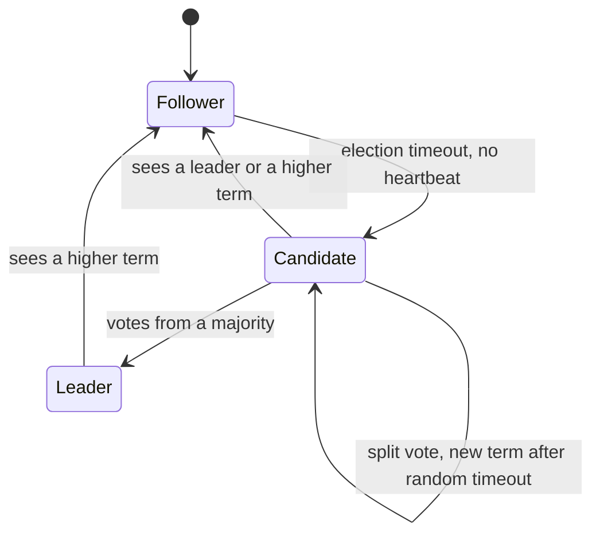
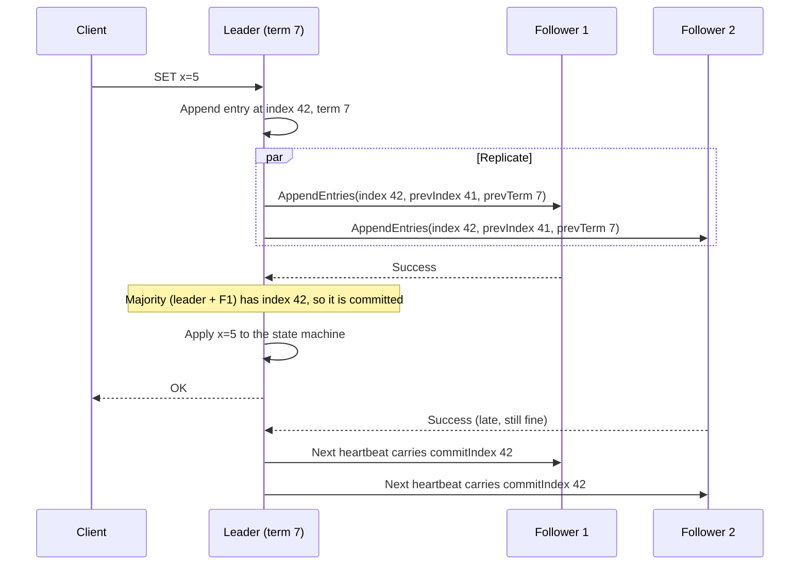
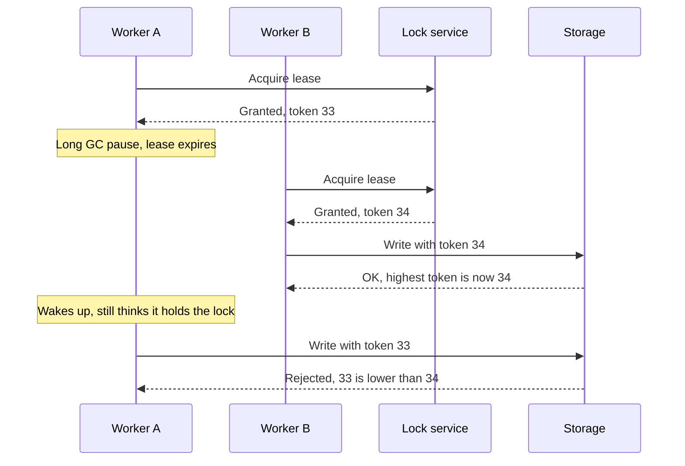

## TL;DR

- A distributed system is one where **partial failure** is normal: some nodes and links fail while others carry on, and you often cannot tell a slow node from a dead one. Every design choice follows from that uncertainty.
- **Time is not shared.** Wall clocks drift and jump, so use them for display, never for ordering. Order events with **logical clocks** (Lamport, vector, hybrid logical clocks), or pay for bounded clock uncertainty, as Spanner's TrueTime does.
- **Consensus** (Raft, Paxos, ZAB) lets a majority of `2f + 1` nodes agree on an ordered log while tolerating `f` crashes. It is the foundation under etcd, ZooKeeper, Kafka KRaft and most strongly consistent databases. Use one of these, and don't build your own.
- **Leases and locks expire while the holder is paused.** Any lock that protects a write needs a **fencing token** that the storage layer checks. A TTL on its own is not mutual exclusion.
- **Exactly-once *delivery* is impossible**. What you can build is effectively-once *processing*: at-least-once delivery plus idempotent or transactional handling. Be precise about which guarantee you mean (linearizable, serializable, eventual), because vendors often aren't.

## Core Concepts

### Partial failure and the system model

On one machine an operation either works or crashes the process. Across a network a request can be lost, delayed, duplicated or reordered, and so can its reply. When a call times out, there are three possibilities:

1. The request never arrived.
2. The remote node processed it, and the reply was lost.
3. The remote node is still processing it.

You cannot distinguish them from the caller's side. That is why retries need idempotency, and why "did my write happen?" is a question the protocol has to answer, not the network.

When reasoning about an algorithm, state the **system model**:

| Assumption | Options | What real systems assume |
|---|---|---|
| Timing | Synchronous (bounded delays) · partially synchronous · asynchronous | Partially synchronous: usually bounded, occasionally not (GC pauses, network congestion) |
| Node faults | Crash-stop · crash-recovery · Byzantine (arbitrary/malicious) | Crash-recovery: nodes restart with whatever was on disk |
| Network | Reliable · fair-loss · arbitrary | Fair-loss: messages may be dropped, duplicated or reordered, but retries eventually get through |

The **FLP result** (Fischer, Lynch and Paterson, 1985) proves that no deterministic algorithm can guarantee consensus in a fully asynchronous system if even one node may crash. Practical algorithms such as Raft get around it by relying on timeouts. They are always **safe** (they never decide two different values), but they are only **live** (they make progress) while the network behaves well enough to elect a leader.

### The eight fallacies

Peter Deutsch (with James Gosling adding the eighth) listed the false assumptions developers make: the network is reliable, latency is zero, bandwidth is infinite, the network is secure, topology doesn't change, there is one administrator, transport cost is zero, and the network is homogeneous. The three that cause most production incidents are reliability, latency and changing topology. Retries without idempotency, chatty call chains and hard-coded IPs all come from them.

### Time and ordering

**Physical clocks.** NTP keeps servers within a few milliseconds of each other on a good day, and tens or hundreds of milliseconds on a bad one. Clocks can also jump backwards after a correction or a VM migration. Two rules follow:

- Measure durations with a **monotonic** clock (`performance.now()`, `process.hrtime.bigint()`), never with `Date.now()`.
- Never use timestamps from different machines to decide "which write came last". Last-write-wins on wall clocks silently drops data when clocks skew.

**Lamport clocks** (1978) give a total order that is consistent with causality. If event `a` happened before `b`, then `L(a) < L(b)`. The converse is not true: a smaller timestamp does not mean the event happened first.

```ts
// Lamport clock: a counter per node, updated on every local event, send and receive.
class LamportClock {
  private time = 0;
  tick(): number { return ++this.time; }                  // local event or send
  receive(remote: number): number {                        // on message receipt
    this.time = Math.max(this.time, remote) + 1;
    return this.time;
  }
}
// Tie-break equal timestamps with the node id to get a deterministic total order.
```

**Vector clocks** keep one counter per node. They can tell you whether two events are **causally ordered or concurrent**, which a Lamport clock can't. Concurrent writes are conflicts that need a merge rule.

```ts
type VClock = Record<string, number>;

type Order = 'before' | 'after' | 'equal' | 'concurrent';

function compare(a: VClock, b: VClock): Order {
  let aLess = false, bLess = false;
  for (const node of new Set([...Object.keys(a), ...Object.keys(b)])) {
    const x = a[node] ?? 0, y = b[node] ?? 0;
    if (x < y) aLess = true;
    if (y < x) bLess = true;
  }
  if (aLess && bLess) return 'concurrent';   // neither saw the other: a real conflict
  if (aLess) return 'before';
  if (bLess) return 'after';
  return 'equal';
}
```

**Hybrid logical clocks (HLC)** combine a physical timestamp with a logical counter. They stay close to wall-clock time, so they are human-readable and work for time-range queries, but they still respect causality. CockroachDB and YugabyteDB use them. **Google Spanner's TrueTime** goes further: GPS receivers and atomic clocks expose an explicit uncertainty interval `[earliest, latest]`, and a commit *waits out* that uncertainty, typically a few milliseconds, before becoming visible. That makes commit order match real-time order (external consistency).

### Consistency models, precisely

| Model | Guarantee | Example |
|---|---|---|
| **Linearizability** | Each operation on a *single object* appears to take effect atomically at some point between its start and end. Once a write completes, every later read sees it | etcd reads (default), a ZooKeeper `sync` then read, a single-leader database reading from the leader |
| **Serializability** | *Transactions* over many objects behave as if run one at a time in *some* order. That order need not match real time | PostgreSQL `SERIALIZABLE` |
| **Strict serializability** | Serializable, and the order matches real time | Spanner, CockroachDB (for most operations), FoundationDB |
| **Causal** | Causally related operations are seen in the same order everywhere. Concurrent ones may differ | Collaboration tools, social feeds with comment threads |
| **Eventual** | If writes stop, replicas converge | DNS, Dynamo-style stores at low quorum settings |

Linearizability is a *recency* guarantee about single objects. Serializability is an *isolation* guarantee about transactions. People confuse them constantly.

### Quorums

With **majority quorums**, a cluster of `n = 2f + 1` nodes tolerates `f` failures. Any two majorities overlap in at least one node, so a new leader always meets someone who saw the last committed write.

| Nodes | Majority | Failures tolerated |
|---|---|---|
| 3 | 2 | 1 |
| 4 | 3 | 1 (no gain over 3, and one more machine to fail) |
| 5 | 3 | 2 |
| 7 | 4 | 3 (each write waits for more acknowledgements, so latency rises) |

In **leaderless replication** (Dynamo, Cassandra, Riak) a client writes to `W` of `N` replicas and reads from `R`. If `W + R > N`, every read set overlaps every write set. The guarantee is weaker than it looks: sloppy quorums with hinted handoff, concurrent writes, failed writes that partly succeeded, and clock-based conflict resolution can all return stale or lost data.

### Consensus and replicated logs

Consensus algorithms agree on an *ordered log of commands*. Each replica applies the same log to a deterministic state machine, so they all reach the same state (state-machine replication).

- **Paxos** (Lamport) is proven and widely implemented (Chubby, Spanner's Paxos groups), and notoriously hard to understand and implement correctly from the paper.
- **Raft** (Ongaro and Ousterhout, 2014) was designed to be understandable. It splits the problem into leader election, log replication and safety. etcd, Consul, CockroachDB, TiKV and Kafka's KRaft use it. Kafka 4.0 (2025) removed ZooKeeper entirely.
- **ZAB** is ZooKeeper's atomic broadcast protocol, which is similar in spirit.

Byzantine fault tolerance (nodes that lie) needs `3f + 1` nodes and is the domain of blockchains and some aerospace systems. Inside a data centre you usually assume crash-recovery faults and use authentication to keep out malicious nodes.

### Leases, locks and fencing

A **lease** is a lock with an expiry, so a crashed holder doesn't block everyone forever. A holder can be **paused** (by a stop-the-world GC, a VM freeze, or a slow disk) past its lease without knowing. When it wakes, it still believes it holds the lock and writes, corrupting data.

The fix is a **fencing token**: a number that increases every time the lock is granted (etcd's revision, ZooKeeper's `zxid`). The *storage* layer rejects any write carrying a lower token than one it has already seen.

```ts
// Storage side: reject writes from a stale lock holder.
async function writeWithFence(key: string, value: string, fencingToken: bigint) {
  const result = await db.query(
    `UPDATE resources
        SET value = $2, last_token = $3
      WHERE key = $1 AND last_token < $3`,
    [key, value, fencingToken],
  );
  if (result.rowCount === 0) throw new Error('Stale fencing token: lock was lost');
}
```

This is the core of Martin Kleppmann's 2016 critique of Redlock. A lock built from Redis TTLs gives no fencing token, so it is fine for *efficiency* (avoiding duplicate work) but unsafe for *correctness* (protecting data).

### Failure detection

All failure detectors are timeouts in disguise. A short timeout gives fast failover but false positives: you declare a slow node dead, the old leader keeps running, and you get **split brain**. A long timeout gives slow recovery. Better options:

- **Phi accrual detectors** (Cassandra, Akka) output a suspicion level based on how far heartbeat arrival times deviate from their history, instead of a binary dead/alive.
- **Gossip and SWIM protocols** spread membership and suspicion with indirect probes ("can *you* reach node C?"), so one bad link doesn't evict a healthy node.
- **Split brain** is prevented by requiring a quorum to act as leader, and, for shared resources, by fencing (STONITH: "shoot the other node in the head").

## How It Works

### Raft roles



### Raft log replication



The key safety rules:

1. **Terms** are logical epochs. Any message with a higher term makes the receiver step down, which is how stale leaders are deposed.
2. **Randomised election timeouts** (the paper suggests 150–300 ms) make split votes rare.
3. **Election restriction**: a node votes only for a candidate whose log is at least as up to date as its own. That guarantees the new leader has every committed entry.
4. **Log matching**: a follower accepts an entry only if its previous entry matches (`prevIndex`, `prevTerm`). Otherwise the leader backs up and overwrites the divergent suffix.

### Fencing a paused lock holder



## When to Use / Trade-offs

| Approach | Use when | Avoid when | Cost |
|---|---|---|---|
| Single leader + synchronous replica | You need linearizable writes in one region | Writers are spread across continents | Failover time, and write latency to the leader |
| Consensus store (etcd, ZooKeeper, Consul) | Leader election, config, membership, small critical metadata | Bulk data or high write throughput (etcd's default size limit is 2 GiB) | 3–5 nodes to run, and every write waits for a quorum round trip |
| Distributed SQL (Spanner, CockroachDB, YugabyteDB) | Strict serializability across regions | Single-region apps a Postgres primary can handle | Cross-region commit latency, higher price, operational novelty |
| Leaderless quorum store (Cassandra, DynamoDB global tables) | Very high write availability, multi-region writes | You need multi-object transactions or read-after-write everywhere | Conflict resolution (often last-write-wins), tuning `N/W/R` |
| CRDTs | Collaborative editing, offline-first, counters and sets | Invariants that need coordination ("balance never below zero") | Metadata growth, limited data types |
| Lamport / vector / hybrid logical clocks | Ordering events or detecting conflicts without trusting wall clocks | You need real-time ordering guarantees (needs TrueTime-style bounds) | Vector clocks grow with the number of writers |

## Common Pitfalls & Anti-patterns

- **Last-write-wins on wall clocks** — a node whose clock is 2 seconds fast wins every conflict, and the other writes vanish without an error. Use version vectors, or make the conflict explicit.
- **TTL locks guarding correctness** — a Redis `SET NX PX` lock protects against duplicate *work*, not concurrent *writes*. Without a fencing token, a paused holder will eventually corrupt data.
- **Even-sized clusters** — 4 or 6 consensus nodes tolerate no more failures than 3 or 5, and a 2/2 network split leaves neither side with a majority.
- **Stretching a consensus cluster across two regions** — with 3 nodes in two regions, losing the region that holds two nodes takes the cluster down. Use three failure domains, or accept that one region is primary.
- **"Exactly-once" taken at face value** — Kafka's exactly-once semantics cover read-process-write *within Kafka*. As soon as you call an external API or a database, you need your own idempotency.
- **Timeouts as truth** — treating "no heartbeat for 3 s" as "dead" without fencing creates split brain during GC pauses or network blips.
- **Reading from followers and assuming fresh data** — follower reads are stale unless the system uses read indexes or leases (for example, etcd's linearizable vs serializable reads).
- **Building your own consensus** — production Raft implementations have taken years to harden (Jepsen has found bugs in many of them). Use a proven library or service.

## Real-world Scenario

**Context:** A logistics company ran a nightly billing job on three VMs. A Redis lock with a 60-second TTL ensured "only one instance runs". The job renewed the lock every 20 seconds. Twice a year, customers were invoiced twice.

**Investigation:** Logs showed that during one run, a 75-second stop-the-world pause on the active instance (a JVM full GC while it held a 40 GB batch in memory) let the lock expire. A second instance acquired it and started billing. The first woke up, renewed nothing (the renewal thread was paused too), and carried on writing invoices. The wall-clock timestamps in the logs disagreed by 1.8 seconds between VMs, which had hidden the overlap during earlier investigations.

**Decision:**
1. Replaced the Redis lock with an etcd lease. Every billing write carries the lease's revision as a fencing token, and the invoices table keeps a `last_token` per billing run and rejects lower tokens.
2. Made invoice creation idempotent with a natural key (`customer_id`, `billing_period`) and a unique constraint, so a duplicate attempt fails safely even if fencing were bypassed.
3. Switched log correlation from wall-clock timestamps to a run id plus sequence numbers.
4. Cut the batch into 5,000-customer chunks with checkpoints, removing the giant heap and the pause.

**Outcome:** Zero duplicate invoices in the following 18 months. The unique constraint caught one more attempted duplicate in a later bug, which became an alert instead of a customer complaint.

**What I'd do differently:** Start with the idempotency key. It is the cheapest and most robust layer, and it would have contained the problem from the first incident while we fixed the locking.

## Interview Questions

### What are the fallacies of distributed computing, and which ones bite hardest in practice? {#fallacies}

**Level:** Foundation

**Model answer:**
The eight fallacies are: the network is reliable, latency is zero, bandwidth is infinite, the network is secure, topology doesn't change, there is one administrator, transport cost is zero, and the network is homogeneous.

In practice the costliest are:
- **Reliability.** Code that assumes a call either succeeds or fails cleanly, so it retries without idempotency or has no timeout.
- **Zero latency.** Chatty designs with 30 sequential service calls per request, or N+1 queries across a network boundary.
- **Static topology.** Hard-coded hosts, long-lived connections that don't notice failover, caches of DNS results that outlive a change.

The underlying point is that remote calls have different failure semantics from local calls, and abstractions that hide that (classic RPC, ORMs over remote stores) invite these bugs.

**What the interviewer is looking for:**
Concrete failure modes tied to each fallacy rather than a recited list, and the insight that remote calls need different failure handling, not just more of it.

**Follow-ups:**
- How would you make a code review catch these?
- Which fallacies does a service mesh help with, and which does it not?

**Red flags:**
- "Modern cloud networks are reliable enough."
- Being able to list the fallacies without connecting any of them to real incidents.

### Why can't you use wall-clock timestamps to order events across machines? {#wall-clock-ordering}

**Level:** Foundation

**Model answer:**
Each machine's clock drifts and is corrected by NTP, typically to within a few milliseconds but sometimes far worse, and corrections can make it jump backwards. VM migration and leap-second handling add further jumps. Two events on different machines a millisecond apart can easily get timestamps in the wrong order.

The consequences:
- **Last-write-wins** conflict resolution silently discards the later write if the earlier one came from a fast clock.
- **Durations** computed from `Date.now()` can be negative or wildly wrong. Use a monotonic clock for elapsed time.
- **Log correlation** across services misleads you during incidents.

Alternatives: logical clocks (Lamport, vector, hybrid logical clocks), a single sequencer (a database sequence or a Kafka partition offset), or bounded-uncertainty clocks like TrueTime where the system waits out the uncertainty.

**What the interviewer is looking for:**
Knowing the difference between wall-clock and monotonic clocks, and naming a concrete alternative for ordering.

**Follow-ups:**
- How would you order events within one Kafka partition versus across partitions?
- What does a hybrid logical clock give you that a Lamport clock doesn't?

**Red flags:**
- "We sync all servers with NTP, so timestamps are fine."
- Using `Date.now()` differences for timeouts or rate limiting.

### What is a quorum, and why do consensus clusters usually have an odd number of nodes? {#quorum-odd-nodes}

**Level:** Foundation

**Model answer:**
A quorum is the minimum number of nodes that must agree for an operation to count. With majority quorums, any two quorums share at least one node, so a decision made by one majority is always visible to the next. That overlap is what makes leader election and committed writes safe.

A cluster of `2f + 1` nodes tolerates `f` failures: 3 nodes tolerate 1, and 5 tolerate 2. Adding a fourth node raises the majority to 3, so it still tolerates only 1 failure, and it adds another machine that can fail and another node every write waits for. Even sizes also risk a symmetric split (2 and 2) where neither side can make progress.

Bigger clusters are not always better: 7 nodes tolerate 3 failures, but every write waits for 4 acknowledgements, so write latency and throughput get worse.

**What the interviewer is looking for:**
The overlap argument, the `2f + 1` formula, and the trade-off between fault tolerance and write latency.

**Follow-ups:**
- How would you place 5 nodes across 3 availability zones?
- What happens to a 3-node cluster when two nodes are down?

**Red flags:**
- "More nodes always means more availability."
- Not knowing that a minority partition must stop accepting writes.

### What is the difference between linearizability and serializability? {#linearizability-vs-serializability}

**Level:** Foundation

**Model answer:**
- **Linearizability** is about single objects and real time. Each read or write appears to take effect instantly at some point between when it starts and finishes, so once a write has completed, every subsequent read anywhere returns it (or something newer). It is a *recency* guarantee. Examples: etcd's default reads, a compare-and-set register.
- **Serializability** is about transactions over many objects. The outcome equals *some* serial order of the transactions, but that order doesn't have to match real time. A read-only transaction may legally see a snapshot from before a write that already committed. It is an *isolation* guarantee.
- **Strict serializability** is both: serializable, and the order respects real time. Spanner calls this external consistency.

This matters because a database can be serializable and still let a user write a value, refresh, and not see it (for instance, reading from a replica).

**What the interviewer is looking for:**
Separating recency from isolation, and knowing strict serializability combines them.

**Follow-ups:**
- Which of these does PostgreSQL's `SERIALIZABLE` level give you, and what about reads from a replica?
- Where would you need linearizability in an e-commerce system?

**Red flags:**
- Treating the terms as synonyms.
- Saying "strong consistency" without saying which guarantee is meant.

### Explain Lamport clocks and vector clocks. When do you need vector clocks? {#logical-clocks}

**Level:** Senior

**Model answer:**
A **Lamport clock** is one counter per node. You increment it on every event, attach it to messages, and on receipt set it to `max(local, received) + 1`. That guarantees that if `a` causally precedes `b`, `L(a) < L(b)`. Ties are broken by node id to get a total order. The limitation: `L(a) < L(b)` does *not* mean `a` happened before `b`. The events may be concurrent, and you can't tell.

A **vector clock** keeps a counter per node. Comparing two vectors tells you whether one event dominates the other (it causally follows) or neither does (they are concurrent). That is what you need to **detect conflicts**: two replicas accepted writes to the same key without seeing each other's, so you must merge rather than overwrite. Riak and early Dynamo used version vectors this way.

The cost is size: vectors grow with the number of writers. Systems mitigate this by tracking per-replica rather than per-client counters (version vectors), or with dotted version vectors.

Use Lamport clocks when you need a consistent total order (for example, a replicated log or a tie-break). Use vector clocks when concurrent updates are legal and must be surfaced or merged.

**What the interviewer is looking for:**
The one-directional implication of Lamport clocks, and that vector clocks exist to detect concurrency.

**Follow-ups:**
- How would you show concurrent edits to a user, or merge them automatically?
- How do hybrid logical clocks fit between these and physical time?

**Red flags:**
- "Lamport timestamps tell you which event happened first."
- Not knowing what to do when two versions are concurrent.

### How does Raft elect a leader and replicate a log? {#raft-overview}

**Level:** Senior

**Model answer:**
Each node is a follower, candidate or leader, and time is divided into numbered **terms**.

- **Election.** A follower that hears no heartbeat within its randomised election timeout becomes a candidate, increments the term, votes for itself and asks the others for votes. A node grants at most one vote per term, and only to a candidate whose log is at least as up to date as its own. A candidate with votes from a majority becomes leader and starts sending heartbeats. Randomised timeouts make split votes rare, and a split vote just triggers another election in a new term.
- **Replication.** The leader appends client commands to its log and sends `AppendEntries` with the previous entry's index and term. A follower rejects the entry if its log doesn't match there, and the leader backs up until they agree, overwriting any divergent suffix on the follower. Once a majority stores an entry from the current term, it is **committed**, and the leader applies it and replies to the client.
- **Safety.** The election restriction guarantees any new leader has all committed entries. Higher terms always win, so a deposed leader steps down as soon as it hears from the new term.

The practical consequences: writes need a majority round trip, a minority partition can't commit anything, and linearizable reads need either a round of heartbeats (ReadIndex) or a leader lease that relies on bounded clock drift.

**What the interviewer is looking for:**
Terms, majority commit, the election restriction, and an awareness of the read path, not only the write path.

**Follow-ups:**
- What happens to a leader isolated in a minority partition that is still receiving client requests?
- How does Raft change cluster membership safely?

**Red flags:**
- Thinking an entry is committed as soon as the leader writes it.
- Not knowing that a minority partition must stop serving writes.

### Why is a distributed lock with a TTL unsafe on its own, and how do fencing tokens fix it? {#fencing-tokens}

**Level:** Senior

**Model answer:**
A TTL makes the lock expire if the holder dies. But the holder can also be *paused* (a GC pause, a VM freeze, page faults, a slow network to the store) for longer than the TTL. Meanwhile the lock expires and another client acquires it. When the first client resumes, it doesn't know it lost the lock and carries on writing. Now two clients write concurrently. No amount of checking "do I still hold the lock?" before writing helps, because the pause can happen between the check and the write.

A **fencing token** closes the gap. The lock service returns a number that increases with every grant (etcd's revision, ZooKeeper's `zxid`). The client sends it with every write, and the **resource itself** rejects any write with a token lower than the highest it has seen. Safety no longer depends on timing, only on the storage layer enforcing the check.

If the resource can't check tokens (a third-party API, for example), use idempotency keys or conditional writes instead. A Redis-based lock without fencing is still fine when the cost of an occasional duplicate is just wasted work.

**What the interviewer is looking for:**
The pause scenario, why check-then-act doesn't help, and that the resource must enforce the token.

**Follow-ups:**
- How would you fence writes to S3 or a third-party payment API?
- What does Kleppmann's critique of Redlock argue?

**Red flags:**
- "Set a long TTL and renew it often."
- Assuming a lock service alone gives mutual exclusion.

### Explain W + R > N in leaderless replication, and where the guarantee breaks down. {#leaderless-quorums}

**Level:** Senior

**Model answer:**
With `N` replicas, a write goes to all of them but succeeds when `W` acknowledge, and a read queries `R`. If `W + R > N`, every read set overlaps every successful write set in at least one replica, so the read sees the latest write (picking the newest version among the responses). A common choice is `N = 3, W = 2, R = 2`. Lower values trade consistency for latency and availability, for example `W = 1` for fast writes.

Where it breaks down:
- **Sloppy quorums and hinted handoff.** During failures, writes land on substitute nodes outside the key's home replicas, so the overlap argument no longer holds until the hints are handed back.
- **Concurrent writes.** Two writers can each reach a quorum with different values. Resolving by timestamp (last-write-wins) loses one silently.
- **Partial failure.** A write that reached only one replica reports failure but isn't rolled back. A later read may or may not return it.
- **Read repair timing.** A read concurrent with a write can return either value, so it isn't linearizable even with strict quorums.

So quorums give you a probabilistic, mostly-fresh read. They are not linearizability.

**What the interviewer is looking for:**
The overlap logic, and specific ways it fails in real systems such as Cassandra and DynamoDB.

**Follow-ups:**
- How would you choose consistency levels for a shopping cart versus a payment ledger in Cassandra?
- What do anti-entropy repair and Merkle trees do?

**Red flags:**
- "W + R > N means strong consistency."
- Not mentioning conflict resolution.

### Is exactly-once delivery possible? What do systems that claim it actually do? {#exactly-once}

**Level:** Senior

**Model answer:**
Exactly-once *delivery* over an unreliable network isn't possible. If an acknowledgement is lost, the sender must either retry (risking a duplicate) or give up (risking loss). That is the Two Generals problem. So you choose at-most-once or at-least-once delivery.

What you *can* build is **effectively-once processing**: at-least-once delivery, plus making the effect happen once. That needs either:
- **Idempotent handlers**, keyed by a message or business id, with a deduplication store or a unique constraint, or
- **Atomic commit of the effect and the progress marker**, for example writing the result and the consumed offset in the same database transaction.

Kafka's exactly-once semantics combine idempotent producers (sequence numbers per partition) with transactions that atomically write output records and commit consumer offsets. That holds for read-process-write pipelines *inside Kafka*. Once a consumer calls an external system, such as sending an email or charging a card, you need your own idempotency key for that system.

**What the interviewer is looking for:**
Clear separation between delivery and processing, and knowing the boundary of vendor exactly-once guarantees.

**Follow-ups:**
- How long do you keep deduplication keys, and what happens when they expire?
- How would you make "send an email" effectively-once?

**Red flags:**
- "We turned on exactly-once in Kafka, so duplicates can't happen."
- Deduplicating only in memory.

### How do you detect that a node has failed, and why is it hard? {#failure-detection}

**Level:** Senior

**Model answer:**
In an asynchronous network, a dead node and a slow node look identical: both just stop answering. Every failure detector is therefore a timeout, and you choose where to sit on the trade-off between detection speed and false positives.

Techniques:
- **Heartbeats with timeouts.** Simple. Tune the timeout to observed latency (p99.9 plus a margin), not a guess.
- **Phi accrual detectors** (Cassandra, Akka) compute a suspicion level from the distribution of past heartbeat intervals, so the threshold adapts to a noisy network.
- **SWIM and gossip.** Nodes probe random peers and, on timeout, ask others to probe indirectly. That separates "my link is bad" from "the node is down", and membership changes spread epidemically.
- **Lease-based leadership.** The leader must renew a lease to keep acting. A paused leader loses authority even if nobody detects it.

Because false positives are unavoidable, the *system* must stay safe when one occurs: quorum-based leadership, terms or epochs, and fencing tokens so a falsely evicted node can't corrupt data when it comes back.

**What the interviewer is looking for:**
The insight that detection is inherently uncertain, so safety has to come from fencing and quorums, not from a perfect detector.

**Follow-ups:**
- What causes long pauses in a JVM or Node.js process, and how would you detect them?
- How does Kubernetes decide that a node is not ready, and what happens to its pods?

**Red flags:**
- "Just ping it every second."
- Failover designs that assume detection is always correct.

### You need leader election for a job scheduler running as 3 instances. How would you design it? {#design-leader-election}

**Level:** Architect

**Model answer:**
First, clarify what happens if two instances act as leader at once. If jobs are idempotent and duplicate runs only waste money, a simple approach is fine. If a duplicate run corrupts data, design for fencing.

Design:
1. **Don't write consensus.** Use an existing primitive: an etcd lease with `election` APIs, a Kubernetes `Lease` object (as used by controller-manager leader election), ZooKeeper ephemeral sequential nodes, or a database row lock such as a PostgreSQL advisory lock if the scheduler already depends on Postgres.
2. **Leases.** The leader renews every few seconds, with a lease duration of 3–5 renewal intervals. Followers watch the key and campaign when it lapses.
3. **Fencing.** Every job execution records the leader's epoch (the lease revision). Writes that matter go through a conditional update that rejects older epochs. Downstream calls get an idempotency key of `job_id + scheduled_time`.
4. **Self-demotion.** The leader stops dispatching new work if it can't renew before its own deadline, measured with a monotonic clock and a safety margin.
5. **Observability.** Expose `is_leader`, leader changes and lease renewal latency. Alert on flapping.

Trade-offs to discuss: fast failover (short leases) versus spurious elections during GC pauses, and whether a single leader is a throughput bottleneck. If it is, partition the jobs (for example by consistent hashing over instances, with ownership per shard) instead of electing one global leader.

**What the interviewer is looking for:**
Reuse of a proven primitive, leases plus fencing, and a clear statement of what correctness depends on.

**Follow-ups:**
- How does the design change if instances run in two regions?
- How would you test it, for example with process pauses or network partitions?

**Red flags:**
- A homegrown "whoever writes the timestamp row first" election with no fencing.
- Not considering what a paused leader does when it wakes up.

### After a network partition between two data centres, your team sees duplicate and out-of-order events. How do you diagnose and fix it? {#partition-duplicates}

**Level:** Architect

**Model answer:**
**Diagnose.**
- Reconstruct the timeline with *logical* identifiers: message ids, producer sequence numbers, partition offsets and leader epochs. Don't trust wall-clock timestamps from both sides.
- Find where duplicates entered. Producer retries after a lost ack? Consumers reprocessing after a rebalance because offsets were committed late? A failover to the other data centre's cluster that replicated asynchronously, so consumers re-read from translated offsets?
- Find where ordering broke. Typically keys moved between partitions or clusters, two producers wrote the same key from both sides during the split, or consumers in both data centres were active (split brain).

**Fix, in layers.**
1. **Idempotent consumers.** Deduplicate by event id or business key with a unique constraint or a processed-events table written in the same transaction as the effect.
2. **Order per key, not globally.** Partition by entity id, carry a per-entity version, and reject or park events with a version lower than or equal to the last applied one. Buffer gaps briefly, then reconcile.
3. **Single writer per key during partitions.** Either one data centre owns each key (home region), or writers on both sides use conflict-free merges (CRDTs) or explicit conflict handling.
4. **Producer settings.** Idempotent producers, and `acks=all` with `min.insync.replicas` set so a minority side can't accept writes.
5. **Failover runbook.** Explicitly fence the old primary (disable its producers) before promoting the other side.

Then rehearse it: a game day that partitions the link and checks that invariants hold.

**What the interviewer is looking for:**
Structured diagnosis using logical ordering, recognising split brain, and layered fixes that accept at-least-once delivery rather than trying to eliminate it.

**Follow-ups:**
- How would you reconcile state that diverged during the split?
- What business metrics would tell you the fix works?

**Red flags:**
- "Increase the timeouts so the partition doesn't happen."
- Trying to restore global ordering across all events.

### How does Spanner provide external consistency with TrueTime, and what would you do without atomic clocks? {#truetime-hlc}

**Level:** Architect

**Model answer:**
Spanner's TrueTime API returns an interval `[earliest, latest]` guaranteed to contain true time. The uncertainty is kept small (single-digit milliseconds) with GPS receivers and atomic clocks in every data centre. When a transaction commits, it picks a timestamp `s ≥ latest` and then **commit-waits** until `earliest > s` before releasing locks and acknowledging. Any transaction that starts after the acknowledgement therefore gets a later timestamp, so timestamp order matches real-time order across the globe. Consistent snapshot reads at a timestamp are then lock-free.

Without specialised clocks:
- **Hybrid logical clocks** (CockroachDB, YugabyteDB) combine NTP time with a logical counter and assume a maximum clock offset (CockroachDB's default is 500 ms). A read that encounters a value with a timestamp inside its uncertainty window restarts at a higher timestamp. That costs occasional retries. Nodes whose clocks drift beyond the bound shut themselves down to preserve correctness.
- **A central timestamp oracle** (TiDB's Placement Driver, Percolator) hands out monotonically increasing timestamps. Simple and correct, but every transaction pays a round trip to it, and it must be highly available.
- **Cloud clock services** such as AWS's Time Sync Service and Google's public NTP with leap smearing reduce uncertainty, but you still need to bound it explicitly.

The architectural lesson: strong cross-region ordering always costs latency, through commit wait, retries or an oracle round trip. Choose it where the invariant needs it.

**What the interviewer is looking for:**
Understanding of commit wait, the alternatives with their costs, and the fact that clock assumptions become correctness assumptions.

**Follow-ups:**
- What happens in CockroachDB if a node's clock drifts beyond the maximum offset?
- When would you accept weaker consistency to avoid these costs?

**Red flags:**
- "Spanner beats CAP."
- Believing NTP alone gives global ordering.

### When would you use a consensus-backed coordination service (etcd, ZooKeeper, Consul) versus doing coordination in your application database? {#coordination-service-choice}

**Level:** Architect

**Model answer:**
**A coordination service** fits when:
- You need primitives like watches, ephemeral nodes or leases, leader election and membership for many services.
- The data is small, critical and read frequently: configuration, service discovery, shard ownership maps.
- Your platform already runs one (Kubernetes ships etcd, so the `Lease` and `ConfigMap` APIs are available).

Costs: another stateful system to operate and secure, size limits (etcd's backend is intended for a few GB at most), write throughput limited by quorum round trips, and a dependency that must be more available than everything relying on it.

**The application database** fits when:
- The coordination is local to one service that already depends on that database. PostgreSQL advisory locks, `SELECT … FOR UPDATE SKIP LOCKED` for work queues, or a conditional update on a version column are simple and transactional with your data.
- You want the lock and the data change to commit atomically, which naturally gives you fencing.

Rules of thumb: put coordination where the data it protects lives. Don't introduce ZooKeeper for one leader election. Don't put high-volume business data in etcd. And whichever you choose, make it the single source of truth. Mixing a Redis lock with a database write is where the subtle bugs live.

**What the interviewer is looking for:**
A pragmatic choice based on operational cost and where the protected data lives, not a default to "add ZooKeeper".

**Follow-ups:**
- How would you implement a reliable work queue in Postgres?
- What happens to your services if etcd loses quorum?

**Red flags:**
- Storing large or high-churn business data in a coordination service.
- Combining several coordination mechanisms for one invariant.

### Design the replication strategy for a global shopping cart that must accept writes during a partition. {#design-partition-tolerant-cart}

**Level:** Architect

**Model answer:**
**Requirements.** Users in several regions must always be able to add items, even when regions can't reach each other. Losing an "add" is worse than resurrecting a removed item. Checkout needs a correct, final cart.

That points to an **AP design for the cart** and a **CP step at checkout**:

1. **Multi-region, multi-writer storage**, for example DynamoDB global tables, Cassandra across data centres or Cosmos DB with multi-region writes. Each region accepts writes locally.
2. **Mergeable data structure.** Model the cart as a CRDT rather than a single blob with last-write-wins:
   - An **OR-Set** (observed-remove set) of line items, where each add has a unique tag, and a remove deletes only the tags it has observed. Concurrent add and remove resolves to "present", which matches the business preference.
   - Quantities as a **PN-counter** per item, or simply as a separate line per add.
   Amazon's original Dynamo paper describes exactly this "merge carts, deleted items may reappear" behaviour, using version vectors and application merges.
3. **Conflict surfacing.** If you can't use CRDTs, keep sibling versions with version vectors and merge them on read in the application.
4. **Checkout is a coordinated operation.** Route it to the user's home region (or a strongly consistent store), freeze a snapshot of the cart with a version, revalidate price and stock, and create the order with an idempotency key. Inventory reservations need coordination, so don't make stock levels a CRDT unless overselling is acceptable and compensated.
5. **Garbage collection.** Tombstones in OR-Sets grow, so compact them after all replicas have acknowledged a version.

Trade-offs to name: occasional resurrected items (acceptable here), metadata overhead, and more complex code versus a single-region cart with a regional failover, which may be enough if the business tolerates a few minutes of read-only carts.

**What the interviewer is looking for:**
Choosing consistency per operation, a concrete merge semantic that matches business preference, and moving the invariant-heavy step (checkout, inventory) to a coordinated path.

**Follow-ups:**
- How would you merge a cart that was built anonymously with the signed-in user's cart?
- How would you test convergence?

**Red flags:**
- Last-write-wins on the whole cart, which loses items.
- Making checkout and inventory eventually consistent without compensation.

## Cheat Sheet

### Foundations

- **Partial failure** — some components fail while others work, and a timeout can't tell you whether the remote side acted.
- **FLP impossibility** — no deterministic consensus is guaranteed in a fully asynchronous system with even one crash, so real algorithms use timeouts for liveness.
- **Two Generals problem** — no protocol over a lossy link guarantees agreement, which is why exactly-once delivery is impossible.
- **Majority quorum** — `2f + 1` nodes tolerate `f` failures, and any two majorities overlap.
- **W + R > N** — leaderless read and write sets overlap, but sloppy quorums and concurrent writes still return stale or lost data.

### Time and ordering

- **Monotonic clock** — use it for durations, because wall clocks jump. In Node.js, use `performance.now()` or `process.hrtime.bigint()`.
- **Lamport clock** — if a happened before b then L(a) < L(b), but not the reverse.
- **Vector clock** — detects whether two events are causally ordered or concurrent, so it can surface conflicts.
- **Hybrid logical clock** — physical time plus a logical counter. CockroachDB uses it with a bounded maximum clock offset.
- **TrueTime commit wait** — Spanner waits out clock uncertainty so that commit order matches real time.

### Consistency and coordination

- **Linearizability** — single-object recency: a completed write is visible to every later read.
- **Serializability** — transactions equal some serial order, not necessarily real-time order.
- **Raft commit** — an entry is committed once a majority stores it in the leader's current term.
- **Fencing token** — a number that increases with each lock grant, checked by the resource to reject a stale holder's writes.
- **Effectively-once** — at-least-once delivery plus idempotent or transactional processing.

## Further Reading

- [The Raft consensus algorithm](https://raft.github.io/) — the paper, visualisations and a list of implementations.
- [Time, Clocks, and the Ordering of Events in a Distributed System](https://lamport.azurewebsites.net/pubs/time-clocks.pdf) — Lamport's 1978 paper that introduced logical clocks.
- [Spanner: Google's Globally-Distributed Database](https://research.google/pubs/spanner-googles-globally-distributed-database-2/) — TrueTime and commit wait from the source.
- [How to do distributed locking](https://martin.kleppmann.com/2016/02/08/how-to-do-distributed-locking.html) — Kleppmann on leases, pauses and fencing tokens.
- [Dynamo: Amazon's Highly Available Key-value Store](https://www.allthingsdistributed.com/files/amazon-dynamo-sosp2007.pdf) — quorums, vector clocks and the shopping-cart merge.
- [Jepsen consistency models](https://jepsen.io/consistency) — precise definitions of each consistency model and how they relate.
- [etcd documentation](https://etcd.io/docs/) — leases, revisions and linearizable versus serializable reads in a production Raft store.
