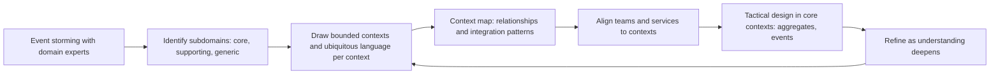
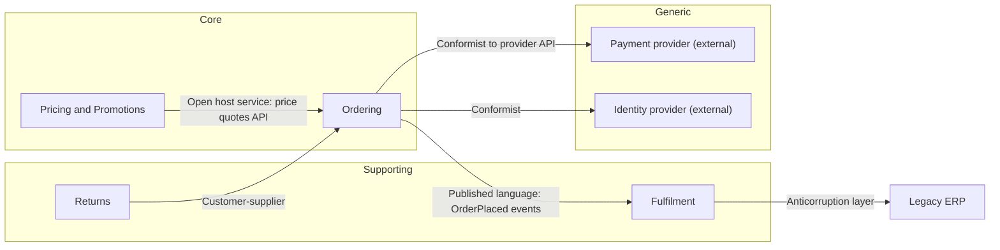

## TL;DR

- DDD is about **putting the business domain at the centre of design**: a shared **ubiquitous language** with domain experts, and models that change as understanding deepens.
- **Strategic DDD matters most:** split a large domain into **bounded contexts**, each with one consistent model and language, and map how they relate (context mapping). These boundaries are the best guide to service, module and team boundaries.
- Classify **subdomains** as core (differentiating: invest heavily), supporting (necessary but specific to you) or generic (buy or use off-the-shelf).
- **Tactical patterns** (entities, value objects, aggregates, domain events, repositories) help implement rich models in complex core domains. **Aggregates** define transactional consistency boundaries: keep them small and reference others by id.
- DDD is overkill for CRUD-heavy or simple domains. Apply it where complexity and business value justify it.

## Core Concepts

### Ubiquitous language

The team, domain experts included, uses **one precise vocabulary** in conversation, documentation, tests and code. If the business says "a policy is *bound*", the code has `policy.bind()`, not `policy.setStatus(3)`. When language becomes awkward or ambiguous, it's a signal the model needs work.

The language is **bounded**: "Customer" in Sales (a lead with a pipeline stage) is not "Customer" in Billing (an account with payment terms) or Support (a contact with tickets). Forcing one universal `Customer` model across all of them creates a bloated, contradictory model that every team fights over.

### Bounded contexts

A **bounded context** is the explicit boundary within which a particular model and language apply consistently. Inside it, terms have one meaning. Across boundaries, translation is explicit.

Heuristics for finding boundaries:
- **Language changes:** the same word means different things, or different experts use different words.
- **Business capability and process boundaries:** Sales, Fulfilment, Billing, Support.
- **Different rates of change** or different rules and regulations.
- **Event storming:** clusters of events, commands and pivotal events ("Order placed", "Invoice issued") reveal natural seams.
- **Team cognitive load** (Team Topologies): a context should fit one team.

A bounded context often maps to one or a few deployable services, or a module in a modular monolith. **One context per team** is a common target, while one team may own several contexts.

### Subdomains: where to invest

| Type | Description | Strategy | Example (e-commerce) |
|---|---|---|---|
| Core | Differentiates the business; complex, changing | Build in-house, best people, rich domain model | Pricing & promotions engine, recommendation |
| Supporting | Needed, specific to you, not differentiating | Build simply (CRUD ok) or outsource | Returns handling workflow |
| Generic | Solved problem, same for everyone | Buy / SaaS / open source | Identity, email, payments processing, accounting |

This classification guides where DDD's tactical patterns pay off (core) and where they're waste (generic).

### Context mapping

How bounded contexts and their teams relate:

- **Partnership:** two teams succeed or fail together and coordinate closely.
- **Shared kernel:** a small, explicitly shared subset of the model (a library). It needs tight coordination; keep it minimal.
- **Customer–supplier:** the downstream team's needs influence the upstream team's priorities.
- **Conformist:** downstream adopts the upstream model as-is (common with big vendors).
- **Anticorruption layer (ACL):** downstream translates the upstream model into its own, protecting it from a messy or legacy model.
- **Open host service and published language:** upstream offers a well-defined protocol or API and schema for many consumers (a public API, event schemas).
- **Separate ways:** no integration. Duplicate the capability instead.

### Tactical building blocks

- **Entity:** has an identity that persists through state changes (`Order` with `orderId`).
- **Value object:** defined by its attributes, immutable, with no identity (`Money`, `Address`, `DateRange`). Validation and behaviour live with the data.
- **Aggregate:** a cluster of entities and value objects with one **root**, which enforces invariants. External code references the aggregate only through the root, and **one transaction modifies one aggregate**.
- **Domain event:** something significant that happened (`OrderPlaced`), named in the past tense. Used to integrate aggregates and contexts.
- **Repository:** collection-like access to aggregates (load and save whole aggregates by id). Hides persistence.
- **Domain service:** domain logic that doesn't naturally belong to one entity (for example a transfer between two accounts, coordinated by events).
- **Application service:** orchestrates a use case: loads aggregates, calls domain methods, saves, publishes events. Contains no business rules.

```ts
// Value object: immutable, self-validating, behaviour with data.
export class Money {
  private constructor(readonly amountMinor: bigint, readonly currency: 'GBP' | 'EUR' | 'USD') {}
  static of(amountMinor: bigint, currency: Money['currency']) {
    if (amountMinor < 0n) throw new Error('Money cannot be negative');
    return new Money(amountMinor, currency);
  }
  add(other: Money) {
    if (other.currency !== this.currency) throw new Error('Currency mismatch');
    return new Money(this.amountMinor + other.amountMinor, this.currency);
  }
}

// Aggregate root: enforces invariants; state changes only through intention-revealing methods.
export class Order {
  private lines: OrderLine[] = [];
  private status: 'draft' | 'placed' | 'cancelled' = 'draft';
  private events: DomainEvent[] = [];

  constructor(readonly id: OrderId, readonly customerId: CustomerId) {} // reference other aggregates by id

  addLine(productId: ProductId, qty: number, unitPrice: Money) {
    if (this.status !== 'draft') throw new DomainError('Cannot change a placed order');
    if (qty <= 0) throw new DomainError('Quantity must be positive');
    this.lines.push(new OrderLine(productId, qty, unitPrice));
  }

  place(now: Date) {
    if (this.lines.length === 0) throw new DomainError('Cannot place an empty order');
    this.status = 'placed';
    this.events.push({ type: 'OrderPlaced', orderId: this.id, total: this.total(), at: now });
  }

  total(): Money {
    return this.lines.reduce((sum, l) => sum.add(l.subtotal()), Money.of(0n, this.lines[0]?.currency ?? 'GBP'));
  }

  pullEvents() {
    const e = this.events;
    this.events = [];
    return e;
  }
}
```

### Aggregate design rules (Vaughn Vernon)

1. **Model true invariants in consistency boundaries.** What must be consistent *immediately* in one transaction? Only that belongs together.
2. **Design small aggregates.** Large aggregates cause contention, slow loads and locking conflicts.
3. **Reference other aggregates by identity,** not object references.
4. **Use eventual consistency outside the boundary:** domain events update other aggregates in separate transactions.

Example: "An order's total must equal the sum of its lines" is an invariant inside the `Order` aggregate. "Customer loyalty points reflect their orders" can be eventually consistent, updated via `OrderPlaced`.

## How It Works

Strategic design flow, from discovery to implementation:



An example context map:



## When to Use / Trade-offs

| Situation | DDD approach | Why |
|---|---|---|
| Complex, differentiating business rules that change often | Full DDD: strategic + rich tactical model | Model clarity and evolvability pay back the investment |
| Large system, many teams | Strategic DDD (contexts, context map) at minimum | Boundaries reduce coupling and coordination |
| Simple CRUD / data entry | Skip tactical patterns; transaction script or active record | Aggregates and repositories add ceremony with no benefit |
| Generic capability (auth, email, billing) | Buy; integrate via ACL | No competitive value in building |
| Integrating a messy legacy system | Anticorruption layer | Keeps legacy concepts out of your model |
| Startup searching for product-market fit | Light strategic thinking, modular monolith | Boundaries are still moving; avoid premature service splits |

Costs: time with domain experts, modelling skill, more code (value objects, explicit events), and the discipline to keep the language and model aligned. The benefits show up over years, not sprints.

## Common Pitfalls & Anti-patterns

- **Tactical-only DDD** — repositories and "aggregates" everywhere, but no bounded contexts or ubiquitous language. You get the ceremony without the benefit.
- **Anaemic domain model** — entities that are just getters and setters, with all rules in services. Invariants scatter and are easy to bypass.
- **One enterprise-wide canonical model** — a single `Customer` that serves every department, which becomes a bottleneck and a compromise for all.
- **Giant aggregates** — `Customer` containing all orders, invoices and addresses. Contention, slow loads and lock conflicts follow.
- **Microservice per entity** — `CustomerService`, `OrderService`, `ProductService` as CRUD wrappers. That is entity services, not bounded contexts, and leads to chatty, distributed monoliths.
- **Sharing databases across contexts** — boundaries in code, coupling through tables.
- **DDD without domain experts** — engineers inventing the language alone.
- **Shared kernel sprawl** — the "common" library grows until every context is coupled to it.

## Real-world Scenario

**Context:** An insurance company split its monolith into 22 microservices along entity lines: Policy, Customer, Claim, Document and so on. Every business change touched 4–6 services. The `Policy` service had 140 fields serving underwriting, billing, claims and customer service, with conflicting rules. Lead time for changes was six weeks.

**Decision:**
- Ran event-storming sessions with underwriters, claims handlers and finance. Identified bounded contexts around business capabilities: Quoting & Underwriting (core), Policy Administration, Claims (core), Billing (supporting) and Documents (generic, moved to a SaaS).
- Each context got its own model of "policy", fed by events such as `PolicyBound` and `PolicyCancelled` with explicit translation, instead of a shared `Policy` service.
- Teams were realigned to contexts.
- An anticorruption layer isolated the mainframe policy ledger.

**Outcome:** Over 18 months, services consolidated from 22 to 9 aligned to contexts, and a typical change touched one service. Lead time dropped to under a week. Underwriting could change rating rules without coordinating with Billing.

**What I'd do differently:** Run the domain discovery *before* the first split. The entity-based decomposition cost two years. Also, invest more in the ubiquitous language glossary early. Several bugs came from "effective date" meaning different things in different contexts.

## Interview Questions

### What is a bounded context, and why does it matter? {#bounded-context}

**Level:** Foundation

**Model answer:**
A bounded context is an explicit boundary within which a particular domain model and its language apply consistently. Inside it, each term has one meaning. Outside it, the same word may mean something else, and translation between contexts is explicit.

It matters because large domains don't have one coherent model. "Account" in authentication, billing and sales are different concepts with different rules. Forcing one model across all of them creates a bloated, contradictory model with high coordination costs. Bounded contexts let each team keep its model focused and evolve it independently. They are the most reliable guide for **module, service and team boundaries**.

**What the interviewer is looking for:**
The model and language consistency idea, the multiple-meanings example, and the link to service and team boundaries.

**Follow-ups:**
- How do you find the boundaries?
- Is a bounded context the same as a microservice?

**Red flags:**
- "A bounded context is a microservice" with no nuance.
- Advocating one canonical enterprise data model.

### What is the difference between an entity and a value object? {#entity-vs-value-object}

**Level:** Foundation

**Model answer:**
- An **entity** has a **distinct identity** that persists over time while its attributes change. Two orders with identical lines are still different orders. Equality is by id.
- A **value object** is defined entirely by its **attributes**, has no identity and is **immutable**. Two `Money(10, 'GBP')` values are interchangeable. Equality is by value. To "change" one, you replace it.

Value objects are underused and very valuable:
- They make implicit concepts explicit (`EmailAddress`, `DateRange`, `Money`).
- They validate themselves on construction, so invalid values can't exist.
- They carry behaviour (`money.add()`, `range.overlaps()`) and remove primitive obsession (passing raw strings and numbers).

**What the interviewer is looking for:**
Identity versus value equality, immutability, and the practical benefits of value objects.

**Follow-ups:**
- Is an `Address` an entity or a value object? When could it be either?
- How do you persist value objects in a relational database?

**Red flags:**
- Treating everything as an entity with an id.
- Mutable value objects.

### What is the ubiquitous language, and how do you build one? {#ubiquitous-language}

**Level:** Foundation

**Model answer:**
The ubiquitous language is a **shared, precise vocabulary** used by domain experts and developers alike: in conversation, user stories, tests and code, *within a bounded context*. If the experts say "an order is fulfilled when all lines are dispatched", the code has `Order.isFulfilled()` with that rule, not `checkStatus2()`.

How to build it:
- Collaborate directly with domain experts in event storming, example mapping and design sessions.
- Listen for ambiguity ("When you say *active*, do you mean paid, or logged in within 30 days?") and resolve it explicitly.
- Keep a living glossary per context.
- Reflect the language in code, tests (BDD-style scenarios), APIs and event names, and refactor code when the language evolves.

When translating between experts and code becomes painful, or terms are used inconsistently, it signals a modelling problem or a hidden context boundary.

**What the interviewer is looking for:**
Precision, collaboration with experts, reflection in code and its scope within a bounded context.

**Follow-ups:**
- What do you do when two departments use the same word differently?
- How do you keep the glossary alive?

**Red flags:**
- Technical jargon in place of business terms in the domain code.
- One language across the whole enterprise.

### What are core, supporting and generic subdomains, and why classify them? {#subdomains}

**Level:** Foundation

**Model answer:**
- **Core subdomain:** what makes the business different and competitive, such as a pricing engine, underwriting rules or matching algorithms. It is usually complex and changes often. **Invest the best people and rich modelling here; build it in-house.**
- **Supporting subdomain:** necessary and specific to the business, but not a differentiator, such as returns handling or internal workflow tools. Build it simply, or outsource it.
- **Generic subdomain:** a solved problem that everyone has: identity, email, payments processing, accounting. **Buy or use off-the-shelf.**

Classification drives investment and build-versus-buy decisions, and tells you where DDD's tactical patterns pay off. Misclassifying is costly: building your own identity provider, or outsourcing your differentiator.

**What the interviewer is looking for:**
Definitions with examples and the strategic consequences for investment and build versus buy.

**Follow-ups:**
- Can a subdomain move between categories over time?
- Give an example where a "generic" subdomain is core for a specific company.

**Red flags:**
- Treating everything as core.
- Building generic capabilities from scratch by default.

### What is an aggregate, and how do you decide its boundaries? {#aggregate-design}

**Level:** Senior

**Model answer:**
An aggregate is a cluster of entities and value objects treated as **one unit for data changes**, with a single **aggregate root** that enforces its **invariants**. External objects reference only the root, and a transaction changes only one aggregate.

To decide the boundaries, ask: **which business rules must be consistent immediately, in one transaction?**
- "Order total equals the sum of lines" and "no lines can be added after placement" mean lines belong inside `Order`.
- "A customer's lifetime value includes all orders" doesn't need to be immediate. Keep `Customer` separate and update it via events.

Vernon's rules:
- Keep aggregates **small**.
- Reference other aggregates **by id**.
- Use **eventual consistency** between aggregates via domain events.

Test the design against concurrency: if many users routinely edit the same aggregate at once (a giant `Project` with all tasks), optimistic locking conflicts become frequent. That signals the aggregate is too big.

**What the interviewer is looking for:**
Invariant-driven boundaries, small aggregates, references by id, eventual consistency between aggregates and awareness of concurrency.

**Follow-ups:**
- How do you enforce a rule that spans two aggregates, such as "a customer can have at most 3 active subscriptions"?
- How do aggregates map to database tables?

**Red flags:**
- Aggregates modelled from the data schema ("all related tables").
- Updating several aggregates in one transaction routinely.

### What is an anaemic domain model, and when is it acceptable? {#anaemic-model}

**Level:** Senior

**Model answer:**
An **anaemic domain model** has entities that are data containers (getters and setters), with all business logic in "service" classes. The result:
- Invariants are scattered and easy to bypass (`order.status = 'SHIPPED'` from anywhere).
- Rules are duplicated across services.
- The code doesn't express the domain language.

A **rich model** puts behaviour with the data, through intention-revealing methods (`order.place()`, `policy.cancel(reason, effectiveDate)`) that enforce rules and emit domain events.

When an anaemic or transaction-script approach is fine:
- **Simple CRUD** with few rules: admin screens, reference data, supporting or generic subdomains.
- Reporting and read models (CQRS read side).
- Thin integration services.

Fowler calls the anaemic model an anti-pattern in complex domains specifically. Applying rich modelling everywhere is also waste. Match the approach to the complexity.

**What the interviewer is looking for:**
Clear definition, why it hurts in complex domains, and the pragmatism to accept it in simple ones.

**Follow-ups:**
- How would you refactor an anaemic model incrementally?
- Where do validation rules belong?

**Red flags:**
- Public setters for every field on core entities.
- Insisting on rich models for simple lookup tables.

### Explain the anticorruption layer. When would you use it? {#anticorruption-layer}

**Level:** Senior

**Model answer:**
An **anticorruption layer (ACL)** is a translation layer between your bounded context and another model, typically a legacy system, a third-party API or an upstream context whose model you don't want to adopt. It translates in both directions (their concepts and formats to yours and back), so **your model stays clean** and isn't shaped by their quirks.

Implementation: adapters, facades and translators (often a separate module or service) that call the external system and map its data. For example, mainframe policy records with codes like `STAT=07` become `Policy { status: 'Lapsed' }` in your model.

Use it when:
- Integrating legacy systems during a strangler-fig migration.
- Third-party models don't fit yours, or might change.
- The upstream team won't accommodate your needs (you can't be a customer in a customer–supplier relationship), and you don't want to be a conformist.

Costs: more code to maintain and some latency. For a clean, stable, well-designed upstream API, conforming may be cheaper.

**What the interviewer is looking for:**
Purpose (protecting your model), implementation approach, use cases (legacy, third party) and the trade-off against conforming.

**Follow-ups:**
- How does the ACL relate to the strangler-fig pattern?
- Where would you put the ACL in a microservices architecture?

**Red flags:**
- Letting legacy field names and codes leak through your whole domain.
- Building an ACL for every integration, including clean internal APIs.

### How do domain events differ from integration events? {#domain-vs-integration-events}

**Level:** Senior

**Model answer:**
- **Domain events** are internal to a bounded context. They capture something meaningful that happened in the model (`OrderLineAdded`, `OrderPlaced`). They're used within the context to trigger side effects, update other aggregates or build read models. They can be fine-grained and can change as the model changes.
- **Integration events** are published *across* context boundaries as part of the context's **published language**. They are a contract: versioned, stable, documented (AsyncAPI, schema registry), and carry only what other contexts need, in a form they can understand. For example, `OrderPlaced.v1 { orderId, customerId, totalMinor, currency, placedAt }`.

Typically, a handler translates selected domain events into integration events, often via the transactional outbox. This decoupling lets the internal model evolve without breaking other teams.

**What the interviewer is looking for:**
Scope (inside versus across contexts), stability and versioning differences, and the translation step.

**Follow-ups:**
- Should integration events carry the full state or just ids?
- How do you guarantee an integration event is published when the transaction commits?

**Red flags:**
- Publishing every internal domain event as a public contract.
- No versioning of cross-context events.

### How do you enforce a rule that spans multiple aggregates? {#cross-aggregate-invariants}

**Level:** Senior

**Model answer:**
First, challenge whether it must be **immediately** consistent. Ask the business: "What happens if it's violated for a few seconds? How often would that occur?" Many "invariants" tolerate brief inconsistency with detection and correction.

Options:
1. **Redraw the aggregate boundary** if the rule is truly transactional and contention is low. The rule may reveal that the concepts belong together.
2. **Eventual consistency with a process manager or saga:** react to events, check the rule and compensate if violated (for example cancel the 4th subscription and notify the customer).
3. **A reservation or constraint aggregate:** model the scarce resource explicitly. A `SubscriptionQuota` aggregate per customer, or a `UniqueUsername` registry, checked and updated transactionally before the main aggregate is created.
4. **Database constraints** as a pragmatic guard: a unique index for uniqueness rules, accepting that the rule then lives partly in the infrastructure.
5. **Domain service checks** with optimistic concurrency, accepting rare races, plus a periodic reconciliation job.

Choose based on the cost of violation, frequency of concurrency and complexity.

**What the interviewer is looking for:**
Questioning the need for immediate consistency, multiple valid techniques and choosing by business cost.

**Follow-ups:**
- How would you guarantee unique usernames across a distributed system?
- What is a process manager?

**Red flags:**
- Loading and locking many aggregates in one transaction as the default.
- Ignoring race conditions.

### How do you identify bounded contexts in an existing monolith? {#finding-contexts-in-monolith}

**Level:** Architect

**Model answer:**
Combine **business discovery** with **code analysis**:

Business side:
- **Big-picture event storming** with domain experts across departments: map the end-to-end flow, then cluster events and find the pivotal events where responsibility hands over.
- Listen for **language shifts:** where the same term changes meaning.
- Map **business capabilities** and their owners, and where business rules and regulations differ.

Code and data side:
- **Coupling analysis:** module dependency graphs, and which tables are read and written by which modules. Look for natural clusters.
- **Change coupling** from git history: files that change together belong together. Tools such as CodeScene help.
- **Hotspots:** high churn plus complexity show where the domain is most active and least clean.
- **Team and incident data:** which parts need many teams to coordinate.

Then:
1. Propose candidate contexts and a context map.
2. Validate them by walking real scenarios through them ("a customer changes address mid-order").
3. Start with a **modular monolith:** enforce module boundaries in code (dependency rules, separate schemas) before extracting any services.
4. Extract the contexts with the clearest boundaries and highest change rate first.

**What the interviewer is looking for:**
Business-first discovery, data and code evidence, validation by scenario and incremental enforcement (modular monolith) before distribution.

**Follow-ups:**
- What do you do with the shared `customers` table everyone uses?
- How would you prioritise which context to extract first?

**Red flags:**
- Splitting by technical layer or by entity.
- Extracting microservices before establishing boundaries in the monolith.

### How should team structure relate to bounded contexts? {#contexts-and-teams}

**Level:** Architect

**Model answer:**
Conway's law says systems mirror the communication structures of the organisations that build them. So **align teams with bounded contexts** (the "inverse Conway manoeuvre"):
- One team owns one or more contexts end to end: model, code, data and operations. A context should not be split across teams, which leads to coordination overhead and a muddled model.
- Context size should fit a team's **cognitive load** (Team Topologies). If a context is too big for one team, it may be several contexts.
- Context-map relationships mirror team relationships. Partnership needs close collaboration. Customer–supplier needs a prioritisation agreement. Open host service and published language suit a platform-like team serving many consumers.
- **Generic subdomains** are often owned by platform teams or bought. **Core subdomains** get stream-aligned teams with the strongest domain expertise and long-term stability, so knowledge accumulates.

Watch for mismatches: a context owned by three teams, or one team owning unrelated contexts across domains. Plan re-organisations together with architecture changes.

**What the interviewer is looking for:**
Conway's law, team ownership of contexts, cognitive load, mapping relationships to team interactions and the deliberate co-design of teams and architecture.

**Follow-ups:**
- What do you do when a key context has no clear owner?
- How do you handle a context that needs knowledge from two departments?

**Red flags:**
- Designing contexts with no regard to team structure.
- Shared ownership of everything.

### When is DDD the wrong approach? {#when-not-ddd}

**Level:** Architect

**Model answer:**
DDD's tactical patterns and deep modelling are costly. They're wrong, or overkill, when:
- **The domain is simple:** mostly CRUD, forms over data, few business rules. A transaction script or active record is clearer.
- **The subdomain is generic:** buy it or use a library. Modelling your own email or identity domain is waste.
- **There's no access to domain experts:** you can't build a ubiquitous language alone, and you'd be guessing.
- **Early exploration:** before product-market fit, the domain changes weekly. Light boundaries (a modular monolith) beat elaborate models.
- **Data-centric or analytical systems:** pipelines, reporting and ML feature stores are better served by data-modelling techniques.
- **The team lacks modelling experience** and there's no time to build it. Half-applied tactical DDD (repositories and aggregates on top of CRUD) adds ceremony without benefit.

Even then, **strategic DDD's ideas** (bounded contexts, ubiquitous language, context mapping, classifying subdomains) are almost always useful at system and organisation scale.

**What the interviewer is looking for:**
Nuanced judgement: separating strategic from tactical DDD and matching investment to complexity and value.

**Follow-ups:**
- How would you introduce DDD to a team that's never used it?
- Which DDD ideas would you apply even to a CRUD app?

**Red flags:**
- DDD as the default for everything.
- Dismissing DDD entirely as "too academic".

### How do you integrate bounded contexts while preserving their autonomy? {#context-integration}

**Level:** Architect

**Model answer:**
Choose the integration style per relationship, and make the contracts explicit:

- **Asynchronous events (published language):** the upstream context publishes versioned integration events (via an outbox). Downstream contexts keep their **own local copy** of the data they need, in their own model. This gives the highest autonomy: no runtime dependency, each context available independently.
- **Synchronous APIs (open host service):** for queries that need fresh data or commands that need an immediate answer. Version the APIs, keep them coarse-grained (business operations, not CRUD on entities) and protect callers with timeouts and fallbacks.
- **Anticorruption layers** on the downstream side whenever the upstream model differs or is unstable.
- **No shared databases between contexts.** Data ownership follows context ownership. Reporting uses event-fed data products or a warehouse, not cross-context joins.
- **Long-running processes across contexts:** sagas or process managers with compensation.
- **Governance:** schema registries and contract tests for events and APIs, and a context map document showing every relationship and its pattern.

**What the interviewer is looking for:**
Events with local copies for autonomy, APIs where needed, ACLs, data ownership, sagas and contract governance.

**Follow-ups:**
- How does the Shipping context get the customer's address without calling Customer at runtime?
- How do you handle GDPR erasure across contexts holding copies?

**Red flags:**
- Shared database tables between contexts.
- Fine-grained CRUD APIs between contexts ("get order line 3").

### Your organisation built "entity microservices" (Customer service, Order service, Product service) and every change touches five of them. What do you do? {#entity-services-fix}

**Level:** Architect

**Model answer:**
**Diagnose with evidence:**
- Which business changes require coordinated deployments? (Change coupling across repositories.)
- Chatty synchronous call chains (from tracing).
- Shared data ownership conflicts.
- Lead time and incident data.

This usually confirms that the services are organised around **nouns** rather than **business capabilities**.

**Rediscover the domain:** event storming with business experts to find bounded contexts around capabilities and processes (Ordering, Fulfilment, Billing, Catalogue management, Customer support), each with its own model of "customer", "order" or "product".

**Target design:** a context map where each context owns the data and rules for its capability, integrated mainly through events with local copies, and synchronous calls only where needed.

**Migrate incrementally:**
1. Pick the most painful flow.
2. Move the logic and data into the owning context, keeping old APIs as facades during the transition.
3. Merge services that always change together. Consolidation is a valid outcome; more services is not always the goal.
4. Use ACLs to shield new contexts from old service models while they coexist.
5. Realign teams to contexts as the boundaries settle.

**Measure:** services touched per change, deployment coordination incidents, lead time and synchronous call depth.

**What the interviewer is looking for:**
Recognising the entity-service anti-pattern, evidence-based diagnosis, capability-based redesign, willingness to merge services and incremental migration with team alignment.

**Follow-ups:**
- How do you get buy-in to merge services that teams are proud of?
- What's your first 90-day plan?

**Red flags:**
- Adding an orchestration layer on top to hide the chattiness.
- Proposing a big-bang rewrite.

### What is a repository in DDD, and how does it differ from a generic data access layer? {#repositories}

**Level:** Senior

**Model answer:**
A DDD **repository** provides collection-like access to **whole aggregates**: `orders.get(orderId)`, `orders.save(order)`. It hides persistence details from the domain. Key differences from a generic DAO or ORM-everywhere approach:
- **One repository per aggregate root,** not per table. There's no `OrderLineRepository`, because lines are loaded and saved through `Order`.
- **It returns fully formed aggregates** with their invariants intact, never partially loaded objects that could be modified inconsistently.
- **The interface is defined in the domain layer** in domain language (`findOverdueFor(customerId)`); the implementation lives in infrastructure (ports and adapters).
- **It doesn't serve every query.** Lists, searches and reports go through a separate read model or query service (CQRS-style), often with SQL straight to optimised views. Forcing reports through aggregate repositories causes N+1 queries and bloated aggregates.
- **Concurrency:** save with optimistic locking (a version column) so concurrent updates to the same aggregate are detected.

```ts
export interface OrderRepository {
  get(id: OrderId): Promise<Order>;            // throws if not found
  save(order: Order, expectedVersion: number): Promise<void>;
}
```

**What the interviewer is looking for:**
Aggregate-level granularity, domain-owned interfaces, separating reads from aggregate persistence and concurrency control.

**Follow-ups:**
- How would you implement this repository with an ORM without leaking the ORM into the domain?
- Where do domain events get published: in the repository or the application service?

**Red flags:**
- A repository per table with generic `findAll`/`update` methods used throughout the domain.
- Returning ORM entities with lazy-loading proxies into domain logic.

## Cheat Sheet

### Strategic
- **Bounded context** — boundary within which one model and language are consistent; best guide for service and team boundaries.
- **Ubiquitous language** — one precise vocabulary shared by experts and code, within a context.
- **Core subdomain** — the differentiator; build in-house with the best people and rich models.
- **Generic subdomain** — solved problem; buy or use off-the-shelf.
- **Context map** — the relationships between contexts and their integration patterns.
- **Anticorruption layer** — translation layer protecting your model from a legacy or foreign model.
- **Open host service + published language** — a well-defined, versioned API or event schema for many consumers.
- **Conformist** — downstream adopts the upstream model as-is.

### Tactical
- **Entity vs value object** — identity-based and mutable vs attribute-based and immutable.
- **Aggregate** — consistency boundary with one root; one transaction changes one aggregate.
- **Aggregate rules** — small, reference others by id, eventual consistency between aggregates.
- **Domain vs integration event** — internal and fine-grained vs cross-context, versioned contract.
- **Anaemic model** — data-only entities with logic in services; fine for CRUD, harmful in complex domains.
- **Entity services anti-pattern** — microservices per noun; chatty, coupled, every change touches many.
- **Event storming** — workshop that discovers events, boundaries and language with domain experts.

## Further Reading

- [Domain-Driven Design Reference (Eric Evans)](https://www.domainlanguage.com/ddd/reference/) — Evans's concise summary of the patterns and definitions.
- [DDD Crew on GitHub](https://github.com/ddd-crew) — free, practical templates: bounded context canvas, context mapping, aggregate design canvas.
- [Effective Aggregate Design (Vaughn Vernon)](https://www.dddcommunity.org/library/vernon_2011/) — the essay series behind the small-aggregate rules.
- [Microsoft: Domain analysis for microservices](https://learn.microsoft.com/en-us/azure/architecture/microservices/model/domain-analysis) — worked example of moving from domain analysis to service boundaries.
- [Martin Fowler: Bounded Context](https://martinfowler.com/bliki/BoundedContext.html) — a short, clear explanation with examples.
- [Team Topologies](https://teamtopologies.com/key-concepts) — team types and interaction modes that pair naturally with bounded contexts.
