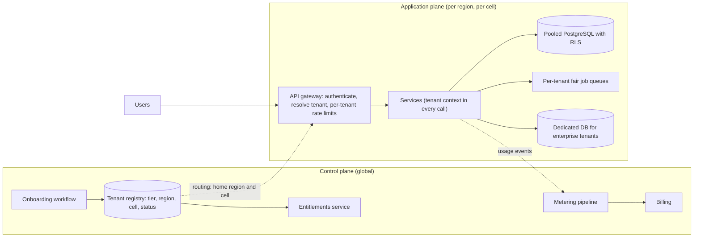
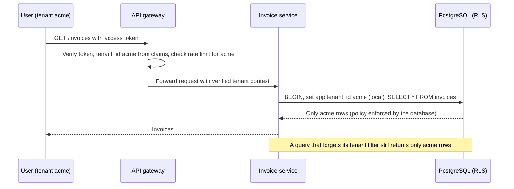
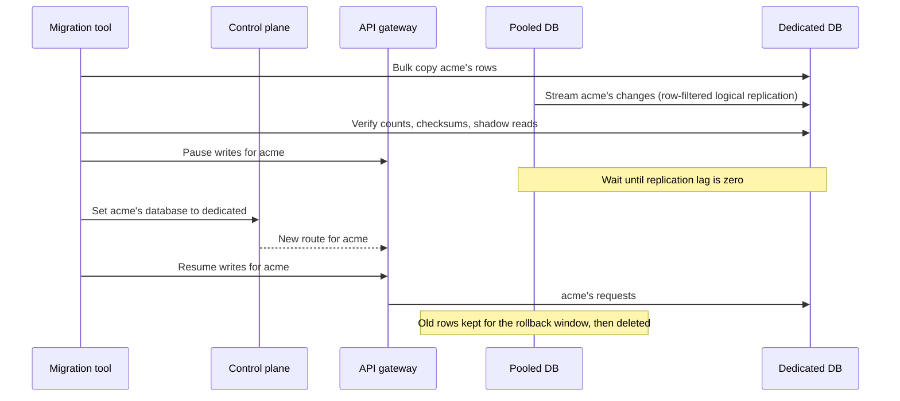

## TL;DR

- Multi-tenancy is a set of **isolation choices made per layer**: compute, data, network, identity and operations. Each layer can be **silo** (dedicated per tenant), **pool** (shared) or a **bridge** mix. The right answer is usually *pooled by default, siloed where a tier, regulation or noisy neighbour demands it*.
- **Tenant context** must flow through every request, job, event, log line and metric, and be **enforced at the data layer**, for example with PostgreSQL row-level security. A missing `WHERE tenant_id = …` is a data breach, not a bug.
- Separate the **control plane** (onboarding, tiers, billing, configuration, tenant lifecycle) from the **application plane** (the product). Automate tenant provisioning end to end.
- **Noisy neighbours** are the main pooled-model risk. Use per-tenant quotas and rate limits, workload isolation for heavy jobs, and cells or dedicated capacity for the largest tenants.
- Make everything **tenant-aware**: cost per tenant, SLOs per tier, per-tenant migrations and deployments, data residency, and offboarding with provable deletion.

## Core Concepts

### Isolation models

| Model | Description | Strengths | Weaknesses |
|---|---|---|---|
| **Silo** | Dedicated stack (or database, or account) per tenant | Strong isolation, per-tenant customisation and residency, easy cost attribution | Expensive, hard to operate at hundreds or thousands of tenants, slower onboarding |
| **Pool** | All tenants share infrastructure and data stores, separated logically | Cheapest per tenant, simple fleet operations, fast onboarding | Noisy neighbours, a bug can leak data across tenants, harder per-tenant cost |
| **Bridge** | Mix per layer or per tier: shared compute, siloed databases; or pooled for small tenants, siloed for enterprise | Matches cost and isolation to need | Two operating models to maintain |
| **Cells** | The fleet is split into identical cells, each serving a subset of tenants | Limits blast radius, scales by adding cells | Cell routing, placement and rebalancing to build |

Choose per layer. A common shape: pooled compute and pooled databases with row-level security for standard tiers, a dedicated database (or account) for enterprise tenants with residency or contractual isolation needs, and the whole fleet organised into cells.

### Control plane and application plane

- The **control plane** owns tenants as entities: sign-up and onboarding, tier and plan, feature entitlements, identity provider configuration, provisioning of tenant resources, metering and billing, suspension and offboarding. It's built once and serves every tenant.
- The **application plane** is the product itself, which reads tenant context and entitlements and enforces isolation.

Tenant onboarding should be one automated workflow (often a Step Functions or Durable Functions orchestration), not a runbook: create the tenant record, set up identity, provision siloed resources if the tier needs them, seed configuration, register billing, and send the welcome email.

### Tenant context

```ts
// Resolve tenant once at the edge of the request, then carry it everywhere.
import { AsyncLocalStorage } from 'node:async_hooks';

interface TenantContext { tenantId: string; tier: 'free' | 'standard' | 'enterprise'; region: string }
export const tenantStore = new AsyncLocalStorage<TenantContext>();

export function tenantMiddleware(req: Request & { auth: { claims: Record<string, string> } }, _res: unknown, next: () => void) {
  // Trust only the verified token, never a header or path parameter supplied by the client.
  const tenantId = req.auth.claims['tenant_id'];
  if (!tenantId) throw new Error('No tenant in token');
  const tenant = tenantCache.get(tenantId);           // tier, region, status from the control plane
  if (!tenant || tenant.status !== 'active') throw new Error('Tenant inactive');
  tenantStore.run({ tenantId, tier: tenant.tier, region: tenant.region }, next);
}

export const currentTenant = () => {
  const ctx = tenantStore.getStore();
  if (!ctx) throw new Error('Tenant context missing');  // fail closed
  return ctx;
};
```

Propagate it in message headers and job payloads, and add `tenant_id` to every log line, trace span and metric (as a log and trace attribute; as a metric label only if tenant count is small enough for your metrics cardinality budget).

### Enforcing isolation in the data layer

Application-level filtering alone relies on every query being written correctly. Add a second layer:

```sql
-- PostgreSQL row-level security: the database enforces the tenant filter.
ALTER TABLE invoices ENABLE ROW LEVEL SECURITY;
ALTER TABLE invoices FORCE ROW LEVEL SECURITY;            -- applies to the table owner too

CREATE POLICY tenant_isolation ON invoices
  USING (tenant_id = current_setting('app.tenant_id')::uuid)
  WITH CHECK (tenant_id = current_setting('app.tenant_id')::uuid);
```

```ts
// Set the tenant per transaction (SET LOCAL semantics), safe with pooled connections.
export async function withTenantTx<T>(fn: (tx: Tx) => Promise<T>): Promise<T> {
  const { tenantId } = currentTenant();
  return db.transaction(async (tx) => {
    await tx.query(`SELECT set_config('app.tenant_id', $1, true)`, [tenantId]); // true = local to this transaction
    return fn(tx);
  });
}
```

The application connects with a role that doesn't have `BYPASSRLS` and isn't a superuser. Admin and cross-tenant jobs use a separate, audited role.

Other stores: partition keys that start with the tenant id (DynamoDB, Cosmos DB), per-tenant prefixes with IAM conditions on object storage (`s3:prefix` matching `${aws:PrincipalTag/tenant}`), and per-tenant encryption keys where customers require them.

### Worked example: what RLS does on one pooled connection

Take the policy above and run these statements in order on the **same pooled connection**, as the application role:

| # | Statements | Result |
|---|---|---|
| 1 | `BEGIN; SELECT set_config('app.tenant_id', '<acme>', true); SELECT count(*) FROM invoices; COMMIT;` | Acme's 1,204 invoices |
| 2 | Same, with Globex's id, then `SELECT * FROM invoices WHERE id = '<an acme invoice>'` | 0 rows. The row exists, but the policy hides it |
| 3 | As Globex: `INSERT INTO invoices (tenant_id, …) VALUES ('<acme>', …)` | `ERROR: new row violates row-level security policy for table "invoices"` (the `WITH CHECK` clause) |
| 4 | A code path that forgot `withTenantTx`: `SELECT count(*) FROM invoices` | `ERROR: invalid input syntax for type uuid: ""`. The transaction-local setting has reverted to an empty string, so the cast fails |
| 5 | The same query on a brand-new connection | `ERROR: unrecognized configuration parameter "app.tenant_id"` |

Steps 4 and 5 are the important ones. A missing tenant fails closed, and loudly, so it shows up in error tracking instead of in a customer's screenshot. If you'd rather return no rows than raise an error, write the policy as `tenant_id = NULLIF(current_setting('app.tenant_id', true), '')::uuid`. The `true` argument returns `NULL` for an unknown setting, and `tenant_id = NULL` matches nothing.

Compare this with a session-level `SET app.tenant_id = '<globex>'`. The setting would survive `COMMIT`, so in step 4 the next request on that connection, possibly for Acme, would silently read Globex's invoices.

### Noisy neighbours and fairness

- **Rate limits and quotas per tenant** (and per tier) at the API gateway, plus concurrency limits for expensive operations.
- **Fair queuing for background work**: per-tenant queues or weighted scheduling, so one tenant's 2-million-row import doesn't delay everyone else's jobs.
- **Separate pools** for heavy workloads (reporting, exports), and read replicas for analytics.
- **Placement**: move tenants that outgrow the pool to a dedicated cell or silo, which needs tenant migration tooling.
- **Visibility**: per-tenant resource usage, so you know who the neighbours are.

### Tiers, metering and cost

- **Tiers** combine entitlements (features), limits (users, storage, API calls) and isolation (pooled or dedicated). Store entitlements in the control plane and check them through a single service or library, not scattered `if (tier === 'enterprise')` checks.
- **Metering**: record billable usage events per tenant (API calls, storage, compute minutes) reliably and idempotently, feeding billing.
- **Cost per tenant**: allocate shared infrastructure costs using usage signals (requests, storage, CPU time) plus direct costs of siloed resources. It tells you whether each tier is profitable and which tenants need repricing or optimisation.

### Operating a multi-tenant fleet

- **Deployments**: the same version everywhere if possible. Roll out progressively by cell or tenant cohort (internal tenants first, then small tenants, then enterprise).
- **Migrations**: in pooled databases, schema changes affect everyone at once, so use expand/contract. In siloed databases, run them across hundreds of databases with orchestration, tracking per-tenant status and retrying failures.
- **SLOs per tier**, and tenant-aware alerting: an outage for one large tenant can be invisible in fleet-wide averages.
- **Support tooling**: safe, audited ways to view a tenant's configuration and data (with consent and logging) instead of ad-hoc database access.
- **Offboarding**: export data, then delete it across databases, object stores, search indexes, caches, logs and backups (or crypto-shred per-tenant keys), and produce evidence of deletion.

### Data residency

Tenants in regulated markets may require data to stay in a region. That usually means **regional stamps** (a full deployment of the application plane per region) with a global control plane that holds minimal metadata, and routing tenants to their home region at login. Cross-region features (global search, analytics) must respect residency.

## How It Works

### Control plane and pooled application plane



### Request with tenant isolation



### Moving a tenant from the pool to a dedicated database



## When to Use / Trade-offs

| Decision | Option | Use when | Cost |
|---|---|---|---|
| Data isolation | Shared tables + `tenant_id` + RLS | Many small and medium tenants, standard tiers | Discipline in every query path, noisy neighbours |
| Data isolation | Schema per tenant | Hundreds of tenants needing some separation or custom extensions | Migrations across many schemas, catalogue bloat at large counts |
| Data isolation | Database or account per tenant | Enterprise, regulated or residency-bound tenants | Higher cost, fleet-wide migrations and monitoring |
| Compute | Pooled services | Default | Fairness controls needed |
| Compute | Dedicated deployment per tenant | Contractual isolation, custom versions (avoid if possible) | Operational sprawl, version drift |
| Scale-out | Cells | Large fleets where blast radius matters | Routing, placement and migration tooling |
| Keys | Per-tenant encryption keys (BYOK) | Enterprise demands, crypto-shredding on offboarding | Key management complexity and cost |

## Common Pitfalls & Anti-patterns

- **Tenant id from the client** — trusting a header, subdomain or path parameter without tying it to the authenticated identity.
- **Isolation only in application code** — one missing filter in a new endpoint or report leaks data across tenants. Add database enforcement and automated cross-tenant tests.
- **Shared caches without tenant in the key** — one tenant served another's cached response.
- **Background jobs without tenant context** — jobs run as a superuser and bypass every check.
- **Custom code per tenant** — branches or forks for big customers create versions you can't upgrade. Use configuration and entitlements instead.
- **One giant pool with no escape hatch** — the largest tenant degrades everyone and you have no way to move it.
- **Fleet-average monitoring** — a full outage for one enterprise tenant disappears in the averages.
- **No offboarding process** — departed tenants' data lingers in backups, logs and search indexes indefinitely.
- **Metric labels per tenant at scale** — thousands of tenants times every metric explodes cardinality and cost. Use traces, logs or aggregated usage tables instead.

## Real-world Scenario

**Context:** A B2B HR platform with 1,800 tenants ran on a single shared PostgreSQL database with `tenant_id` filters in application code. A new reporting endpoint shipped without a tenant filter, and for 40 minutes customers could see other customers' aggregate headcount data. Separately, three large tenants' month-end payroll runs regularly slowed the platform for everyone.

**Decision:**
1. **Data-layer enforcement**: enabled PostgreSQL RLS with `FORCE ROW LEVEL SECURITY` on all tenant tables, set the tenant per transaction, and moved the application to a role without `BYPASSRLS`. Admin jobs got a separate, audited role.
2. **Automated cross-tenant tests**: every API endpoint is called as tenant A for resources created by tenant B in CI, and must return 404 or 403.
3. **Tenant context everywhere**: AsyncLocalStorage-based context, cache keys prefixed with the tenant, and tenant ids in all job payloads, logs and traces.
4. **Fairness**: per-tenant rate limits by tier, per-tenant weighted job queues, and payroll runs moved to a separate worker pool.
5. **Bridge model**: the three largest tenants moved to dedicated databases in their own cell, using tenant migration tooling (logical replication plus a short per-tenant cutover).
6. **Control plane**: a tenant registry with tier, cell and region, used by the gateway for routing.

**Outcome:** No further cross-tenant exposure. The CI suite caught two missing filters in new endpoints within the first quarter, and RLS blocked one more in production as an error instead of a leak. p95 latency during month-end fell from 2.4 s to 380 ms for pooled tenants.

**What I'd do differently:** Build RLS and tenant-aware caching from day one. Retrofitting them into 300 queries and several caching layers took two engineers three months.

## Interview Questions

### What are the silo, pool and bridge tenancy models? {#tenancy-models}

**Level:** Foundation

**Model answer:**
- **Silo**: each tenant gets dedicated resources: its own database, deployment or even cloud account. Strong isolation, easy per-tenant cost and customisation, and simple residency, but expensive and hard to operate at scale.
- **Pool**: tenants share the same infrastructure and data stores, separated logically by tenant id. Cheapest and simplest to operate as a fleet, but needs careful isolation in code and data, and fairness controls against noisy neighbours.
- **Bridge**: a mix, either per layer (shared compute, separate databases) or per tier (pooled for small tenants, siloed for enterprise).

The choice is made **per layer** and **per tier**, based on isolation requirements, cost targets, compliance, and the size distribution of tenants. Most SaaS products start pooled and add silos for the tenants who need and pay for them.

**What the interviewer is looking for:**
The three models with trade-offs, and the per-layer, per-tier framing.

**Follow-ups:**
- Which would you choose for a product with 10,000 small tenants and 20 large ones?
- What does a cell-based architecture add?

**Red flags:**
- "Always use a database per tenant for security."
- No consideration of cost at scale.

### How should tenant identity be established and propagated through a system? {#tenant-context}

**Level:** Foundation

**Model answer:**
- **Establish it from the verified identity**: the tenant comes from claims in the validated access token (or from a session tied to an authenticated user), never from a client-controlled header, path parameter or subdomain on its own. Subdomains can be used for routing and branding, but must be checked against the token's tenant.
- **Resolve once at the edge**: the gateway or middleware validates the token, loads tenant metadata (status, tier, region) from the control plane, and rejects suspended tenants.
- **Propagate it implicitly within a service** (AsyncLocalStorage in Node.js, request-scoped context elsewhere), so code can't forget it, and **explicitly across boundaries**: in service-to-service calls, message headers, job payloads and scheduled tasks.
- **Fail closed**: if tenant context is missing, refuse the operation rather than defaulting to "all tenants".
- **Record it everywhere**: logs, traces, audit records.

**What the interviewer is looking for:**
Trusting only verified identity, propagating across async boundaries, and failing closed.

**Follow-ups:**
- How do you handle users who belong to several tenants?
- How do background jobs get tenant context?

**Red flags:**
- Reading tenant id from an `X-Tenant-Id` header supplied by the client.
- Defaulting to no filter when context is missing.

### What is a noisy neighbour, and how do you prevent one in a pooled system? {#noisy-neighbour}

**Level:** Foundation

**Model answer:**
A noisy neighbour is a tenant whose workload consumes so much shared capacity (CPU, database connections, I/O, queue throughput) that other tenants' performance suffers. Typical causes: bulk imports, large reports, integrations hammering the API, or a tenant much larger than the rest.

Prevention:
- **Per-tenant rate limits and quotas**, tiered by plan, at the gateway and for expensive operations.
- **Fair scheduling** of background work: per-tenant queues or weighted round-robin, so one tenant's backlog doesn't block others.
- **Workload isolation**: separate worker pools and read replicas for heavy operations (exports, analytics).
- **Limits inside operations**: pagination, maximum query time, batch sizes.
- **Placement**: move outsized tenants to dedicated capacity, a separate cell or a silo.
- **Visibility**: per-tenant usage metrics, so you can spot and talk to heavy users.

**What the interviewer is looking for:**
Concrete controls at several layers, plus the ability to move tenants.

**Follow-ups:**
- How do you set fair rate limits for very different tenant sizes?
- How would you detect a noisy neighbour in the database?

**Red flags:**
- "Autoscaling solves it."
- No per-tenant visibility.

### What do the control plane and the application plane do in a SaaS architecture? {#control-vs-application-plane}

**Level:** Foundation

**Model answer:**
- **Control plane**: manages tenants as entities across the whole product: sign-up and onboarding, the tenant registry (status, tier, region, cell), identity provider setup, entitlements and limits, provisioning of any dedicated resources, metering and billing, configuration, suspension and offboarding. It's global and built once.
- **Application plane**: the product's features, running for tenants. It reads tenant context and entitlements from the control plane and enforces isolation, limits and feature access.

Why separate them: onboarding and tenant lifecycle become automated and consistent, the product doesn't embed per-tenant logic, and operations (routing, tier changes, migrations between cells) have a single source of truth. The control plane should be highly available for logins and routing, and the application plane should keep working on cached tenant data if the control plane briefly isn't (static stability).

**What the interviewer is looking for:**
Clear responsibilities, automation of the tenant lifecycle, and dependency design between the planes.

**Follow-ups:**
- What would happen to running tenants if the control plane went down?
- What does tenant onboarding look like end to end?

**Red flags:**
- Tenant setup done by hand through runbooks.
- Tier logic scattered through product code.

### How do you enforce tenant isolation in a shared PostgreSQL database? {#rls-isolation}

**Level:** Senior

**Model answer:**
Use **defence in depth**:

1. **Schema**: `tenant_id` on every tenant-owned table, in primary keys or leading index columns (for both isolation and performance), and in foreign keys where possible (composite keys including `tenant_id` prevent cross-tenant references).
2. **Row-level security**: `ENABLE` and `FORCE ROW LEVEL SECURITY`, with policies comparing `tenant_id` to a session setting. `WITH CHECK` stops inserts or updates into another tenant.
3. **Setting the tenant safely with connection pools**: set it per transaction with `set_config('app.tenant_id', $1, true)` (transaction-local), so a pooled connection can't carry one tenant's setting into another request.
4. **Roles**: the application role must not be a superuser, the table owner (unless `FORCE` is set), or have `BYPASSRLS`. Cross-tenant admin work uses a separate audited role.
5. **Application layer**: repositories still filter by tenant (for clarity and index use), and the tenant comes from verified context.
6. **Tests**: automated cross-tenant access tests for every endpoint, and tests that a query without the tenant setting fails or returns nothing.

Watch for performance (policies add predicates, so index on `tenant_id`), objects that run with their owner's privileges and so can bypass RLS (views, unless created with `security_invoker` in PostgreSQL 15+, and `SECURITY DEFINER` functions), and reporting replicas that need the same controls.

**What the interviewer is looking for:**
RLS mechanics including `FORCE`, transaction-local settings with pooling, roles that can bypass RLS, and testing.

**Follow-ups:**
- How does PgBouncer's transaction pooling mode affect this?
- How do you run legitimate cross-tenant analytics?

**Red flags:**
- Session-level `SET app.tenant_id` with a shared pool.
- Running the application as the table owner without `FORCE`.

### How do you run schema migrations across hundreds of tenant databases? {#fleet-migrations}

**Level:** Senior

**Model answer:**
- **Backward-compatible changes only** (expand/contract), because tenant databases will be on different schema versions for a while during the rollout, and the application must work against both.
- **Orchestration**: a migration service or job that iterates over the tenant registry, applies migrations to each database with a concurrency limit, records each tenant's schema version, and retries failures. Tools such as Flyway or Atlas run per database, and the orchestrator handles the fleet.
- **Progressive rollout**: internal and test tenants first, then a small cohort, then the rest, watching errors and latency between waves.
- **Visibility**: a dashboard of tenant schema versions and failures, and alerts on stuck migrations.
- **Idempotency and resumability**: rerunning the orchestrator continues where it stopped.
- **Long-running changes** (backfills, index builds) are batched and throttled per database, scheduled outside each tenant's peak hours where possible (time zones matter).
- **Gate the application**: features that need the new schema are enabled per tenant only once that tenant's migration has completed (feature flags keyed by schema version).

**What the interviewer is looking for:**
Compatibility across versions, fleet orchestration with tracking, progressive rollout and coupling with feature flags.

**Follow-ups:**
- What do you do with the five tenants whose migration failed?
- How long can tenants stay on different versions?

**Red flags:**
- A loop in a deploy script with no tracking.
- Breaking schema changes that need all databases updated at once.

### How do you implement tiers, entitlements and limits without scattering checks through the code? {#entitlements}

**Level:** Senior

**Model answer:**
- **Model plans as data** in the control plane: each tier defines **features** (booleans), **limits** (users, storage, API calls per minute, projects) and **isolation** (pooled or dedicated). Tenants can have overrides from contracts.
- **One entitlements service or library** answers "can tenant X use feature Y?" and "what is tenant X's limit for Z?", backed by a cache, with sensible behaviour if it's unavailable.
- **Enforce at the right layer**: rate limits at the gateway, feature access in the API and UI (hide or disable features, and enforce server-side), usage limits at the point of creation (for example when adding the 51st user).
- **Use the feature-flag system** for rollouts, but keep commercial entitlements distinct from temporary release flags, since they have different owners and lifecycles.
- **Usage tracking**: meter consumption to show tenants their usage, warn them before limits, and feed billing.
- **Test and audit**: tests per tier, and an audit trail of entitlement changes (sales overrides matter).

**What the interviewer is looking for:**
Entitlements as data with a single decision point, server-side enforcement, and separating commercial entitlements from release flags.

**Follow-ups:**
- How do you handle a downgrade when a tenant is over the new plan's limits?
- Should the UI or the API enforce entitlements?

**Red flags:**
- `if (tenant.plan === 'enterprise')` throughout the codebase.
- Enforcement only in the UI.

### How do you measure cost per tenant in a pooled system? {#cost-per-tenant}

**Level:** Senior

**Model answer:**
1. **Direct costs** are easy: dedicated databases, accounts or cells tagged with the tenant.
2. **Shared costs** need allocation using usage signals:
   - Request counts and compute time per tenant (from traces or gateway logs) to allocate compute.
   - Storage per tenant (database table sizes by tenant, object storage by prefix, search index document counts).
   - Data transfer and third-party usage (emails, SMS, AI tokens) metered per tenant.
3. **Allocation model**: split each shared cost pool (database, compute cluster, cache) by the most relevant driver, and allocate the remainder (platform overhead) proportionally or as a fixed per-tenant cost.
4. **Pipeline**: usage events aggregated daily per tenant, joined with the cloud cost and usage report, into a cost-per-tenant table.
5. **Use it**: unit economics per tier (is the free tier sustainable?), pricing decisions, finding outlier tenants to optimise or reprice, and capacity planning.

Accuracy only needs to be good enough for decisions. Aim for directionally correct allocation and refine the drivers that matter most.

**What the interviewer is looking for:**
Direct versus allocated costs, concrete usage drivers, and business uses of the result.

**Follow-ups:**
- How would you allocate the cost of a shared database cluster?
- What would you do about a tenant whose cost exceeds its revenue?

**Red flags:**
- Dividing total cost by tenant count.
- Per-tenant metric labels for every metric to get the data.

### How do you handle tenant offboarding and data deletion? {#tenant-offboarding}

**Level:** Senior

**Model answer:**
**Process (automated as a control-plane workflow):**
1. **Suspend** access, and give the customer a defined window and a self-service **export** in documented formats.
2. **Retention period** according to contract and law (for example 30 days to allow reactivation), during which data is retained but inaccessible.
3. **Delete everywhere**: primary databases (rows or the whole dedicated database), object storage, search indexes, caches, analytics and data warehouse copies, queues and event logs, and third-party processors (via their APIs).
4. **Backups**: either let them expire within a documented window, or use **crypto-shredding**: encrypt each tenant's data with a tenant-specific key and destroy the key, making backup copies unreadable.
5. **Evidence**: a deletion record listing each system and confirmation, for the customer and auditors.
6. **Logs**: avoid storing tenant business data in logs, and keep log retention short, so logs age out.

**Make it testable**: a "data map" of everywhere tenant data lives (kept current as systems are added) and a test tenant that's created, used and deleted regularly, with a scan confirming nothing remains.

**What the interviewer is looking for:**
Full coverage of copies, the backup problem and crypto-shredding, evidence, and a data map.

**Follow-ups:**
- How do you delete one tenant's data from an append-only event store?
- What would you tell an enterprise customer who asks for proof of deletion?

**Red flags:**
- "We delete their rows from the main database."
- Ignoring backups and analytics copies.

### Design the architecture for a B2B SaaS product expecting 20,000 tenants, from 3-person startups to 50,000-employee enterprises. {#design-saas-platform}

**Level:** Architect

**Model answer:**
**Tiering drives isolation:**
- **Free and standard tiers**: fully pooled compute and data (shared PostgreSQL with RLS, `tenant_id` partition keys in other stores).
- **Enterprise**: pooled compute by default, dedicated databases (or a dedicated cell) for tenants with contractual isolation, residency or extreme scale, and bring-your-own-key encryption as an option.

**Structure:**
1. **Global control plane**: tenant registry (tier, region, cell, status), onboarding orchestration, entitlements, metering and billing, and identity configuration (per-tenant SSO via SAML or OIDC, and SCIM provisioning for enterprises).
2. **Regional stamps** (EU, US, others as needed for residency), each containing **cells**. A cell is a complete copy of the application plane serving a few thousand small tenants or one or two large ones. A thin routing layer maps tenants to their cell.
3. **Application plane**: stateless services with tenant context resolved at the gateway, per-tenant rate limits, fair job queues, and RLS in shared databases.
4. **Data**: pooled databases per cell, dedicated databases for siloed tenants, tenant-prefixed object storage, and tenant-aware search (shared indexes with routing; dedicated for large tenants).
5. **Operations**: progressive deployment by cell, fleet migration orchestration, per-tier SLOs, tenant-aware dashboards for the top tenants, and cost per tenant.
6. **Tenant mobility**: tooling to move a tenant between cells or from pool to silo (replicate, verify, cut over), which you'll need as tenants grow.

**Security**: automated cross-tenant testing, tenant-aware caches, audited support access, and per-tenant audit logs that customers can export.

**What the interviewer is looking for:**
Tier-driven isolation, control and application planes, cells and regional stamps, enterprise identity, tenant mobility and operations.

**Follow-ups:**
- How do you decide how many tenants go into a cell?
- How would you route a request before you know which cell the tenant is in?

**Red flags:**
- One database per tenant for 20,000 tenants.
- A single global pool with no blast-radius limits.

### How would you move a large tenant from the shared pool to a dedicated database without downtime? {#tenant-migration}

**Level:** Architect

**Model answer:**
1. **Provision** the dedicated database and register it in the control plane as the tenant's *target*, not yet active.
2. **Copy**: an initial bulk copy of the tenant's rows (filtered by `tenant_id`) from every table, then **continuous replication** of that tenant's changes. PostgreSQL logical replication with row filters (PostgreSQL 15+) or CDC (Debezium) filtered by tenant both work.
3. **Verify**: row counts and checksums per table, plus application-level checks (shadow reads for key queries comparing pool and dedicated results).
4. **Cut over** in a short window: put the tenant into a brief read-only or write-paused state (seconds to a minute) at the gateway, wait for replication to catch up fully, switch the tenant's routing in the control plane to the dedicated database, invalidate caches, and resume writes.
5. **Monitor** errors and latency for that tenant. Keep reverse replication or the old data for a rollback window.
6. **Clean up**: delete the tenant's rows from the pool after the rollback window, and update cost allocation.

Make it repeatable tooling, since you'll do it many times (cell rebalancing, residency moves). Other stores (object storage, search, caches, queues) need the same treatment, so drive it from the tenant data map.

**What the interviewer is looking for:**
Replication filtered by tenant, verification, a short controlled cutover via the control plane, rollback and reusable tooling.

**Follow-ups:**
- How would you handle in-flight background jobs during cutover?
- How do you move the tenant's search index and files?

**Red flags:**
- A multi-hour maintenance window as the default.
- No verification before cutover.

### A customer reports seeing another customer's data. How do you respond, and how do you prevent it from happening again? {#cross-tenant-incident}

**Level:** Architect

**Model answer:**
**Respond (as a SEV1 security incident):**
1. Confirm and **contain**: disable the affected endpoint or feature (feature flag or gateway rule), flush any shared caches involved.
2. **Scope**: which tenants' data was exposed, to whom, what data, and for how long? Use access logs, traces with tenant ids, and audit logs. Preserve evidence.
3. **Legal and privacy**: involve the DPO and legal immediately. If personal data was exposed, GDPR's 72-hour notification clock may have started, and customer contracts usually require prompt notice.
4. **Communicate** honestly and promptly with affected customers.
5. **Fix** the root defect and verify it.

**Prevent (systemic, not just the one bug):**
- **Database-enforced isolation** (RLS, or per-tenant credentials for siloed stores), so a missing filter becomes an error instead of a leak.
- **Tenant-aware caching**: tenant in every cache key, enforced by the cache wrapper.
- **Automated cross-tenant tests** for every endpoint in CI, and in periodic production probes using synthetic tenants.
- **Fail-closed context**: code without tenant context can't query tenant data.
- **Review focus**: new queries and endpoints get explicit tenant-isolation review (CODEOWNERS for data access code).
- **Monitoring**: anomaly detection for responses containing more than one tenant id.
- A **blameless review** looking for why existing guardrails didn't catch it.

**What the interviewer is looking for:**
Treating it as a security incident with regulatory implications, plus layered, systemic prevention.

**Follow-ups:**
- How would you detect such a leak if no customer reported it?
- What would you tell customers who weren't affected but ask about it?

**Red flags:**
- Fixing the one query and moving on.
- Not involving legal or privacy.

### How do you meet data residency requirements for tenants in the EU while serving global customers? {#saas-data-residency}

**Level:** Architect

**Model answer:**
**Clarify the requirement**: does it cover all personal data, customer content only, backups, logs, support access? Is it contractual, regulatory (sector rules) or a preference? GDPR itself allows transfers with safeguards (adequacy decisions such as the EU-US Data Privacy Framework, or standard contractual clauses), so residency is often a customer or sector requirement rather than a strict legal one.

**Architecture:**
- **Regional stamps**: a full application plane (compute, databases, object storage, search, queues, backups) in the EU, and tenants assigned a home region at onboarding.
- **Global control plane with minimal data**: tenant id, region, routing and billing metadata, but no customer content. Or a regionalised control plane if even that is restricted.
- **Routing**: a global login or entry point that sends users to their tenant's region, or regional hostnames.
- **Telemetry and support**: logs, traces and error reports for EU tenants stay in the EU (or are scrubbed of personal data). Support access from other regions is controlled, logged and possibly contractually limited.
- **Third-party processors**: email, analytics and AI providers must offer EU processing, or be excluded for those tenants.
- **Cross-region features**: global search or analytics must work per region, or on aggregated anonymised data.
- **Moving tenants between regions**: the same tenant migration tooling, with legal sign-off.

**Evidence**: data maps, region tags on resources, policies preventing resource creation outside allowed regions (SCPs or Azure Policy), and audit reports.

**What the interviewer is looking for:**
Clarifying the actual requirement, full regional stamps including telemetry and processors, and a minimal global control plane.

**Follow-ups:**
- How do you handle a user who belongs to tenants in two regions?
- What changes for an EU sovereign-cloud requirement?

**Red flags:**
- Only the main database is in the EU, while logs, backups and processors are elsewhere.
- Assuming GDPR forbids all non-EU processing.

### How do you make caches, queues and background jobs tenant-aware? {#tenant-aware-async}

**Level:** Senior

**Model answer:**
Isolation failures often happen outside the request path, where tenant context is easy to lose.

**Caches:**
- Include the tenant id in **every key**, enforced by a cache wrapper that takes tenant context automatically (`tenant:{id}:invoice:{invoiceId}`), so a developer can't forget it.
- Per-tenant invalidation (delete by prefix or versioned namespaces), useful for offboarding and tenant moves.
- Watch memory share: one large tenant can evict everyone else's entries. Consider per-tenant limits or separate caches for big tenants.

**Queues and events:**
- Every message carries the **tenant id in headers and payload**. Consumers restore tenant context from it before doing anything, and fail closed if it's missing.
- **Fairness**: per-tenant queues, partition keys including the tenant, or weighted scheduling, so one tenant's burst doesn't delay everyone else.
- Dead-letter handling and replays must preserve tenant context.

**Background and scheduled jobs:**
- Jobs run **per tenant** (iterate over tenants from the registry), each with its own context and database setting, rather than as one superuser job across all data.
- Concurrency limits per tenant and overall, spread across time to avoid everyone's job at midnight UTC.
- Cross-tenant jobs (billing, analytics) use a dedicated, audited role and are reviewed carefully.

**Testing:** cross-tenant tests that cover cached responses, consumer handling and job outputs, not just synchronous APIs.

**What the interviewer is looking for:**
Tenant context enforced in caches, messages and jobs, fairness in async processing, and testing beyond the request path.

**Follow-ups:**
- How would you run a nightly job for 20,000 tenants without overloading the database?
- How do you invalidate one tenant's cache entries efficiently?

**Red flags:**
- Global cron jobs running as a superuser over all tenants' data.
- Cache keys built from resource ids only.

### How do you decide how many tenants go into a cell, and how do you rebalance cells over time? {#cell-sizing}

**Level:** Architect

**Model answer:**
**Sizing a cell** is a trade-off between blast radius, cost efficiency and operational overhead:
- **Blast radius**: how many tenants (or how much revenue) are you willing to affect with one cell's failure or bad deployment? That sets an upper bound.
- **Capacity**: a cell has a tested maximum (from load tests of the whole cell: database, queues, services). Fill it to a target utilisation, such as 50–60% of the tested limit, leaving headroom for growth and spikes.
- **Tenant size distribution**: many small tenants fit in shared cells. A tenant above a threshold (for example 20% of a cell's capacity) gets its own cell.
- **Fixed cost per cell**: each cell has baseline infrastructure and operational cost, so cells that are too small waste money, and too many cells complicate deployment and monitoring.

**Placement** happens at onboarding using the tenant's tier, region and expected size, recorded in the control plane's registry, and the routing layer sends requests to the right cell.

**Rebalancing:**
- Monitor per-cell utilisation and per-tenant growth.
- Open new cells before existing ones fill, and place new tenants there.
- Move tenants that grow too large, or cells that run hot, with **tenant migration tooling** (replicate, verify, short cutover). Move the smallest tenants that solve the imbalance, at quiet times for those tenants.
- Keep cells **identical** (same version, same configuration templates), so moving a tenant doesn't change its behaviour.

**What the interviewer is looking for:**
Explicit trade-offs (blast radius, capacity, fixed cost), placement through the control plane, and rebalancing with migration tooling.

**Follow-ups:**
- How would you roll out a new release across 30 cells?
- What metrics tell you a cell needs rebalancing?

**Red flags:**
- No tested capacity limit for a cell.
- Cells that drift into different configurations.

### How do you model users who belong to several tenants? {#multi-tenant-users}

**Level:** Foundation

**Model answer:**
Separate **identity** from **membership**:
- A **user** is a global identity: one login and one profile.
- A **membership** links a user to a tenant with a role and a status: `(user_id, tenant_id, role, status)`. Authorisation is always checked against the membership for the **active** tenant, never against the user alone. A user can be an admin in one tenant and a viewer in another.

How the active tenant works:
- The user chooses a tenant (a tenant switcher, or a tenant subdomain), and the server issues a session or token **scoped to that tenant**, with `tenant_id` and the role as claims.
- Switching tenants means getting a new token. Endpoints never take a tenant id from the request body and check membership themselves.

Enterprise details:
- **Per-tenant SSO.** A tenant can require its own identity provider (SAML or OIDC) for its members. Home-realm discovery uses verified email domains. A user who signs in with a password for one tenant must still go through that tenant's SSO to get its token.
- **SCIM provisioning** from the tenant's identity provider creates and removes memberships. Deprovisioning removes that one membership, not the whole user.
- **Guests** (consultants, auditors) are memberships with a guest role, and are audited like everyone else.

**What the interviewer is looking for:**
The user–membership split, tokens scoped to one active tenant, and how per-tenant SSO fits in.

**Follow-ups:**
- What happens when two tenants claim the same email domain?
- What happens to a user's content when they leave one tenant?

**Red flags:**
- A `role` column on the user table.
- Trusting a tenant id sent in the request body.

### How do you test tenant isolation automatically? {#isolation-testing}

**Level:** Senior

**Model answer:**
Make isolation a property the build checks, not something reviewers have to remember:

1. **Two-tenant fixtures.** Seed tenants A and B with the same kinds of data.
2. **Generated cross-tenant API tests.** From the OpenAPI spec or the router table, call every route that takes a resource id as tenant A with tenant B's ids, and expect 404. A 404 is better than a 403 because it doesn't reveal that the resource exists. For list endpoints, assert that none of B's ids appear. New routes are covered automatically, and a route the generator can't handle fails the build.
3. **Database guards in CI.** Check that every table with a `tenant_id` column has RLS enabled and forced, and that the application role can't bypass it:

   ```sql
   -- Must return no rows.
   SELECT c.relname
   FROM pg_class c
   JOIN pg_namespace n ON n.oid = c.relnamespace
   WHERE n.nspname = 'app'
     AND c.relkind IN ('r', 'p')
     AND EXISTS (SELECT 1 FROM pg_attribute a
                 WHERE a.attrelid = c.oid AND a.attname = 'tenant_id' AND NOT a.attisdropped)
     AND NOT (c.relrowsecurity AND c.relforcerowsecurity);

   -- Must also return no rows.
   SELECT rolname FROM pg_roles WHERE rolname = 'app_user' AND (rolsuper OR rolbypassrls);
   ```

   Also test that a query without a tenant setting raises an error.
4. **Asynchronous paths.** Warm a cache as A, then read as B. Publish a message for A, and check that B's data is untouched. Run a job for A, and check its output.
5. **Static checks.** A lint rule that forbids using the raw database client outside `withTenantTx`, and code owners on data-access code.
6. **Production probes.** Synthetic canary tenants that keep trying to read each other's data, with an alert on any success.

**What the interviewer is looking for:**
Generated tests that cover new endpoints automatically, database-level checks, and coverage of caches, queues and jobs.

**Follow-ups:**
- How would you test isolation in a search index shared by all tenants?
- What would you check for GraphQL, where one query can reach many resources?

**Red flags:**
- An annual penetration test as the only check.
- Tests that only ever run as a single tenant.

### How do you give support engineers access to a tenant's data safely? {#support-access}

**Level:** Senior

**Model answer:**
Start from **no standing access** to production customer data, and make the safe path the easy one:

- **Tools before data.** A support console shows the tenant's configuration, entitlements, health, recent errors and job status from telemetry, without showing customer content. Most tickets need nothing more.
- **Just-in-time access** when content is needed. A request tied to a ticket, approved by a second person (or by the customer, where the contract requires it, as with Microsoft's Customer Lockbox), scoped to one tenant, time-boxed to a few hours, and read-only by default.
- **Impersonation through the application.** "View as this user" runs through the normal app, so tenant context, RLS and permissions still apply. Show a visible banner, record actions as "support on behalf of", block access to secrets, and require extra approval for writes.
- **Audit everything.** Who accessed which tenant, why, when and what they viewed. Put it in the tenant's own exportable audit log.
- **Break-glass for incidents.** A separate role with alarms on every use and a review afterwards.
- **Residency.** Where the contract requires it, EU tenants are supported by staff in the EU.

**What the interviewer is looking for:**
No standing access, just-in-time grants with approval and expiry, impersonation that keeps isolation in force, and a full audit trail.

**Follow-ups:**
- How would you handle a support request that requires changing a tenant's data?
- What would you show an enterprise customer who asks who accessed their data last month?

**Red flags:**
- Support engineers sharing a database admin login.
- Impersonation that skips the audit log.

### A large customer wants features nobody else has and asks to stay on an older version. How do you handle customisation in a multi-tenant product? {#tenant-customisation}

**Level:** Architect

**Model answer:**
**The principle: one codebase, one version.** Every fork or pinned version multiplies testing, migrations, security patching and incident surface, and it is what turns SaaS back into on-premises consulting.

Work through options from cheapest to most expensive:
1. **Configuration.** Workflows, fields, notifications and branding as per-tenant settings.
2. **A product feature behind an entitlement.** The request often reveals a gap other customers have too. Build it properly and sell it as a tier or an add-on.
3. **Custom fields.** Per-tenant field definitions stored as validated JSON (a JSONB column in PostgreSQL), with GIN or expression indexes for the few that need fast queries.
4. **Extension points.** Webhooks, events, a public API, embedded app frameworks, or sandboxed scripts (for example WebAssembly or V8 isolates with time and memory limits).
5. **Integrations outside the core.** Professional services build on the public API, so nothing tenant-specific lives in the product.

**On versions:** offer **rollout rings** instead of pinning. Enterprise tenants can sit in a later ring (getting each release a week or two after everyone else), get advance notice of visible changes behind flags, and have change freezes around their critical periods. Every ring converges on the same version within a bounded lag.

**Commercially:** price custom work so its cost is visible, and write the "no forks" rule into contracts.

**What the interviewer is looking for:**
A firm line against forks and pinned versions, a ladder of customisation options, and rollout rings as the answer to the stability concern.

**Follow-ups:**
- How would you let tenants run custom logic without risking the whole pool?
- How do you migrate tenants' custom-field data when the product adds a real field for it?

**Red flags:**
- `if (tenantId === 'acme')` in product code.
- A branch per enterprise customer.

### Design per-tenant usage metering that billing can trust. {#usage-metering}

**Level:** Architect

**Model answer:**
**Separate three jobs:** *metering* (what was used), *rating* (what it costs) and *invoicing*. A billing platform can do rating and invoicing. You own the accuracy of metering.

**Capture:**
- Emit a usage event where consumption happens: `{ eventId, tenantId, meter, quantity, occurredAt, source }`.
- Make `eventId` deterministic (for example, the request id plus the meter name), so retries produce duplicates that can be removed.
- Record it with the business operation through a transactional outbox, so usage exists if and only if the operation committed. For API calls, gateway logs are a reasonable source.
- **Counters versus gauges.** API calls are counters. Storage is a gauge: snapshot it on a schedule (hourly, say) and bill on the average or the peak, whichever the contract states.

**Pipeline:**
1. At-least-once stream, deduplicated by `eventId`.
2. Aggregate per tenant, meter and hour, by event time, not arrival time.
3. Accept late events up to a cut-off. After a billing period closes, later events are billed in the next period as adjustments.
4. **Never edit history.** Corrections are new adjustment events with a reason.

**Trust:**
- **Reconcile** aggregates daily against sources of truth (storage sizes, database counts, provider invoices for resold usage). Alert on drift above an agreed threshold.
- **Show tenants the same numbers** in a usage dashboard and API, broken down by day. Disputes drop when customers can see what they're paying for.
- **Keep enforcement separate.** Real-time limits use fast approximate counters (in Redis, for example). Bill from the accurate pipeline, never from rate-limiter counters.

**What the interviewer is looking for:**
Idempotent capture tied to the business transaction, event-time aggregation with late-data rules, immutable corrections, reconciliation, and transparency to customers.

**Follow-ups:**
- How do you handle a tenant changing plans in the middle of a billing period?
- How would you backfill usage after a pipeline outage?

**Red flags:**
- Billing from sampled logs or rate-limiter counters.
- Silently recalculating past periods.

## Cheat Sheet

### Models

- **Silo / pool / bridge** — dedicated, shared, or a mix per layer and per tier.
- **Cells** — identical, independent copies of the application plane, each serving a subset of tenants.
- **Control plane** — tenant registry, onboarding, entitlements, metering, billing and lifecycle.
- **Application plane** — the product, which reads tenant context and enforces isolation.
- **Regional stamp** — a full deployment per region to meet residency requirements.

### Isolation

- **Tenant context source** — verified token claims only, never a client-supplied header.
- **Row-level security** — the database enforces the tenant filter. Use FORCE, and an app role without BYPASSRLS.
- **Pool-safe tenant setting** — set_config('app.tenant_id', id, true) inside each transaction.
- **Tenant-aware cache keys** — the tenant id in every cache key, enforced by the cache wrapper.
- **Cross-tenant tests** — call every endpoint as tenant A for tenant B's resources, and expect 403 or 404.
- **Crypto-shredding** — per-tenant keys, destroyed on offboarding so backups become unreadable.

### Operations

- **Noisy neighbour controls** — per-tenant rate limits, fair queues, separate pools for heavy work, and moving large tenants.
- **Entitlements as data** — plans define features, limits and isolation, checked through one service.
- **Cost per tenant** — direct costs plus shared costs allocated by usage drivers.
- **Fleet migrations** — backward-compatible changes, orchestrated per database, rolled out progressively.

### Revisit

- **Membership model** — a global user plus a membership per tenant with its own role. Tokens carry the active tenant.
- **RLS fails closed** — with no tenant set, the policy's uuid cast raises an error (or, with `NULLIF`, matches nothing) instead of returning every tenant.
- **RLS coverage check** — a CI query on `pg_class` proves every table with `tenant_id` has RLS enabled and forced.
- **Just-in-time support access** — tied to a ticket, approved, scoped to one tenant, time-boxed, read-only by default and audited.
- **Configuration over customisation** — settings, entitlements and extension points, never a fork per tenant.
- **Rollout rings** — enterprise tenants can take releases later, but every ring converges on one version.
- **Trusted metering** — deterministic event ids, event-time aggregation, corrections as adjustments, daily reconciliation.

## Further Reading

- [AWS SaaS Lens: Well-Architected Framework](https://docs.aws.amazon.com/wellarchitected/latest/saas-lens/saas-lens.html) — silo, pool and bridge models, control and application planes.
- [Azure Architecture Center: Multitenant solutions](https://learn.microsoft.com/en-us/azure/architecture/guide/multitenant/overview) — tenancy models, deployment stamps and per-service guidance.
- [PostgreSQL: Row Security Policies](https://www.postgresql.org/docs/current/ddl-rowsecurity.html) — RLS semantics, FORCE and bypass rules.
- [AWS Well-Architected: Reducing the scope of impact with cell-based architecture](https://docs.aws.amazon.com/wellarchitected/latest/reducing-scope-of-impact-with-cell-based-architecture/reducing-scope-of-impact-with-cell-based-architecture.html) — cells, routing and placement.
- [Deployment Stamps pattern](https://learn.microsoft.com/en-us/azure/architecture/patterns/deployment-stamp) — regional and scale units for multi-tenant systems.
