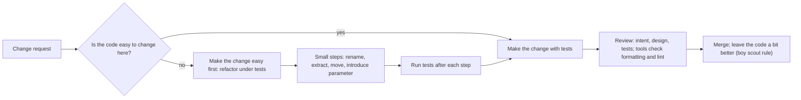

## TL;DR

- Clean code is code that is **easy to read, understand and change safely** — optimise for the next reader, who is usually you in six months.
- **SOLID** — Single responsibility, Open–closed, Liskov substitution, Interface segregation, Dependency inversion — are heuristics for managing change and coupling in object-oriented (and modular) code.
- Most value comes from basics: **good names, small focused functions, clear module boundaries, explicit error handling, tests**, and removing duplication of *knowledge* (not just of text).
- Principles conflict and can be over-applied: too many tiny classes and abstractions hurt readability as much as god classes. Use **judgement and refactor towards structure when change demands it**.
- At scale, enforce the mechanical parts automatically (formatters, linters, type checks, architecture tests) and spend human review on design and intent.

## Core Concepts

### SOLID in practical terms

| Principle | Meaning | Smell when violated | Typical fix |
|---|---|---|---|
| **S**ingle responsibility | A module should have one reason to change (one actor/stakeholder) | A class changed by both finance rules and email formatting | Split by reason to change |
| **O**pen–closed | Extend behaviour without modifying existing code | Every new variant edits the same `switch` | Strategy/polymorphism/registry |
| **L**iskov substitution | Subtypes must be usable wherever the base type is expected | Overrides throwing "not supported", type checks on subclasses | Fix the hierarchy or use composition |
| **I**nterface segregation | Clients shouldn't depend on methods they don't use | Fat interfaces; fakes implementing 20 unused methods | Smaller, role-based interfaces |
| **D**ependency inversion | High-level policy depends on abstractions, not details | Domain code importing the database driver | Ports owned by the domain; adapters implement them |

### Clean code basics

- **Names reveal intent:** `elapsedDays` not `d`; `isEligibleForRefund()` not `check()`; use domain language.
- **Functions do one thing** at one level of abstraction; prefer few parameters (introduce a parameter object when they grow); avoid boolean flag parameters that switch behaviour.
- **Command–query separation:** functions either change state or return information, not both (where practical).
- **Small, cohesive modules** with clear public interfaces; hide details.
- **Explicit error handling:** don't swallow errors; use typed results or exceptions consistently; fail fast on programmer errors.
- **Comments explain *why*, not *what*** — the code says what; comments capture intent, constraints, trade-offs and links to decisions.
- **Formatting is automated** (Prettier, gofmt) — never debated.
- **Tests** document behaviour and enable refactoring.

```ts
// Before: unclear names, mixed levels of abstraction, hidden side effects
async function proc(o: any, f: boolean) {
  if (o.items.length > 0 && (f || o.total > 100)) {
    o.status = 'ok';
    await db.query('update orders set status = $1 where id = $2', ['ok', o.id]);
    await mailer.send(o.email, 'Your order', `<p>Order ${o.id} confirmed</p>`);
  }
}

// After: intent-revealing names, single level of abstraction, dependencies explicit
async function confirmOrder(order: Order, deps: { orders: OrderRepository; notifications: Notifications }) {
  if (!order.canBeConfirmed()) return;
  order.confirm();
  await deps.orders.save(order);
  await deps.notifications.orderConfirmed(order);
}
```

### Coupling and cohesion

- **High cohesion:** things that change together live together.
- **Low coupling:** modules depend on few, stable interfaces of others.
- **Connascence** (a finer-grained vocabulary) describes kinds of coupling — name, type, meaning, position, timing — and favours weaker forms across module boundaries.

### Duplication: DRY, properly understood

DRY ("Don't Repeat Yourself") is about **knowledge**: each business rule should have one authoritative representation. Two pieces of code that look alike but change for different reasons are *not* duplication — merging them creates coupling. "Duplication is far cheaper than the wrong abstraction" (Sandi Metz); the **rule of three** suggests waiting for a third occurrence before abstracting.

### Code smells (signals to refactor)

Long function, large class, long parameter list, primitive obsession (strings for emails, money as numbers), feature envy (method using another object's data more than its own), shotgun surgery (one change touches many files), divergent change (one module changes for many reasons), speculative generality, dead code, deep nesting, magic numbers.

## How It Works



"Make the change easy, then make the easy change" (Kent Beck): refactoring is part of delivering features, not a separate project.

## When to Use / Trade-offs

| Practice | Use when | Avoid / be careful when | Trade-off |
|---|---|---|---|
| Extracting small functions | Long functions mixing levels of abstraction | Extraction scatters logic across dozens of trivial functions | Readability vs fragmentation |
| Introducing interfaces (DIP) | Boundaries to infrastructure, multiple implementations, testing seams | Single implementation inside one module with no foreseeable variation | Flexibility vs indirection |
| Removing duplication | Same knowledge/rule duplicated | Coincidental similarity | Single source of truth vs coupling |
| Comments | Why, constraints, non-obvious trade-offs | Restating what code does | Context vs staleness |
| Exceptions vs result types | Exceptions for unexpected failures; results for expected outcomes | Mixing styles inconsistently | Clarity vs ceremony |
| Strict linting | Mechanical rules with clear value | Opinionated rules that cause churn | Consistency vs friction |

## Common Pitfalls & Anti-patterns

- **God classes/modules** — `OrderService` with 3,000 lines and 40 dependencies.
- **Over-abstraction** — interfaces for everything, one implementation each; "enterprise FizzBuzz".
- **Primitive obsession** — strings and numbers for emails, money, ids; validation scattered.
- **Boolean flag arguments** — `send(order, true, false)`.
- **Swallowed errors** — empty catch blocks; logging and continuing in an invalid state.
- **Comments that lie** — outdated comments contradicting code.
- **Clever code** — dense one-liners that save lines and cost understanding.
- **Big-bang clean-ups** — massive refactoring PRs nobody can review.
- **Style debates in review** — anything a formatter or linter can decide.

## Real-world Scenario

**Context:** A billing module had become the team's most feared code: a 2,400-line class handling pricing, discounts, tax, invoice formatting and emailing. Every change took days and caused regressions; only two engineers dared touch it.

**Decision:** Over three months, alongside feature work: characterisation tests around invoice outputs; split by reason to change (pricing rules, tax, invoice rendering, notifications) into modules with clear interfaces; introduced value objects (`Money`, `TaxRate`, `InvoiceNumber`) to kill primitive obsession; replaced flag parameters with explicit functions; extracted infrastructure (PDF rendering, email) behind ports. Each refactor was a small PR tied to a feature that needed it.

**Outcome:** Average lead time for billing changes dropped from ~6 days to ~1.5; billing-related incidents fell sharply; four more engineers became comfortable making changes.

**What I'd do differently:** Add architecture tests (dependency rules) as soon as the modules existed — one shortcut import from rendering into pricing slipped in and had to be untangled later.

## Interview Questions

### What does the single responsibility principle really mean? {#single-responsibility}

**Level:** Foundation

**Model answer:**
SRP is often paraphrased as "a class should do one thing", but Robert Martin's sharper definition is: **a module should have one reason to change** — it should be responsible to one actor or stakeholder. An `Employee` class that calculates pay (finance's rules), formats reports (operations' needs) and saves to the database (IT's concerns) has three reasons to change; changes for one actor risk breaking the others.

Applying it: group code by the rules and stakeholders that drive change; separate business rules from infrastructure and presentation. Don't over-apply it into dozens of one-method classes — cohesion matters too.

**What the interviewer is looking for:**
"Reason to change" framing, an example, and balance with cohesion.

**Follow-ups:**
- How do you spot an SRP violation in code review?
- Can a function violate SRP?

**Red flags:**
- "Every class should have one method."

### Explain the open–closed principle with an example. {#open-closed}

**Level:** Foundation

**Model answer:**
Software entities should be **open for extension but closed for modification**: you add new behaviour by adding code, not by editing existing, tested code.

Example: discount rules implemented as a `switch` on discount type — every new type edits the switch and risks breaking others. Instead, define a `DiscountRule` interface (or function type), implement each rule separately and register them; adding a rule means adding a module.

Mechanisms: polymorphism, strategy, plugins/registries, configuration, events. Caveat: you can't make code open to every possible change — apply it where variation is real and recurring (often after the second or third variant).

**What the interviewer is looking for:**
Definition, concrete example, mechanisms and pragmatism about where to apply it.

**Follow-ups:**
- How does OCP relate to the strategy pattern?
- When is modifying existing code the right choice?

**Red flags:**
- Designing every class for imagined extensions.

### What is the Liskov substitution principle? {#liskov}

**Level:** Foundation

**Model answer:**
LSP (Barbara Liskov): **objects of a subtype must be usable anywhere the base type is expected without breaking correctness**. Subtypes must honour the base type's contract: accept at least the same inputs (no stronger preconditions), guarantee at least the same results (no weaker postconditions), keep invariants, and not throw new unexpected exceptions.

Classic violation: `Square extends Rectangle` — setting width on a square also changes height, breaking code that assumes independent width and height. Practical smells: overrides that throw `NotSupported`, callers checking `instanceof` to special-case subclasses, empty method implementations.

Fixes: rethink the hierarchy, prefer **composition** over inheritance, split interfaces so types only promise what they can deliver. LSP also applies to interface implementations and API versions — a new implementation must keep the contract.

**What the interviewer is looking for:**
Contract-based explanation, classic example, smells and fixes.

**Follow-ups:**
- How does LSP relate to interface segregation?
- Give a real-world LSP violation you've seen.

**Red flags:**
- Only reciting the square/rectangle example without understanding contracts.

### What makes names and functions clean? {#naming-and-functions}

**Level:** Foundation

**Model answer:**
**Names:**
- Reveal intent and use domain language: `overdueInvoices`, `calculateVatForCountry`.
- Length proportional to scope: short in tiny scopes, descriptive in wide ones.
- Avoid misleading or noisy names (`data`, `info`, `manager`, `handle2`), and encoded types.
- Booleans read as questions: `isActive`, `hasPermission`.

**Functions:**
- Do one thing at one level of abstraction — orchestration functions call well-named steps; detail functions do the steps.
- Small enough to understand at a glance (no strict line limit).
- Few parameters; group related ones into objects; avoid boolean flags that change behaviour (split into two functions).
- No hidden side effects; separate commands (change state) from queries (return data) where practical.
- Early returns/guard clauses instead of deep nesting.

**What the interviewer is looking for:**
Concrete, practical guidance on naming and function design.

**Follow-ups:**
- How long should a function be?
- How do you name something when you can't find a good name?

**Red flags:**
- Arbitrary rules ("never more than 5 lines") applied dogmatically.

### Explain interface segregation and dependency inversion. {#isp-dip}

**Level:** Senior

**Model answer:**
**Interface segregation:** clients shouldn't be forced to depend on methods they don't use. Instead of a fat `UserService` interface with 25 methods, define role-based interfaces (`UserLookup`, `PasswordReset`) for each client's needs. Benefits: smaller fakes in tests, fewer reasons to recompile/change, clearer dependencies.

**Dependency inversion:** high-level policy (domain logic) should not depend on low-level details (databases, HTTP clients); both should depend on **abstractions**, and the abstractions should be **owned by the high-level module**. Example: the domain defines `OrderRepository` and `PaymentGateway` interfaces; infrastructure adapters implement them; wiring happens at the composition root. This is the basis of hexagonal/clean architecture and makes the domain testable without infrastructure.

They work together: small, client-owned interfaces at boundaries.

**What the interviewer is looking for:**
Accurate definitions, ownership of abstractions, examples and link to hexagonal architecture.

**Follow-ups:**
- Who should own an interface — the provider or the consumer?
- Does DIP mean you need an interface for every class?

**Red flags:**
- Confusing dependency inversion with dependency injection only.

### What are common code smells, and how do you refactor them? {#code-smells}

**Level:** Senior

**Model answer:**
- **Long function:** extract functions by intent; introduce explaining variables.
- **Large class / divergent change:** split by reason to change.
- **Shotgun surgery** (one change touches many places): move related behaviour together.
- **Long parameter list:** introduce a parameter object or pass a domain object.
- **Primitive obsession:** introduce value objects (`EmailAddress`, `Money`) with validation.
- **Feature envy:** move the method to the data it uses.
- **Switch statements on type, repeated:** replace with polymorphism or strategy maps.
- **Deep nesting:** guard clauses, extract functions.
- **Duplicate knowledge:** consolidate into one place (if it really is the same rule).
- **Dead code and speculative generality:** delete.

Refactor in small, behaviour-preserving steps under tests, preferably using IDE automated refactorings, and commit often. Fowler's *Refactoring* catalogue names each move.

**What the interviewer is looking for:**
Recognising smells and pairing them with specific refactorings done safely.

**Follow-ups:**
- How do you refactor code with no tests?
- What smell do you see most often in your codebase?

**Red flags:**
- Refactoring without tests or in huge PRs.

### How do you apply DRY without creating the wrong abstraction? {#dry}

**Level:** Senior

**Model answer:**
DRY is about **knowledge**, not text: each business rule, constant or decision should have a single authoritative place. Two code fragments that look similar but represent **different concepts that change for different reasons** aren't duplication — merging them couples unrelated things and leads to abstractions full of flags and special cases.

Guidelines:
- Ask "if this rule changes, should both places change?" If yes, consolidate; if not, keep them separate.
- Wait for the **rule of three** before abstracting incidental similarity.
- When an abstraction starts accumulating parameters and conditionals for different callers, **inline it back** and re-split ("duplication is far cheaper than the wrong abstraction" — Sandi Metz).
- Consolidate truly shared knowledge (tax rates, validation rules, API contracts) in one place, often with types or schemas generated from a single source.
- In tests, some duplication improves readability (DAMP: descriptive and meaningful phrases).

**What the interviewer is looking for:**
Knowledge vs textual duplication, the wrong-abstraction trap, rule of three, and test readability nuance.

**Follow-ups:**
- Two microservices have similar validation logic. Do you share a library?
- How do you undo a bad abstraction?

**Red flags:**
- Abstracting every similar-looking code block immediately.

### What does clean error handling look like? {#error-handling}

**Level:** Senior

**Model answer:**
- **Distinguish expected outcomes from failures:** expected business outcomes (payment declined, validation errors, not found) are modelled explicitly — typed results/discriminated unions or specific error types — so callers must handle them. Unexpected failures (bugs, invariant violations) throw and propagate to a central handler.
- **Never swallow errors:** no empty catch blocks; if you catch, handle meaningfully, add context and rethrow, or convert to a domain error.
- **Add context, don't lose the cause:** wrap with `cause` (`new Error('Failed to load order 42', { cause })`).
- **Fail fast** on invalid states and invalid input at boundaries (validate early).
- **Consistent policy:** one style per layer; map errors to HTTP or user responses in one place.
- **Clean up resources** (finally, `using`/disposables, try-with-resources).
- **Log once**, at the boundary where handled — avoid logging the same error at every layer.

```ts
type PlaceOrderResult =
  | { ok: true; orderId: OrderId }
  | { ok: false; reason: 'OUT_OF_STOCK' | 'PAYMENT_DECLINED'; detail?: string };
```

**What the interviewer is looking for:**
Expected vs unexpected errors, no swallowing, context and causes, central mapping and single logging.

**Follow-ups:**
- Exceptions or result types in TypeScript?
- How do you avoid logging the same error five times?

**Red flags:**
- `catch (e) {}` or catching and continuing silently.

### When are comments useful, and when are they harmful? {#comments}

**Level:** Senior

**Model answer:**
Useful comments explain what code cannot:
- **Why** — the reason for a non-obvious decision or workaround ("Retry twice because the provider returns 502 during failover — see INC-1234").
- **Constraints and invariants** that aren't enforced by types.
- **Warnings** about consequences ("Changing this order breaks the bank's file format").
- **Links** to ADRs, tickets, specs.
- **Public API documentation** (TSDoc/JSDoc) for library consumers.

Harmful comments:
- Restating the code (`i++ // increment i`).
- Outdated comments that contradict the code — worse than none.
- Commented-out code (use version control).
- Comments compensating for bad names or tangled logic — refactor instead.

Rule of thumb: try to make the code self-explanatory first; then add comments for intent and context.

**What the interviewer is looking for:**
Why-over-what, examples of good and bad comments, and refactoring before commenting.

**Follow-ups:**
- How do you keep comments from going stale?
- Should every public function have a docstring?

**Red flags:**
- "Good code needs no comments, ever."

### What should a code review focus on to improve code quality? {#code-review-quality}

**Level:** Senior

**Model answer:**
Automate the mechanical layer (formatting, linting, type checks, tests, security scans) so humans focus on:
- **Correctness:** does it do what's intended, including edge cases and error paths?
- **Design:** right place for the change, sensible boundaries, coupling, appropriate abstraction (neither over- nor under-engineered).
- **Readability:** names, structure, comments explaining why.
- **Tests:** meaningful assertions on behaviour, coverage of risky paths.
- **Operational concerns:** logging, metrics, performance, security, backward compatibility, migrations.
- **Consistency** with existing patterns and ADRs.

Practice: small PRs; author provides context (what and why, how tested); reviewers distinguish blocking issues from suggestions; ask questions; review promptly (within a working day); move long debates to a call; recognise good work.

**What the interviewer is looking for:**
Automation for mechanics, human focus on design and correctness, good review etiquette.

**Follow-ups:**
- How do you handle a PR that's 3,000 lines?
- What's your turnaround target for reviews?

**Red flags:**
- Reviews dominated by style nitpicks.

### How do you measure code quality? {#measuring-quality}

**Level:** Architect

**Model answer:**
No single metric captures it; combine indicators with outcomes:
- **Outcome signals:** change failure rate, defect escape rate, time to make typical changes (lead time), incident causes linked to code areas.
- **Hotspots:** change frequency × complexity from version control (tools like CodeScene) — complex code that changes often is where quality matters most.
- **Static metrics:** cyclomatic/cognitive complexity, function/class size, duplication, dependency cycles, lint violations, type strictness — trends rather than absolute targets.
- **Test health:** coverage of changed code, mutation score for critical modules, flaky test rate.
- **Developer experience:** surveys on how easy areas are to change; onboarding time.

Use metrics to **prioritise and guide**, not as targets (Goodhart's law); ratchet rather than demand big-bang compliance; discuss trends in engineering reviews.

**What the interviewer is looking for:**
Outcome-linked, hotspot-focused measurement with awareness of gaming.

**Follow-ups:**
- What is a hotspot analysis?
- Would you set a coverage target?

**Red flags:**
- A single metric like coverage as the definition of quality.

### How do you enforce coding standards across 40 repositories? {#standards-at-scale}

**Level:** Architect

**Model answer:**
- **Automate everything mechanical:** formatter (Prettier, gofmt) and shared linter configs published as versioned packages; type-check strictness; pre-commit hooks and CI checks; automated dependency/config updates (Renovate).
- **Architecture tests** (dependency-cruiser, ArchUnit, eslint boundaries) enforce layering and module rules.
- **Ratchets for legacy code:** prevent new violations without blocking on old ones (baseline files, "counts can only go down").
- **Golden-path templates** so new services start compliant.
- **Short, explained engineering guidelines** with examples — and the reasoning, so people can challenge them.
- **Code review norms** focusing on design rather than style.
- **Ownership:** a guild or platform team maintains configs, reviews rule proposals and handles upgrades.
- **Measure:** violations trends, adoption of shared configs, survey feedback on friction.

**What the interviewer is looking for:**
Automation, shared configs, architecture tests, ratchets, templates, explained guidelines and ownership.

**Follow-ups:**
- A new lint rule produces 5,000 violations. How do you roll it out?
- How do you avoid rule bloat?

**Red flags:**
- Standards enforced only through manual review.

### How do you think about coupling and cohesion beyond individual classes? {#coupling-cohesion}

**Level:** Architect

**Model answer:**
The same principles apply at module, service and team levels:
- **Cohesion:** group things that change together — by business capability, not technical layer (a `billing` module containing its API, domain and persistence beats `controllers/`, `services/`, `repositories/` folders spanning everything).
- **Coupling:** minimise and make explicit dependencies between modules: stable interfaces, no reaching into internals, no shared databases between services, acyclic dependencies.
- **Kinds of coupling:** compile-time (imports), runtime (synchronous calls), data (shared schemas), temporal (must deploy together), semantic (shared assumptions). Connascence gives vocabulary for their strength.
- **Measuring:** dependency graphs, cycles, change coupling from git history (files/services that always change together), deployment coupling.
- **Organisational coupling:** Conway's law — module boundaries should align with team boundaries.

Good modular boundaries (a modular monolith) often deliver most of the benefits people seek from microservices, without distribution costs.

**What the interviewer is looking for:**
Applying cohesion/coupling at higher levels, kinds of coupling, measurement and organisational alignment.

**Follow-ups:**
- How do you detect hidden coupling between services?
- Package by feature or by layer?

**Red flags:**
- Layer-first organisation as the only structure.

### How do you balance clean code with delivery pressure? {#clean-code-vs-delivery}

**Level:** Architect

**Model answer:**
- **Make refactoring part of delivery:** "make the change easy, then make the easy change" — improve the code you're touching as part of the feature, in small steps. This rarely needs separate approval.
- **Focus on hotspots:** invest where code changes often and hurts; leave stable, rarely touched code alone even if ugly.
- **Take deliberate shortcuts consciously:** when a deadline truly matters, accept debt explicitly (ticket or ADR with a repayment plan) and repay it soon after.
- **Protect the basics always:** tests for new behaviour, readable names, no swallowed errors — these cost little and save a lot.
- **Show the business impact:** lead time and incident data for messy areas; quality as a speed enabler, not a luxury.
- **Avoid gold-plating** too: perfectionism and big refactors without business need also harm delivery.

**What the interviewer is looking for:**
Continuous refactoring, hotspot focus, deliberate debt, non-negotiable basics and business framing.

**Follow-ups:**
- Your manager says there's no time for refactoring this quarter. What do you do?
- How do you stop deliberate debt becoming permanent?

**Red flags:**
- "We'll clean it up later" with no plan; or perfectionism blocking delivery.

### What are the common criticisms of "Clean Code" style advice, and where do you stand? {#clean-code-criticism}

**Level:** Architect

**Model answer:**
Common criticisms of strict *Clean Code* (Robert Martin) style:
- **Extremely small functions** can fragment logic so readers jump across many tiny functions to understand one behaviour; "locality of behaviour" suffers.
- **Abstraction-heavy designs** add indirection, hurting performance and comprehension (critiques such as Casey Muratori's on performance; John Ousterhout's *A Philosophy of Software Design* argues for **deep modules** — simple interfaces hiding significant functionality — over many shallow ones).
- **Dogmatic rules** (line limits, "no comments") ignore context.
- **OO-centric advice** maps poorly to functional or data-oriented code.

My stance: the goals — readability, changeability, testability — are right; the specific rules are heuristics. Prefer **deep modules with clear interfaces**, functions sized for understanding rather than a line count, comments for "why", and consistency within a codebase. Measure by how easily the team changes the code safely, and adapt to the language and domain (performance-critical code may justify different trade-offs).

**What the interviewer is looking for:**
Awareness of critiques, alternative views (deep modules), and a nuanced, outcome-based position.

**Follow-ups:**
- What's a deep module?
- How do you resolve disagreements about style in a team?

**Red flags:**
- Treating any book's rules as law.

## Cheat Sheet

### SOLID
- **Single responsibility** — one reason to change (one actor/stakeholder).
- **Open–closed** — extend by adding code, not modifying tested code; apply where variation is real.
- **Liskov substitution** — subtypes honour the base contract; no `NotSupported` overrides.
- **Interface segregation** — small, client-specific interfaces.
- **Dependency inversion** — domain owns abstractions; infrastructure implements them.

### Clean code
- **Intent-revealing names** — domain language; booleans read as questions.
- **One level of abstraction per function** — orchestrate or do detail, not both.
- **No flag arguments** — split into separate functions.
- **Comments explain why** — not what; delete commented-out code.
- **Expected vs unexpected errors** — typed results for outcomes, exceptions for failures; never swallow.
- **Primitive obsession** — replace raw strings/numbers with value objects.

### Judgement
- **DRY is about knowledge** — not textual similarity.
- **Wrong abstraction** — costlier than duplication; inline and re-split when it rots.
- **Make the change easy, then make the easy change** — refactoring as part of delivery.
- **Hotspots** — complex code that changes often deserves the most care.
- **Deep modules** — simple interfaces hiding significant functionality (Ousterhout).

## Further Reading

- [Martin Fowler: Refactoring](https://refactoring.com/) — the catalogue of behaviour-preserving changes and code smells.
- [Robert C. Martin: The Single Responsibility Principle](https://blog.cleancoder.com/uncle-bob/2014/05/08/SingleReponsibilityPrinciple.html) — the "reason to change" definition from its author.
- [Sandi Metz: The Wrong Abstraction](https://sandimetz.com/blog/2016/1/20/the-wrong-abstraction) — why duplication can be cheaper than the wrong abstraction.
- [A Philosophy of Software Design (John Ousterhout)](https://web.stanford.edu/~ouster/cgi-bin/book.php) — VERIFY: link path; deep modules and complexity.
- [Google Engineering Practices: Code Review](https://google.github.io/eng-practices/review/) — what reviewers should look for and how.
