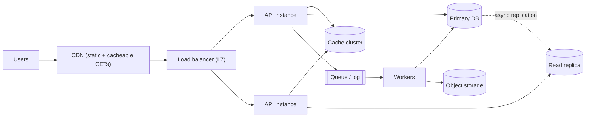
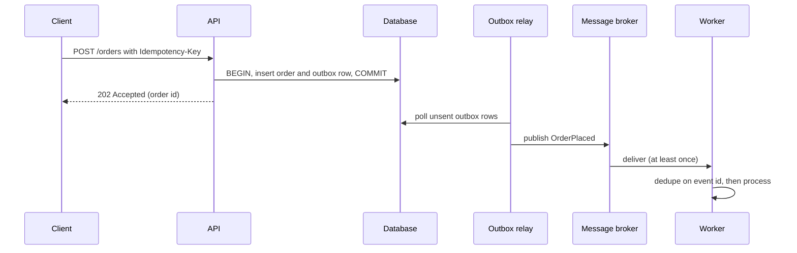

## TL;DR

- System design is **trade-off management under constraints**. Start from requirements and non-functional targets (latency, availability, durability, cost), not from boxes and arrows.
- Most systems scale through the same few moves: **stateless compute behind a load balancer, caching, read replicas, partitioning, and asynchronous work through queues**. Learn when each one stops being enough.
- In a distributed system, **partial failure is the normal state**. Timeouts, retries with jitter, idempotency, back-pressure and graceful degradation are design features, not afterthoughts.
- Consistency is a spectrum. Pick the **weakest model the business can tolerate** for each piece of data, and make the strong-consistency islands small.
- At Staff/Architect level the interviewer is judging **how you reason**: clarifying scope, estimating, naming the bottleneck, and explaining what you would *not* build yet.

## Core Concepts

### Requirements first: functional vs non-functional

Functional requirements say *what* the system does ("users can shorten a URL"). Non-functional requirements (NFRs) say *how well*, and they drive the architecture:

| NFR | Typical target | What it forces |
|---|---|---|
| Latency | p99 < 200 ms for reads | Caching, data locality, fewer hops |
| Availability | 99.9% (≈ 43 min/month downtime) vs 99.99% (≈ 4.3 min/month) | Redundancy, multi-AZ, automated failover; 99.99% usually means no single-region dependency on the hot path |
| Durability | "Never lose a paid order" | Synchronous replication, write-ahead logs, backups you have restored |
| Throughput | 50k writes/s peak | Partitioning, batching, async ingestion |
| Consistency | "Balance must never go negative" | A strongly consistent store or a single-writer per key |
| Cost | Budget per request or per user | Tiered storage, right-sized replicas, fewer always-on components |

A design without stated NFRs can't be wrong, which is why it can't be right either.

### Back-of-envelope estimation

Estimates tell you which component breaks first. Useful anchors (orders of magnitude, not benchmarks):

- 1 day ≈ 86,400 s ≈ **10⁵ s**. So 1M requests/day ≈ 12 req/s on average; plan for a peak of 2–10× that.
- Main memory reference ≈ 100 ns; SSD random read ≈ 100 µs; round trip inside a data centre ≈ 0.5 ms; cross-continent round trip ≈ 100–150 ms.
- A single well-tuned relational primary handles roughly thousands to low tens of thousands of simple writes/s. The real figure depends heavily on hardware, row size, indexes and durability settings, so benchmark rather than quote.
- A cache node (Redis-class) serves on the order of 100k simple ops/s.

```ts
// Storage for a URL shortener over 5 years
const writesPerDay = 1_000_000;
const bytesPerRecord = 500; // short code, long URL, metadata, index overhead
const fiveYears = writesPerDay * 365 * 5; // ≈ 1.8 billion records
const totalBytes = fiveYears * bytesPerRecord; // ≈ 0.9 TB, so a single store can hold it, but plan to partition
const readQps = (writesPerDay * 100) / 86_400; // 100:1 read/write ratio, ≈ 1,160 req/s average
```

### Scaling compute: stateless services

Keep request-handling services **stateless**: session state goes in a token or a shared store. Then any instance can serve any request, and you scale by adding instances behind a load balancer. State that must live in memory (WebSocket connections, game rooms) needs **sticky routing** or a consistent-hash ring, and that becomes its own scaling problem.

### Scaling data: replication and partitioning

- **Replication** copies the same data to several nodes. Read replicas scale reads and improve availability. Asynchronous replication means **replica lag**: a user may not see their own write.
- **Partitioning (sharding)** splits data across nodes by key, which scales writes and storage. The shard key decides everything:
  - **Hash** of the key spreads load evenly but makes range queries scatter-gather.
  - **Range** keeps range scans cheap but creates hot spots (for example, time-ordered keys all writing to the newest shard).
  - **Consistent hashing** with virtual nodes limits data movement when nodes join or leave.
- Cross-shard queries, transactions and secondary indexes are the hidden cost. Choose the key so that the **most frequent query hits one shard**.

### Caching

Cache-aside (lazy loading) is the default: read the cache, fall back to the database, then populate the cache. Decide the **TTL, the invalidation trigger, and the stampede protection** (request coalescing, early refresh). See the Caching topic for depth.

### Asynchronous processing

Put a durable queue or log between producer and consumer when the work doesn't need to finish inside the user's request, when load is spiky, or when consumers fail independently. You gain buffering and isolation. You pay with eventual consistency, duplicate delivery (so consumers must be **idempotent**), ordering questions and harder debugging.

### Consistency models and CAP/PACELC

- **CAP:** during a network **P**artition, a replicated system must choose between **C**onsistency (refuse some requests) and **A**vailability (answer, possibly with stale data). It says nothing about normal operation.
- **PACELC** adds: **E**lse, when there is no partition, you trade **L**atency against **C**onsistency. This is the trade-off you face every day.
- Useful models from strongest to weakest: linearizable → sequential → causal → read-your-writes / monotonic reads → eventual.

### Reliability patterns

```ts
// Retry with capped exponential backoff and full jitter, but only for idempotent operations.
async function withRetry<T>(op: () => Promise<T>, attempts = 4, baseMs = 100, capMs = 2_000): Promise<T> {
  for (let i = 0; ; i++) {
    try {
      return await op();
    } catch (err) {
      if (i >= attempts - 1 || !isRetryable(err)) throw err;
      const backoff = Math.min(capMs, baseMs * 2 ** i);
      await new Promise((r) => setTimeout(r, Math.random() * backoff)); // full jitter
    }
  }
}
declare function isRetryable(err: unknown): boolean;
```

Timeouts on every network call, a retry budget, circuit breakers, bulkheads (separate pools per dependency), load shedding and fallbacks together turn a dependency failure into a degraded feature rather than an outage.

## How It Works

A typical read-heavy web system and the request path through it:



How a write that triggers background work flows, including the transactional outbox so the database write and the event can't diverge:



### A repeatable interview structure

1. **Clarify scope:** users, core use cases, what's out of scope.
2. **NFRs and estimates:** QPS, data size, read/write ratio, latency and availability targets.
3. **API and data model:** the main endpoints and entities, and the access patterns.
4. **High-level design:** the simplest architecture that meets the NFRs.
5. **Deep dives:** the bottleneck, the hardest consistency problem, failure modes.
6. **Trade-offs and evolution:** what you'd change at 10× scale, and what you deliberately left out.

## When to Use / Trade-offs

| Technique | Use when | Avoid when | Cost |
|---|---|---|---|
| Vertical scaling | Early on; the state is hard to partition; you need simplicity | You're near the largest instance size or need fault tolerance | Rises steeply with size; single point of failure |
| Horizontal scaling (stateless) | Request-driven services | The service holds unshareable in-memory state | LB, deploy orchestration, observability |
| Read replicas | Read-heavy work that tolerates lag | Read-your-writes is required everywhere | Replica lag, failover complexity |
| Sharding | Writes or storage exceed one node | Cross-entity transactions and ad-hoc queries dominate | Resharding, cross-shard queries, operations |
| Cache | Hot, read-mostly data with a tolerable staleness window | Data changes constantly or must be exact | Invalidation bugs, stampedes, memory |
| Queue / log | Spiky load, slow work, fan-out to many consumers | The caller needs the result synchronously | Eventual consistency, duplicates, ops |
| Multi-region active-active | Availability above ~99.99% or global latency needs | Strong consistency across regions is required cheaply | Conflict resolution, 2×+ infra, data-residency rules |
| CDN / edge | Static assets, cacheable APIs, global users | Highly personalised, uncacheable responses | Cache-key design, purge strategy |

## Common Pitfalls & Anti-patterns

- **Designing before clarifying** — jumping to Kafka and Kubernetes before agreeing on QPS and NFRs. Spot it when nobody can say which requirement a component satisfies.
- **The distributed monolith** — services that must deploy together and call each other synchronously in long chains. Availability multiplies down: five services at 99.9% in series give ≈ 99.5%.
- **Retry storms** — every layer retries 3× without jitter or a budget, so one slow dependency receives 27× the load and never recovers.
- **No timeouts** — a hung dependency holds threads and connections until the caller falls over too. Every network call needs a deadline that is shorter than the caller's own.
- **Hot partitions** — a celebrity user, a timestamp-ordered key or a "global counter" row. Spot it with per-partition metrics, not averages.
- **Cache as source of truth** — data that exists only in Redis, without persistence, is lost on eviction or failover.
- **Ignoring the tail** — designing for averages. With fan-out to 100 back-ends, the slowest one sets the user's latency, so p99 of each becomes the median experience.
- **Dual writes** — writing to the database and then publishing to a broker in two steps. A crash between them loses or invents events. Use an outbox or change data capture.
- **Premature sharding** — splitting data before exhausting indexing, caching, replicas and vertical scaling. You pay the operational cost for years.

## Real-world Scenario

**Context.** A B2B SaaS ticketing platform (about 2,000 tenant companies) ran on one PostgreSQL primary with two read replicas and a stateless Node.js API. A few tenants grew to 40% of the traffic. During their Monday-morning peaks, p99 latency climbed from 150 ms to 4 s and the primary's CPU reached 95%.

**Constraints.** No downtime windows (customers in many time zones), a team of eight engineers, a requirement that each tenant's data could be moved to an EU-only region within a year, and a strict "no lost tickets" rule.

**Decision.**
1. **First, cheap wins.** Fixed three N+1 query paths, added two composite indexes, and moved dashboard aggregates to a 30-second cache. Primary CPU fell to 60%. This bought about six months.
2. **Isolate the noisy tenants.** Added per-tenant rate limits and a separate worker pool for bulk imports (a bulkhead), so one tenant's import could no longer slow everyone down.
3. **Shard by tenant.** Tenant id was already on every table and in every query, so it became the shard key. A small **directory service** maps tenant → cell (database plus API pool). Large tenants get dedicated cells, and small tenants are packed together. Cross-tenant queries were rare and moved to a read-only analytics warehouse fed by change data capture.
4. **Migrate a tenant at a time.** Each move used logical replication, a short write freeze per tenant (under 30 s), and an automated row-count and checksum comparison.

**Outcome.** p99 returned to under 200 ms at triple the traffic. An incident in one cell now affects only the tenants in it. EU data residency became "place the tenant's cell in the EU region."

**What I'd do differently.** Introduce the directory service and tenant-scoped connection routing on day one, even with a single database. That makes the later split a data move rather than a code change. And build per-tenant latency dashboards earlier: the averages hid the problem for weeks.

## Interview Questions

### What is the difference between vertical and horizontal scaling, and when would you pick each? {#vertical-vs-horizontal}

**Level:** Foundation

**Model answer:**
**Vertical scaling** (scale up) gives one machine more CPU, memory or faster disks. It needs no code changes and keeps strong consistency easy, but it has a hard ceiling, its cost rises steeply at the top end, and the machine is still a single point of failure.

**Horizontal scaling** (scale out) adds more machines and spreads the load across them. It allows near-linear growth and fault tolerance, but it needs the work to be divisible: stateless services behind a load balancer, or data partitioned by key. It brings distributed-systems problems with it: coordination, consistency and partial failure.

In practice: scale **stateless compute horizontally from the start** because it is cheap to do. Scale **stateful stores vertically for as long as is sensible** (plus read replicas), and partition only when writes or data size demand it.

**What the interviewer is looking for:**
That the candidate separates compute from state, knows vertical scaling is a legitimate choice rather than a failure, and can name the point at which it stops working.

**Follow-ups:**
- What makes a service hard to scale horizontally?
- How does auto-scaling decide when to add instances, and what lags behind it?

**Red flags:**
- "Always scale horizontally" with no mention of the cost or of state.
- Not recognising that a bigger single database server is still a single point of failure.

### Why do we measure latency in percentiles rather than averages, and how does latency relate to throughput? {#latency-throughput-percentiles}

**Level:** Foundation

**Model answer:**
Latency is how long one request takes. Throughput is how many requests complete per unit of time. They are linked through queueing: as utilisation approaches 100%, queues grow and latency rises sharply long before throughput reaches its maximum. Little's Law states it: requests in flight = arrival rate × time in system.

Averages hide the experience of real users because latency distributions have long tails. A p50 of 50 ms with a p99 of 2 s means 1 in 100 requests is slow. A page that makes 20 back-end calls hits that tail on most loads. So set targets on **p95/p99 (sometimes p99.9)** and measure them over meaningful windows. Never average percentiles across hosts; aggregate histograms instead.

**What the interviewer is looking for:**
An understanding of tail latency and fan-out amplification, and that utilisation targets (for example, keeping it under ~70%) exist to protect latency.

**Follow-ups:**
- How would you reduce tail latency in a fan-out service? (Hedged requests, timeouts, fewer hops.)
- Why is averaging p99 across instances wrong?

**Red flags:**
- Only quoting averages.
- Believing you can run at 100% utilisation without a latency cost.

### Explain the CAP theorem and why PACELC is more useful in practice. {#cap-pacelc}

**Level:** Foundation

**Model answer:**
CAP says that when a **network partition** separates replicas, a system must choose between **consistency** (every read sees the latest write, so some requests are refused or blocked) and **availability** (every request gets a response, possibly stale). Partitions aren't optional in a distributed system, so the real choice is CP or AP *during a partition*.

CAP says nothing about the normal case, which is where systems spend nearly all of their time. **PACELC** adds: *Else* (no partition), choose between **latency** and **consistency**. Synchronous replication across zones gives consistency at the cost of latency. Asynchronous replication is fast but can lose recent writes on failover or serve stale reads.

Examples: a single-leader relational database with synchronous standby is PC/EC. DynamoDB with eventually consistent reads leans PA/EL, but it offers strongly consistent reads per request at extra cost and latency. DynamoDB serves strongly consistent reads from the partition leader, and they cost twice the read capacity of eventually consistent reads.

**What the interviewer is looking for:**
That the candidate doesn't treat CAP as "pick two of three", knows its definitions are narrow, and can apply the latency-versus-consistency trade-off to a concrete design decision.

**Follow-ups:**
- Which parts of an e-commerce system need CP behaviour, and which can be AP?
- What does quorum (R + W > N) give you, and what doesn't it guarantee?

**Red flags:**
- "We chose CA."
- Treating "eventual consistency" as a fixed delay rather than an unbounded guarantee.

### What does a load balancer do, and what is the difference between L4 and L7 load balancing? {#load-balancing-l4-l7}

**Level:** Foundation

**Model answer:**
A load balancer spreads requests across healthy back-ends, removes failed ones using health checks, and gives clients one stable address.

- **L4 (transport layer)** routes on IP and port. It is very fast, protocol-agnostic and can pass TLS straight through, but it can't see URLs, headers or cookies. Examples include AWS NLB and Azure Load Balancer.
- **L7 (application layer)** understands HTTP. It can route by path or host, terminate TLS, retry, rewrite headers, apply WAF rules and do sticky sessions by cookie. It costs more CPU and adds a little latency. Examples include AWS ALB, Azure Application Gateway, Envoy and NGINX.

Algorithms: round robin, least connections, weighted, and consistent hashing for cache affinity. **Least-outstanding-requests** often beats round robin when request costs vary. Health checks must test real readiness, and be careful that a dependency outage doesn't fail every instance's health check at once.

**What the interviewer is looking for:**
Practical knowledge of where TLS ends, how health checks interact with failures, and when you'd use each layer (for example, L4 for long-lived TCP or gRPC streams and L7 for HTTP routing).

**Follow-ups:**
- How do you balance long-lived WebSocket or gRPC connections fairly?
- What is connection draining and why does it matter during deploys?

**Red flags:**
- Health checks that call every downstream dependency.
- No awareness that the load balancer itself must be redundant.

### Estimate the capacity needed for a photo-sharing service with 10 million daily active users. {#back-of-envelope}

**Level:** Senior

**Model answer:**
State assumptions out loud, then calculate:

- 10M DAU; each user views 50 photos and uploads 0.2 photos per day.
- Reads: 500M/day ÷ 10⁵ s ≈ **5,000 req/s average**, about 15–25k/s at peak. Uploads: 2M/day ≈ **23/s**, about 100/s at peak.
- Storage: 2M × 2 MB original plus ~300 KB of resized variants ≈ **4.6 TB/day**, which is ≈ 1.7 PB/year before replication. That means object storage with lifecycle tiering, not a database.
- Egress: if 80% of views are served from the CDN at ~200 KB each, origin serves ~1,000 req/s ≈ 200 MB/s. The CDN carries the remaining ~800 MB/s.
- Metadata: 2M rows/day × ~1 KB ≈ 0.7 TB/year. A relational or wide-column store with read replicas is enough for years.

Conclusions: the hard parts are **storage cost and CDN egress**, not the metadata database. The design focuses on direct-to-object-storage uploads (pre-signed URLs), asynchronous thumbnail generation, and a CDN with long cache lifetimes on immutable URLs.

**What the interviewer is looking for:**
Assumptions stated clearly, round numbers, a peak factor, and most importantly a *conclusion* about which component dominates and how that shapes the design.

**Follow-ups:**
- How would the numbers change if you added short videos?
- Where would you cut cost first?

**Red flags:**
- Spending ten minutes on exact arithmetic with no conclusion.
- Storing images as database blobs at this scale.

### How would you scale the database layer of a growing application? {#scaling-the-database}

**Level:** Senior

**Model answer:**
In order of increasing cost and complexity:

1. **Measure and fix queries:** indexes, N+1 queries, connection pooling, removing hot-row contention.
2. **Scale vertically** to a larger instance with faster storage.
3. **Cache** hot reads (cache-aside, materialised aggregates).
4. **Add read replicas** and route read traffic to them. Handle replica lag for read-your-writes, for example by reading from the primary for a few seconds after that user writes.
5. **Split by function** so each service owns its own database (vertical partitioning), and move analytics to a warehouse.
6. **Shard** by a key aligned with the dominant access pattern (tenant id, user id). Add a routing layer or directory, and plan for resharding with consistent hashing or many logical shards mapped onto fewer physical ones.
7. **Change the data store** to suit the access pattern: wide-column for huge write volumes, search engines for text, time-series databases for metrics.

At each step, state the new failure modes: lag, cache invalidation, cross-shard queries, more complex operations.

**What the interviewer is looking for:**
A sense of order and cost, not a list of technologies. Strong candidates explain how they'd choose a shard key and handle hot keys and resharding.

**Follow-ups:**
- How do you handle a "celebrity" key that overloads one shard?
- How do you run a cross-shard report?

**Red flags:**
- Sharding as the first step.
- Ignoring replica lag in user-facing flows.

### How do you make an operation safe to retry in a distributed system? {#idempotency-retries}

**Level:** Senior

**Model answer:**
Networks give you **at-least-once** delivery: a timeout doesn't tell you whether the operation happened. So make operations **idempotent**, meaning that repeating them has the same effect as doing them once.

- **Natural idempotency:** `PUT` with the full state, "set status to SHIPPED", or upserts keyed by business id.
- **Idempotency keys:** the client sends a unique key (`Idempotency-Key` header). The server stores the key with the result in the same transaction as the effect, and replays the stored result for duplicates. Keys expire after a sensible window (for example, 24 h).
- **Deduplication in consumers:** record processed message ids, or make the handler's effect conditional (`UPDATE ... WHERE version = n`).
- **Exactly-once effect = at-least-once delivery + idempotent processing.** "Exactly-once delivery" across arbitrary systems isn't achievable. Kafka's exactly-once semantics hold only inside Kafka's own read-process-write transactions.

Retries also need **exponential backoff with jitter**, a **retry budget** (for example, retries ≤ 10% of requests), and retrying at **one layer only**.

**What the interviewer is looking for:**
That the key and the effect are committed atomically, and an understanding of why retry storms happen and how budgets prevent them.

**Follow-ups:**
- What if two requests with the same key arrive at the same time?
- How long should idempotency keys be kept?

**Red flags:**
- "We use exactly-once delivery, so duplicates can't happen."
- Retrying non-idempotent payment calls blindly.

### Design a URL shortener like bit.ly. {#design-url-shortener}

**Level:** Senior

**Model answer:**
**Requirements:** create a short link, redirect, optional custom alias and expiry, and analytics (eventually consistent). 100M new links/month, 100:1 reads to writes, redirect p99 < 50 ms, and high availability for redirects.

**Estimates:** ~40 writes/s and ~4,000 redirects/s on average (peak ~20k/s). Over 5 years that's ~6B links × ~500 B ≈ 3 TB.

**Key generation:** 7 base62 characters give 62⁷ ≈ 3.5 trillion codes. Options:
- Hash the URL and truncate. Collisions need checking, and the same URL always gets the same code, which may or may not be wanted.
- A **counter encoded in base62**, issued in ranges to each app server (from a coordinator such as ZooKeeper or a database sequence), so there's no per-write coordination. The downside is that codes are guessable, so add a bijective shuffle if that matters.
- Random codes with an insert-if-absent check. This is simple, and collisions are rare at low fill.

**Storage:** a key-value or wide-column store keyed by code (DynamoDB, Cassandra) suits point lookups at this scale. Custom aliases use the same table with a conditional insert.

**Read path:** CDN or edge cache → in-memory cache (very high hit rate, because popularity follows a power law) → store. Return **301** for cacheability or **302** if every click must reach you for analytics.

**Analytics:** emit click events to a log (Kafka/Kinesis), aggregate them asynchronously, and never block the redirect.

**Failure modes:** a cache stampede on a viral link (coalesce requests), abuse and phishing (rate limits, URL scanning), and expiry cleanup (TTL in the store).

**What the interviewer is looking for:**
Clear key-generation trade-offs, an explanation of 301 vs 302, analytics kept off the hot path, and estimates used to justify the storage choice.

**Follow-ups:**
- How would you prevent enumeration of private links?
- How would you serve redirects from multiple regions?

**Red flags:**
- A single auto-increment database row as the global counter with no batching.
- Writing analytics synchronously in the redirect path.

### Design a distributed rate limiter for a public API. {#design-rate-limiter}

**Level:** Senior

**Model answer:**
**Requirements:** limits per API key (for example, 1,000 req/min with short bursts), enforced across hundreds of gateway instances, adding < 5 ms, and failing open or closed by policy.

**Algorithms:**
- **Token bucket:** allows bursts up to the bucket size, refilling at a steady rate. It's the common choice.
- **Sliding-window counter:** weights the current and previous fixed windows. It is accurate enough and cheap.
- **Sliding-window log:** exact, but it uses memory per request.
- **Fixed window:** simplest, but allows 2× bursts at window edges.

**Distributed state:** a central Redis (sharded by key) with an atomic Lua script or `INCR` + `EXPIRE` per window. To cut latency and load, use **local token buckets on each gateway, synchronised periodically** (approximate limits), or route a key consistently to one limiter node.

**Responses:** `429 Too Many Requests` with `Retry-After` and rate-limit headers, so clients can back off.

**Failure policy:** if Redis is down, fail open with local limits (to protect availability) or fail closed (to protect a fragile back-end). It is a business decision, and you should state it.

**What the interviewer is looking for:**
Algorithm trade-offs, atomicity of the check-and-increment, the latency cost of central state, and an explicit failure policy.

**Follow-ups:**
- How do you rate-limit by user and by IP across regions?
- How is rate limiting different from load shedding?

**Red flags:**
- A read-then-write counter without atomicity.
- No plan for when the limiter's own store fails.

### Compare strong consistency, read-your-writes and eventual consistency, with examples of where each is appropriate. {#consistency-models}

**Level:** Senior

**Model answer:**
- **Strong (linearizable):** every read sees the latest committed write, as if there were one copy. Needed for money movement, inventory reservation, unique usernames and leader election. It costs latency and coordination, and availability during partitions.
- **Read-your-writes (session consistency):** a user always sees their own updates, while others may lag. This is what most user-facing features actually need: profile edits, posting a comment. You implement it with sticky reads to the primary after a write, version tokens, or client-side merging.
- **Monotonic reads:** a user never sees data go backwards (for example, by bouncing between replicas with different lag).
- **Causal:** effects are seen after their causes (a reply is never visible before its question).
- **Eventual:** replicas converge if writes stop. That suits like counts, view counts, recommendations and search indexes.

Design approach: classify each piece of data by business impact, keep strongly consistent parts small and partitioned, and make eventual consistency visible to users where it matters ("Processing…").

**What the interviewer is looking for:**
Matching the model to business invariants, and knowing practical techniques for session guarantees on top of replicated stores.

**Follow-ups:**
- How would you implement read-your-writes with asynchronous replicas?
- What are CRDTs, and when would you use them?

**Red flags:**
- Strong consistency everywhere "to be safe", with no cost discussion.
- Thinking eventual consistency means "consistent within a second".

### Design the home timeline for a social network with 300 million users. {#design-news-feed}

**Level:** Architect

**Model answer:**
**Requirements:** a home feed of posts from followed accounts, newest or ranked first, with p99 < 300 ms to load. ~100M DAU, ~500M posts/day, heavy reads.

**Core choice: fan-out on write vs fan-out on read.**
- **Fan-out on write (push):** when someone posts, append the post id to each follower's precomputed timeline (a capped list in a cache). Reads are very fast, but a celebrity with 50M followers causes 50M writes and a long delay.
- **Fan-out on read (pull):** build the feed at read time by merging recent posts from everyone the user follows. Writes are cheap, but reads are expensive and the tail latency is poor.
- **Hybrid (the usual answer):** push for normal accounts, and **pull for high-follower accounts**, merging their posts in at read time. Only precompute timelines for users who have been active recently.

**Components:** a post service (durable store, partitioned by post id), a social-graph service, a fan-out workers pool fed by a log, a timeline cache (lists of post ids per user, capped at ~800), hydration (fetching post bodies and authors in batches through a cache), a ranking service, and a media CDN.

**Scale concerns:** hot keys for celebrity posts (replicate hot entries, cache in process), backfilling when a user follows someone, deletes and privacy changes that must propagate (tombstones checked at hydration), and multi-region timeline caches rebuilt from the durable log.

**Trade-offs to state:** freshness vs cost, ranking quality vs latency, and how stale a timeline may be for inactive users.

**What the interviewer is looking for:**
The hybrid fan-out reasoning driven by the follower distribution, separating ids from hydration, and handling edge cases (deletes, privacy, celebrity posts) rather than drawing boxes only.

**Follow-ups:**
- How do you guarantee a deleted or privately reshared post never shows?
- How would you add ranking without blowing the latency budget?

**Red flags:**
- Pure fan-out on write, with no answer to the celebrity problem.
- Querying the posts table with a giant `IN` list of followed ids at read time at this scale.

### When would you run a system active-active across multiple regions, and what changes in the design? {#multi-region}

**Level:** Architect

**Model answer:**
**Why:** availability targets that one region can't meet (99.99%+), low latency for global users, or regulatory placement of data. **Why not:** it typically more than doubles cost and complexity. Many systems are better served by multi-AZ in one region plus a warm standby region (active-passive) with a tested recovery time objective (RTO) and recovery point objective (RPO).

**What changes in active-active:**
- **Data:** either partition ownership (each user or tenant has a home region, with writes routed there, so there are no conflicts) or accept multi-writer replication with conflict resolution: last-writer-wins (lossy), CRDTs, or application merges. Globally strong consistency (for example, Spanner-style) costs cross-region latency on each write.
- **Routing:** latency-based or geo DNS, or anycast, with health-based failover. Plan for DNS TTL lag and clients that cache.
- **Capacity:** each region must absorb the failed region's traffic, so plan headroom (N+1 regions).
- **Dependencies:** no hidden single-region control plane (identity, secrets, feature flags, CI/CD). Test with region-evacuation game days.
- **Data residency:** pin regulated data to its jurisdiction, even in an "active-active" design.

**What the interviewer is looking for:**
Questioning the need first, explicit RTO/RPO reasoning, a concrete approach to write conflicts, and awareness of control-plane and capacity traps.

**Follow-ups:**
- How do you test that failover actually works?
- How do you handle a user who travels between regions?

**Red flags:**
- "Just replicate the database to both regions" with no conflict strategy.
- No mention of cost or of testing failover.

### Your service collapses every time traffic spikes, even though auto-scaling is enabled. What do you do? {#overload-protection}

**Level:** Architect

**Model answer:**
**Diagnose:** auto-scaling reacts in minutes, but spikes hit in seconds. Saturated services slow down, clients time out and **retry**, which raises the load further: a **metastable failure** that persists even after the original trigger is gone. Check retries per layer, queue depths, connection pools and the cold start of new instances.

**Fix in layers:**
1. **Admission control and load shedding:** cap concurrency per instance (for example, adaptive concurrency limits) and reject the excess quickly with `503`/`429`, rather than queueing indefinitely. Shed low-priority traffic first (prefetch, analytics, batch jobs).
2. **Bounded queues and deadlines:** propagate request deadlines and drop work whose caller has already given up.
3. **Retry discipline:** retry at one layer only, with jitter and a retry budget, and add circuit breakers towards failing dependencies.
4. **Absorb bursts:** move non-interactive work to queues, serve cacheable responses from the CDN, and use static stability (keep serving the last known good data).
5. **Capacity:** pre-scale for known events, keep warm headroom, scale on leading signals (concurrency, queue depth) rather than CPU, and keep cold start fast.
6. **Verify:** load-test beyond peak, and run chaos tests of the "retry storm" scenario.

**What the interviewer is looking for:**
Recognising retry amplification and metastable failure, preferring fast rejection to slow failure, and treating priority-based shedding as a product decision.

**Follow-ups:**
- How do you decide which traffic to shed first?
- How do client SDKs contribute to retry storms, and how would you fix that?

**Red flags:**
- "Add more instances" as the whole answer.
- Increasing timeouts and queue sizes to "absorb" overload.

### How do you keep data consistent across microservices without distributed transactions? {#distributed-transactions}

**Level:** Architect

**Model answer:**
Two-phase commit (2PC) across services couples their availability and holds locks during network round trips, and many modern stores and brokers don't support it. The usual alternatives:

- **Saga:** a sequence of local transactions, each with a **compensating action** (refund payment, release stock).
  - *Choreography:* services react to each other's events. There's no central coordinator, but the flow is hard to see once there are more than a few steps.
  - *Orchestration:* a coordinator (a workflow engine such as Temporal, AWS Step Functions or Azure Durable Functions) drives the steps and the compensations. It's explicit and observable.
- **Transactional outbox:** write the state change and the event to the same database in one transaction, and have a relay or change data capture publish the event. This removes the dual-write problem.
- **Idempotent consumers** with deduplication, because events are delivered at least once.
- **Semantic locks and pending states:** an order is `PENDING` until all steps finish, so other processes don't act on half-finished work.
- **Reconciliation jobs** as a safety net, comparing systems of record and repairing drift.

Sagas give up isolation: other transactions can see intermediate states. Design for that ("reserve" rather than "deduct"), and keep truly atomic invariants inside one service's database.

**What the interviewer is looking for:**
The outbox for dual writes, choosing between choreography and orchestration, compensation design, and admitting that isolation is lost.

**Follow-ups:**
- What happens if a compensating action fails?
- When would you redraw service boundaries instead of building a saga?

**Red flags:**
- "Use 2PC across all the services."
- Publishing events after the commit with no outbox or retry, and assuming that is reliable.

### How do you decide how much to build for future scale versus what the system needs now? {#designing-for-evolution}

**Level:** Architect

**Model answer:**
Design for **roughly 10× current load**, and make the expensive decisions **reversible** rather than building for 100× now.

- **Identify one-way doors:** the data model, the partition key, public APIs, the tenancy model and identity. These are expensive to change, so invest thought (and an ADR) in them now.
- **Two-way doors:** the choice of queue, cache, framework or instance size. Pick the simplest option and change it later.
- **Leave seams:** route all data access through a repository or tenant router, version APIs, and pass a tenant or partition id everywhere from day one, even with one database.
- **Use evidence:** fitness functions and SLO dashboards show when you're approaching a limit, and capacity models are revisited each quarter.
- **Consider the organisation and its costs:** a modular monolith run by a small team often beats microservices that need a platform team the company doesn't have.

The architect's job is to make the next migration cheap, not to avoid ever migrating.

**What the interviewer is looking for:**
Judgement: distinguishing reversible from irreversible decisions, tying scale to evidence, and weighing team capacity and cost alongside technology.

**Follow-ups:**
- Give an example of a one-way door you got wrong, and how you recovered.
- How do you get leadership to fund headroom work before it becomes an incident?

**Red flags:**
- Defaulting to the most scalable architecture regardless of team size or load.
- Never revisiting capacity assumptions.

## Cheat Sheet

### Estimation

- **Seconds in a day** — ~86,400, so use 10⁵ for estimates (1M/day ≈ 12/s).
- **Peak factor** — plan for 2–10× the average load, depending on how spiky the traffic is.
- **99.9% vs 99.99% availability** — ~43 min vs ~4.3 min of downtime per month.
- **Serial availability** — multiply it: five 99.9% dependencies in series ≈ 99.5%.

### Data and consistency

- **CAP in one line** — during a partition, choose between refusing requests (C) or serving possibly stale data (A).
- **PACELC** — else (no partition), trade latency against consistency.
- **Read replica downside** — replication lag breaks read-your-writes unless you route recent writers to the primary.
- **Good shard key** — high cardinality, even load, and the most common query hits one shard.
- **Consistent hashing** — maps keys to a ring so adding a node moves only ~1/N of the keys.
- **Dual-write fix** — transactional outbox or change data capture.

### Reliability

- **Exactly-once effect** — at-least-once delivery plus idempotent processing.
- **Retry rules** — idempotent operations only, exponential backoff with jitter, one layer, with a budget.
- **Load shedding** — reject the excess quickly and by priority, rather than queueing until everything times out.
- **Metastable failure** — overload that persists after the trigger ends, usually sustained by retries.
- **Saga** — local transactions plus compensating actions, coordinated by choreography or orchestration.

### Patterns

- **Fan-out on write vs read** — push for normal accounts, pull for celebrities (hybrid).
- **301 vs 302 redirect** — 301 is cached by browsers, 302 lets every click reach the server.
- **Token bucket** — rate limit that allows bursts up to the bucket size at a steady refill rate.

## Further Reading

- [Designing Data-Intensive Applications (Martin Kleppmann)](https://dataintensive.net/) — the canonical book on replication, partitioning, consistency and stream processing.
- [Google SRE Book](https://sre.google/sre-book/table-of-contents/) — SLOs, handling overload and cascading failures, written from production experience.
- [AWS Well-Architected Framework](https://docs.aws.amazon.com/wellarchitected/latest/framework/welcome.html) — a structured review of reliability, performance, cost and operational trade-offs.
- [Azure Architecture Center](https://learn.microsoft.com/en-us/azure/architecture/) — reference architectures and cloud design patterns (Saga, Outbox, Throttling, Bulkhead).
- [Amazon Builders' Library](https://aws.amazon.com/builders-library/) — first-hand articles on timeouts, retries with jitter, load shedding and static stability.
- [Jepsen: Consistency Models](https://jepsen.io/consistency) — a precise map of consistency models and how they relate.
- [Dynamo: Amazon's Highly Available Key-value Store (2007)](https://www.allthingsdistributed.com/files/amazon-dynamo-sosp2007.pdf) — the original paper behind consistent hashing, quorums and leaderless replication in practice.
