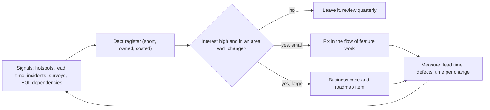
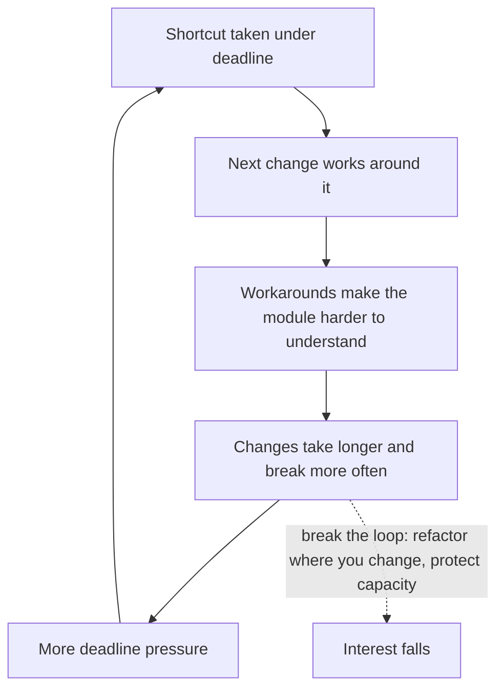
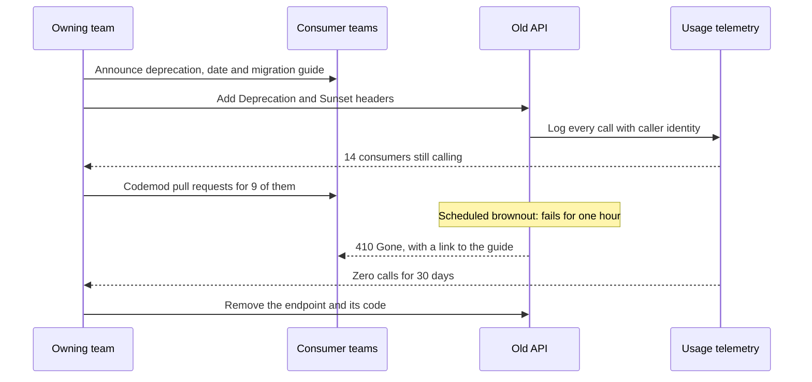

## TL;DR

- Technical debt is the **future cost of change** created by shortcuts, outdated decisions or learning that the code no longer reflects. Like financial debt, it has **principal** (the effort to fix it) and **interest** (the extra cost paid on every change until you do).
- Not all debt is bad. **Prudent, deliberate** debt taken to learn or hit a real deadline can be smart. **Reckless or inadvertent** debt left to compound is what cripples teams.
- Debt only matters **where you change code**. Use **hotspot analysis** (change frequency × complexity) and delivery data (lead time, change failure rate, unplanned work) to find the debt with high interest. Don't try to clean the whole codebase.
- Pay it down **continuously**, in the flow of feature work ("make the change easy, then make the easy change"), backed by a steady capacity allocation and a short, owned debt register. Big "debt sprints" and rewrites are usually signs that continuous paydown failed.
- Explain debt in **business terms**: slower delivery, incidents, security exposure, onboarding time and blocked opportunities. "The code is ugly" persuades nobody.

## Core Concepts

### The metaphor

Ward Cunningham coined it in 1992. Shipping code that reflects your current understanding is like borrowing money: it gets you there faster, but you must pay it back by refactoring as understanding improves. If you don't, the **interest**, the extra effort on every future change, keeps accruing.

The useful questions are therefore:
- **What's the interest rate?** How much does this debt slow down or endanger the changes we actually make?
- **What's the principal?** How much would it cost to remove?
- **Is it compounding?** Does it make new debt more likely, as tangled modules attract more tangles?

### Fowler's technical debt quadrant

|  | **Reckless** | **Prudent** |
|---|---|---|
| **Deliberate** | "We don't have time for design." | "We must ship now and deal with the consequences." (with a plan to repay) |
| **Inadvertent** | "What's layering?" | "Now we know how we should have done it." |

Prudent-inadvertent debt is unavoidable. You learn the right design by building the system. Reckless debt is the one to prevent, through skills, standards and review.

### Kinds of debt

| Kind | Examples | Typical interest |
|---|---|---|
| **Code** | Duplication, long functions, unclear names, dead code | Slower changes, bugs in edge cases |
| **Design / architecture** | Wrong boundaries, a shared database, a distributed monolith, synchronous chains | Cross-team coordination, cascading failures, inability to scale |
| **Test** | Missing or flaky tests, slow suites, only end-to-end tests | Fear of change, long feedback loops, regressions |
| **Dependency / platform** | Outdated frameworks, end-of-life runtimes, unpatched libraries | Security exposure, painful forced upgrades |
| **Infrastructure / operations** | Manual deployments, snowflake servers, missing observability | Slow recovery, risky releases |
| **Data** | Inconsistent schemas, missing constraints, duplicate sources of truth | Wrong reports, migration pain |
| **Documentation / knowledge** | Tribal knowledge, outdated runbooks, a single expert | Slow onboarding, key-person risk |

### Measuring where it hurts

No single number measures technical debt. Combine:

- **Hotspots**: files or modules that change often *and* are complex. Most of a codebase is rarely touched, so its debt has little interest. Adam Tornhill's work (and the CodeScene tool) popularised this.
- **Change coupling**: files that keep changing together across module boundaries, which shows hidden dependencies.
- **Delivery data**: lead time, change failure rate and the share of time spent on unplanned work, per area of the code.
- **Defects and incidents** per module.
- **Dependency freshness**: how far behind current versions you are (libyear), and how many end-of-life components remain.
- **Developer experience**: surveys asking which areas people dread changing. Engineers know where the pain is.

Static-analysis "debt ratios" (such as SonarQube's remediation estimates) are useful for spotting trends and new issues in changed code, but poor at prioritising: they treat a messy file nobody touches the same as one changed every day.

```ts
// Hotspots: change frequency (git) × size as a complexity proxy.
// Usage: tsx hotspots.ts  (run in the repository root)
import { execSync } from 'node:child_process';
import { existsSync, readFileSync } from 'node:fs';

const since = '12 months ago';
const log = execSync(`git log --since="${since}" --name-only --pretty=format:`, { encoding: 'utf8' });

const changes = new Map<string, number>();
for (const file of log.split('\n').filter((f) => /\.(ts|tsx|js|java|cs|py)$/.test(f))) {
  changes.set(file, (changes.get(file) ?? 0) + 1);
}

const hotspots = [...changes]
  .filter(([file]) => existsSync(file))
  .map(([file, count]) => {
    const lines = readFileSync(file, 'utf8').split('\n').length;
    return { file, changes: count, lines, score: count * lines };
  })
  .sort((a, b) => b.score - a.score)
  .slice(0, 15);

console.table(hotspots);
```

### Worked example: estimating the interest on one module

The team believes the pricing module is slowing them down. Here's how to turn that belief into a number product leadership can weigh against features.

**1. Find the work that touched it.** Ticket ids in commit messages connect code to delivery data:

```bash
# Tickets whose commits touched pricing in the last 12 months.
git log --since="12 months ago" --format=%s -- src/pricing | grep -oE 'PAY-[0-9]+' | sort -u > pricing-tickets.txt
wc -l < pricing-tickets.txt   # 38
```

**2. Compare like with like.** Take cycle time (from first commit to production) for those 38 tickets, and for tickets elsewhere with the same story-point size, so you aren't just measuring that pricing work is bigger:

| | Median cycle time | Reopened or caused an incident |
|---|---|---|
| Medium tickets touching pricing | 9 days | 11 of 38 |
| Medium tickets elsewhere | 4 days | 6 of 120 |

**3. Put a range on the interest.**
- Delivery: about 5 extra days × 38 tickets ≈ **190 engineer-days a year**. Some of that is genuine domain complexity, so call it 100–190.
- Incidents: 7 pricing incidents, at roughly 3 engineer-days each (response, fix, follow-up) ≈ **20 engineer-days**.
- Next year: the roadmap has about 1.5× as many pricing changes, so the interest grows to **150–315 days**.

**4. Estimate the principal and the payback.** Characterisation tests (15 days), extracting the rules behind a clear interface (30 days) and migrating callers (15 days) add up to about **60 engineer-days**. Even if the work removes only half the interest, it pays back in roughly 5–10 months. At the optimistic end, it's under 3.

**5. Present a decision, not a complaint.** "Pricing changes take twice as long as similar work and caused 7 incidents last year. Sixty engineer-days, spread over the next two quarters alongside the pricing roadmap, should pay for itself within the year. We'll report cycle time for pricing tickets monthly."

The numbers are rough, and saying so makes them more credible. Ranges built from your own history beat a static-analysis "remediation estimate" every time.

### Ways of paying it down

- **Refactor in the flow of work.** Kent Beck: "make the change easy (warning: this may be hard), then make the easy change". Improve the code you're about to change, as part of the feature. It's the cheapest way to pay down debt where interest is highest.
- **The boy scout rule**: leave the code a little better than you found it. Good for small improvements, but it doesn't fix structural problems.
- **Capacity allocation**: a steady share of each team's capacity (often 15–25%) for improvement work chosen by the team, protected in planning. Predictable and sustainable.
- **Targeted investments** for large, high-interest items such as replacing a shared database or upgrading a framework across many services, planned like any other roadmap item with a business case.
- **Strangler fig** for replacing whole components incrementally.
- **Rewrites** only rarely: they freeze value delivery and usually underestimate how much behaviour the old system encodes.

### Preventing new debt

- A **definition of done** that includes tests, observability and docs.
- **Automated guardrails**: linters, type checking, architecture fitness functions (dependency rules between modules) and dependency update bots (Renovate, Dependabot).
- **ADRs with revisit triggers**, so deliberate shortcuts are recorded with the conditions for repaying them.
- **Small batches and code review** focused on design, not style (automate the style).
- **Time to learn**: inadvertent debt falls as the team's domain and design skills grow.

### Debt from AI-generated code

AI coding assistants make it cheap to produce code, including duplicated, unreviewed or poorly understood code. Industry analyses since 2024 have reported rising code duplication and churn alongside assistant adoption. Treat it like any other source of inadvertent debt: review generated code with the same bar, prefer reuse over regeneration, keep tests and fitness functions strict, and watch hotspot and duplication trends.

## How It Works

### From signal to paydown



### Interest compounding



### Retiring an internal API



## When to Use / Trade-offs

| Approach | Use when | Avoid when | Cost |
|---|---|---|---|
| Take deliberate debt | Learning fast (an experiment, an MVP), a real deadline, with a repayment plan | You won't revisit it, or it compounds across teams | Interest until repaid |
| Refactor in the flow | Debt is in code you're changing for features | The fix spans many teams or months | Slightly longer feature work |
| Fixed capacity allocation | Ongoing, varied improvement needs | Debt so severe it needs a focused programme | 15–25% of capacity |
| Targeted investment | Large, high-interest debt (shared database, EOL framework) | Low-interest debt in stable code | A roadmap slot with a business case |
| Dedicated debt sprint | Rarely, for example a one-off upgrade that needs everyone | As the main strategy, since it implies debt was ignored the rest of the time | Lost feature flow, and the debt returns |
| Rewrite | The platform is truly unworkable and the domain is well understood | The old system's behaviour isn't fully known | Long freeze, high risk |
| Leave it | Stable code nobody changes, or code soon to be retired | Security or compliance exposure | Nothing, until it changes |

## Common Pitfalls & Anti-patterns

- **Debt as a moral failing** — calling all past decisions "bad code" ignores that many were sensible at the time and alienates the people who made them.
- **Cleaning everything** — refactoring stable code nobody touches, while hotspots stay painful.
- **The giant debt backlog** — hundreds of tickets nobody prioritises. A short, costed register beats a long list.
- **Debt sprints as the strategy** — debt is ignored for months, then a sprint barely dents it.
- **Hidden refactoring** — padding estimates to sneak in improvements damages trust. Make improvement work visible.
- **The "big rewrite" escape** — rewriting to escape debt, then re-creating it under the same pressures.
- **Unrecorded deliberate debt** — shortcuts taken "temporarily" with no record or trigger, so they become permanent.
- **Vanity metrics** — chasing a static-analysis score rather than delivery outcomes.
- **Neglected dependencies** — skipping minor upgrades until a forced major upgrade becomes a multi-month project.

## Real-world Scenario

**Context:** A logistics company's routing service, 9 years old with 400,000 lines of Java, was owned by two teams. Lead time for changes had risen to 5 weeks, and about 45% of each sprint went on unplanned fixes. Product leadership saw the teams as slow, and the engineers wanted a rewrite.

**Decision:**
1. **Evidence**: hotspot analysis over 12 months showed that 4% of files took 52% of all changes, and three of them (a 6,000-line `RoutePlanner`, a pricing rules class and a shared `Utils`) were involved in 60% of production defects. The rest of the codebase was ugly but rarely touched.
2. **Business case**: estimated the interest as about 2 extra engineer-weeks per feature touching those files, and 70% of the roadmap touched them. Presented "cut lead time for routing features in half within two quarters" rather than "refactor the code".
3. **Approach**: no rewrite. Characterisation tests around the three hotspots, then extraction of the pricing rules into a separate module with a clear interface, and incremental decomposition of `RoutePlanner` as each roadmap feature touched it. 20% capacity was protected for improvement work chosen by the teams.
4. **Prevention**: architecture fitness tests (ArchUnit) to stop new dependencies on the old `Utils`, and Renovate for dependency updates.

**Outcome:** After two quarters, lead time for routing changes dropped from 5 weeks to 2, unplanned work fell to about 20%, and routing-related incidents halved. The rewrite was never needed.

**What I'd do differently:** Run the hotspot analysis and share it with product much earlier. The data changed the conversation from "engineers want to gold-plate" to "here is where we lose two weeks per feature".

## Interview Questions

### What is technical debt, and where does the metaphor come from? {#what-is-tech-debt}

**Level:** Foundation

**Model answer:**
Ward Cunningham introduced the metaphor in 1992. Shipping software that reflects your current, incomplete understanding is like borrowing: it gets value out sooner, but you need to repay by refactoring as you learn. If you don't, you pay **interest**: every future change is slower and riskier because the code doesn't reflect the domain or the design you now know you need.

Today the term covers anything in a system that makes future change more expensive than it needs to be: messy code, wrong architectural boundaries, missing tests, outdated dependencies, manual operations and missing documentation.

The useful part of the metaphor is the economics. Debt has a **principal** (the cost to fix it) and an **interest rate** (the ongoing cost of living with it). Some debt is worth taking on deliberately. What matters is managing it consciously.

**What the interviewer is looking for:**
The original meaning (learning and repaying), principal versus interest, and a broader definition than "bad code".

**Follow-ups:**
- Is all technical debt bad?
- How is technical debt different from a bug?

**Red flags:**
- "Technical debt is code written by bad developers."
- No notion of interest.

### Explain Fowler's technical debt quadrant. {#debt-quadrant}

**Level:** Foundation

**Model answer:**
Martin Fowler classifies debt on two axes: **deliberate versus inadvertent**, and **reckless versus prudent**:
- **Reckless, deliberate**: "We don't have time for design." Knowingly cutting corners without a plan.
- **Prudent, deliberate**: "We must ship now and deal with the consequences." A conscious trade-off, ideally recorded with a plan to repay.
- **Reckless, inadvertent**: "What's layering?" Debt from lack of knowledge or skill.
- **Prudent, inadvertent**: "Now we know how we should have done it." Debt that appears as you learn. Unavoidable, even for excellent teams.

Responses differ: prevent reckless debt through skills, standards, review and automation. Record prudent deliberate debt with repayment triggers. Accept prudent inadvertent debt as part of learning, and refactor as understanding improves.

**What the interviewer is looking for:**
All four quadrants, and different responses for each.

**Follow-ups:**
- Give an example of prudent deliberate debt you took on.
- How do you reduce reckless inadvertent debt in a team?

**Red flags:**
- Treating all debt as reckless.
- Not recognising that learning creates debt.

### What kinds of technical debt are there beyond messy code? {#types-of-debt}

**Level:** Foundation

**Model answer:**
- **Architecture and design**: wrong module or service boundaries, shared databases, synchronous call chains, a distributed monolith. Usually the most expensive, because it affects many teams.
- **Test**: missing tests, flaky tests, slow suites, over-reliance on end-to-end tests. Creates fear of change.
- **Dependency and platform**: outdated frameworks and libraries, end-of-life runtimes and operating systems. Creates security exposure and forced upgrades.
- **Infrastructure and operations**: manual deployments, snowflake servers, poor observability. Slows recovery.
- **Data**: inconsistent schemas, missing constraints, duplicate sources of truth.
- **Documentation and knowledge**: tribal knowledge and single experts. Key-person risk and slow onboarding.
- **Process**: manual approvals and hand-offs that slow delivery, sometimes included in broader definitions.

Naming the kind helps choose the fix and the owner: architecture debt usually needs a cross-team plan, while code debt can be fixed in the flow of work.

**What the interviewer is looking for:**
Breadth, and an understanding that different kinds need different approaches.

**Follow-ups:**
- Which kind of debt is usually most expensive, and why?
- How would you find knowledge debt?

**Red flags:**
- Only mentioning code style.

### What is the "boy scout rule", and what are its limits? {#boy-scout-rule}

**Level:** Foundation

**Model answer:**
"Leave the code a little better than you found it." Every time you touch code, make a small improvement: rename a confusing variable, extract a function, add a missing test, delete dead code. Because improvements happen where changes happen, it naturally targets the code with the highest interest, and it costs little.

Limits:
- **Structural problems** (wrong boundaries, a shared database, a framework upgrade) can't be fixed in small increments by individuals. They need a plan.
- **Scope creep**: well-meaning improvements can bloat a pull request and make review hard. Keep refactoring in separate commits or pull requests when it's substantial.
- **Untested code**: refactoring without tests is risky. Add characterisation tests first.
- **Code you don't own**: improvements in another team's area need coordination.

It's a good habit, not a strategy on its own.

**What the interviewer is looking for:**
Why it works (it targets hotspots) and an honest view of its limits.

**Follow-ups:**
- How do you keep refactoring from hiding inside feature pull requests?
- What are characterisation tests?

**Red flags:**
- Treating it as the complete debt strategy.
- Large unreviewable refactors bundled into feature work.

### How do you measure technical debt? {#measuring-debt}

**Level:** Senior

**Model answer:**
There is no single number. Combine signals that indicate **where debt is costing you**:

- **Hotspots**: change frequency multiplied by complexity, per file or module. The interest is paid where code changes.
- **Delivery data per area**: lead time, change failure rate, unplanned work, and time to complete similar-sized changes in different modules.
- **Quality**: defects and incidents per module, and flaky test rates.
- **Dependency health**: versions behind current (libyear), end-of-life components, open vulnerabilities.
- **Change coupling**: files that change together across boundaries, showing hidden architectural dependencies.
- **Developer surveys**: "Which areas do you avoid changing?" Engineers' perception is often the most accurate signal.
- **Static analysis** for trends and for gating new issues in changed code, not for ranking the whole codebase.

Then express it in business terms: extra weeks per feature, incident cost, security exposure, onboarding time.

**What the interviewer is looking for:**
Multiple signals, a focus on interest (where change happens), and translating into business impact.

**Follow-ups:**
- Why is a SonarQube debt ratio a poor way to prioritise?
- How would you estimate the interest on a specific piece of debt?

**Red flags:**
- "We use the static-analysis score."
- No link between measurement and decisions.

### What is hotspot analysis, and why is it better than whole-codebase metrics? {#hotspot-analysis}

**Level:** Senior

**Model answer:**
Hotspot analysis combines **how often code changes** (from version-control history) with **how complex it is** (lines of code, cyclomatic complexity, indentation depth). The files at the top of both lists are hotspots: complex code that the team must work in all the time.

Why it's better:
- **Debt only charges interest when you change code.** A tangled module nobody has touched in three years costs almost nothing today. Whole-codebase metrics treat it the same as code changed daily.
- **Change is concentrated.** In most codebases, a small percentage of files gets most of the changes, so a small, focused effort gives a large payoff.
- **It's objective and cheap**: derived from git history, it starts conversations with data rather than opinion.

Extensions: **change coupling** (files that change together, especially across module or team boundaries), **trends** (a hotspot whose complexity is rising), and **knowledge maps** (who has changed a hotspot, to find key-person risk).

Caveats: renames and moves distort history, generated files must be excluded, and change frequency partly reflects the roadmap, so check the future roadmap too.

**What the interviewer is looking for:**
The interest argument, how hotspots are computed, and awareness of extensions and caveats.

**Follow-ups:**
- How would you combine hotspots with the upcoming roadmap?
- What does high change coupling between two services tell you?

**Red flags:**
- Prioritising refactoring by file size alone.
- Ignoring version-control history as a source of insight.

### How do you write a business case for paying down a specific piece of debt? {#debt-business-case}

**Level:** Senior

**Model answer:**
1. **Describe the impact, not the code**: "Every change to pricing rules takes about 2 extra weeks and causes a quarter of our production incidents", not "the pricing module is a mess".
2. **Quantify the interest** with evidence: lead time for changes in that area versus others, incident count and cost, unplanned work hours, onboarding time, security exposure (for example an end-of-life framework without patches after a known date).
3. **Connect to the roadmap**: what share of planned work touches this area? Interest multiplies with future change.
4. **Estimate the principal** and the plan: the cost to fix, in increments that deliver value along the way rather than a big bang.
5. **Show the return**: payback period, risk reduction, options unlocked (such as entering a new market or supporting a new pricing model).
6. **Define success measures**: lead time, incident rate, time spent per change, checked after delivery.
7. **Offer options**: do nothing (with its cost), a minimal fix, or the full fix.

Present it in the same planning forum as features, so it competes on the same terms.

**What the interviewer is looking for:**
Business language, evidence, incremental plans and measurable success.

**Follow-ups:**
- What if you can't quantify the interest precisely?
- How would you handle a product manager who still says no?

**Red flags:**
- "We need three months to clean up the code."
- No success measures.

### How do you keep dependency and platform upgrade debt under control? {#dependency-debt}

**Level:** Senior

**Model answer:**
- **Automate small updates**: Renovate or Dependabot opening pull requests for patch and minor versions, with good tests and auto-merge for low-risk updates. Small, frequent upgrades are far cheaper than rare big ones.
- **Track freshness**: an inventory of runtimes, frameworks and key libraries with versions and end-of-life dates, plus a libyear or "versions behind" metric per service.
- **Plan major upgrades ahead of end-of-life**: put runtime and framework EOL dates (Node.js, Java, .NET, Spring, React) on the roadmap a year ahead.
- **Golden paths and shared templates**: when services use a common base image, pipeline and libraries, upgrades can be done once and rolled out widely.
- **Minimise dependencies**: fewer, well-maintained libraries. Prefer platform features over small packages.
- **Security policy**: SLAs for fixing critical vulnerabilities, enforced by SCA tools in the pipeline.
- **Ownership**: every service has an owner responsible for keeping it current, with the time to do so.

**What the interviewer is looking for:**
Automation, visibility of EOL dates, small continuous upgrades and ownership.

**Follow-ups:**
- How do you upgrade a framework across 80 services?
- When would you allow a service to stay on an old version?

**Red flags:**
- Upgrading only when forced by a vulnerability.
- No inventory of versions.

### Should teams run "tech debt sprints"? {#debt-sprints}

**Level:** Senior

**Model answer:**
Usually not as the main strategy:
- They imply debt was ignored for the rest of the time, so it accumulated faster than a sprint can repay.
- Work chosen in a rush for a "debt sprint" is often low-value cleanup rather than high-interest hotspots.
- They stop value delivery, and product stakeholders learn to see debt work as a cost centre.
- Debt returns quickly if daily practices don't change.

Better:
- **Continuous paydown**: refactor in the flow of feature work, plus a steady capacity allocation (15–25%) the team controls.
- **Targeted investments** for large items, with a business case and a place on the roadmap.

Exceptions where a focused period makes sense: a deadline-driven upgrade (a runtime reaching end of life), a stabilisation period after a crisis, or a coordinated migration that benefits from everyone working on it at once. Even then, tie it to measurable outcomes.

**What the interviewer is looking for:**
The case against it, a better default and sensible exceptions.

**Follow-ups:**
- How do you protect a capacity allocation when deadlines loom?
- How would you choose what to work on within the allocation?

**Red flags:**
- "We do a cleanup sprint every quarter, and that handles it."
- No mechanism for continuous paydown.

### How do you prevent new debt without slowing the team down? {#preventing-debt}

**Level:** Senior

**Model answer:**
Make the right thing automatic and cheap:
- **Automated checks** in CI: type checking, linting, formatting, tests, and architecture fitness functions (dependency-cruiser, ArchUnit, Nx module boundaries) that block forbidden dependencies. Machines enforce the rules, so reviews focus on design.
- **Definition of done** including tests, observability and documentation, so "done" doesn't hide unfinished work.
- **Small batches**: small pull requests and trunk-based development make design problems visible early and cheap to fix.
- **Recorded deliberate debt**: when a shortcut is the right call, record it (an ADR or a ticket linked in the code) with a trigger for repayment.
- **Golden paths and templates**: new services start with good defaults.
- **Skills**: pairing, design reviews for significant changes, and time to learn the domain reduce inadvertent debt.
- **Visible metrics**: hotspot and dependency trends reviewed periodically.

The goal is not zero debt, which would mean over-engineering. It's that every piece of debt is a choice, not an accident.

**What the interviewer is looking for:**
Automation over policing, recording deliberate debt, and recognising that zero debt isn't the goal.

**Follow-ups:**
- What architecture rules would you enforce automatically?
- How do you stop the definition of done becoming a checklist nobody follows?

**Red flags:**
- Heavy manual review gates.
- Aiming for zero debt.

### Your team spends 60% of its time on unplanned work in a 10-year-old codebase. Plan the next six months. {#debt-turnaround}

**Level:** Architect

**Model answer:**
**Month 1: understand where the time goes.**
- Categorise the unplanned work: incidents, bugs, support requests, manual operational tasks, urgent fixes for other teams.
- Hotspot analysis plus incident and defect mapping to modules. Survey the team on what they dread.
- Agree with product leadership on the goal: "unplanned work below 30% and lead time halved within two quarters", and on the capacity needed to get there.

**Months 1–2: stop the bleeding.**
- Automate the top manual operational tasks.
- Fix the top recurring incident causes with strong actions (guardrails, tests, alerts).
- Protect the team: one rotating person handles interrupts, so the rest can focus.

**Months 2–5: pay down high-interest debt.**
- Characterisation tests around the top hotspots, then incremental refactoring tied to roadmap features touching them.
- A protected improvement allocation (25–30% during the turnaround), visible on the board.
- One or two targeted investments if the data supports them, such as splitting a god class or replacing a flaky integration.

**Throughout: prevent and measure.**
- Architecture fitness functions, dependency automation, and a definition of done.
- Monthly review with product: unplanned-work share, lead time, incidents, and team sentiment.

**Month 6**: reduce the allocation to a sustainable level (15–20%) once metrics improve. Keep the practices.

**What the interviewer is looking for:**
Data first, quick wins on unplanned work, debt work aimed at hotspots, product partnership and measurable goals.

**Follow-ups:**
- Product says they can't give up 30% of capacity. What do you say?
- How do you keep morale up during the turnaround?

**Red flags:**
- Proposing a rewrite immediately.
- No measures of progress.

### How do you manage architectural debt that spans many teams? {#architectural-debt}

**Level:** Architect

**Model answer:**
Architectural debt (a shared database, wrong service boundaries, synchronous chains, an outdated integration platform) can't be fixed by one team in the flow of feature work. It needs coordination:

1. **Make it visible**: describe the debt, its interest per team (coordination time, incidents, blocked features) and the target state, using C4 diagrams and data such as change coupling and dependency waits.
2. **Agree the target and the path in an ADR**, reviewed with affected teams, including intermediate states that each deliver value.
3. **Assign ownership**: one accountable owner (often a Staff or Principal engineer), with a named contact in each affected team.
4. **Fund it explicitly** in portfolio planning: an investment theme, with capacity reserved in each affected team, rather than hoping teams do it in their spare time.
5. **Make the new way easier**: provide the replacement capability (APIs, libraries, migration tooling) before asking teams to migrate.
6. **Stop new debt**: fitness functions or policies that block new usage of the old pattern (no new tables in the shared database, no new synchronous calls to the legacy service).
7. **Track and communicate progress**: a migration dashboard (consumers migrated, dependencies remaining), reviewed in architecture and leadership forums.

**What the interviewer is looking for:**
Visibility, explicit funding and ownership, stopping the bleeding, and enabling migration rather than mandating it.

**Follow-ups:**
- How do you handle a team that won't prioritise its part?
- How do you sequence migration across teams?

**Red flags:**
- Expecting teams to fix it "when they have time".
- An architecture team that dictates without funding.

### Design a technical debt register and governance process for a 200-engineer organisation. {#debt-register}

**Level:** Architect

**Model answer:**
**Principles**: short, owned, costed and decision-oriented. Not a dumping ground.

**Two levels:**
- **Team level**: each team keeps its own small list (in its normal backlog with a "debt" label), prioritised within the team's improvement allocation. No central approval needed.
- **Organisation level**: a register of 10–20 cross-cutting, high-interest items: architecture debt, end-of-life platforms, security-relevant debt.

**Each organisation-level entry has:**
- A description and the affected systems and teams.
- **Interest**: evidence of the cost (lead time, incidents, security risk, blocked opportunities).
- **Principal**: an estimate of effort.
- **A trigger or deadline** (for example an EOL date).
- An owner and the next decision needed.

**Governance:**
- A monthly or quarterly review in the architecture forum: add, merge or close entries, and decide which become funded investments.
- Funded items enter portfolio planning alongside features, with success measures.
- Teams' improvement allocations are protected by engineering leadership, and their use is reported (briefly) to keep trust.
- A periodic data refresh: hotspots, dependency freshness, incident themes.

**Avoid**: hundreds of tickets, entries without evidence, and a register that has no route to funding.

**What the interviewer is looking for:**
Two levels of ownership, evidence-based entries, and a governance path to actual decisions.

**Follow-ups:**
- Who decides what makes it onto the organisation-level register?
- How do you retire entries?

**Red flags:**
- A central list of every code smell.
- A register with no link to planning.

### How does AI-assisted coding change the technical debt picture, and what would you do about it? {#ai-generated-debt}

**Level:** Architect

**Model answer:**
**Risks:**
- **Volume**: generating code is cheap, so more of it gets written, and every line must be maintained.
- **Duplication over reuse**: assistants tend to produce new code rather than find and reuse existing abstractions. Industry analyses since 2024 have reported rising duplicated code and churn alongside assistant adoption.
- **Shallow understanding**: code merged without the author fully understanding it becomes knowledge debt.
- **Plausible but subtly wrong code**, including outdated API usage, insecure patterns and inconsistent conventions.

**Opportunities:**
- AI is good at **paying down** certain debt: writing characterisation tests, explaining legacy code, mechanical refactors, and large-scale upgrades and migrations with review.

**What I'd do:**
- Keep the **same review bar** for generated code. The author must be able to explain it.
- Give assistants **context**: repository conventions, architecture rules and preferred libraries (in instruction files), so they reuse rather than reinvent.
- Strengthen **automated guardrails**: tests, type checks, fitness functions, duplication detection and security scanning.
- **Watch trends**: duplication, churn, hotspot complexity and defect rates in AI-heavy areas.
- **Use AI deliberately for paydown**: test generation and migration campaigns, with human review.

**What the interviewer is looking for:**
A balanced view of risks and opportunities, and concrete controls rather than bans.

**Follow-ups:**
- How would you measure whether AI assistance is increasing debt?
- Would you allow AI-generated pull requests without a human author?

**Red flags:**
- "AI makes debt irrelevant because we can regenerate code."
- Banning AI tools without analysis.

### You're doing due diligence on a company your organisation may acquire. How do you assess its technical debt? {#debt-due-diligence}

**Level:** Architect

**Model answer:**
**Scope the questions to the deal thesis**: will we integrate the product, scale it, or keep it standalone? That determines which debt matters.

**Evidence to gather (usually in a short window):**
- **Architecture**: diagrams, key boundaries, data stores, integration points, single points of failure, scalability limits relative to the growth plan.
- **Code and history**: hotspot and change-coupling analysis from version control, test coverage and suite health, the age and structure of the main codebases, and knowledge concentration (how many people have changed the critical code; bus factor).
- **Dependencies**: runtime and framework versions, EOL components, open source licences (copyleft obligations), known vulnerabilities.
- **Operations**: deployment frequency, lead time, incident history, observability, DR tests, on-call load.
- **Security and compliance**: penetration test results, data protection, certifications and their findings.
- **People**: key-person dependencies, attrition, contractors holding critical knowledge.
- **Cost**: cloud spend and its growth, licences, and any hidden manual operations cost.

**Output**: a prioritised list of material risks with estimated remediation cost and time, separated into deal-breakers, items to price into the deal, and post-acquisition work. Include retention recommendations for key people.

**What the interviewer is looking for:**
Deal-relevant scoping, evidence from history and operations (not just reading code), people risk and a decision-ready output.

**Follow-ups:**
- What would be a deal-breaker for you?
- How do you assess debt when you have only two weeks and limited access?

**Red flags:**
- Judging quality by reading a few files.
- Ignoring people and licence risk.

### How is technical debt different from a bug, a missing feature or legacy code? {#debt-vs-bugs-legacy}

**Level:** Foundation

**Model answer:**
- **A bug** is behaviour that's wrong *today*: users see incorrect results. **Debt** is a property of the code or system that makes *future change* slower or riskier, even if every behaviour is correct right now. Debt often *causes* bugs, and a bug can be a symptom of debt, but fixing the bug doesn't repay the debt.
- **A missing feature** is functionality nobody has built. Calling it debt ("feature debt") blurs the line between investing in the product and maintaining the system, and makes both harder to prioritise.
- **Legacy code** is a description of age or ownership, not of quality. Michael Feathers defines it as code without tests. Old, stable, well-tested code that nobody needs to change carries little interest. Code written last month without tests or a clear design may carry a lot.

Why the distinctions matter: each goes through a different path. Bugs go to triage with severity. Features go to product prioritisation. Debt needs evidence of interest and a share of capacity. Lumping everything into a "tech debt" bucket turns it into a backlog nobody can reason about.

**What the interviewer is looking for:**
Debt as the cost of future change rather than present wrongness, and why separating the categories helps prioritisation.

**Follow-ups:**
- Is a missing test suite a bug or debt?
- Would you count an end-of-life runtime as debt, risk or both?

**Red flags:**
- "Tech debt is whatever engineers want to work on."
- Treating all old code as debt.

### How do you safely change legacy code that has no tests? {#refactoring-without-tests}

**Level:** Senior

**Model answer:**
Michael Feathers' approach in *Working Effectively with Legacy Code*: **get the code under test with the smallest, safest changes, then refactor**.

1. **Identify the change point** and the places where you can observe its behaviour.
2. **Find or create a seam**: a place where you can change behaviour without editing the code there. For example, pass a dependency in through a constructor parameter that defaults to the current one, or extract a hard-wired database call into a method you can override in a test.
3. **Write characterisation tests** that pin down what the code does now, including surprising behaviour. For code with large outputs (reports, generated files, API responses), use **approval or snapshot tests**: record the output once, review it, then compare against it on every run.
4. **Refactor in tiny steps**, preferably with the IDE's automated refactorings (rename, extract, move), which are far less risky than hand edits. Run the tests after each step.
5. **Make the actual change**, with a new test for the new behaviour.

When you can't get the code under test right away:
- **Sprout method or class:** write the new logic as new, tested code, and call it from the old code with a one-line change.
- **Wrap method:** put the new behaviour before or after a call to the renamed original.
- **Scratch refactoring:** refactor freely to *understand* the code, then throw the changes away and do it properly.

Keep refactoring and behaviour changes in separate commits, and add tests in the areas you touch, not everywhere at once.

**What the interviewer is looking for:**
Seams, characterisation and approval tests, automated refactorings, and the sprout and wrap techniques for when testing isn't possible yet.

**Follow-ups:**
- How do you write a characterisation test for a function that depends on the current time?
- When would you stop and propose a rewrite of a component instead?

**Red flags:**
- Large hand-made refactors with no tests, "because it's urgent".
- Trying to reach high coverage everywhere before making any change.

### How do you retire an internal API or library that other teams still depend on? {#deprecation}

**Level:** Senior

**Model answer:**
Deprecation is debt that the owning team can't repay alone, because the interest is paid in other teams' code. Treat it as a small programme:

1. **Provide the replacement first**, and make it better, or at least no worse, for consumers.
2. **Announce with a date, a reason and a migration guide**, showing the old and new usage side by side. Give enough notice to fit consumers' planning cycles.
3. **Signal it in the system itself**: compiler or lint warnings (`@deprecated` in TSDoc), runtime warnings, and for HTTP APIs the `Sunset` header (RFC 8594) and `Deprecation` header (RFC 9745).
4. **Measure usage by caller**, so "everyone" becomes a named list of owners. You can't finish what you can't see.
5. **Do the migration for them where you can**: codemods (jscodeshift, OpenRewrite) that open pull requests in each consumer's repository.
6. **Run brownouts**: announced windows in which the old path fails on purpose. They find the consumers nobody knew about, such as month-end batch jobs.
7. **Stop new usage** with a lint rule or a dependency check in CI, so the list only shrinks.
8. **Delete it** once usage has stayed at zero long enough to cover rare jobs.

The common failure is step 8 never happening, so the organisation pays for two ways of doing the same thing indefinitely.

**What the interviewer is looking for:**
Replacement first, usage telemetry by caller, doing the migration work for consumers, brownouts, and actually deleting the old code.

**Follow-ups:**
- A critical consumer can't migrate before the deadline. What do you do?
- How would you deprecate a field in a widely used event schema?

**Red flags:**
- An email announcement as the whole plan.
- Deprecated code that stays in place for years "just in case".

### When would you refactor, rewrite or replace a component with a bought product? {#refactor-rewrite-replace}

**Level:** Architect

**Model answer:**
Start from what the business needs the component to do over the next few years, not from how bad the code is.

**Refactor incrementally (the default)** when the design is broadly right for where the product is going, the knowledge is available, and the pain is concentrated in a few hotspots. It keeps delivering value and has the lowest risk.

**Rewrite** only when most of these hold:
- The current architecture can't reach a **required** capability (scale, multi-tenancy, a regulatory requirement) without changing almost everything.
- The platform is a dead end: an unsupported language or runtime, with no upgrade path.
- The domain is well understood, and behaviour can be specified, for example from characterisation tests and production traffic.
- You can do it **incrementally** with a strangler fig, routing one capability at a time, rather than with a big-bang cut-over.

Rewrites fail when teams underestimate the behaviour the old system encodes (edge cases, integrations, data quirks), when the old system keeps changing while the new one chases it, and when the business waits a year for no new value.

**Replace with a product** when the capability is a **generic subdomain** (identity, billing, search, workflow, CMS) that a vendor does better, and the differentiating parts can live in configuration or around it. Account for migration, integration and licence costs, lock-in, and the loss of control over the roadmap.

**Decide with data:** cost of the current interest, cost and risk of each option, time to first value, and what happens to the team's knowledge. Make it an ADR, and set checkpoints at which you would stop.

**What the interviewer is looking for:**
Incremental refactoring as the default, clear conditions for a rewrite, the strangler approach, and build versus buy grounded in what differentiates the business.

**Follow-ups:**
- How do you keep a strangler migration from stalling at 70%?
- How would you validate that the new system behaves like the old one?

**Red flags:**
- "The code is ugly, so we should rewrite it."
- A rewrite that delivers nothing to users until it's finished.

### How would you run a large-scale code migration across hundreds of repositories? {#large-scale-migrations}

**Level:** Architect

**Model answer:**
Examples are a framework major version, replacing a logging library, or a new internal SDK across 300 services. Treat it as a **campaign** with tooling, not as 300 tickets:

1. **Inventory.** Find every affected repository and call site (code search such as Sourcegraph or GitHub code search, dependency graphs, SBOMs). Classify them by pattern and difficulty.
2. **Automate the change.** Write codemods for the common patterns: jscodeshift or ts-morph for TypeScript, OpenRewrite for Java, Roslyn analysers and code fixes for .NET. AI assistants help with the long tail of odd cases, with the same review as any other change.
3. **Open the pull requests in bulk** (Sourcegraph Batch Changes, multi-gitter or a small script). Each must be small, pass the consumer's own CI, and explain why, with a link to the guide.
4. **Roll out in waves.** Pilot teams first, to fix the codemod, then the easy majority, then the hard cases with hands-on help from the platform team.
5. **Make it visible.** A dashboard of migrated, open and blocked repositories per team, reviewed in engineering leadership meetings.
6. **Set the policy.** A deadline tied to a real driver (an end-of-life date, a security fix). Block new usage of the old pattern in CI. Have an escalation path for teams that don't merge.
7. **Finish.** Remove the old library or compatibility shims, and the tooling that supported them.

Who does the work matters. If the central team writes the codemods and opens the pull requests, owning teams only review and merge. That's the difference between a migration that finishes in a quarter and one that takes two years.

**What the interviewer is looking for:**
Inventory, automation with codemods, small pull requests in waves, visibility and policy, and the central team carrying most of the effort.

**Follow-ups:**
- How do you handle repositories with no active owner?
- How would you verify behaviour hasn't changed in services with weak test suites?

**Red flags:**
- A wiki page and a deadline, with every team doing it by hand.
- Leaving the old library installed "for compatibility" after the migration.

## Cheat Sheet

### Concepts

- **Technical debt** — the future cost of change from shortcuts or outdated understanding, with principal and interest.
- **Interest** — the extra effort and risk paid on every change until the debt is repaid.
- **Debt quadrant** — reckless or prudent, crossed with deliberate or inadvertent (Fowler).
- **Prudent inadvertent debt** — "now we know how we should have done it". Unavoidable, and repaid by refactoring.
- **Architecture debt** — wrong boundaries, shared databases or coupling that span teams. The most expensive kind.

### Finding it

- **Hotspot** — code that changes often and is complex, which is where interest is paid.
- **Change coupling** — files that change together across boundaries, revealing hidden dependencies.
- **Libyear** — total years a project's dependencies lag behind their latest releases.
- **Static debt ratios** — good for trends and gating new code, poor for prioritising.

### Paying it down

- **Make the change easy** — refactor the code you're about to change, then make the change (Kent Beck).
- **Boy scout rule** — leave code a little better than you found it. A habit, not a strategy.
- **Capacity allocation** — a steady 15–25% for improvement work the team chooses.
- **Debt sprints** — usually a sign that continuous paydown failed.
- **Characterisation tests** — tests that capture current behaviour before refactoring legacy code.
- **Debt business case** — impact in business terms, interest evidence, an incremental plan and success measures.

### Revisit

- **Interest estimate** — compare cycle time with similar-sized work elsewhere, add incident cost, and quote a range.
- **Debt vs bug** — a bug is wrong behaviour now; debt makes future change slower or riskier.
- **Seam** — a place to change behaviour without editing that code, used to get legacy code under test.
- **Sprout and wrap** — put new logic in new, tested code, called from the old code with a one-line change.
- **Brownout** — announced, short windows in which a deprecated path fails on purpose, to flush out unknown consumers.
- **Rewrite conditions** — a required capability is unreachable, the platform is a dead end, behaviour is specifiable, and it can be done incrementally.
- **Migration campaign** — inventory, codemods, bulk pull requests in waves, a dashboard, then delete the old path.

## Further Reading

- [Ward Explains Debt Metaphor](https://wiki.c2.com/?WardExplainsDebtMetaphor) — Ward Cunningham on what he meant by technical debt.
- [Technical Debt](https://martinfowler.com/bliki/TechnicalDebt.html) — Martin Fowler on principal, interest and when debt is worth taking.
- [Technical Debt Quadrant](https://martinfowler.com/bliki/TechnicalDebtQuadrant.html) — the reckless/prudent and deliberate/inadvertent model.
- [Your Code as a Crime Scene, Second Edition](https://pragprog.com/titles/atcrime2/your-code-as-a-crime-scene-second-edition/) — Adam Tornhill on hotspot and change-coupling analysis.
- [Renovate documentation](https://docs.renovatebot.com/) — automating dependency updates.
- [libyear](https://libyear.com/) — a simple measure of dependency freshness.
