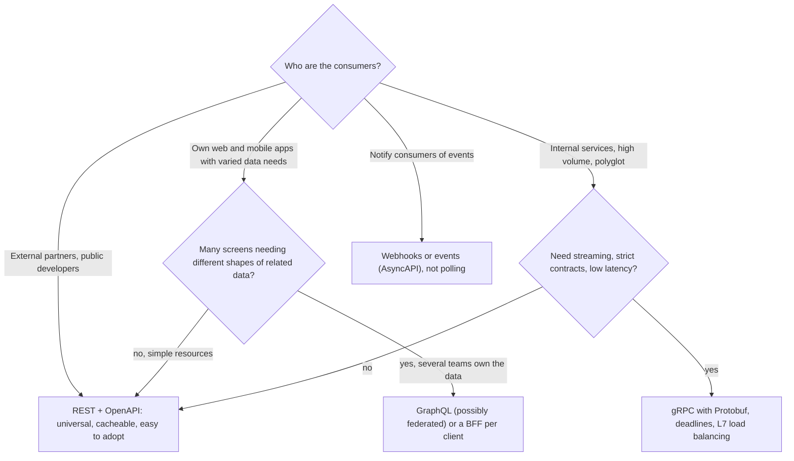
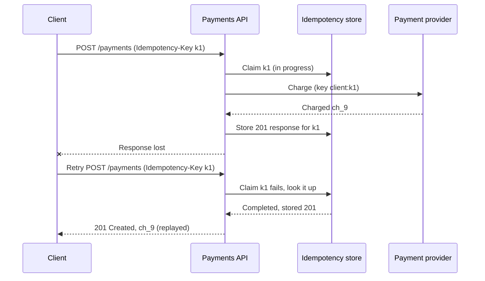

## TL;DR

- **REST over HTTP** is the default for public and cross-organisation APIs: universal tooling, caching, simple mental model. Use HTTP semantics properly (methods, status codes, caching, conditional requests).
- **GraphQL** shines when **many clients need different shapes of related data** (mobile + web + partners) and you want one flexible endpoint; it moves complexity to the server (N+1, query cost limits, caching, authorisation per field).
- **gRPC** fits **internal service-to-service** calls: strongly typed contracts (Protobuf), efficient binary encoding over HTTP/2, streaming and deadlines; browsers need gRPC-Web or Connect.
- Whatever the style: **contract-first**, backward-compatible evolution, consistent errors, pagination, idempotency for retries, and auth on every call.
- The hard parts are **evolution and governance** across many teams and consumers, not the syntax.

## Core Concepts

### REST essentials

REST (Roy Fielding, 2000) is an architectural style: resources identified by URIs, manipulated through a uniform interface, stateless requests, cacheable responses. In practice "RESTful" means using HTTP well:

| Method | Safe | Idempotent | Typical use |
|---|---|---|---|
| GET | ✓ | ✓ | Read a resource or collection |
| HEAD / OPTIONS | ✓ | ✓ | Metadata / CORS preflight |
| PUT | ✗ | ✓ | Replace a resource at a known URI |
| DELETE | ✗ | ✓ | Remove (repeat → same end state) |
| POST | ✗ | ✗ | Create in a collection, or trigger an action |
| PATCH | ✗ | not guaranteed | Partial update (JSON Merge Patch / JSON Patch) |

Status codes carry meaning: `200/201/204`, `400` (malformed), `401` (not authenticated), `403` (authenticated but not allowed), `404`, `409` (conflict), `412` (precondition failed), `422` (validation), `429` (rate limited, with `Retry-After`), `500/502/503/504`. Errors in a consistent machine-readable format: **Problem Details** (RFC 9457, which obsoleted RFC 7807).

```http
HTTP/1.1 422 Unprocessable Content
Content-Type: application/problem+json

{
  "type": "https://api.example.com/problems/invalid-quantity",
  "title": "Quantity must be at least 1",
  "status": 422,
  "detail": "Line 2 has quantity 0.",
  "instance": "/orders/ord_81f2/lines/2",
  "errors": [{ "pointer": "/lines/1/quantity", "message": "must be >= 1" }]
}
```

Resource design: nouns and collections (`/orders`, `/orders/{id}/lines`), filtering via query parameters, actions that don't map to CRUD as sub-resources or explicit action endpoints (`POST /orders/{id}/cancellation`). Describe the contract with **OpenAPI** and generate docs, clients and mocks from it.

### GraphQL essentials

A single endpoint where clients send a query describing exactly the fields they need, validated against a typed schema:

```graphql
type Query { order(id: ID!): Order }
type Order { id: ID! status: OrderStatus! total: Money! customer: Customer! lines(first: Int, after: String): OrderLineConnection! }

# Client query: one round-trip, only needed fields
query OrderPage($id: ID!) {
  order(id: $id) { status total { amount currency } customer { name } lines(first: 10) { edges { node { sku quantity } } } }
}
```

Server realities:
- **Resolvers** per field → the **N+1 problem** (resolving `customer` for each of 50 orders = 50 DB calls). Fix with batching (**DataLoader**) and query planning.
- **Cost control:** depth/complexity limits, pagination limits, timeouts; **persisted queries** (allow-listed operations by hash) for first-party apps.
- **Caching:** HTTP caching is harder (usually POST to one URL); rely on persisted GET queries, CDN with operation hashes, client caches (normalised by id), and server-side data loaders.
- **Authorisation** must be enforced per field/type in resolvers or a policy layer — not just at the endpoint.
- **Errors** return HTTP 200 with an `errors` array; partial data is normal. Monitoring must look inside responses.
- **Federation** (e.g. Apollo Federation) composes subgraphs owned by different teams into one supergraph.

### gRPC essentials

Contract in Protobuf; code generated for client and server; runs over HTTP/2 with multiplexing.

```proto
syntax = "proto3";
package orders.v1;

service OrderService {
  rpc GetOrder(GetOrderRequest) returns (Order);
  rpc WatchOrderStatus(WatchOrderStatusRequest) returns (stream OrderStatusEvent); // server streaming
}

message GetOrderRequest { string order_id = 1; }
message Order {
  string id = 1;
  OrderStatus status = 2;
  int64 total_minor = 3;
  string currency = 4;
  reserved 5; // removed field — never reuse its number
}
```

- Four call types: unary, server streaming, client streaming, bidirectional streaming.
- **Deadlines** propagate across calls; always set them. Status codes (`DEADLINE_EXCEEDED`, `UNAVAILABLE`, `RESOURCE_EXHAUSTED`…) guide retries.
- Binary Protobuf is compact and fast; schema evolution rules: add fields with new numbers, never change types or reuse numbers.
- **Browsers** can't use raw gRPC (no HTTP/2 trailer access): use gRPC-Web via a proxy, or the Connect protocol, or a REST/JSON gateway (gRPC-Gateway, transcoding).
- Load balancing needs care: long-lived HTTP/2 connections defeat L4 load balancers → use L7 (Envoy, service mesh) or client-side balancing.

### Cross-cutting API concerns

- **Pagination:** cursor-based (opaque `next` token, stable under inserts) over offset for large or changing collections.
- **Idempotency:** `Idempotency-Key` header on POSTs that create or charge; server stores key → result for a window and replays it on retry.
- **Concurrency:** `ETag` + `If-Match` → `412 Precondition Failed` on conflicting updates (optimistic locking).
- **Versioning and evolution:** additive changes only within a version; tolerant readers (ignore unknown fields); deprecation with `Deprecation`/`Sunset` headers and timelines.
- **Rate limiting** with clear headers and `429`.
- **Security:** OAuth 2.0 / OIDC access tokens, scopes, object-level authorisation on every request (OWASP API Security Top 10's #1 is broken object-level authorisation).
- **Observability:** correlation/trace headers, per-endpoint RED metrics.

### Worked example: implementing idempotency keys

A `POST /payments` endpoint that clients can retry safely. The key's lifecycle is stored in PostgreSQL:

```sql
CREATE TABLE idempotency_keys (
  client_id     text        NOT NULL,
  key           text        NOT NULL,
  request_hash  text        NOT NULL,
  status        text        NOT NULL CHECK (status IN ('in_progress', 'completed')),
  response_code int,
  response_body jsonb,
  created_at    timestamptz NOT NULL DEFAULT now(),
  PRIMARY KEY (client_id, key)          -- scoped per client: two clients can use the same key
);
```

```ts
export async function createPayment(req: ApiRequest): Promise<ApiResponse> {
  const key = req.header('idempotency-key');
  if (!key) return problem(400, 'missing-idempotency-key');
  const hash = sha256(canonicalJson(req.body));

  // Claim the key. Exactly one concurrent request can win this insert.
  const claimed = await db.query(
    `INSERT INTO idempotency_keys (client_id, key, request_hash, status)
     VALUES ($1, $2, $3, 'in_progress')
     ON CONFLICT (client_id, key) DO NOTHING`,
    [req.clientId, key, hash],
  );

  if (claimed.rowCount === 0) {
    const { rows: [row] } = await db.query(
      `SELECT request_hash, status, response_code, response_body
         FROM idempotency_keys WHERE client_id = $1 AND key = $2`,
      [req.clientId, key],
    );
    if (row.request_hash !== hash) return problem(422, 'idempotency-key-reused'); // same key, different request
    if (row.status === 'in_progress') return problem(409, 'request-in-progress');  // the first attempt is still running
    return { status: row.response_code, body: row.response_body, headers: { 'Idempotent-Replayed': 'true' } };
  }

  // Pass a key downstream too: the provider deduplicates if we call it twice.
  const charge = await psp.charges.create(
    { amountMinor: req.body.amountMinor, currency: req.body.currency },
    { idempotencyKey: `${req.clientId}:${key}` },
  );
  const body = { id: charge.id, status: charge.status };
  await db.query(
    `UPDATE idempotency_keys SET status = 'completed', response_code = 201, response_body = $3
      WHERE client_id = $1 AND key = $2`,
    [req.clientId, key, body],
  );
  return { status: 201, body };
}
```

What each piece protects against:
- **The primary key** makes the claim atomic, so two simultaneous retries can't both charge.
- **The request hash** catches a client bug that reuses one key for different payments.
- **The downstream key** covers a crash after the charge but before the `UPDATE`. A recovery job finds rows stuck `in_progress` for more than a minute, calls the provider again with the same key, gets the *same* charge back, and completes the row.
- **Store business failures too.** If the card is declined, store the 402 response as `completed`, so a retry gets the same decline instead of a second attempt. For transient failures (timeouts, 5xx from the provider), delete the row so the client's retry runs again.
- **Expire keys** after a window such as 24 hours, with a scheduled delete.

## How It Works



A typical layered setup: gRPC between internal services → a **BFF** or GraphQL layer shaping data for first-party clients → REST/OpenAPI public API through a gateway (auth, rate limits, analytics) → webhooks for partners.

### A retried request with a lost response



## When to Use / Trade-offs

| Style | Strengths | Weaknesses | Best fit |
|---|---|---|---|
| REST/JSON | Universal, HTTP caching, simple, great tooling (OpenAPI) | Over/under-fetching, many round-trips for nested data, loose typing without discipline | Public APIs, CRUD-ish resources, cross-org integration |
| GraphQL | Client-shaped responses, one round-trip, strong schema, introspection, federation | Server complexity, N+1, caching and rate limiting harder, field-level authz, query cost attacks | Multiple first-party clients over rich, connected data |
| gRPC | Strong contracts, compact binary, streaming, deadlines, codegen in many languages | Browser support needs proxies, harder to debug by hand, LB considerations | Internal microservices, high-throughput or streaming |
| Webhooks | Push notifications to third parties, simple for consumers | Delivery guarantees, security (signing), retries, consumer downtime | Partner integrations, event notification |
| Async messaging | Decoupling, buffering, fan-out | Eventual consistency, ops complexity | Internal events between domains |

## Common Pitfalls & Anti-patterns

- **RPC over REST in disguise** — `POST /getOrder`, `POST /updateOrderStatus` for everything; loses caching and HTTP semantics.
- **200 OK with an error body** in REST — breaks clients, monitoring and retries.
- **Leaking the database schema** as the API — every column change becomes a breaking change.
- **Chatty APIs** — clients making 30 calls per screen; fix with resource design, BFFs or GraphQL.
- **No pagination limits** — `GET /orders` returning 2 million rows.
- **GraphQL without cost limits** — deeply nested queries take down the database.
- **Authorising only at the gateway** — missing object-level checks (`GET /orders/123` for someone else's order).
- **Breaking changes without versioning** — renaming fields, changing types, tightening validation.
- **gRPC without deadlines** — hung calls pile up and exhaust resources.
- **Unsigned webhooks** — anyone can forge events to your consumers.

## Real-world Scenario

**Context:** A travel company had a REST API used by its web app, two mobile apps and 120 partners. Mobile screens needed 8–12 calls each, leading to slow loads on poor networks; meanwhile, web and partner needs pulled the REST API in different directions, and every change risked breaking partners.

**Decision:** Kept the **public REST API** as the stable, versioned partner contract (OpenAPI, linted in CI, 12-month deprecation policy). Introduced a **GraphQL layer** for first-party apps only, federated across three domain teams' subgraphs (Search, Booking, Customer), with persisted queries, depth/complexity limits and DataLoader batching. Internal service calls moved to **gRPC** with deadlines and an Envoy mesh.

**Outcome:** Mobile screens dropped to one round-trip; p75 screen load on 4G improved ~40%. Partner-facing changes slowed down deliberately (good), while app teams shipped UI changes without backend releases. An early incident — a nested query fan-out hammering the bookings DB — led to cost limits and persisted-query enforcement in production.

**What I'd do differently:** Enforce persisted queries and per-field authorisation tests from day one; and invest earlier in schema governance (naming, nullability conventions) across subgraphs — inconsistent conventions were expensive to fix later.

## Interview Questions

### What makes an API "RESTful" in practice? {#rest-principles}

**Level:** Foundation

**Model answer:**
REST is an architectural style (Fielding): resources with stable identifiers, a uniform interface, stateless requests, cacheable responses, and (in theory) hypermedia driving state. In practice, a good REST API:
- Models **resources** as nouns and collections (`/customers/{id}/orders`), not verbs.
- Uses **HTTP methods by their semantics**: GET (safe, cacheable), PUT/DELETE (idempotent), POST (create or non-idempotent actions), PATCH (partial updates).
- Returns **meaningful status codes** and a consistent error format (Problem Details).
- Is **stateless**: each request carries auth and context; no server session affinity.
- Uses **HTTP features**: caching headers (`Cache-Control`, `ETag`), conditional requests, content negotiation.
- Has a documented contract (OpenAPI).

Few APIs implement full HATEOAS; that's fine, but consistency and correct HTTP semantics matter.

**What the interviewer is looking for:**
Resources, method semantics, status codes, statelessness, caching — pragmatic rather than dogmatic.

**Follow-ups:**
- How would you model "cancel an order" in REST?
- What is HATEOAS and why is it rare?

**Red flags:**
- "REST means JSON over HTTP."
- Verbs in every URL and POST for everything.

### Which HTTP methods are safe and idempotent, and why does it matter? {#http-idempotency}

**Level:** Foundation

**Model answer:**
- **Safe** methods don't change server state: GET, HEAD, OPTIONS. Crawlers, prefetchers and caches may call them freely.
- **Idempotent** methods produce the same end state no matter how many times they're applied: GET, HEAD, OPTIONS, PUT, DELETE. POST is not; PATCH isn't guaranteed (depends on the patch semantics).

Why it matters: networks fail ambiguously — a client may not know if its request succeeded. Idempotent requests can be **retried safely** by clients, proxies and SDKs. For non-idempotent operations like "create payment", make them safe to retry with an **Idempotency-Key**: the server stores the key with the result and returns the same response on a retry instead of charging twice.

Note idempotency is about the **effect**, not the response: a second DELETE might return 404 instead of 204, but the state is the same.

**What the interviewer is looking for:**
Correct classification, the retry rationale, and idempotency keys for POST.

**Follow-ups:**
- How would you implement idempotency keys server-side?
- Is `PATCH /counter {"increment": 1}` idempotent?

**Red flags:**
- Using GET for state changes.
- Believing POST can never be made safe to retry.

### How should an API report errors? {#status-codes-errors}

**Level:** Foundation

**Model answer:**
- **Use the right status code class:** 4xx for client problems (400 malformed, 401 unauthenticated, 403 forbidden, 404 not found, 409 conflict, 412 precondition failed, 422 validation, 429 rate limited), 5xx for server problems (500, 502, 503 with `Retry-After`, 504).
- **Consistent machine-readable body:** RFC 9457 Problem Details (`type`, `title`, `status`, `detail`, `instance`) plus extension fields like field-level validation errors. Clients branch on `type` (a stable identifier), not on message text.
- **Helpful but safe:** explain what's wrong and how to fix it; never leak stack traces, SQL or internal hostnames.
- **Correlation id** in a header and the body so support can find the trace.
- **Retry guidance:** which errors are retryable (503, 429 with Retry-After) and which aren't.

For gRPC, use standard status codes with rich error details; for GraphQL, the `errors` array with `extensions.code`, remembering HTTP status is usually 200.

**What the interviewer is looking for:**
Correct status code use, a standard error format, safe detail, correlation ids and retry semantics.

**Follow-ups:**
- 401 vs 403 — when do you use each?
- Should a missing resource the user isn't allowed to see return 403 or 404?

**Red flags:**
- 200 with `{ "success": false }`.
- Stack traces in responses.

### How do you choose between REST, GraphQL and gRPC? {#choosing-api-style}

**Level:** Foundation

**Model answer:**
Start from consumers and constraints:
- **REST** for public/partner APIs and general resource APIs: every language and tool speaks it, HTTP caching works, easy onboarding.
- **GraphQL** for first-party clients (web, mobile) that need different shapes of connected data — one round-trip, client-driven field selection, a strongly typed schema; at the cost of server complexity (N+1, query cost limits, field-level authorisation, harder caching).
- **gRPC** for internal service-to-service communication: Protobuf contracts and codegen, efficient binary over HTTP/2, streaming, deadlines — but limited browser support and harder manual debugging.

They combine well: gRPC internally, GraphQL or BFFs for apps, REST publicly, events/webhooks for notifications. The choice should also consider team skills, existing tooling and governance capacity.

**What the interviewer is looking for:**
Consumer-driven reasoning, honest trade-offs, and awareness that mixed approaches are normal.

**Follow-ups:**
- When would you *not* use GraphQL even for a mobile app?
- How would a browser call a gRPC service?

**Red flags:**
- "GraphQL replaces REST."
- Choosing by hype without consumer analysis.

### What API versioning strategies exist, and which do you prefer? {#api-versioning}

**Level:** Senior

**Model answer:**
First principle: **avoid breaking changes** — evolve additively (new optional fields, new endpoints), have clients be tolerant readers. Version only for unavoidable breaks.

Strategies when you must:
- **URI versioning** (`/v1/orders`): explicit, easy to route and cache, visible in logs; coarse (whole API).
- **Header / media type versioning** (`Accept: application/vnd.acme.v2+json` or `Api-Version: 2026-03-01`): cleaner URLs, finer-grained; harder to test in a browser and to cache correctly.
- **Date-based versions** (Stripe-style): each account pinned to the version at signup; server translates between versions internally. Excellent consumer experience, significant platform investment.
- **GraphQL:** versionless by convention — add fields, deprecate old ones with `@deprecated`, monitor usage, remove when unused.
- **gRPC/Protobuf:** package versions (`orders.v1` → `orders.v2`) for breaking changes; additive changes within a version.

Policy matters more than mechanism: what counts as breaking, deprecation timelines (e.g. 12 months for public APIs), `Deprecation`/`Sunset` headers, usage monitoring per version and client, and migration guides.

**What the interviewer is looking for:**
Additive evolution first, trade-offs between mechanisms, and a deprecation policy with usage tracking.

**Follow-ups:**
- Is adding a new enum value a breaking change?
- How would you find which clients still call v1?

**Red flags:**
- Versioning every minor change.
- Breaking changes without notice because "nobody uses that field".

### How do you design pagination for a large, changing collection? {#pagination}

**Level:** Senior

**Model answer:**
- **Offset/limit** (`?offset=200&limit=50`): simple, supports jumping to page N, but slow at high offsets (DB scans and discards rows) and **unstable** when items are inserted/deleted (duplicates or skips).
- **Cursor/keyset** pagination: the server returns an opaque cursor encoding the sort key of the last item (`created_at, id`); the next query is `WHERE (created_at, id) < (:ts, :id) ORDER BY created_at DESC, id DESC LIMIT 50`. Fast with an index at any depth and stable under concurrent inserts. Can't jump to arbitrary pages — usually fine for feeds and APIs.

Design details:
- Opaque cursors (base64 of the key) so you can change implementation.
- A **unique tiebreaker** in the sort (id) to avoid skips.
- Enforce a max `limit`.
- Return `next` cursor (and `prev` if needed) plus `has_more`; avoid expensive total counts or make them approximate/optional.
- Filters and sort order must be part of the cursor context.
- GraphQL: the Relay connection spec (`edges`, `pageInfo { endCursor hasNextPage }`).

**What the interviewer is looking for:**
Trade-offs of offset vs cursor, keyset query mechanics with a tiebreaker, limits and opaque cursors.

**Follow-ups:**
- How do you support "jump to page 40" in a UI if you use cursors?
- How do you paginate when sorting by a non-unique column?

**Red flags:**
- Offset pagination on a 50-million-row table without thought.
- No maximum page size.

### What performance and security problems does GraphQL introduce, and how do you handle them? {#graphql-performance}

**Level:** Senior

**Model answer:**
**Performance:**
- **N+1 queries:** each resolver fetches independently → use **DataLoader** (batch + per-request cache) and design resolvers around batch loading.
- **Expensive queries:** deep nesting, large lists → **query depth and complexity limits**, mandatory pagination arguments with max sizes, timeouts.
- **Caching:** HTTP caching doesn't work naturally on POSTs → **persisted queries** (allow-listed by hash, sent as GET → CDN-cacheable), response caching for public data, normalised client caches.

**Security:**
- **Field-level authorisation** in resolvers or a policy layer; check object ownership, not just authentication at the endpoint.
- **Query cost attacks** and batching abuse (many operations in one request) → cost analysis and rate limiting by computed cost, not request count.
- **Introspection** disabled or restricted in production for private APIs; persisted queries prevent arbitrary queries from first-party clients.
- **Error leakage:** sanitise error messages and stack traces.

**Observability:** trace per resolver, record operation names, monitor errors inside 200 responses.

**What the interviewer is looking for:**
DataLoader, cost/depth limits, persisted queries, field-level authz and cost-based rate limiting.

**Follow-ups:**
- How do you rate-limit GraphQL fairly?
- How does federation affect query planning and performance?

**Red flags:**
- Assuming the endpoint-level auth check is enough.
- No limits on query complexity in a public GraphQL API.

### How do you make a "create payment" endpoint safe for clients to retry? {#idempotency-keys}

**Level:** Senior

**Model answer:**
Use **idempotency keys**:
1. Client generates a unique key per logical operation (UUID) and sends `Idempotency-Key: <key>` with the POST. Retries reuse the same key.
2. Server, in a transaction, inserts `(key, client_id, request_hash, status='in_progress')`. If the key already exists:
   - completed → return the **stored response** (same status and body);
   - in progress → return `409` (or wait briefly);
   - different request body with the same key → `422` (key misuse).
3. Perform the operation, passing the same key downstream (payment providers support it), store the final response with the key.
4. Keys expire after a window (e.g. 24 h).

Details: scope keys per client/account; make the storage durable; handle crashes mid-operation (status remains in progress → recover by querying the downstream provider or by reconciliation). Document the behaviour for client developers. An IETF draft to standardise the `Idempotency-Key` header expired in 2026 without becoming an RFC, but the header remains a widely used convention (Stripe and many payment APIs use it).

**What the interviewer is looking for:**
The full protocol including in-progress and mismatched-body cases, key scoping, expiry and downstream propagation.

**Follow-ups:**
- What happens if the server crashes after charging but before storing the response?
- Could you use a natural key instead?

**Red flags:**
- "Clients shouldn't retry POSTs."
- Storing the key outside the transaction that records the operation.

### What do you need to get right when running gRPC in production? {#grpc-practice}

**Level:** Senior

**Model answer:**
- **Deadlines everywhere:** set a deadline on every call and propagate remaining time downstream; handle `DEADLINE_EXCEEDED` explicitly. Without them, hung calls exhaust threads/connections.
- **Retries:** only for retryable codes (`UNAVAILABLE`, sometimes `RESOURCE_EXHAUSTED`) with backoff + jitter, budgets, and idempotent methods; configure via service config or the mesh.
- **Load balancing:** HTTP/2 multiplexes many calls over a long-lived connection, so L4 balancers pin traffic to one backend. Use L7 proxies (Envoy, service mesh) or client-side balancing with name resolution; set max connection age to rebalance.
- **Schema evolution:** never reuse field numbers (`reserved`), don't change types, add fields as optional; lint and detect breaking changes in CI (e.g. `buf breaking`).
- **Browser and external access:** gRPC-Web, Connect, or JSON transcoding at the gateway.
- **Observability:** interceptors for tracing, metrics per method and status code, structured logging; reflection/grpcurl for debugging.
- **Message size and streaming:** set max message sizes; stream large results; handle flow control and cancellation in streams.
- **Security:** mTLS between services, auth metadata (tokens) per call.

**What the interviewer is looking for:**
Deadlines, retries, the HTTP/2 load-balancing gotcha, schema evolution tooling and browser access.

**Follow-ups:**
- Why might one backend pod get all the traffic?
- How do you version a gRPC service with a breaking change?

**Red flags:**
- No deadlines.
- Unaware of the L4 load-balancing problem.

### How do you prevent lost updates when two clients edit the same resource? {#etags-concurrency}

**Level:** Senior

**Model answer:**
Use **optimistic concurrency** with conditional requests:
1. `GET /orders/42` returns `ETag: "v7"` (a version number or hash).
2. Client sends `PUT/PATCH /orders/42` with `If-Match: "v7"`.
3. Server applies the update only if the current version is still v7 (`UPDATE ... WHERE id = 42 AND version = 7`); otherwise returns **`412 Precondition Failed`**.
4. Client refetches, merges or asks the user, and retries.

Servers can **require** preconditions (`428 Precondition Required`) on updates to critical resources. For GraphQL/gRPC, pass an explicit `version` field in the mutation and return a conflict error.

Alternatives: pessimistic locking (rarely appropriate across HTTP), last-write-wins (acceptable only where conflicts are harmless), or domain-specific merging (e.g. CRDTs for collaborative editing).

**What the interviewer is looking for:**
ETag/If-Match mechanics, the conditional update in the DB, 412/428, and alternatives.

**Follow-ups:**
- Strong vs weak ETags — what's the difference?
- How would you handle conflicts in a collaborative document editor?

**Red flags:**
- Last-write-wins on financial or inventory data without thought.
- Holding database locks between HTTP requests.

### How would you set up API governance for an organisation with 60 teams publishing APIs? {#api-governance}

**Level:** Architect

**Model answer:**
Aim for **consistency and safety without a review bottleneck**:
- **API guidelines** (short, opinionated): naming, resource design, error format (Problem Details), pagination, versioning and deprecation policy, auth scopes, idempotency, date/money formats. Borrow from published guides (Zalando, Microsoft, Google AIP).
- **Design-first with contracts in the repo:** OpenAPI/Protobuf/GraphQL schemas reviewed in PRs; **automated linting** (Spectral for OpenAPI, `buf lint` for Protobuf, GraphQL schema linting) enforces the guidelines in CI.
- **Breaking-change detection** in CI (`oasdiff`, `buf breaking`, GraphQL schema diff) blocks unintended breaks; intentional breaks require the versioning/deprecation process.
- **API catalogue** (Backstage, an API portal) listing every API, owner, lifecycle stage, docs and consumers.
- **Gateway / platform capabilities:** authentication, rate limiting, analytics, and consumer identification — so usage per client is visible before deprecating anything.
- **Lightweight review** only for new public APIs or novel patterns, by a rotating API guild — advisory, time-boxed.
- **Metrics:** lint compliance, breaking-change incidents, time to publish a new API, consumer satisfaction.

**What the interviewer is looking for:**
Guidelines + automation (lint, breaking-change detection), a catalogue, gateway-provided consumer visibility, and minimal human gates.

**Follow-ups:**
- A team wants an exception to the error format. How do you handle it?
- How do you introduce linting to 300 existing APIs?

**Red flags:**
- A central board manually reviewing every endpoint.
- Guidelines with no automated enforcement.

### Design a public API for third-party developers integrating with your platform. {#public-api-design}

**Level:** Architect

**Model answer:**
- **Style:** REST + JSON with an OpenAPI spec (lowest barrier for partners), plus **webhooks** for events; consider a GraphQL API later if partners need flexible queries.
- **Resource model** based on stable business concepts, not internal services or tables; consistent naming and formats (ISO 8601 times in UTC, money as minor units + currency, opaque string ids with prefixes like `ord_`).
- **Auth:** OAuth 2.0 (client credentials for server-to-server, authorisation code + PKCE for user-delegated access), granular scopes, short-lived tokens; API keys only for low-risk cases.
- **Reliability features:** idempotency keys on creates, cursor pagination, ETags, rate limits with headers, Problem Details errors with stable `type`s, correlation ids.
- **Versioning:** a published compatibility and deprecation policy (e.g. 12 months), dated or URI versions, changelog, `Sunset` headers, usage tracking per client.
- **Webhooks:** signed (HMAC with timestamp to prevent replay), retries with backoff, idempotent event ids, event catalogue, a way to replay missed events.
- **Developer experience:** sandbox environment, interactive docs, SDKs generated from the spec, quickstarts, status page.
- **Security and abuse:** object-level authorisation on every request, input validation, per-client quotas, anomaly monitoring, audit logs.

**What the interviewer is looking for:**
A holistic design: stable resource model, OAuth scopes, reliability features, evolution policy, secure webhooks and developer experience.

**Follow-ups:**
- How would you handle a partner exceeding rate limits during their peak?
- How do you change a field's meaning without breaking partners?

**Red flags:**
- Exposing internal service APIs directly.
- No deprecation policy or usage tracking.

### Web, iOS and Android teams need different data shapes from 12 backend services. BFF or GraphQL federation? {#bff-vs-federation}

**Level:** Architect

**Model answer:**
Both solve "client-shaped data over many services"; they differ in ownership and coupling:

- **Backend-for-Frontend (BFF):** one thin backend per client experience (web BFF, mobile BFF), owned by the client team, calling downstream services and shaping responses.
  - Pros: client teams control their API and release cadence; simple to reason about; tailored caching and auth flows.
  - Cons: duplicated aggregation logic across BFFs; each BFF must track downstream changes; can grow into a mini-monolith.
- **GraphQL federation:** each domain team owns a **subgraph**; a router composes a supergraph; clients query what they need.
  - Pros: one schema across domains, no duplicated aggregation, clients self-serve new fields, domain ownership preserved.
  - Cons: platform investment (router, schema registry, composition checks), schema governance across teams, query planning/performance and cost limits, field-level authz.

Decision factors: number of client teams and how different their needs are; maturity of domain teams; platform capacity; existing GraphQL skills. Many organisations use **both**: a federated graph as the data layer, with a thin BFF where a client needs special handling (e.g. auth flows, aggregation for TV apps).

**What the interviewer is looking for:**
Clear comparison of ownership models, costs and operational complexity, and a context-based decision (including hybrid).

**Follow-ups:**
- How do you prevent the BFF accumulating business logic?
- How do you govern schema changes across 12 subgraphs?

**Red flags:**
- One "general purpose" API that tries to fit all clients.
- Adopting federation without a platform team to run it.

### You must make a breaking change to an API with 200 consumers. How do you run it? {#breaking-change-migration}

**Level:** Architect

**Model answer:**
1. **Challenge the need:** can it be additive (new field/endpoint alongside the old)? Most "breaking" changes can be expand-then-contract.
2. **Know your consumers:** gateway analytics by client id → who calls what, how often, which fields (where possible). Contact owners.
3. **Expand:** introduce the new version/field/endpoint while keeping the old one working; translate between them server-side if feasible.
4. **Communicate:** changelog, migration guide with examples, timeline (deprecation date, sunset date), `Deprecation`/`Sunset` headers, direct outreach to top consumers, and SDK updates.
5. **Support migration:** office hours, compatibility shims, a sandbox; for internal consumers, offer PRs or codemods.
6. **Track progress:** dashboard of remaining traffic on the old version per consumer; escalate stragglers via account managers or engineering leaders.
7. **Brownouts** before sunset: scheduled short periods where the old version returns errors, to flush out unknown consumers.
8. **Contract:** remove the old version after the sunset date, keeping a rollback option for a short period.

**What the interviewer is looking for:**
Expand-and-contract, consumer visibility, generous communication, migration support, brownouts and data-driven tracking.

**Follow-ups:**
- A key partner can't migrate in time. What do you do?
- How would this differ for an internal-only API?

**Red flags:**
- Announcing a removal date by email and hoping.
- No usage data before deprecating.

### Design a reliable, secure webhook delivery system. {#webhook-design}

**Level:** Architect

**Model answer:**
**Producer side:**
- Events written via an **outbox** in the same transaction as the state change; a dispatcher reads and delivers.
- **At-least-once delivery** with exponential backoff + jitter over hours/days (e.g. up to 3 days), per-endpoint queues so one slow consumer doesn't block others, and circuit breaking for endpoints that keep failing (with notifications to the owner).
- **Signing:** HMAC-SHA256 over timestamp + body with a per-endpoint secret; include the timestamp header and reject old timestamps to prevent replay; support secret rotation (two valid secrets during rotation).
- **Payload design:** event id (for idempotency), type, created time, API version, and either a thin payload (consumer fetches details via API) or a full snapshot; document ordering is not guaranteed — include versions/timestamps.
- **Security:** HTTPS only, verify endpoint ownership, block private IP ranges to avoid SSRF from your infrastructure, limit payload size.
- **Operability:** delivery logs visible to customers, manual and automatic **replay** of missed events, a test-event button, metrics per endpoint, and a dead-letter state.

**Consumer guidance:** verify signatures, respond 2xx fast and process asynchronously, de-duplicate by event id, tolerate out-of-order delivery.

**What the interviewer is looking for:**
Outbox, at-least-once with backoff and isolation, HMAC signing with replay protection, SSRF awareness, and replay/observability features.

**Follow-ups:**
- A customer's endpoint was down for 4 days. How do they recover?
- How do you prevent your webhook system being used to attack internal services?

**Red flags:**
- Fire-and-forget with no retries.
- Unsigned payloads.

### What does contract-first API development mean, and what does it give you? {#contract-first}

**Level:** Foundation

**Model answer:**
You **write and review the API contract before the implementation**: an OpenAPI document for REST, `.proto` files for gRPC, an SDL schema for GraphQL, or AsyncAPI for events. The contract lives in the repository and is the source of truth.

What it gives you:
- **Earlier feedback.** Consumers review the shape of the API before anyone has built it, when changing it is cheap.
- **Parallel work.** Frontend and partner teams build against a **mock server** generated from the contract while the backend is written.
- **Generated code.** Clients, server stubs, request validation and documentation come from one source, so they can't drift apart.
- **Automated checks.** Linting against the organisation's guidelines (Spectral, `buf lint`), and breaking-change detection on every pull request (`oasdiff`, `buf breaking`).
- **A test oracle.** Responses can be validated against the schema in tests.

The alternative, **code-first**, generates the contract from annotations in the code. It's quicker to start and fine for internal APIs with one consumer, but the contract becomes a by-product and tends to leak implementation details. Many teams settle on contract-first for public and cross-team APIs, and code-first for internal ones, with the same CI checks on the generated contract.

**What the interviewer is looking for:**
The contract as the source of truth, mocks and generated code, and automated linting and breaking-change checks.

**Follow-ups:**
- How do you keep the implementation honest to the contract?
- Who approves a change to a shared contract?

**Red flags:**
- An OpenAPI file written once and never updated.
- Hand-written clients for an API that already has a contract.

### How do you design an API operation that takes minutes to complete? {#long-running-operations}

**Level:** Senior

**Model answer:**
Don't hold an HTTP request open for minutes: proxies, load balancers and mobile networks will cut it off, and the client can't tell what happened. Use the **asynchronous request–reply** pattern:

1. `POST /reports` validates the request, records an operation, and returns **`202 Accepted`** with `Location: /operations/op_81` (and ideally a suggested `Retry-After`).
2. `GET /operations/op_81` returns the status: `{ "status": "running", "progress": 0.4 }`, then `succeeded` with a link to the result (`/reports/rep_12`), or `failed` with a Problem Details error.
3. The client polls with backoff, or receives a **webhook** or event when the operation finishes, or both.

Design details:
- **Idempotency.** Accept an `Idempotency-Key` on the `POST`, so a retried request returns the same operation instead of starting another.
- **Cancellation.** `POST /operations/op_81/cancel` (or `DELETE`), with clear semantics for work that has already been done.
- **Retention.** How long operation records and results stay available.
- **Authorisation.** Only the caller (or its tenant) can read the operation.
- **gRPC and Google AIP-151** use the same idea: methods return a long-running `Operation` resource that clients poll or wait on.

For very long or streamed work (exports of millions of rows), write the result to object storage and return a time-limited download URL.

**What the interviewer is looking for:**
`202` with an operation resource, polling or callbacks, and idempotency, cancellation and retention.

**Follow-ups:**
- How would you show progress in a UI without polling every second?
- What happens to running operations during a deployment?

**Red flags:**
- A request that blocks for ten minutes "because the client waits anyway".
- No way to find out what happened after a timeout.

### How do you design a bulk endpoint that creates or updates many items in one call? {#bulk-operations}

**Level:** Senior

**Model answer:**
First decide the **failure semantics**, because that shapes everything else:
- **All-or-nothing.** One transaction; any invalid item rejects the whole batch with errors per item. Simple for clients, but limited by transaction size and lock duration.
- **Partial success.** Each item succeeds or fails on its own. The response lists a result per item, in request order or keyed by a client-supplied reference:

```json
{
  "results": [
    { "ref": "line-1", "status": 201, "id": "prd_91" },
    { "ref": "line-2", "status": 422, "error": { "type": "…/invalid-sku", "detail": "SKU 'X1' not found" } }
  ]
}
```

Return `200` for a processed batch whose items have their own outcomes (or `207 Multi-Status`, if your clients handle it), not a misleading `201` or `400` for the whole request.

Other details:
- **Limits:** a maximum number of items and payload size per request, documented and enforced.
- **Idempotency:** an `Idempotency-Key` for the batch, and ideally a client reference per item, so a retry after a partial failure doesn't duplicate the successful items.
- **Large batches go asynchronous:** accept a file or a job, return `202` and an operation, and report results per item when it finishes.
- **Rate limits** count items, not requests, or a bulk endpoint becomes a way around them.
- **Ordering:** say whether items are applied in order, and what happens when two items touch the same resource.

**What the interviewer is looking for:**
An explicit choice between atomic and partial success, results per item, limits, idempotency, and switching to asynchronous processing for large inputs.

**Follow-ups:**
- How would a client retry only the failed items?
- When would you offer a file-upload import instead of a JSON bulk endpoint?

**Red flags:**
- `400` for a whole batch because one item failed, without saying which.
- Unlimited batch sizes.

### Partners want to react to events on your platform in near real time. Webhooks, a streaming API or an event feed? {#partner-event-delivery}

**Level:** Architect

**Model answer:**
Each option puts the operational burden in a different place:

| Option | How it works | Good for | Costs |
|---|---|---|---|
| **Webhooks** | You POST each event to the partner's endpoint | Most partners. Simple to consume, near real time | You run delivery: retries, backoff, signing, per-endpoint isolation, replay. Partners need a public endpoint |
| **Event feed (polling)** | `GET /events?after=cursor` returns events in order | Partners behind firewalls, batch integrations, recovery after outages | Polling load and latency. You keep a durable, ordered event log per tenant |
| **Streaming** (SSE, WebSockets, gRPC streams) | Partner holds a connection and receives events | Low-latency dashboards and trading-style use cases | Long-lived connections at scale, reconnection and resume logic |
| **Cloud event bus** (for example, partner event sources on a cloud provider) | Events delivered into the partner's own cloud account | Partners already on that cloud | Ties integration to one provider |

My default is **webhooks plus an event feed behind them**:
- The feed is the source of truth: a durable log per tenant with stable event ids and cursors.
- Webhooks are the low-latency notification of new entries, with signing, retries and a delivery log.
- A partner whose endpoint was down catches up from the feed with its last cursor, instead of you replaying days of webhooks.

Whatever you choose: a published event catalogue with schemas and versions, event ids for deduplication, no promise of global ordering (give per-resource versions instead), payloads that respect each partner's permissions, and thin events with a link to fetch details when the data is sensitive.

**What the interviewer is looking for:**
Where the operational burden falls in each option, recovery after downtime, and the feed-plus-webhooks combination.

**Follow-ups:**
- How long would you retain the event feed?
- How do you stop a slow partner endpoint from delaying deliveries to everyone else?

**Red flags:**
- Fire-and-forget webhooks with no way to recover missed events.
- Promising partners strict ordering across all events.

### How would you approach SDKs for a public API? {#sdk-strategy}

**Level:** Architect

**Model answer:**
An SDK is part of the product: for many developers it *is* the API. Decide deliberately:

- **Which languages.** Choose from usage data and the customer base (often TypeScript, Python, Java, Go, C#). Each SDK is a product to maintain, so fewer, better SDKs beat many neglected ones.
- **Generated or hand-written.** Generate the bulk from the OpenAPI contract (OpenAPI Generator, or commercial generators such as Speakeasy or Stainless). Hand-write a thin layer for the idiomatic parts: pagination iterators, webhook signature verification, file uploads.
- **Build reliability in**, so every customer gets it by default:
  - Retries with backoff and jitter on retryable errors only, honouring `Retry-After`.
  - Automatic idempotency keys on retried `POST`s.
  - Timeouts with sensible defaults.
  - Typed errors that expose the Problem Details `type`.
- **Versioning.** Semantic versioning of the SDK itself, and a pinned API version per SDK release, so upgrading the API is a deliberate choice.
- **Observability.** A `User-Agent` with SDK name and version, so you can see adoption and find customers on buggy releases.
- **Quality.** Tests against a mock server generated from the contract and against a sandbox, published changelogs, and examples that compile in CI.
- **Lifecycle.** A support policy for old SDK versions, deprecation warnings at run time, and security fixes back-ported for the supported range.

Keep the HTTP API fully usable without the SDK, documented with raw requests, so customers in other languages and tools aren't second-class.

**What the interviewer is looking for:**
Generation plus idiomatic hand-written layers, reliability defaults built in, versioning and telemetry, and SDKs treated as maintained products.

**Follow-ups:**
- How would you roll out a breaking change in the SDK?
- How do you decide when to add support for a new language?

**Red flags:**
- Hand-written SDKs that drift from the API.
- SDKs that retry every error, including non-idempotent `POST`s without keys.

## Cheat Sheet

### HTTP and REST
- **Safe methods** — GET, HEAD, OPTIONS; no state change.
- **Idempotent methods** — GET, HEAD, OPTIONS, PUT, DELETE; POST is not, PATCH not guaranteed.
- **401 vs 403** — not authenticated vs authenticated but not allowed.
- **Problem Details** — RFC 9457 standard JSON error format (`type`, `title`, `status`, `detail`).
- **Idempotency-Key** — client key on POST; server replays the stored result on retry.
- **ETag + If-Match** — optimistic concurrency; conflict returns 412.
- **Cursor pagination** — keyset on (sort key, id); stable and fast at any depth.

### GraphQL and gRPC
- **N+1 in GraphQL** — batch resolvers with DataLoader.
- **Persisted queries** — allow-listed operations by hash; enables GET caching and blocks arbitrary queries.
- **GraphQL cost limits** — depth and complexity limits, max page sizes, cost-based rate limiting.
- **gRPC deadlines** — set and propagate on every call; handle DEADLINE_EXCEEDED.
- **gRPC load balancing** — long-lived HTTP/2 connections need L7 or client-side balancing.
- **Protobuf evolution** — add fields with new numbers; never reuse or retype; mark removed as `reserved`.

### Evolution
- **Expand and contract** — add the new alongside the old, migrate consumers, then remove.
- **Webhook signing** — HMAC over timestamp + body, reject stale timestamps, rotate secrets.

### Revisit

- **Idempotency key claim** — `INSERT … ON CONFLICT DO NOTHING` on (client, key); the loser looks up the stored result.
- **Idempotency request hash** — same key with a different body is a client bug: reject with 422.
- **Contract-first** — write and review OpenAPI, Protobuf or SDL before code; generate mocks, clients and validation.
- **Long-running operation** — `202 Accepted` plus an operation resource to poll, or a callback when it finishes.
- **Bulk endpoint** — choose atomic or partial success, return a result per item, limit size, go async when large.
- **Feed plus webhooks** — a durable, cursor-based event feed as the source of truth, webhooks as the fast notification.
- **SDK reliability defaults** — retries with jitter on retryable errors, automatic idempotency keys, timeouts, typed errors.

## Further Reading

- [RFC 9110: HTTP Semantics](https://www.rfc-editor.org/rfc/rfc9110) — the authoritative definition of methods, status codes and conditional requests.
- [RFC 9457: Problem Details for HTTP APIs](https://www.rfc-editor.org/rfc/rfc9457) — the standard error response format.
- [OpenAPI Specification](https://spec.openapis.org/oas/latest.html) — describing REST APIs as contracts.
- [GraphQL specification and learning guides](https://graphql.org/learn/) — official docs, including best practices on pagination and authorisation.
- [gRPC documentation](https://grpc.io/docs/) — core concepts, deadlines, status codes and language guides.
- [Protocol Buffers: proto3 language guide](https://protobuf.dev/programming-guides/proto3/) — field numbering and schema evolution rules.
- [OWASP API Security Top 10](https://owasp.org/API-Security/) — the most common API vulnerabilities, led by broken object-level authorisation.
