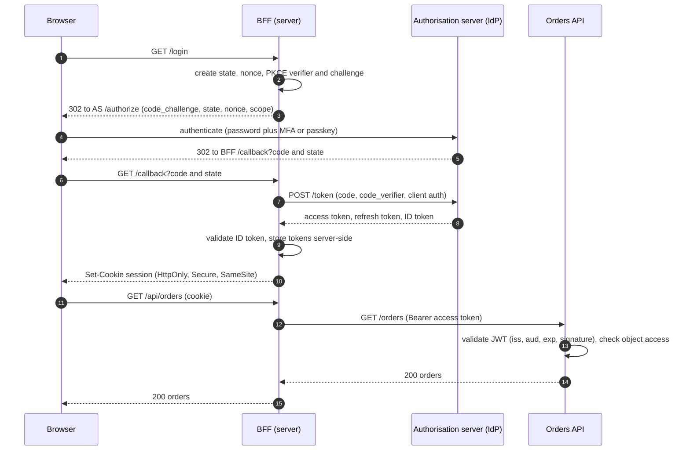

## TL;DR

- **Authentication** proves *who* you are; **authorisation** decides *what* you may do. Most breaches in APIs are authorisation failures (checking the user is logged in but not that they own the object).
- **OAuth 2.0** is a *delegated authorisation* framework (access tokens for APIs); **OpenID Connect** adds *authentication* on top (ID token, user info). Use the **authorisation code flow with PKCE** for apps; implicit and password grants are deprecated (removed in OAuth 2.1 drafts).
- **JWTs** are signed, self-contained tokens: validate signature, `iss`, `aud`, `exp` and algorithm every time; keep them short-lived; they're hard to revoke.
- For browser apps, prefer the **BFF pattern** (tokens on the server, HttpOnly secure session cookie to the browser) over storing tokens in `localStorage`.
- Model authorisation explicitly (RBAC → ABAC → relationship-based), enforce it **server-side on every request**, centralise policy where it's shared, and **buy identity** rather than build it.

## Core Concepts

### Authentication building blocks

- **Credentials:** passwords (hash with Argon2id/bcrypt/scrypt; follow NIST SP 800-63B: length over composition rules, check against breached-password lists, no forced periodic rotation), **MFA** (TOTP, push, hardware keys), and **passkeys** (WebAuthn/FIDO2 public-key credentials — phishing-resistant, increasingly the default).
- **Sessions:** server-side session id in a cookie (`HttpOnly; Secure; SameSite=Lax/Strict`), revocable instantly, simple. Great for web apps on one domain.
- **Tokens:** bearer tokens (often JWTs) sent in `Authorization: Bearer …`; suited to APIs, mobile and cross-domain calls; stateless validation but harder revocation.
- **Federation / SSO:** an identity provider (IdP: Entra ID, Okta, Auth0, Keycloak, Cognito) authenticates users; apps trust its assertions via **OIDC** or **SAML 2.0**.

### OAuth 2.0 and OpenID Connect

Roles: **resource owner** (user), **client** (app), **authorisation server** (issues tokens), **resource server** (API).

Main grants today:
- **Authorisation code + PKCE** — users signing in to web, SPA (via BFF) and mobile apps.
- **Client credentials** — machine-to-machine; no user.
- **Device authorisation grant** — TVs/CLIs without a browser.
- **Refresh tokens** — obtain new access tokens without re-login; rotate on use.
- Deprecated: implicit grant and resource owner password credentials (both dropped from OAuth 2.1, which is still an IETF Internet-Draft; the OAuth 2.0 Security Best Current Practice, RFC 9700, already advises against them).

OIDC adds the **ID token** (a JWT about the authentication event: `sub`, `iss`, `aud`, `exp`, `nonce`, `auth_time`, `amr`), a UserInfo endpoint, and discovery (`/.well-known/openid-configuration`) with signing keys (JWKS). **ID tokens are for the client; access tokens are for APIs** — never send an ID token to an API as authorisation.

### JWT validation

```ts
import { createRemoteJWKSet, jwtVerify } from 'jose';

const JWKS = createRemoteJWKSet(new URL('https://login.example.com/.well-known/jwks.json'));

export async function authenticate(authHeader?: string) {
  const token = authHeader?.match(/^Bearer (.+)$/)?.[1];
  if (!token) throw new Unauthorized();
  const { payload } = await jwtVerify(token, JWKS, {
    issuer: 'https://login.example.com/',
    audience: 'orders-api',          // token must be meant for THIS API
    algorithms: ['RS256', 'ES256'],  // pin algorithms: never accept "none" or HS/RS confusion
    clockTolerance: '30s',
  });
  return { userId: payload.sub!, scopes: String(payload.scope ?? '').split(' '), tenantId: payload.tid as string };
}
```

Pitfalls: accepting `alg: none`; algorithm confusion (RS256 public key used as HS256 secret); skipping `aud`/`iss`; long-lived tokens; putting sensitive data in the payload (it's only base64-encoded, not encrypted); trusting claims for authorisation decisions that need fresh data.

### Authorisation models

| Model | How it decides | Good for | Limits |
|---|---|---|---|
| RBAC | User has roles; roles grant permissions | Internal apps, coarse access | Role explosion; no per-object rules |
| ABAC | Policies over attributes of user, resource, action, context | Fine-grained, contextual rules (region, time, classification) | Policies get complex; needs attribute data at decision time |
| ReBAC | Relationships graph (user → member of → team → owner of → document) | Sharing, hierarchies, multi-tenant collaboration (Google Docs-style) | Needs a relationship store (Zanzibar-style: OpenFGA, SpiceDB) |
| Scopes (OAuth) | What the *client* may do on the user's behalf | Limiting third-party app power | Not a substitute for per-user, per-object checks |

Enforcement points: in the service (always, for object-level checks), optionally at the gateway (coarse checks: authenticated, scope present). Policy engines (OPA/Rego, AWS Cedar, OpenFGA) let you express and test policy separately from code.

```ts
// Object-level authorisation — the check most often missing (OWASP API1: BOLA)
const order = await orders.get(orderId);
if (order.tenantId !== ctx.tenantId || !(await can(ctx.user, 'read', order))) throw new NotFound(); // 404 hides existence
```

### Worked example: refresh-token rotation with reuse detection

Every refresh returns a new refresh token and marks the old one used. If a used token ever comes back, someone has a copy, so the whole chain of tokens from that login (the *family*) is revoked:

```sql
CREATE TABLE refresh_tokens (
  token_hash bytea       PRIMARY KEY,   -- store a hash, never the token itself
  family_id  uuid        NOT NULL,      -- every token descended from one sign-in
  user_id    uuid        NOT NULL,
  expires_at timestamptz NOT NULL,      -- absolute limit, inherited by each rotated token
  used_at    timestamptz,
  revoked_at timestamptz
);
```

```ts
export async function refresh(presented: string) {
  return db.transaction(async (tx) => {
    const { rows: [t] } = await tx.query(
      'SELECT * FROM refresh_tokens WHERE token_hash = $1 FOR UPDATE',
      [sha256(presented)],
    );
    if (!t || t.revoked_at || t.expires_at < new Date()) throw new Unauthorized();

    if (t.used_at) {
      // A token that was already exchanged has come back: assume it was stolen.
      await tx.query(
        'UPDATE refresh_tokens SET revoked_at = now() WHERE family_id = $1 AND revoked_at IS NULL',
        [t.family_id],
      );
      await audit('refresh_token_reuse', { userId: t.user_id, familyId: t.family_id });
      throw new Unauthorized();
    }

    await tx.query('UPDATE refresh_tokens SET used_at = now() WHERE token_hash = $1', [t.token_hash]);
    const next = randomToken(32);
    await tx.query(
      'INSERT INTO refresh_tokens (token_hash, family_id, user_id, expires_at) VALUES ($1, $2, $3, $4)',
      [sha256(next), t.family_id, t.user_id, t.expires_at],
    );
    return { accessToken: await mintAccessToken(t.user_id), refreshToken: next };
  });
}
```

How it plays out when an attacker copies a token:

| Event | Result |
|---|---|
| The user signs in | R1 is issued in family F |
| Malware copies R1 from the device | — |
| The app refreshes with R1 | R1 is marked used, and R2 is issued |
| The attacker presents R1 | R1 is already used, so family F is revoked, including R2 |
| The app presents R2 | Rejected. The user signs in again, and the reuse is in the audit log |

Whoever uses the stolen token second, the attacker or the user, triggers the revocation. One refinement: a mobile app that retries a refresh after a dropped response will present R1 twice legitimately. Managed identity providers handle this with a short reuse interval or grace period, during which the same R1 returns the same R2 instead of revoking the family.

### Service-to-service identity

- **mTLS** with workload identities (service mesh, SPIFFE/SPIRE) proves which service is calling.
- **Client credentials tokens** with audience-restricted scopes for calls across trust boundaries.
- **Token exchange** (RFC 8693) or propagating the end-user context so downstream services can authorise on behalf of the user.
- Cloud workload identity (managed identities, IAM roles for service accounts, workload identity federation) instead of long-lived secrets.

## How It Works

Authorisation code flow with PKCE through a BFF:



PKCE binds the code to the client that started the flow (the attacker can't redeem a stolen code without the verifier); `state` protects against CSRF on the callback; `nonce` binds the ID token to the request.

## When to Use / Trade-offs

| Choice | Use when | Avoid when | Trade-off |
|---|---|---|---|
| Server sessions (cookie) | Web app and API on the same site | Many APIs across domains, mobile-only | Instant revocation, simple; needs session store |
| JWT access tokens | APIs, microservices, mobile | You need instant revocation of every token | Stateless validation; revocation lag = token lifetime |
| Opaque tokens + introspection | High-security APIs needing revocation | Very high-volume, latency-sensitive paths | Central check per request (cacheable) |
| BFF for SPAs | Browser apps calling APIs | Pure server-rendered apps (already have sessions) | Extra component; best token security in browsers |
| Tokens in browser storage | Rarely; low-risk apps | Anything sensitive | XSS can steal tokens |
| Managed IdP (buy) | Almost always | Extreme sovereignty constraints (then self-host Keycloak) | Cost and lock-in vs security and features |
| RBAC | Simple, internal | Per-object sharing | Simple vs coarse |
| ReBAC (Zanzibar-style) | Sharing, hierarchies, multi-tenant collaboration | Simple apps | Expressive vs new infrastructure |

## Common Pitfalls & Anti-patterns

- **Broken object-level authorisation (BOLA/IDOR)** — checking authentication but not ownership: `/invoices/123` returns anyone's invoice.
- **Trusting the client** — hiding buttons in the UI as "authorisation"; role or tenant id taken from the request body.
- **Rolling your own crypto or auth protocol** — custom token formats, homegrown password hashing.
- **Long-lived JWTs with no revocation strategy** — a leaked token valid for 30 days.
- **Not validating `aud`** — a token for one API accepted by another.
- **Tokens in localStorage** — any XSS exfiltrates them.
- **Sending ID tokens to APIs** — mixing authentication proof with API authorisation.
- **Role explosion** — 400 roles nobody understands; hard-coded role checks scattered across code.
- **Shared service accounts with static secrets** — no attribution, painful rotation.
- **Missing rate limits on login/OTP endpoints** — credential stuffing and OTP brute force.

## Real-world Scenario

**Context:** A B2B SaaS company (900 business customers) had built its own auth: password login, JWTs signed with one shared HS256 secret used by 14 services, 24-hour token lifetime, roles stored in the token. A penetration test found that changing the `tenantId` in a request body returned another tenant's data in three endpoints, and the HS256 secret was present in several services' config — any of them could mint admin tokens.

**Decision:** Moved authentication to a managed IdP with OIDC (enterprise customers got SAML/OIDC SSO and SCIM provisioning); access tokens became RS256/ES256 with 10-minute lifetimes, audience per API and JWKS rotation; the web app moved to a BFF with HttpOnly cookies. Authorisation: tenant id taken **only** from the validated token; an authorisation library enforcing tenant scoping in the data-access layer (plus PostgreSQL row-level security as defence in depth); permissions moved from hard-coded role checks to a central policy (OPA) with unit-tested rules.

**Outcome:** The IDOR class was eliminated (automated tests per endpoint verify cross-tenant access fails); enterprise SSO unlocked several large deals; incident response for compromised accounts went from "rotate the global secret" to revoking sessions in the IdP.

**What I'd do differently:** Add cross-tenant authorisation tests to CI from the first endpoint, and never let a symmetric signing secret leave the issuer.

## Interview Questions

### What's the difference between authentication and authorisation? {#authn-vs-authz}

**Level:** Foundation

**Model answer:**
- **Authentication (authn):** verifying identity — "you are user 123", via passwords, passkeys, MFA, SSO. Result: an authenticated principal (user or service).
- **Authorisation (authz):** deciding whether that principal may perform an action on a resource — "user 123 may read invoice 456 but not delete it".

They fail differently: authentication failures return **401** (who are you?); authorisation failures return **403** (or 404 to avoid revealing existence). In APIs, authorisation bugs are the bigger risk — the OWASP API Security Top 10 is led by broken object-level authorisation, where the user is logged in but can access objects that aren't theirs.

**What the interviewer is looking for:**
Clear distinction, status codes, and awareness that authorisation flaws dominate.

**Follow-ups:**
- Where in your code should authorisation checks live?
- Is OAuth authentication or authorisation?

**Red flags:**
- Using the terms interchangeably.
- Assuming that if a user is logged in, they can access what they request.

### Sessions or tokens: how do you choose? {#sessions-vs-tokens}

**Level:** Foundation

**Model answer:**
- **Server-side sessions:** the server stores session state; the browser holds an opaque id in a `HttpOnly; Secure; SameSite` cookie. Pros: instant revocation (delete the session), small cookie, no token exposure to JavaScript. Cons: needs a shared session store at scale; cookies are tied to domains; CSRF must be considered (SameSite + CSRF tokens for state-changing requests).
- **Tokens (e.g. JWT access tokens):** self-contained, validated without a lookup. Pros: work across domains, mobile and service-to-service; scale without shared state. Cons: revocation is hard until expiry; must be stored safely on clients; larger.

Common pattern: **sessions between browser and your backend (BFF)**, **tokens between backend and APIs**. Mobile apps use tokens stored in the OS secure storage (Keychain/Keystore) with refresh token rotation.

**What the interviewer is looking for:**
Trade-offs on revocation, storage, scale and domains, and the hybrid BFF pattern.

**Follow-ups:**
- How do you protect cookie-based sessions against CSRF?
- How would you log a user out everywhere with JWTs?

**Red flags:**
- "JWTs are always better because they're stateless."
- Ignoring CSRF with cookies.

### What is a JWT and how must an API validate it? {#jwt-validation}

**Level:** Foundation

**Model answer:**
A JSON Web Token is `header.payload.signature`, base64url-encoded: claims (issuer, subject, audience, expiry, scopes…) signed by the issuer (JWS). Anyone can read the claims; only the issuer can produce a valid signature.

Validation on every request:
1. **Signature** with the issuer's public key from its JWKS (cached, with rotation by `kid`).
2. **Algorithm pinned** to what you expect (e.g. RS256/ES256) — reject `none` and prevent HS/RS confusion.
3. **`iss`** matches your trusted issuer.
4. **`aud`** includes *this* API.
5. **`exp`** (and `nbf`) with small clock skew.
6. Then authorise using scopes/claims plus your own checks on the resource.

Use a well-maintained library. Keep tokens short-lived (minutes), don't put secrets or sensitive personal data in them, and remember revocation is limited to expiry unless you add introspection or deny lists.

**What the interviewer is looking for:**
Structure, the full validation checklist (especially `aud` and algorithm pinning), and the readability/revocation caveats.

**Follow-ups:**
- What is the `kid` header for?
- How would you revoke a stolen JWT?

**Red flags:**
- Decoding without verifying.
- "JWTs are encrypted."

### What's the difference between OAuth 2.0 and OpenID Connect? {#oauth-vs-oidc}

**Level:** Foundation

**Model answer:**
- **OAuth 2.0** is a framework for **delegated authorisation**: a client obtains an **access token** to call an API on a user's behalf (or its own, with client credentials), limited by scopes. It doesn't define how to identify the user to the client — an access token is meant for the API, not as proof of who logged in.
- **OpenID Connect (OIDC)** is an **identity layer on top of OAuth 2.0**: it adds the **ID token** (a signed JWT about the authentication: who, when, how), the `openid` scope, a UserInfo endpoint, discovery and standard claims. It's what you use for "Sign in with…" and SSO.

So: OIDC for logging users in to your app; OAuth access tokens for calling APIs. SAML 2.0 is an older XML-based federation protocol still common for enterprise SSO.

**What the interviewer is looking for:**
Authorisation vs authentication layer, ID token vs access token, and where SAML fits.

**Follow-ups:**
- Why shouldn't an API accept ID tokens?
- What is the `nonce` in OIDC for?

**Red flags:**
- "OAuth is a login protocol."
- Using access tokens to establish identity in the client.

### Walk through the authorisation code flow with PKCE. Why is PKCE needed? {#auth-code-pkce}

**Level:** Senior

**Model answer:**
1. Client creates a random **code verifier** and its SHA-256 **code challenge**, plus `state` (CSRF) and `nonce` (for OIDC).
2. Redirects the user to the authorisation server's `/authorize` with `response_type=code`, `client_id`, `redirect_uri`, scopes, `code_challenge`, `state`.
3. User authenticates and consents.
4. AS redirects back to `redirect_uri` with a short-lived, single-use **authorisation code** and `state`.
5. Client verifies `state`, then calls `/token` with the code and the **code verifier** (plus client authentication if it's confidential).
6. AS checks the verifier hashes to the challenge, then issues access token (and refresh/ID tokens).

**Why PKCE:** authorisation codes can be intercepted (malicious apps registering the same custom URL scheme on mobile, logs, browser history, referrers). Without PKCE, an attacker with the code could exchange it. PKCE ensures only the party that started the flow (holding the verifier) can redeem the code. It's required for public clients and recommended for all clients (and mandatory in OAuth 2.1 drafts).

**What the interviewer is looking for:**
Correct sequence, state/nonce/PKCE roles, and the interception threat.

**Follow-ups:**
- Why must redirect URIs be exactly registered?
- How does the device code flow differ?

**Red flags:**
- Recommending the implicit flow for SPAs.
- Confusing `state` and PKCE.

### Where should a single-page app keep its tokens? {#spa-token-storage}

**Level:** Senior

**Model answer:**
- **`localStorage`/`sessionStorage`:** readable by any JavaScript on the origin — a single XSS (including via a compromised third-party script) can steal tokens and use them elsewhere. Avoid for anything sensitive.
- **In-memory only:** safer against theft at rest, but XSS can still use tokens while the page is open; lost on reload (needs silent renew via iframes, increasingly broken by third-party cookie restrictions).
- **Backend-for-Frontend (recommended):** the SPA talks to its own backend on the same site; the BFF performs the OAuth flow as a confidential client, stores tokens server-side, and gives the browser an `HttpOnly; Secure; SameSite` session cookie. The BFF attaches access tokens when proxying API calls. Tokens never reach JavaScript; add CSRF protection (SameSite plus anti-CSRF header/token for state-changing requests).

Defence in depth regardless: strict Content Security Policy, dependency hygiene, short token lifetimes, refresh token rotation, and (where supported) sender-constrained tokens (DPoP, mTLS).

**What the interviewer is looking for:**
XSS risk of browser storage, the BFF pattern with cookie security and CSRF, plus defence in depth.

**Follow-ups:**
- What does DPoP do?
- How does the BFF handle token refresh?

**Red flags:**
- "localStorage is fine because we sanitise input."
- Ignoring CSRF when moving to cookies.

### How do refresh tokens work, and how do you handle revocation? {#refresh-tokens}

**Level:** Senior

**Model answer:**
Access tokens are short-lived (5–15 min) to limit damage if stolen; **refresh tokens** (longer-lived, held by the client) obtain new access tokens without re-authentication.

Securing them:
- **Rotation:** every refresh returns a new refresh token and invalidates the old; **reuse detection** — if an old refresh token is presented again, assume theft and revoke the whole token family.
- **Binding:** confidential clients authenticate when refreshing; sender-constrained tokens (DPoP/mTLS) bind tokens to a key.
- **Lifetimes:** absolute maximum lifetime and idle timeout; re-authentication for sensitive actions (step-up).

Revocation strategies:
- Revoke refresh tokens/sessions at the IdP (logout, password reset, admin action) — new access tokens stop within one access-token lifetime.
- For immediate cut-off: **opaque tokens + introspection** (with short caching), or a **deny list** of token ids (`jti`) / a per-user "tokens issued before X are invalid" timestamp checked by APIs.
- Push revocation events (e.g. OpenID Shared Signals / CAEP) to resource servers where supported (the Shared Signals Framework, CAEP and RISC became final OpenID specifications in September 2025, but vendor support still varies).

**What the interviewer is looking for:**
Rotation with reuse detection, lifetimes, binding, and realistic revocation options with their trade-offs.

**Follow-ups:**
- A user's laptop is stolen. What happens to their sessions?
- What's the cost of introspection per request, and how do you mitigate it?

**Red flags:**
- Long-lived access tokens with no refresh strategy.
- Refresh tokens stored in localStorage.

### Compare RBAC, ABAC and relationship-based access control. {#authorisation-models}

**Level:** Senior

**Model answer:**
- **RBAC:** users get roles, roles grant permissions (`Editor` → `article:update`). Simple, auditable, fits organisations. Breaks down with per-object rules ("editors can only edit articles in their section") → role explosion (`Editor-Sports`, `Editor-Politics`…).
- **ABAC:** policies evaluate attributes of subject, resource, action and environment: `allow update if user.department == article.section and article.status != 'published' and time within business hours`. Fine-grained and contextual; policies can get complex and need the attributes at decision time.
- **ReBAC:** permissions derive from relationships in a graph: user → member of → team → editor of → folder → parent of → document. Natural for sharing, hierarchies and multi-tenant collaboration. Google's **Zanzibar** paper inspired OpenFGA, SpiceDB and others.

Practical systems combine them: roles for coarse capabilities, relationships for ownership/sharing, attributes for context (region, data classification). Implement via a policy engine or authorisation service with tests, decision logging and explainability ("why was this denied?").

**What the interviewer is looking for:**
Clear definitions, where each breaks down, and combining models with proper tooling.

**Follow-ups:**
- How would you model "share a document with a team, with view-only access"?
- How do you audit who has access to what?

**Red flags:**
- Hard-coded `if (user.role === 'admin')` checks everywhere as the strategy.
- Not knowing ReBAC exists for sharing scenarios.

### How should services authenticate and authorise calls to each other? {#service-to-service-auth}

**Level:** Senior

**Model answer:**
- **Workload identity, not shared secrets:** each service has its own identity — mTLS certificates issued automatically (service mesh, SPIFFE/SPIRE) or cloud workload identity (managed identities, IAM roles for service accounts). No long-lived passwords or API keys in config.
- **Authenticate the caller:** mTLS proves which service is calling; or the caller presents an OAuth **client credentials** token with an audience for the target API.
- **Authorise the call:** allow-lists per service and operation (mesh authorisation policies, scopes), least privilege — the reporting service can read orders, not refund them.
- **Propagate user context when acting on behalf of a user:** pass the user's token or use **token exchange** (RFC 8693) to obtain a downscoped token for the downstream audience, so the downstream service can enforce user-level authorisation instead of trusting the caller blindly ("confused deputy").
- **Zero trust:** don't trust the network; every hop authenticated and authorised, encrypted in transit; audit logs per call.

**What the interviewer is looking for:**
Workload identity, mTLS/client credentials, least privilege, user-context propagation and the confused-deputy risk.

**Follow-ups:**
- What is the confused deputy problem?
- How do you rotate service credentials without downtime?

**Red flags:**
- "Internal network, so no auth needed."
- One shared API key for all services.

### How should you store passwords, and where do MFA and passkeys fit? {#passwords-mfa-passkeys}

**Level:** Senior

**Model answer:**
**Passwords (if you must store them — prefer an IdP):**
- Hash with a slow, salted, memory-hard algorithm: **Argon2id** (preferred), scrypt or bcrypt, with tuned parameters; never SHA-256 alone, never encryption.
- Follow NIST SP 800-63B: a minimum of 15 characters when the password is the only factor (8 when it's one factor of MFA), allow at least 64, no arbitrary composition rules or forced periodic changes, **check against known-breached passwords**, rate-limit and lock out intelligently against credential stuffing.

**MFA:**
- Adds a second factor; strengths vary: SMS (weak: SIM swap, interception) < TOTP apps < push with number matching < **phishing-resistant** factors (FIDO2 security keys, passkeys).
- Enforce for admins and sensitive actions; step-up authentication for risky operations.

**Passkeys (WebAuthn/FIDO2):**
- Public-key credentials bound to the site's origin; the private key stays on the device or syncs via the platform's keychain. Phishing-resistant (the browser won't use a credential on the wrong domain), no shared secret to leak from your database, and better UX.
- Plan for account recovery carefully — the recovery path is often the weakest link.

**What the interviewer is looking for:**
Correct hashing, modern password policy, MFA strength ordering, passkeys' phishing resistance, and recovery as the weak point.

**Follow-ups:**
- How would you migrate existing bcrypt hashes to Argon2id?
- How do you design account recovery securely?

**Red flags:**
- MD5/SHA-1 or unsalted hashes.
- Treating SMS OTP as strong MFA.

### Design authorisation for a multi-tenant B2B SaaS platform. {#multi-tenant-authz}

**Level:** Architect

**Model answer:**
**Tenant isolation first:**
- Tenant id comes **only from the authenticated context** (token claim or session), never from request parameters.
- Enforce tenant scoping in the data-access layer (every query filtered automatically) plus **defence in depth**: PostgreSQL row-level security, per-tenant encryption keys for sensitive data, or separate databases for high-tier tenants.
- Automated tests per endpoint asserting cross-tenant access fails.

**Within a tenant:**
- Tenant admins manage users and roles; roles map to permissions (RBAC) for common cases; **relationship-based** rules for resource sharing (projects, folders, teams); attributes for context (data classification, region).
- A central **authorisation service or library** with a policy engine (OPA, Cedar, OpenFGA), so rules are consistent across services, testable and auditable; services call `check(user, action, resource)`.
- Custom roles for enterprise customers, with permission sets as the building block.

**Platform-level access:**
- Support/operations staff access to tenant data via just-in-time, audited, customer-consented access ("break glass"), never standing admin rights.

**Enterprise needs:**
- SSO per tenant (OIDC/SAML), SCIM provisioning/deprovisioning, audit logs exportable by tenant admins, IP allow-lists.

**Performance:** cache decisions briefly; batch checks for list endpoints (filter queries by permitted resources rather than checking each row after fetching).

**What the interviewer is looking for:**
Tenant isolation as non-negotiable with layered enforcement, a central policy model mixing RBAC/ReBAC/ABAC, audited internal access and enterprise identity features.

**Follow-ups:**
- How would you implement "list all documents I can see" efficiently?
- How do you handle a user who belongs to multiple tenants?

**Red flags:**
- Tenant id from a query parameter or request body.
- Support staff with permanent access to all tenants.

### How do you support enterprise SSO and user provisioning for B2B customers? {#enterprise-sso}

**Level:** Architect

**Model answer:**
- **Protocols:** support **OIDC** and **SAML 2.0** (many enterprises still use SAML), configured per tenant: the customer's IdP (Entra ID, Okta, Ping…) authenticates; your platform trusts it for that tenant's users.
- **Home realm discovery:** route users to the right IdP by email domain or tenant-specific login URL; verify domain ownership before enabling.
- **Just-in-time provisioning** on first login, mapping IdP claims/groups to your roles.
- **SCIM 2.0** for automated provisioning and, crucially, **deprovisioning** — when someone leaves the customer, access is removed promptly.
- **Policy controls for tenant admins:** enforce SSO-only (no password login), session lifetimes, MFA requirements delegated to their IdP, IP allow-lists.
- **Security details:** validate SAML signatures and assertions strictly (XML signature wrapping attacks are a classic bug class), handle certificate rotation, protect against account takeover when a user exists both locally and via SSO (link accounts deliberately).
- **Build vs buy:** use a managed IdP or identity broker that supports multi-tenant enterprise SSO (Auth0/Okta organisations, Entra External ID, WorkOS, Keycloak) — implementing SAML yourself is a known source of vulnerabilities.

**What the interviewer is looking for:**
OIDC and SAML per tenant, discovery, JIT and SCIM (especially deprovisioning), admin controls, security pitfalls and buying the capability.

**Follow-ups:**
- What happens to active sessions when SCIM deprovisions a user?
- How would you migrate a tenant from passwords to SSO?

**Red flags:**
- Hand-rolled SAML parsing.
- No deprovisioning story.

### Design a central authorisation service for 80 microservices. {#authorisation-service}

**Level:** Architect

**Model answer:**
**Why central:** consistent rules, auditability, and one place to model sharing and hierarchies — but it must not become a latency or availability bottleneck.

**Architecture:**
- **Policy and data:** policies as code (OPA/Rego, Cedar, or a ReBAC schema in OpenFGA/SpiceDB) in Git with tests and review; relationship and attribute data kept in sync from domain services via events (e.g. `ProjectMemberAdded`).
- **Decision API:** `check(subject, action, resource, context)` and **list/filter** APIs (`which documents can user X read?`) for efficient list endpoints.
- **Deployment for latency and availability:** decision points close to services — sidecars or embedded libraries evaluating locally with replicated policy/data (OPA bundles), or a highly available regional service with caching; target low single-digit ms p99.
- **Consistency:** Zanzibar's "zookies"/consistency tokens address the new-enemy problem (a revoked permission shouldn't be bypassed by a stale cache when accessing newer content); define consistency requirements per use case.
- **Failure mode:** fail closed for sensitive actions; degrade gracefully (cached decisions with short TTL) for low-risk reads.
- **Operability:** decision logs (who, what, decision, policy version) for audit; explain API for debugging denials; shadow mode when changing policies (evaluate new policy, compare decisions, before enforcing).
- **Adoption:** SDKs and middleware for services; migrate endpoint by endpoint, keeping coarse checks at the gateway.

**What the interviewer is looking for:**
Policy-as-code, data synchronisation, check and list APIs, latency/availability design, consistency awareness, fail-closed choices, auditability and safe rollout.

**Follow-ups:**
- How do you keep relationship data in sync and correct?
- How would you test a policy change across 80 services?

**Red flags:**
- A synchronous central call on every request with no caching or HA design.
- Policies scattered back into service code "for performance".

### How would you migrate from an in-house authentication system to a managed identity provider? {#idp-migration}

**Level:** Architect

**Model answer:**
1. **Inventory:** applications and APIs relying on current auth, token formats and consumers, user store (hash algorithms), MFA methods, integrations (SSO, API keys), and edge cases (service accounts, legacy clients).
2. **Choose the IdP** on requirements: protocols (OIDC, SAML), B2B/B2C features, MFA/passkeys, customisation of login UX, data residency, SLAs, pricing at your user scale, migration tooling.
3. **User migration strategy:**
   - **Bulk import** of users with existing password hashes if the IdP supports your algorithm (bcrypt usually is), or
   - **Lazy migration:** on login, the IdP calls your legacy system to verify the password once, then stores it natively; run until most active users have migrated, then force resets for the rest.
   - Re-enrol MFA or migrate TOTP secrets securely where supported.
4. **Token compatibility:** introduce new tokens with audiences per API; APIs accept both old and new issuers during transition (dual validation), then remove the old.
5. **Application migration:** one app at a time to OIDC (BFFs for SPAs), with feature flags and rollback.
6. **Cut-over hygiene:** session handling during the switch, communication to users, support runbooks, monitoring login success rates and errors by client.
7. **Decommission:** remove the legacy user store and signing keys; rotate anything that was shared.

**What the interviewer is looking for:**
Inventory, IdP selection criteria, user and credential migration options (lazy migration), dual-token transition, incremental app migration and decommissioning.

**Follow-ups:**
- How do you handle users who never log in during the migration window?
- What metrics tell you the migration is going well?

**Red flags:**
- A big-bang switch forcing all users to reset passwords.
- No plan for API token compatibility.

### What does "zero trust" mean in practice, and how would you move an organisation towards it? {#zero-trust}

**Level:** Architect

**Model answer:**
Zero trust replaces "trusted internal network" with **explicit verification of every access request**, based on identity, device and context, with least privilege and continuous evaluation (NIST SP 800-207 describes the model).

In practice:
- **Strong identity for users and workloads:** SSO with phishing-resistant MFA; workload identities (mTLS, cloud identities) for services.
- **Device posture:** access depends on managed, compliant devices (patched, encrypted).
- **Per-request authorisation** at application level, not network location: identity-aware proxies for internal apps (instead of VPN-to-everything), service mesh policies between services.
- **Least privilege and just-in-time access:** no standing admin rights; time-bound elevation with approval and audit.
- **Micro-segmentation:** limit lateral movement; default-deny network policies.
- **Continuous monitoring:** logs, anomaly detection, session re-evaluation when risk changes.

Roadmap: start with identity (SSO + MFA everywhere, retire shared accounts) → privileged access management (JIT admin) → identity-aware proxy for internal tools (replace VPN for most use) → workload identity and mTLS in the platform → segmentation and device posture. Measure: share of apps behind SSO, standing admin accounts, VPN usage, time to revoke access.

**What the interviewer is looking for:**
Core principles, concrete controls for users, devices, services and networks, and a phased roadmap with measures.

**Follow-ups:**
- Is a service mesh enough for zero trust?
- How do you handle legacy apps that can't do SSO?

**Red flags:**
- Zero trust as a product you buy.
- Treating it as purely a network project.

### What are OAuth scopes, and how do they differ from permissions? {#scopes-vs-permissions}

**Level:** Foundation

**Model answer:**
A **scope** limits what a **client application** may do on the user's behalf. A **permission** says what the **user** may do. An API needs both checks, and the effective access is the intersection.

For example, a calendar app asks for `calendar.read`. The user consents, and the access token carries that scope. The app can now read calendars, but only those the *user* is allowed to see. And even though the user could delete events, the app can't, because it was never granted `calendar.write`.

Design guidance:
- **Name scopes by resource and action** (`orders.read`, `orders.write`), coarse enough that users understand the consent screen.
- **Keep per-object decisions out of scopes.** "Can read order 42" depends on ownership and roles, checked in the API against current data. Packing every permission into the token makes tokens large and stale.
- **Request the least.** Clients ask for the scopes they need now, and request more later (incremental consent) when a feature needs them.
- **Check scopes in the API** on every request, typically in middleware, and then do the object-level check.

For first-party apps, scopes matter less, because the client is trusted. For third-party integrations, they are the main limit on what a compromised or over-eager app can do.

**What the interviewer is looking for:**
Scopes limit the client, permissions limit the user, and both are checked, with object-level checks kept out of the token.

**Follow-ups:**
- How would you design scopes for a public API with 40 resources?
- Should roles be put into access tokens?

**Red flags:**
- Treating the `admin` scope as proof the user is an administrator.
- Authorising only on scopes, with no per-object check.

### What are sender-constrained tokens (DPoP, mutual TLS), and when are they worth it? {#sender-constrained-tokens}

**Level:** Senior

**Model answer:**
A normal access token is a **bearer** token: whoever holds it can use it. If it leaks through logs, a compromised proxy or malware, the attacker can replay it until it expires. A **sender-constrained** token is bound to a key the legitimate client holds, so a stolen token alone is useless.

- **DPoP** (RFC 9449). The client generates a key pair and proves possession on every request with a `DPoP` header: a short JWT signed with its private key, covering the HTTP method, the URL, a timestamp and (for resource requests) a hash of the access token. The authorisation server binds the token to the public key's thumbprint (the `cnf.jkt` claim). The API checks the proof's signature, method, URL and freshness, and that the key matches the token. It works at the application layer, so it suits browsers and mobile apps.
- **Mutual TLS-bound tokens** (RFC 8705). The token is bound to the client's TLS certificate (`cnf.x5t#S256`), and the API checks that the connection presented that certificate. It's strong and simple for server-to-server calls where you already manage certificates, and awkward for browsers.

When it's worth it: high-value APIs (payments, open banking, health data), long-lived refresh tokens on public clients, and regulated profiles that require it (FAPI 2.0). The costs are client complexity, replay caches for proof ids (`jti`), clock tolerance, and support across your identity provider and API gateway.

For a typical first-party web app behind a BFF, tokens never reach the browser, so DPoP adds less. Short lifetimes and refresh rotation already limit the damage.

**What the interviewer is looking for:**
The bearer-token replay problem, how proof of possession works in DPoP and mTLS, and where each fits.

**Follow-ups:**
- Why does a DPoP proof include the HTTP method and URL?
- How does DPoP interact with a CDN or proxy that rewrites URLs?

**Red flags:**
- "Use HTTPS, so tokens can't be stolen."
- Thinking DPoP encrypts the token.

### How do you require a stronger sign-in for sensitive actions such as changing payout details? {#step-up-auth}

**Level:** Senior

**Model answer:**
Use **step-up authentication**: a normal session is enough for everyday use, but sensitive actions require a recent, strong authentication.

1. **Define the requirement per action.** For example, changing bank details needs a phishing-resistant factor (a passkey or security key) within the last 5 minutes.
2. **Express it in OIDC.** Send the user back to the identity provider with `acr_values` (the required level, such as a phishing-resistant MFA profile) and `max_age=300`. The new ID token or access token carries `acr` (the level achieved), `amr` (the methods used) and `auth_time`.
3. **Check it on the server, in the API that performs the action.** Reject the request if `acr` is too low or `auth_time` is too old. Hiding a button in the UI isn't enforcement.
4. **Tell the client what's missing.** RFC 9470 standardises the API response: `401` with `WWW-Authenticate: Bearer error="insufficient_user_authentication", acr_values="…", max_age=300`. The client starts the step-up flow and retries.
5. **Keep it short-lived.** The elevated state should expire quickly, or be bound to the single action (a transaction-scoped token) so it can't be reused for other sensitive operations.

Add **notifications** ("your payout details were changed") and a **cooling-off period** for the riskiest changes, such as delaying the first payout to new bank details. These catch the cases where the attacker passed the step-up anyway.

**What the interviewer is looking for:**
Per-action requirements, `acr`, `amr` and `auth_time` checked server-side, the standard challenge response, and compensating controls.

**Follow-ups:**
- What would you do for users who have no strong factor enrolled?
- How does step-up work for an API used by a machine, not a person?

**Red flags:**
- Re-entering the same password as the only step-up.
- Checking the requirement only in the frontend.

### Design API keys for a developer platform. {#api-key-design}

**Level:** Architect

**Model answer:**
API keys are long-lived secrets, so design for the day one leaks.

**Format:**
- A recognisable prefix plus enough randomness: `sk_live_` followed by 32+ random bytes, base62-encoded. The prefix tells people (and secret scanners) what it is and which environment it belongs to. A checksum suffix lets scanners reject random strings without calling you.
- A separate public **key id** for logs and dashboards, so the secret never needs to be shown again.

**Storage and issuance:**
- **Show the secret once**, at creation. Store only a hash. A fast hash such as SHA-256 is fine here, because the key is random and long, unlike a password.
- Scope each key: specific permissions, environment (test or live), optional IP allow-lists, an owner (a person or a service account), and an optional expiry.

**Lifecycle:**
- **Rotation without downtime.** Allow two active keys per integration, so customers can deploy the new one before revoking the old.
- **Last-used timestamp and source IP** shown in the dashboard, so unused keys get noticed and revoked.
- **Revocation** takes effect within seconds, which is easy because every request looks up the key's hash.

**Leak response:**
- Join secret-scanning programmes (GitHub's secret scanning partner programme, for example), so keys pushed to public repositories are reported to you, and revoke or notify automatically.
- Alert on anomalies: a key suddenly used from a new country, or at 50 times its normal rate.

**When not to use API keys:** for user-delegated access (use OAuth), and for server-to-server calls inside your own cloud (use workload identity). For high-value integrations, offer OAuth client credentials, where tokens are short-lived.

**What the interviewer is looking for:**
Identifiable prefixes, hashed storage with show-once, scoping, rotation with overlap, usage visibility and automated leak response.

**Follow-ups:**
- Why is SHA-256 acceptable for API keys but not for passwords?
- How do you migrate customers from unscoped keys to scoped ones?

**Red flags:**
- Storing keys in plain text, or showing them again in the dashboard.
- One key per account with no way to rotate it without downtime.

### Design account recovery that doesn't become the weakest link. {#account-recovery}

**Level:** Architect

**Model answer:**
Attackers go for whichever way into an account is easiest. If you deploy passkeys but let anyone reset access with an email link and a support call, the recovery path *is* your security level.

**Prevent the need:**
- Encourage **several strong authenticators**: more than one passkey (synced passkeys survive a lost phone), plus a hardware key for high-value accounts.
- Offer **recovery codes** at enrolment, stored hashed and usable once.

**When recovery is needed, scale the checks to the risk:**
- **Low-risk accounts:** an email link that expires quickly and works once, plus a check that the request comes from a device or location seen before.
- **High-value accounts** (admins, accounts holding money): recovery codes, or identity verification (document plus liveness check), or for business users, a reset approved by the organisation's own administrator through its identity provider.

**Contain the damage of a fraudulent recovery:**
- **Notify every existing channel** (email, push, SMS) that recovery started, with a one-click "this wasn't me".
- **Delay** the recovery of high-value accounts (for example 24 hours) unless it is confirmed from an existing device.
- **Restrict new sessions** after recovery: no payout changes, no new API keys and no export of data for a few days.
- **Revoke other sessions and tokens** when recovery completes.

**Support staff are part of the system:** give them scripts that never bypass the checks, require two people for manual overrides, log everything, and test them with social-engineering exercises.

**What the interviewer is looking for:**
Recovery treated as an authentication path with risk-based checks, plus notification, delays and restrictions that limit the damage of a successful attack.

**Follow-ups:**
- How do you recover an account whose only passkey was on a lost phone?
- What does the support desk do when a caller is very convincing?

**Red flags:**
- SMS one-time codes as the only recovery for a high-value account.
- Support staff who can disable MFA on request.

## Cheat Sheet

### Concepts
- **Authn vs authz** — who you are (401) vs what you may do (403/404).
- **BOLA / IDOR** — authenticated but not checked for object access; the #1 API vulnerability.
- **OAuth 2.0 vs OIDC** — delegated API access (access token) vs login and identity (ID token).
- **Authorisation code + PKCE** — the standard user flow; PKCE stops intercepted codes being redeemed.
- **Client credentials** — machine-to-machine tokens with no user.
- **ID token vs access token** — ID token is for the client about login; access token is for the API.

### Tokens
- **JWT validation** — signature, pinned algorithm, `iss`, `aud`, `exp` on every request.
- **JWT payload** — signed, not encrypted; never put secrets in it.
- **Refresh token rotation** — new refresh token each use; reuse of an old one revokes the family.
- **BFF for SPAs** — tokens stay server-side; browser gets an HttpOnly, Secure, SameSite cookie.

### Credentials and models
- **Password hashing** — Argon2id (or bcrypt/scrypt), salted, tuned; check breached-password lists.
- **Passkeys** — WebAuthn public-key credentials; phishing-resistant, no shared secret.
- **RBAC / ABAC / ReBAC** — roles vs attribute policies vs relationship graph (Zanzibar-style).
- **Token exchange** — RFC 8693; downscoped tokens to call downstream services on a user's behalf.
- **Zero trust** — verify every request by identity, device and context; least privilege, no trusted network.

### Revisit

- **Refresh-token reuse** — a used refresh token presented again means a copy exists: revoke the whole family.
- **Rotation grace period** — a short window in which a retried refresh returns the same new token instead of revoking.
- **Scopes vs permissions** — scopes limit the client app, permissions limit the user; check both.
- **DPoP** — RFC 9449: the client signs a proof per request with a key bound to the token, so a stolen token alone is useless.
- **Step-up challenge** — RFC 9470: `insufficient_user_authentication` with `acr_values` and `max_age`, checked against `acr` and `auth_time`.
- **API key storage** — show it once, store a SHA-256 hash, prefix it so scanners can find leaks.
- **Recovery is authentication** — notify existing channels, delay high-value recoveries, restrict new sessions.

## Further Reading

- [OAuth 2.0 (oauth.net)](https://oauth.net/2/) — index of the OAuth specifications, including PKCE, token exchange and OAuth 2.1 progress.
- [OpenID Connect Core 1.0](https://openid.net/specs/openid-connect-core-1_0.html) — the OIDC specification: ID tokens, flows and claims.
- [RFC 7636: PKCE](https://www.rfc-editor.org/rfc/rfc7636) — Proof Key for Code Exchange.
- [OWASP Authentication Cheat Sheet](https://cheatsheetseries.owasp.org/cheatsheets/Authentication_Cheat_Sheet.html) — practical guidance on login, MFA and account recovery.
- [NIST SP 800-63B: Digital Identity Guidelines](https://pages.nist.gov/800-63-4/sp800-63b.html) — authoritative password and authenticator guidance.
- [Zanzibar: Google's Consistent, Global Authorization System](https://research.google/pubs/zanzibar-googles-consistent-global-authorization-system/) — the paper behind relationship-based access control systems.
- [OWASP API Security Top 10](https://owasp.org/API-Security/) — API-specific risks, led by broken object-level authorisation.
