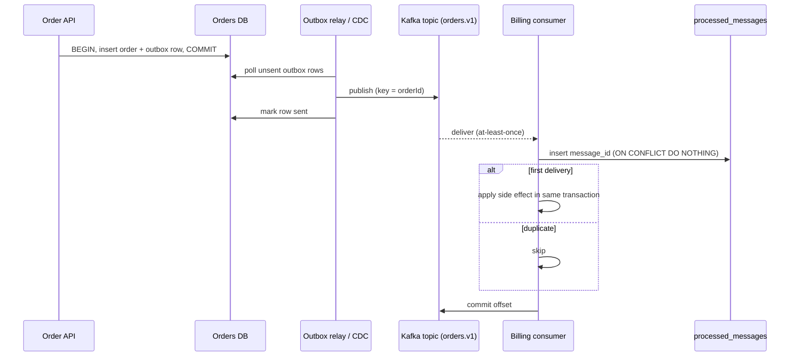

## TL;DR

- **Queues** distribute work (each message is processed by one consumer, then gone); **logs/streams** distribute facts (messages are retained and replayable, and many consumer groups read independently).
- "Exactly-once" is end-to-end only when consumers are **idempotent**. Brokers offer at-least-once delivery plus de-duplication aids, never magic.
- **Ordering is per partition/session key**, never global at scale. Choose the key to match the entity whose order matters.
- The **dual-write problem** (update DB *and* publish) is solved with the **transactional outbox** (or CDC), not with "publish after commit and hope".
- Retries, dead-letter queues, schema evolution and consumer lag monitoring are the real design work. The happy path is easy.

## Core Concepts

### Queue vs pub/sub vs log

| Model | Example | Delivery | Retention | Typical use |
|---|---|---|---|---|
| Point-to-point queue | Azure Service Bus queue, SQS, RabbitMQ queue | One consumer per message (competing consumers) | Until acknowledged | Commands, background jobs |
| Pub/sub topic | Service Bus topics + subscriptions, SNS, Event Grid | Copy per subscription | Until each subscription acknowledges | Fan-out notifications |
| Partitioned log | Kafka, Azure Event Hubs, Kinesis | Each consumer group tracks its own offset | Time/size based, replayable | Event streaming, analytics, event sourcing feeds |

A log does not delete on read. Consumers move an **offset**, so a new service can replay history and a bug can be fixed by rewinding.

### Delivery semantics

- **At-most-once:** acknowledge before processing; a crash loses the message.
- **At-least-once:** acknowledge after processing; a crash causes redelivery, so **duplicates are normal**.
- **Exactly-once:** Kafka offers exactly-once *within Kafka* (idempotent producers + transactions across read-process-write to Kafka topics). Once you touch an external DB or API, you are back to at-least-once and need idempotency.

```ts
// Idempotent consumer: record the message id in the same transaction as the side effect.
export async function handlePaymentCaptured(msg: { id: string; orderId: string; amount: number }) {
  await db.transaction(async (tx) => {
    const inserted = await tx.query(
      'INSERT INTO processed_messages (message_id) VALUES ($1) ON CONFLICT DO NOTHING RETURNING 1',
      [msg.id],
    );
    if (inserted.rowCount === 0) return; // duplicate delivery: already applied

    await tx.query('UPDATE orders SET status = $1, paid_amount = $2 WHERE id = $3', ['PAID', msg.amount, msg.orderId]);
  });
}
```

### Ordering and partitioning

Kafka guarantees order **within a partition**. Messages with the same key go to the same partition, so key by the entity whose ordering matters (`orderId`, `accountId`). Consequences:

- Parallelism is capped by partition count per consumer group.
- A hot key creates a hot partition.
- Changing the partition count changes key→partition mapping for new messages (ordering across the change is not guaranteed).

Service Bus offers ordering through **sessions** (`SessionId`); one receiver holds a session lock at a time.

### Transactional outbox

```ts
// Inside the same DB transaction as the business change:
await db.transaction(async (tx) => {
  await tx.query('INSERT INTO orders (id, status) VALUES ($1, $2)', [order.id, 'PLACED']);
  await tx.query(
    'INSERT INTO outbox (id, topic, key, payload) VALUES ($1, $2, $3, $4)',
    [crypto.randomUUID(), 'orders.v1', order.id, JSON.stringify({ type: 'OrderPlaced', orderId: order.id })],
  );
});
// A relay (poller or CDC such as Debezium) publishes outbox rows and marks them sent.
// It may publish twice after a crash — consumers must be idempotent.
```

### Retries, poison messages and DLQs

- **Transient errors** (timeouts, 503s): retry with exponential backoff and jitter.
- **Permanent errors** (validation failure, unknown entity): do not retry. Dead-letter immediately with the reason.
- Kafka has no built-in DLQ. Implement retry topics (`orders.retry.1m`, `orders.retry.10m`) and a DLQ topic, or use a framework that does.
- Service Bus dead-letters automatically after `MaxDeliveryCount`, and supports scheduled messages for delayed retry.

### Schema evolution

Producers and consumers deploy independently, so schemas must evolve compatibly. Use a schema registry with Avro, Protobuf or JSON Schema and enforce a compatibility mode (backward, forward or full). Rules of thumb: add optional fields, never reuse or repurpose fields, version the topic for breaking changes (`orders.v2`).

### Platform notes

- Kafka 4.0 removed ZooKeeper; clusters run in **KRaft** mode.
- VERIFY: Kafka "share groups" (KIP-932, queue-like consumption) were early access in 4.0 and are maturing in later releases.
- Azure Event Hubs exposes a Kafka-compatible endpoint; Service Bus is the choice for enterprise messaging features (sessions, transactions, scheduled delivery, duplicate detection).

## How It Works



## When to Use / Trade-offs

| Choice | Use when | Avoid when | Cost |
|---|---|---|---|
| Synchronous REST/gRPC | Caller needs the answer now; simple request/response | Long-running work, fan-out to many services | Temporal coupling, cascading failures |
| Queue (Service Bus, SQS) | Distributing commands/jobs, need per-message ack, DLQ, scheduling | Many independent readers, replay needed | Messages gone after ack |
| Log (Kafka, Event Hubs) | High throughput, many consumers, replay, stream processing | Small volumes with complex routing; per-message delay/priority | Operational complexity, partition design |
| Event notification (thin events) | Consumers fetch details they need | Consumers can't call back (offline, rate limits) | Extra calls, read-your-writes issues |
| Event-carried state transfer (fat events) | Consumers need autonomy and local copies | Payloads hold sensitive data many shouldn't see | Larger messages, schema coupling |

## Common Pitfalls & Anti-patterns

- **Dual writes** — committing to the DB then publishing (or the reverse) loses or invents events on crashes.
- **Assuming no duplicates** — every at-least-once system delivers duplicates eventually; non-idempotent consumers double-charge.
- **Retrying poison messages forever** — blocks a partition (Kafka) or burns compute; classify errors and dead-letter.
- **Global ordering assumptions** — designing as if all events arrive in order across keys.
- **Events as remote procedure calls** — `SendEmailToUserCommand` broadcast on a topic: this is a queue job, not an event.
- **No lag monitoring** — consumer lag is the most important health signal for streaming systems.
- **Breaking schema changes without versioning** — renaming a field takes down every consumer you didn't know about.

## Real-world Scenario

**Context:** A retailer's checkout published `OrderPlaced` to Kafka after committing the order. During a broker failover, ~0.3% of orders were never published, so the warehouse never shipped them.

**Decision:** Introduced a transactional outbox with Debezium CDC, idempotent consumers keyed on event id, and a retry/DLQ topic chain with alerting on DLQ depth. Topics were keyed by `orderId` so per-order lifecycle events stayed ordered.

**Outcome:** Zero lost orders over the next two peak seasons. Duplicate deliveries (~0.01%) were absorbed harmlessly. The DLQ surfaced a malformed-address bug within an hour instead of weeks.

**What I'd do differently:** Put a schema registry in from day one. Two later incidents were consumers breaking on an "additive" change that wasn't.

## Interview Questions

### What is the difference between a message queue and an event log like Kafka? {#queue-vs-log}

**Level:** Foundation

**Model answer:**
A queue delivers each message to one of a set of competing consumers and deletes it once acknowledged. It is ideal for distributing work. A log appends messages to partitions and retains them for a configured time. Each consumer group tracks its own offset, so many independent consumers read the same data and can replay it. Queues offer richer per-message features (DLQ, scheduling, priorities, sessions); logs offer throughput, replay and stream processing.

**What the interviewer is looking for:**
Retention vs consumption semantics, competing consumers vs consumer groups, and matching the tool to the use case.

**Follow-ups:**
- How does a Kafka consumer group scale, and what limits it?
- When would you use Azure Service Bus over Event Hubs?

**Red flags:**
- "Kafka is just a faster queue."
- Not knowing that log messages persist after consumption.

### Does exactly-once delivery exist? How do you get exactly-once *processing*? {#exactly-once}

**Level:** Senior

**Model answer:**
Over an unreliable network, delivery is at-most-once or at-least-once. Kafka's exactly-once semantics (idempotent producer + transactions) give exactly-once *within Kafka* for read-process-write pipelines. As soon as a side effect leaves Kafka (DB write, email, payment API), you need idempotency: a unique message id stored transactionally with the side effect, natural idempotency (`SET status = PAID`), or idempotency keys on downstream APIs.

**What the interviewer is looking for:**
Precision about where the guarantee holds and a concrete idempotency mechanism.

**Follow-ups:**
- How long do you keep processed message ids, and how do you clean them up?
- How do you make an email send idempotent?

**Red flags:**
- "Enable exactly-once in Kafka and you're done."
- Relying on de-duplication windows alone for financial operations.

### How do you guarantee ordering of events for a single order while still scaling consumers? {#ordering-guarantees}

**Level:** Senior

**Model answer:**
Use the order id as the partition key (Kafka) or session id (Service Bus). All events for one order land on one partition or session and are processed in sequence, while different orders spread across partitions for parallelism. Within a consumer, process a partition's messages sequentially (or parallelise per key). Watch for hot keys, and remember retries must not reorder: a failing message either blocks its key or goes to a retry path that is also keyed, with consumers tolerating out-of-order arrival using version numbers.

**What the interviewer is looking for:**
Per-key ordering, the parallelism trade-off, and awareness that retries and partition changes break naive ordering.

**Follow-ups:**
- What happens to ordering when you increase partitions?
- How would you handle one customer generating 40% of traffic?

**Red flags:**
- Claiming Kafka guarantees global ordering.
- A single partition "to be safe" for a high-volume topic.

### Explain the dual-write problem and how the transactional outbox solves it. {#outbox-pattern}

**Level:** Senior

**Model answer:**
Writing to the database and publishing to a broker are two separate systems with no shared transaction. A crash between them either loses the event (DB committed, publish failed) or emits a phantom event (published, DB rolled back). The outbox writes the event to an `outbox` table in the *same* DB transaction as the state change. A relay (poller or CDC from the transaction log) then publishes rows to the broker. The relay can publish duplicates after crashes, so consumers must be idempotent. CDC avoids polling load and preserves commit order.

**What the interviewer is looking for:**
Clear articulation of the failure modes, the pattern, and its at-least-once consequence.

**Follow-ups:**
- Polling relay vs CDC: what are the trade-offs?
- How do you keep the outbox table from growing forever?

**Red flags:**
- Suggesting distributed transactions (2PC) across DB and broker as the default.
- "Publish inside the DB transaction before commit."

### Design the retry and failure handling for an order-fulfilment consumer that calls a flaky warehouse API. {#retry-dlq-design}

**Level:** Architect

**Model answer:**
1. **Classify errors.** Transient (timeouts, 429, 5xx) vs permanent (400 validation, unknown SKU).
2. **Bounded in-process retries** with exponential backoff and jitter for brief blips, using an idempotency key on the warehouse call.
3. **Delayed retry tiers.** For Kafka, retry topics (1m, 10m, 1h) consumed by the same handler after the delay, so the main partition is not blocked. For Service Bus, scheduled re-delivery or abandon with `MaxDeliveryCount`.
4. **DLQ** for permanent failures and exhausted retries, storing the error, attempt count and original metadata.
5. **Circuit breaker** around the warehouse API. When open, pause consumption (Kafka `pause()`) rather than burning through retries.
6. **Ordering decision.** If per-order order matters, park subsequent messages for that order while one is retrying, or design the handler to tolerate reordering using versions.
7. **Operations.** Alert on DLQ depth and age, add a redrive tool with audit, add dashboards for lag and retry rates, and write a runbook.

**What the interviewer is looking for:**
Error classification, not blocking healthy traffic, idempotency, backpressure, and operability (redrive, alerts). Architect answers discuss the ordering vs availability trade-off explicitly.

**Follow-ups:**
- How do you redrive DLQ messages safely after a fix?
- What metrics would page someone at 3 a.m. and which wouldn't?
- How would the design change if the warehouse API had a strict rate limit?

**Red flags:**
- Infinite immediate retries.
- No distinction between transient and permanent failures.
- DLQ with no alerting or ownership.

### Forty teams publish and consume events on a shared platform. How do you manage schema evolution without breaking consumers? {#schema-evolution}

**Level:** Architect

**Model answer:**
- **Schema registry** (Confluent, Apicurio, Azure Schema Registry) with Avro or Protobuf; CI checks compatibility on every producer change.
- **Compatibility policy.** Backward compatibility as the default (new schema reads old data), full for critical shared topics.
- **Evolution rules.** Add optional fields with defaults, never remove required fields or change types, never reuse field numbers or names.
- **Breaking changes** go to a new versioned topic (`orders.v2`) with dual publishing during a migration window and a deprecation date.
- **Ownership and discovery.** Every topic has an owning team, an AsyncAPI document and a catalogue entry listing known consumers.
- **Contract tests.** Consumer-driven contracts for critical flows.

**What the interviewer is looking for:**
Governance that scales socially as well as technically: automation over review boards, clear ownership, and a migration path for breaking changes.

**Follow-ups:**
- JSON Schema vs Avro vs Protobuf: which would you pick and why?
- How do you find out who consumes a topic before changing it?

**Red flags:**
- "We'll just coordinate releases."
- A central architecture team manually approving every schema change.

## Cheat Sheet

- **Queue** — competing consumers, message deleted on ack; for commands and jobs.
- **Log/stream** — retained, replayable, per-consumer-group offsets; for facts and fan-out at scale.
- **At-least-once** — the realistic default; duplicates will happen, so make consumers idempotent.
- **Kafka exactly-once** — idempotent producer + transactions; holds only inside Kafka.
- **Ordering** — per partition key / Service Bus session, never global.
- **Outbox** — write the event to a table in the same DB transaction; a relay or CDC publishes it.
- **Poison message** — permanently failing message; classify errors, dead-letter, alert.
- **Retry topics** — delayed retry tiers so failures don't block the main partition.
- **Consumer lag** — the key streaming health metric; alert on growth and age.
- **Schema compatibility** — add optional fields; breaking changes get a new topic version.
- **KRaft** — Kafka's built-in metadata quorum; ZooKeeper was removed in Kafka 4.0.

## Further Reading

- [Apache Kafka documentation](https://kafka.apache.org/documentation/) — design, delivery semantics and configuration.
- [Azure Service Bus messaging overview](https://learn.microsoft.com/en-us/azure/service-bus-messaging/service-bus-messaging-overview) — queues, topics, sessions and dead-lettering.
- [Azure Event Hubs for Apache Kafka](https://learn.microsoft.com/en-us/azure/event-hubs/azure-event-hubs-apache-kafka-overview) — using the Kafka protocol on Azure.
- [AsyncAPI specification](https://www.asyncapi.com/docs) — documenting event-driven APIs.
- [Transactional outbox pattern (Azure Architecture Center)](https://learn.microsoft.com/en-us/azure/architecture/databases/guide/transactional-outbox-cosmos) — VERIFY: link path; a worked outbox example on Azure.
