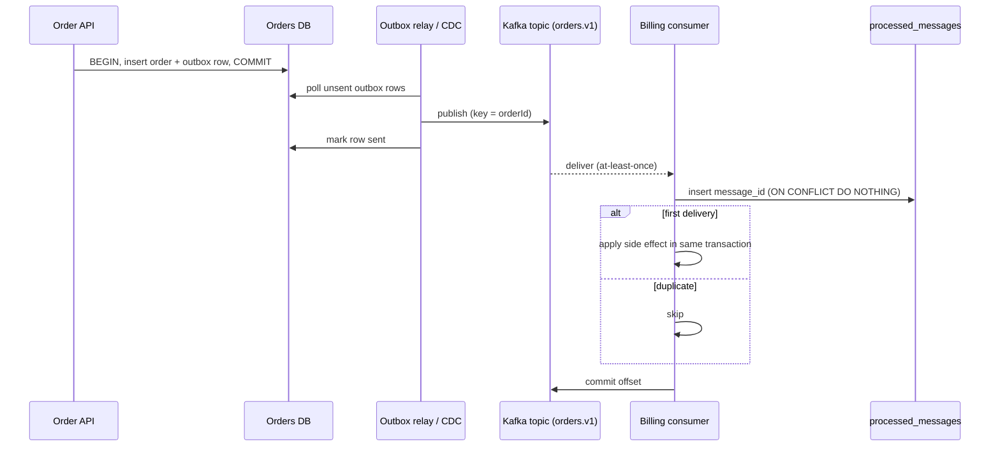
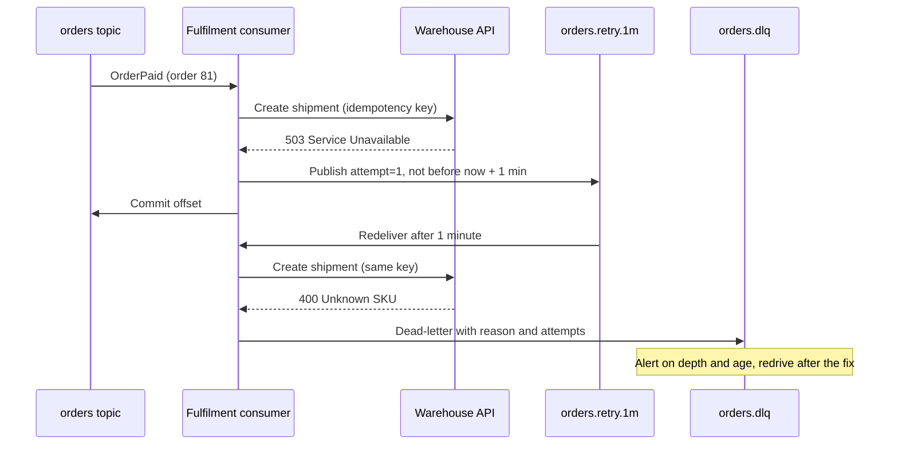

## TL;DR

- **Queues** distribute work (each message is processed by one consumer, then gone); **logs/streams** distribute facts (messages are retained and replayable, and many consumer groups read independently).
- "Exactly-once" is end-to-end only when consumers are **idempotent**. Brokers offer at-least-once delivery plus de-duplication aids, never magic.
- **Ordering is per partition/session key**, never global at scale. Choose the key to match the entity whose order matters.
- The **dual-write problem** (update DB *and* publish) is solved with the **transactional outbox** (or CDC), not with "publish after commit and hope".
- Retries, dead-letter queues, schema evolution and consumer lag monitoring are the real design work. The happy path is easy.

## Core Concepts

### Queue vs pub/sub vs log

| Model | Example | Delivery | Retention | Typical use |
|---|---|---|---|---|
| Point-to-point queue | Azure Service Bus queue, SQS, RabbitMQ queue | One consumer per message (competing consumers) | Until acknowledged | Commands, background jobs |
| Pub/sub topic | Service Bus topics + subscriptions, SNS, Event Grid | Copy per subscription | Until each subscription acknowledges | Fan-out notifications |
| Partitioned log | Kafka, Azure Event Hubs, Kinesis | Each consumer group tracks its own offset | Time/size based, replayable | Event streaming, analytics, event sourcing feeds |

A log does not delete on read. Consumers move an **offset**, so a new service can replay history and a bug can be fixed by rewinding.

### Delivery semantics

- **At-most-once:** acknowledge before processing; a crash loses the message.
- **At-least-once:** acknowledge after processing; a crash causes redelivery, so **duplicates are normal**.
- **Exactly-once:** Kafka offers exactly-once *within Kafka* (idempotent producers + transactions across read-process-write to Kafka topics). Once you touch an external DB or API, you are back to at-least-once and need idempotency.

```ts
// Idempotent consumer: record the message id in the same transaction as the side effect.
export async function handlePaymentCaptured(msg: { id: string; orderId: string; amount: number }) {
  await db.transaction(async (tx) => {
    const inserted = await tx.query(
      'INSERT INTO processed_messages (message_id) VALUES ($1) ON CONFLICT DO NOTHING RETURNING 1',
      [msg.id],
    );
    if (inserted.rowCount === 0) return; // duplicate delivery: already applied

    await tx.query('UPDATE orders SET status = $1, paid_amount = $2 WHERE id = $3', ['PAID', msg.amount, msg.orderId]);
  });
}
```

### Ordering and partitioning

Kafka guarantees order **within a partition**. Messages with the same key go to the same partition, so key by the entity whose ordering matters (`orderId`, `accountId`). Consequences:

- Parallelism is capped by partition count per consumer group.
- A hot key creates a hot partition.
- Changing the partition count changes key→partition mapping for new messages (ordering across the change is not guaranteed).

Service Bus offers ordering through **sessions** (`SessionId`); one receiver holds a session lock at a time.

### Worked example: sizing a topic's partitions

An `order-events` topic must handle a peak of **50,000 messages a second**, averaging 1 KB each (50 MB/s), and an average of 15,000 a second. It is keyed by `orderId`.

**1. Measure, then divide.** A common rule: partitions ≥ max(T / p, T / c), where T is the target throughput, p is what one partition can take from producers, and c is what one consumer can process from one partition. Measure p and c on your own hardware and handler. Don't copy someone else's numbers.

| | Measured per partition | Partitions needed for 50 MB/s |
|---|---|---|
| Producer | ~10 MB/s | 5 |
| Consumer, one database write per message (~2 ms) | 500 messages/s ≈ 0.5 MB/s | **100** |
| Consumer, batched writes of 200 messages | ~5,000 messages/s ≈ 5 MB/s | 10 |

The consumer is the bottleneck, as it usually is. Batching the handler's writes changes the answer by ten times, so fix the handler before adding partitions.

**2. Add headroom, and pick once.** Adding partitions later changes which partition a key maps to, so per-order ordering breaks across the change. Size for about two years of growth: with batching and three times the growth, 30 partitions are needed, so choose **32** (or 48 if the consumer count needs to divide evenly).

**3. Don't overshoot.** Each partition costs open files and memory on the brokers, adds work to leader elections and rebalances, and can't be removed later without recreating the topic. Thousands of partitions for one topic is rarely the answer.

**4. Check the storage.** 15 MB/s average × 86,400 s ≈ 1.3 TB a day. With 7 days' retention that is about 9 TB, and about **27 TB** with a replication factor of 3, before compression. Tiered storage can move older segments to object storage if longer replay is needed.

**5. Write the decision down**, with the measured p and c, so the next person knows what assumption to re-test when traffic changes.

### Transactional outbox

```ts
// Inside the same DB transaction as the business change:
await db.transaction(async (tx) => {
  await tx.query('INSERT INTO orders (id, status) VALUES ($1, $2)', [order.id, 'PLACED']);
  await tx.query(
    'INSERT INTO outbox (id, topic, key, payload) VALUES ($1, $2, $3, $4)',
    [crypto.randomUUID(), 'orders.v1', order.id, JSON.stringify({ type: 'OrderPlaced', orderId: order.id })],
  );
});
// A relay (poller or CDC such as Debezium) publishes outbox rows and marks them sent.
// It may publish twice after a crash — consumers must be idempotent.
```

### Retries, poison messages and DLQs

- **Transient errors** (timeouts, 503s): retry with exponential backoff and jitter.
- **Permanent errors** (validation failure, unknown entity): do not retry. Dead-letter immediately with the reason.
- Kafka has no built-in DLQ. Implement retry topics (`orders.retry.1m`, `orders.retry.10m`) and a DLQ topic, or use a framework that does.
- Service Bus dead-letters automatically after `MaxDeliveryCount`, and supports scheduled messages for delayed retry.

### Schema evolution

Producers and consumers deploy independently, so schemas must evolve compatibly. Use a schema registry with Avro, Protobuf or JSON Schema and enforce a compatibility mode (backward, forward or full). Rules of thumb: add optional fields, never reuse or repurpose fields, version the topic for breaking changes (`orders.v2`).

### Platform notes

- Kafka 4.0 removed ZooKeeper; clusters run in **KRaft** mode.
- Kafka "share groups" (KIP-932, queue-like consumption with per-record acknowledgement) were early access in 4.0, a preview in 4.1 and production-ready from 4.2 (2026). They give up per-partition ordering.
- Azure Event Hubs exposes a Kafka-compatible endpoint; Service Bus is the choice for enterprise messaging features (sessions, transactions, scheduled delivery, duplicate detection).

## How It Works



### Retry tiers and dead-lettering



The cost of this design is ordering. While order 81 waits in the retry topic, a later event for the same order can overtake it. Either park later events for that key until the retry resolves, or make the handler reject events older than the order's current version.

## When to Use / Trade-offs

| Choice | Use when | Avoid when | Cost |
|---|---|---|---|
| Synchronous REST/gRPC | Caller needs the answer now; simple request/response | Long-running work, fan-out to many services | Temporal coupling, cascading failures |
| Queue (Service Bus, SQS) | Distributing commands/jobs, need per-message ack, DLQ, scheduling | Many independent readers, replay needed | Messages gone after ack |
| Log (Kafka, Event Hubs) | High throughput, many consumers, replay, stream processing | Small volumes with complex routing; per-message delay/priority | Operational complexity, partition design |
| Event notification (thin events) | Consumers fetch details they need | Consumers can't call back (offline, rate limits) | Extra calls, read-your-writes issues |
| Event-carried state transfer (fat events) | Consumers need autonomy and local copies | Payloads hold sensitive data many shouldn't see | Larger messages, schema coupling |

## Common Pitfalls & Anti-patterns

- **Dual writes** — committing to the DB then publishing (or the reverse) loses or invents events on crashes.
- **Assuming no duplicates** — every at-least-once system delivers duplicates eventually; non-idempotent consumers double-charge.
- **Retrying poison messages forever** — blocks a partition (Kafka) or burns compute; classify errors and dead-letter.
- **Global ordering assumptions** — designing as if all events arrive in order across keys.
- **Events as remote procedure calls** — `SendEmailToUserCommand` broadcast on a topic: this is a queue job, not an event.
- **No lag monitoring** — consumer lag is the most important health signal for streaming systems.
- **Breaking schema changes without versioning** — renaming a field takes down every consumer you didn't know about.

## Real-world Scenario

**Context:** A retailer's checkout published `OrderPlaced` to Kafka after committing the order. During a broker failover, ~0.3% of orders were never published, so the warehouse never shipped them.

**Decision:** Introduced a transactional outbox with Debezium CDC, idempotent consumers keyed on event id, and a retry/DLQ topic chain with alerting on DLQ depth. Topics were keyed by `orderId` so per-order lifecycle events stayed ordered.

**Outcome:** Zero lost orders over the next two peak seasons. Duplicate deliveries (~0.01%) were absorbed harmlessly. The DLQ surfaced a malformed-address bug within an hour instead of weeks.

**What I'd do differently:** Put a schema registry in from day one. Two later incidents were consumers breaking on an "additive" change that wasn't.

## Interview Questions

### What is the difference between a message queue and an event log like Kafka? {#queue-vs-log}

**Level:** Foundation

**Model answer:**
A queue delivers each message to one of a set of competing consumers and deletes it once acknowledged. It is ideal for distributing work. A log appends messages to partitions and retains them for a configured time. Each consumer group tracks its own offset, so many independent consumers read the same data and can replay it. Queues offer richer per-message features (DLQ, scheduling, priorities, sessions); logs offer throughput, replay and stream processing.

**What the interviewer is looking for:**
Retention vs consumption semantics, competing consumers vs consumer groups, and matching the tool to the use case.

**Follow-ups:**
- How does a Kafka consumer group scale, and what limits it?
- When would you use Azure Service Bus over Event Hubs?

**Red flags:**
- "Kafka is just a faster queue."
- Not knowing that log messages persist after consumption.

### Does exactly-once delivery exist? How do you get exactly-once *processing*? {#exactly-once}

**Level:** Senior

**Model answer:**
Over an unreliable network, delivery is at-most-once or at-least-once. Kafka's exactly-once semantics (idempotent producer + transactions) give exactly-once *within Kafka* for read-process-write pipelines. As soon as a side effect leaves Kafka (DB write, email, payment API), you need idempotency: a unique message id stored transactionally with the side effect, natural idempotency (`SET status = PAID`), or idempotency keys on downstream APIs.

**What the interviewer is looking for:**
Precision about where the guarantee holds and a concrete idempotency mechanism.

**Follow-ups:**
- How long do you keep processed message ids, and how do you clean them up?
- How do you make an email send idempotent?

**Red flags:**
- "Enable exactly-once in Kafka and you're done."
- Relying on de-duplication windows alone for financial operations.

### How do you guarantee ordering of events for a single order while still scaling consumers? {#ordering-guarantees}

**Level:** Senior

**Model answer:**
Use the order id as the partition key (Kafka) or session id (Service Bus). All events for one order land on one partition or session and are processed in sequence, while different orders spread across partitions for parallelism. Within a consumer, process a partition's messages sequentially (or parallelise per key). Watch for hot keys, and remember retries must not reorder: a failing message either blocks its key or goes to a retry path that is also keyed, with consumers tolerating out-of-order arrival using version numbers.

**What the interviewer is looking for:**
Per-key ordering, the parallelism trade-off, and awareness that retries and partition changes break naive ordering.

**Follow-ups:**
- What happens to ordering when you increase partitions?
- How would you handle one customer generating 40% of traffic?

**Red flags:**
- Claiming Kafka guarantees global ordering.
- A single partition "to be safe" for a high-volume topic.

### Explain the dual-write problem and how the transactional outbox solves it. {#outbox-pattern}

**Level:** Senior

**Model answer:**
Writing to the database and publishing to a broker are two separate systems with no shared transaction. A crash between them either loses the event (DB committed, publish failed) or emits a phantom event (published, DB rolled back). The outbox writes the event to an `outbox` table in the *same* DB transaction as the state change. A relay (poller or CDC from the transaction log) then publishes rows to the broker. The relay can publish duplicates after crashes, so consumers must be idempotent. CDC avoids polling load and preserves commit order.

**What the interviewer is looking for:**
Clear articulation of the failure modes, the pattern, and its at-least-once consequence.

**Follow-ups:**
- Polling relay vs CDC: what are the trade-offs?
- How do you keep the outbox table from growing forever?

**Red flags:**
- Suggesting distributed transactions (2PC) across DB and broker as the default.
- "Publish inside the DB transaction before commit."

### Design the retry and failure handling for an order-fulfilment consumer that calls a flaky warehouse API. {#retry-dlq-design}

**Level:** Architect

**Model answer:**
1. **Classify errors.** Transient (timeouts, 429, 5xx) vs permanent (400 validation, unknown SKU).
2. **Bounded in-process retries** with exponential backoff and jitter for brief blips, using an idempotency key on the warehouse call.
3. **Delayed retry tiers.** For Kafka, retry topics (1m, 10m, 1h) consumed by the same handler after the delay, so the main partition is not blocked. For Service Bus, scheduled re-delivery or abandon with `MaxDeliveryCount`.
4. **DLQ** for permanent failures and exhausted retries, storing the error, attempt count and original metadata.
5. **Circuit breaker** around the warehouse API. When open, pause consumption (Kafka `pause()`) rather than burning through retries.
6. **Ordering decision.** If per-order order matters, park subsequent messages for that order while one is retrying, or design the handler to tolerate reordering using versions.
7. **Operations.** Alert on DLQ depth and age, add a redrive tool with audit, add dashboards for lag and retry rates, and write a runbook.

**What the interviewer is looking for:**
Error classification, not blocking healthy traffic, idempotency, backpressure, and operability (redrive, alerts). Architect answers discuss the ordering vs availability trade-off explicitly.

**Follow-ups:**
- How do you redrive DLQ messages safely after a fix?
- What metrics would page someone at 3 a.m. and which wouldn't?
- How would the design change if the warehouse API had a strict rate limit?

**Red flags:**
- Infinite immediate retries.
- No distinction between transient and permanent failures.
- DLQ with no alerting or ownership.

### Forty teams publish and consume events on a shared platform. How do you manage schema evolution without breaking consumers? {#schema-evolution}

**Level:** Architect

**Model answer:**
- **Schema registry** (Confluent, Apicurio, Azure Schema Registry) with Avro or Protobuf; CI checks compatibility on every producer change.
- **Compatibility policy.** Backward compatibility as the default (new schema reads old data), full for critical shared topics.
- **Evolution rules.** Add optional fields with defaults, never remove required fields or change types, never reuse field numbers or names.
- **Breaking changes** go to a new versioned topic (`orders.v2`) with dual publishing during a migration window and a deprecation date.
- **Ownership and discovery.** Every topic has an owning team, an AsyncAPI document and a catalogue entry listing known consumers.
- **Contract tests.** Consumer-driven contracts for critical flows.

**What the interviewer is looking for:**
Governance that scales socially as well as technically: automation over review boards, clear ownership, and a migration path for breaking changes.

**Follow-ups:**
- JSON Schema vs Avro vs Protobuf: which would you pick and why?
- How do you find out who consumes a topic before changing it?

**Red flags:**
- "We'll just coordinate releases."
- A central architecture team manually approving every schema change.

### What are at-most-once, at-least-once and exactly-once delivery, and which should you design for? {#delivery-semantics}

**Level:** Foundation

**Model answer:**
The difference is *when the consumer acknowledges* relative to doing the work.

- **At-most-once:** acknowledge (or commit the offset) first, then process. A crash mid-processing loses the message. Acceptable only for data where loss is cheap, such as metrics samples or presence pings.
- **At-least-once:** process first, then acknowledge. A crash after the side effect but before the ack causes redelivery, so the same message is processed twice.
- **Exactly-once:** the effect of each message is applied once. Brokers can only provide this inside their own boundary (Kafka transactions for read-process-write between Kafka topics). Anywhere else it is built from at-least-once delivery plus idempotent processing.

Design for **at-least-once with idempotent consumers**. It is the default in Service Bus (peek-lock), SQS and Kafka with manual offset commits, and it fails safe: duplicates are detectable, lost messages are not.

**What the interviewer is looking for:**
The candidate ties each semantic to ack timing, picks at-least-once as the default and immediately mentions idempotency.

**Follow-ups:**
- Where does Kafka's `enable.auto.commit=true` put you on this spectrum?
- Name three ways to make a consumer idempotent.

**Red flags:**
- Believing a broker setting alone gives exactly-once side effects in a database or third-party API.
- Choosing at-most-once for business events "for performance".

### What is consumer lag, and how do you monitor and act on it? {#consumer-lag}

**Level:** Foundation

**Model answer:**
Consumer lag is how far a consumer group is behind the head of the stream. Per partition, it is the latest offset minus the group's committed offset. Summed across partitions it says how much work is queued. Lag converted to **time** ("the oldest unprocessed message is 4 minutes old") is what matters to users, because 100k messages may be 2 seconds or 2 hours of work depending on throughput.

Monitor:
- Lag in messages *and* estimated seconds, per partition, so one stuck partition isn't hidden by healthy ones.
- The trend. Steadily growing lag means consumption is slower than production, and scaling or optimisation is needed.
- The equivalent for queues: active message count and the age of the oldest message.

Act on it by scaling consumers (up to the partition count), fixing slow handlers (batching, removing per-message remote calls), finding hot partitions, or applying backpressure upstream.

**What the interviewer is looking for:**
Lag as offset difference, the time view, per-partition granularity and the partition-count ceiling on scaling.

**Follow-ups:**
- Lag is growing on one partition only. What do you suspect?
- How would you autoscale consumers on lag (for example KEDA)?

**Red flags:**
- Only monitoring broker CPU and memory.
- Thinking adding consumers beyond the partition count increases throughput.

### What is the difference between an event, a command and a query in a message-driven system? {#event-vs-command}

**Level:** Foundation

**Model answer:**
- A **command** asks one specific receiver to do something: `ReserveStock`, `SendInvoice`. It is named in the imperative, has exactly one handler, can be rejected and usually travels on a **queue**. The sender depends on the receiver's capability.
- An **event** states that something has already happened: `OrderPlaced`, `PaymentCaptured`. It is named in the past tense, can have zero or many subscribers and cannot be rejected, because it's a fact. It usually travels on a **topic or log**. The publisher does not know who listens.
- A **query** asks for data and expects a response. It is usually synchronous (HTTP or gRPC). Request-reply over messaging is possible but rarely worth it.

The distinction drives coupling. Events invert the dependency: the producer doesn't change when a new consumer appears. Disguising commands as events (`SendWelcomeEmailEvent`) hides a dependency that is really there.

**What the interviewer is looking for:**
Naming conventions, cardinality of handlers, the transport that fits each, and the coupling argument.

**Follow-ups:**
- Can one business action produce both a command and an event?
- Who owns the schema of a command versus an event?

**Red flags:**
- Using the words interchangeably.
- Broadcasting commands on a pub/sub topic so "whoever needs to" handles them.

### How do Kafka consumer group rebalances work, and how do you stop them hurting throughput? {#consumer-rebalancing}

**Level:** Senior

**Model answer:**
A consumer group divides a topic's partitions among its members. A **rebalance** reassigns them when a member joins, leaves, crashes or is considered dead. A consumer is presumed dead if it misses heartbeats for `session.timeout.ms` or doesn't call `poll()` within `max.poll.interval.ms`.

Why it hurts: with the classic **eager** protocol, every consumer gives up *all* partitions and stops processing until the new assignment is made, even for partitions that didn't move. Deployments, autoscaling and slow handlers can cause repeated "rebalance storms".

Mitigations:
- **Cooperative incremental rebalancing** (`CooperativeStickyAssignor`): only the partitions that move are revoked.
- **Static membership** (`group.instance.id`): a restarting pod rejoins with the same identity within the session timeout and does not trigger a rebalance. This is ideal for rolling deploys on Kubernetes.
- **The next-generation consumer protocol** (KIP-848), where the broker coordinates assignment incrementally. Generally available for consumers from Kafka 4.0.
- **Keep `poll()` loops fast:** bound `max.poll.records` and move slow work off the poll thread (with care for offset commits), or raise `max.poll.interval.ms` deliberately.
- **Commit offsets** in the partitions-revoked callback so the next owner doesn't reprocess a large batch.

**What the interviewer is looking for:**
Understanding of liveness detection (heartbeat vs poll interval), eager vs cooperative protocols, static membership, and the link between slow processing and rebalances.

**Follow-ups:**
- Why might a consumer that is healthy and heartbeating still be kicked out of the group?
- How do rebalances interact with exactly-once (transactional) consumers?

**Red flags:**
- Treating rebalances as rare events that need no design.
- Fixing rebalance loops only by raising every timeout to hours.

### Thin events or fat events? When do you include the full state in the payload? {#thin-vs-fat-events}

**Level:** Senior

**Model answer:**
- **Thin (event notification):** `{ "type": "CustomerUpdated", "customerId": "c-42", "version": 17 }`. Consumers call the owner's API for details. Payloads stay small and never stale, and sensitive data isn't broadcast. The cost is runtime coupling back to the producer (load spikes, availability dependency) and read-your-writes races, where the consumer fetches before the owner's read model has caught up.
- **Fat (event-carried state transfer):** the event carries the state consumers need, often the full entity snapshot after the change. Consumers can build local copies and work when the producer is down. Payloads get larger, schemas couple more tightly and data spreads (GDPR erasure, PII exposure).
- **Delta events** (only the changed fields) are a middle ground but force consumers to have applied every previous delta in order.

Rules of thumb: carry what most consumers need to act without calling back, include an entity **version** so consumers can ignore stale updates, keep sensitive fields out (or on a restricted topic) and use thin events plus fetch for rare, heavy or sensitive details. For compacted Kafka topics that act as a table, fat snapshots keyed by entity id are the natural fit.

**What the interviewer is looking for:**
Trade-offs in coupling, availability, consistency and data governance, with the versioning detail.

**Follow-ups:**
- How do you handle a GDPR erasure request when customer data is in retained events?
- What is log compaction and how does it relate to fat events?

**Red flags:**
- Dogmatism either way.
- Putting the entire aggregate, including secrets, on a company-wide topic.

### When would you choose Azure Service Bus over Event Hubs or Kafka, and the other way round? {#service-bus-vs-event-hubs}

**Level:** Senior

**Model answer:**
They solve different problems.

**Service Bus** is an enterprise message broker. Pick it for commands and workflows that need per-message features:
- Peek-lock with explicit complete/abandon, automatic dead-lettering after `MaxDeliveryCount`.
- Sessions for ordered, exclusive processing per key; scheduled and deferred messages; duplicate detection within a time window.
- Transactions across send and complete within a namespace; topic subscriptions with SQL-like filters.

**Event Hubs or Kafka** are partitioned logs. Pick them for high-volume event streams:
- Telemetry, clickstream and change data capture at millions of events per second.
- Many independent consumer groups, replay from retention, and integration with stream processing (Flink, Stream Analytics, Spark).
- Event Hubs exposes a Kafka endpoint, so Kafka clients work without running brokers.

Signals for Service Bus: low or medium volume, each message is a unit of work, routing per message, need to delay or retry individual messages. Signals for a log: volume, fan-out to many readers, replay, analytics, ordered history per key.

Many systems use both: Service Bus for the order workflow commands, Event Hubs for the analytics firehose.

**What the interviewer is looking for:**
Feature-level reasoning rather than "Kafka is faster", and comfort with using both.

**Follow-ups:**
- How would you implement a 30-minute delayed retry on Event Hubs?
- What limits the throughput of a single Service Bus session?

**Red flags:**
- Choosing Kafka for a 50-messages-a-minute job queue because it is popular.
- Not knowing that Event Hubs lacks per-message acknowledgement and dead-lettering.

### Design the order flow across payment, inventory and shipping services. Choreography or orchestration? {#saga-design}

**Level:** Architect

**Model answer:**
A single database transaction cannot span three services, so the flow is a **saga**: a sequence of local transactions, each with a **compensating action** for when a later step fails (`RefundPayment`, `ReleaseStock`).

**Choreography:** each service reacts to events. `OrderPlaced` → Payment captures and emits `PaymentCaptured` → Inventory reserves and emits `StockReserved` → Shipping books. Failures emit events that trigger compensations upstream.
- Pros: loose coupling, no central component, easy to add listeners.
- Cons: the business process exists only implicitly across services. It is hard to answer "where is order 123 stuck?" and cyclic dependencies creep in.

**Orchestration:** an order orchestrator (a state machine, or a workflow engine such as Temporal, Azure Durable Functions or AWS Step Functions) sends commands and waits for replies, persisting state at each step.
- Pros: the process is explicit, versioned and observable, timeouts and compensations live in one place.
- Cons: the orchestrator is a component to run, and it can grow into a god service if it absorbs domain logic.

My default: **orchestrate the core money-moving flow**, because it needs visibility, timeouts and auditable compensation, and **choreograph the side effects** (emails, analytics, loyalty points) off domain events.

Design details either way:
- Idempotent steps and idempotency keys on payment calls.
- Pivot step ordering: do the hardest-to-compensate step, such as shipping, last.
- Semantic locks or a `PENDING` status so other processes don't act on half-finished orders.
- Timeouts that trigger compensation.
- A per-saga correlation id for tracing.

**What the interviewer is looking for:**
Saga mechanics, compensation (not rollback), an explicit trade-off between the two styles, failure and timeout handling and observability. Architect answers justify the hybrid.

**Follow-ups:**
- Payment succeeded, inventory failed and the refund call is timing out. What happens?
- How do you version a long-running workflow while instances are in flight?
- How do you handle the user cancelling mid-saga?

**Red flags:**
- Proposing two-phase commit across services and the payment provider.
- No compensation design, or assuming compensation is an exact undo.
- Choreography with no way to see the end-to-end state.

### Your organisation wants to replace synchronous REST calls between 12 microservices with events. How do you evaluate and run that change? {#migrate-sync-to-async}

**Level:** Architect

**Model answer:**
Start from the problem, not the pattern. Which pain is real? Cascading failures, latency chains (p99 compounding through 5 hops), tight release coupling, or scaling bottlenecks? Then classify each interaction:

- **Queries that need an answer now** (price lookup, auth checks) stay synchronous, or become local read models fed by events if availability matters more than freshness.
- **Notifications of facts** ("order shipped, update loyalty") become events. This is the biggest win.
- **Commands for long-running work** become queued commands, with the result reported asynchronously.

The cost of going asynchronous has to be accepted explicitly:
- **Eventual consistency in the UI:** design pending states and "we'll email you" flows.
- **Debugging:** you need distributed tracing with context propagated through message headers, and correlation ids.
- **New failure modes:** duplicates, reordering, poison messages, DLQs.
- **Platform and skills:** schema governance, a broker platform and team skills.

Execution:
1. Pick one high-value seam and prove the paved road: outbox library, schema registry, tracing, DLQ dashboards.
2. Run the event path and the REST path side by side (strangler pattern), compare the results, then cut over.
3. Measure before and after: availability, p99, incident count, lead time.
4. Write an ADR with the guidelines, so teams don't apply events everywhere.

**What the interviewer is looking for:**
Problem-first reasoning, keeping sync where it fits, a candid account of costs, and incremental migration with measurement. This is a judgement question, not a Kafka question.

**Follow-ups:**
- The product owner insists the confirmation page shows the final shipping date. How do you design it?
- How do you prevent the event mesh becoming an untraceable "distributed monolith"?

**Red flags:**
- "Events everywhere" as an end in itself.
- Ignoring the user-experience impact of eventual consistency.
- A big-bang migration.

### Design event streaming across two regions for disaster recovery. What happens to ordering and offsets on failover? {#multi-region-streaming}

**Level:** Architect

**Model answer:**
First agree the targets. Can the business accept losing the last few seconds of events (the **RPO**, recovery point objective)? How fast must processing resume (the **RTO**, recovery time objective)? Is active-active really needed? Then choose a topology:

- **Active-passive with asynchronous replication.** Mirror topics to the DR cluster with MirrorMaker 2 or Confluent Cluster Linking (on Azure, Event Hubs geo-replication, generally available since 2025 for Premium and Dedicated, replicates data and consumer offsets; the older geo-disaster recovery pairing replicates metadata only). The RPO is the replication lag. On failover, producers and consumers switch bootstrap servers.
- **Active-active.** Each region produces to local topics (`eu.orders`, `us.orders`) and mirrors the other's. Consumers read both. There is no single global order, so per-entity ordering needs **home-region ownership** of each entity, or conflict handling with versions.
- **Stretched cluster** across nearby availability zones or metro regions with synchronous replication (`acks=all`, `min.insync.replicas`). It gives a zero RPO but needs low latency between sites, so it doesn't work across continents.

Offsets and ordering on failover:
- Offsets are *not* the same number across clusters. Use the replication tool's **offset translation** (MirrorMaker 2 checkpoints, or cluster linking that preserves offsets), or restart from a timestamp.
- Expect duplicates (rewind slightly) or gaps (unreplicated tail). Idempotent consumers make "rewind a bit" the safe choice.
- Events produced in the old region but not yet replicated are lost or must be reconciled when it returns. Decide the procedure in advance and rehearse it.

Operations: replication lag alerts, regular game days, runbooks and an explicit failback plan.

**What the interviewer is looking for:**
RPO and RTO first, topology trade-offs, offset translation, accepting duplicates over loss and practising failover.

**Follow-ups:**
- How would you guarantee no double-charging after failover?
- What is the effect of `acks=1` versus `acks=all` on data loss during a broker failure?

**Red flags:**
- Assuming offsets carry over unchanged.
- Active-active with global ordering assumptions.
- A DR design that has never been tested.

### What is log compaction in Kafka, and when do you use it? {#log-compaction}

**Level:** Foundation

**Model answer:**
A normal Kafka topic deletes data by **time or size** (`cleanup.policy=delete`). A **compacted** topic (`cleanup.policy=compact`) instead keeps **at least the latest message for every key**, and removes older messages for keys that have newer ones.

It turns a topic into a **changelog of current state**: a new consumer that reads from the beginning ends up with the latest value of every key, without having to process years of history.

How it behaves:
- Compaction runs in the background on closed log segments. Consumers may still see some older values for a key that haven't been compacted yet, so they must apply messages in order and treat the last one as current.
- **Deleting a key** means writing a *tombstone*: a message with that key and a `null` value. Tombstones are kept for `delete.retention.ms`, so consumers have time to see them, and then removed.
- Offsets don't change. Compacted topics simply have gaps in the offsets.

Uses:
- Current state of entities, such as customer profiles or product prices, as fat snapshot events keyed by id.
- Kafka's own `__consumer_offsets` topic, and Kafka Streams state store changelogs.
- Configuration or reference data that services load at start-up.

It isn't suitable when consumers need every intermediate change, such as an audit trail or billing events. Use a normal retention topic for those, or both: compaction can be combined with a time limit (`compact,delete`).

**What the interviewer is looking for:**
Latest value per key instead of time-based retention, tombstones for deletes, and the changelog use case.

**Follow-ups:**
- How would you erase one customer's data from a compacted topic?
- Why might a consumer still see an old value for a key?

**Red flags:**
- Thinking compaction keeps only one message per key at all times.
- Using a compacted topic for events where every occurrence matters.

### How do you process messages from one partition in parallel without losing ordering or offsets? {#parallel-consumption}

**Level:** Senior

**Model answer:**
A Kafka consumer group's parallelism is capped by the partition count, and a slow handler (one remote call per message) makes each partition slow. Adding partitions is one fix, but it is irreversible and remaps keys. Processing in parallel *within* a partition is another, if you handle two problems.

**Ordering.** Messages for the same key must still be processed in order. Run messages for **different keys** concurrently, and messages for the **same key** one after another: for example, a pool of workers where each key is hashed to one worker, or an in-memory queue per key.

**Offsets.** Kafka commits one offset per partition, meaning "everything before this is done". With parallel processing, message 105 can finish before 103. You may commit only up to the **highest offset with everything before it completed**. Anything after that point is processed again after a crash or rebalance, so handlers must be idempotent.

Libraries such as the Confluent Parallel Consumer implement this (ordering by key or by partition, tracking completed offsets, and storing the out-of-order completions in the commit metadata to reduce reprocessing).

Other details:
- **Backpressure.** Limit messages in flight, and `pause()` partitions when the limit is reached, while still calling `poll()` to stay in the group.
- **Rebalances.** On revocation, stop work for those partitions and commit what is safely complete.
- **When ordering doesn't matter at all**, Kafka's share groups (KIP-932) give queue-style consumption with per-message acknowledgement.

**What the interviewer is looking for:**
Key-level ordering, the "highest contiguous completed offset" rule, idempotency for the replay window, and backpressure.

**Follow-ups:**
- What happens if one key's message is stuck for a minute?
- How does this compare with simply increasing the partition count?

**Red flags:**
- Committing each message's offset as soon as it finishes, out of order.
- A thread pool per partition with no per-key ordering.

### Which Kafka producer and topic settings prevent losing acknowledged messages? {#producer-durability}

**Level:** Senior

**Model answer:**
A message is safe only once it is on enough brokers that a failure can't remove it. The settings work together:

| Setting | Recommended | Why |
|---|---|---|
| `replication.factor` | 3 | Copies on three brokers, ideally in three availability zones (`broker.rack`) |
| `min.insync.replicas` | 2 | A write needs at least two in-sync copies to succeed |
| `acks` | `all` | The producer waits for every in-sync replica, so the `min.insync.replicas` rule applies |
| `enable.idempotence` | `true` (default since Kafka 3.0) | Retries don't create duplicates, and per-partition order holds with up to 5 requests in flight |
| `retries` / `delivery.timeout.ms` | Defaults (retry until the delivery timeout, 2 minutes) | Transient leader changes don't surface as errors |
| `unclean.leader.election.enable` | `false` (the default) | An out-of-date replica is never promoted to leader, which would silently drop acknowledged messages |

With `acks=1`, the leader acknowledges before replicating. If it dies straight after, the message is gone even though the producer was told it succeeded. With `min.insync.replicas=1`, `acks=all` degrades to the same thing whenever the followers fall behind.

The trade-off is availability: with RF=3 and `min.insync.replicas=2`, losing two of the three replicas makes the partition reject writes (`NotEnoughReplicas`) rather than accept writes it can't protect.

The producer application matters too. Handle the send callback's errors, and don't treat "handed to the client library" as "delivered". For business events, the transactional outbox ensures that a message which never made it can be sent again.

**What the interviewer is looking for:**
`acks=all` combined with `min.insync.replicas`, idempotent producers, no unclean leader election, and the availability trade-off.

**Follow-ups:**
- What does a producer see when only one in-sync replica remains?
- Does Kafka fsync each message to disk? Why is that usually acceptable?

**Red flags:**
- `acks=all` with `min.insync.replicas=1`, believing it is safe.
- Fire-and-forget sends with errors ignored.

### Design a change-data-capture pipeline that streams changes from a legacy database to new services. {#cdc-pipeline}

**Level:** Architect

**Model answer:**
**Capture.** Use log-based CDC: Debezium (on Kafka Connect, or Debezium Server) reading the database's transaction log, which for PostgreSQL means a logical replication slot. It captures every committed change in commit order without touching the application, and without polling load.

**Choose what to publish:**
- **Raw table changes** expose the legacy schema to every consumer. A column rename then breaks services you don't know about. Fine for replication into a warehouse, poor as a contract between teams.
- **An outbox table** written by the application, routed by Debezium's outbox event router, publishes *domain events* with designed schemas. That's the better contract. On a legacy system you can't change, use an anticorruption service that consumes raw changes and publishes clean events.

**Initial state.** Debezium takes a consistent **snapshot**, then streams changes from that point. Newer incremental snapshots run in chunks while streaming continues. Plan for the snapshot's load and duration on large tables.

**Event details:**
- Key events by primary key, so each row's changes stay ordered.
- Deletes produce a delete event followed by a tombstone, which supports compacted topics.
- Register schemas, and decide how schema changes in the source become versioned events.

**Operational risks:**
- **Replication slot growth.** If the connector is down, PostgreSQL keeps all write-ahead log (WAL) since the slot's position, and the disk can fill. Alert on slot lag. Set `max_slot_wal_keep_size` to cap it (accepting a re-snapshot if it is exceeded).
- **Failover.** Logical slots must survive a primary failover (PostgreSQL 17 can synchronise failover slots to standbys), or the connector must re-snapshot.
- **Large transactions** and bulk backfills produce bursts. Size the consumers for them.
- **Personal data** flows into every topic. Filter columns at the source and set retention deliberately.

**Consumers** are idempotent and use the source's log position (the LSN) or a version to ignore stale or duplicate changes.

**What the interviewer is looking for:**
Log-based capture, raw changes versus outbox events as a contract, snapshots, ordering by key, and the replication-slot and failover risks.

**Follow-ups:**
- How would you backfill a new consumer that needs three years of history?
- How do you handle a source schema change mid-stream?

**Red flags:**
- Publishing raw legacy tables as the long-term contract for other teams.
- No monitoring of replication slot lag.

### Design a system that sends millions of reminders, each at a specific time, which users can cancel. {#scheduled-messages}

**Level:** Architect

**Model answer:**
"Send this at 09:00 tomorrow in the user's time zone, unless they cancel" is a **durable timer** problem. Brokers offer partial answers:
- Amazon SQS delays messages by at most 15 minutes.
- Azure Service Bus supports scheduled messages, with cancellation by sequence number.
- Kafka has no per-message delay at all.

At millions of timers, with cancellation and edits, I'd **keep the timers in a database and use the broker for execution**:

1. **Timer store.** A `reminders` table: `id, user_id, due_at (UTC), status, payload, version`, with an index on `(status, due_at)`. Store the user's local time and time zone too, so you can recalculate when a daylight-saving rule or the user's time zone changes.
2. **Scheduler.** Workers poll for due rows in small batches: `SELECT … WHERE status = 'scheduled' AND due_at <= now() ORDER BY due_at LIMIT 500 FOR UPDATE SKIP LOCKED`. They mark the rows `enqueued` and publish to a queue. Several workers can run safely, and none blocks another.
3. **Execution.** Senders consume the queue and deliver. Each message carries the reminder id and version, so a sender checks it is still current. A cancellation or edit (which bumps the version) after enqueueing is then ignored rather than sent.
4. **Cancellation and edits** are plain updates to the row. Most happen long before the due time, so there's nothing to recall from a broker.

**Scale and spikes.** Reminders cluster on round times (09:00 in each time zone). Partition the table by due date, spread the load by adding a few seconds of jitter where the product allows it, and size senders for the peak minute. For far larger scale, a hierarchical approach: a database for far-future timers, and in-memory timing wheels or broker scheduling for the next few minutes.

**Correctness.** At-least-once with idempotent senders (a sent marker per reminder and version), alerts when due reminders are older than a threshold (the scheduler is behind), and recovery after an outage that sends late reminders or drops them, according to product rules.

Workflow engines (Temporal, Durable Functions) provide durable timers out of the box. They're a good fit when the reminder is part of a longer process.

**What the interviewer is looking for:**
Durable timers in a store with `SKIP LOCKED` polling, version checks for cancellation, time-zone handling, and planning for spikes on round times.

**Follow-ups:**
- What happens to reminders that were due during a two-hour outage?
- How would you guarantee a reminder is never sent twice?

**Red flags:**
- One delayed message per reminder on a broker that can't cancel them.
- Storing due times in local time without the time zone.

## Cheat Sheet

- **Queue** — competing consumers, message deleted on ack; for commands and jobs.
- **Log/stream** — retained, replayable, per-consumer-group offsets; for facts and fan-out at scale.
- **At-least-once** — the realistic default; duplicates will happen, so make consumers idempotent.
- **Kafka exactly-once** — idempotent producer + transactions; holds only inside Kafka.
- **Ordering** — per partition key / Service Bus session, never global.
- **Outbox** — write the event to a table in the same DB transaction; a relay or CDC publishes it.
- **Poison message** — permanently failing message; classify errors, dead-letter, alert.
- **Retry topics** — delayed retry tiers so failures don't block the main partition.
- **Consumer lag** — the key streaming health metric; alert on growth and age.
- **Schema compatibility** — add optional fields; breaking changes get a new topic version.
- **KRaft** — Kafka's built-in metadata quorum; ZooKeeper was removed in Kafka 4.0.
- **Command vs event** — command: imperative, one handler, can be rejected; event: past tense, many subscribers, a fact.
- **Static membership** — `group.instance.id` lets a restarting consumer rejoin without triggering a rebalance.
- **Cooperative rebalancing** — only partitions that move are revoked, so the group keeps processing.
- **Saga** — sequence of local transactions with compensating actions; orchestrate money flows, choreograph side effects.

### Revisit

- **Partition sizing** — partitions ≥ max(T ÷ producer throughput, T ÷ consumer throughput), measured; the consumer usually dominates.
- **Adding partitions later** — changes key-to-partition mapping, so per-key ordering breaks across the change.
- **Retry topic trade-off** — keeps the main partition flowing, but a retried message can be overtaken by later events for its key.
- **Tombstone** — a message with a key and a null value, deleting that key from a compacted topic.
- **Parallel offset commits** — commit only up to the highest offset with everything before it completed.
- **Durable producer** — RF 3, `min.insync.replicas=2`, `acks=all`, idempotence on, no unclean leader election.
- **Replication slot lag** — a stopped CDC connector makes PostgreSQL keep WAL until the disk fills: alert on it.

## Further Reading

- [Apache Kafka documentation](https://kafka.apache.org/documentation/) — design, delivery semantics and configuration.
- [Azure Service Bus messaging overview](https://learn.microsoft.com/en-us/azure/service-bus-messaging/service-bus-messaging-overview) — queues, topics, sessions and dead-lettering.
- [Azure Event Hubs for Apache Kafka](https://learn.microsoft.com/en-us/azure/event-hubs/azure-event-hubs-apache-kafka-overview) — using the Kafka protocol on Azure.
- [AsyncAPI specification](https://www.asyncapi.com/docs) — documenting event-driven APIs.
- [Transactional outbox pattern (Azure Architecture Center)](https://learn.microsoft.com/en-us/azure/architecture/databases/guide/transactional-out-box-cosmos) — a worked outbox example on Azure.
