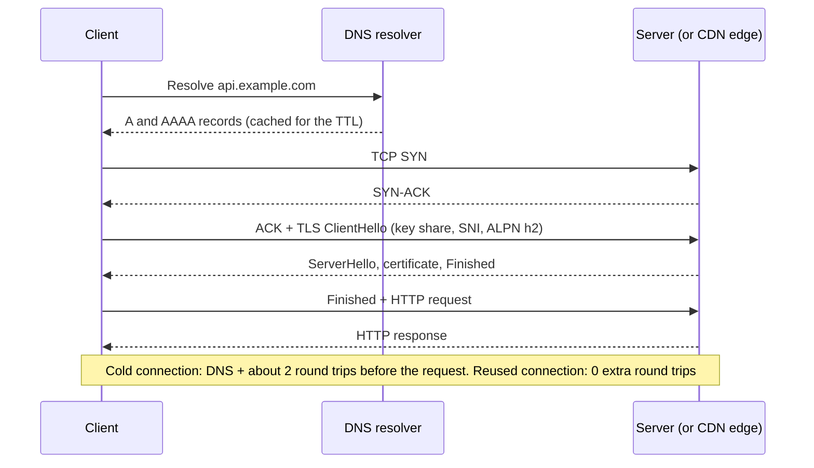
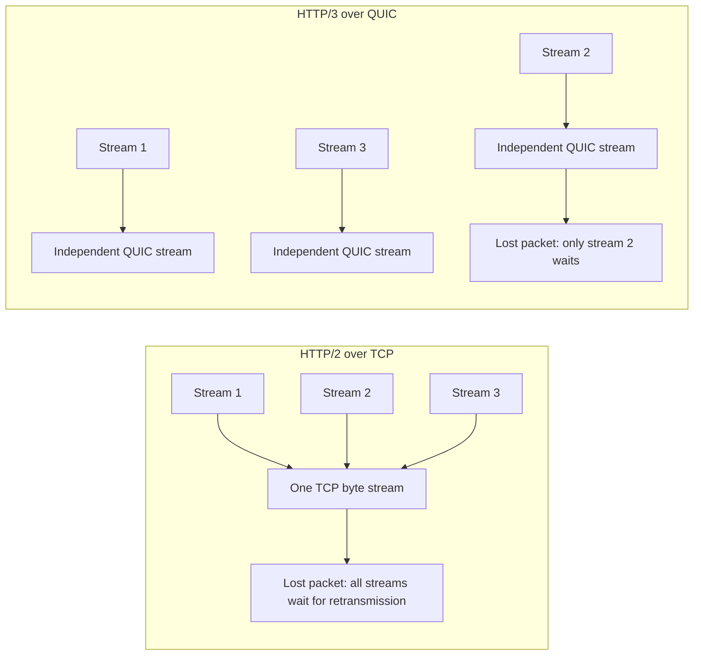

## TL;DR

- Most "the app is slow" and "it works on my machine" problems live in the network path: **DNS → TCP → TLS → HTTP**, plus proxies, load balancers and CDNs in between. Knowing what each layer costs in round trips explains a large share of latency.
- **Round trips dominate.** A new HTTPS connection over TCP and TLS 1.3 costs about two round trips before the first request byte. On a 150 ms intercontinental path, that's 300 ms before your server does any work. **Connection reuse, CDNs and HTTP/2 or HTTP/3** exist largely to avoid paying it again.
- **HTTP/2** multiplexes many requests over one TCP connection, but TCP packet loss still stalls all of them. **HTTP/3 runs over QUIC (UDP)**, removing that head-of-line blocking and allowing connection migration between networks.
- **DNS** is a distributed cache. TTLs decide how fast changes and failovers take effect, and many clients and resolvers don't honour them precisely. Plan failover with that in mind.
- In production, most network incidents are **timeouts, exhausted connection pools, expired certificates, MTU or proxy quirks, and DNS caching**. Learn the tools: `curl -v`, `dig`, `openssl s_client`, `mtr` and `tcpdump`.

## Core Concepts

### The layers that matter day to day

| Layer | Protocols | What can go wrong |
|---|---|---|
| Application | HTTP/1.1, HTTP/2, HTTP/3, gRPC, WebSocket | Wrong status handling, header size limits, idle timeouts on long-lived connections |
| Security | TLS 1.2 / 1.3, mTLS | Expired or misconfigured certificates, missing intermediate certificates, SNI issues |
| Transport | TCP, UDP (QUIC runs over UDP) | Handshake latency, slow start, packet loss, port exhaustion, connection resets |
| Network | IP (v4/v6), routing, NAT | Asymmetric routes, NAT timeouts, MTU and fragmentation problems, IPv6 misconfiguration |
| Name resolution | DNS | Stale caches, wrong TTLs, resolver outages, split-horizon confusion |

### TCP essentials

- **Three-way handshake** (SYN, SYN-ACK, ACK): one round trip before any data can be sent.
- **Reliable, ordered byte stream**: lost packets are retransmitted, and later data waits behind the gap (head-of-line blocking).
- **Congestion control and slow start**: a new connection starts with a small congestion window and grows it, so new connections are slow for large transfers. Reused, warm connections are faster.
- **Connection states that bite**: `TIME_WAIT` after closing (lots of short-lived outbound connections can exhaust ephemeral ports), and idle connections silently dropped by NATs, firewalls or load balancers after their idle timeout (for example AWS NAT gateways drop idle flows after 350 seconds).

### TLS 1.3

- **One round trip** for a full handshake (TLS 1.2 needed two). Combined with TCP, that's about two round trips before the first request.
- **0-RTT resumption** lets a returning client send data in its first flight, but that early data can be **replayed** by an attacker. Only allow it for idempotent requests.
- **Forward secrecy** is mandatory (ephemeral key exchange), and legacy ciphers are gone.
- **Certificates**: the server presents a chain to a trusted root. Missing intermediates are a classic "works in browsers, fails in curl or Java" bug. **SNI** tells the server which hostname's certificate to present.
- **Lifetimes are shrinking**: the CA/Browser Forum voted in 2025 to cut maximum public certificate validity in steps from 398 days to 47 days by 2029. Automate renewal (ACME, managed certificates) everywhere.
- **mTLS**: both sides present certificates. Used for service-to-service authentication (often by a service mesh) and B2B integrations.

### HTTP versions

| Version | Transport | Key features | Limitations |
|---|---|---|---|
| HTTP/1.1 | TCP | Keep-alive connections, text headers | One request at a time per connection, so browsers open about 6 per origin. Head-of-line blocking per connection |
| HTTP/2 | TCP + TLS | Binary framing, many concurrent streams on one connection, header compression (HPACK) | A single lost TCP packet stalls every stream. Server push is effectively dead (removed from Chrome) |
| HTTP/3 | QUIC over UDP | Streams are independent at the transport level, 1-RTT (or 0-RTT) setup combining transport and TLS, connection migration when the client's IP changes | UDP may be blocked or throttled on some networks, so clients fall back. Higher CPU cost in some stacks |

Servers advertise HTTP/3 with the `Alt-Svc` header or the DNS `HTTPS` record, and browsers race or fall back to HTTP/2.

### DNS

- **Resolution**: client stub resolver → recursive resolver (ISP, corporate, or public such as 1.1.1.1 and 8.8.8.8) → root → TLD → authoritative servers. Results are cached at every step for the record's **TTL**.
- **Records**: `A`/`AAAA` (addresses), `CNAME` (alias, which can't sit at the zone apex), `ALIAS`/`ANAME` or provider-specific apex aliases, `MX`, `TXT` (verification, SPF, DKIM), `SRV`, `CAA` (which CAs may issue certificates), and `HTTPS`/`SVCB` (advertise HTTP/3 and other connection details).
- **TTL trade-off**: low TTLs (30–60 s) allow fast changes and failover, at the cost of more queries and more dependence on DNS availability. High TTLs are resilient and cheap, but changes are slow. Lower the TTL *before* a planned migration.
- **Caching beyond your control**: some resolvers enforce minimum TTLs, JVMs historically cached DNS results forever when a security manager was installed (`networkaddress.cache.ttl`), and connection pools keep using old IPs until connections are recycled.
- **Anycast**: the same IP is announced from many locations, and routing sends users to the nearest. CDNs and public DNS resolvers use it.

### Proxies, load balancers and CDNs

- **Reverse proxies and L7 load balancers** terminate TLS and HTTP, so the backend sees the proxy's IP. The client IP comes from `X-Forwarded-For` or the standard `Forwarded` header, which you must only trust from known proxies. Idle timeouts at each hop must be ordered: the client's keep-alive is shorter than the proxy's, and the proxy's shorter than the backend's, or you get intermittent 502s.
- **CDNs** cache content at the edge, terminate TLS near users (saving round trips) and keep warm connections back to the origin.

### Connection pooling

Opening connections is expensive, so clients keep pools of warm connections. Pool problems are a common production failure:
- **Pool too small**: requests queue for a connection, and latency rises without any visible cause on the server.
- **No timeouts on acquiring a connection**: requests hang forever when the pool is exhausted.
- **Stale connections**: the server or a middlebox closed an idle connection, and the next request on it fails with a reset. Retry idempotent requests on a fresh connection, and set the client's idle timeout below the server's.

```ts
// Node.js (undici, used by global fetch): an explicit pool per upstream.
import { Agent, setGlobalDispatcher } from 'undici';

setGlobalDispatcher(new Agent({
  connections: 50,            // max sockets per origin
  keepAliveTimeout: 30_000,   // close idle sockets before the server (e.g. 60 s) or LB does
  keepAliveMaxTimeout: 60_000,
  connect: { timeout: 2_000 }, // connection setup, including TLS
  headersTimeout: 5_000,      // time to receive response headers
  bodyTimeout: 10_000,
}));
```

### Worked example: timeouts and a pool for a Node.js service behind a load balancer

A Node.js API sits behind an AWS Application Load Balancer (idle timeout 60 s) and calls a pricing service about 600 times a second per instance. Pricing's latency is 25 ms at p50 and 60 ms at p99.

**Inbound: keep connections open longer than the load balancer does.**

```ts
import http from 'node:http';

const server = http.createServer(app);
server.keepAliveTimeout = 65_000; // longer than the ALB's 60 s idle timeout, so the ALB always closes first
server.headersTimeout = 66_000;   // must be longer than keepAliveTimeout
server.requestTimeout = 30_000;   // the whole request, protecting against very slow clients
server.listen(8080);
```

With Node's default `keepAliveTimeout` of 5 seconds, Node would close idle connections the ALB still considers open, and the next request on one of them would come back as a 502.

**Outbound: size the pool with Little's Law.** Connections in use ≈ requests per second × time each request holds a connection:
- Typical: 600 × 0.025 s = **15**.
- When pricing is slow (p99 for a sustained period): 600 × 0.060 s = **36**.

So allow **40** connections, and fail fast beyond that instead of queueing for ever:

```ts
import { Agent, fetch } from 'undici';

// One pool per dependency, so a slow pricing service can't take sockets from anything else.
const pricingPool = new Agent({
  connections: 40,
  keepAliveTimeout: 30_000,   // shorter than the pricing servers' own 65 s, so we close first
  connect: { timeout: 1_000 },
  headersTimeout: 2_000,
  bodyTimeout: 5_000,
});

export const getPrice = (sku: string) =>
  fetch(`https://pricing.internal/prices/${sku}`, {
    dispatcher: pricingPool,
    signal: AbortSignal.timeout(300), // includes time spent waiting for a free connection
  });
```

The whole chain now follows one rule: **each side closes idle connections before the side it talks to does.** The client is under 60 s, the ALB is at 60 s, and Node is at 65 s. Outbound, Node is at 30 s and pricing is at 65 s.

The `AbortSignal.timeout(300)` matters most. If pricing slows down and all 40 connections are busy, new requests fail after 300 ms, where a circuit breaker or fallback can handle them, instead of piling up in the agent's queue.

### Real-time transports

| Option | Direction | Notes |
|---|---|---|
| Short polling | Client pulls | Simple, wasteful, adds latency |
| Long polling | Server responds when data is ready | Works everywhere, awkward at scale |
| Server-Sent Events | Server to client over HTTP | Simple, automatic reconnection, works well over HTTP/2 |
| WebSocket | Bidirectional | Long-lived connections need sticky routing, heartbeats and careful load balancer idle timeouts |
| WebTransport | Bidirectional over HTTP/3 | Newer, multiple streams and datagrams. Browser support is still uneven |

### Latency budget

Approximate round-trip times: same AZ under 1 ms, across AZs in a region about 1–2 ms, across a continent 30–80 ms, and London to Sydney roughly 250–300 ms. The speed of light in fibre (about 200,000 km/s) sets a hard floor. A request needing 4 round trips across the Atlantic can't take less than about 300 ms, whatever the server does.

### Debugging toolkit

```bash
# Where does the time go? DNS, connect, TLS, first byte, total.
curl -s -o /dev/null -w 'dns=%{time_namelookup} connect=%{time_connect} tls=%{time_appconnect} ttfb=%{time_starttransfer} total=%{time_total}\n' https://api.example.com/health

dig +trace api.example.com          # follow resolution from the root, see TTLs
dig @8.8.8.8 api.example.com AAAA    # ask a specific resolver
openssl s_client -connect api.example.com:443 -servername api.example.com -showcerts   # certificate chain, SNI
mtr -rwzc 50 api.example.com         # per-hop latency and loss
sudo tcpdump -i any -nn 'host 10.0.3.12 and port 5432' -w pg.pcap   # capture for Wireshark
```

## How It Works

### A first HTTPS request



### HTTP/2 versus HTTP/3 under packet loss



## When to Use / Trade-offs

| Decision | Option | Use when | Watch out for |
|---|---|---|---|
| Protocol to clients | HTTP/2 | The default for APIs and websites | Head-of-line blocking on lossy mobile networks |
| Protocol to clients | HTTP/3 | Mobile users, lossy or high-latency networks, global audiences | UDP blocked on some networks, so keep HTTP/2 fallback |
| Service to service | HTTP/1.1 keep-alive or HTTP/2 / gRPC | Internal calls in one region | HTTP/2 connections to an L4 load balancer pin to one backend, which needs client-side balancing |
| DNS TTL | Low (30–60 s) | Planned migrations, DNS-based failover | More queries, more dependence on DNS availability |
| DNS TTL | High (hours) | Stable records | Slow changes. Lower it a day before a change |
| Real-time | Server-Sent Events | Server-to-client updates (notifications, dashboards) | One direction only |
| Real-time | WebSocket | Bidirectional, interactive (chat, collaborative editing) | Stateful connections, scaling and load balancer timeouts |
| TLS termination | At the edge or load balancer | Most applications | Traffic behind it is plain unless re-encrypted |
| TLS termination | End-to-end, or mTLS | Zero-trust and regulated environments | Certificate management at scale (use a mesh or automation) |

## Common Pitfalls & Anti-patterns

- **New connection per request** — no keep-alive or pooling, so every call pays DNS, TCP and TLS setup, and ports run out under load.
- **Mismatched idle timeouts** — the backend closes idle connections before the load balancer does, causing intermittent 502s on reused connections.
- **DNS failover that doesn't fail over** — TTLs ignored by clients, connection pools holding old IPs, or JVM DNS caching.
- **Expired certificates** — still among the most common outage causes. Automate renewal and alert on expiry for every endpoint, including internal ones.
- **Missing intermediate certificates** — browsers work around it, but other clients fail.
- **Trusting `X-Forwarded-For` blindly** — clients can forge it, so only accept it from known proxies.
- **gRPC behind an L4 load balancer** — long-lived HTTP/2 connections pin all requests to one backend. Use L7 or client-side load balancing.
- **Ignoring MTU** — VPNs, tunnels and overlays reduce the packet size. When ICMP is blocked, large packets silently disappear and connections hang after the handshake.
- **0-RTT for non-idempotent requests** — replayable early data can duplicate side effects.
- **Chatty cross-region calls** — many sequential round trips at 80 ms each add up to seconds.

## Real-world Scenario

**Context:** A B2B SaaS API served customers in Europe and Asia-Pacific from a single EU region. APAC customers reported p95 latency around 1.8 s for calls that took 120 ms in Europe. The team assumed the database was slow in some way and spent two weeks profiling queries.

**Investigation:** `curl -w` timings from a Singapore VM showed DNS at 40 ms, TCP connect at 170 ms, TLS done at 340 ms, and first byte at 520 ms. The customers' integrations (mostly serverless functions) opened a **new connection for every call**, so each paid about two round trips at 170 ms before sending anything. Several also called the API 3–4 times in sequence per business operation.

**Decision:**
1. Put the API behind a CDN with edge points in APAC (TLS terminates near the customer, with warm, pooled connections back to the EU origin), and enabled HTTP/2 and HTTP/3.
2. Published SDK updates that reuse connections (keep-alive agents) and documented guidance for serverless clients to create clients outside the handler.
3. Added a batch endpoint so common multi-step operations needed one round trip instead of four.
4. Longer term: a read replica and cache in an APAC region for the read-heavy endpoints.

**Outcome:** APAC p95 fell from 1.8 s to about 450 ms with the CDN and SDK changes alone. The batch endpoint brought typical multi-step operations under 300 ms. The database had never been the problem.

**What I'd do differently:** Measure the network path first. A single `curl -w` from the affected region would have pointed at connection setup within minutes, instead of two weeks of query tuning.

## Interview Questions

### What happens, at the network level, when a browser requests https://example.com for the first time? {#url-to-response}

**Level:** Foundation

**Model answer:**
1. **DNS**: the browser checks its own cache, then the operating system's, then asks the configured recursive resolver, which (if not cached) walks root → `.com` TLD → `example.com`'s authoritative servers, returning A/AAAA (and possibly HTTPS) records with a TTL.
2. **TCP handshake** to port 443: SYN, SYN-ACK, ACK. One round trip. (If HTTP/3 is known to be available, the browser uses QUIC over UDP instead, combining transport and TLS setup.)
3. **TLS 1.3 handshake**: ClientHello with key share, SNI and ALPN (offering `h2` and `http/1.1`). The server replies with its certificate and key share. The browser validates the certificate chain, hostname and expiry. One round trip.
4. **HTTP request** over the encrypted connection, typically HTTP/2. The response arrives, and the browser parses HTML and makes more requests (CSS, JavaScript, images) over the same connection.
5. **Along the way**: CDNs, load balancers and proxies may terminate TLS and forward the request to the origin over their own pooled connections.

The key insight is the cost in round trips: a cold HTTPS connection costs DNS plus about two round trips before the first byte of the request.

**What the interviewer is looking for:**
The correct order and round-trip awareness, and mentions of SNI, ALPN, certificate validation and caching.

**Follow-ups:**
- How does HTTP/3 change this sequence?
- What's different for the second request to the same site?

**Red flags:**
- Skipping DNS or TLS entirely.
- No sense of the latency cost.

### What's the difference between TCP and UDP, and why does HTTP/3 use UDP? {#tcp-vs-udp}

**Level:** Foundation

**Model answer:**
- **TCP** is connection-oriented: a handshake, reliable and ordered delivery, retransmission, flow control and congestion control. The cost is handshake latency and head-of-line blocking, since data behind a lost packet waits.
- **UDP** is connectionless: individual datagrams, with no delivery or ordering guarantees and no handshake. Applications build whatever reliability they need on top. It's used for DNS, video calls, games and QUIC.

**Why HTTP/3 uses QUIC over UDP:**
- TCP is implemented in operating system kernels and middleboxes, so changing it is extremely slow. QUIC implements reliability, congestion control and streams in user space on top of UDP, so it can evolve quickly.
- QUIC has **independent streams**, so a lost packet only stalls its own stream, removing HTTP/2's TCP-level head-of-line blocking.
- It **combines transport and TLS handshakes** (1-RTT, or 0-RTT on resumption).
- **Connection IDs** let a connection survive the client's IP changing, for example switching from Wi-Fi to mobile data.

**What the interviewer is looking for:**
Core differences, plus the real motivations for QUIC: ossification, head-of-line blocking, handshake cost and migration.

**Follow-ups:**
- What happens when a network blocks UDP?
- Why can't TCP just be fixed instead?

**Red flags:**
- "UDP is faster because it's unreliable" as the whole explanation.
- Thinking HTTP/3 has no reliability.

### How does DNS caching work, and what does a record's TTL control? {#dns-ttl}

**Level:** Foundation

**Model answer:**
Every resolver along the path (the browser, the operating system, the recursive resolver, and sometimes the application runtime) caches answers for the record's **TTL** (time to live) in seconds. Until it expires, they return the cached answer without asking the authoritative servers.

What the TTL controls:
- **Speed of change**: after you update a record, clients may keep using the old value for up to the old TTL (longer, if caches misbehave).
- **Load and resilience**: higher TTLs mean fewer queries, and clients keep working briefly even if your DNS provider has an outage.

Practical rules:
- **Lower the TTL in advance** of planned changes (a day or more before, so the old long TTL has expired everywhere), then raise it again afterwards.
- For **DNS-based failover**, use short TTLs (30–60 s), but don't rely on them alone. Some resolvers enforce minimum TTLs, application runtimes may cache, and connection pools keep talking to old IPs until connections are recycled.
- Negative answers (NXDOMAIN) are cached too, governed by the SOA record's settings.

**What the interviewer is looking for:**
The caching chain, the TTL trade-off, and the "lower before changing" practice.

**Follow-ups:**
- Why might clients still hit an old IP an hour after a change with a 60-second TTL?
- What is a CNAME, and why can't you use one at the zone apex?

**Red flags:**
- "Changes are instant if the TTL is low."
- Not knowing about negative caching.

### What are HTTP keep-alive and connection pooling, and why do they matter? {#keep-alive-pooling}

**Level:** Foundation

**Model answer:**
**Keep-alive** (persistent connections) lets several HTTP requests reuse one TCP and TLS connection instead of opening a new one each time. **Connection pooling** keeps a set of open, warm connections per destination, ready for reuse.

Why it matters:
- **Latency**: a new HTTPS connection costs about two round trips plus TCP slow start. On a 50 ms path, that's over 100 ms saved per request.
- **CPU**: TLS handshakes are expensive on both sides.
- **Resource limits**: many short-lived connections leave sockets in `TIME_WAIT` and can exhaust ephemeral ports on busy clients and NAT gateways.

What to configure:
- **Pool size** per destination, matched to concurrency (Little's Law).
- **Timeouts**: connect, acquire a connection from the pool, and request.
- **Idle timeout** shorter than the server's and the load balancer's, so the client never reuses a connection the other side already closed.
- **Retry idempotent requests** once on a fresh connection after a reset.

In serverless functions, create clients outside the handler so connections are reused across invocations.

**What the interviewer is looking for:**
Cost of new connections, port exhaustion, and the idle-timeout ordering rule.

**Follow-ups:**
- What symptoms does an exhausted connection pool produce?
- How do keep-alive and HTTP/2 multiplexing differ?

**Red flags:**
- Creating a new HTTP client per request.
- Not knowing what `TIME_WAIT` is.

### Walk through the TLS 1.3 handshake. What changed from TLS 1.2, and what is the risk with 0-RTT? {#tls13-handshake}

**Level:** Senior

**Model answer:**
**TLS 1.3 full handshake (one round trip):**
1. **ClientHello**: supported cipher suites, a **key share** (an ephemeral public key, guessing the group the server will choose), SNI (the hostname) and ALPN (application protocols such as `h2`).
2. **ServerHello**: the chosen cipher and the server's key share. Both sides now derive handshake keys. The server then sends, *encrypted*, its certificate, a signature proving it holds the private key (CertificateVerify), and Finished.
3. The client validates the certificate chain, hostname and signature, sends Finished, and can immediately send application data.

**Changes from TLS 1.2:**
- One round trip instead of two, because the key share is sent up front.
- Only forward-secret key exchanges (ephemeral Diffie-Hellman). Static RSA key exchange is gone.
- Legacy and weak algorithms removed (RC4, CBC-mode suites, SHA-1, compression, renegotiation).
- More of the handshake is encrypted, including the certificate.

**0-RTT (early data):** on resumption with a pre-shared key, the client can send data in its first flight. That data **isn't protected against replay**, because an attacker can resend it. Servers should accept 0-RTT only for idempotent, safe requests (such as GETs), or not at all. Many CDNs restrict it this way.

**What the interviewer is looking for:**
The handshake sequence, the reasons it's faster and safer, and the replay risk of 0-RTT.

**Follow-ups:**
- What is forward secrecy, and why does it matter?
- How does certificate validation work, and what can go wrong?

**Red flags:**
- Thinking TLS 1.3 is the same as 1.2.
- Enabling 0-RTT for all requests.

### HTTP/1.1, HTTP/2 or HTTP/3: how do they differ, and when does each matter? {#http-versions}

**Level:** Senior

**Model answer:**
- **HTTP/1.1**: text-based, one in-flight request per connection (pipelining never worked in practice), so browsers open about 6 connections per origin. That led to hacks such as domain sharding, sprite sheets and bundling.
- **HTTP/2**: binary framing and **multiplexing** of many concurrent streams over one connection, plus header compression (HPACK) and stream prioritisation. Removes application-level head-of-line blocking and the need for domain sharding. But it runs over TCP, so **one lost packet stalls all streams**, which hurts on lossy mobile networks. Server push turned out to be little used and has been removed from Chrome.
- **HTTP/3**: HTTP semantics over **QUIC** (on UDP). Independent streams at the transport level, combined transport and TLS handshakes (1-RTT, or 0-RTT on resumption), and connection migration when the client's IP changes. It helps most on mobile and lossy or high-latency networks. Clients discover it through `Alt-Svc` or DNS `HTTPS` records and fall back to HTTP/2 if UDP is blocked.

**Practical implications:**
- Enable HTTP/2 and HTTP/3 at the edge (CDN or load balancer). It's usually a configuration switch.
- Undo HTTP/1.1-era hacks (domain sharding) that hurt HTTP/2.
- Internally, gRPC needs HTTP/2. Its long-lived connections need L7 or client-side load balancing.

**What the interviewer is looking for:**
The head-of-line blocking story at each level, and practical deployment implications.

**Follow-ups:**
- Why does domain sharding hurt HTTP/2?
- Why do gRPC connections need special load-balancing treatment?

**Red flags:**
- "HTTP/2 solves head-of-line blocking completely."
- Recommending HTTP/2 server push.

### Your DNS-based failover took 40 minutes to move traffic, even with a 60-second TTL. Why, and how do you fix it? {#dns-failover-delays}

**Level:** Senior

**Model answer:**
**Likely causes:**
- **Resolvers ignoring or clamping TTLs**: some ISP and corporate resolvers enforce minimum TTLs or serve stale data.
- **Application-level DNS caching**: for example older JVMs caching lookups for a long time (`networkaddress.cache.ttl`), or HTTP clients and SDKs that resolve once at startup.
- **Connection pools and keep-alive**: existing connections to the old IPs keep being reused, regardless of DNS, until they're closed. Long-lived connections (HTTP/2, gRPC, WebSocket, database pools) may last hours.
- **Health check timing**: the DNS provider's health checks took several intervals to mark the primary unhealthy before changing answers.
- **Clients that cache aggressively**: mobile apps, IoT devices, browsers.

**Fixes:**
- Configure runtimes to respect short TTLs, and give connection pools a **maximum connection lifetime** (for example 5 minutes), so they re-resolve periodically.
- Tune health checks (interval and failure threshold) for the detection time you need.
- Prefer failover mechanisms that **don't depend on client DNS behaviour**: anycast IPs (Global Accelerator, Front Door, Cloudflare), or a load balancer or CDN that switches origins itself.
- Test failover regularly and measure how long traffic actually takes to move.

**What the interviewer is looking for:**
Awareness of the caching layers and connection reuse, and alternatives to pure DNS failover.

**Follow-ups:**
- How would you measure where remaining traffic to the old region is coming from?
- What's the trade-off of a maximum connection lifetime?

**Red flags:**
- "Lower the TTL to 1 second."
- Not considering existing connections.

### You see intermittent 502 errors from your load balancer, mostly after quiet periods. What's going on? {#intermittent-502s}

**Level:** Senior

**Model answer:**
A classic cause is an **idle timeout mismatch**. The load balancer keeps a pooled connection to the backend. The backend's keep-alive timeout is *shorter* than the load balancer's idle timeout, so the backend closes the idle connection. The load balancer then sends the next request on that connection just as it's being closed, gets a reset, and returns 502.

Clues: errors cluster after idle periods, appear on low-traffic instances, and backend logs show no matching requests.

**Fix:** order the timeouts so each upstream side keeps connections open longer than the side in front of it, for example client keep-alive under 60 s, load balancer idle timeout 60 s, backend keep-alive 65 s or more. Node.js's default `keepAliveTimeout` (5 seconds) is notably shorter than typical load balancer idle timeouts (AWS ALB defaults to 60 s), so raise `server.keepAliveTimeout` (and `headersTimeout` just above it).

**Other causes to check:**
- Backends crashing or restarting (deploys without connection draining).
- Responses exceeding header size limits.
- Backend timeouts longer than the load balancer's request timeout.
- Health checks passing while the application is failing.

**What the interviewer is looking for:**
The idle-timeout mismatch with the exact ordering rule, and a structured approach to the other causes.

**Follow-ups:**
- How would you confirm this from logs or packet captures?
- What is connection draining, and how does it relate to deploys?

**Red flags:**
- "Add retries" without understanding the cause.
- No knowledge of keep-alive timeouts.

### When would you use WebSockets, Server-Sent Events or long polling? {#realtime-transports}

**Level:** Senior

**Model answer:**
- **Server-Sent Events (SSE)**: one-way server-to-client streaming over plain HTTP. Built-in reconnection with last-event IDs, simple to implement, works with HTTP/2 multiplexing and standard proxies. Good for notifications, live dashboards, progress updates and streaming LLM tokens. Client-to-server goes over normal HTTP requests.
- **WebSockets**: full-duplex, low-overhead messaging after an HTTP upgrade. Good for interactive, bidirectional use such as chat, collaborative editing and multiplayer games. Costs: long-lived stateful connections, sticky routing or a pub/sub backplane to fan out messages across instances, heartbeats to survive idle timeouts, and reconnection and resync logic you write yourself.
- **Long polling**: the request is held until data is available, then re-issued. Works through almost any proxy and is a fallback when the others aren't available, but it's less efficient.
- **WebTransport**: bidirectional streams and datagrams over HTTP/3. Promising for low-latency use cases, but support is still uneven.

Design concerns for any of them: authentication on connect and during long sessions (token expiry), backpressure for slow clients, scaling the connection count (file descriptors, memory), and graceful reconnect during deploys.

**What the interviewer is looking for:**
A choice by direction and interactivity, plus the operational costs of long-lived connections.

**Follow-ups:**
- How would you scale WebSockets to a million concurrent connections?
- How do you handle deploys without dropping every connection at once?

**Red flags:**
- WebSockets for everything, including simple notifications.
- Not considering load balancer idle timeouts.

### How do you troubleshoot an API that's slow only for some users? {#troubleshoot-latency}

**Level:** Senior

**Model answer:**
**Segment first**: by region, ISP or network, client type (browser, mobile, server SDK), protocol (HTTP/2 or HTTP/3), and endpoint. Real-user monitoring and edge logs with timing breakdowns help.

**Break down the time** for an affected client:
- `curl -w` timings (DNS, connect, TLS, time to first byte, total) from a machine in the affected region or network.
- Browser DevTools' timing tab for a real user.

**Then by phase:**
- **Slow DNS**: resolver problems, missing records in some regions, or a slow authoritative provider. Use `dig` against various resolvers.
- **Slow connect or TLS**: distance (no nearby edge), packet loss (`mtr`), certificate chain size, or OCSP/CRL checks.
- **Slow time to first byte with a fast connection**: the server or origin. Correlate with traces and check routing (are these users hitting a distant region?).
- **Slow download**: bandwidth or loss, large payloads, or missing compression.

**Common findings:** users routed to a distant region by geo-DNS mistakes, corporate proxies doing TLS inspection, mobile networks with high loss (HTTP/3 helps), IPv6 path problems (happy eyeballs falling back slowly), or clients not reusing connections.

**What the interviewer is looking for:**
Segmentation, phase-by-phase breakdown with concrete tools, and knowledge of common real causes.

**Follow-ups:**
- How would you capture timings from real users at scale?
- What is "happy eyeballs"?

**Red flags:**
- Jumping straight to server-side profiling.
- No tools beyond "check the logs".

### Design the network edge for a global API with users on five continents and two origin regions. {#global-edge-design}

**Level:** Architect

**Model answer:**
**Goals**: low latency worldwide, resilience to a regional failure, DDoS protection, and simple operations.

**Design:**
1. **Anycast edge** (a CDN or global load balancer such as CloudFront, Front Door, Cloudflare or Fastly). Users connect to the nearest point of presence, where TLS terminates, saving round trips. HTTP/2 and HTTP/3 enabled.
2. **Edge security**: WAF rules, bot and DDoS protection, rate limiting per API key, and TLS policy (TLS 1.2+, with HSTS for browser-facing hosts).
3. **Edge caching** for cacheable GETs (with correct `Cache-Control` and `Vary`), and request collapsing to protect the origin.
4. **Origin routing**: the edge routes to the nearest healthy origin region using health checks and latency. Edge-to-origin connections are pooled and kept warm over the provider's backbone.
5. **Origins**: two regions (for example EU and US), each behind a regional L7 load balancer. Depending on data needs, active-active (for reads, or partitioned writes by tenant home region) or active-passive.
6. **Failover**: the edge marks an origin unhealthy and shifts traffic in seconds, without relying on client DNS TTLs. Rehearse it.
7. **Certificates and DNS**: managed certificates with automated renewal, CAA records, and DNS on a highly available provider (ideally with a secondary).
8. **Observability**: edge logs with timing breakdowns (client RTT, origin time), synthetic checks from every continent, and alerts per region.

**Trade-offs to discuss:** cost per request at the edge, data residency (where TLS terminates and whether logs leave a region), cache invalidation, and vendor lock-in at the edge.

**What the interviewer is looking for:**
Anycast and TLS termination near users, health-based origin routing independent of DNS TTLs, security at the edge and observability.

**Follow-ups:**
- How do you handle data residency when TLS terminates in another country?
- How would you route writes for a user whose home region is the other origin?

**Red flags:**
- Pure DNS round-robin as the failover mechanism.
- No DDoS or WAF consideration.

### How would you secure service-to-service traffic inside a platform of 100 microservices? {#service-mesh-mtls}

**Level:** Architect

**Model answer:**
**Goals**: encryption in transit, strong service identity (which service is calling?), authorisation between services, and manageable certificates.

**Options:**
1. **Service mesh with automatic mTLS** (Istio, Linkerd, Cilium, or a cloud mesh): sidecars or node-level proxies (Istio's ambient mode) handle certificates, rotation and mTLS transparently. Workload identities follow SPIFFE (for example `spiffe://prod/ns/payments/sa/payments-api`). Authorisation policies allow or deny calls by identity. Also gives consistent retries, timeouts and telemetry.
2. **Library-based mTLS** with a certificate authority (Vault PKI, cert-manager, a cloud private CA) and short-lived certificates. Fewer moving parts at runtime, but every language and service must implement it correctly.
3. **Application-level tokens** (OAuth 2.0 client credentials, or signed tokens propagated with the request) on top of TLS, for business-level authorisation and user context.

**Recommended layering:** mesh mTLS for transport encryption and service identity, default-deny authorisation policies between namespaces, plus application tokens where calls act on behalf of users or need fine-grained permissions.

**Operational concerns:** certificate lifetime (hours, automated rotation), the mesh as a critical dependency (upgrades, control-plane outages; data planes should keep working with cached config), performance overhead, debugging encrypted traffic (use mesh telemetry rather than packet captures), and gradual rollout (permissive mode first, then strict).

**What the interviewer is looking for:**
mTLS with workload identity, authorisation beyond encryption, operational realism and staged rollout.

**Follow-ups:**
- How do you roll out strict mTLS without breaking traffic?
- How does this fit with zero-trust principles?

**Red flags:**
- "It's inside the VPC, so it's safe."
- Long-lived, manually managed certificates.

### A critical partner integration fails intermittently with connection resets. How do you investigate across organisational boundaries? {#cross-org-network-debugging}

**Level:** Architect

**Model answer:**
**Characterise it first:**
- When does it happen (time of day, after idle periods, under load)? Which hosts and IPs on both sides? What exact errors (reset during connect, during TLS, mid-request)?
- Collect timestamps with millisecond precision and correlation ids, so both sides can find the same events.

**Likely culprits by symptom:**
- **Resets after idle periods**: a firewall, NAT or load balancer in the path dropping idle flows (for example a NAT gateway's 350-second idle timeout), or a keep-alive mismatch. Fix with shorter client idle timeouts, TCP keep-alives, or a maximum connection lifetime.
- **Resets under load**: connection limits on the partner's side, SYN backlog overflow, port exhaustion on your NAT (too many connections to one destination IP and port).
- **Resets during TLS**: certificate changes, unsupported ciphers after a security update, SNI mismatches, mTLS certificate expiry.
- **Hangs after the handshake with large payloads**: MTU problems over a VPN, with ICMP blocked.

**Evidence and collaboration:**
- Packet captures on your side (`tcpdump`) at the time of failure. Who sent the RST? From which IP (the partner, or a middlebox)?
- Ask the partner for logs at their edge for the same timestamps and source IPs.
- Escalate through a joint channel with named technical contacts. Share evidence, not blame.

**Mitigate meanwhile**: idempotent retries with backoff on a fresh connection, and a circuit breaker so failures don't cascade.

**What the interviewer is looking for:**
Systematic characterisation, knowledge of middlebox behaviour, packet-level evidence and constructive cross-organisation collaboration.

**Follow-ups:**
- How do you tell whether an RST came from the partner's server or a firewall in between?
- What would you put in a contract or integration agreement to make this easier?

**Red flags:**
- "It's their problem" without evidence.
- Retries without idempotency.

### How do you manage certificates across hundreds of endpoints as maximum lifetimes shrink to 47 days? {#certificate-lifecycle}

**Level:** Architect

**Model answer:**
The CA/Browser Forum's 2025 decision reduces the maximum validity of public TLS certificates in steps, down to 47 days by 2029. Manual renewal becomes impossible at scale, so treat certificates as automated infrastructure:

1. **Inventory**: discover every certificate in use (load balancers, CDNs, ingress controllers, appliances, partner-facing endpoints, internal services), using Certificate Transparency logs for public names and scanning internally. Record owners.
2. **Automate issuance and renewal**: ACME (Let's Encrypt or a commercial ACME CA) via cert-manager for Kubernetes, managed certificates on cloud load balancers and CDNs (ACM, Azure Front Door, Key Vault auto-renewal), and ACME clients on remaining servers.
3. **Automate deployment**: renewal is useless if the new certificate isn't picked up. Reload services automatically, and avoid certificates copied by hand into appliances. Replace or front such devices with automated termination.
4. **Monitoring**: alert on certificates expiring within, say, 14 days on every endpoint, from the outside (synthetic checks) as well as from the inventory.
5. **Policy**: CAA DNS records restricting which CAs can issue, and standard key types.
6. **Internal PKI**: for service-to-service mTLS, a private CA with even shorter lifetimes (hours or days), issued automatically through the mesh or SPIFFE tooling.
7. **Exceptions**: legacy systems that can't automate get a migration plan, not a calendar reminder.

**What the interviewer is looking for:**
Inventory, automation of both issuance and deployment, monitoring and policy, and awareness of the shrinking-lifetime timeline.

**Follow-ups:**
- What breaks when a certificate is renewed but the intermediate changes?
- How would you handle certificates pinned in mobile apps?

**Red flags:**
- Calendar reminders and manual renewal.
- No inventory of where certificates live.

### How would you design network connectivity between two on-premises data centres and several cloud regions? {#hybrid-connectivity}

**Level:** Architect

**Model answer:**
**Requirements first**: bandwidth and latency needs per flow (database replication, user traffic, batch transfers), availability targets, security and compliance (does traffic need to stay off the internet?), and growth.

**Connectivity options:**
- **Site-to-site VPN** over the internet: quick and cheap, encrypted, but with variable latency and limited throughput per tunnel (typically around 1–1.25 Gbps). Good for starting, for backup paths, or for low-volume sites.
- **Dedicated private connections** (AWS Direct Connect, Azure ExpressRoute, Google Cloud Interconnect): predictable latency and higher bandwidth, often via a colocation provider. They're not encrypted by default, so add MACsec or IPsec over them where required.

**Topology:**
- **Hub and spoke per cloud**: a transit hub (AWS Transit Gateway, Azure Virtual WAN or hub VNets) that on-premises connects to once, and that all workload networks attach to. Avoid full meshes of point-to-point links.
- **Redundancy**: two connections from each data centre, on different devices and providers, to different cloud edge locations, plus VPN as a final backup. Test failover, including BGP route preferences.
- **Routing**: BGP with deliberate route preferences and filtering, so traffic takes the expected path and a misconfiguration can't advertise routes everywhere.

**Foundations that are hard to fix later:**
- **IP address planning** with no overlaps between on-premises and every cloud network (use an IPAM tool).
- **Hybrid DNS**: conditional forwarding between on-premises DNS and cloud resolvers (Route 53 Resolver endpoints, Azure DNS Private Resolver), so names resolve correctly in both directions.
- **Security**: central inspection where needed, segmentation, and flow logs.
- **Cost**: data transfer pricing differs per path. Egress over private connections is usually cheaper than internet egress.

**What the interviewer is looking for:**
Choosing VPN versus private links on requirements, hub-and-spoke topology, real redundancy, and early attention to IP planning and hybrid DNS.

**Follow-ups:**
- How would you test that failover from the private link to VPN actually works?
- Two acquired companies use overlapping IP ranges. What are your options?

**Red flags:**
- A single private connection with no backup.
- Ignoring DNS resolution between environments.

### What is NAT, and why can servers making many outbound connections run out of ports? {#nat-port-exhaustion}

**Level:** Foundation

**Model answer:**
**Network address translation** lets many machines with private addresses (`10.0.0.0/8`, `172.16.0.0/12`, `192.168.0.0/16`) share one or a few public IP addresses. For outbound traffic, the NAT device rewrites the source address and **source port** of each connection, and keeps a table entry so replies get back to the right machine.

The catch is that a connection is identified by the tuple (source IP, source port, destination IP, destination port, protocol). With one public IP talking to **one destination IP and port**, only the source port can vary, so there's a ceiling of tens of thousands of simultaneous connections. AWS's NAT gateway, for example, supports up to 55,000 simultaneous connections to each unique destination per public IP address. Azure has a similar limit on SNAT ports per instance behind its load balancers.

Symptoms of exhaustion: intermittent connection timeouts or failures to connect to one popular destination (a third-party API, a cloud service endpoint), while everything else works. The NAT's metrics show dropped connections or port allocation errors.

Fixes, roughly in order:
1. **Reuse connections**: keep-alive and connection pooling, so you need far fewer simultaneous connections. This is the real fix in most cases.
2. **Avoid NAT for cloud services**: private endpoints or VPC endpoints for storage, queues and databases.
3. **Add public IPs** to the NAT gateway, which multiplies the available ports.
4. **Spread destinations**: if the partner offers several IPs, distribute across them.

**What the interviewer is looking for:**
What NAT rewrites, why the connection tuple limits ports per destination, and connection reuse as the main fix.

**Follow-ups:**
- Why does `TIME_WAIT` make the problem worse for short-lived connections?
- How would you confirm that NAT port exhaustion is the cause?

**Red flags:**
- "Add bigger instances."
- Opening a new connection per request to the same API.

### What is MTU, and how do path MTU problems show up? {#mtu-pmtud}

**Level:** Senior

**Model answer:**
The **MTU** (maximum transmission unit) is the largest packet a link carries: usually 1,500 bytes on Ethernet. Tunnels and overlays add headers, so the usable MTU inside them is smaller: IPsec VPNs, GRE, VXLAN in Kubernetes networks and cloud overlays.

**Path MTU discovery** finds the smallest MTU along a route. A packet that is too large and marked "don't fragment" is dropped, and the router sends back an ICMP "fragmentation needed" (IPv4) or "packet too big" (IPv6) message, so the sender uses smaller packets.

**The classic failure is a black hole.** A firewall blocks those ICMP messages, so the sender never learns. Small packets work and large ones vanish. The symptoms are distinctive:
- The TCP handshake and the TLS ClientHello succeed, then the connection **hangs** when the server sends its certificate chain or a large response.
- `curl` to some endpoints works and to others hangs. Small API responses work and large ones time out.
- It happens only over the VPN, or only from one network.

Diagnosis: `ping -M do -s 1472 host` on Linux (1,472 bytes of payload plus 28 bytes of headers is 1,500) and lower sizes until it passes; `tracepath` shows where the MTU drops; a packet capture shows retransmissions of full-size segments with no acknowledgements.

Fixes: allow the ICMP messages through (they're needed, not optional), **clamp the TCP MSS** on the tunnel's router so TCP never sends segments larger than fit, or lower the interface MTU on hosts that use the tunnel. Kubernetes network plugins usually set a lower pod MTU for this reason.

**What the interviewer is looking for:**
Why tunnels reduce the MTU, how blocked ICMP creates a black hole, the "handshake works, then hangs" symptom, and MSS clamping as the fix.

**Follow-ups:**
- Why does IPv6 depend on path MTU discovery even more than IPv4?
- How does QUIC handle MTU?

**Red flags:**
- Blocking all ICMP "for security".
- Raising timeouts for a connection that hangs on large packets.

### Why is a new connection slow for large responses, and what does TCP congestion control have to do with it? {#congestion-control}

**Level:** Senior

**Model answer:**
TCP doesn't know how much bandwidth a path has, so it probes. A new connection starts with a small **congestion window**: commonly 10 segments, about 14 KB. The sender can only have that much unacknowledged data in flight. Each round trip, during **slow start**, the window roughly doubles, until loss or a threshold slows growth down.

Consequences:
- **The first ~14 KB arrives in the first round trip**; a 200 KB response on a new connection needs several more round trips. On a 150 ms path, that's a big part of the load time, whatever the bandwidth.
- That's why performance guidance says to fit critical HTML and CSS into the first ~14 KB, and why **warm, reused connections** are much faster than new ones: their window has already grown.
- **Idle connections may reset their window** after a pause (Linux's `tcp_slow_start_after_idle`, on by default).

**Congestion control algorithms** decide how the window grows and reacts:
- **CUBIC** (the Linux default) treats packet loss as the congestion signal. On lossy links (Wi-Fi, mobile), random loss makes it back off unnecessarily.
- **BBR** (from Google) models the path's bandwidth and minimum round-trip time instead, and often gives better throughput and lower queueing on lossy or long paths. Many CDNs and large services use it.

Practical levers: connection reuse, CDNs that terminate near the user (short round trips make slow start cheap), HTTP/2 or HTTP/3 to share one warm connection, smaller critical responses, and BBR on servers that send large responses over long paths.

**What the interviewer is looking for:**
The initial window and slow start, the round-trip cost for large responses on new connections, and the difference between loss-based and model-based congestion control.

**Follow-ups:**
- Why does a CDN help even for responses it can't cache?
- What is bufferbloat?

**Red flags:**
- "More bandwidth will fix slow first loads."
- Opening a new connection for every large download.

### How would you plan an IPv6 or dual-stack rollout for a large platform? {#ipv6-dual-stack}

**Level:** Architect

**Model answer:**
**Why now:** public IPv4 addresses are scarce and, at major cloud providers, now charged for. Many mobile networks are IPv6-first and reach IPv4 through translation (NAT64), and large private networks run out of RFC 1918 space, especially when acquisitions bring overlapping ranges.

**Plan:**
1. **Inventory** what depends on IPv4: allow-lists, firewall rules, logging and analytics that parse addresses, databases storing IPs in 32-bit columns, rate limiters keyed by IP, third-party integrations, and appliances.
2. **Address plan.** Get a cloud or provider IPv6 allocation and plan it hierarchically (a `/56` or `/48` per region, a `/64` per subnet). There's no scarcity, so plan for clarity.
3. **Edge first.** Enable dual-stack on the CDN and load balancers (publish `AAAA` records). This is low-risk, because clients choose with **Happy Eyeballs**: they race IPv6 and IPv4 and use whichever connects first.
4. **Then internal networks**, dual-stack subnets and Kubernetes clusters, and eventually **IPv6-only** segments where possible, with NAT64/DNS64 for anything that still needs IPv4.

**Things that break:**
- Code that assumes addresses fit in 15 characters or match an IPv4 regex.
- **Rate limiting and abuse controls**: a single customer controls a whole `/64` (or more), so limit by prefix, not by individual IPv6 address.
- **Security parity**: IPv6 needs its own firewall rules and security groups. A common gap is a perfectly locked-down IPv4 stack with IPv6 wide open.
- ICMPv6 must be allowed for neighbour discovery and path MTU discovery.

**Measure and roll out by cohort**, watching connection success and latency per address family, and keep IPv4 working until the data says otherwise.

**What the interviewer is looking for:**
The business case, inventory of IPv4 assumptions, edge-first rollout relying on Happy Eyeballs, and the traps in rate limiting, security parity and ICMPv6.

**Follow-ups:**
- How would you rate-limit abusive IPv6 clients fairly?
- What changes for logging and GDPR when you start seeing IPv6 addresses?

**Red flags:**
- Enabling IPv6 without matching firewall rules.
- Rate limiting per individual IPv6 address.

### How do you protect a public API from DDoS attacks at each layer? {#ddos-protection}

**Level:** Architect

**Model answer:**
Attacks target different layers, so the defences are layered too:

**Volumetric (L3/L4)**: UDP floods, reflection and amplification attacks (DNS, NTP, memcached) and SYN floods, measured in hundreds of Gbps or Tbps.
- Only absorbable at the provider's edge: **anycast** networks spread the traffic across many locations. Use the cloud provider's protection (AWS Shield, Azure DDoS Protection, Cloud Armor) or a CDN.
- Hide origins: accept traffic only from the CDN's address ranges or through private origin connectivity, so attackers can't bypass the edge.
- SYN cookies at the edge handle SYN floods without keeping state.

**Protocol attacks**: abuse of TLS or HTTP/2 itself, such as HTTP/2 Rapid Reset (2023), where clients open and cancel streams faster than servers can process them.
- Keep the edge and proxies patched, and set limits on concurrent streams, header sizes and request rates per connection.

**Application layer (L7)**: floods of valid-looking requests, often from botnets of residential IPs, aimed at expensive endpoints (search, login, report generation).
- **WAF and bot management** at the edge: rate rules, managed rule sets, challenges for suspicious clients, and reputation signals.
- **Rate limits per API key and per IP prefix**, and stricter limits on expensive endpoints.
- **Make expensive work cheap to refuse**: caching, request collapsing, authentication before costly operations, and pagination limits.
- **Load shedding by priority** in the services, so authenticated paying customers are served while anonymous traffic is shed.

**Preparation:**
- A runbook: who to call (provider DDoS response teams), which switches to flip (stricter WAF rules, "under attack" mode, disabling expensive features).
- Dashboards showing traffic by source, endpoint and rule.
- Cost protection where providers offer it, because autoscaling during an attack can be expensive.
- Rehearse with the provider's sanctioned testing process.

**What the interviewer is looking for:**
Distinct defences for volumetric, protocol and application-layer attacks, origin protection, and preparation through runbooks and rehearsal.

**Follow-ups:**
- How would you tell a DDoS attack from a legitimate traffic spike?
- What would you do if the attack targets your login endpoint?

**Red flags:**
- "Autoscaling will absorb it."
- Origins reachable directly from the internet, bypassing the CDN.

## Cheat Sheet

### Round trips and transports

- **Cold HTTPS cost** — DNS lookup plus about 2 round trips (TCP + TLS 1.3) before the first request byte.
- **TCP head-of-line blocking** — a lost packet stalls everything behind it on the connection.
- **HTTP/2** — multiplexed streams on one TCP connection, but TCP loss stalls every stream.
- **HTTP/3 / QUIC** — UDP-based, independent streams, combined handshake, connection migration.
- **TLS 1.3** — a 1-RTT handshake with forward secrecy only. 0-RTT early data can be replayed.
- **SNI and ALPN** — the hostname requested and the application protocol negotiated in the TLS ClientHello.

### DNS

- **DNS TTL** — how long resolvers cache an answer. Lower it before planned changes.
- **DNS failover limits** — resolver clamping, runtime caching and pooled connections delay it.
- **Anycast** — one IP announced from many locations, so users reach the nearest one.
- **CAA record** — restricts which certificate authorities may issue for a domain.

### Operations

- **Idle timeout ordering** — client below load balancer below backend, or reused connections cause 502s.
- **Node.js keepAliveTimeout** — defaults to 5 s, shorter than typical load balancer idle timeouts (60 s).
- **Connection pool exhaustion** — requests queue invisibly, so set acquire timeouts and size pools by concurrency.
- **curl -w timings** — breaks a request into DNS, connect, TLS, first byte and total.
- **Certificate lifetimes** — public certificates fall to 47 days maximum by 2029, so automate renewal.

### Revisit

- **Inbound keep-alive behind a load balancer** — Node `keepAliveTimeout` above the LB idle timeout (65 s vs 60 s), `headersTimeout` above that.
- **Pool sizing** — connections ≈ requests per second × seconds each holds a connection; size for the slow case, then fail fast.
- **NAT port exhaustion** — one public IP to one destination IP and port has a fixed number of source ports; reuse connections.
- **MTU black hole** — blocked ICMP means large packets vanish: the handshake works, then the connection hangs.
- **Initial congestion window** — about 14 KB in the first round trip, then slow start; warm connections are much faster.
- **IPv6 rate limiting** — limit by prefix (such as /64), because one client controls millions of addresses.
- **DDoS layers** — volumetric at the anycast edge, protocol limits in proxies, L7 with WAF, rate limits and load shedding.

## Further Reading

- [High Performance Browser Networking](https://hpbn.co/) — Ilya Grigorik's free book on TCP, TLS, HTTP/2 and latency.
- [RFC 9114: HTTP/3](https://www.rfc-editor.org/rfc/rfc9114) — the HTTP/3 specification.
- [RFC 9000: QUIC](https://www.rfc-editor.org/rfc/rfc9000) — the QUIC transport protocol.
- [RFC 8446: TLS 1.3](https://www.rfc-editor.org/rfc/rfc8446) — the TLS 1.3 specification, including 0-RTT replay considerations.
- [MDN: An overview of HTTP](https://developer.mozilla.org/en-US/docs/Web/HTTP/Guides/Overview) — HTTP concepts, connection management and evolution.
- [RFC 9499: DNS Terminology](https://www.rfc-editor.org/rfc/rfc9499) — precise definitions of resolvers, zones, records and caching.
