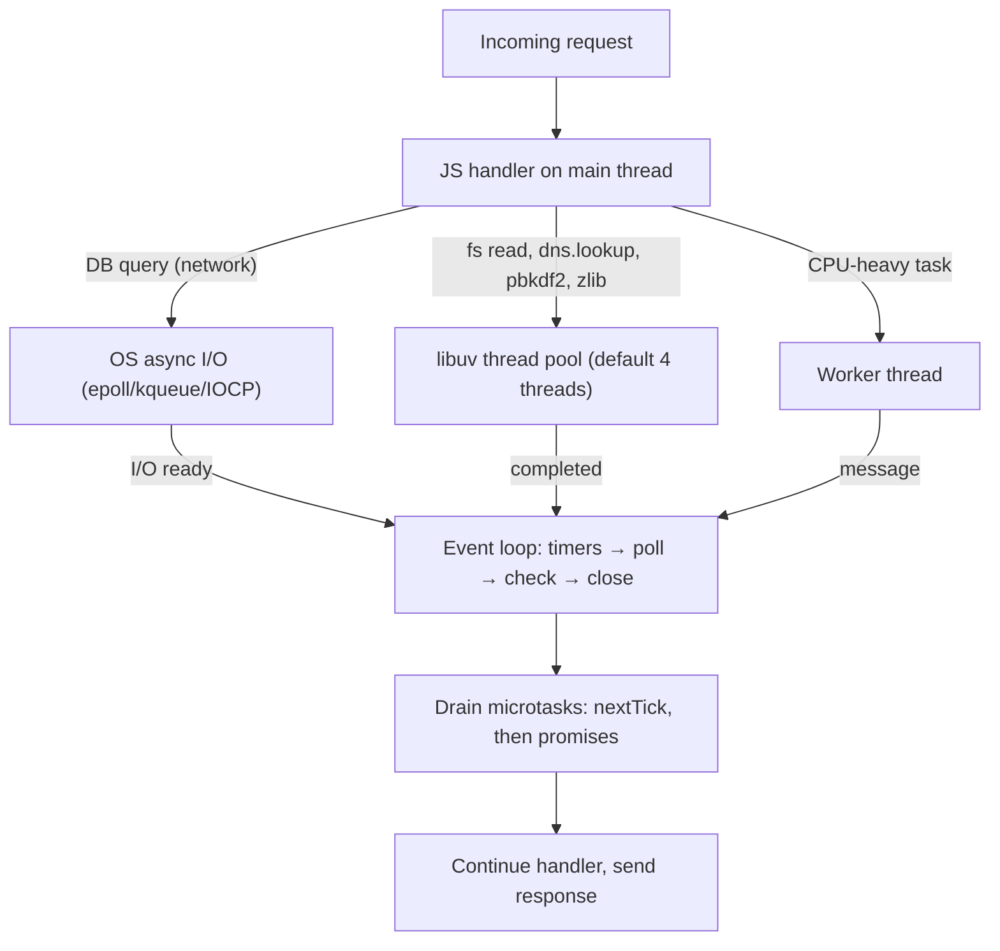

## TL;DR

- Node.js runs JavaScript on V8 with an **event loop** (libuv): a single main thread handles many concurrent I/O operations without blocking. It excels at **I/O-bound** workloads (APIs, gateways, real-time) and struggles with **CPU-bound** work on the main thread.
- **Never block the event loop:** synchronous I/O, heavy JSON/regex/crypto on large inputs, and tight loops stall every request. Offload CPU work to **worker threads**, other services, or native code.
- Use **streams** with backpressure for large data, `AsyncLocalStorage` for request context, and proper async error handling — unhandled promise rejections crash the process by default (since Node 15).
- Scale by running **multiple processes/instances** (containers, cluster) behind a load balancer; profile with built-in tools (`--cpu-prof`, heap snapshots, `perf_hooks`, event loop delay metrics).
- Stay on **LTS** releases, manage npm supply-chain risk, and design for graceful shutdown.

## Core Concepts

### The event loop

Node runs JavaScript on one main thread. Asynchronous operations (network, timers, file system via the thread pool) register callbacks; libuv's event loop cycles through **phases**:

1. **timers** — `setTimeout`/`setInterval` callbacks whose time has elapsed
2. **pending callbacks** — some deferred system callbacks
3. **idle/prepare** — internal
4. **poll** — retrieve new I/O events and run their callbacks; may block waiting for I/O
5. **check** — `setImmediate` callbacks
6. **close callbacks** — e.g. socket `close`

Between each callback, Node drains the **microtask queues**: `process.nextTick` callbacks first, then promise reactions (`.then`, `await` continuations). Recursive `nextTick` or promise chains can starve I/O.

```ts
setTimeout(() => console.log('timeout'), 0);
setImmediate(() => console.log('immediate'));
Promise.resolve().then(() => console.log('promise'));
process.nextTick(() => console.log('nextTick'));
console.log('sync');
// sync, nextTick, promise, then timeout/immediate (order of these two varies in the main module;
// inside an I/O callback, immediate always runs first)
```

### Blocking and CPU work

Anything synchronous and slow blocks *all* requests:
- `fs.readFileSync`, `crypto.pbkdf2Sync`, `zlib.*Sync` in request paths.
- `JSON.parse`/`stringify` of multi-MB payloads.
- Catastrophic regular expressions (ReDoS) on user input.
- Large loops, sorting huge arrays, image processing.

Mitigations: async APIs, streaming parsers, size limits on inputs, safe regex (linear-time engines or validated patterns), and **worker threads** or separate services for CPU-heavy tasks.

### libuv thread pool

File system operations, `dns.lookup`, some `crypto` (pbkdf2, scrypt, randomBytes) and `zlib` run on libuv's **thread pool** (default size 4, configurable with `UV_THREADPOOL_SIZE` up to a limit). Network I/O does **not** use it (it uses the OS's non-blocking mechanisms). A saturated pool causes mysterious latency (e.g. many concurrent `dns.lookup` calls or password hashing).

### Concurrency options

| Mechanism | What it is | Use for |
|---|---|---|
| Async I/O | Default model | Most API work |
| Worker threads | Separate JS threads with message passing / SharedArrayBuffer | CPU-bound tasks in-process (hashing, parsing, image processing) |
| `cluster` / multiple processes | Several Node processes sharing a port | Using multiple cores on a VM; in containers, prefer one process per container and scale replicas |
| Child processes | Spawn other programs | Calling CLIs, isolation |
| External services/queues | Offload heavy jobs | Long-running or bursty CPU work |

### Streams and backpressure

Streams process data in chunks, keeping memory flat. **Backpressure** stops a fast producer overwhelming a slow consumer; `pipeline()` wires it up and handles errors and cleanup.

```ts
import { pipeline } from 'node:stream/promises';
import { createReadStream, createWriteStream } from 'node:fs';
import { createGzip } from 'node:zlib';

await pipeline(createReadStream('export.csv'), createGzip(), createWriteStream('export.csv.gz'));
```

### Async context and errors

```ts
import { AsyncLocalStorage } from 'node:async_hooks';

const requestContext = new AsyncLocalStorage<{ requestId: string; userId?: string }>();

app.use((req, res, next) => requestContext.run({ requestId: req.headers['x-request-id'] as string ?? crypto.randomUUID() }, next));

export const log = (msg: string, extra = {}) =>
  console.log(JSON.stringify({ msg, ...extra, ...requestContext.getStore() })); // requestId follows async calls
```

- Always `await` or handle promises; enable lint rules (`no-floating-promises`).
- **Unhandled rejections** terminate the process by default (Node 15+); **uncaught exceptions** leave the process in an unknown state — log, then exit and let the orchestrator restart it.
- Use centralised error middleware; distinguish operational errors (expected, handled) from programmer errors (bugs).

### Runtime landscape (2026)

- **LTS lines:** even-numbered releases become LTS (Active then Maintenance, about 30 months total). VERIFY: Node 22 and 24 are the current LTS lines; Node 20 reached end of life in April 2026.
- Built-ins reduce dependencies: `fetch` (undici), test runner (`node:test`), watch mode, `.env` loading (`--env-file`), permission model, and TypeScript type stripping (see the TypeScript topic).
- Alternatives: Deno and Bun offer different trade-offs (built-in TS, tooling, performance) with increasing Node compatibility.

## How It Works



The main thread should spend its time on short callbacks; anything long belongs to the OS, the thread pool, a worker, or another service.

## When to Use / Trade-offs

| Use Node.js when | Consider alternatives when |
|---|---|
| I/O-bound APIs, BFFs, gateways, real-time (WebSockets) | Heavy CPU workloads (video, ML inference, large computations) — Go, Rust, Java, Python with native libs, or offload |
| Full-stack TypeScript teams sharing code and types | Strict latency SLOs where GC pauses matter and alternatives are viable |
| Rapid development with a huge ecosystem | Ecosystem risk is unacceptable without strong supply-chain controls |
| Serverless functions with fast cold starts | Long-running, memory-heavy processing |

| Framework | Strengths | Trade-offs |
|---|---|---|
| Express | Ubiquitous, simple, huge middleware ecosystem | Older design; async error handling improved in Express 5 |
| Fastify | High performance, schema-based validation and serialisation, plugins | Smaller ecosystem than Express |
| NestJS | Structured, DI, decorators, opinionated architecture for large teams | Heavier abstraction, decorator-based patterns |
| Hono and similar | Lightweight, multi-runtime (edge, Bun, Deno, Node) | Younger ecosystem |

## Common Pitfalls & Anti-patterns

- **Blocking the event loop** with sync APIs or CPU-heavy work in request handlers.
- **Floating promises** — un-awaited async calls swallowing errors or causing races.
- **Unbounded concurrency** — `Promise.all` over 50,000 items, overwhelming databases or APIs; use pools/limits.
- **Memory leaks** via caches without eviction, event listeners never removed, closures holding large objects, global arrays.
- **Loading huge payloads into memory** instead of streaming.
- **Ignoring backpressure** when piping streams manually.
- **Catching `uncaughtException` and continuing.**
- **Dependency sprawl** — hundreds of transitive packages, typosquatting and malicious updates.
- **Running multiple Node processes per container** without need, or one per VM core in Kubernetes where replicas are simpler.
- **Not handling SIGTERM** — dropped requests on deploy.

## Real-world Scenario

**Context:** A Node.js API's p99 latency spiked from 80 ms to 4 s every few minutes under moderate load, without CPU saturation on dashboards.

**Investigation:** Event loop delay metrics (`monitorEventLoopDelay`) showed 3–4 s stalls. A CPU profile (`--cpu-prof` in a staging load test) revealed a synchronous `JSON.stringify` on a 30 MB report object in an export endpoint, plus `bcrypt` hashing via a sync call in login. Separately, the libuv thread pool was saturated by `dns.lookup` calls from an HTTP client without keep-alive.

**Decision:** Moved exports to a background job producing a streamed file; switched to async hashing in a worker pool with bounded concurrency; enabled HTTP keep-alive and DNS caching; increased `UV_THREADPOOL_SIZE` modestly; added event-loop-delay SLO alerts.

**Outcome:** p99 dropped below 120 ms; stalls disappeared; throughput per instance improved ~2×.

**What I'd do differently:** Instrument event loop delay from day one — CPU averages hid the problem for weeks.

## Interview Questions

### Explain the Node.js event loop. {#event-loop}

**Level:** Foundation

**Model answer:**
Node executes JavaScript on a single main thread. Instead of blocking on I/O, it starts operations asynchronously (via the OS or libuv's thread pool) and registers callbacks. libuv's **event loop** repeatedly runs through phases: **timers** (expired `setTimeout`/`setInterval`), **pending callbacks**, **poll** (process I/O events, possibly waiting for new ones), **check** (`setImmediate`), and **close callbacks**.

After each callback, Node drains **microtasks**: the `process.nextTick` queue first, then promise reactions. This is why `await` continuations run before timers.

The result: one thread can handle thousands of concurrent connections, as long as each callback is short. Long synchronous work blocks every other request.

**What the interviewer is looking for:**
Single main thread, phases, microtasks ordering, and the "keep callbacks short" implication.

**Follow-ups:**
- What's the difference between `setImmediate` and `setTimeout(fn, 0)`?
- Can `process.nextTick` starve the event loop?

**Red flags:**
- "Node is multi-threaded so blocking is fine."
- No idea where promises run.

### What blocks the event loop, and how do you detect and avoid it? {#blocking-event-loop}

**Level:** Foundation

**Model answer:**
Blocking happens when synchronous code runs for a long time on the main thread:
- Sync APIs (`readFileSync`, `pbkdf2Sync`, `execSync`) in request paths.
- Heavy computation: big JSON parse/stringify, large sorts, image processing, compression.
- Catastrophic backtracking regexes (ReDoS) on user input.
- Long loops or recursion over large data.

**Detect:** event loop delay/lag metrics (`perf_hooks.monitorEventLoopDelay`), APM traces showing gaps, CPU profiles (`--cpu-prof`, clinic.js, Chrome DevTools), latency spikes without network causes.

**Avoid:** use async APIs; stream large data; limit input sizes; use safe regexes; offload CPU work to worker threads, background jobs or other services; break work into chunks (`setImmediate` between chunks) if it must stay in-process.

**What the interviewer is looking for:**
Concrete causes, detection via event loop delay and profiling, and remedies.

**Follow-ups:**
- How would you safely process a 500 MB CSV upload?
- What is ReDoS?

**Red flags:**
- Not knowing that JSON.parse is synchronous.

### What are streams and backpressure in Node.js? {#streams-backpressure}

**Level:** Foundation

**Model answer:**
**Streams** process data incrementally in chunks — readable, writable, duplex and transform streams (files, HTTP bodies, sockets, compression). They keep memory usage bounded regardless of data size and let processing start before all data arrives.

**Backpressure** prevents a fast producer from overwhelming a slow consumer: when a writable's internal buffer exceeds its `highWaterMark`, `write()` returns `false`, and the producer should pause until the `drain` event. `stream.pipeline()` (or `pipeline` from `stream/promises`) handles backpressure, errors and cleanup across a chain automatically; async iterators (`for await (const chunk of stream)`) also respect backpressure.

Use cases: file uploads/downloads, exports, proxying, ETL, log processing.

**What the interviewer is looking for:**
Purpose of streams, backpressure mechanics and using pipeline for correct error handling.

**Follow-ups:**
- What happens if you ignore `write()` returning false?
- Why prefer `pipeline` over `.pipe()`?

**Red flags:**
- Reading whole files into memory for large data.

### How should async errors be handled in Node.js? {#async-error-handling}

**Level:** Foundation

**Model answer:**
- **Always await or handle promises**; lint for floating promises. Use `try/catch` around `await` where you can handle the error meaningfully; otherwise let it propagate to a central handler.
- **Framework error middleware** (Express 5 handles rejected promises from async handlers; Fastify has built-in async support) to map errors to responses and log them with context.
- **Distinguish operational errors** (timeouts, validation failures, 404s from dependencies — expected, handled, possibly retried) from **programmer errors** (bugs, undefined access — fix the code).
- **Unhandled rejections** crash the process by default since Node 15 — good: crash and let the orchestrator restart rather than continue in an unknown state. Log them before exiting.
- **`uncaughtException`:** log and exit; don't try to continue.
- **Event emitters:** always handle `'error'` events, or the process crashes.
- **Timeouts and cancellation:** use `AbortController`/`AbortSignal.timeout()` for fetch and long operations.

**What the interviewer is looking for:**
Awaiting promises, central handling, operational vs programmer errors, crash-on-unknown-state and cancellation.

**Follow-ups:**
- What happens to in-flight requests when the process crashes?
- How do you add timeouts to a fetch call?

**Red flags:**
- Swallowing errors with empty catch blocks.
- Continuing after uncaught exceptions.

### What is the libuv thread pool, and when does it become a bottleneck? {#libuv-threadpool}

**Level:** Senior

**Model answer:**
libuv maintains a small thread pool (default **4 threads**, configurable via `UV_THREADPOOL_SIZE` set before the pool is first used) for operations without good non-blocking OS APIs: most **file system** calls, **`dns.lookup`** (used by default for hostname resolution), CPU-heavy **crypto** (`pbkdf2`, `scrypt`, `randomBytes` for large sizes), and **zlib** compression.

Network sockets don't use it — they use the OS's async mechanisms (epoll, kqueue, IOCP).

It becomes a bottleneck when many such operations run concurrently: e.g. password hashing for login bursts, lots of file reads, or many new outbound connections each doing `dns.lookup`. Symptoms: latency spikes even though CPU and event loop delay look okay for JS.

Mitigations: increase pool size (moderately, considering CPU cores), use keep-alive and DNS caching (or `dns.resolve`, which uses the network), move heavy crypto to worker threads with bounded concurrency, and stream/cache file access.

**What the interviewer is looking for:**
What uses the pool, default size, symptoms and mitigations.

**Follow-ups:**
- Why does `dns.lookup` use the thread pool while `dns.resolve` doesn't?
- How would you measure thread pool saturation?

**Red flags:**
- Believing all async operations run on the thread pool.

### How do you use multiple CPU cores with Node.js? {#scaling-nodejs}

**Level:** Senior

**Model answer:**
- **Multiple processes:** run several Node processes. On VMs, the `cluster` module or a process manager (PM2) forks workers sharing a port. **In containers/Kubernetes**, the usual approach is one process per container and more replicas, with resource requests around one CPU — simpler scheduling, isolation and observability.
- **Worker threads:** for CPU-bound work inside one process (parsing, hashing, image transforms), using a pool (e.g. Piscina) with bounded concurrency and message passing (or `SharedArrayBuffer` for shared memory). Not for I/O — async I/O already scales on one thread.
- **Offloading:** queues and dedicated services (possibly in other languages) for heavy or long-running processing.
- **Statelessness:** keep processes stateless (sessions in Redis, no in-memory state that must be shared) so scaling horizontally works.

**What the interviewer is looking for:**
Processes vs threads, containers favour replicas, worker pools for CPU work, statelessness.

**Follow-ups:**
- What's the cost of transferring data to worker threads?
- Why might cluster mode in a container be a bad idea?

**Red flags:**
- Using worker threads to "speed up" database calls.

### How do you find and fix a memory leak in a Node.js service? {#memory-leaks}

**Level:** Senior

**Model answer:**
1. **Confirm:** memory (heap used, RSS) grows steadily under steady load without returning after GC; OOM kills in containers.
2. **Reproduce** in a controlled environment with a load test.
3. **Heap snapshots:** take several (via `--inspect` and DevTools, `v8.writeHeapSnapshot()`, or `--heapsnapshot-signal`) at intervals; compare to find object types growing; inspect **retainer paths** to see what keeps them alive.
4. **Common causes:**
   - Unbounded in-memory caches/maps (use LRU with size/TTL limits).
   - Event listeners added per request and never removed.
   - Closures capturing large objects; timers/intervals not cleared.
   - Global arrays of requests/logs; AsyncLocalStorage stores holding large objects.
   - Native memory (buffers) — RSS grows while heap doesn't.
5. **Fix and verify** with the same load test; add memory metrics and alerts.
6. **Container settings:** set `--max-old-space-size` below the container memory limit to leave room for non-heap memory.

**What the interviewer is looking for:**
Reproduction, heap snapshot comparison with retainers, common causes and container memory tuning.

**Follow-ups:**
- Heap is stable but RSS grows. What could it be?
- How do you take a heap snapshot in production safely?

**Red flags:**
- "Restart it nightly" as the fix.

### How do you propagate request context (request IDs, user) through async code? {#async-context}

**Level:** Senior

**Model answer:**
Use **`AsyncLocalStorage`** (from `node:async_hooks`): run each request's handling inside `als.run(store, fn)`, then any code in the async call chain — including after `await`, timers and callbacks — can read the store with `als.getStore()`, without passing context through every function.

Uses: request/correlation IDs in logs, tenant and user context for authorisation, tracing (OpenTelemetry's Node SDK uses it for active spans), per-request caches.

Caveats:
- Keep stores small; don't stash large objects.
- Context can be lost with some callback-based libraries or custom thread pools — test integrations; `AsyncResource` can bind callbacks.
- Workers don't inherit context — pass needed values explicitly.
- Don't use it to hide essential dependencies that should be explicit parameters.

**What the interviewer is looking for:**
AsyncLocalStorage usage, practical applications and caveats.

**Follow-ups:**
- How does OpenTelemetry track the current span in Node?
- What's the performance impact?

**Red flags:**
- Global variables for request context.

### How do you profile a slow Node.js service? {#profiling}

**Level:** Senior

**Model answer:**
- **Start with metrics:** latency by endpoint, event loop delay, CPU, memory, GC pauses, thread pool and connection pool usage; APM/OpenTelemetry traces to locate slow spans (DB, external calls vs in-process).
- **CPU profiling:** `node --cpu-prof` or `--inspect` with Chrome DevTools, clinic.js flame graphs, or continuous profilers in production — look for hot functions, sync work, expensive serialisation, regexes.
- **Event loop analysis:** `perf_hooks.monitorEventLoopDelay`, clinic doctor/bubbleprof for async bottlenecks.
- **Memory/GC:** heap snapshots, `--trace-gc`, allocation profiling for GC pressure.
- **Load testing** (k6, autocannon) to reproduce under realistic concurrency.
- **Fix** with evidence: caching, batching DB calls, streaming, connection keep-alive and pooling, moving CPU work off the main thread, algorithm improvements — then re-measure.

**What the interviewer is looking for:**
Metrics-first approach, the right profiling tools, reproduction with load tests and evidence-based fixes.

**Follow-ups:**
- What does a flame graph show?
- How do you profile safely in production?

**Red flags:**
- Guessing and micro-optimising without data.

### How do you implement graceful shutdown in a Node.js service? {#nodejs-graceful-shutdown}

**Level:** Senior

**Model answer:**
```ts
const server = app.listen(8080);
let shuttingDown = false;

async function shutdown(signal: string) {
  if (shuttingDown) return;
  shuttingDown = true;
  log(`received ${signal}, draining`);
  readiness.markNotReady();                       // fail readiness so the LB stops sending traffic
  await new Promise((r) => setTimeout(r, 5_000)); // allow endpoint removal to propagate
  server.close();                                  // stop accepting new connections
  server.closeIdleConnections?.();                 // Node 18.2+: close idle keep-alive sockets
  await Promise.race([inFlight.drained(), new Promise((r) => setTimeout(r, 20_000))]);
  await Promise.allSettled([db.end(), queueConsumer.stop(), telemetry.shutdown()]);
  process.exit(0);
}
process.on('SIGTERM', () => void shutdown('SIGTERM'));
process.on('SIGINT', () => void shutdown('SIGINT'));
```

Key points: Node must receive the signal (run `node` directly as PID 1 or with a proper init; avoid `npm start` wrappers that don't forward signals), fail readiness, stop accepting connections, close keep-alive connections, finish in-flight requests within the orchestrator's grace period, stop consumers cleanly (commit offsets), flush telemetry, then exit.

**What the interviewer is looking for:**
Signal handling, readiness, connection draining incl. keep-alive, bounded wait, resource cleanup and PID 1 awareness.

**Follow-ups:**
- Why do keep-alive connections delay shutdown?
- What happens if shutdown exceeds the grace period?

**Red flags:**
- No SIGTERM handling.

### How do you choose a Node.js web framework for a large organisation? {#framework-choice}

**Level:** Architect

**Model answer:**
Criteria: team size and experience, need for structure, performance requirements, ecosystem and plugins, TypeScript support, validation and OpenAPI integration, observability, maintenance and community health, and runtime targets (Node only, or edge/Bun/Deno too).

- **Express:** familiar to most developers, huge middleware ecosystem; Express 5 improved async error handling. Minimal structure — you must provide conventions.
- **Fastify:** strong performance, JSON-schema validation and fast serialisation, encapsulated plugin system, good TypeScript support — a strong default for high-throughput APIs.
- **NestJS:** opinionated architecture (modules, DI, decorators), consistency across many teams, integrations for GraphQL, microservices, OpenAPI; heavier abstraction and learning curve.
- **Hono / lightweight frameworks:** multi-runtime, edge-friendly, small.

For an organisation: standardise on one or two options with a **paved-road template** (logging, tracing, health checks, config, validation, error handling, graceful shutdown, security headers), so the framework choice matters less than consistent cross-cutting concerns. Record the choice in an ADR.

**What the interviewer is looking for:**
Criteria-based comparison and emphasis on paved-road consistency.

**Follow-ups:**
- Would you migrate existing Express services to Fastify? How?
- How do you keep dependencies of 80 Node services up to date?

**Red flags:**
- Choosing by benchmark numbers alone.

### What are the main security risks specific to Node.js applications? {#nodejs-security}

**Level:** Architect

**Model answer:**
- **Supply chain:** large dependency trees, typosquatting, compromised maintainer accounts, malicious install scripts. Mitigate with lockfiles, `npm ci`, curated registries, SCA with reachability, provenance (npm provenance attestations), restricting install scripts, automated updates with review, minimising dependencies (use built-ins like `fetch`, `node:test`).
- **Prototype pollution:** merging untrusted objects (`__proto__`, `constructor.prototype`) altering behaviour — use safe merge utilities, `Object.create(null)` maps, schema validation, and freeze prototypes where appropriate.
- **ReDoS:** catastrophic regexes on user input blocking the event loop — validate regexes, limit input length, consider linear-time regex engines.
- **Injection:** SQL/NoSQL (MongoDB operator injection like `{"$gt": ""}`), command injection via `child_process` with shell strings — parameterise and validate.
- **Deserialisation and eval:** avoid `eval`, `new Function`, `vm` for untrusted code (not a sandbox).
- **SSRF** from URL-fetching features.
- **Path traversal** in file serving.
- **Secrets handling** and environment leakage in logs.
- **Runtime hardening:** run as non-root, least-privilege credentials, the Node permission model for restricting file/network/child process access where suitable (VERIFY: stability status by version), security headers (Helmet).

**What the interviewer is looking for:**
Node-specific risks (supply chain, prototype pollution, ReDoS, NoSQL injection, vm misconceptions) with concrete mitigations.

**Follow-ups:**
- How does prototype pollution lead to privilege escalation?
- How do you evaluate a new npm dependency?

**Red flags:**
- Treating `vm` as a security sandbox.

### When would you not choose Node.js for a backend? {#when-not-nodejs}

**Level:** Architect

**Model answer:**
- **CPU-heavy workloads:** video/image processing, large-scale numerical computation, ML training/inference — better in languages with strong multithreading or native ecosystems (Go, Rust, Java, C++, Python with native libraries), or as separate services.
- **Very strict tail-latency requirements** with heavy memory churn, where GC behaviour and single-threaded execution make p99.9 hard to control.
- **Domains where another ecosystem is far stronger:** data science (Python), enterprise integration with mature JVM libraries, systems programming.
- **Teams without JavaScript/TypeScript expertise** and no plan to build it.
- **Long-running, memory-intensive batch processing** where a JVM or Go service would be simpler to operate.

Node remains a great choice for I/O-heavy APIs, BFFs, real-time services and full-stack TypeScript teams. Polyglot is fine with a clear paved road for each supported language.

**What the interviewer is looking for:**
Balanced judgement based on workload characteristics, ecosystem and team.

**Follow-ups:**
- Your team wants to rewrite a Node service in Go for performance. How do you evaluate it?
- Can worker threads close the gap for CPU work?

**Red flags:**
- Dogmatic "Node for everything" or "Node is a toy".

### How would you design a high-throughput API in Node.js? {#high-throughput-node}

**Level:** Architect

**Model answer:**
- **Keep the main thread free:** async I/O only; schema-based validation and serialisation (e.g. Fastify with JSON schemas) for speed; avoid large synchronous transforms; stream big payloads.
- **Connection management:** HTTP keep-alive for outbound calls (undici agents), connection pools for databases with sensible sizes, DNS caching.
- **Bounded concurrency:** limit parallel downstream calls (p-limit, pools), apply backpressure and load shedding (return 503 when queues are full), timeouts with `AbortSignal`.
- **Caching:** in-process LRU for hot data with TTLs, plus a distributed cache; request coalescing to avoid thundering herds.
- **CPU work offloaded** to worker pools or separate services.
- **Horizontal scaling:** stateless instances, one process per container, autoscaling on RPS/latency/event loop delay.
- **Observability:** OpenTelemetry traces, RED metrics, event loop delay, GC metrics, profiling in production.
- **Load testing** to find limits; tune Node/V8 flags only with evidence (e.g. heap size).

**What the interviewer is looking for:**
Main-thread hygiene, connection reuse, bounded concurrency and load shedding, caching, horizontal scaling and observability.

**Follow-ups:**
- What metric would you autoscale on?
- How do you prevent one slow downstream dependency from exhausting resources?

**Red flags:**
- Unbounded `Promise.all` fan-outs.

### What's your strategy for Node.js versions and upgrades across many services? {#nodejs-lts-strategy}

**Level:** Architect

**Model answer:**
- **Use LTS releases only** in production (even-numbered majors once they enter Active LTS); plan upgrades well before End of Life — LTS lines get about 30 months of support. Track the official release schedule.
- **Standardise via paved road:** base images, CI templates and `engines` fields pin supported versions; Renovate/Dependabot open upgrade PRs across repositories.
- **Test upgrades:** run test suites on the next LTS in CI early (matrix builds), watch deprecation warnings, check native modules (node-gyp addons) and dependencies for compatibility.
- **Roll out progressively:** non-critical services first, then canaries for critical ones; monitor latency, memory and error rates (V8 and GC changes can shift behaviour).
- **Track the fleet:** dashboard of Node versions per service; escalate stragglers near EOL; patch-level updates applied quickly for security releases.
- **Adopt new built-ins deliberately** (fetch, test runner, type stripping) to reduce dependencies.

**What the interviewer is looking for:**
LTS discipline, automation, early testing, progressive rollout, fleet visibility and security patching.

**Follow-ups:**
- A critical service depends on a native module that doesn't support the new version. What do you do?
- How quickly should you apply Node security releases?

**Red flags:**
- Running odd-numbered (non-LTS) releases in production long-term.
- Services on end-of-life versions.

## Cheat Sheet

### Runtime model
- **Event loop phases** — timers, pending callbacks, poll, check (`setImmediate`), close.
- **Microtasks** — `process.nextTick` queue first, then promise reactions, between callbacks.
- **libuv thread pool** — default 4 threads; fs, `dns.lookup`, pbkdf2/scrypt, zlib — not network sockets.
- **Blocking** — sync APIs, big JSON, ReDoS, heavy loops stall every request.
- **Event loop delay** — the key Node health metric; alert on it.

### Practices
- **Worker threads** — for CPU-bound work in-process, via a bounded pool.
- **Scale out** — one process per container, more replicas; cluster mainly on VMs.
- **Streams + pipeline** — bounded memory and automatic backpressure and cleanup.
- **AsyncLocalStorage** — request context across async calls (used by OpenTelemetry).
- **Unhandled rejections** — crash the process by default since Node 15; log and let it restart.
- **Graceful shutdown** — SIGTERM, fail readiness, close server and keep-alive sockets, drain, exit.
- **Memory leaks** — compare heap snapshots and follow retainer paths.

### Ecosystem and security
- **LTS** — even-numbered majors; about 30 months of support; upgrade before EOL.
- **Prototype pollution** — untrusted merges altering `Object.prototype`; validate and use safe maps.
- **`vm` is not a sandbox** — never run untrusted code with it.

## Further Reading

- [Node.js: The Node.js Event Loop](https://nodejs.org/en/learn/asynchronous-work/event-loop-timers-and-nexttick) — official explanation of phases, timers and `nextTick`.
- [Node.js: Don't block the event loop](https://nodejs.org/en/learn/asynchronous-work/dont-block-the-event-loop) — guidance on blocking work and the thread pool.
- [Node.js release schedule](https://nodejs.org/en/about/previous-releases) — LTS lines and end-of-life dates.
- [Node.js API: AsyncLocalStorage](https://nodejs.org/api/async_context.html) — async context tracking.
- [Node.js API: Worker threads](https://nodejs.org/api/worker_threads.html) — CPU parallelism in Node.
- [Node.js Security Best Practices](https://nodejs.org/en/learn/getting-started/security-best-practices) — official threat model and mitigations.
