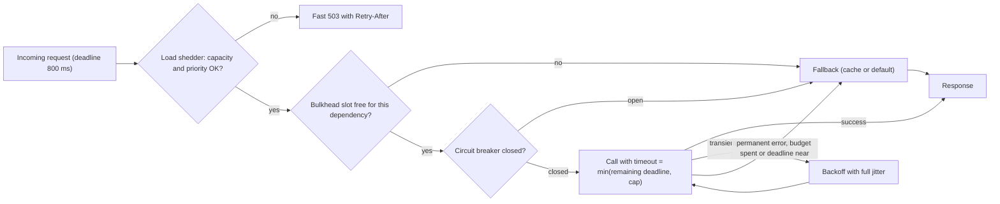
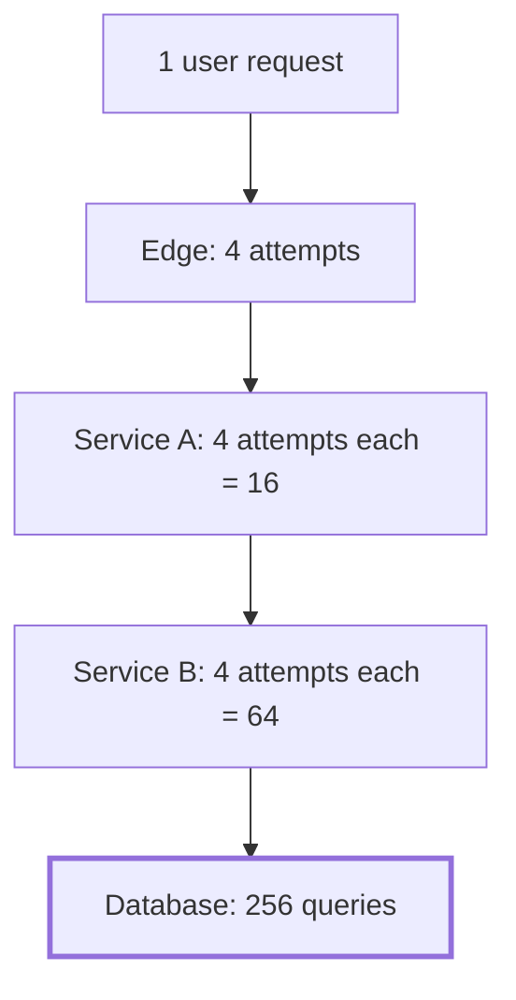

## TL;DR

- Most outages that spread between services are **amplification failures**: a slow dependency ties up threads, connections or memory upstream, and retries multiply the load on the thing that is already struggling. Resilience patterns exist to **contain** failure, not to hide it.
- Every remote call needs a **timeout**, derived from the dependency's measured latency and the caller's own **deadline**. Propagate the remaining deadline downstream so no one works on a request the user has already abandoned.
- **Retry** only idempotent operations, only on transient errors, at **one layer**, with **exponential backoff, full jitter and a retry budget**. Unbounded retries turn a blip into an outage.
- **Circuit breakers, bulkheads and load shedding** stop one bad dependency or one traffic spike from consuming everything. **Fallbacks** keep the user journey working in a degraded mode, but only if they are simpler than the thing they replace and are tested.
- Resilience is proven by **experiment**: chaos and game days check that the configured behaviour actually happens under failure.

## Core Concepts

### Failure modes you're designing for

| Failure | What it looks like | Primary defences |
|---|---|---|
| Dependency down | Connection refused, immediate 5xx | Fast failure, circuit breaker, fallback |
| Dependency slow | Requests hang, latency rises, pools fill | Timeouts, bulkheads, load shedding |
| Transient blip | Occasional resets, a 503 during a deploy | Retries with backoff and jitter |
| Overload | Rising latency and errors with traffic | Rate limiting, load shedding, autoscaling, backpressure |
| Partial or grey failure | One AZ, one shard or one host is bad | Outlier detection, hedging, cell isolation |

A slow dependency is usually worse than a dead one. A dead dependency fails fast. A slow one holds resources on every caller, so the failure **cascades** upstream.

### Timeouts and deadlines

Pick timeouts from data, not round numbers:

- **Connect timeout**: short (hundreds of milliseconds inside a region). A slow connect usually means the host is gone.
- **Request timeout**: a little above the dependency's p99 or p99.9 latency for that operation, and always below the caller's own remaining time.
- **Deadline**: the absolute time by which the whole request must finish. Each hop subtracts its own elapsed time and passes on what's left, as gRPC does natively with deadlines.

```ts
// Deadline-aware fetch: the downstream timeout can never exceed what the caller has left.
export async function callWithDeadline(url: string, deadline: number, init: RequestInit = {}) {
  const remaining = deadline - performance.now();
  if (remaining <= 5) throw new Error('Deadline exceeded before call');   // don't start doomed work
  const signal = AbortSignal.any([
    AbortSignal.timeout(Math.min(remaining, 2_000)),                     // per-call cap
    ...(init.signal ? [init.signal] : []),
  ]);
  return fetch(url, {
    ...init,
    signal,
    headers: { ...init.headers, 'x-request-deadline-ms': String(Math.floor(remaining)) },
  });
}
```

`AbortSignal.timeout()` and `AbortSignal.any()` are built into Node.js (since 17.3 and 20.3 respectively) and modern browsers, so no library is needed.

### Retries, backoff and jitter

Retry only when all three hold:

1. **The operation is idempotent**: a GET, a PUT of a full resource, or a POST carrying an idempotency key.
2. **The error is transient**: a connection reset, 502, 503, 504, or 429 with a `Retry-After` header. Never retry 400, 401, 403, 404 or 422. The answer won't change.
3. **There is time left** before the deadline.

**Exponential backoff** spreads retries out. **Jitter** stops clients that failed together from retrying together, which would hit the recovering service in synchronised waves. AWS's analysis found **full jitter** (a random delay between 0 and the exponential cap) gives the least total work for contended resources.

```ts
const sleep = (ms: number) => new Promise((r) => setTimeout(r, ms));

export async function retry<T>(
  fn: (attempt: number) => Promise<T>,
  { maxAttempts = 3, baseMs = 100, capMs = 2_000, isRetryable = (_e: unknown) => true } = {},
): Promise<T> {
  for (let attempt = 1; ; attempt++) {
    try {
      const result = await fn(attempt);
      retryBudget.deposit();                               // successes earn retry tokens
      return result;
    } catch (err) {
      if (attempt >= maxAttempts || !isRetryable(err) || !retryBudget.tryWithdraw()) throw err;
      const exp = Math.min(capMs, baseMs * 2 ** (attempt - 1));
      await sleep(Math.random() * exp);                    // full jitter
    }
  }
}
```

### Retry budgets and amplification

If each of 5 layers makes 1 attempt plus 3 retries, one user request can become `4^5 = 1,024` calls at the bottom layer during an outage. Two rules prevent this:

- **Retry at one layer**: usually the one closest to the failing dependency, or the edge. Every other layer passes failures through.
- **Retry budget**: retries may add at most a fixed fraction of load, for example 10% of successful requests over a sliding window. When the budget is spent, fail fast. gRPC's retry throttling and Finagle's retry budgets work this way.

```ts
// Token bucket: each success deposits 0.1 tokens, each retry withdraws 1.
// Retries can therefore never exceed ~10% of successful traffic.
export const retryBudget = {
  tokens: 10, max: 10,
  deposit() { this.tokens = Math.min(this.max, this.tokens + 0.1); },
  tryWithdraw() { if (this.tokens < 1) return false; this.tokens -= 1; return true; },
};
```

### Circuit breakers

A breaker watches the outcome of calls to one dependency and stops calling it when it is clearly failing. That gives the dependency room to recover and gives callers an instant answer instead of a timeout.

- **Closed**: calls flow. The breaker tracks the failure rate (and slow-call rate) over a sliding window, with a minimum number of calls before it can trip.
- **Open**: calls fail immediately (or go to the fallback) for a cool-down period.
- **Half-open**: a few trial calls are allowed. If they succeed, close. If not, open again.

```ts
type State = 'closed' | 'open' | 'half-open';

export class CircuitBreaker {
  private state: State = 'closed';
  private openedAt = 0;
  private window: boolean[] = [];             // true = failure, last N calls

  constructor(private readonly opts = { size: 50, minCalls: 20, failureRate: 0.5, coolDownMs: 10_000 }) {}

  async call<T>(fn: () => Promise<T>, fallback?: () => T | Promise<T>): Promise<T> {
    if (this.state === 'open') {
      if (performance.now() - this.openedAt < this.opts.coolDownMs) {
        if (fallback) return fallback();
        throw new Error('Circuit open');
      }
      this.state = 'half-open';
    }
    try {
      const result = await fn();
      this.record(false);
      return result;
    } catch (err) {
      this.record(true);
      if (fallback) return fallback();
      throw err;
    }
  }

  private record(failed: boolean) {
    if (this.state === 'half-open') {
      if (failed) this.trip(); else { this.state = 'closed'; this.window = []; }
      return;
    }
    this.window.push(failed);
    if (this.window.length > this.opts.size) this.window.shift();
    const failures = this.window.filter(Boolean).length;
    if (this.window.length >= this.opts.minCalls && failures / this.window.length >= this.opts.failureRate) this.trip();
  }

  private trip() { this.state = 'open'; this.openedAt = performance.now(); }
}
```

In production, use a maintained library rather than this sketch: **Resilience4j** (Java), **Polly** (.NET, with resilience pipelines from v8 and `Microsoft.Extensions.Http.Resilience`), and **cockatiel** or **opossum** (Node.js). Netflix's Hystrix has been in maintenance mode since 2018.

### Bulkheads

Named after a ship's watertight compartments: partition resources so one failing area can't sink the rest.

- **Per-dependency concurrency limits.** At most 20 in-flight calls to the recommendations service, so a slow recommender can't exhaust the event loop's sockets or the thread pool used for payments.
- **Separate connection pools** per downstream and per priority.
- **Separate deployments or cells** for noisy tenants or critical journeys.

```ts
// A semaphore-based bulkhead: reject immediately when the compartment is full.
export class Bulkhead {
  private inFlight = 0;
  constructor(private readonly limit: number) {}
  async run<T>(fn: () => Promise<T>): Promise<T> {
    if (this.inFlight >= this.limit) throw new Error('Bulkhead full');   // shed, don't queue forever
    this.inFlight++;
    try { return await fn(); } finally { this.inFlight--; }
  }
}
```

### Load shedding and adaptive concurrency

When a server is past capacity, accepting more work makes everyone slower, until every request times out and goodput falls to zero. **Load shedding** rejects some requests early and cheaply (a 503 or 429 before any expensive work) so the rest succeed.

- **Shed by priority**: health checks and checkout before analytics and prefetch.
- **Bound queues and give them timeouts**: a request that waited 5 seconds in a queue for a 2-second deadline is already dead. Drop it before doing the work.
- **Adaptive concurrency limits** discover the server's capacity from latency, as TCP congestion control does, instead of using a fixed number. Examples are Netflix's `concurrency-limits` (Vegas and Gradient algorithms) and Envoy's adaptive concurrency filter.

**Rate limiting** is different. It enforces *fairness and contracts per client* ("100 requests per minute per API key"). Load shedding protects *the server* regardless of who is sending. You usually need both.

### Fallbacks and graceful degradation

A fallback answers when the primary path can't: a cached value, a static default ("popular items" instead of personalised recommendations), a reduced feature, or an honest "try again later". Rules:

- A fallback must be **simpler and more reliable** than the primary, preferably local. A fallback that calls another remote service is just a second point of failure.
- **Exercise it regularly.** Fallback code that only runs during outages is the least-tested code in the system.
- Some operations must **fail closed**: authorisation, payments, anything with legal effect. Never "allow if the policy service is down".

### Hedged requests

For read-heavy fan-out services, the slowest replica dominates tail latency. A **hedged request** sends a second copy to another replica if the first hasn't answered by roughly the p95 latency, and uses whichever returns first. Google's "The Tail at Scale" reported large p99.9 reductions for about 2–5% extra load. Use it only for idempotent reads, and cancel the losing request.

### Chaos engineering

Chaos engineering verifies resilience by injecting faults in a controlled way:

1. Define the **steady state** as a business metric, such as orders per minute or the login success rate.
2. **Hypothesise** that it holds when something fails: "If the recommendations service adds 2 s of latency, checkout conversion stays within 1%."
3. **Inject the fault** with a small blast radius and an abort condition. Tools include AWS Fault Injection Service, Azure Chaos Studio, Gremlin, LitmusChaos and Chaos Mesh.
4. **Learn** from the difference, fix it, and automate the experiment.

## How It Works

### A resilient call path



The order matters. Shed first, because it's the cheapest check. Check the bulkhead before the breaker, so a full compartment doesn't count as a dependency failure. Retry inside the breaker, so retries are visible to it.

### Retry amplification



With retries at only the edge and a 10% retry budget, the same outage costs the database about 1.1 queries per user request.

## When to Use / Trade-offs

| Pattern | Use when | Avoid when | Cost |
|---|---|---|---|
| Timeout + deadline | Always, on every remote call | Never skip it | Tuning per operation, and false timeouts if set too tight |
| Retry with backoff + jitter | Idempotent calls, transient errors | Non-idempotent writes without a key, or user-facing paths with no time left | Extra load, higher tail latency |
| Retry budget | Any service with retries | — | A little state per client |
| Circuit breaker | A dependency that fails hard and needs time to recover | Calls that are already cheap to fail, or very low traffic (it never sees enough calls) | Tuning thresholds, a risk of flapping |
| Bulkhead | Several dependencies with different criticality | A single dependency | Slightly lower utilisation |
| Load shedding | Bursty traffic, or capacity that can't scale instantly | — | Rejected requests during spikes, by design |
| Hedged requests | Fan-out reads with a long tail | Writes, or a dependency that is already overloaded | 2–5% extra load |
| Fallback | A non-critical feature with an acceptable degraded mode | Authorisation, payments, correctness-critical data | Code paths that must be tested |
| Service mesh policies (Envoy, Istio, Linkerd) | Many services, uniform timeouts, retries and outlier detection | Logic that needs business context (fallback content) | Sidecar or ambient overhead, platform complexity |

## Common Pitfalls & Anti-patterns

- **No timeout, or the library default** — many HTTP clients default to no request timeout or to minutes. One slow dependency then exhausts the caller.
- **Timeouts that grow downstream** — the edge times out at 2 s while a service behind it waits 10 s on the database. Work continues for responses nobody will receive.
- **Retrying at every layer** — retries multiply across layers and turn a partial outage into a total one.
- **Retrying non-idempotent writes** — duplicate payments and orders. Use idempotency keys.
- **Synchronised retries** — backoff without jitter hits the recovering service in waves.
- **Breakers per instance with tiny windows** — they trip on one or two errors at low traffic, or never trip at all. Set a minimum call count.
- **Fallbacks that call another remote service** — this doubles the dependencies and fails at the same moment.
- **Liveness probes that check dependencies** — when the database blips, Kubernetes restarts every pod, which then stampede the database on startup.
- **Unbounded queues** — they turn overload into latency, then into memory exhaustion. Bound every queue and give it a timeout.
- **Untested configuration** — resilience settings scattered through code and never exercised under fault injection.

## Real-world Scenario

**Context:** A retail platform's product page called 9 services. During a Black Friday warm-up, the reviews service's database hit lock contention and its latency rose from 80 ms to 6 s. Within four minutes the product page, and then checkout, was down. Checkout shared the API gateway's connection pool, and every layer retried three times.

**Analysis:**
- The gateway had a 30-second timeout and one shared pool of 500 upstream connections. Requests waiting on reviews filled it.
- Retries at the gateway, the product-page BFF and the reviews client multiplied load on the reviews database by up to 64 times.
- The reviews fallback ("load reviews later") existed in the frontend but never ran, because the BFF waited the full 30 seconds.

**Decision:**
1. Deadlines: the edge set an 800 ms deadline for the product page, propagated as a header. Each client took `min(remaining, per-call cap)`.
2. Retries: removed everywhere except the clients nearest each dependency, with full jitter and a 10% retry budget.
3. Bulkheads: separate connection pools and concurrency limits for critical (pricing, stock, checkout) and non-critical (reviews, recommendations) calls.
4. Breakers on reviews and recommendations, with fallbacks to cached aggregates.
5. Load shedding at the gateway with priority classes, so checkout traffic is always admitted first.
6. A monthly game day using Azure Chaos Studio to add latency to one non-critical service in a production cell.

**Outcome:** In the real Black Friday, the recommendations service degraded for 20 minutes. Product pages showed "popular items", checkout was unaffected, and p99 page latency stayed under 900 ms.

**What I'd do differently:** Treat resilience settings as reviewed configuration from day one, with dashboards for breaker state, budget usage and shed rate. We found two clients still using a 60-second default timeout months later.

## Interview Questions

### Why does every remote call need a timeout, and how do you choose its value? {#choosing-timeouts}

**Level:** Foundation

**Model answer:**
Without a timeout, a call to a hung dependency holds the caller's resources (a socket, memory, a thread or a slot in a pool) indefinitely. Enough of them and the caller stops serving anything, so the failure spreads upstream. A timeout bounds how long you'll wait and turns "hung" into a failure you can handle.

Choosing the value:
- Start from the dependency's **measured latency**: a little above p99 or p99.9 for that specific operation, so you rarely time out healthy calls.
- Keep it **below the caller's remaining deadline**. There's no point waiting 5 s when the user's request times out at 2 s.
- Set separate **connect** and **request** timeouts. Connects should fail fast.
- Review them when latency changes, and alert on the timeout rate.

**What the interviewer is looking for:**
Linking timeouts to resource exhaustion and cascading failure, and choosing values from data and deadlines rather than guesses.

**Follow-ups:**
- What happens to the work the dependency is still doing after you time out?
- How would you handle an operation that is legitimately slow, such as a report export?

**Red flags:**
- Relying on library defaults.
- A single global timeout of 30 or 60 seconds.

### Explain the three states of a circuit breaker. {#circuit-breaker-states}

**Level:** Foundation

**Model answer:**
- **Closed**: calls pass through while the breaker records outcomes over a sliding window (by count or time). When the failure rate, or the slow-call rate, crosses a threshold, with at least a minimum number of calls, it trips.
- **Open**: calls fail immediately or go to a fallback, without touching the dependency, for a cool-down period. Callers get an instant answer, and the dependency gets breathing room.
- **Half-open**: after the cool-down, a limited number of trial calls go through. Success closes the breaker. Failure reopens it, often with a longer cool-down.

The breaker's state should be visible on dashboards and should emit events, because an open breaker is a symptom someone needs to see.

**What the interviewer is looking for:**
All three states, why it helps both caller and callee, and the minimum-calls detail.

**Follow-ups:**
- Should a 404 count as a failure?
- Would you keep breakers per instance or share state across instances?

**Red flags:**
- Confusing a circuit breaker with a retry.
- Opening on a single error.

### Which errors should be retried, and which shouldn't? {#retryable-errors}

**Level:** Foundation

**Model answer:**
Retry only **transient** errors on **idempotent** operations:
- Connection resets, connect timeouts and DNS hiccups.
- HTTP 502, 503 and 504, and 429 when you honour `Retry-After`.
- Database deadlocks and serialization failures, where the database explicitly says "retry the transaction".

Don't retry:
- 400, 401, 403, 404, 409 and 422. The same request will get the same answer.
- Non-idempotent operations, unless the server deduplicates them with an idempotency key.
- A request timeout on a write, unless the write is idempotent. The first attempt may have succeeded.
- Anything when the deadline has nearly passed.

Even for retryable errors, cap the attempts (2–3), use backoff with jitter, and respect a retry budget.

**What the interviewer is looking for:**
Separating error types, and specifically recognising that a timeout on a write is ambiguous.

**Follow-ups:**
- How does an idempotency key work on the server side?
- How would you handle `Retry-After` at the client?

**Red flags:**
- "Retry everything three times."
- Retrying POSTs without idempotency.

### What is the difference between rate limiting and load shedding? {#rate-limit-vs-load-shed}

**Level:** Foundation

**Model answer:**
- **Rate limiting** enforces a policy *per client*: API key X may make 100 requests per minute. It's about fairness, contracts and abuse prevention. It returns 429, ideally with `Retry-After`, and it applies even when the server has spare capacity.
- **Load shedding** protects *the server*: when it is at capacity, it rejects some requests early so the rest succeed. It's driven by the server's own health (concurrency, queue time, CPU), not by who is calling, and it usually returns 503.

You need both. A well-behaved client within its quota can still be shed during a spike, and a misbehaving client should be rate limited even when the server is idle. Good load shedding is also priority-aware, so critical traffic is the last to be shed.

**What the interviewer is looking for:**
Different purposes and signals, and the understanding that they complement each other.

**Follow-ups:**
- Where would you implement each: at the gateway, in the service, or both?
- How would you choose which requests to shed first?

**Red flags:**
- Treating them as the same thing.
- Shedding without any notion of priority.

### Why add jitter to exponential backoff? {#backoff-jitter}

**Level:** Senior

**Model answer:**
When a dependency fails, many clients fail at the same moment. With pure exponential backoff they all retry at the same moments too (after 100 ms, 200 ms, 400 ms…), so the recovering service gets synchronised waves of traffic that can knock it over again: a thundering herd.

Jitter randomises each delay to spread retries over time. The common variants:
- **Full jitter**: `random(0, min(cap, base × 2^attempt))`. AWS's analysis found it does the least total work and finishes fastest in contended scenarios.
- **Equal jitter**: half fixed, half random. It guarantees a minimum wait.
- **Decorrelated jitter**: each delay is random between the base and three times the previous delay.

The same idea applies to anything periodic and synchronised: cache TTLs (add jitter to expiry to avoid stampedes), cron jobs across a fleet, and reconnect storms after a broker restart.

**What the interviewer is looking for:**
The synchronisation problem, a concrete jitter formula, and awareness of the wider pattern.

**Follow-ups:**
- How does jitter interact with a retry deadline?
- Where else in a system have you seen synchronised load cause problems?

**Red flags:**
- Fixed-interval retries.
- Thinking jitter is only for distributed locks.

### How can retries make an outage worse, and how do you stop that? {#retry-amplification}

**Level:** Senior

**Model answer:**
Retries add load exactly when the system is least able to take it. Two mechanisms:

1. **Multiplicative amplification across layers.** If each of `L` layers makes `k` attempts, the bottom layer sees up to `k^L` calls per user request. With 4 attempts across 4 layers, that's 256.
2. **Metastable feedback.** Overload causes timeouts, timeouts cause retries, retries add load. The system can stay down even after the original trigger is gone.

Controls:
- **Retry at one layer**, usually the client closest to the failing dependency. Other layers propagate the error.
- **Retry budgets**: retries can add at most ~10% to traffic. Beyond that, fail fast.
- **Circuit breakers**, so you stop calling a clearly failing dependency.
- **Deadlines**, so no retry starts once the caller has given up.
- **Server signals**: respect `Retry-After`, and have overloaded servers say "don't retry" (gRPC's pushback, for example).
- **Metrics**: monitor retry rate as its own signal. A rising retry ratio is an early warning.

**What the interviewer is looking for:**
The multiplicative effect, budgets, and that retry policy is a system-wide concern, not a per-client choice.

**Follow-ups:**
- How would you implement a retry budget shared across many instances?
- What retry behaviour would you want from a mobile client?

**Red flags:**
- "Retries make the system more reliable" without qualification.
- No awareness of nested retries in SDKs (cloud SDKs often retry by default).

### What is a bulkhead, and how would you apply one in a Node.js service? {#bulkheads}

**Level:** Senior

**Model answer:**
A bulkhead isolates resources so that failure in one area can't consume capacity needed by another, like watertight compartments in a ship.

In Node.js there's no thread-per-request pool to exhaust, but there are still shared resources: the HTTP agent's socket pool, memory for pending promises, database connections and the event loop itself. A slow dependency causes pending requests to pile up, memory to grow and latency to rise for everything.

How to apply it:
- **A concurrency limit per dependency.** A semaphore (for example via cockatiel's `bulkhead`, or `p-limit`) caps in-flight calls to each downstream. When full, reject or fall back immediately instead of queueing without limit.
- **A separate HTTP agent or undici pool per dependency**, with its own `connections` limit, so one host can't take every socket.
- **Separate database pools** for critical and background work.
- **Isolation at deployment level** for big differences: run batch or export endpoints as a separate deployment so they can't starve interactive traffic.

Size each compartment with Little's Law: concurrency ≈ throughput × latency. At 200 requests per second and 50 ms, you need about 10 concurrent slots. Add headroom, and reject beyond it.

**What the interviewer is looking for:**
Understanding what the shared resources actually are in an event-loop runtime, and sizing limits from throughput and latency.

**Follow-ups:**
- Should a full bulkhead count as a failure for the circuit breaker?
- How would you size the compartments for a dependency whose latency varies a lot?

**Red flags:**
- "Node is single-threaded, so bulkheads don't apply."
- Unbounded in-memory queues as the overflow strategy.

### How do you propagate deadlines across a chain of services? {#deadline-propagation}

**Level:** Senior

**Model answer:**
The edge sets a **deadline** for the whole request, for example "now + 800 ms". Each service then:
1. Reads the remaining budget from the incoming request. gRPC carries it natively in the `grpc-timeout` header. Over HTTP, use a header with the remaining milliseconds, since absolute times depend on clock sync.
2. Subtracts its own expected local work and a safety margin.
3. Passes the remainder to each downstream call, capped by that call's normal timeout.
4. **Refuses to start** work that can't finish in time, and **cancels** in-flight work when the deadline passes. In Node.js, pass an `AbortSignal` all the way down to `fetch` and database clients.

Benefits: no service burns resources on a response nobody will receive, timeouts stay consistent instead of growing downstream, and overload clears faster because doomed work is dropped.

Watch-outs: queue-based or asynchronous steps need their own deadlines, such as a message TTL. Fan-out calls share the same deadline rather than each getting the full amount. And services shouldn't trust a client-supplied deadline larger than their own policy allows.

**What the interviewer is looking for:**
Remaining-time propagation, cancellation, and handling of asynchronous boundaries.

**Follow-ups:**
- How do you propagate cancellation into a database query?
- What happens to deadlines across a message queue?

**Red flags:**
- Each service using a fixed, independent timeout.
- Not cancelling work after the deadline.

### When are hedged requests worth it? {#hedged-requests}

**Level:** Senior

**Model answer:**
Hedging sends a duplicate request to a second replica if the first hasn't responded within a threshold, typically around the p95 latency, and uses the first response that arrives. It cuts **tail latency** caused by a temporarily slow replica (GC, noisy neighbour, disk hiccup) rather than by a systemic problem.

Worth it when:
- The operation is an **idempotent read**.
- Latency has a long, *uncorrelated* tail across replicas: a slow replica is slow for its own reasons.
- The service fans out, so the slowest of N calls dominates. Google's "The Tail at Scale" showed big p99.9 gains for a few percent of extra load.
- The losing request can be **cancelled**.

Not worth it when:
- The dependency is **overloaded**. Hedging adds load to a system that's already slow everywhere. Tie hedging to a budget, and disable it under high load.
- Requests have side effects.
- All replicas share the bottleneck (the same database), so a second copy won't be faster.

**What the interviewer is looking for:**
Tail latency versus systemic slowness, and the requirement for budgets and cancellation.

**Follow-ups:**
- How would you pick the hedging threshold dynamically?
- How does hedging interact with retries and circuit breakers?

**Red flags:**
- Hedging writes.
- Always sending two requests ("for reliability").

### How should liveness and readiness probes relate to a service's dependencies? {#health-checks-dependencies}

**Level:** Senior

**Model answer:**
- **Liveness** answers "is this process broken beyond repair, so restarting it would help?" It should check only the process itself: the event loop is responsive, there's no deadlock. It should **not** check the database or downstream services. If it does, a database blip makes Kubernetes restart every pod at once, and the restarts stampede the database.
- **Readiness** answers "should this instance receive traffic right now?" It can include *local* conditions such as warm-up done, caches loaded or a connection pool available. Including shared dependencies is risky for the same reason: if the database is down, every pod goes unready, and the load balancer has nowhere to send traffic, not even the fallback paths that would have worked.
- **Startup probes** cover slow initialisation so liveness doesn't kill a pod that's still starting.

Report dependency health separately, through metrics, breaker state and a deep health endpoint for humans and dashboards, and let the application degrade gracefully rather than letting the orchestrator take it out.

**What the interviewer is looking for:**
The restart-storm failure mode, and the distinction between the orchestrator's decisions and dependency monitoring.

**Follow-ups:**
- What would you put in a readiness check for a service with an in-memory cache?
- How should a load balancer health check differ from a Kubernetes probe?

**Red flags:**
- Liveness probes that call the database.
- A single `/health` endpoint used for everything.

### What is a metastable failure, and how do you design to avoid one? {#metastable-failures}

**Level:** Architect

**Model answer:**
A metastable failure is a state where a system stays degraded **after the trigger has gone**, because a feedback loop sustains the overload. The term comes from Bronson et al.'s 2021 HotOS paper. Typical loops:

- **Retry storms**: load causes timeouts, timeouts cause retries, retries add load.
- **Cache loss**: a cold or flushed cache sends all traffic to the database, which slows down, so requests time out before the cache can be refilled.
- **Work amplification on failure**: failed requests trigger expensive recovery paths such as reconnection handshakes, full resyncs or logging stack traces.
- **Queues**: a backlog makes every request slow enough to time out, so the system does work that is never used, and the backlog never drains.

Design defences:
- **Bound the amplifiers**: retry budgets, one retry layer, jittered reconnection, cache-fill coalescing (single-flight) and request collapsing.
- **Shed load early and adaptively**, and drop requests whose deadline has passed. LIFO queueing under overload helps fresh requests succeed.
- **Do the same work in good and bad times**, using AWS's "constant work" idea. For example, push the full configuration on a schedule rather than only deltas on change, so recovery doesn't create a spike.
- **Keep capacity headroom** for recovery, not just steady state.
- **Have a recovery lever**: the ability to drop traffic, pause clients or flip to a degraded mode fast.
- **Test recovery**, not only failure: run game days where you remove the trigger and check the system comes back on its own.

**What the interviewer is looking for:**
Identifying the sustaining feedback loop as the problem, and concrete designs that break it.

**Follow-ups:**
- How would you detect that a system is in a metastable state, rather than just overloaded?
- Give an example of a cache warm-up strategy that avoids this.

**Red flags:**
- "Scale out until it recovers" as the only plan.
- Treating every incident as a capacity problem.

### Design the resilience strategy for a checkout that calls payments, inventory, pricing and recommendations. {#design-checkout-resilience}

**Level:** Architect

**Model answer:**
**Classify dependencies by criticality and semantics first:**

| Dependency | Criticality | On failure |
|---|---|---|
| Pricing | Critical, read | Short timeout, 1 retry, last-known price only if pricing rules allow it, otherwise fail |
| Inventory | Critical, reservation write | Idempotent reservation with a key, retry within the deadline, then fail with a clear message |
| Payments | Critical, write with money | Idempotency key on every attempt, no blind retries on timeout: query status first, then fail closed |
| Recommendations | Optional | 150 ms timeout, breaker, fallback to nothing or static "popular items" |

**Cross-cutting design:**
1. **Deadline** of about 3 s for the checkout submit, propagated to each call.
2. **Bulkheads**: separate pools and concurrency limits for payments, inventory and pricing versus optional calls, so recommendations can never starve payments.
3. **Breakers** on every dependency, with fallbacks only where the business allows them. Payments and inventory fail closed.
4. **Payment ambiguity**: on a timeout, mark the order "payment pending", poll or receive the provider's webhook, and reconcile. Never charge twice. That makes the order flow a saga with compensations (release the inventory reservation if payment fails).
5. **Load shedding** at the edge with checkout prioritised over browsing.
6. **Observability**: per-dependency latency, error rate, breaker state, retry-budget usage, fallback rate, and the business SLO (checkout success rate).
7. **Verification**: chaos experiments for each row in the table above, in a production cell with abort conditions.

**What the interviewer is looking for:**
Different policies per dependency based on criticality and idempotency, explicit handling of ambiguous payment outcomes, and how the whole is verified.

**Follow-ups:**
- What would you show the user while payment is pending?
- How would you handle the payment provider being down for an hour?

**Red flags:**
- One retry policy for every dependency.
- Retrying a payment call on timeout without an idempotency key or a status check.

### How would you introduce chaos engineering into an organisation that has never done it? {#introduce-chaos-engineering}

**Level:** Architect

**Model answer:**
Treat it as building confidence, not breaking things for fun. Phased plan:

1. **Prerequisites.** Good observability and SLOs, so you can see the steady state. Incident response that works. Leadership agreement on why ("we've had three cascading outages this year") and on the rules.
2. **Start with game days in pre-production.** A tabletop or manual fault ("we'll stop the cache in staging at 2 pm") with the team watching. Fix what you find. This builds the habit and the runbooks.
3. **Write hypotheses in business terms**: "If one AZ loses connectivity, order success rate stays above 99.5%."
4. **Controlled production experiments.** Small blast radius (one cell, 1% of traffic, internal users), automatic abort on SLO burn, business hours, and the owning team present. Use managed tools such as AWS FIS, Azure Chaos Studio or Gremlin, so experiments are auditable and can be stopped.
5. **Automate** experiments that pass into regular runs, for example in CI/CD for each release, or weekly.
6. **Share the learning.** Treat findings like postmortem actions, track them and celebrate fixes. Measure progress by findings fixed and incidents avoided, not by experiments run.

Common resistance: "too risky" (answered by blast-radius controls and starting in staging), "no time" (tie it to the cost of recent incidents), and compliance concerns (involve risk teams early and document controls).

**What the interviewer is looking for:**
A staged approach with safety controls, business-level hypotheses, and attention to culture and buy-in.

**Follow-ups:**
- What would your first three experiments be for a typical web platform?
- How do you decide when an experiment should abort?

**Red flags:**
- Starting with random production failures and no observability.
- Measuring success by the number of experiments.

### What does static stability mean, and how would you apply it to a dependency on a control plane? {#static-stability}

**Level:** Architect

**Model answer:**
A system is **statically stable** if it keeps working when a dependency fails *without needing to change anything*: no scaling, no reconfiguration, no calls to a control plane. The AWS Builders' Library uses the example of pre-provisioning capacity across availability zones. If one AZ fails, the other two already have enough capacity, instead of relying on auto-scaling (a control-plane action) during the failure.

**Control plane versus data plane.** The data plane serves requests (load balancers routing traffic, instances handling calls). The control plane changes configuration (creating instances, updating DNS, issuing credentials). Control planes are typically more complex and less available. Design so the data plane survives control-plane outages.

Applying it:
- **Pre-provision** N+1 capacity across zones for critical services rather than relying on scale-up during an incident.
- **Cache configuration and credentials** locally with long validity, so a config service or secrets-manager outage doesn't stop running services. Refresh in the background, and keep serving the last-known-good value.
- **Don't make deployments or failover depend on systems that may be down at the same time**, such as a DNS change through a provider's API during a regional outage. Prefer pre-configured routing or health-check-based failover.
- **Feature flags and service discovery** should fail to a safe, cached state, not to "everything off" or "nothing found".

The trade-off is cost: idle headroom and stale-but-working configuration. That is a deliberate choice for critical paths.

**What the interviewer is looking for:**
The control-plane versus data-plane distinction, and concrete examples of removing dependencies on change during failure.

**Follow-ups:**
- How much headroom would you keep, and how would you justify the cost?
- How long can cached credentials safely stay valid?

**Red flags:**
- "Auto-scaling will handle AZ failure."
- Configuration clients that crash when the config service is unreachable.

### You've inherited 40 services with retries, breakers and fallbacks configured ad hoc. How do you standardise resilience? {#standardise-resilience}

**Level:** Architect

**Model answer:**
**Discover.** Inventory the current behaviour: timeouts, retries (including hidden ones in SDKs and HTTP clients), breakers and fallbacks per call edge, from code and from traces. Map the call graph and find the worst offenders, such as missing timeouts, retries at multiple layers and timeouts that grow downstream.

**Decide the layering:**
- The **platform layer** (service mesh such as Istio, Linkerd or Envoy, or a shared gateway) owns generic, uniform policy: connect timeouts, outlier detection, mTLS, maybe retries for idempotent GETs, with budgets.
- A **shared client library** (for example a wrapper around cockatiel, Polly or Resilience4j) owns behaviour that needs application context: deadlines from the request context, idempotency keys, per-dependency bulkheads and breakers, and fallbacks.
- **Make sure each concern has exactly one owner**, so retries don't happen in both the mesh and the library.

**Roll out:**
1. Publish a resilience standard: default timeouts derived from SLOs, retry rules, which errors are retryable, and a fail-open or fail-closed decision per dependency.
2. Provide the library with safe defaults and declarative config per dependency, reviewed like code.
3. Add standard metrics (retry ratio, breaker state, shed rate, fallback rate) to the default dashboard.
4. Migrate the highest-risk edges first, measured by incident history and criticality.
5. Enforce through linting (no raw `fetch` without the wrapper), architecture fitness functions and chaos experiments in CI.

**Measure** success by fewer cascading incidents, lower retry amplification and a better SLO-burn profile during dependency failures.

**What the interviewer is looking for:**
A clear split of responsibility between platform and application, avoiding duplicate retries, and an incremental, risk-driven migration.

**Follow-ups:**
- What would you put in the mesh and what in the library, specifically?
- How would you stop teams bypassing the standard library?

**Red flags:**
- "Install a service mesh and you're done."
- A big-bang rewrite of all clients.

## Cheat Sheet

### Timeouts and retries

- **Timeout value** — a little above the dependency's p99 for that operation, and never above the caller's remaining deadline.
- **Deadline propagation** — pass the remaining time downstream, and refuse or cancel work that can't finish.
- **Retryable errors** — connection resets, 502, 503, 504, and 429 with Retry-After, on idempotent operations only.
- **Full jitter** — sleep `random(0, min(cap, base × 2^attempt))`, which avoids synchronised retry waves.
- **Retry budget** — retries may add at most ~10% to traffic, then fail fast.
- **Retry amplification** — `k` attempts at `L` layers gives up to `k^L` calls, so retry at one layer only.

### Isolation and overload

- **Circuit breaker states** — closed (counting), open (failing fast), half-open (trial calls).
- **Bulkhead** — separate pools or concurrency limits per dependency, so one failure can't starve the rest.
- **Load shedding** — reject early and cheaply at capacity, by priority, so the rest of the traffic succeeds.
- **Rate limiting vs load shedding** — per-client fairness (429) versus protecting the server (503).
- **Adaptive concurrency** — find the capacity limit from latency, as TCP congestion control does.

### Degradation and verification

- **Fallback rule** — simpler and more local than the primary, regularly exercised, and never for authorisation or payments.
- **Hedged request** — a duplicate read after ~p95 that cuts tail latency for a few percent extra load.
- **Liveness probe** — checks the process only, never shared dependencies, to avoid restart storms.
- **Metastable failure** — degradation sustained by a feedback loop after the trigger has gone.
- **Static stability** — keeps working through a dependency failure without needing to change anything.

## Further Reading

- [Timeouts, retries and backoff with jitter](https://aws.amazon.com/builders-library/timeouts-retries-and-backoff-with-jitter/) — AWS Builders' Library on retry layering, budgets and jitter.
- [Using load shedding to avoid overload](https://aws.amazon.com/builders-library/using-load-shedding-to-avoid-overload/) — how Amazon services shed load and why goodput collapses without it.
- [Static stability using Availability Zones](https://aws.amazon.com/builders-library/static-stability-using-availability-zones/) — control plane versus data plane and pre-provisioned capacity.
- [Addressing Cascading Failures](https://sre.google/sre-book/addressing-cascading-failures/) — Google SRE book chapter on overload, retries and deadlines.
- [Principles of Chaos Engineering](https://principlesofchaos.org/) — the canonical definition and principles.
- [Resilience4j documentation](https://resilience4j.readme.io/docs/getting-started) — circuit breaker, bulkhead, retry and rate limiter semantics in detail.
- [Polly documentation](https://www.pollydocs.org/) — .NET resilience pipelines, including hedging and rate limiting.
