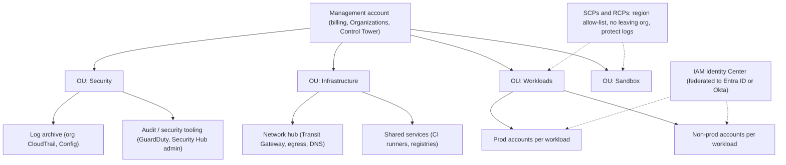
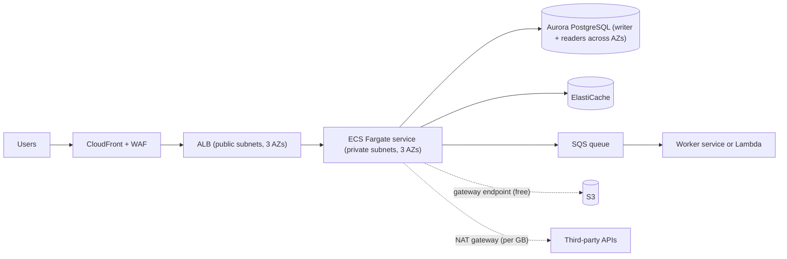
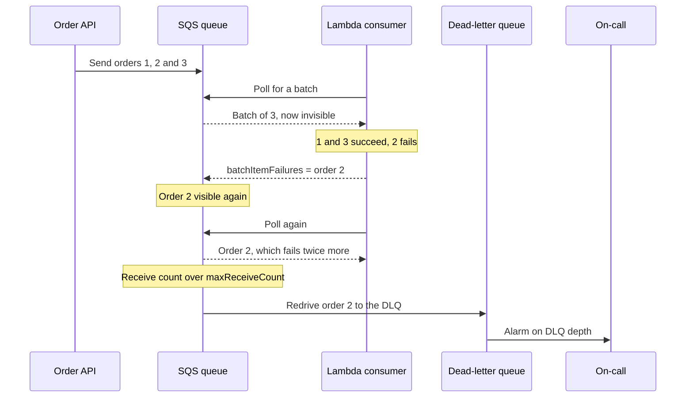

## TL;DR

- AWS organises everything around **accounts as the boundary** for security, blast radius and billing. A well-run estate has many accounts grouped into organisational units under **AWS Organizations**, guarded by **service control policies** and set up through **Control Tower** or an equivalent landing zone.
- **IAM is the control plane for everything.** Workloads use **roles** with short-lived credentials, never long-lived access keys. Understand the evaluation logic: an explicit deny always wins, and SCPs, resource control policies, permission boundaries and session policies only ever *limit* permissions.
- The core building blocks map closely to Azure: **VPC** ≈ VNet, **IAM Identity Center** ≈ Entra ID for workforce access, **ECS/EKS/Lambda** ≈ Container Apps/AKS/Functions, **SQS/SNS/EventBridge** ≈ Service Bus/Event Grid. The differences are in the defaults, the limits and the pricing.
- Design for failure with **multiple Availability Zones by default**, and use multi-region only when an RTO/RPO or latency requirement justifies the cost and complexity. Use the **Well-Architected Framework**'s six pillars to review designs.
- Most bill surprises come from **data transfer and NAT gateways, idle or oversized resources, logs, and storage left behind**. Tag for cost allocation from day one, use Savings Plans for steady load, and consider Graviton and Spot instances.

## Core Concepts

### Account structure and governance

| Concept | What it is | Azure analogue |
|---|---|---|
| **Account** | Hard boundary for resources, IAM, quotas and billing | Subscription |
| **AWS Organizations** | Hierarchy of accounts with consolidated billing | Management groups + subscriptions |
| **Organizational unit (OU)** | A group of accounts that share policies (Security, Infrastructure, Workloads/Prod, Workloads/Non-prod, Sandbox) | Management group |
| **Service control policy (SCP)** | Caps the maximum permissions for principals in accounts. It grants nothing | Azure Policy deny effects, roughly |
| **Resource control policy (RCP)** | Caps what can be done *to resources* in accounts, such as preventing access from outside the organisation (added 2024) | — |
| **Control Tower** | Sets up and governs a multi-account landing zone with guardrails and Account Factory | Azure landing zone accelerators |
| **IAM Identity Center** | Workforce single sign-on into accounts, with permission sets, federated to your identity provider (for example Entra ID or Okta) | Entra ID + Azure RBAC |

Why many accounts? An account is the strongest isolation AWS gives you. Separate accounts per workload and environment limit the blast radius of a compromised credential or a runaway script, keep quotas separate, and make cost allocation trivial.

### IAM essentials

- **Principals**: users (avoid them for humans, use Identity Center instead), **roles** (assumed for temporary credentials by people, services, workloads or other accounts) and federated identities.
- **Policies**: JSON documents with `Effect`, `Action`, `Resource` and optional `Condition`.
  - **Identity-based** policies are attached to roles or users.
  - **Resource-based** policies are attached to resources (S3 bucket policies, KMS key policies, SQS queue policies).
- **Workload identity**: EC2 instance profiles, ECS task roles, Lambda execution roles, and EKS Pod Identity or IRSA. Code gets temporary credentials automatically from the SDK's default credential chain.

```json
{
  "Version": "2012-10-17",
  "Statement": [
    {
      "Sid": "ReadOwnPrefixOnly",
      "Effect": "Allow",
      "Action": ["s3:GetObject"],
      "Resource": "arn:aws:s3:::acme-invoices/${aws:PrincipalTag/tenant}/*"
    },
    {
      "Sid": "DenyOutsideEU",
      "Effect": "Deny",
      "Action": "*",
      "Resource": "*",
      "Condition": { "StringNotEquals": { "aws:RequestedRegion": ["eu-west-1", "eu-central-1"] } }
    }
  ]
}
```

**Evaluation logic, simplified:**
1. An explicit `Deny` anywhere wins.
2. SCPs and RCPs (organisation), permission boundaries and session policies must all allow the action. They only limit, never grant.
3. Within one account, an `Allow` in either the identity policy or the resource policy is enough for most services.
4. **Cross-account** access needs both: the caller's identity policy allows it *and* the resource's policy trusts the caller (or the caller assumes a role in the target account).
5. Otherwise the request is implicitly denied.

### Compute

| Service | Use for | Notes |
|---|---|---|
| **EC2** | Full control, special OS or licensing needs, steady high utilisation | Auto Scaling groups across AZs. Graviton (Arm) instances often give better price-performance |
| **Lambda** | Event-driven, spiky or low-volume workloads, glue code | Up to 15 minutes per invocation, up to 10 GB memory. Concurrency limits per account and region. Cold starts matter for latency-sensitive paths |
| **ECS on Fargate** | Containers without managing servers or Kubernetes | Simplest container option. ECS Service Connect for service-to-service traffic |
| **ECS on EC2** | Containers at scale with cost control (Spot, reserved capacity) | You manage the instances (capacity providers help) |
| **EKS** | Kubernetes ecosystem, portability, complex platforms | Most flexible and most operational work. EKS Auto Mode (2024) offloads node management |

### Storage and data

- **S3**: object storage with strong read-after-write consistency (since December 2020) and eleven nines of durability. Storage classes run from Standard through Intelligent-Tiering, Standard-IA and One Zone-IA to the Glacier tiers (Instant Retrieval, Flexible Retrieval, Deep Archive). Lifecycle rules move or expire objects. Block Public Access should be on at account level.
- **EBS**: block volumes for EC2, within one AZ. **EFS**: managed NFS across AZs.
- **RDS**: managed PostgreSQL, MySQL, MariaDB, SQL Server and Oracle, with Multi-AZ deployments for failover.
- **Aurora**: AWS's cloud-native MySQL- and PostgreSQL-compatible engine. Storage is replicated six ways across three AZs, it supports up to 15 low-lag read replicas, and Aurora Global Database replicates across regions, typically with under a second of lag.
- **DynamoDB**: serverless key-value and document store with single-digit-millisecond latency at any scale. Design from access patterns (partition key, sort key, GSIs). Items are limited to 400 KB. On-demand or provisioned capacity, and global tables for multi-region.
- **ElastiCache / MemoryDB**: managed Redis-compatible (and Valkey) and Memcached caches.

```ts
// DynamoDB access-pattern design: one table, composite keys (AWS SDK v3).
import { DynamoDBClient } from '@aws-sdk/client-dynamodb';
import { DynamoDBDocumentClient, QueryCommand } from '@aws-sdk/lib-dynamodb';

const db = DynamoDBDocumentClient.from(new DynamoDBClient({}));

// PK = CUSTOMER#<id>, SK = ORDER#<isoDate>#<orderId>  → "orders for a customer, newest first"
export async function recentOrders(customerId: string, limit = 20) {
  const { Items } = await db.send(new QueryCommand({
    TableName: 'commerce',
    KeyConditionExpression: 'PK = :pk AND begins_with(SK, :prefix)',
    ExpressionAttributeValues: { ':pk': `CUSTOMER#${customerId}`, ':prefix': 'ORDER#' },
    ScanIndexForward: false,   // newest first
    Limit: limit,
  }));
  return Items ?? [];
}
```

### Messaging and integration

| Service | Model | Use for | Azure analogue |
|---|---|---|---|
| **SQS** | Queue, pull. Standard (at-least-once, best-effort order) or FIFO (ordered per message group, deduplicated) | Work queues, buffering, decoupling | Service Bus queues |
| **SNS** | Pub/sub push fan-out to SQS, Lambda, HTTP, email and SMS | Simple fan-out notifications | Service Bus topics / Event Grid |
| **EventBridge** | Event bus with content-based routing rules, schema registry, SaaS integrations, scheduler and Pipes | Event-driven integration between services and accounts | Event Grid |
| **Kinesis Data Streams** | Partitioned, ordered, replayable stream | High-volume telemetry and clickstreams | Event Hubs |
| **MSK** | Managed Apache Kafka | Kafka ecosystem compatibility | Event Hubs (Kafka API) or Confluent |
| **Step Functions** | Workflow orchestration as state machines | Sagas, long-running processes, human approval steps | Durable Functions / Logic Apps |

### Networking

- **VPC** per account and region, with **public subnets** (route to an internet gateway) and **private subnets** in each AZ.
- **NAT gateway** for outbound internet from private subnets. It's charged per hour *and per GB processed* (about $0.045 per GB in us-east-1), which makes it a classic cost trap.
- **VPC endpoints**: **gateway endpoints** for S3 and DynamoDB are free and keep traffic off the NAT gateway. **Interface endpoints** (PrivateLink) give private access to other services, charged per hour per AZ plus per GB.
- **Transit Gateway** connects many VPCs and on-premises networks in a hub and spoke. **VPC Lattice** handles service-to-service connectivity across accounts.
- **Load balancing**: **ALB** (layer 7, HTTP routing), **NLB** (layer 4, static IPs, very high throughput), **Global Accelerator** (anycast IPs into regions), **CloudFront** (CDN and edge security with AWS WAF).
- **Route 53**: DNS with health checks, latency-based, weighted and failover routing. **Route 53 Application Recovery Controller** for controlled regional failover.

### Operations and security

- **Observability**: CloudWatch metrics, logs and alarms, Container Insights, and X-Ray or CloudWatch Application Signals for traces. AWS Distro for OpenTelemetry (ADOT) is the recommended route for vendor-neutral instrumentation.
- **Audit and posture**: CloudTrail (API audit logs, organisation trail into a log-archive account), AWS Config (resource configuration history and rules), Security Hub (findings and standards), GuardDuty (threat detection), IAM Access Analyzer (external and unused access).
- **Secrets and keys**: KMS (customer-managed keys, key policies), Secrets Manager (rotation), and Parameter Store for configuration.
- **Infrastructure as code**: CloudFormation (native, stack-based), CDK (TypeScript or other languages synthesising CloudFormation), or Terraform.
- **Well-Architected Framework**: six pillars (operational excellence, security, reliability, performance efficiency, cost optimisation and sustainability) plus the Well-Architected Tool for reviews.

### Cost levers

- **Commitments**: Compute Savings Plans (flexible across EC2, Fargate and Lambda) and EC2 Instance Savings Plans or Reserved Instances (deeper discount, less flexible). RDS and other databases have their own reserved pricing.
- **Spot instances** for fault-tolerant work (batch, CI, stateless workers) at large discounts, with a 2-minute interruption notice.
- **Graviton** instances, which AWS says give up to 40% better price-performance than comparable x86 for many workloads.
- **Right-sizing** with Compute Optimizer, **storage lifecycle** policies, **log retention** settings (CloudWatch Logs defaults to never expire), and **data transfer** awareness: cross-AZ, NAT and internet egress.
- **Visibility**: cost allocation tags, Cost Explorer, Cost and Usage Reports (CUR 2.0 / Data Exports), budgets and anomaly detection.

### Worked example: finding and cutting a NAT gateway bill

A service runs on ECS Fargate in private subnets across three AZs in us-east-1, with one NAT gateway per AZ and no VPC endpoints. Cost and Usage Report data, grouped by `UsageType`, shows `NatGateway-Bytes` as the third-largest line on the bill. VPC Flow Logs for the NAT gateways' network interfaces, joined to destination IP ranges, break the monthly traffic down (taking 1 TB as 1,000 GB to keep the sums simple):

| Traffic through NAT | GB per month |
|---|---|
| S3 (data files and exports) | 40,000 |
| ECR image pulls (layers are stored in S3) | 6,000 |
| CloudWatch Logs | 4,000 |
| Third-party APIs | 1,000 |
| **Total** | **51,000** |

**Before**, at $0.045 per NAT gateway hour and $0.045 per GB processed:
- Hours: 3 gateways × 730 hours × $0.045 = $98.55.
- Data: 51,000 GB × $0.045 = $2,295.
- About **$2,394 a month**, almost all of it data processing, for traffic that never needed to leave AWS.

**After** adding endpoints:
- An **S3 gateway endpoint** is free and carries the S3 traffic *and* the ECR image layers, because ECR serves layers from S3. That removes 46,000 GB from the NAT gateways.
- **Interface endpoints** for `ecr.api`, `ecr.dkr` and `logs` cost $0.01 per hour per AZ each: 3 endpoints × 3 AZs × 730 hours × $0.01 = $65.70. Their data processing is $0.01 per GB: 4,000 GB of logs is $40, and the ECR API calls are negligible.
- Only the third-party traffic still uses NAT: 1,000 GB × $0.045 = $45, plus the same $98.55 of gateway hours.
- About **$249 a month**, a saving of roughly $2,145 a month (90%).

Two follow-on checks:
- **Cross-AZ traffic.** If a subnet's route table points at a NAT gateway in another AZ, every byte also pays inter-AZ transfer ($0.01 per GB in each direction), and one AZ's outage takes the others' egress with it. Route each AZ to its own NAT gateway.
- **Endpoint policies.** An endpoint can carry a policy, so the S3 gateway endpoint can allow only the organisation's buckets. The saving and the data-perimeter control come from the same change.

## How It Works

### Multi-account landing zone



### A three-tier web application across AZs



### An SQS batch with one bad message



Without `ReportBatchItemFailures`, the handler's single error would make all three messages reappear, and orders 1 and 3 would be processed again. That's harmless only if every consumer is idempotent, which it should be anyway.

## When to Use / Trade-offs

| Decision | Option A | Option B | Choose A when | Choose B when |
|---|---|---|---|---|
| Containers | ECS (Fargate) | EKS | You want the simplest managed container platform, all-AWS | You need the Kubernetes ecosystem, portability or an existing platform |
| Serverless compute | Lambda | Fargate | Spiky or event-driven, short tasks, pay per use | Steady traffic, long-running, needs more control or a consistent latency profile |
| Relational | RDS | Aurora | Standard engine features at lower cost, smaller workloads | Higher availability, fast failover, many read replicas, global database |
| Data store | Aurora / RDS | DynamoDB | Relational queries, transactions across entities, ad-hoc reporting | Known access patterns at massive scale, serverless operations, predictable latency |
| Async | SQS | EventBridge | Work queues with one consumer group, buffering | Routing events to many targets by content, cross-account buses |
| IaC | CDK / CloudFormation | Terraform | AWS-only, TypeScript teams, native integration (drift detection, StackSets) | Multi-cloud, existing Terraform skills and modules |
| Private connectivity | Gateway endpoints | Interface endpoints | S3 and DynamoDB (free) | Other AWS services or PrivateLink providers |

## Common Pitfalls & Anti-patterns

- **One big account** — everything in a single account means a compromised key or a bad script can reach everything, quotas collide and costs are opaque.
- **Long-lived access keys** — IAM users with keys in CI or laptops. Use Identity Center for people and roles with OIDC federation for CI (for example GitHub Actions to IAM roles).
- **`"Action": "*"` policies** — over-broad permissions that never get trimmed. Use IAM Access Analyzer's unused-access findings and policy generation.
- **NAT gateway surprises** — S3, ECR or DynamoDB traffic going through NAT at per-GB rates instead of free gateway endpoints. Cross-AZ chatter also adds per-GB charges.
- **Single-AZ "temporarily"** — databases or services in one AZ that stay that way until the AZ has a bad day.
- **Logs kept forever** — CloudWatch Logs retention defaults to never expire. Set retention per log group.
- **Lambda everywhere** — synchronous Lambda chains calling Lambda, recursion loops, and concurrency limits hit during spikes.
- **Scanning DynamoDB** — designing tables like relational schemas, then using `Scan` and filters. Design keys for the access patterns.
- **Public S3 by accident** — keep account-level Block Public Access on, and serve public content via CloudFront with origin access control.
- **Ignoring service quotas** — hitting limits (Lambda concurrency, ENIs, EIPs) during a launch. Check and raise them ahead of time.

## Real-world Scenario

**Context:** A fintech scale-up ran everything in two AWS accounts (prod and dev) built by hand over four years. Engineers used IAM users with access keys, the bill had grown 60% in a year to $180k a month, and an audit flagged broad admin access and no central logging.

**Decision:**
1. **Landing zone**: Control Tower with OUs for Security, Infrastructure, Workloads (prod and non-prod) and Sandbox. An organisation CloudTrail into a locked log-archive account. SCPs: region allow-list, deny leaving the organisation, deny disabling CloudTrail, GuardDuty or Config.
2. **Identity**: IAM Identity Center federated to Entra ID (their existing workforce IdP) with permission sets per role. All IAM users and keys removed within 8 weeks. CI uses GitHub OIDC to assume deployment roles.
3. **Account per workload and environment**, migrated service by service with Terraform, starting with new services and then the payments platform.
4. **Network hub**: a Transit Gateway with centralised egress, and gateway endpoints for S3 and DynamoDB in every VPC.
5. **Cost**: tagging policy enforced via SCP and Config rules, Compute Savings Plans covering 70% of the steady baseline, Graviton for the ECS fleet, and log retention set to 30 or 90 days.

**Outcome:** Over 9 months, the monthly bill fell to $125k despite 30% traffic growth. NAT data processing alone dropped by $14k a month once endpoints were added. The next audit had no high findings, and new services got a fully configured account through Account Factory in under an hour.

**What I'd do differently:** Put the tagging policy and cost allocation in place in the first week. Several months of cost attribution was guesswork, which made the savings harder to prove.

## Interview Questions

### How should an AWS estate be organised with accounts, Organizations and OUs, and why use many accounts? {#multi-account}

**Level:** Foundation

**Model answer:**
An AWS account is the strongest isolation boundary AWS offers: IAM, resources, quotas and billing are separate per account. A well-structured estate uses **AWS Organizations** to manage many accounts, grouped into **organisational units**, typically:
- **Security**: a log archive account and a security tooling or audit account.
- **Infrastructure**: networking hub and shared services.
- **Workloads**: separate prod and non-prod OUs, with an account per workload per environment.
- **Sandbox**: experimentation with budgets and strict guardrails.

**SCPs** at OU level enforce boundaries (allowed regions, no disabling of logging), and **Control Tower** automates setup, guardrails and account vending.

Benefits: a compromised credential or a runaway script is contained, quotas don't collide, cost allocation is automatic, and permissions are simpler because they apply per account.

**What the interviewer is looking for:**
The account as a security and blast-radius boundary, and a sensible OU structure with guardrails.

**Follow-ups:**
- How do people sign in to dozens of accounts?
- What would you never allow in the management account?

**Red flags:**
- Running workloads in the management account.
- One account per environment for the whole company.

### How do IAM roles differ from IAM users, and why should workloads use roles? {#iam-roles-vs-users}

**Level:** Foundation

**Model answer:**
- An **IAM user** has long-term credentials: a password and/or access keys that stay valid until rotated or deleted.
- An **IAM role** has no long-term credentials. A trusted principal (a service, a workload, a federated person, another account) *assumes* it and receives **temporary credentials** from STS that expire, typically within an hour.

Workloads should use roles because:
- There are no secrets to store, rotate or leak. The SDK fetches and refreshes credentials automatically (instance profiles, ECS task roles, Lambda execution roles, EKS Pod Identity or IRSA).
- Permissions are scoped to the workload and auditable in CloudTrail by role session.
- Leaked temporary credentials expire.

For people, use IAM Identity Center with federation to the corporate identity provider. For CI/CD, use OIDC federation (for example GitHub Actions assuming a role) instead of stored keys.

**What the interviewer is looking for:**
Temporary versus long-lived credentials, and federation for both people and CI.

**Follow-ups:**
- How does GitHub Actions assume a role without any stored secret?
- How would you find and remove existing access keys across 50 accounts?

**Red flags:**
- Access keys in environment variables or CI secrets as the norm.
- Sharing one IAM user between people.

### When do you use SQS, SNS, EventBridge and Kinesis? {#aws-messaging}

**Level:** Foundation

**Model answer:**
- **SQS**: a queue that consumers pull from. Use it for work distribution and buffering between producer and consumer. Standard queues give at-least-once delivery with best-effort ordering. FIFO queues give ordering per message group and deduplication, with lower throughput.
- **SNS**: push-based pub/sub. Use it to fan a message out to several subscribers: SQS queues, Lambda, HTTP endpoints, email or SMS. SNS + SQS is the classic fan-out pattern.
- **EventBridge**: an event bus with content-based routing rules, cross-account buses, a schema registry, SaaS sources, Pipes and a scheduler. Use it for event-driven integration between services and teams, where routing logic belongs in rules rather than code.
- **Kinesis Data Streams**: an ordered, partitioned, replayable stream with retention. Use it for high-volume event streams and analytics where several consumers read the same data at their own pace. MSK if you want Kafka.

Rule of thumb: commands and jobs go to **SQS**, domain events between teams go to **EventBridge**, simple fan-out goes to **SNS**, and high-volume streams for replay go to **Kinesis or MSK**.

**What the interviewer is looking for:**
Queue versus pub/sub versus routed bus versus stream, plus delivery semantics.

**Follow-ups:**
- How do you handle poison messages in SQS?
- What changes if you need strict ordering per customer?

**Red flags:**
- Using Kinesis as a work queue.
- Assuming exactly-once delivery from SQS standard queues.

### Compare the S3 storage classes, and explain when you'd use lifecycle policies. {#s3-storage-classes}

**Level:** Foundation

**Model answer:**
- **S3 Standard**: frequently accessed data, millisecond access, across at least three AZs.
- **S3 Intelligent-Tiering**: unknown or changing access patterns. It moves objects between access tiers automatically for a small monitoring fee per object.
- **Standard-IA / One Zone-IA**: infrequently accessed but needs millisecond access. Lower storage cost, a retrieval fee, and minimum storage duration and object size charges. One Zone-IA keeps data in one AZ, for re-creatable data.
- **Glacier Instant Retrieval**: archive data accessed rarely but needing milliseconds.
- **Glacier Flexible Retrieval**: archives with retrievals in minutes to hours.
- **Glacier Deep Archive**: the cheapest, with retrieval in hours. Compliance archives.
- **S3 Express One Zone**: very low-latency single-AZ storage for performance-critical workloads.

**Lifecycle policies** transition objects between classes by age (logs: Standard for 30 days, then IA, then Glacier after 180 days) and **expire** them (delete after 7 years, or clean up incomplete multipart uploads and old versions). Watch out for minimum durations and per-object transition costs with millions of tiny objects.

**What the interviewer is looking for:**
Matching access pattern to class, awareness of retrieval fees and minimums, and lifecycle use.

**Follow-ups:**
- Why might moving billions of small objects to Glacier increase the bill?
- How would you find which buckets cost the most?

**Red flags:**
- "Glacier is always cheaper."
- Not cleaning up old object versions in versioned buckets.

### Explain how IAM evaluates a request when identity policies, resource policies, SCPs and permission boundaries all apply. {#iam-policy-evaluation}

**Level:** Senior

**Model answer:**
In order:
1. **Explicit deny anywhere** (identity policy, resource policy, SCP, RCP, permission boundary, session policy) means the request is **denied**.
2. **Organisation guardrails**: the action must be allowed by every SCP on the path from the root to the account, and RCPs must allow it for the resource's account. They're filters. They grant nothing.
3. **Resource-based policy**: in the same account, an allow in the resource policy can be enough by itself for many services, because it names the principal.
4. **Identity-based policy** must allow it, *and* it must be within the **permission boundary** (if set) and the **session policy** (if one was passed when assuming the role).
5. If nothing allows it, the request is **implicitly denied**.

**Cross-account**: both sides must agree. The caller's identity policy allows the action, *and* the target resource's policy allows the caller's principal, or the caller assumes a role in the target account whose trust policy allows it.

Practical uses: permission boundaries let teams create roles for their own services without being able to escalate privileges. SCPs enforce organisation-wide rules (region restrictions, protection of security services). RCPs block access to resources from outside the organisation.

**What the interviewer is looking for:**
Deny precedence, limiting versus granting policies, and the cross-account rule.

**Follow-ups:**
- How would you let developers create IAM roles safely?
- How do you debug an access-denied error that spans an SCP and a bucket policy?

**Red flags:**
- Thinking SCPs grant permissions.
- Not knowing about the cross-account two-sided rule.

### ECS on Fargate, EKS, or Lambda for a new set of services? {#aws-compute-choice}

**Level:** Senior

**Model answer:**
Start from workload shape and team capability:

- **Lambda** fits event-driven or spiky workloads (S3 events, queue consumers, APIs with uneven traffic), short tasks (under 15 minutes), and teams that want zero infrastructure management. Watch out for cold starts on latency-sensitive paths, concurrency limits, cost at sustained high volume, and the difficulty of local testing and observability across many functions.
- **ECS on Fargate** fits containerised services with steady or moderate traffic, when you want the simplest operational model on AWS. There are no clusters or nodes to manage, IAM integration per task, and ECS Service Connect for service discovery. Fewer ecosystem tools than Kubernetes, and AWS-specific.
- **EKS** fits teams that need the Kubernetes ecosystem (operators, Helm charts, service mesh, GitOps), portability or consistency with clusters elsewhere, or that run a platform for many teams. It brings the most operational responsibility (upgrades, add-ons, networking), partly reduced by EKS Auto Mode and managed node groups.

Typical decision: a product company with a few teams on AWS only starts with **ECS Fargate for services plus Lambda for event glue**. An organisation building a multi-team internal platform, or already invested in Kubernetes, picks **EKS**.

**What the interviewer is looking for:**
A decision tied to workload and team capacity, including Kubernetes' operational cost.

**Follow-ups:**
- What would make you move from Fargate to EC2-backed capacity?
- How would you manage Lambda cold starts for a user-facing API?

**Red flags:**
- "Kubernetes for everything" without considering operational cost.
- Lambda for long-running, steady, high-throughput processing.

### RDS, Aurora or DynamoDB? {#aws-database-choice}

**Level:** Senior

**Model answer:**
- **RDS** (PostgreSQL or MySQL): a standard managed relational database. Good for most applications that need SQL, transactions and ad-hoc queries, at the lowest cost. Multi-AZ gives synchronous standby failover, typically within a minute or two.
- **Aurora** (PostgreSQL- or MySQL-compatible): the same SQL model with a distributed storage layer (six copies across three AZs), faster failover, up to 15 read replicas with low lag, Global Database for cross-region disaster recovery, and Serverless v2 for variable load. Costs more than RDS, and the I/O-intensive pricing model needs checking.
- **DynamoDB**: a serverless key-value and document store with predictable single-digit-millisecond latency at any scale, no connections to manage, and global tables. It requires designing for known access patterns up front. Ad-hoc queries, joins and complex reporting are hard, so export to S3 for analytics.

Questions that decide it: Do you need relational queries and multi-entity transactions? How well known and stable are the access patterns? What scale and latency targets apply? What are the availability and DR targets? What skills does the team have?

Common combination: Aurora or RDS as the system of record, DynamoDB for very high-scale key-value paths (sessions, carts, idempotency keys), and ElastiCache in front where reads are hot.

**What the interviewer is looking for:**
Clear criteria, Aurora's real differentiators, and DynamoDB's access-pattern-first design.

**Follow-ups:**
- When is Aurora's cost not justified?
- How would you support reporting over DynamoDB data?

**Red flags:**
- Choosing DynamoDB "because it scales" without knowing the access patterns.
- Treating Aurora as a different database engine from PostgreSQL or MySQL.

### How do private workloads reach AWS services and the internet, and what does it cost? {#vpc-endpoints-nat}

**Level:** Senior

**Model answer:**
Workloads in private subnets have no direct route to the internet. Options:
- **NAT gateway** in a public subnet per AZ, for outbound internet (third-party APIs, package downloads). Charged per hour plus **per GB processed** (about $0.045 per GB in us-east-1), on top of normal data transfer charges.
- **Gateway VPC endpoints** for **S3 and DynamoDB**: route-table entries, **free**, and they keep that traffic off the NAT gateway.
- **Interface VPC endpoints** (PrivateLink) for other services (ECR, CloudWatch Logs, STS, Secrets Manager and others): private IPs in your subnets, charged per hour per AZ plus per GB. Usually cheaper than NAT for heavy traffic, and they also improve security posture.
- **Centralised egress**: route outbound traffic through a shared network account (Transit Gateway to an egress VPC with NAT and firewall). Fewer NAT gateways and central inspection, at the cost of cross-account data processing charges.

Cost traps: container image pulls from ECR and log shipping through NAT, NAT gateways in one AZ serving other AZs (cross-AZ charges, and a single point of failure), and chatty cross-AZ traffic between services.

**What the interviewer is looking for:**
Gateway versus interface endpoints, the NAT per-GB charge, and the trade-offs of centralised egress.

**Follow-ups:**
- How would you find which workloads generate the NAT charges?
- One NAT gateway or one per AZ?

**Red flags:**
- Not knowing that S3 and DynamoDB have free gateway endpoints.
- Putting workloads in public subnets to avoid NAT costs.

### How do you design a DynamoDB table for a known set of access patterns? {#dynamodb-single-table}

**Level:** Senior

**Model answer:**
1. **List the access patterns first**, with frequency and latency needs: "get order by id", "list a customer's orders newest first", "orders by status for operations", "all items in an order".
2. **Choose the partition key** for even distribution and to group data read together. Avoid hot keys (a single "status" value, or a date for all writes today).
3. **Use composite sort keys** to support range queries and hierarchy: `PK = CUSTOMER#123`, `SK = ORDER#2026-11-25#o-9`. A `begins_with` query returns a customer's orders by date.
4. **Single-table design** (optional): store several entity types in one table with generic `PK`/`SK` attributes, so related items can be fetched in one query. Powerful, but harder to understand. Use separate tables when patterns don't overlap.
5. **Global secondary indexes** for other patterns, for example `GSI1PK = STATUS#PENDING`, `GSI1SK = <date>`. Use sparse indexes (only items with the attribute) for subsets. GSIs are eventually consistent.
6. **Consider item size** (400 KB limit, and cost per KB), write sharding for hot partitions, TTL for expiry, and conditional writes for idempotency and optimistic locking.
7. **Plan for analytics separately**: export to S3, or stream to an analytics store.

Validate with the actual query code and realistic data volumes before committing, because changing keys later means migrating data.

**What the interviewer is looking for:**
Access-pattern-first thinking, key design to avoid hot partitions, and GSIs with their consistency caveat.

**Follow-ups:**
- How would you support a new access pattern a year later?
- How do you avoid a hot partition for a celebrity customer?

**Red flags:**
- Relational normalisation with Scan and filters.
- No awareness of hot partitions.

### CloudFormation, CDK or Terraform on AWS? {#aws-iac-choice}

**Level:** Senior

**Model answer:**
- **CloudFormation**: AWS-native, state managed by AWS, deep integration (StackSets across accounts, drift detection, rollbacks, Control Tower customisations). It's verbose YAML or JSON with limited abstraction, and new features can lag.
- **CDK**: write infrastructure in TypeScript, Python or other languages that synthesises CloudFormation. High-level constructs, real programming-language abstractions, and testing with normal tools. It inherits CloudFormation's deployment behaviour and limits, and code can become "too clever".
- **Terraform** (or OpenTofu): a multi-cloud and multi-provider tool with a large module ecosystem, explicit plans, and the same tool for AWS, Azure, GitHub, Datadog and others. You manage state (S3 with locking, or Terraform Cloud), and new AWS features usually arrive quickly through the provider.

Decision: an **AWS-only organisation with TypeScript skills** often prefers CDK. **Multi-cloud estates or existing Terraform investment** pick Terraform. CloudFormation directly is mostly for organisation-wide StackSets and Control Tower customisations. Consistency across the organisation matters more than the tool. Mixing tools for the same resources causes drift and ownership confusion.

**What the interviewer is looking for:**
Trade-offs including state, abstraction, multi-cloud and organisational consistency.

**Follow-ups:**
- How would you manage Terraform state for 100 accounts?
- How do you test CDK code?

**Red flags:**
- Choosing by personal preference without considering the organisation.
- Click-ops in production "for now".

### Design a multi-account landing zone for an enterprise with 50 teams moving to AWS. {#aws-landing-zone}

**Level:** Architect

**Model answer:**
**Foundation:**
- **Control Tower** (or a Terraform-based equivalent such as the Landing Zone Accelerator) for Organizations, OUs, guardrails and **Account Factory**, ideally Account Factory for Terraform so accounts are created through pull requests.
- **OUs**: Security (log archive, audit), Infrastructure (network, shared services), Workloads with Prod and Non-prod OUs, Sandbox, Suspended, and possibly a Policy Staging OU to test SCP changes.

**Identity:** IAM Identity Center federated to the corporate identity provider, permission sets per job function (read-only, developer, operator, break-glass), access granted by group. No IAM users. CI uses OIDC federation to deployment roles.

**Guardrails:**
- SCPs: region allow-list, deny leaving the organisation, protect CloudTrail, Config, GuardDuty and the log buckets, deny root user actions, require IMDSv2.
- RCPs to block access to organisation resources from outside identities.
- Config rules and Security Hub standards for detective controls. Tagging policies.

**Logging and security:** an organisation CloudTrail into an immutable log archive (S3 Object Lock), GuardDuty and Security Hub delegated to the audit account, Access Analyzer across the organisation.

**Network:** a hub with Transit Gateway in a network account, centralised egress and inspection where required, shared Route 53 resolvers, gateway endpoints everywhere, and an IP address plan (VPC IPAM) avoiding overlaps with on-premises.

**Account vending:** one account per workload per environment, with a baseline (VPC, roles, budgets, logging) applied automatically and owners and cost centres tagged.

**Operating model:** a cloud platform team owns the landing zone as a product. Changes go through IaC, guardrails are tested in staging OUs, and there are documented exception processes.

**What the interviewer is looking for:**
Completeness across identity, guardrails, logging, network and vending, and treating the landing zone as a product with change control.

**Follow-ups:**
- How do you roll out a new SCP without breaking production?
- How would you handle a team that needs a region outside the allow-list?

**Red flags:**
- No separation of security and logging accounts.
- Manual account creation.

### Design a multi-region active-passive architecture with an RPO of 1 minute and an RTO of 15 minutes on AWS. {#aws-multi-region-dr}

**Level:** Architect

**Model answer:**
**Pattern: warm standby.**

- **Data**:
  - **Aurora Global Database**: storage-level replication to the secondary region, typically under a second of lag, which comfortably meets an RPO of 1 minute. Managed failover or switchover promotes the secondary.
  - **DynamoDB global tables** for key-value data, active in both regions, last writer wins.
  - **S3 Cross-Region Replication** with Replication Time Control (15-minute SLA) for objects, so check the RPO for object data separately.
  - Secrets and keys: multi-region KMS keys, and Secrets Manager replication.
- **Compute**: the full stack deployed in the secondary region by the same IaC pipeline, scaled down (minimum tasks or instances) but **running**, so failover is scale-up rather than build-up. Container images replicated (ECR replication).
- **Traffic**: Route 53 failover routing with health checks, or Route 53 Application Recovery Controller routing controls for a deliberate, human-approved switch that doesn't depend on control planes during the event. Global Accelerator is an alternative for fast IP-level failover.
- **Static stability**: the secondary region must not depend on the primary for anything during failover (no cross-region calls to the primary's configuration, identity or deployment pipelines).

**Runbook and testing:** a documented failover decision rule (who decides, after how long), automated failover steps (promote Aurora, scale ECS, switch routing), and quarterly game days with real traffic switches. Also plan the fail-back, which is often harder.

**Trade-offs:** cost of the standby (perhaps 30–50% of primary), data written in the last seconds may be lost or need reconciliation, and asynchronous replication gives no true zero RPO without synchronous cross-region writes, which cost latency.

**What the interviewer is looking for:**
Choosing replication per data store to meet the RPO, warm standby to meet the RTO, controlled routing, static stability and regular testing.

**Follow-ups:**
- How would the design change for an RTO of 1 minute?
- How do you test failover without hurting customers?

**Red flags:**
- Backup-and-restore for a 15-minute RTO.
- Untested failover.

### You're an Azure-experienced architect asked to review an AWS design. What maps across, and what's different? {#azure-to-aws}

**Level:** Architect

**Model answer:**
**Maps across fairly directly:**

| Azure | AWS |
|---|---|
| Management groups / subscriptions | Organizations OUs / accounts |
| Azure Policy (deny) | SCPs and RCPs (preventive), Config rules (detective) |
| Entra ID + Azure RBAC | IAM Identity Center + IAM roles and policies |
| Managed identity | IAM roles for EC2, ECS tasks, Lambda, EKS pods |
| VNet, NSG, Private Endpoint | VPC, security groups / NACLs, interface endpoints (PrivateLink) |
| Front Door / Application Gateway / Load Balancer | CloudFront + Global Accelerator / ALB / NLB |
| AKS / Container Apps / Functions | EKS / ECS Fargate / Lambda |
| Azure SQL / PostgreSQL Flexible / Cosmos DB | RDS and Aurora / RDS PostgreSQL / DynamoDB |
| Service Bus / Event Grid / Event Hubs | SQS + SNS / EventBridge / Kinesis or MSK |
| Key Vault | KMS + Secrets Manager |
| Azure Monitor / App Insights | CloudWatch / X-Ray and Application Signals |
| Bicep | CloudFormation / CDK |

**Important differences to check in the review:**
- **IAM model**: AWS policies are JSON documents with resource-based policies and a deny-first evaluation that includes SCPs. Azure RBAC assigns roles at scopes. Cross-account access in AWS needs both sides to agree.
- **Account granularity**: AWS designs typically use many more accounts than Azure designs use subscriptions.
- **Networking**: security groups are stateful and attach to network interfaces. Private subnets need NAT or endpoints, and **NAT and cross-AZ data are billed per GB**, which Azure designs often underestimate when ported.
- **Availability zones**: in AWS most services are explicitly zonal or regional. Check that subnets, NAT gateways and databases span AZs.
- **Messaging semantics**: there is no exact Service Bus equivalent with sessions, transactions and topics in one service. Combinations of SQS FIFO, SNS and EventBridge replace it.
- **Serverless limits**: Lambda timeouts, concurrency and payload limits differ from Azure Functions plans.

**What the interviewer is looking for:**
Accurate mapping plus awareness of where analogies break: IAM, networking cost and messaging.

**Follow-ups:**
- How would you replicate Service Bus sessions on AWS?
- What's the AWS equivalent of an Azure landing zone's policy-driven governance?

**Red flags:**
- Assuming one-to-one equivalence everywhere.
- Ignoring the data-transfer pricing differences.

### Your AWS bill grew 40% in a quarter. How do you investigate and reduce it? {#aws-cost-reduction}

**Level:** Architect

**Model answer:**
**Investigate:**
1. **Cost Explorer** by service, account, region and usage type over 6 months. Find where the growth is. Typical culprits are EC2/ECS, RDS/Aurora, data transfer (NAT, inter-AZ, egress), CloudWatch, and S3.
2. **CUR / Data Exports** into Athena for detail: which resources and tags, `UsageType` values such as `NatGateway-Bytes` or `DataTransfer-Regional-Bytes`.
3. **Correlate with changes**: new services, traffic growth, a new logging setup, a change from Savings Plan coverage.
4. **Unit economics**: cost per customer or per transaction. If traffic grew 40% too, the problem is efficiency, not waste.

**Reduce, quick wins first:**
- **Waste**: idle and unattached resources (EBS volumes, old snapshots, unused load balancers and elastic IPs), non-prod running at night and weekends, forgotten test environments.
- **Network**: gateway endpoints for S3 and DynamoDB, interface endpoints for ECR and logs, keep chatty services in the same AZ where it's safe, compress and cache egress via CloudFront.
- **Logs and metrics**: retention policies, sampling, lower log levels, Infrequent Access log class.
- **Right-size** with Compute Optimizer, move to **Graviton**, and use **Spot** for CI and batch.
- **Commitments**: Compute Savings Plans for the steady baseline after right-sizing, reviewed quarterly.
- **Storage**: lifecycle rules, Intelligent-Tiering, delete old versions.

**Make it stick:** tag enforcement, per-team showback or chargeback, budgets and anomaly alerts per account, and cost reviewed in architecture decisions (FinOps practices).

**What the interviewer is looking for:**
A structured investigation, AWS-specific cost drivers (NAT, cross-AZ, logs), sequencing (right-size before committing) and governance.

**Follow-ups:**
- Why right-size before buying Savings Plans?
- How would you present the plan to the CFO?

**Red flags:**
- Buying Savings Plans first.
- Cutting reliability (single AZ) to save money without discussing the risk.

### How would you design a serverless event-driven order pipeline on AWS, and avoid its common failure modes? {#serverless-order-pipeline}

**Level:** Architect

**Model answer:**
**Design:**
1. **API Gateway → Lambda (or a direct service integration)** accepts the order, validates it, writes it to DynamoDB with a conditional write on an idempotency key, and returns `202 Accepted`.
2. **DynamoDB Streams → EventBridge Pipes** publishes an `OrderPlaced` event to an **EventBridge** bus. That's an outbox-like pattern, because the event comes from the committed write.
3. **EventBridge rules** route to consumers: an **SQS queue per consumer** (payments, inventory, notifications) for buffering and retries, each consumed by Lambda.
4. **Step Functions** orchestrates the multi-step saga (reserve stock, charge payment, confirm, or compensate) with retries, timeouts and error states.
5. **DLQs** on every queue and Lambda async destination, with alarms and a redrive process.

**Failure modes and defences:**
- **Duplicates**: everything is at-least-once. Idempotency keys in DynamoDB (conditional writes) for each consumer's side effects, or Powertools for AWS Lambda's idempotency utility.
- **Partial batch failures**: use `ReportBatchItemFailures` with SQS so one bad message doesn't make the whole batch retry.
- **Poison messages**: `maxReceiveCount` and DLQs, with alarms on DLQ depth.
- **Concurrency spikes overwhelming downstream** (such as a relational database or a payment API): reserved concurrency and SQS maximum concurrency on event source mappings, or RDS Proxy.
- **Timeouts**: the SQS visibility timeout must exceed the Lambda timeout (AWS recommends about six times), or messages get processed twice.
- **Ordering**: SQS FIFO with message group per order where order matters, otherwise design consumers to tolerate reordering using versions.
- **Recursive loops**: a Lambda writing to the bucket or queue that triggers it. AWS's loop detection helps, but design to avoid it.
- **Observability**: correlation ids through events, structured logs, X-Ray or OpenTelemetry tracing, and alarms on age of oldest message.

**What the interviewer is looking for:**
A sound event flow with an outbox-like publish, per-consumer queues, a saga, and specific AWS failure-mode knowledge.

**Follow-ups:**
- How do you replay events after a consumer bug is fixed?
- When would you replace Lambda consumers with Fargate?

**Red flags:**
- Lambda calling Lambda synchronously through the whole chain.
- No idempotency or DLQs.

### What is the difference between security groups and network ACLs? {#security-groups-vs-nacls}

**Level:** Foundation

**Model answer:**
| | Security group | Network ACL |
|---|---|---|
| Attached to | Elastic network interfaces (instances, tasks, load balancers, endpoints) | Subnets |
| State | **Stateful**: return traffic is allowed automatically | **Stateless**: return traffic needs its own rule, usually for ephemeral ports 1024–65535 |
| Rules | Allow only | Allow and deny |
| Evaluation | All rules together | In number order, lowest first. The first match wins |
| Sources | CIDR ranges, prefix lists, **other security groups** | CIDR ranges only |

In practice, security groups do almost all the work. Referencing groups instead of IP addresses expresses intent ("the ALB's group may reach the service's group on 8080") and keeps working as tasks come and go. NACLs are a coarse, subnet-wide backstop: blocking a known bad range quickly, or enforcing "the data subnets accept nothing from the public subnets" regardless of what any team puts in its security groups.

Neither inspects content. For layer 7 filtering use AWS WAF on CloudFront or the ALB, and for central egress or domain filtering use AWS Network Firewall.

**What the interviewer is looking for:**
Stateful versus stateless, the scope of each, group-to-group references, and an opinion on which to rely on.

**Follow-ups:**
- Why might a NACL change break responses but not requests?
- How would you allow a Lambda function in a VPC to reach an RDS database?

**Red flags:**
- `0.0.0.0/0` inbound on database security groups.
- Forgetting ephemeral return ports in a custom NACL.

### How do Lambda concurrency and cold starts work, and how do you control them? {#lambda-concurrency}

**Level:** Senior

**Model answer:**
**Concurrency** is the number of requests being processed at once, with one execution environment per in-flight request. Each environment handles one request at a time.
- The **account limit** per region defaults to 1,000 and can be raised. All functions share it.
- Each function can scale out by **1,000 environments every 10 seconds**, up to the account limit.
- **Reserved concurrency** guarantees a function a slice of the account limit *and* caps it at that number. The cap is its most useful side: it protects a downstream database or a rate-limited partner API. Setting it to 0 is a kill switch.
- For SQS triggers, **maximum concurrency** on the event source mapping limits how many environments that queue can drive, without throttling other invocations of the function.

A **cold start** happens when a request needs a new environment: download the code, start the runtime, run the initialisation code outside the handler. It ranges from a couple of hundred milliseconds for a small Node.js or Python function to several seconds for a large JVM function. Since August 2025 the init phase is billed for every configuration, so heavy initialisation costs money as well as latency.

Ways to reduce it:
- **Do less at init**: smaller bundles (tree-shaking, no unused SDK clients), lazy-load rarely used dependencies, keep SDK clients and connections in module scope so warm invocations reuse them.
- **SnapStart** for Java, Python and .NET restores a snapshot of an initialised environment.
- **Provisioned concurrency** keeps a number of environments initialised. It's billed while configured, and it can be scheduled or scaled on utilisation.
- More memory also gives proportionally more CPU, which often shortens init.

For databases, put **RDS Proxy** between Lambda and a relational database, so thousands of short-lived environments don't open thousands of connections.

**What the interviewer is looking for:**
The per-request environment model, reserved concurrency as a protective cap, and cold-start remedies matched to their cost.

**Follow-ups:**
- A Lambda function overwhelms its PostgreSQL database during a spike. What do you change?
- When does provisioned concurrency cost more than running Fargate?

**Red flags:**
- Thinking one Lambda environment handles many requests at once.
- "Warming" functions with scheduled pings instead of provisioned concurrency.

### A call returns AccessDenied. How do you work out which policy is denying it? {#debug-access-denied}

**Level:** Senior

**Model answer:**
1. **Confirm who is calling.** Run `aws sts get-caller-identity` in the same context, or read `userIdentity` in the CloudTrail event. Many "permission" bugs are the wrong role: a default profile, a task role that wasn't set, or a session from the wrong account.
2. **Read the whole error message.** For most services it names the policy type: "no identity-based policy allows the action", "with an explicit deny in a service control policy", "in a resource-based policy" or "in a permissions boundary". That narrows the search to one layer.
3. **Find the CloudTrail event** (`errorCode` `AccessDenied` or `UnauthorizedOperation`) to see the exact action, resource ARN, region and request parameters. A request to the wrong region or a slightly different ARN is common.
4. **Walk the layers that can deny it:**
   - SCPs and RCPs on every OU from the root down.
   - The resource policy: bucket policy, KMS key policy, queue policy, or the role's trust policy for `AssumeRole`.
   - The permissions boundary and any session policy.
   - The identity policy, including its `Condition` keys (tags, source VPC, MFA, region).
   - **VPC endpoint policies** if the call goes through an endpoint.
5. **Check the service-specific traps:**
   - **KMS**: reading an encrypted S3 object needs `kms:Decrypt` on the key, and a key policy that allows the account or role.
   - **S3**: Block Public Access, Object Ownership and ACLs.
   - **Cross-account**: both sides must allow it.
6. **Test the fix with tools**, not repeated deploys: the IAM policy simulator for identity policies, and IAM Access Analyzer's policy checks to validate a change before it ships.

Afterwards, ask why the error was confusing. Use clear policy `Sid`s and keep guardrails documented, so the next person can find the deny quickly.

**What the interviewer is looking for:**
A systematic order: identity, error text, CloudTrail, then each policy layer, plus the KMS and endpoint-policy traps.

**Follow-ups:**
- The same role can read the bucket from a laptop but not from a Lambda function in a VPC. Why might that be?
- How do you stop people from "fixing" access errors with `s3:*`?

**Red flags:**
- Adding `AdministratorAccess` to see whether it helps.
- Not knowing that SCPs and KMS key policies can deny.

### How do you roll out a new service control policy without breaking production? {#scp-rollout}

**Level:** Architect

**Model answer:**
An SCP affects every principal in every account under the OU it's attached to, except the management account and service-linked roles. A wrong one can stop deployments or break running workloads across hundreds of accounts in seconds. Treat it like a production code change.

1. **Write it as code** in the landing zone repository, with a reviewed pull request, a clear `Sid` per statement and the reason documented.
2. **Measure the impact before enforcing it.** SCPs have no audit mode, so query CloudTrail (an organisation trail in Athena or CloudTrail Lake) for calls the new policy would have denied in the last 30–90 days. IAM Access Analyzer's last-accessed data helps for service-level denies.
3. **Leave room for the platform.** Exempt break-glass and pipeline roles with a condition on `aws:PrincipalArn` (for example the landing zone's deployment roles), so the guardrail can't lock out the people who need to fix it.
4. **Stage the rollout**: a policy-staging OU with test accounts, then Sandbox, then non-prod, then prod. Wait long enough between stages to cover monthly jobs and seasonal workloads.
5. **Watch for denies** after each stage: an EventBridge rule or a CloudWatch metric filter on CloudTrail `AccessDenied` events whose message mentions a service control policy, routed to the platform team.
6. **Have a fast rollback.** Detaching the policy takes effect quickly, so keep the pipeline able to revert, and make sure the rollback doesn't itself depend on something the SCP blocks.

Mind the limits: up to five SCPs attached to each OU or account, 5,120 characters each. That pushes towards a few well-structured policies rather than one per rule.

**What the interviewer is looking for:**
Impact analysis from CloudTrail before enforcing, exemptions for break-glass, staged OUs, deny monitoring and a tested rollback.

**Follow-ups:**
- How would you handle a team that needs an exception for one account?
- Why can't an SCP protect the management account, and what do you do about it?

**Red flags:**
- Attaching a new deny SCP at the root on a Friday.
- No exemption for the roles that manage the organisation.

### How would you build a data perimeter so the organisation's data can only be reached by trusted identities from expected networks? {#aws-data-perimeter}

**Level:** Architect

**Model answer:**
A data perimeter is a set of preventive guardrails ensuring that only **trusted identities** access **trusted resources** from **expected networks**. Each of the three is enforced by a different kind of policy, so that one mistake, such as a bucket policy that's too open or a stolen credential, isn't enough to leak data.

| Goal | Enforced with | Key condition |
|---|---|---|
| Only my identities can access my resources | **RCPs** (resource control policies) and resource policies | `aws:PrincipalOrgID` equals my organisation, with exceptions for AWS services acting for me (`aws:PrincipalIsAWSService`) |
| My identities can only access my resources | **SCPs** and **VPC endpoint policies** | `aws:ResourceOrgID` equals my organisation, with documented exceptions for third-party and AWS-owned resources |
| Access only from expected networks | RCPs, SCPs and resource policies | `aws:SourceVpc`, `aws:SourceVpce` or `aws:SourceIp`, with `aws:ViaAWSService` so services calling on your behalf still work |

**Design steps:**
1. **Inventory the exceptions first.** Use IAM Access Analyzer's external access findings and CloudTrail to find legitimate cross-organisation access: partner buckets, vendor SaaS roles, public datasets, AWS service principals.
2. **Start with RCPs** on the services they cover. They began with S3, STS, KMS, SQS and Secrets Manager and have since added services such as ECR, CloudWatch Logs and DynamoDB. One RCP closes the "bucket made public by mistake" path across every account.
3. **Add SCPs** that deny access to resources outside the organisation, so a compromised workload can't copy data to the attacker's bucket.
4. **Apply endpoint policies** on S3 and DynamoDB gateway endpoints and on interface endpoints, so traffic from your VPCs can only reach your organisation's resources.
5. **Network controls on credentials**: deny use of the organisation's roles from outside expected networks for sensitive data stores, so a stolen session token is useless from the attacker's laptop.
6. **Roll out like any guardrail**: impact analysis from CloudTrail, staged OUs, deny monitoring.

**Trade-offs:** every exception is a maintenance cost, and network conditions break legitimate paths such as the console, AWS services acting for you and partners. Start with the identity and resource controls, which have the best value and the fewest surprises, and apply network controls to the most sensitive data.

**What the interviewer is looking for:**
The trusted identities, resources and networks model, the right policy type for each, the key condition keys, and a realistic plan for exceptions.

**Follow-ups:**
- How do you allow a vendor's SaaS product to read one bucket without breaking the perimeter?
- Which AWS-owned resources would a "my resources only" SCP accidentally block?

**Red flags:**
- Relying on bucket policies alone across hundreds of accounts.
- Network-only controls without identity controls.

## Cheat Sheet

### Governance and identity

- **AWS account** — the strongest isolation boundary, so use one per workload per environment.
- **SCP** — caps maximum permissions in member accounts and never grants anything.
- **IAM evaluation** — explicit deny wins, guardrails must allow, and otherwise the request is implicitly denied.
- **Cross-account access** — the caller's identity policy and the resource policy or role trust must both allow it.
- **IAM Identity Center** — workforce SSO into many accounts with permission sets. Avoid IAM users.
- **OIDC for CI** — GitHub Actions assumes an IAM role, so no stored access keys.

### Services

- **ECS Fargate vs EKS** — the simplest AWS-native containers versus the Kubernetes ecosystem with more operational work.
- **Lambda limits** — 15-minute timeout, up to 10 GB memory, and concurrency per account and region.
- **Aurora** — six-way storage replication across three AZs, up to 15 replicas, and Global Database for DR.
- **DynamoDB design** — access patterns first, composite keys, GSIs, and a 400 KB item limit.
- **SQS vs SNS vs EventBridge** — queue to pull from versus push fan-out versus a rule-routed event bus.
- **S3 consistency** — strong read-after-write consistency since December 2020.

### Networking and cost

- **Gateway endpoints** — free private access to S3 and DynamoDB that avoids NAT per-GB charges.
- **NAT gateway cost** — hourly plus about $0.045 per GB processed in us-east-1.
- **Savings Plans** — commit to steady compute spend after right-sizing. Compute Savings Plans cover EC2, Fargate and Lambda.
- **Well-Architected pillars** — operational excellence, security, reliability, performance efficiency, cost optimisation, sustainability.

### Revisit

- **NAT vs endpoints** — S3 gateway endpoints are free and also carry ECR image layers. Interface endpoints are $0.01 per hour per AZ plus $0.01 per GB, against NAT's $0.045 per GB.
- **Security groups vs NACLs** — stateful, allow-only, on network interfaces, can reference other groups. NACLs are stateless, ordered allow and deny rules on subnets.
- **SQS partial batch failure** — return `batchItemFailures` so only failed messages retry, and use `maxReceiveCount` plus a DLQ with an alarm.
- **Lambda concurrency** — one request per environment. Reserved concurrency guarantees and caps a function. Functions scale by 1,000 environments every 10 seconds.
- **Cold starts** — slim init, SnapStart for Java, Python and .NET, provisioned concurrency for steady latency. Init time has been billed since August 2025.
- **AccessDenied triage** — confirm the caller, read the policy type in the message, find the CloudTrail event, then check SCP, RCP, resource, boundary, session, identity and endpoint policies.
- **Data perimeter** — RCPs for trusted identities, SCPs and endpoint policies for trusted resources, network conditions for expected networks.

## Further Reading

- [AWS Well-Architected Framework](https://docs.aws.amazon.com/wellarchitected/latest/framework/welcome.html) — the six pillars and design principles.
- [Organizing your AWS environment using multiple accounts](https://docs.aws.amazon.com/whitepapers/latest/organizing-your-aws-environment/organizing-your-aws-environment.html) — the recommended OU and account structure.
- [IAM policy evaluation logic](https://docs.aws.amazon.com/IAM/latest/UserGuide/reference_policies_evaluation-logic.html) — exactly how identity, resource and organisation policies combine.
- [AWS Control Tower](https://docs.aws.amazon.com/controltower/latest/userguide/what-is-control-tower.html) — landing zones, controls and Account Factory.
- [DynamoDB: NoSQL design best practices](https://docs.aws.amazon.com/amazondynamodb/latest/developerguide/bp-general-nosql-design.html) — access-pattern-first table design.
- [Disaster recovery of workloads on AWS](https://docs.aws.amazon.com/whitepapers/latest/disaster-recovery-workloads-on-aws/disaster-recovery-workloads-on-aws.html) — backup, pilot light, warm standby and active-active.
- [Amazon Builders' Library](https://aws.amazon.com/builders-library/) — how Amazon builds and operates resilient services.
