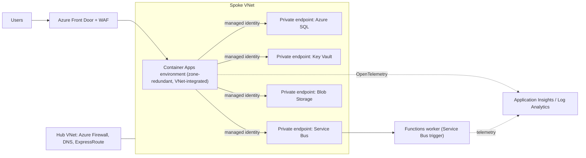
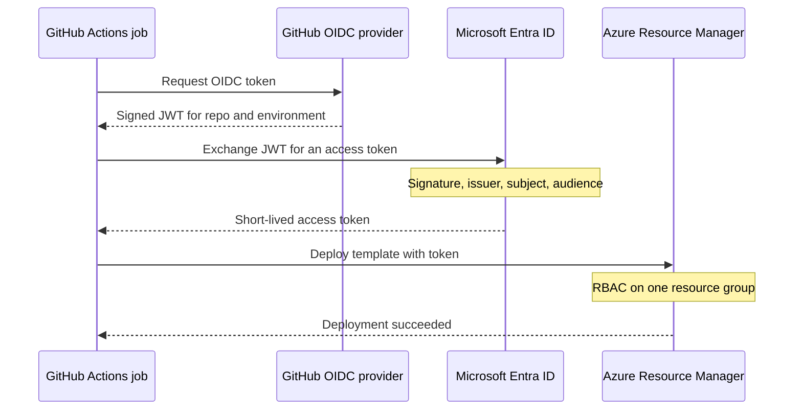

## TL;DR

- Azure organises everything under **Microsoft Entra ID** (identity) and a resource hierarchy: **management groups → subscriptions → resource groups → resources**, governed by **Azure RBAC** and **Azure Policy**.
- Default compute choices: **App Service** for web apps/APIs, **Azure Container Apps** for containerised microservices without cluster ops, **Azure Functions** for event-driven code, **AKS** when you need full Kubernetes, VMs for lift-and-shift.
- Data: **Azure SQL Database** or **Azure Database for PostgreSQL Flexible Server** for relational, **Cosmos DB** for globally distributed NoSQL, **Blob Storage** for objects; messaging via **Service Bus** (commands), **Event Grid** (reactive events), **Event Hubs** (streams).
- Secure PaaS with **managed identities** (no secrets), **Key Vault**, **private endpoints** and Entra-based auth; observe with **Azure Monitor / Application Insights** (OpenTelemetry).
- Build on an **Azure Landing Zone** (Cloud Adoption Framework), deploy with **Bicep or Terraform** from pipelines using workload identity federation, and review with the **Well-Architected Framework**.

## Core Concepts

### Resource hierarchy and governance

```text
Entra ID tenant
└── Root management group
    ├── Platform MG ── Identity sub · Management sub (logging) · Connectivity sub (hub network)
    ├── Landing zones MG
    │   ├── Corp MG (private, connected to on-prem) ── app subscriptions
    │   └── Online MG (internet-facing) ── app subscriptions
    └── Sandbox MG ── experiment subscriptions (relaxed policies, budgets)
```

- **Subscriptions** are units of billing, scale limits and isolation — typically one per workload and environment (or per team) for blast radius and cost clarity.
- **Resource groups** hold resources sharing a lifecycle.
- **Azure RBAC** assigns roles (Owner, Contributor, Reader, and many service-specific roles) to principals at a scope; inherited downwards.
- **Azure Policy** evaluates and enforces rules (deny, audit, modify, deployIfNotExists): allowed regions, required tags, no public network access, diagnostic settings deployed automatically. Assign policy **initiatives** at management groups.
- **Tags + Cost Management** for allocation, budgets and anomaly alerts.

### Identity: Entra ID and managed identities

- **Microsoft Entra ID** (renamed from Azure Active Directory in 2023) handles users, groups, app registrations, Conditional Access and SSO (OIDC, SAML).
- **Privileged Identity Management (PIM):** just-in-time elevation to privileged roles with approval and audit.
- **Managed identities** give Azure resources an identity to call other Azure services (Key Vault, Storage, SQL, Service Bus) **without secrets**: system-assigned (tied to the resource) or user-assigned (shareable, lifecycle independent).
- **Workload identity federation:** external workloads (GitHub Actions, AKS pods, other clouds) exchange their OIDC tokens for Entra tokens — no client secrets in pipelines.

```ts
// Node.js: access Blob Storage with a managed identity — no connection strings
import { DefaultAzureCredential } from '@azure/identity';
import { BlobServiceClient } from '@azure/storage-blob';

const credential = new DefaultAzureCredential(); // managed identity in Azure, developer login locally
const blobs = new BlobServiceClient('https://acmeprodinvoices.blob.core.windows.net', credential);
const container = blobs.getContainerClient('invoices');
await container.getBlockBlobClient('2026/03/inv-981.pdf').uploadData(pdfBuffer);
```

### Compute

| Service | What it is | Good for |
|---|---|---|
| App Service | Managed web hosting (code or containers), slots, autoscale | Web apps and APIs, quick wins |
| Azure Functions | Serverless functions, triggers/bindings; Durable Functions for workflows | Event handlers, glue, schedules, orchestrations |
| Azure Container Apps | Serverless containers on managed Kubernetes (KEDA scaling, Dapr, revisions) | Microservices, workers, APIs without cluster ops |
| AKS | Managed Kubernetes control plane; you run node pools | Platforms needing full Kubernetes, many services, custom operators |
| Virtual Machines / Scale Sets | IaaS | Lift-and-shift, special software, licensing |
| Container Instances | Single containers on demand | Short tasks, burst jobs |

### Data and storage

- **Storage accounts:** Blob (hot/cool/cold/archive tiers, lifecycle policies), Files (SMB/NFS shares), Queues, Tables; **Data Lake Storage Gen2** (hierarchical namespace) for analytics.
- **Redundancy:** LRS (3 copies, one data centre), ZRS (across 3 AZs), GRS/RA-GRS (LRS + async copy to the paired region), GZRS/RA-GZRS (ZRS + async geo copy).
- **Relational:** Azure SQL Database (serverless, Hyperscale), SQL Managed Instance (near-full SQL Server compatibility for migrations), Azure Database for PostgreSQL / MySQL Flexible Server (zone-redundant HA).
- **Cosmos DB:** multi-model NoSQL with global distribution, multi-region writes, five consistency levels, partition-key-based scaling, RU-based or serverless billing. (Azure Cosmos DB for PostgreSQL, the Citus-based distributed option, no longer accepts new deployments and retires on 31 March 2029. Distributed PostgreSQL now means **elastic clusters** in Azure Database for PostgreSQL Flexible Server.)
- **Caching:** Azure Managed Redis (the successor to Azure Cache for Redis, whose Enterprise tiers retire on 31 March 2027 and Basic/Standard/Premium tiers on 30 September 2028). Creating new Azure Cache for Redis instances has been blocked for all customers since October 2026, so new work starts on Azure Managed Redis.

### Messaging and integration

| Service | Pattern | Use for |
|---|---|---|
| Service Bus | Enterprise broker: queues, topics, sessions, transactions, DLQ, scheduling, duplicate detection | Commands, workflows, ordered processing |
| Event Grid | Push-based event routing (pub/sub) with filtering; system events from Azure resources; MQTT broker | Reacting to events ("blob created"), lightweight fan-out |
| Event Hubs | Partitioned log, high throughput, Kafka-compatible endpoint, Capture to storage | Telemetry, clickstreams, streaming analytics |
| Storage Queues | Simple, cheap queue | Basic background jobs at large scale |
| API Management | API gateway: policies, auth, rate limits, developer portal | Publishing and governing APIs |
| Logic Apps | Low-code workflows with connectors | Integration with SaaS/business systems |

### Networking

- **VNets and subnets**, **NSGs**, **Azure Firewall** (central egress/inspection), **hub-and-spoke** or **Virtual WAN** topologies.
- **Private Link / private endpoints** to PaaS services plus **Private DNS zones**; disable public network access on PaaS resources.
- **Load balancing family:** Front Door (global L7, CDN, WAF), Application Gateway (regional L7, WAF), Load Balancer (regional L4), Traffic Manager (DNS-based global routing).
- **Hybrid:** VPN Gateway, ExpressRoute (private circuits).

### Operations and security

- **Azure Monitor:** metrics, Log Analytics workspaces (KQL), alerts, workbooks; **Application Insights** for application telemetry (Azure Monitor OpenTelemetry Distro).
- **Key Vault:** secrets, keys, certificates; RBAC authorisation model; soft delete and purge protection.
- **Microsoft Defender for Cloud:** posture management (secure score), workload protection; **Microsoft Sentinel** for SIEM.
- **Backup and Site Recovery** for VM/data backup and DR orchestration.
- **Azure Advisor** for cost, reliability and security recommendations.

### Worked example: tracing a private endpoint's DNS

An Azure SQL logical server, `acme-orders.database.windows.net`, has a private endpoint in a spoke VNet at `10.20.4.5`, and **public network access is disabled**. The private DNS zone `privatelink.database.windows.net` lives in the connectivity subscription, linked to the hub and every spoke. An Azure Policy `deployIfNotExists` assignment adds each private endpoint's A record to it.

**From an app in the spoke VNet**, which uses Azure-provided DNS:

| Step | Query | Answer |
|---|---|---|
| 1 | `acme-orders.database.windows.net` | Public DNS returns a CNAME to `acme-orders.privatelink.database.windows.net`. Azure adds this CNAME once the server has a private endpoint |
| 2 | `acme-orders.privatelink.database.windows.net` | The VNet is linked to the private zone, so Azure DNS answers from it: an A record for `10.20.4.5` |
| 3 | Connect to `10.20.4.5:1433` | The connection stays inside the VNet and succeeds. TLS still validates, because the client used the server's normal name |

**From a laptop on-premises**, over ExpressRoute, using the corporate DNS servers:

| Step | Query | Answer |
|---|---|---|
| 1 | `acme-orders.database.windows.net` | The same CNAME to the `privatelink` name |
| 2 | `acme-orders.privatelink.database.windows.net` | The corporate DNS can't see the private zone, so it carries on through public DNS and gets the server's **public** IP |
| 3 | Connect to the public IP | Rejected, because public network access is disabled. The error looks like a firewall or login problem, not DNS |

**The fix** is a conditional forwarder on the corporate DNS servers for the *public* zone `database.windows.net`, pointing at the inbound endpoint of an **Azure DNS Private Resolver** in the hub. Azure then answers with the private IP for servers that have private endpoints, and the normal public answer for everything else.

Two habits prevent most of these incidents:
- **Debug with `nslookup` from the failing client first.** If the name doesn't resolve to a private address, the problem is DNS, whatever the error message says.
- **Keep one private zone per service, centrally**, linked to every VNet. Per-team copies of the same zone name each hold only some of the records, and a VNet linked to the wrong copy can't resolve the rest.

## How It Works

Reference architecture: zone-redundant web application with private PaaS backends.



Deployment flow: Bicep or Terraform in Git → pipeline (GitHub Actions/Azure DevOps) authenticates via workload identity federation → what-if/plan → approval → deploy to subscription created by the landing zone's subscription vending, with policies enforcing private access, tags and diagnostics.

### A pipeline deploying without a secret



A pull request's token carries a different subject (`repo:acme/orders:pull_request`), so it can't use the production credential even if a workflow is changed to try.

## When to Use / Trade-offs

| Decision | Option A | Option B | Choose A when | Choose B when |
|---|---|---|---|---|
| Container hosting | Container Apps | AKS | Want serverless containers, scale-to-zero, small/medium platform | Need full Kubernetes API, operators, custom networking, large platform team |
| Web hosting | App Service | Container Apps | Simple web app/API, deployment slots, mature features | Many microservices, event-driven scaling, Dapr |
| Relational DB | Azure SQL Database | PostgreSQL Flexible Server | SQL Server ecosystem, Hyperscale, T-SQL skills | Open-source stack, Postgres extensions, portability |
| Lift-and-shift SQL Server | SQL Managed Instance | Azure SQL Database | Need instance features (SQL Agent, cross-db queries, CLR) | App fits single-database model |
| Events | Event Grid | Service Bus | Reacting to state changes, push fan-out, Azure system events | Reliable commands, ordering, transactions, DLQ |
| Streams | Event Hubs | Service Bus | Millions of events/s, replay, Kafka clients | Per-message workflows |
| IaC | Bicep | Terraform | Azure-only, day-zero support for new features, no state file | Multi-cloud/providers, existing Terraform skills and modules |
| Global entry | Front Door | Application Gateway | Global users, CDN, multi-region failover | Regional, VNet-internal or specific L7 needs |

## Common Pitfalls & Anti-patterns

- **One giant subscription** for everything — no blast-radius isolation, messy RBAC and cost allocation.
- **Connection strings and keys everywhere** instead of managed identities and Entra auth.
- **Public endpoints on PaaS** (storage, SQL, Key Vault) "because private endpoints are fiddly".
- **Private endpoints without private DNS** — resolution still points to public IPs; connections fail or bypass the private path.
- **Owner role handed out widely**; no PIM for privileged access.
- **No diagnostic settings** — resource logs never reach Log Analytics; investigations fail.
- **Single-zone deployments** where zone redundancy was a checkbox away.
- **Ignoring service limits and quotas** (subscription vCPU quotas, Service Bus/Front Door limits) until a launch.
- **Over-provisioned Premium SKUs** in dev/test; no auto-shutdown; no reservations or savings plans for steady production.
- **Click-ops** in the portal with no IaC — drift and irreproducible environments.

## Real-world Scenario

**Context:** A healthcare SaaS on Azure had grown to 9 subscriptions created ad hoc, with storage keys in app settings, public endpoints on SQL and storage, and a regulator audit approaching (patient data, UK residency requirements).

**Decision:** Adopted the **Azure Landing Zone** reference architecture: management group hierarchy, policy initiatives (UK regions only, deny public network access, require private endpoints, deploy diagnostic settings, require encryption with customer-managed keys for patient data), hub-and-spoke networking with Azure Firewall, and subscription vending via Terraform. Apps were migrated to **managed identities** (Key Vault references for remaining third-party secrets), **private endpoints** with Private DNS, Entra-only auth on Azure SQL, and **Defender for Cloud** for posture. Pipelines moved to GitHub Actions with workload identity federation.

**Outcome:** Secure score rose from 41% to 88%; the audit passed without major findings; secrets in configuration dropped to near zero; new environments became available in under an hour instead of two weeks.

**What I'd do differently:** Roll out policies in **audit mode first** with a remediation window — deny-mode policies applied too quickly broke two teams' deployments. And plan IP address space up front; overlapping VNets from the early days required renumbering.

## Interview Questions

### Explain Azure's resource hierarchy and how governance applies to it. {#resource-hierarchy}

**Level:** Foundation

**Model answer:**
- **Entra ID tenant:** the identity boundary.
- **Management groups:** containers for subscriptions, up to several levels deep, used to apply **policy and RBAC** across many subscriptions.
- **Subscriptions:** billing and scale/isolation boundaries; commonly one per workload/environment.
- **Resource groups:** logical containers for resources sharing a lifecycle (deploy and delete together).
- **Resources:** VMs, databases, storage accounts…

Governance: **Azure RBAC** role assignments and **Azure Policy** assignments are inherited down the hierarchy, so you set guardrails once at a management group (allowed regions, required tags, deny public endpoints) and every subscription beneath complies. Cost Management and budgets work at subscription/resource group scope with tags for finer allocation.

**What the interviewer is looking for:**
The levels, why subscriptions are isolation units, and inheritance of RBAC and Policy.

**Follow-ups:**
- Why not put everything in one subscription?
- How would you structure management groups for prod vs non-prod?

**Red flags:**
- Confusing resource groups with subscriptions.
- Applying policies resource by resource.

### What is a managed identity, and why use it? {#entra-managed-identity}

**Level:** Foundation

**Model answer:**
A **managed identity** is an Entra ID identity automatically managed for an Azure resource (App Service, Functions, Container Apps, VMs, AKS workloads). The resource obtains tokens from a local endpoint and uses them to access other services that support Entra authentication — Key Vault, Storage, Azure SQL, Service Bus, Cosmos DB — **with no secrets in code or configuration**, and Azure rotates the underlying credentials.

- **System-assigned:** created with and tied to one resource; deleted with it.
- **User-assigned:** a standalone identity attachable to several resources; useful for pre-provisioning permissions or sharing across scale units.

Grant it least-privilege RBAC roles at the narrowest scope (e.g. `Storage Blob Data Contributor` on one container). In code, `DefaultAzureCredential` uses the managed identity in Azure and the developer's login locally.

**What the interviewer is looking for:**
The no-secrets benefit, system vs user-assigned, least-privilege RBAC and SDK usage.

**Follow-ups:**
- How would a GitHub Actions pipeline authenticate without a secret?
- When do you prefer user-assigned identities?

**Red flags:**
- Storing storage account keys in app settings when managed identity is available.
- Granting the identity Contributor on the subscription.

### What compute options does Azure offer, and when would you use each? {#azure-compute-options}

**Level:** Foundation

**Model answer:**
- **App Service:** managed hosting for web apps and APIs (code or containers) with deployment slots, autoscale and built-in auth — the quickest path for standard web workloads.
- **Azure Functions:** event-driven serverless code with triggers (HTTP, Service Bus, Event Grid, timers) and bindings; **Durable Functions** for stateful orchestrations.
- **Azure Container Apps:** serverless containers with KEDA-based autoscaling (including scale to zero), revisions/traffic splitting, Dapr integration — microservices without managing Kubernetes.
- **AKS:** managed Kubernetes for platforms that need the full Kubernetes API, custom controllers or advanced networking; you manage node pools, upgrades and add-ons.
- **Virtual Machines / Scale Sets:** IaaS for lift-and-shift, legacy or specialised software.
- **Container Instances:** run a container quickly for short jobs.

Default for new microservices is usually Container Apps or App Service; AKS when there's a platform team and a genuine need.

**What the interviewer is looking for:**
Accurate positioning of each service and a sensible default.

**Follow-ups:**
- What would push you from Container Apps to AKS?
- How do Durable Functions differ from plain Functions?

**Red flags:**
- AKS as the default for a single small API.
- Not knowing Container Apps exists.

### Explain Azure Storage redundancy options. {#storage-redundancy}

**Level:** Foundation

**Model answer:**
- **LRS (locally redundant):** three synchronous copies within one data centre. Cheapest; doesn't survive a data-centre or zone loss.
- **ZRS (zone-redundant):** three synchronous copies across three availability zones in the region. Survives a zone failure — the usual choice for production in zone-enabled regions.
- **GRS (geo-redundant):** LRS in the primary region plus **asynchronous** replication to the paired secondary region (another LRS). **RA-GRS** allows read access to the secondary.
- **GZRS / RA-GZRS:** ZRS in the primary plus asynchronous geo-replication — the highest durability and availability option.

Notes: geo-replication is asynchronous, so failover can lose recent writes (RPO typically minutes; check the documented targets); customer-initiated failover exists for geo-redundant accounts. Choose by RPO/RTO, residency (the paired region must satisfy data location rules), and cost.

**What the interviewer is looking for:**
Correct definitions, sync vs async replication, failover implications and residency awareness.

**Follow-ups:**
- What happens to writes during a regional outage with GRS?
- How do you protect blobs against accidental deletion?

**Red flags:**
- Thinking GRS means zero data loss.
- LRS for critical production data without consideration.

### Compare Front Door, Application Gateway, Load Balancer and Traffic Manager. {#load-balancing-options}

**Level:** Senior

**Model answer:**
- **Azure Front Door:** global, layer 7 (HTTP/S) entry point on Microsoft's edge network: TLS termination, CDN caching, WAF, path-based routing, health probes and fast failover across regions/origins. Use for internet-facing apps with global users or multi-region active-active/active-passive.
- **Application Gateway:** **regional** layer 7 load balancer inside a VNet: WAF, path/host routing, TLS termination, private frontends, ingress for AKS (Application Gateway for Containers). Use for regional web apps, internal L7 routing, or behind Front Door when needed.
- **Azure Load Balancer:** **regional layer 4** (TCP/UDP) — high throughput, low latency, internal or public; for non-HTTP traffic and VM scale sets.
- **Traffic Manager:** **DNS-based** global routing (priority, weighted, performance, geographic); works with any protocol but failover is limited by DNS TTL and client caching.

Common combinations: Front Door → Container Apps/App Service in two regions; Front Door → Application Gateway → AKS for VNet-internal architectures; Load Balancer for TCP services.

**What the interviewer is looking for:**
Global vs regional, L7 vs L4 vs DNS, and sensible combinations.

**Follow-ups:**
- Why is DNS-based failover slower?
- Where would you put the WAF?

**Red flags:**
- Using Traffic Manager for fast HTTP failover without understanding TTLs.
- Confusing Front Door with Application Gateway.

### When do you use Service Bus, Event Grid and Event Hubs? {#azure-messaging}

**Level:** Senior

**Model answer:**
- **Service Bus:** enterprise message broker for **high-value messages** — commands, workflows, ordered processing (sessions), transactions, dead-lettering, scheduled and deferred messages, duplicate detection. Pull-based with peek-lock.
- **Event Grid:** **push-based event routing** for reactive programming: Azure resources and custom apps publish events ("BlobCreated", "OrderPlaced"), subscribers (Functions, webhooks, queues) receive them with filtering and retries. Lightweight notifications, not a durable stream for replay (Event Grid namespaces add pull delivery and an MQTT broker).
- **Event Hubs:** **partitioned event stream** for high-throughput telemetry and event streaming, multiple consumer groups, retention and replay, **Kafka-compatible endpoint**, Capture to storage for analytics.

Combine them: an order service sends `ReserveStock` commands on Service Bus; storage uploads trigger processing via Event Grid; clickstream flows through Event Hubs into analytics.

**What the interviewer is looking for:**
Clear purpose of each (messages vs discrete events vs streams) and a realistic combined design.

**Follow-ups:**
- How would you handle ordering per customer?
- Which would you use for CDC from a database?

**Red flags:**
- Using Event Hubs for workflow commands needing per-message DLQ.
- Not distinguishing push notifications from durable streams.

### How do you choose between Azure SQL Database, PostgreSQL Flexible Server and Cosmos DB? {#azure-data-choices}

**Level:** Senior

**Model answer:**
- **Azure SQL Database:** fully managed SQL Server engine — strong for teams with SQL Server/.NET skills, T-SQL features, serverless tier for intermittent workloads, **Hyperscale** for very large databases with fast scale and read replicas, zone-redundant options; **SQL Managed Instance** when migrating SQL Server apps needing instance-level features.
- **Azure Database for PostgreSQL – Flexible Server:** managed open-source Postgres with zone-redundant HA, read replicas, extensions (pgvector, PostGIS, etc.) — good default for open-source stacks and portability.
- **Cosmos DB:** globally distributed NoSQL with partition-key scaling, single-digit-millisecond reads at scale, **multi-region writes**, tunable consistency, change feed; billed by request units (provisioned, autoscale or serverless). Best for known access patterns at high scale or global distribution; poor for ad-hoc relational queries.

Decide on data model and access patterns, consistency/transactions, scale and global needs, team skills, ecosystem and cost model; most transactional business systems start relational.

**What the interviewer is looking for:**
Positioning of each engine, Hyperscale/MI nuances, Cosmos strengths and modelling constraints, and decision criteria.

**Follow-ups:**
- How do you choose a Cosmos DB partition key?
- What does Cosmos session consistency guarantee?

**Red flags:**
- Choosing Cosmos DB for a relational workload "because it scales".
- Ignoring RU cost modelling.

### How do you secure access to PaaS services with private networking? {#private-endpoints}

**Level:** Senior

**Model answer:**
1. **Private endpoints:** a network interface in your VNet with a private IP mapped to a specific PaaS resource (SQL, Storage, Key Vault, Service Bus, Cosmos DB). Traffic stays on the Microsoft backbone.
2. **Private DNS zones** (e.g. `privatelink.database.windows.net`) linked to the VNets so the service's normal hostname resolves to the private IP — typically centralised in the hub with policy-driven record creation. Without this, clients resolve the public IP.
3. **Disable public network access** on the PaaS resource (or restrict to selected networks), enforced by Azure Policy.
4. **Compute integration:** App Service/Functions VNet integration, Container Apps environments in your VNet, AKS in your VNet, so the calling workloads can reach the private endpoints.
5. **Identity on top:** network isolation is not authentication — still use managed identities and Entra auth, disable local/key auth where possible.
6. **Hybrid access:** on-premises resolution via DNS forwarders/Private DNS Resolver and ExpressRoute/VPN.

Service endpoints are an older, simpler mechanism (traffic from a subnet identified to the service) but the resource keeps a public endpoint — private endpoints are preferred for strong isolation.

**What the interviewer is looking for:**
Private endpoints + DNS, disabling public access, compute VNet integration, identity in addition to network controls.

**Follow-ups:**
- Your app can't reach Key Vault after adding a private endpoint. What do you check?
- Service endpoints vs private endpoints?

**Red flags:**
- Forgetting DNS.
- Treating private networking as a substitute for authentication.

### Bicep or Terraform for Azure infrastructure? {#bicep-vs-terraform}

**Level:** Senior

**Model answer:**
- **Bicep:** Azure's native DSL compiling to ARM templates. Pros: day-zero support for new Azure features and API versions, no state file (ARM is the state), `what-if` previews, good VS Code tooling, deployment stacks for lifecycle management. Cons: Azure-only; module ecosystem smaller (though Azure Verified Modules help).
- **Terraform (or OpenTofu) with azurerm/azapi providers:** Pros: one tool and workflow across Azure, other clouds, SaaS (GitHub, Datadog, Entra); large ecosystem; mature plan/apply workflow. Cons: state file management (remote state, locking, secrets in state), provider lag for brand-new features (mitigated by `azapi`), licensing considerations (Terraform BSL since 2023 vs OpenTofu MPL).

Choose by organisation context: Azure-only shops with Microsoft skills often prefer Bicep; multi-cloud or SaaS-heavy organisations prefer Terraform. Either way: modules, pipelines with plan/what-if and approvals, workload identity federation, policy-as-code checks, and drift detection.

**What the interviewer is looking for:**
Balanced comparison including state, feature lag, ecosystem and licensing, and consistent practices regardless of tool.

**Follow-ups:**
- How do you manage Terraform state securely on Azure?
- What are Azure Verified Modules?

**Red flags:**
- Hand-editing ARM JSON at scale.
- Storing Terraform state locally or in Git.

### How would you set up observability for applications on Azure? {#azure-observability}

**Level:** Senior

**Model answer:**
- **Instrument with OpenTelemetry** using the Azure Monitor OpenTelemetry Distro (or OTLP to a collector), sending traces, metrics and logs to **Application Insights** (backed by Log Analytics). Set `service.name`, environment and version consistently.
- **Workspace design:** a central Log Analytics workspace per environment/region (or per business unit) with RBAC; resource-context access so teams see their own data; retention tiers and basic/auxiliary log tables for high-volume, low-query data to control cost.
- **Platform logs:** diagnostic settings on every resource (deployed by Azure Policy) sending resource logs and metrics to the workspace; Activity Log for control-plane audit.
- **Alerts:** SLO-based alerts on request success and latency (log alerts or metric alerts), action groups routing to on-call tools; avoid alerting on raw CPU.
- **Dashboards:** workbooks or Grafana (Azure Managed Grafana) for service and SLO views; application maps for dependencies.
- **Cost control:** sampling (ingestion sampling or OpenTelemetry tail sampling via a collector), daily caps with alerts, dropping noisy logs, commitment tiers for large ingestion.

**What the interviewer is looking for:**
OpenTelemetry-based instrumentation, workspace strategy, diagnostic settings via policy, SLO alerting and cost management.

**Follow-ups:**
- How do you correlate a Service Bus message's processing with the originating HTTP request?
- How do you avoid a runaway Log Analytics bill?

**Red flags:**
- No diagnostic settings, so platform logs are missing.
- Using proprietary SDKs everywhere when OpenTelemetry is supported.

### Design an Azure landing zone for an enterprise moving 300 applications. {#azure-landing-zone}

**Level:** Architect

**Model answer:**
Start from the **Cloud Adoption Framework Azure Landing Zone** reference architecture and adapt:
- **Management group hierarchy:** Platform (Identity, Management, Connectivity subscriptions), Landing Zones (Corp for internal/connected apps, Online for internet-facing), Sandbox, Decommissioned.
- **Subscription vending:** an automated process (Terraform/Bicep modules + pipeline + request form) creating subscriptions per application/environment with networking (spoke VNet peered to hub), RBAC groups, budgets, tags and policy assignments in minutes.
- **Identity:** Entra ID with Conditional Access, PIM for privileged roles, break-glass accounts, groups-based RBAC; workload identity federation for pipelines.
- **Networking:** hub-and-spoke or Virtual WAN; Azure Firewall for egress inspection; Private DNS zones centralised with policy-driven registration; ExpressRoute to on-premises; IP address management plan.
- **Policy initiatives:** allowed regions, deny public PaaS access, require private endpoints, enforce TLS/encryption, deploy diagnostics and Defender plans, required tags; rolled out audit-first, then deny.
- **Security operations:** Defender for Cloud across subscriptions, Sentinel for SIEM, central Log Analytics, Key Vault patterns.
- **Management:** backup policies, update management for VMs, cost management with budgets and anomaly alerts.
- **Operating model:** platform team owns the landing zone as a product (versioned, documented, with a roadmap), application teams own their subscriptions within guardrails; exception process via ADR.

**What the interviewer is looking for:**
CAF-based hierarchy, automated vending, identity, networking with DNS, policy rollout strategy, security ops and an operating model.

**Follow-ups:**
- How do you migrate existing ad-hoc subscriptions into the landing zone?
- How do you handle an application that needs public internet ingress?

**Red flags:**
- Manual subscription creation.
- Deny policies applied everywhere on day one without audit.

### Design a multi-region, highly available web application on Azure. {#multi-region-azure}

**Level:** Architect

**Model answer:**
**Requirements first:** target availability (e.g. 99.99%), RPO/RTO, active-active vs active-passive, data residency, budget.

**Design (active-active example):**
- **Front Door** as the global entry with WAF, health probes and latency-based routing to two regions (e.g. UK South and West Europe, or paired regions within residency rules).
- **Each region self-sufficient:** zone-redundant Container Apps or App Service, regional caches, private endpoints, regional Key Vault, Service Bus namespace (with geo-disaster recovery or regional queues and idempotent consumers).
- **Data:**
  - **Cosmos DB** with multi-region writes (conflict resolution policy) for data that must be writable everywhere, or
  - **Azure SQL** with auto-failover groups / active geo-replication (single writer, readable secondaries, failover with possible data loss of the replication lag), or PostgreSQL Flexible Server with geo-replicas.
  - Blob Storage with GZRS / object replication.
- **Stateless app tier** (no session affinity), idempotent operations, outbox for events.
- **Failover:** automatic at the Front Door layer for app health; data-tier failover automated where safe, otherwise runbook-driven with clear decision authority.
- **Testing:** regular region failover drills (Azure Chaos Studio, game days), capacity headroom in each region to take the full load.
- **Deployment:** region-by-region rollouts (deploy to one region, validate, then the other) to avoid deploying a bad change everywhere at once.

**What the interviewer is looking for:**
Requirements-driven design, global routing, regional independence, explicit data replication trade-offs, safe deployments and DR testing.

**Follow-ups:**
- How do you handle a write conflict in Cosmos DB multi-region writes?
- What's the cost difference vs single region, and how do you justify it?

**Red flags:**
- Shared single-region dependencies (one Key Vault, one database) in a "multi-region" design.
- Never testing failover.

### How do you govern a large Azure estate with Azure Policy without slowing teams down? {#azure-policy-governance}

**Level:** Architect

**Model answer:**
- **Policy as code:** definitions and initiative assignments in Git (Enterprise Policy as Code or Terraform/Bicep), reviewed and deployed via pipeline, versioned.
- **Layered assignments:** organisation-wide baselines at the root/intermediate management groups (regions, encryption, logging), stricter initiatives for Corp/Online/regulated scopes.
- **Effects chosen deliberately:**
  - `deny` for clear-cut, high-risk violations (public storage, disallowed regions).
  - `deployIfNotExists`/`modify` to **auto-remediate** (diagnostic settings, tags inheritance, Defender plans) — guardrails that help rather than block.
  - `audit` for new rules during a grace period.
- **Shift left:** run the same rules in CI against IaC (e.g. PSRule for Azure, Checkov, `what-if` validation) so developers see violations before deployment.
- **Exemptions** with expiry dates and justification (tracked like ADRs), reviewed regularly.
- **Visibility:** compliance dashboards per team/subscription, remediation tasks, and trend reporting to leadership.
- **Communication:** changelog and advance notice for new deny policies; office hours.

**What the interviewer is looking for:**
Policy as code, layered scopes, effect selection including auto-remediation, shift-left checks, time-bound exemptions and transparency.

**Follow-ups:**
- A new deny policy breaks a production deployment pipeline. What's your process?
- How do you measure policy effectiveness?

**Red flags:**
- Policies managed by clicking in the portal.
- Permanent, undocumented exemptions.

### AKS or Azure Container Apps for a 40-service platform? {#aks-vs-container-apps}

**Level:** Architect

**Model answer:**
**Azure Container Apps** — serverless containers on managed Kubernetes infrastructure:
- Pros: no cluster operations (upgrades, node management), KEDA autoscaling incl. scale to zero, revisions and traffic splitting, Dapr and ingress built in, VNet integration, workload profiles (dedicated or consumption), lower platform team burden.
- Cons: no direct Kubernetes API access (no custom operators/CRDs), fewer networking and scheduling controls, some limits on sidecars/daemonsets and specialised workloads.

**AKS** — managed control plane, full Kubernetes:
- Pros: entire Kubernetes ecosystem (operators, service mesh, GitOps, custom schedulers), fine-grained networking and security controls, GPU/specialised node pools, multi-tenant platform patterns.
- Cons: you own node pool lifecycle, upgrades (frequent), add-on management, security hardening, capacity planning — needs a capable platform team; easy to under-invest.

Decision factors: platform team capacity; need for Kubernetes-specific tooling or portability; workload types (stateful sets, GPUs, daemonsets); regulatory network controls; cost model at your scale. For 40 standard HTTP/worker services with a small platform team, Container Apps is usually the better default; choose AKS when specific requirements demand it — and you can mix (Container Apps for most services, AKS for specialised workloads).

**What the interviewer is looking for:**
Concrete capability and operational-burden comparison, decision criteria tied to team capacity and workloads, openness to mixing.

**Follow-ups:**
- What would make you migrate from Container Apps to AKS later, and how hard would it be?
- How do you run GitOps on each?

**Red flags:**
- Choosing AKS for CV value.
- Ignoring the AKS upgrade cadence and ops cost.

### How would you reduce a growing Azure bill by 30% without hurting reliability? {#azure-cost}

**Level:** Architect

**Model answer:**
1. **Visibility:** Cost Management by subscription, resource group and tag; allocate shared costs; find the top 20 cost drivers (usually compute, databases, Log Analytics, egress, storage).
2. **Quick wins:**
   - Delete orphaned resources (unattached disks, old snapshots, idle public IPs, unused App Service plans).
   - Auto-shutdown and scale-to-zero for dev/test; smaller SKUs outside production.
   - Azure Advisor recommendations for rightsizing.
3. **Rightsize then commit:** rightsize VMs, App Service plans, AKS node pools and databases (vCore, DTU, Hyperscale settings, serverless for intermittent DBs); then **Azure savings plans for compute** and **reservations** for steady baselines; **Azure Hybrid Benefit** for existing Windows Server/SQL Server licences.
4. **Architecture levers:** autoscaling (KEDA, scale rules), spot node pools for batch/CI, storage lifecycle tiers (cool/cold/archive), CDN caching to cut egress, Cosmos DB autoscale/serverless and query RU optimisation.
5. **Observability cost:** Log Analytics ingestion reduction (sampling, basic/auxiliary logs, filtering verbose logs), commitment tiers.
6. **Guardrails:** budgets and anomaly alerts per team, policy restricting expensive SKUs in non-prod, cost reviews in architecture decisions, showback to teams.

Protect reliability by keeping SLO dashboards in view: don't remove zone redundancy or headroom from critical tiers; validate changes with load tests.

**What the interviewer is looking for:**
Visibility first, quick wins, rightsizing before commitments, Azure-specific levers (Hybrid Benefit, savings plans), observability cost, guardrails and reliability protection.

**Follow-ups:**
- Savings plans vs reservations — when do you choose each?
- Which teams should own cost decisions?

**Red flags:**
- Buying reservations before rightsizing.
- Cutting zone redundancy on critical systems to save money.

### What is the difference between Azure RBAC roles and Microsoft Entra roles? {#azure-rbac-vs-entra-roles}

**Level:** Foundation

**Model answer:**
They're two separate role systems that people often mix up.

| | Microsoft Entra roles | Azure RBAC roles |
|---|---|---|
| Control | The directory: users, groups, app registrations, Conditional Access, tenant settings | Azure resources: subscriptions, resource groups, VMs, storage, databases |
| Examples | Global Administrator, User Administrator, Application Administrator, Security Reader | Owner, Contributor, Reader, Storage Blob Data Reader, Key Vault Secrets User |
| Scope | The tenant, or an administrative unit | Management group, subscription, resource group or a single resource, inherited downwards |

Points that matter in practice:
- **Neither implies the other.** A Global Administrator has no access to Azure resources by default. They can elevate themselves to User Access Administrator at the root scope, which is a powerful break-glass step that should be audited and alerted on.
- Azure RBAC separates **control-plane actions** (`Actions`, such as creating a storage account) from **data-plane actions** (`DataActions`, such as reading a blob). Owner on a storage account doesn't let you read its blobs through Entra auth unless you also hold a data role.
- **Privileged Identity Management** covers both systems, so privileged roles in either can be eligible and activated just in time.
- Both support **custom roles**, and Azure RBAC role assignments can carry **conditions** (attribute-based access control) for storage.

**What the interviewer is looking for:**
The directory versus resources distinction, separate scopes, control versus data plane, and the elevation path for Global Administrators.

**Follow-ups:**
- Who should be able to grant RBAC roles in a subscription?
- How would you give a team access to read blobs in one container only?

**Red flags:**
- Assuming Global Administrator means owner of every subscription.
- Using Owner where a data-plane role is what's needed.

### How does workload identity federation let a pipeline deploy to Azure without a secret? {#workload-identity-federation}

**Level:** Senior

**Model answer:**
You configure a **federated identity credential** on a user-assigned managed identity or an app registration. It says "trust tokens from this issuer, with this subject and this audience". For GitHub Actions:
- **Issuer:** `https://token.actions.githubusercontent.com`
- **Subject:** for example `repo:acme/orders:environment:production`
- **Audience:** `api://AzureADTokenExchange`

At run time the job (with `id-token: write` permission) asks GitHub for a signed OIDC token. `azure/login` presents it to Entra ID, which checks the signature and matches the claims **exactly** against the credential, then returns a short-lived Entra access token. The same mechanism works for AKS pods (Microsoft Entra Workload ID), Terraform Cloud, other clouds' workloads and any OIDC issuer.

Why it's better than a client secret:
- There's no secret to store, rotate, or leak in logs or forks.
- The trust is tied to a specific repository *and* environment or branch, not to whoever has the secret.
- Tokens live for minutes to an hour, not months.

Designing it well:
- **One identity per environment**, each with least-privilege RBAC at the narrowest scope (often one resource group).
- Use **GitHub environments** as the subject, so production tokens are only issued to jobs that passed the environment's protection rules (required reviewers, branch restrictions).
- Subjects are matched exactly, so plan the naming. An identity supports up to 20 federated credentials.
- Keep the trust configuration in IaC, and alert on changes to federated credentials. Adding one is how an attacker would backdoor the identity.

**What the interviewer is looking for:**
The issuer, subject and audience triple, the token exchange, scoping by environment, and least-privilege RBAC behind it.

**Follow-ups:**
- How would you stop a pull request workflow from using the production identity?
- How does this compare with AWS's `AssumeRoleWithWebIdentity`?

**Red flags:**
- A service principal secret with Contributor on the subscription, stored as a repository secret.
- One identity shared by every environment.

### How do you design Key Vault usage for a large estate? {#key-vault-design}

**Level:** Senior

**Model answer:**
**What goes in it:** secrets (third-party API keys, connection strings that can't yet use Entra auth), keys (customer-managed encryption keys, signing keys, HSM-backed in the Premium tier) and certificates (with auto-renewal from integrated CAs). Managed HSM gives single-tenant HSM pools for stricter compliance needs.

**Structure:**
- **One vault per application, per environment, per region.** That limits the blast radius, keeps RBAC simple, and spreads the per-vault throttling limits. A shared "company vault" becomes a bottleneck and a single point of compromise.
- **Azure RBAC** as the permission model rather than legacy access policies, with data roles such as Key Vault Secrets User granted to the app's managed identity on that vault only.

**Protection:**
- **Soft delete** is always on, with 7 to 90 days' retention. Enable **purge protection** for vaults holding encryption keys, so a deleted key can't be purged before the retention period ends. It can't be turned off once enabled.
- **Private endpoint** and public network access disabled, with Private DNS as for any PaaS service.
- **Diagnostic logs** to Log Analytics, with alerts on unusual access patterns and denied requests.

**Consumption:**
- App Service and Functions use **Key Vault references** in app settings, AKS uses the **Secrets Store CSI driver**, and code uses the SDK with `DefaultAzureCredential`. Cache secrets in the app instead of fetching per request.
- **Rotation**: Key Vault publishes Event Grid events such as `SecretNearExpiry`, which can trigger a Function that rotates the secret with the provider.

**The best secret is none**: move each dependency to managed identity and Entra auth where it's supported, and keep Key Vault for what's left.

**What the interviewer is looking for:**
Vault granularity, RBAC, soft delete and purge protection, private access, consumption patterns, rotation and eliminating secrets.

**Follow-ups:**
- A vault is throttling requests during a traffic spike. What's happening and what do you change?
- How do you rotate a database password with no downtime?

**Red flags:**
- One vault for the whole company.
- Granting Key Vault Administrator to applications.

### Hub-and-spoke or Virtual WAN for a network spanning four regions and 60 branch offices? {#hub-spoke-vs-virtual-wan}

**Level:** Architect

**Model answer:**
**Customer-managed hub-and-spoke:** you build a hub VNet per region with Azure Firewall or third-party appliances, VPN and ExpressRoute gateways, and the DNS Private Resolver. Spokes peer to their hub.
- VNet peering **isn't transitive**, so spoke-to-spoke and hub-to-hub traffic needs user-defined routes through the firewall, or Azure Virtual Network Manager connectivity groups for direct paths.
- Full control over what lives in the hub and how traffic is routed, but every route table, peering and cross-region path is yours to design and maintain.

**Virtual WAN:** Microsoft runs the hubs. Each virtual hub has a managed router.
- **Any-to-any transit** between VNets, branches (site-to-site VPN and SD-WAN partner integrations), remote users and ExpressRoute, across hubs in different regions, without hand-built routing.
- A **secured virtual hub** adds Azure Firewall, and **routing intent** sends private and internet traffic through it with a single setting.
- Constraints: you can't deploy your own resources inside a virtual hub, so shared services such as the DNS resolver go in a spoke. You also get less fine-grained routing control, and pricing per hub and per GB processed.

**For four regions and 60 branches**, Virtual WAN usually wins. Branch connectivity and global transit are exactly what it automates, and hand-building that mesh is where hub-and-spoke designs accumulate fragile routing. Hub-and-spoke stays the better fit for one or two regions, few branches, or a need for appliances and routing that Virtual WAN doesn't support.

**Either way:**
- An **IP address plan** with no overlaps, managed in Virtual Network Manager's IPAM or an external tool.
- Centralised **private DNS** with conditional forwarding from on-premises.
- **Network Manager security admin rules** for organisation-wide rules that teams can't override.
- Network changes deployed through IaC with the landing zone.

**What the interviewer is looking for:**
Non-transitive peering, what Virtual WAN automates and what it constrains, a decision tied to the scale of regions and branches, and the shared foundations.

**Follow-ups:**
- How do you inspect traffic between two spokes in Virtual WAN?
- How would you migrate an existing hub-and-spoke network to Virtual WAN?

**Red flags:**
- Assuming peering is transitive.
- Choosing by habit without counting regions and branches.

### Design an API platform on Azure API Management for 30 teams publishing internal and partner APIs. {#api-management-design}

**Level:** Architect

**Model answer:**
**Topology:**
- **Front Door with WAF** for partner traffic, to API Management in a VNet (internal mode, or with a private endpoint), and backends reached privately (Container Apps, App Service, AKS ingress).
- Internal consumers reach the same gateway privately. Keep separate products for internal and partner APIs.
- The **Premium tier** for availability zones, multi-region gateways and full VNet injection. With multiple regions the management plane stays in the primary region: gateways keep serving during a primary outage, but configuration changes wait.
- **Self-hosted gateways** for APIs that must run on-premises or in another cloud, managed from the same instance.

**Multi-team operation:**
- **Workspaces** give each team its own APIs, products and policies on the shared instance, without access to the others'.
- **APIOps**: each API's OpenAPI definition and policies in the owning team's repository, deployed through a pipeline with linting (for example Spectral rules for naming and security schemes). No portal edits in production.
- **Versions** for breaking changes, **revisions** for non-breaking ones, and a deprecation policy partners can plan around.

**Security and traffic policies:**
- `validate-jwt` (or `validate-azure-ad-token`) with Entra ID or the partner's identity provider. Subscription keys identify a consumer for quotas and analytics. They aren't authentication.
- `rate-limit-by-key` and `quota-by-key` per consumer, and mTLS for partners that need it.
- Backend **circuit breakers** and load-balanced backend pools for resilience. Response caching where it's safe.
- Remove internal headers and stack traces in outbound policies.

**Operations:** Application Insights with correlation ids passed to backends, per-API dashboards and alerts on 5xx and latency, and the developer portal for partner onboarding and key self-service. The platform team owns the instance and the policy fragments. API teams own their APIs.

**What the interviewer is looking for:**
Private topology with an edge WAF, tier and multi-region implications, workspaces and APIOps for many teams, JWT-based security, and clear ownership.

**Follow-ups:**
- How do you stop one partner's traffic from starving the others?
- Would you put Azure OpenAI behind the same gateway, and what policies would you add?

**Red flags:**
- Subscription keys as the only authentication.
- Every team editing policies in the portal.

## Cheat Sheet

### Governance and identity
- **Hierarchy** — tenant → management groups → subscriptions → resource groups → resources.
- **Azure Policy effects** — deny, audit, modify, deployIfNotExists; roll out audit-first.
- **Entra ID** — the identity platform (formerly Azure AD); Conditional Access and PIM for privileged roles.
- **Managed identity** — resource identity with no secrets; system- or user-assigned.
- **Workload identity federation** — pipelines and pods exchange OIDC tokens for Entra tokens; no client secrets.

### Services
- **Container Apps vs AKS** — serverless containers without cluster ops vs full Kubernetes with ops burden.
- **Service Bus / Event Grid / Event Hubs** — commands and workflows / reactive push events / high-throughput streams.
- **Storage redundancy** — LRS, ZRS, GRS, GZRS; geo-replication is asynchronous.
- **SQL Database vs Managed Instance** — single managed DB vs near-full SQL Server instance for migrations.
- **Front Door vs Application Gateway** — global L7 with CDN/WAF vs regional L7 in a VNet.

### Practice
- **Private endpoint + Private DNS** — both are needed; then disable public network access.
- **Bicep vs Terraform** — Azure-native, no state vs multi-provider with state file.
- **Diagnostic settings** — deploy via policy so resource logs reach Log Analytics.
- **Cost levers** — rightsize, savings plans/reservations, Hybrid Benefit, auto-shutdown, log ingestion control.
- **Landing zone** — CAF reference architecture with subscription vending and policy guardrails.

### Revisit

- **Private endpoint DNS** — the public name CNAMEs to `privatelink`, and only a linked private zone turns that into the private IP. On-premises clients need a forwarder for the *public* zone to the DNS Private Resolver.
- **Entra roles vs Azure RBAC** — directory objects at tenant scope versus Azure resources at management group to resource scope. Global Administrator doesn't imply resource access.
- **Control vs data plane** — `Actions` manage resources, `DataActions` read and write their data. Owner doesn't grant blob reads.
- **Workload identity federation** — issuer, subject and audience must match exactly. Scope subjects to GitHub environments, use one identity per environment, and allow at most 20 credentials per identity.
- **Key Vault** — one vault per app, environment and region. Azure RBAC, purge protection for keys, private endpoint, Key Vault references.
- **Virtual WAN vs hub-and-spoke** — managed any-to-any transit with routing intent versus full control with non-transitive peering and your own routes.
- **API Management** — Front Door plus WAF in front, workspaces and APIOps for teams, `validate-jwt` for auth, subscription keys only for quotas.

## Further Reading

- [Azure Architecture Center](https://learn.microsoft.com/en-us/azure/architecture/) — reference architectures, design patterns and technology choice guides.
- [Cloud Adoption Framework: Azure landing zones](https://learn.microsoft.com/en-us/azure/cloud-adoption-framework/ready/landing-zone/) — the reference landing zone design.
- [Azure Well-Architected Framework](https://learn.microsoft.com/en-us/azure/well-architected/) — pillars and service guides for reviewing workloads.
- [Managed identities for Azure resources](https://learn.microsoft.com/en-us/entra/identity/managed-identities-azure-resources/overview) — how managed identities work and which services support them.
- [Azure Private Link and private endpoints](https://learn.microsoft.com/en-us/azure/private-link/private-endpoint-overview) — private connectivity to PaaS, including DNS integration.
- [Bicep documentation](https://learn.microsoft.com/en-us/azure/azure-resource-manager/bicep/overview) — Azure-native infrastructure as code.
- [Choose an Azure container service](https://learn.microsoft.com/en-us/azure/architecture/guide/choose-azure-container-service) — comparison of Container Apps, AKS, App Service and others.
