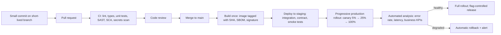

## TL;DR

- **Continuous integration** merges small changes to trunk frequently, each verified by a fast automated build and tests. **Continuous delivery** keeps every change releasable; **continuous deployment** releases every passing change automatically.
- **Build once, deploy many:** produce an immutable, versioned artefact once and promote the same artefact through environments with environment-specific configuration.
- Keep pipelines **fast** (feedback in minutes), **reliable** (no flaky tests) and **secure** (least-privilege OIDC credentials, pinned dependencies, protected branches).
- Reduce release risk with **progressive delivery**: feature flags, canaries, blue-green, automated rollback based on health metrics.
- Pipelines are a product: standard templates, self-service, measured with DORA and pipeline metrics (duration, success rate, queue time).

## Core Concepts

### CI, continuous delivery, continuous deployment

- **Continuous integration (CI):** developers integrate into the mainline at least daily; every push triggers build, unit tests, static analysis; broken builds are fixed immediately. Requires **trunk-based development** (short-lived branches) and a fast, trustworthy test suite.
- **Continuous delivery (CD):** every change that passes the pipeline is **deployable** to production at the push of a button; deployment is a business decision.
- **Continuous deployment:** every change that passes the pipeline is **deployed** automatically.

### Typical pipeline

```yaml
# .github/workflows/ci-cd.yml (simplified)
name: ci-cd
on:
  pull_request:
  push:
    branches: [main]

permissions:
  contents: read
  id-token: write   # OIDC to the cloud; no long-lived secrets

jobs:
  build-test:
    runs-on: ubuntu-latest
    steps:
      - uses: actions/checkout@<pinned-commit-sha>
      - uses: actions/setup-node@<pinned-commit-sha>
        with: { node-version: 22, cache: npm }
      - run: npm ci
      - run: npm run lint && npm run typecheck
      - run: npm test -- --coverage
      - run: npm run build
      - run: docker build -t $REGISTRY/orders:${{ github.sha }} .
      - run: trivy image --exit-code 1 --severity CRITICAL $REGISTRY/orders:${{ github.sha }}
      # push image + SBOM + signature (main only)

  deploy-staging:
    needs: build-test
    if: github.ref == 'refs/heads/main'
    environment: staging
    runs-on: ubuntu-latest
    steps:
      - run: ./deploy.sh staging $REGISTRY/orders:${{ github.sha }}   # same artefact
      - run: ./smoke-tests.sh staging

  deploy-prod:
    needs: deploy-staging
    environment: production   # protection rules: approvals, wait timer, branch restriction
    runs-on: ubuntu-latest
    steps:
      - run: ./deploy.sh production $REGISTRY/orders:${{ github.sha }} --canary 5%
      - run: ./canary-analysis.sh   # compares error rate/latency vs baseline; rolls back on failure
```

Stages commonly include: checkout → dependency install (cached) → lint/format → type check → unit tests → build → security scans (SAST, SCA, secrets, container) → package artefact (with SBOM, signature) → deploy to test environment → integration/contract/E2E tests → deploy to production progressively → post-deploy verification.

### Build once, deploy many

- Build an **immutable artefact** (container image, package) once, tagged with the commit SHA.
- Promote the **same artefact** through environments; inject configuration and secrets at deploy time.
- Never rebuild per environment — you'd be testing a different binary than you ship.

### Deployment strategies

| Strategy | How | Pros | Cons |
|---|---|---|---|
| Rolling | Replace instances gradually | Simple, no extra capacity | Mixed versions during rollout; slow rollback |
| Blue-green | Deploy new version alongside; switch traffic | Instant switch and rollback | Double capacity; DB compatibility needed |
| Canary | Route a small % of traffic to new version, analyse, expand | Limits blast radius; real traffic validation | Needs good metrics and traffic routing |
| Feature flags (dark launch) | Deploy code off; enable per user/segment | Decouples deploy from release; instant kill switch | Flag debt; testing combinations |
| Shadow / mirroring | Copy traffic to new version without serving responses | Safe performance/behaviour comparison | Side effects must be suppressed |

### Trunk-based development and feature flags

Short-lived branches (hours to a day or two) merged to main behind flags avoid merge hell and keep main releasable. Flags have a lifecycle: create with an owner and expiry, remove after full rollout; differentiate release toggles (temporary) from ops kill switches and permission/entitlement flags (long-lived).

### Pipeline security

- **OIDC/workload identity federation** to clouds instead of stored secrets; scoped to repo, branch and environment.
- Least-privilege `GITHUB_TOKEN`/pipeline permissions; protected branches and environments with required reviews.
- **Pin third-party actions/plugins by commit SHA**; restrict which actions may be used.
- Isolated, ephemeral runners for untrusted code (pull requests from forks must not access secrets).
- Signed artefacts with provenance (SLSA), SBOMs, and verification at deploy.

## How It Works



## When to Use / Trade-offs

| Choice | Use when | Avoid when | Trade-off |
|---|---|---|---|
| Continuous deployment | Strong automated tests, observability, progressive delivery | Regulatory approval required per release, weak tests | Fastest feedback vs requires maturity |
| Continuous delivery with manual approval | Need a business or compliance gate | Approvals become rubber stamps | Control vs batching and delays |
| Monorepo pipelines | Shared code, atomic cross-project changes | Without affected-only builds and caching | Consistency vs build tooling investment |
| Polyrepo pipelines | Independent services, clear ownership | Heavy cross-repo changes | Independence vs duplication and coordination |
| Self-hosted runners | Special hardware, network access, cost at scale | No capacity to secure and maintain them | Control vs security/ops burden |
| Hosted runners | Most cases | Need private network access or GPUs | Simplicity vs cost and limits |

## Common Pitfalls & Anti-patterns

- **Long-lived feature branches** — painful merges, "integration hell", no real CI.
- **Slow pipelines** (30–60+ minutes) — developers batch changes and context-switch.
- **Flaky tests tolerated** — people re-run until green and stop trusting the pipeline.
- **Rebuilding per environment** — the artefact in production isn't the one you tested.
- **Manual deployment steps** and snowflake environments.
- **Secrets in pipeline variables** with broad access; unpinned third-party actions.
- **Big-bang releases** — many changes deployed together; hard to find the culprit.
- **No rollback plan** or untested rollbacks; irreversible database migrations coupled to deploys.
- **Feature flag debt** — hundreds of stale flags and untested combinations.
- **Approval theatre** — manual gates that nobody actually reviews.

## Real-world Scenario

**Context:** A fintech's main service had a 55-minute pipeline, weekly releases bundling ~80 changes, a 25% change failure rate and frequent rollbacks taking hours. Developers kept feature branches open for weeks.

**Decision:** Moved to trunk-based development with feature flags; split the test suite (unit tests parallelised, integration tests with Testcontainers, a small E2E suite run post-deploy); added build caching and affected-only builds; quarantined flaky tests with an owner and SLA; built once and promoted images with SHA tags; introduced canary deployments with automated analysis (error rate and p99 vs baseline) and auto-rollback; moved cloud credentials to OIDC.

**Outcome:** Pipeline time dropped to 11 minutes; deployments rose to multiple per day; change failure rate fell to ~7%; mean recovery time went from hours to minutes thanks to automated rollback.

**What I'd do differently:** Address flaky tests first — until the pipeline was trusted, developers resisted deploying more frequently.

## Interview Questions

### What's the difference between continuous integration, continuous delivery and continuous deployment? {#ci-cd-definitions}

**Level:** Foundation

**Model answer:**
- **Continuous integration:** developers merge small changes into the main branch frequently (at least daily); every change triggers an automated build and tests; a broken build is fixed immediately. The goal is to detect integration problems early.
- **Continuous delivery:** extends CI so every change that passes the pipeline is in a **releasable** state; deploying to production is a low-risk, push-button decision (which may be made by the business).
- **Continuous deployment:** every change that passes all stages is **automatically deployed** to production without manual intervention.

CI is a prerequisite for both; continuous deployment requires strong automated testing, observability and safe rollout mechanisms (canaries, flags, auto-rollback).

**What the interviewer is looking for:**
Precise distinctions and prerequisites.

**Follow-ups:**
- Can you do CI with long-lived feature branches?
- What would stop you adopting continuous deployment?

**Red flags:**
- "CI means we have Jenkins."
- Conflating delivery and deployment.

### What stages would you put in a CI/CD pipeline? {#pipeline-stages}

**Level:** Foundation

**Model answer:**
On pull requests (fast feedback, under ~10 minutes):
- Dependency install (cached), lint/format, type check, unit tests, build.
- Security checks: SAST, dependency (SCA) and secret scanning, IaC scanning.

On merge to main:
- Build the **artefact once** (container image tagged with commit SHA), generate SBOM, sign it, push to registry.
- Deploy to a test/staging environment; run integration, contract and smoke tests.
- Deploy to production progressively (canary/blue-green/rolling) with automated health checks and rollback.
- Post-deploy verification and notifications; record deployment events (for DORA metrics).

Ordering principle: fast, cheap checks first; slow, expensive checks later or in parallel; fail fast.

**What the interviewer is looking for:**
Sensible stages split between PR and main, build-once, security, progressive deployment and fail-fast ordering.

**Follow-ups:**
- Where do end-to-end tests belong?
- How would you handle database migrations in this pipeline?

**Red flags:**
- Deploying straight to production with no automated checks.
- Running all tests serially in one 45-minute stage.

### What is trunk-based development, and why does it matter for CI/CD? {#trunk-based-development}

**Level:** Foundation

**Model answer:**
Trunk-based development means developers commit to a single main branch (trunk) directly or via **short-lived branches** (hours to a couple of days), merging frequently. Incomplete features are hidden behind **feature flags** or built incrementally (branch by abstraction), so main stays releasable.

Why it matters:
- It **is** continuous integration — long-lived branches delay integration and cause large, risky merges.
- Smaller changes → easier reviews, easier debugging, lower change failure rate.
- Enables frequent deployment and short lead times (DORA research links trunk-based development to higher delivery performance).

Requirements: fast automated tests, good code review turnaround, feature flags and discipline to keep main green.

**What the interviewer is looking for:**
Definition, link to CI and DORA outcomes, and enabling practices.

**Follow-ups:**
- How do you develop a feature that takes three weeks?
- What's branch by abstraction?

**Red flags:**
- GitFlow with long-lived develop/release branches as the default for web services.

### Why "build once, deploy many"? {#build-once}

**Level:** Foundation

**Model answer:**
Build the deployable artefact (container image, package, binary) **once** from a specific commit, version it immutably (e.g. tag with the commit SHA or digest), and **promote that same artefact** through test, staging and production — supplying environment-specific configuration and secrets at deploy time.

Benefits:
- What you tested is exactly what you ship — no differences from rebuilding (dependency drift, different build flags, compromised build).
- Faster promotions (no rebuild).
- Traceability: every running version maps to a commit, build log, SBOM and test results.
- Easy rollback: redeploy the previous immutable artefact.

Anti-pattern: separate builds per environment or "latest" tags that change underneath you.

**What the interviewer is looking for:**
Immutability, promotion, config injection, traceability and rollback.

**Follow-ups:**
- How do you handle environment-specific configuration?
- Why avoid the `latest` tag?

**Red flags:**
- Rebuilding for production after testing in staging.

### Compare rolling, blue-green and canary deployments. {#deployment-strategies}

**Level:** Senior

**Model answer:**
- **Rolling:** replace instances in batches. Simple and capacity-efficient; old and new versions run together during rollout (requires compatibility); rollback means rolling back again (slower).
- **Blue-green:** run the new version (green) alongside the old (blue), test it, then switch traffic at once (load balancer/DNS). Instant switch and rollback; needs double capacity during deploy; database schema must work with both versions.
- **Canary:** send a small percentage of real traffic (or a segment) to the new version, compare health metrics (errors, latency, business KPIs) with the baseline, then increase gradually. Limits blast radius and validates with real traffic; needs traffic-splitting capability and good observability, ideally **automated canary analysis** and rollback.

Complements: **feature flags** decouple release from deploy; **shadow traffic** tests without user impact. Choose based on risk, infrastructure (Kubernetes with Argo Rollouts/Flagger, service mesh, cloud load balancers), and observability maturity.

**What the interviewer is looking for:**
Mechanics, trade-offs, database compatibility, automation of canary analysis.

**Follow-ups:**
- What metrics would decide a canary's success?
- How do you canary a change in a message consumer?

**Red flags:**
- Canaries judged by someone eyeballing dashboards only.
- Ignoring schema compatibility.

### Your pipeline takes 45 minutes. How do you speed it up? {#pipeline-speed}

**Level:** Senior

**Model answer:**
1. **Measure** where time goes (per stage and step, queue time vs run time).
2. **Caching:** dependency caches, build caches (remote caches for Gradle/Bazel/Nx/Turborepo), Docker layer caching.
3. **Parallelise:** split tests across runners (by timing data), run independent stages concurrently.
4. **Do less:** affected-only builds/tests in monorepos; move slow E2E suites out of the PR path (run post-merge or on deploy) while keeping a small critical set; remove redundant steps.
5. **Faster tests:** fix slow tests (sleep-based waits, unnecessary setup); use Testcontainers sensibly; shift checks to cheaper levels of the test pyramid.
6. **Fix flakiness:** quarantine flaky tests with owners — retries hide problems and waste time.
7. **Better runners:** bigger/faster machines where cost-effective, warm pools, avoid queueing.
8. **Fail fast:** run cheapest, most likely-to-fail checks first.

Set a target (e.g. PR feedback under 10 minutes) and track it as a team metric.

**What the interviewer is looking for:**
Measurement first, caching, parallelism, affected-only builds, test strategy, flakiness and runner capacity.

**Follow-ups:**
- How would you implement affected-only testing in a monorepo?
- How do you decide which E2E tests run on PRs?

**Red flags:**
- Only buying bigger machines.
- Adding automatic retries for flaky tests as the fix.

### How do you use feature flags well, and what are the risks? {#feature-flags}

**Level:** Senior

**Model answer:**
Uses:
- **Release toggles:** deploy incomplete or risky features dark; enable gradually (internal users → beta → percentage → all).
- **Ops toggles / kill switches:** disable expensive or failing features instantly.
- **Experiment toggles:** A/B tests.
- **Permission/entitlement flags:** long-lived plan or role-based access.

Good practices:
- A flag management system (LaunchDarkly, Unleash, OpenFeature-compatible providers, cloud app configuration) with audit logs and targeting.
- Each flag has an **owner, type and expiry**; release flags are removed soon after full rollout (track "flag debt").
- Default values safe if the flag service is unavailable; evaluate server-side for security-relevant decisions.
- Test both paths for active flags; limit combinations.
- Use OpenFeature to avoid vendor lock-in in code.

Risks: stale flags increasing complexity, untested combinations, flags used as configuration sprawl, incidents caused by flipping flags without change control (treat significant flag changes like deployments — audited and monitored).

**What the interviewer is looking for:**
Flag types, lifecycle management, safe defaults, testing and governance of flag changes.

**Follow-ups:**
- How do you clean up hundreds of old flags?
- Should flag changes go through change management?

**Red flags:**
- Flags never removed.
- Client-side flags gating security-sensitive features.

### How do you handle database migrations in a continuous delivery pipeline? {#migrations-in-cd}

**Level:** Senior

**Model answer:**
- **Versioned migrations in code** (Flyway, Liquibase, Prisma, EF migrations, Alembic), reviewed in PRs, applied automatically by the pipeline before or during deploy.
- **Backward-compatible changes (expand–contract):** old and new application versions must both work with the schema during rollout and rollback.
  1. Expand: add new columns/tables (nullable or with defaults), dual-write.
  2. Backfill in batches.
  3. Switch reads to the new structure.
  4. Contract: remove old columns in a later release.
- **Decouple schema changes from risky code changes;** feature flags help.
- **Lock-aware operations:** online index creation, short lock timeouts, batching large updates; test against production-sized data.
- **Rollback strategy:** prefer roll-forward fixes; keep migrations reversible where feasible; never deploy destructive changes in the same release as the code that stops using the data.

**What the interviewer is looking for:**
Automated versioned migrations, expand–contract, decoupling, lock awareness and roll-forward thinking.

**Follow-ups:**
- How do you rename a column safely?
- Who runs migrations in a multi-instance deployment?

**Red flags:**
- Manual SQL scripts run by a DBA during a release window.
- Schema changes that break the previous app version.

### How do you secure a CI/CD pipeline? {#pipeline-security}

**Level:** Senior

**Model answer:**
- **Credentials:** OIDC/workload identity federation to cloud providers (no long-lived keys), scoped by repo, branch and environment; secrets in a vault or the platform's secret store with minimal exposure; masked in logs.
- **Least privilege:** minimal default token permissions; elevated permissions only in specific jobs; separate identities per environment.
- **Supply chain:** pin third-party actions/plugins by commit SHA, restrict allowed actions, review updates; lockfiles for dependencies; dependency and container scanning; SBOM generation; signed artefacts with provenance (SLSA) verified at deploy.
- **Source protections:** branch protection, required reviews (including CODEOWNERS for pipeline files), signed commits for sensitive repos.
- **Untrusted code:** pull requests from forks run without secrets on isolated, ephemeral runners; avoid `pull_request_target` patterns that check out untrusted code with privileges.
- **Runner security:** ephemeral runners, hardened images, network restrictions for self-hosted runners.
- **Deployment protections:** environment rules, approvals for production, audit logs.

**What the interviewer is looking for:**
Credential hygiene, least privilege, supply chain controls, source protections, untrusted code isolation and runner hardening.

**Follow-ups:**
- What's dangerous about `pull_request_target` in GitHub Actions?
- How would you detect a compromised pipeline?

**Red flags:**
- Cloud admin keys stored as pipeline secrets.
- Third-party actions referenced by mutable tags.

### How do you run CI efficiently in a monorepo? {#monorepo-ci}

**Level:** Senior

**Model answer:**
- **Affected-only builds:** compute which projects changed (and their dependents) via the dependency graph — tools like Nx, Turborepo, Bazel, Pants, or Gradle — and build/test only those.
- **Remote caching:** reuse build and test results across machines and runs (content-addressed caches), so unchanged work is skipped.
- **Parallelism and distribution:** spread tasks across agents.
- **Ownership:** CODEOWNERS per directory; project-level pipelines and deployment for independently deployable apps.
- **Consistent tooling:** shared lint/test configuration, but per-project overrides where needed.
- **Release strategy:** independent versioning/deployment per service despite one repo; avoid deploying everything on every change.
- **Guard rails:** dependency rules between projects (module boundaries) to keep the graph healthy.

**What the interviewer is looking for:**
Dependency-graph-based affected builds, remote caching, distribution, ownership and independent deployments.

**Follow-ups:**
- How do you handle a change to a shared library used by 40 services?
- Monorepo vs polyrepo — which would you pick and why?

**Red flags:**
- Building and testing the entire monorepo on every commit.

### Design a CI/CD platform for an engineering organisation of 60 teams. {#cicd-platform}

**Level:** Architect

**Model answer:**
- **Paved road:** reusable pipeline templates/workflows per workload type (container service, frontend, library, infrastructure) encoding standards — tests, security scans, SBOM/signing, build-once, progressive deployment, DORA event emission. Teams consume and extend them; versioned and updated via automated PRs.
- **Deployment platform:** GitOps (Argo CD/Flux) or a deployment service with progressive delivery (canary/blue-green, automated analysis, auto-rollback) and environment promotion.
- **Identity and security:** OIDC to clouds, least-privilege per environment, protected environments, artefact signing and verification, policy checks.
- **Runner infrastructure:** autoscaling ephemeral runners, caching services, cost monitoring; hosted runners where adequate.
- **Developer experience:** self-service onboarding (a new service gets a working pipeline from a template in minutes), clear docs, fast feedback, observability of pipeline runs.
- **Governance and compliance:** automated evidence (who approved, what tests ran, which artefact deployed) for audit; change records generated automatically.
- **Metrics:** DORA per team (owned by teams, not for ranking), pipeline duration, success/flaky rates, queue times, adoption of templates.
- **Operating model:** platform team as product owner with a roadmap driven by developer feedback; inner-source contributions.

**What the interviewer is looking for:**
Templates, progressive deployment, security, runner infrastructure, self-service, automated compliance, metrics and product-style ownership.

**Follow-ups:**
- How do you migrate 60 teams from bespoke pipelines?
- A team needs something the templates don't support. What happens?

**Red flags:**
- Central team operating every team's deployments manually.
- No standards, every team building its own pipeline.

### How does progressive delivery with automated analysis work? {#progressive-delivery}

**Level:** Architect

**Model answer:**
Progressive delivery releases changes to increasing slices of traffic or users while continuously evaluating health, automatically promoting or rolling back.

Components:
- **Traffic control:** service mesh, ingress or load balancer weights (Argo Rollouts, Flagger, cloud deployment services), or feature-flag targeting by user/segment.
- **Analysis:** compare canary vs baseline (not vs historical averages) on SLIs — error rate, latency percentiles, saturation — plus business metrics (checkout conversion). Use statistical tests or thresholds over sufficient sample sizes.
- **Steps:** e.g. 1% → 5% → 25% → 50% → 100% with pause/analysis windows; faster for low-risk changes.
- **Automatic rollback** when thresholds are breached; alert the owning team with context.
- **Scope:** also apply to configuration changes, flags and infrastructure where possible — many incidents come from config, not code.
- **Prerequisites:** good observability with low-latency metrics, version-labelled telemetry, backward-compatible changes (both versions run simultaneously), and sufficient traffic for meaningful comparisons (or synthetic traffic for low-volume services).

**What the interviewer is looking for:**
Traffic shifting, baseline comparison, SLI and business metrics, automatic rollback, config coverage and prerequisites.

**Follow-ups:**
- How do you canary a low-traffic internal service?
- What causes false positives in canary analysis?

**Red flags:**
- Comparing canaries against yesterday's metrics.
- Manual watching as the only analysis.

### How do CI/CD pipelines differ for mobile apps? {#mobile-cicd}

**Level:** Architect

**Model answer:**
Mobile constraints: app store review and release processes, users updating slowly (many versions in the wild), code signing, device fragmentation and slower builds.

Practices:
- **CI on every PR:** build, unit tests, lint, UI tests on simulators/emulators; device farm tests for critical flows (nightly or pre-release).
- **Signing and secrets:** managed signing certificates/profiles (Fastlane match or platform services), stored securely, used only by CI.
- **Release trains:** regular cadence (e.g. weekly) with automated builds to internal testers (TestFlight, Play internal testing), then staged rollouts.
- **Staged/phased rollouts** in stores (percentage-based on Google Play; phased release on the App Store) with crash and ANR monitoring and the ability to halt.
- **Feature flags and remote config** to release behaviour independently of binaries and to kill broken features without waiting for store review.
- **Backward compatibility:** APIs must support older app versions for months; minimum supported version policy with forced upgrade for critical issues.
- **Over-the-air updates** for JS-based frameworks (e.g. React Native) within store policy limits.
- **Metrics:** crash-free sessions, adoption of new versions, release cadence.

**What the interviewer is looking for:**
Awareness of store constraints, signing, release trains, staged rollouts, flags/remote config and API compatibility.

**Follow-ups:**
- A critical bug is found after release. What are your options?
- How do you test on many devices efficiently?

**Red flags:**
- Treating mobile like web deployments.
- Breaking API changes without considering old app versions.

### How do you satisfy audit and compliance requirements with fast pipelines? {#compliant-pipelines}

**Level:** Architect

**Model answer:**
Turn manual controls into **automated, evidenced controls**:
- **Segregation of duties:** enforced via branch protection (author can't approve their own PR), required reviewers/CODEOWNERS, protected environments with approvals for production — no human has direct production deploy rights.
- **Change records:** generated automatically from pipeline data (commit, PR, reviewers, tests run, scan results, artefact digest, deploy time, approver) and linked to tickets; standard changes pre-approved by the change board.
- **Traceability:** requirements → PRs → commits → artefacts (signed, with provenance and SBOM) → deployments.
- **Security controls:** mandatory scans with thresholds; exceptions recorded with expiry.
- **Immutable logs:** pipeline and deployment logs retained according to policy, tamper-evident.
- **Emergency changes:** break-glass procedure with automatic post-hoc review.
- **Auditor engagement:** walk auditors through the controls and evidence; map them to frameworks (SOC 2, ISO 27001, PCI DSS).

Result: higher deployment frequency *and* better audit outcomes than manual change boards.

**What the interviewer is looking for:**
Automated segregation of duties, generated change records, traceability, immutable evidence and auditor engagement.

**Follow-ups:**
- An auditor insists on a CAB approval for every change. How do you respond?
- How do you handle hotfixes during incidents?

**Red flags:**
- Manual spreadsheets as change records.
- Developers with direct production access as normal practice.

### How do you measure the effectiveness of your CI/CD system? {#pipeline-metrics}

**Level:** Architect

**Model answer:**
**Outcome metrics (DORA):** deployment frequency, lead time for changes, change failure rate, failed deployment recovery time — per team/service, used for improvement, not ranking.

**Pipeline health:**
- Duration (p50/p90) for PR checks and deploy pipelines; queue time waiting for runners.
- Success rate and **flaky test rate** (failures that pass on retry).
- Time to fix a broken main branch.
- Rollback frequency and automated vs manual rollback ratio.
- Cost per pipeline run / per deploy.

**Developer experience:** survey questions on pipeline speed and reliability; time from merge to production.

**Adoption:** share of services on standard templates and progressive delivery.

Use the data to prioritise platform work (e.g. flaky tests or runner queueing), and set targets like "PR feedback under 10 minutes for 90% of runs".

**What the interviewer is looking for:**
DORA plus pipeline-specific health, developer experience and adoption metrics used to drive improvements.

**Follow-ups:**
- How do you detect flaky tests automatically?
- Which single metric would you improve first?

**Red flags:**
- Only counting number of builds.
- Using DORA metrics to rank teams.

## Cheat Sheet

### Concepts
- **CI** — integrate small changes to main at least daily; every change built and tested automatically.
- **Continuous delivery vs deployment** — always releasable vs automatically released.
- **Trunk-based development** — short-lived branches, feature flags, main always green.
- **Build once, deploy many** — immutable SHA-tagged artefact promoted across environments.
- **Fail fast** — cheapest, most likely-to-fail checks first.

### Release safety
- **Rolling / blue-green / canary** — gradual replace / instant switch / small traffic slice with analysis.
- **Progressive delivery** — staged traffic increases with automated baseline comparison and rollback.
- **Feature flag types** — release, ops kill switch, experiment, permission; release flags must expire.
- **Expand–contract migrations** — schema compatible with old and new app versions.

### Security and platform
- **OIDC federation** — pipelines get short-lived cloud credentials; no stored keys.
- **Pin actions by SHA** — mutable tags can be hijacked.
- **Fork PRs** — no secrets, isolated ephemeral runners.
- **Automated compliance** — segregation of duties via branch and environment protection, generated change records.
- **Pipeline metrics** — duration, queue time, flaky rate, main-branch recovery, DORA.

## Further Reading

- [Continuous Delivery (Jez Humble, Dave Farley)](https://continuousdelivery.com/) — the foundational principles and patterns.
- [DORA capabilities: Continuous integration](https://dora.dev/capabilities/continuous-integration/) — research-backed guidance on CI and related capabilities.
- [Trunk Based Development](https://trunkbaseddevelopment.com/) — practices, branch strategies and feature flags.
- [GitHub Actions: Secure use reference](https://docs.github.com/en/actions/reference/security/secure-use) — OIDC, permissions, pinning and untrusted input.
- [Argo Rollouts documentation](https://argo-rollouts.readthedocs.io/) — progressive delivery on Kubernetes with automated analysis.
- [OpenFeature](https://openfeature.dev/) — vendor-neutral feature flag API.
