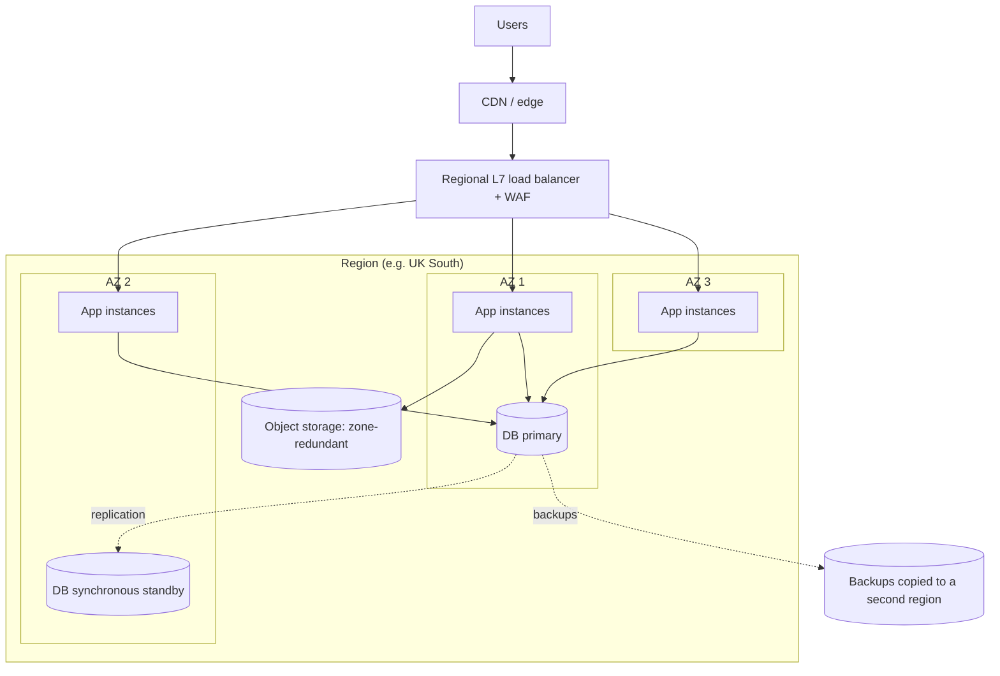
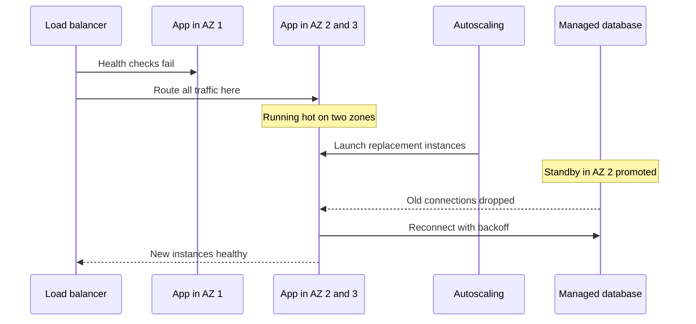

## TL;DR

- Cloud is **on-demand, self-service, elastic infrastructure and services paid for by use**. The value isn't cheaper servers — it's speed, managed capabilities and elasticity.
- Service models trade control for convenience: **IaaS → containers → PaaS → serverless → SaaS**. Move up the stack unless you have a reason not to.
- Under the **shared responsibility model** the provider secures the cloud; you secure what you put in it (identity, data, configuration, code). Most cloud breaches are customer misconfigurations.
- Design for failure using **regions and availability zones**: spread across AZs for high availability; use multiple regions for disaster recovery or latency, when justified.
- Cost, security and reliability are architecture concerns from day one: landing zones, identity-first security, tagging, and the Well-Architected pillars.

## Core Concepts

### Essential characteristics (NIST definition)

On-demand self-service, broad network access, resource pooling, rapid elasticity, measured service. The consequence for architects: infrastructure becomes **software** (APIs, infrastructure as code), capacity becomes a **variable cost**, and failure of individual components is **expected**.

### Service models

| Model | You manage | Provider manages | Examples |
|---|---|---|---|
| IaaS | OS, runtime, app, data, scaling, patching | Hardware, virtualisation, network fabric | VMs (EC2, Azure VMs, Compute Engine) |
| Containers (CaaS) | Container images, app, (cluster config) | Control plane, nodes (partly) | AKS, EKS, GKE, ECS, Azure Container Apps, Cloud Run |
| PaaS | App and data | OS, runtime, scaling, patching | App Service, Elastic Beanstalk, managed DBs |
| Serverless / FaaS | Functions and config | Everything else, scales to zero | Lambda, Azure Functions, Cloud Functions |
| SaaS | Configuration and data | The whole application | Microsoft 365, Salesforce, Stripe |

### Shared responsibility

```text
Customer:  data • identities & access • application code • OS/runtime (IaaS) • network config • encryption choices
Shared:    patching (depends on model) • configuration of managed services • logging/monitoring setup
Provider:  physical data centres • hardware • hypervisor • global network • managed service internals
```

The higher up the stack, the less you manage — but **identity, data and configuration are always yours**. Public storage buckets, over-privileged IAM roles and leaked access keys are the classic customer-side failures.

### Global infrastructure

- **Region:** a geographic area with multiple data centres (e.g. UK South, us-east-1). Choose by latency to users, data residency, service availability and price.
- **Availability zone (AZ):** physically separate data centre(s) within a region with independent power, cooling and networking, connected by low-latency links. Deploying across AZs survives a data-centre failure.
- **Edge locations / CDN PoPs:** cache content and terminate connections close to users.
- **Paired regions** (Azure) or provider guidance on DR region choice.

### Storage types

- **Block storage** (EBS, Managed Disks): a virtual disk attached to one VM; low latency; for databases and OS disks.
- **File storage** (EFS, Azure Files): shared POSIX/SMB file systems mounted by many machines; for lift-and-shift apps needing shared files.
- **Object storage** (S3, Blob Storage, GCS): HTTP-accessible objects in buckets/containers; virtually unlimited, cheap, durable (designed for very high durability across devices/AZs), tiered (hot, cool, archive); for static assets, backups, data lakes.

### Networking basics

- **Virtual network (VPC/VNet)** with subnets (public/private), route tables, NAT gateways for outbound internet from private subnets.
- **Security groups / NSGs:** stateful rules per resource or subnet, with inbound denied by default. AWS security groups are allow-only; Azure NSGs also support deny rules.
- **Private endpoints / PrivateLink:** reach managed services (databases, storage) over private IPs instead of the public internet.
- **Load balancers:** L4 (TCP) and L7 (HTTP with path routing, TLS termination, WAF).
- **Hybrid connectivity:** site-to-site VPN or dedicated links (ExpressRoute, Direct Connect).

### Pricing models

- **On-demand / pay-as-you-go:** most flexible, highest unit price.
- **Commitments:** reserved instances or savings plans for 1–3 years — significant discounts for steady baseline usage.
- **Spot / preemptible:** deep discounts for interruptible capacity — batch jobs, CI runners, stateless workers with graceful shutdown.
- **Serverless/per-request:** pay per invocation, GB-second or request — cheap at low/variable volume, can be expensive at sustained high volume.
- Hidden costs: **data egress**, cross-AZ/cross-region traffic, NAT gateway processing, log ingestion, idle resources.

### Well-Architected pillars

AWS, Azure and Google publish similar frameworks: **operational excellence, security, reliability, performance efficiency, cost optimisation** (AWS and Google also have a **sustainability** pillar). Use them as review checklists for workloads.

### Worked example: what does the SLA chain add up to?

A checkout runs in one region. Each component's provider SLA (illustrative, but typical) is:

| Component | SLA | Allowed downtime per month |
|---|---|---|
| CDN | 99.99% | 4.4 min |
| Regional load balancer | 99.99% | 4.4 min |
| App tier (multi-AZ) | 99.95% | 21.9 min |
| Managed database (multi-AZ) | 99.99% | 4.4 min |
| Managed cache | 99.9% | 43.8 min |
| Third-party payment API | 99.9% | 43.8 min |

If a request needs **every** component (a serial chain), the availabilities multiply:

0.9999 × 0.9999 × 0.9995 × 0.9999 × 0.999 × 0.999 ≈ **99.72%**, or about **2 hours of downtime a month**. That's worse than any single component.

Two design moves change the answer:
1. **Take components off the critical path.** If the cache is optional (fall back to the database, which is sized for it) and the payment is taken asynchronously (accept the order, charge it from a queue), the chain is CDN, load balancer, app and database: ≈ **99.92%**, about 35 minutes a month.
2. **Add redundancy in parallel.** Two independent regions, each with load balancer, app and database (≈ 99.93% each), fail together only if both fail: 1 − (0.0007)² ≈ 99.99995%. But the CDN or global DNS in front is still one serial component, so the total is capped near **99.99%**. The global entry point becomes the limit.

What this doesn't tell you:
- **An SLA isn't a prediction.** It's a promise backed by service credits, usually a fraction of that service's bill, and it says nothing about your business's losses. Real availability is often better, sometimes worse.
- **Failures aren't independent.** A bad deploy, an expired certificate or a shared identity provider takes out "redundant" copies together. Most outages come from your own changes, which no provider SLA covers.
- **Parallel redundancy only counts if failover works.** It has to be automatic, or at least tested, and the surviving side needs the capacity to take the full load.

## How It Works

High-availability web workload in one region across three AZs:



An AZ outage removes a third of app capacity (autoscaling replaces it) and, if the primary was there, the database fails over to the standby in another AZ — typically within a minute or two for managed databases.

### What happens when an availability zone fails



Nothing in this sequence needs a person, but every step is a setting someone chose: health check intervals, spare capacity per zone, automatic failover, connection retry behaviour and DNS caching. Test it by simulating the loss of a zone, for example with AWS Fault Injection Service or Azure Chaos Studio, before a real one does.

## When to Use / Trade-offs

| Compute option | Use when | Avoid when | Trade-off |
|---|---|---|---|
| VMs (IaaS) | Lift-and-shift, special OS needs, licensing constraints | New apps that fit managed platforms | Full control; full patching and ops burden |
| Managed Kubernetes | Many services, need portability and rich ecosystem, platform team exists | Small teams with few services | Powerful; significant operational complexity |
| Container PaaS (Container Apps, Cloud Run, ECS Fargate) | Containerised services without managing clusters | Need deep Kubernetes customisation | Simpler; fewer knobs |
| App PaaS (App Service, Beanstalk) | Standard web apps/APIs | Unusual runtimes or networking | Fast; opinionated |
| Functions / serverless | Event-driven, spiky or low-volume workloads, glue | Long-running, latency-critical with cold-start sensitivity, sustained high volume | Scales to zero; cold starts, limits, cost at scale |
| SaaS | Non-differentiating capabilities | Core differentiators | Fastest; least control, vendor dependency |

## Common Pitfalls & Anti-patterns

- **Lift-and-shift and stop** — VMs moved as-is, then run 24/7 at on-demand prices: higher cost than the data centre, none of the benefits.
- **Single-AZ production** — one data-centre failure takes everything down.
- **Click-ops** — resources created by hand in the portal; no reproducibility, drift, no review.
- **Over-privileged identities and long-lived keys** — access keys in repos, `*:*` policies, shared admin accounts.
- **Public by accident** — storage buckets, databases or management ports exposed to the internet.
- **Ignoring egress and cross-AZ costs** — chatty architectures across zones/regions and data transfer out.
- **No tagging or ownership** — nobody knows who owns the £20k/month cluster.
- **Multi-cloud by default** — doubled complexity for theoretical portability.
- **Assuming the provider does backups and DR for you** — managed services have options; you must configure and test them.

## Real-world Scenario

**Context:** A mid-size insurer moved 120 applications from its data centre to the cloud in 9 months by rehosting VMs. A year later, cloud cost was 35% higher than the old data centre, two outages happened when a single-AZ database VM failed, and security flagged 40 storage accounts with public access.

**Decision:** Established a **landing zone** (management groups/accounts per environment, policy guardrails denying public storage and requiring encryption and tags, central logging, hub-and-spoke networking with private endpoints). Rightsized VMs, bought commitments for the steady baseline, scheduled non-production shutdowns, and moved databases to managed services with zone redundancy. Prioritised replatforming the top 15 applications by cost and change frequency to PaaS/containers.

**Outcome:** Within six months cost fell 30% (below the original data-centre run-rate), there were no further single-AZ outages, and policy guardrails prevented new public storage entirely. Teams on PaaS deployed several times a week instead of monthly.

**What I'd do differently:** Build the landing zone and guardrails *before* the migration and plan the "optimise" phase into the migration programme budget — rehost is a stepping stone, not the destination.

## Interview Questions

### Explain IaaS, PaaS, SaaS and serverless with examples. {#service-models}

**Level:** Foundation

**Model answer:**
They differ in how much of the stack you manage:
- **IaaS:** you rent virtual machines, disks and networks; you manage the OS, runtime, patching and scaling (Azure VMs, EC2).
- **PaaS:** you deploy code or containers; the provider runs the OS, runtime and scaling (Azure App Service, Container Apps, managed PostgreSQL).
- **Serverless/FaaS:** you supply functions triggered by events; the provider handles everything including scaling to zero, billing per execution (Lambda, Azure Functions). "Serverless" also describes managed services with per-use billing (DynamoDB, S3).
- **SaaS:** a complete application you configure and use (Microsoft 365, Salesforce, Stripe).

The trade-off is **control vs operational burden and speed**. Default to the highest level that meets your requirements; drop down for specific needs (special OS, licensing, performance tuning, unusual networking).

**What the interviewer is looking for:**
Correct definitions, examples, and the control-vs-convenience trade-off with a sensible default.

**Follow-ups:**
- Where do containers on Kubernetes sit?
- When would you choose IaaS for a new application?

**Red flags:**
- Thinking serverless means "no servers exist".
- Choosing IaaS by default.

### What is the shared responsibility model? {#shared-responsibility}

**Level:** Foundation

**Model answer:**
Security and operations responsibilities are split between provider and customer:
- **Provider ("security of the cloud"):** physical data centres, hardware, hypervisor, global network, and the internals of managed services.
- **Customer ("security in the cloud"):** identities and access, data (classification, encryption choices, backups), application code, configuration of every service, network rules, and OS/runtime patching on IaaS.

The split shifts with the service model: on IaaS you patch the OS; on PaaS the provider does; on SaaS you mostly own identity, data and configuration. **Identity, data and configuration are always yours** — and most real-world cloud incidents (public buckets, leaked keys, over-privileged roles) are customer-side.

**What the interviewer is looking for:**
The split, how it varies by service model, and the constant customer responsibilities.

**Follow-ups:**
- Who is responsible for backups of a managed database?
- How would you detect misconfigurations at scale?

**Red flags:**
- "The cloud provider handles security."
- Not knowing that configuration is the customer's job.

### What are regions and availability zones, and how do you use them? {#regions-azs}

**Level:** Foundation

**Model answer:**
- A **region** is a geographic location with multiple data centres. Regions are largely independent, so a regional outage doesn't affect others. Choose regions for latency to users, data residency/legal requirements, service availability and price.
- An **availability zone** is one or more physically separate data centres within a region, with independent power, cooling and networking, connected by low-latency links (typically a few ms or less).

Usage:
- **High availability:** spread instances across at least two (ideally three) AZs behind a load balancer; use zone-redundant managed services (databases with standby in another AZ, zone-redundant storage).
- **Disaster recovery and global latency:** deploy to a second region — backups and replication to recover from a regional failure, or active-active for global users — at higher cost and complexity.

Note cross-AZ data transfer often costs money and adds latency; design chatty paths carefully.

**What the interviewer is looking for:**
Definitions, HA via multi-AZ, DR/latency via multi-region, and awareness of costs.

**Follow-ups:**
- Do all services support zone redundancy?
- When is multi-region worth it?

**Red flags:**
- Single-AZ production for important workloads.
- Assuming multi-region is required for availability in every case.

### What are block, file and object storage, and when do you use each? {#storage-types}

**Level:** Foundation

**Model answer:**
- **Block storage:** virtual disks attached to a VM (usually one at a time); low latency, the OS formats it with a file system. Used for OS disks and self-managed databases. Examples: EBS, Azure Managed Disks.
- **File storage:** a managed network file system (NFS/SMB) shared by many machines. Used for legacy apps needing shared files, content management, home directories. Examples: EFS, Azure Files.
- **Object storage:** objects (file + metadata) in buckets/containers accessed over HTTP APIs; massively scalable, very durable, cheap, with lifecycle tiers (hot → cool → archive). Used for static web assets, media, backups, logs, data lakes. Examples: S3, Azure Blob Storage, GCS.

Rules of thumb: object storage by default for unstructured data; block for databases and VMs; file only when an application genuinely needs a shared file system. Secure object storage carefully — private by default, access via signed URLs or identities, never public by accident.

**What the interviewer is looking for:**
Clear distinctions, use cases, and security awareness for object storage.

**Follow-ups:**
- How would you serve user-uploaded images securely?
- What are storage lifecycle policies?

**Red flags:**
- Mounting object storage as a file system for database files.
- Public buckets for convenience.

### How do you design a highly available application within one region? {#high-availability}

**Level:** Senior

**Model answer:**
- **No single points of failure:** at least two instances of each stateless tier across **multiple AZs** behind a load balancer with health checks; autoscaling to replace failed instances and absorb load.
- **Stateless app tier:** sessions in a distributed store or tokens; files in object storage; so any instance can serve any request.
- **Data tier:** managed database with synchronous standby in another AZ and automatic failover; zone-redundant storage; caches with replicas.
- **Graceful degradation:** timeouts, retries with jitter, circuit breakers; non-critical features fail softly.
- **Deployments that don't cause outages:** rolling/blue-green with health checks, database migrations compatible with old and new code.
- **Capacity headroom:** if one AZ is lost, the remaining AZs must carry the load (N+1 thinking).
- **Observability and testing:** SLOs, alerts, and failure testing (terminate instances, simulate AZ loss).

Target numbers depend on the SLO: 99.9% is achievable with multi-AZ design; 99.99% usually needs multi-region and very disciplined operations.

**What the interviewer is looking for:**
Multi-AZ redundancy at every tier, statelessness, managed failover, headroom, safe deployments and testing.

**Follow-ups:**
- What's the cost of multi-AZ, and is it always worth it?
- How do you test an AZ failure?

**Red flags:**
- Only redundancy at the app tier, single database instance.
- Ignoring capacity after losing a zone.

### Explain cloud pricing models and how you'd reduce the cost of a steady workload. {#pricing-models}

**Level:** Senior

**Model answer:**
Models:
- **On-demand:** pay per second/hour; flexible, most expensive per unit.
- **Commitment discounts:** reserved instances or savings plans for 1 or 3 years, typically large discounts for predictable baseline usage; savings plans are more flexible across instance types.
- **Spot/preemptible:** spare capacity at deep discounts, reclaimable at short notice — for fault-tolerant batch, CI, rendering, stateless workers.
- **Per-request/serverless:** pay per invocation and duration; ideal for spiky or low workloads.

For a steady workload:
1. **Rightsize** first (CPU/memory utilisation data; modern instance families are often cheaper per unit of performance).
2. **Turn off what isn't needed** (non-production at night/weekends).
3. **Commit** for the stable baseline (savings plans/reservations), leave peaks on-demand or autoscaled.
4. **Use spot** for interruptible parts.
5. **Optimise storage and data transfer:** lifecycle tiers, delete orphaned disks/snapshots, reduce egress and cross-AZ chatter, review NAT and logging costs.
6. **Managed services** where they reduce total cost including people time.

Do it continuously with tagging, cost allocation and budgets (FinOps).

**What the interviewer is looking for:**
Knowledge of models, an ordered optimisation approach (rightsize before committing), and hidden cost awareness.

**Follow-ups:**
- Why rightsize before buying reservations?
- How would you run production workloads on spot safely?

**Red flags:**
- Buying 3-year reservations for unproven workloads.
- Ignoring data transfer costs.

### Describe the core building blocks of cloud networking. {#cloud-networking}

**Level:** Senior

**Model answer:**
- **Virtual network (VPC/VNet):** your private IP space in a region, split into **subnets** (public for load balancers/gateways, private for apps and data). Plan CIDR ranges to avoid overlaps with on-premises and other networks.
- **Routing:** route tables; **NAT gateways** for outbound internet from private subnets; internet gateway for public subnets.
- **Security:** security groups/NSGs (stateful rules, inbound denied by default; AWS security groups are allow-only, Azure NSGs also allow deny rules), network ACLs, firewalls in a hub; **WAF** on internet-facing L7 endpoints.
- **Private access to services:** private endpoints/PrivateLink so databases, storage and other PaaS are reachable only from inside your network; disable public endpoints.
- **Connectivity:** peering between VNets/VPCs, **hub-and-spoke** or transit gateways for many networks; VPN or dedicated circuits (ExpressRoute, Direct Connect) to on-premises.
- **DNS:** private DNS zones for internal names and private endpoints.
- **Load balancing:** L4 and L7, regional and global (front doors/global accelerators).

Principles: private by default, least-privilege rules, centralised egress inspection where required, and everything defined in IaC.

**What the interviewer is looking for:**
Accurate components, private-by-default design, hybrid connectivity and IP planning.

**Follow-ups:**
- Why do private endpoints need private DNS?
- Hub-and-spoke vs full mesh peering?

**Red flags:**
- Databases on public IPs "protected by a password".
- Overlapping address spaces with on-prem.

### How do you choose between VMs, containers and serverless for a workload? {#compute-choice}

**Level:** Senior

**Model answer:**
Consider workload shape, team capability and constraints:
- **Serverless functions:** event-driven, spiky or low-volume work, glue between services, scheduled jobs. Watch execution time limits, cold starts for latency-sensitive paths, concurrency limits, and cost at sustained high volume.
- **Container PaaS** (Azure Container Apps, Cloud Run, ECS Fargate): HTTP services and workers packaged as containers without cluster management; scale to zero possible; great default for many teams.
- **Managed Kubernetes:** many services, need for portability, custom networking/operators, service mesh, or platform teams building internal platforms. Brings real operational complexity (upgrades, security, cost).
- **VMs:** lift-and-shift, legacy software, special OS/kernel or licensing needs, or software that isn't containerisable.

Also weigh: startup time, statefulness, GPU needs, compliance, existing skills and the platform team's paved roads. Many estates mix them — e.g. container PaaS for APIs, functions for event handlers, VMs for a vendor appliance.

**What the interviewer is looking for:**
Workload-driven criteria, knowledge of each option's limits, and pragmatism about Kubernetes complexity.

**Follow-ups:**
- When do cold starts matter, and how do you mitigate them?
- What would make you adopt Kubernetes?

**Red flags:**
- "Kubernetes for everything."
- Serverless for long-running, steady, high-throughput processing without cost analysis.

### What migration strategies exist for moving applications to the cloud? {#migration-strategies}

**Level:** Senior

**Model answer:**
The common "Rs" (AWS lists seven):
- **Retire:** switch off what's unused (often 10–20% of a portfolio).
- **Retain:** keep on-premises for now (compliance, imminent retirement, too risky).
- **Rehost** ("lift and shift"): move VMs as-is — fastest, least benefit; good for data-centre exit deadlines.
- **Relocate:** move at the hypervisor level (e.g. VMware workloads to a cloud VMware service) without changes.
- **Replatform** ("lift and reshape"): small changes to use managed services — managed database, container PaaS — good benefit for modest effort.
- **Repurchase:** replace with SaaS (CRM, HR, email).
- **Refactor / re-architect:** redesign for cloud-native — highest benefit and effort; reserve for strategic, high-change applications.

Choose per application via portfolio assessment: business value, technical health, change frequency, dependencies, compliance, licensing, and the deadline. Group by dependency into migration waves, and plan the optimisation phase after rehosting.

**What the interviewer is looking for:**
Knowledge of the strategies, criteria for choosing per application, and portfolio/wave thinking.

**Follow-ups:**
- Which apps would you refactor first?
- How do you handle tightly coupled applications sharing a database?

**Red flags:**
- One strategy for everything.
- Refactoring everything before moving anything.

### How should identity and access management work in the cloud? {#cloud-iam}

**Level:** Senior

**Model answer:**
- **Human access via SSO** from the corporate IdP with MFA; no local cloud users; group-based role assignments.
- **Least privilege:** start from minimal built-in roles, custom roles where needed; scope assignments to the smallest resource scope (resource group/project/account) rather than the whole organisation.
- **Just-in-time privileged access:** admin rights requested, approved, time-bound and audited (e.g. Entra PIM, AWS IAM Identity Center with temporary elevation).
- **Workload identities, not keys:** managed identities, IAM roles for service accounts, workload identity federation for CI/CD (OIDC from GitHub Actions to the cloud) — no long-lived secrets in code or pipelines.
- **Secrets** that must exist live in a vault (Key Vault, Secrets Manager) with rotation.
- **Guardrails:** organisation policies (deny public storage, restrict regions, require encryption), and separation of environments (prod in separate subscriptions/accounts).
- **Detection:** audit logs centralised, alerts on risky actions (new admin assignments, key creation, policy changes), periodic access reviews.

**What the interviewer is looking for:**
SSO + MFA, least privilege at scope, JIT, workload identity federation, vaulted secrets, guardrails and auditing.

**Follow-ups:**
- How do you let a GitHub Actions workflow deploy to Azure without storing a secret?
- How would you find over-privileged roles?

**Red flags:**
- Shared admin accounts or root/owner credentials in daily use.
- Access keys in source control.

### Should your organisation adopt a multi-cloud strategy? {#multi-cloud}

**Level:** Architect

**Model answer:**
Distinguish the reasons:
- **Legitimate drivers:** acquired companies already on another cloud; a specific best-of-breed service (e.g. a data/AI platform); regulatory or customer requirements; negotiating leverage at very large scale; SaaS products that must run where customers are.
- **Weak drivers:** "avoid lock-in" in the abstract, or "resilience against a provider outage" — true active-active multi-cloud is extremely expensive and rarely achieves better availability than a well-designed multi-region single-cloud setup.

Costs of multi-cloud: duplicated skills and platforms, lowest-common-denominator architectures (giving up managed services), complex networking and identity, higher egress costs, more security surface.

My typical recommendation: **one primary cloud**, used deeply (managed services, platform investments), with **portability where it's cheap** — containers, Terraform/OpenTofu, OpenTelemetry, open data formats, standard protocols — and **exit plans** for critical dependencies. Allow a secondary cloud for specific, justified workloads with clear ownership. Record the decision in an ADR.

**What the interviewer is looking for:**
Separating real from imagined benefits, quantifying costs, and a pragmatic primary-cloud strategy with cheap portability.

**Follow-ups:**
- The board asks "what if our cloud provider has a global outage?" How do you answer?
- How do you write an exit plan for a cloud provider?

**Red flags:**
- Multi-cloud active-active as a default resilience strategy.
- Abstracting every service behind custom layers "for portability".

### What is a landing zone, and what would you put in one? {#landing-zone}

**Level:** Architect

**Model answer:**
A landing zone is the **pre-configured, governed foundation** into which workloads are deployed — so every team starts secure, compliant and consistent.

Components:
- **Resource hierarchy:** management groups/organisational units → subscriptions/accounts per workload and environment (isolation, blast radius, cost separation).
- **Identity:** SSO integration, role model, privileged access management, break-glass accounts.
- **Policy guardrails:** deny public storage/databases, allowed regions, required encryption and tags, required diagnostic settings, approved SKUs — enforced by Azure Policy/AWS SCPs/Organisation Policies.
- **Networking:** hub-and-spoke or transit, central egress/firewall, private DNS, hybrid connectivity, IP address management.
- **Security tooling:** central logging (activity, audit, flow logs) to a protected account, threat detection (Defender, GuardDuty, Security Command Center), vulnerability management.
- **Cost management:** budgets, tagging, cost allocation, anomaly alerts.
- **Automation:** everything defined in IaC; **subscription vending** — teams request a new environment and get a compliant one in minutes.
- **Operations:** backup policies, monitoring baselines, patch management for IaaS.

Use the provider's reference implementations (Azure Landing Zones/CAF, AWS Control Tower/Landing Zone Accelerator) as a starting point, adapted to your compliance needs.

**What the interviewer is looking for:**
The purpose (secure-by-default foundation), the key components, automation/vending, and use of reference implementations.

**Follow-ups:**
- How do you evolve guardrails without breaking existing workloads?
- How do you handle a team needing an exception to a policy?

**Red flags:**
- Every team creating subscriptions/accounts by hand.
- Guardrails as documentation only.

### Compare disaster recovery strategies in the cloud. {#dr-strategies}

**Level:** Architect

**Model answer:**
Choose by **RPO** (data loss tolerated) and **RTO** (time to recover) per workload tier:

| Strategy | How | RPO / RTO | Cost |
|---|---|---|---|
| Backup & restore | Backups copied to another region; rebuild infra via IaC on disaster | Hours / hours–days | Lowest |
| Pilot light | Core data replicated continuously; minimal infra running in DR region; scale up on failover | Minutes / tens of minutes–hours | Low–medium |
| Warm standby | Scaled-down full environment running in DR region, data replicated | Seconds–minutes / minutes | Medium–high |
| Active-active (multi-site) | Full capacity in multiple regions serving traffic | Near zero / near zero | Highest; complex data consistency |

Essentials regardless of strategy:
- **Infrastructure as code** so the environment can be recreated.
- **Backups isolated** (separate account, immutable/locked) to survive ransomware or account compromise.
- **Dependencies** — DNS, identity, secrets, third-party integrations — must also work in the DR region.
- **Regular DR tests** (game days); an untested plan is a hope.
- **Runbooks and decision authority** — who declares a disaster and triggers failover.

Tier the portfolio: most systems backup & restore or pilot light; only the critical few warrant warm standby or active-active.

**What the interviewer is looking for:**
The four strategies with RPO/RTO/cost, tiering, isolated backups, dependency awareness and testing.

**Follow-ups:**
- How would you test DR without impacting production?
- What's commonly forgotten in DR plans?

**Red flags:**
- Active-active for everything.
- Backups in the same account and region as production only.

### Plan the migration of a 400-application data centre to the cloud within two years. {#datacentre-migration}

**Level:** Architect

**Model answer:**
**Foundations (months 0–4):** business case and goals (exit date, cost, agility), executive sponsor, cloud centre of excellence; landing zone with guardrails; hybrid connectivity; identity integration; migration tooling (discovery, replication).

**Assessment:** discovery tools map servers, dependencies and utilisation; application owners interviewed; each app assigned a strategy (retire, retain, rehost, replatform, repurchase, refactor) by business value, technical fit, compliance and deadline. Expect to **retire** a meaningful fraction.

**Wave planning:** group apps by dependency clusters and risk; start with low-risk, well-understood apps to prove the factory; schedule critical systems once processes are mature; align with licence renewals and hardware end-of-life.

**Migration factory:** standard runbooks, automated replication and cut-over, testing templates, rollback plans, a weekly cadence of waves.

**Operate and optimise:** monitoring, backup and DR configured per tier; rightsizing and commitments after stabilisation; follow-up replatforming of high-value apps.

**People and governance:** training and certification, operating model changes (who owns cloud costs and ops), regular steering reviews of progress, risks and spend vs plan.

**Risks:** hidden dependencies (mainframe calls, hard-coded IPs), licensing (bring-your-own-licence rules), latency between migrated and remaining apps during transition, and data gravity for large databases.

**What the interviewer is looking for:**
Foundations first, assessment with per-app strategies, dependency-driven waves, a repeatable factory, post-migration optimisation and people/operating-model change.

**Follow-ups:**
- An app owner refuses to migrate. What do you do?
- How do you handle a 40 TB database with a 2-hour cut-over window?

**Red flags:**
- Moving everything by rehost with no optimisation plan.
- No dependency mapping.

### How do you manage vendor lock-in with a cloud provider? {#lock-in}

**Level:** Architect

**Model answer:**
Lock-in is a **cost to be managed, not avoided at all costs** — managed services deliver much of the cloud's value, and avoiding them has its own (often larger) cost.

Approach:
- **Classify dependencies** by switching cost and strategic risk: commodity (VMs, object storage, managed Postgres) vs proprietary (a specific NoSQL database, serverless orchestration, AI platform).
- **Accept proprietary services where they create clear value**, recording the trade-off in an ADR, with an estimate of exit effort.
- **Keep portability cheap where it costs little:** containers, open-source-compatible managed databases (Postgres, MySQL, Redis APIs), Terraform/OpenTofu, OpenTelemetry, open data formats (Parquet, Iceberg), standard protocols (OIDC, Kafka).
- **Architectural seams:** ports and adapters around proprietary SDKs in core domains, so a swap is contained.
- **Data portability:** regular exports in open formats; understand egress costs for bulk moves.
- **Commercial levers:** contract terms, pricing protections, enterprise agreements reviewed with procurement.
- **Exit plan** for critical systems — documented and roughly costed, as regulators increasingly expect (e.g. financial services operational resilience rules).

**What the interviewer is looking for:**
Lock-in as a managed trade-off, classification, cheap portability measures, seams, data portability, and exit planning.

**Follow-ups:**
- Would you use a cloud-specific database for a core system?
- How do regulators view cloud concentration risk?

**Red flags:**
- Refusing all managed services.
- No awareness of exit costs.

### What is the difference between scalability and elasticity, and how does autoscaling work? {#elasticity-autoscaling}

**Level:** Foundation

**Model answer:**
- **Scalability** is a system's ability to handle more load by adding resources. **Vertical** scaling uses a bigger machine, which is simple but has a ceiling and often needs a restart. **Horizontal** scaling adds more instances, which needs a stateless or partitioned design.
- **Elasticity** is doing that automatically and in both directions: adding capacity as load rises and **removing it** as load falls, so you pay for what you use.

Autoscaling works as a control loop:
1. **Measure a signal**: CPU, request rate per instance, queue depth, or a custom metric such as concurrent sessions. The best signal is close to the real bottleneck. Queue depth beats CPU for workers.
2. **Compare it with a target**, such as 60% CPU or 100 messages per worker (target tracking), or use step and scheduled rules.
3. **Add or remove instances**, within minimum and maximum limits.

Practical points:
- **Scale-out takes time.** Booting, pulling images and warming caches can take minutes, so keep headroom, scale on leading signals, or use scheduled scaling ahead of known peaks.
- **Scale in carefully.** Use cooldowns to avoid flapping, and drain connections before terminating.
- **Set a maximum.** It caps the bill during a bug or an attack, and protects downstream dependencies that can't scale.
- Elasticity only works for parts that are **stateless**. Databases usually scale differently: replicas, bigger instances, or serverless tiers.

**What the interviewer is looking for:**
Clear definitions, vertical versus horizontal, the control loop, good scaling signals and the practical limits.

**Follow-ups:**
- Why might CPU be a poor scaling signal for a queue consumer?
- How do you handle a traffic spike that arrives faster than instances can start?

**Red flags:**
- No maximum limit.
- Assuming the database scales like the stateless tier.

### What does a cloud SLA actually promise, and how do you reason about a system's availability from its components' SLAs? {#cloud-slas}

**Level:** Senior

**Model answer:**
A provider's **SLA** is a contract: if the monthly uptime of a service falls below the stated percentage, you can claim **service credits**, typically 10–30% of that service's bill for the month, rising to 100% only for severe outages. It doesn't compensate your losses, it often requires you to claim, and it usually only applies to specific configurations. A database's higher SLA may need a multi-AZ deployment, for example.

To reason about the whole system:
- **Serial dependencies multiply.** If a request needs five components each at 99.9%, the best case is 0.999⁵ ≈ 99.5%. Every hard dependency lowers the ceiling.
- **Parallel redundancy combines as** 1 − (product of the failure probabilities), but only if the copies fail independently and failover works.
- **Your target is an SLO**, set from user needs, and it can't exceed what the serial chain allows unless you remove dependencies from the critical path or add redundancy.

Ways to improve the result:
- Make non-essential dependencies **optional**, with timeouts, fallbacks and asynchronous processing.
- Use **zone-redundant** configurations that come with higher SLAs.
- Add **regional redundancy** only for the parts that need it.
- Remember that the **biggest risks are often not in any SLA**: your deployments, configuration changes, certificates and capacity.

Translate percentages into minutes: 99.9% allows about 43 minutes of downtime a month, 99.95% about 22, and 99.99% about 4. At 99.99%, a single slow manual failover uses the whole month's budget.

**What the interviewer is looking for:**
SLAs as credit-backed contracts, serial and parallel composition, the independence caveat, and the difference between a provider's SLA and your SLO.

**Follow-ups:**
- Your product promises customers 99.95%, but one critical dependency only offers 99.9%. What do you do?
- Why is the SLA of a service you can't fail over from effectively your ceiling?

**Red flags:**
- Treating an SLA as a measurement of real availability.
- Adding up downtime instead of multiplying availabilities.

### How do you approach encryption and key management in the cloud? {#cloud-encryption}

**Level:** Senior

**Model answer:**
**In transit:** TLS everywhere, including inside the network: between services, to databases and to caches. Use managed certificates with automatic renewal, set a minimum of TLS 1.2, and use mutual TLS where services need to authenticate each other.

**At rest:** major providers encrypt storage and managed databases by default with **provider-managed keys**. The choice is who controls the key:

| Option | Who controls the key | Use when |
|---|---|---|
| Provider-managed keys | The provider, invisibly | The default for most data |
| **Customer-managed keys** (KMS, Key Vault) | You: rotation, key policy, disabling or deleting it | Regulatory requirements, separation of duties, the ability to revoke access ("crypto-shredding") |
| Customer-provided or external keys (BYOK, HYOK, external key stores) | You, partly outside the provider | Strict sovereignty requirements, at a real cost in availability and complexity |

**How it works underneath:** **envelope encryption**. Data is encrypted with a data key, and the data key is encrypted with a key-encryption key that never leaves the KMS or HSM. That's why encrypting terabytes doesn't mean sending them to the KMS, and why disabling one key makes everything under it unreadable.

**Key management practices:**
- Keys in KMS or Key Vault, never in code or configuration. Automatic rotation where supported.
- **Separate key administrators from data users.** The people who manage keys shouldn't be able to read the data, and the reverse.
- Audit every key use (CloudTrail, Key Vault logs), and alert on disable, delete and policy changes.
- Protect against loss: deletion waiting periods, purge protection and backups for keys you hold. A deleted customer-managed key means data loss.

Encryption at rest mainly protects against physical theft and some provider-side access. Most breaches come through valid credentials, so **identity and access control** still matter most.

**What the interviewer is looking for:**
Defaults versus customer-managed keys, envelope encryption, separation of duties, key-loss risk, and realism about what encryption at rest protects.

**Follow-ups:**
- What happens to a database if its customer-managed key is disabled?
- How would you use per-tenant keys in a SaaS product?

**Red flags:**
- "It's encrypted, so it's secure."
- Customer-managed keys everywhere without a plan for key loss or rotation.

### A CFO asks whether you should move workloads from the cloud back on-premises. How do you evaluate repatriation? {#cloud-repatriation}

**Level:** Architect

**Model answer:**
Repatriation can be right for some workloads, but the decision needs an honest comparison, not a headline bill.

**Where it can pay off:**
- **Large, steady, predictable workloads**, where elasticity adds little: big storage estates, constant compute, high-volume egress such as video delivery.
- Workloads using commodity infrastructure (VMs, block storage) rather than managed services.
- Specific regulatory or sovereignty needs, or hardware the cloud prices poorly (some GPU or high-bandwidth workloads).

**Build a fair total cost of ownership:**
- **Cloud side:** use the *optimised* cost after rightsizing, commitments and architecture fixes. Many repatriation cases compare an unoptimised cloud bill with an idealised data centre.
- **On-premises side:** hardware with a 4–5 year refresh, data-centre space or colocation, power, network and transit, spares, support contracts, software licences, and the **people**: operations, security, procurement and on-call. Include the capacity you must buy for peaks, and the time to procure it.
- **Migration costs:** egress to move the data out, dual running during the move, and re-engineering away from managed services you'd lose.
- **Opportunity cost:** what the teams would build instead, and the slower provisioning that follows.

**Decide workload by workload**, not "cloud versus on-premises" for everything. A common outcome is hybrid: steady storage-heavy or compute-heavy platforms move to colocation, while customer-facing, variable and managed-service-heavy systems stay in the cloud.

**Before deciding, try the cheaper fixes:** negotiate pricing, commit for the baseline, re-architect egress-heavy paths with a CDN, and move to cheaper storage tiers. Often these close most of the gap.

Record the analysis, its assumptions and the review date in an ADR, and revisit it, because both prices and the business change.

**What the interviewer is looking for:**
Workload-level analysis, a fair TCO including people and migration, optimised cloud baselines, and openness to a hybrid outcome.

**Follow-ups:**
- Which three numbers would you need first?
- How would you de-risk moving a 2 PB storage platform out?

**Red flags:**
- Comparing list-price cloud bills with server purchase prices.
- Ignoring the staff and capacity-planning costs of running hardware.

### A launch needs 300 GPUs and 2,000 vCPUs in one region next month. How do you make sure the capacity will be there? {#cloud-capacity-planning}

**Level:** Architect

**Model answer:**
"Infinite capacity" is a simplification. Every region has finite hardware per instance type, every account has **quotas**, and scarce types such as recent GPUs are often constrained.

**Quotas first:**
- Check the **service quotas** that apply: vCPU limits per instance family, GPU quotas, IP addresses, load balancers, and managed-service limits. Request increases weeks ahead with a business justification, because large or GPU requests can take time or be partly granted.
- Check **per-account rate limits** that a big scale-out could hit: API throttling for launches, container image pulls and DNS.

**Then secure the capacity itself:**
- **Capacity reservations** (On-Demand Capacity Reservations on AWS, capacity reservations on Azure, reservations on Google Cloud) guarantee instances in a specific zone, billed whether used or not. Pair them with savings plans or committed-use discounts for the price.
- For GPUs, use the provider's **scheduled or block capacity** options (for example, capacity blocks for ML on AWS), or negotiate directly through your account team.
- **Spread** the request across zones and, if the workload allows, regions and instance types, so one constrained pool doesn't block the launch.

**Design for flexibility:**
- Make workloads run on **several instance families and sizes**, and on Arm where possible. Autoscaling groups with mixed instance policies, or Kubernetes node pools that use several types, turn "no capacity" into "slightly different capacity".
- Know your **fallback order**: other types, then another zone, then another region, then a degraded mode.
- For batch and training, **queue the work** instead of needing everything at once.

**Validate and operate:**
- Load-test at the target scale in production-like conditions, which also surfaces the quotas you missed.
- Pre-scale before the launch, and alert on failures to launch instances with "insufficient capacity".
- Release reservations after the peak, because they cost money every hour.

**What the interviewer is looking for:**
Quotas versus physical capacity, reservations and their cost, flexibility across types and zones, and validation at scale.

**Follow-ups:**
- A capacity reservation is 40% unused after launch. What do you do?
- How would you handle an inference service if GPUs run out during a spike?

**Red flags:**
- Assuming autoscaling will find capacity on the day.
- Discovering quota limits during the launch.

## Cheat Sheet

### Models and responsibility
- **IaaS / PaaS / FaaS / SaaS** — less to manage as you go up; default to the highest level that fits.
- **Shared responsibility** — provider secures the cloud; you secure identity, data, config and code in it.
- **Region vs AZ** — geographic area vs isolated data centre(s) within it.
- **Multi-AZ** — the baseline for highly available production.
- **Object storage** — HTTP objects, cheap, durable, tiered; private by default.

### Cost
- **On-demand vs commitments vs spot** — flexibility vs baseline discount vs interruptible deep discount.
- **Rightsize before committing** — otherwise you lock in waste.
- **Hidden costs** — egress, cross-AZ traffic, NAT processing, log ingestion, idle resources.

### Architecture and governance
- **Landing zone** — governed foundation: hierarchy, identity, policies, networking, logging, vending.
- **Private endpoints** — reach PaaS services over private IPs; disable public access.
- **Workload identity** — managed identities and OIDC federation instead of long-lived keys.
- **7 Rs** — retire, retain, rehost, relocate, replatform, repurchase, refactor.
- **DR strategies** — backup & restore, pilot light, warm standby, active-active.
- **Multi-cloud** — justified by specific needs, not abstract lock-in fears.
- **Well-Architected pillars** — operational excellence, security, reliability, performance, cost (and sustainability).

### Revisit

- **Composite availability** — serial dependencies multiply (six components give about 99.72%). Parallel copies combine as 1 − the product of their failure probabilities, if they fail independently.
- **Downtime budgets** — 99.9% ≈ 43 min a month, 99.95% ≈ 22 min, 99.99% ≈ 4 min.
- **SLA vs SLO** — an SLA is a credit-backed contract for one service. Your SLO comes from user needs and is capped by your serial chain.
- **Elasticity** — scaling out *and in* automatically on a signal close to the bottleneck, within minimum and maximum limits.
- **Envelope encryption** — data keys encrypt data, a key-encryption key in KMS encrypts the data keys. Disabling the key makes everything under it unreadable.
- **Repatriation** — compare against the optimised cloud cost and a full on-premises cost including people. Decide per workload.
- **Capacity** — quotas and physical capacity are separate. Reserve scarce types, stay flexible across families and zones, and release reservations after the peak.

## Further Reading

- [NIST SP 800-145: The NIST Definition of Cloud Computing](https://csrc.nist.gov/pubs/sp/800/145/final) — the canonical definition of characteristics and service models.
- [Microsoft Cloud Adoption Framework](https://learn.microsoft.com/en-us/azure/cloud-adoption-framework/) — strategy, landing zones and migration guidance.
- [AWS Well-Architected Framework](https://docs.aws.amazon.com/wellarchitected/latest/framework/welcome.html) — pillars and review questions applicable to any cloud.
- [AWS: Disaster recovery options in the cloud](https://docs.aws.amazon.com/whitepapers/latest/disaster-recovery-workloads-on-aws/disaster-recovery-options-in-the-cloud.html) — backup/restore, pilot light, warm standby and multi-site explained.
- [Google Cloud Architecture Framework](https://cloud.google.com/architecture/framework) — Google's equivalent pillars and best practices.
- [AWS shared responsibility model](https://aws.amazon.com/compliance/shared-responsibility-model/) — the provider's statement of the responsibility split.
