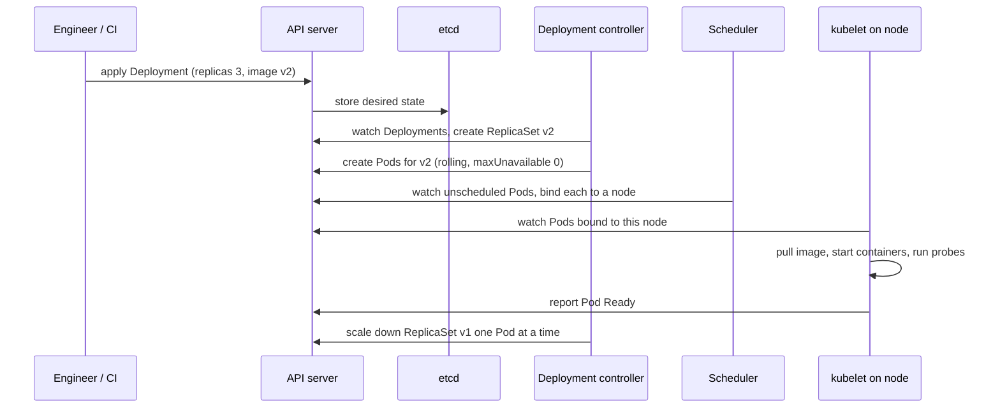
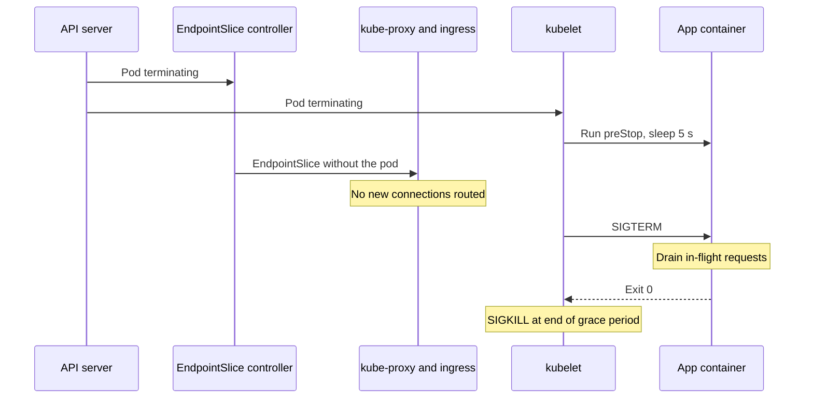

## TL;DR

- **Containers** package an application with its dependencies and run it as an isolated process using Linux namespaces and cgroups — lightweight compared with VMs, but sharing the host kernel.
- Good images are **small, reproducible, non-root, multi-stage builds** with pinned bases, rebuilt regularly for patches.
- **Kubernetes** is a declarative orchestrator: you describe desired state (Deployments, Services, ConfigMaps…) and controllers continuously reconcile reality towards it.
- Production readiness depends on details: **resource requests/limits**, **readiness/liveness/startup probes**, **graceful shutdown**, PodDisruptionBudgets, autoscaling, network policies and security contexts.
- Kubernetes is powerful but **operationally expensive**. Use managed services, a paved-road platform, or simpler container platforms unless you need its flexibility.

## Core Concepts

### Containers vs virtual machines

| | Containers | Virtual machines |
|---|---|---|
| Isolation | Process-level (namespaces, cgroups), shared kernel | Hardware virtualisation, own kernel |
| Startup | Milliseconds–seconds | Seconds–minutes |
| Size | MBs | GBs |
| Density | High | Lower |
| Security boundary | Weaker (kernel shared); harden or use sandboxed runtimes (gVisor, Kata) for untrusted code | Stronger |

Images follow the **OCI** standard: layered filesystems plus metadata, stored in registries and identified by immutable digests.

### Dockerfile best practices

```dockerfile
# syntax=docker/dockerfile:1
FROM node:22-bookworm-slim AS build
WORKDIR /app
COPY package.json package-lock.json ./
RUN npm ci                      # cached layer while dependencies are unchanged
COPY . .
RUN npm run build && npm prune --omit=dev

FROM gcr.io/distroless/nodejs22-debian12 AS runtime   # minimal runtime, no shell
WORKDIR /app
COPY --from=build /app/node_modules ./node_modules
COPY --from=build /app/dist ./dist
USER nonroot
EXPOSE 8080
CMD ["dist/server.js"]
```

- **Multi-stage builds** keep build tools out of runtime images.
- **Order layers** from least to most frequently changing for cache efficiency.
- **Minimal bases** (distroless, slim) — fewer CVEs; pin by digest in production.
- **Non-root user**, no secrets in layers (use build secrets), `.dockerignore`.
- **One process per container**; log to stdout/stderr; handle SIGTERM.

### Kubernetes architecture

- **Control plane:** API server (all interactions), etcd (state), scheduler (places pods on nodes), controller manager (reconciliation loops); managed by the cloud in AKS/EKS/GKE.
- **Nodes:** kubelet (runs pods), container runtime (containerd/CRI-O — Docker Engine's dockershim was removed in v1.24), kube-proxy or eBPF data plane (networking), CNI plugin (pod networking), CSI drivers (storage).

### Core objects

| Object | Purpose |
|---|---|
| Pod | One or more containers sharing network/storage; the scheduling unit; ephemeral |
| Deployment → ReplicaSet | Stateless workloads; rolling updates and rollbacks |
| StatefulSet | Stable identities and persistent volumes per replica (databases, brokers) |
| DaemonSet | One pod per node (log shippers, agents) |
| Job / CronJob | Run-to-completion and scheduled tasks |
| Service | Stable virtual IP/DNS for a set of pods (ClusterIP, NodePort, LoadBalancer) |
| Ingress / Gateway API | HTTP routing from outside the cluster; Gateway API is the newer, more expressive standard (the Ingress API is frozen, and the popular Ingress NGINX controller was retired in March 2026) |
| ConfigMap / Secret | Configuration and sensitive values (Secrets are only base64-encoded by default — enable encryption at rest or use external stores) |
| PersistentVolumeClaim | Request for storage |
| HorizontalPodAutoscaler | Scale replicas on metrics |
| PodDisruptionBudget | Limit voluntary disruptions (drains, upgrades) |
| NetworkPolicy | Allowed traffic between pods |
| CustomResourceDefinition + Operator | Extend the API with your own resources and controllers |

### Example deployment (production-minded)

```yaml
apiVersion: apps/v1
kind: Deployment
metadata:
  name: orders-api
  labels: { app: orders-api }
spec:
  replicas: 3
  strategy:
    rollingUpdate: { maxUnavailable: 0, maxSurge: 1 }
  selector:
    matchLabels: { app: orders-api }
  template:
    metadata:
      labels: { app: orders-api }
    spec:
      securityContext: { runAsNonRoot: true, seccompProfile: { type: RuntimeDefault } }
      topologySpreadConstraints:
        - maxSkew: 1
          topologyKey: topology.kubernetes.io/zone
          whenUnsatisfiable: ScheduleAnyway
          labelSelector: { matchLabels: { app: orders-api } }
      terminationGracePeriodSeconds: 30
      containers:
        - name: api
          image: registry.example.com/orders-api@sha256:3f1c...   # immutable digest
          ports: [{ containerPort: 8080 }]
          resources:
            requests: { cpu: 250m, memory: 256Mi }
            limits: { memory: 512Mi }        # memory limit; CPU limit often omitted to avoid throttling
          readinessProbe: { httpGet: { path: /ready, port: 8080 }, periodSeconds: 5 }
          livenessProbe: { httpGet: { path: /live, port: 8080 }, periodSeconds: 10, failureThreshold: 3 }
          startupProbe: { httpGet: { path: /live, port: 8080 }, failureThreshold: 30, periodSeconds: 2 }
          securityContext: { allowPrivilegeEscalation: false, readOnlyRootFilesystem: true, capabilities: { drop: [ALL] } }
          lifecycle:
            preStop: { sleep: { seconds: 5 } }   # native sleep action (no shell needed in distroless); lets endpoints update before SIGTERM. On by default from 1.30, stable in 1.34.
```

### Resources, QoS and scheduling

- **Requests** reserve capacity for scheduling; **limits** cap usage. CPU over the limit is **throttled**; memory over the limit is **OOM-killed**.
- **QoS classes:** Guaranteed (requests = limits), Burstable, BestEffort (none) — affects eviction order under node pressure.
- Over-requesting wastes money (nodes look full but idle); under-requesting causes noisy neighbours and evictions. Right-size from metrics (VPA recommendations).

### Worked example: right-sizing requests from metrics

A service runs 60 replicas, each requesting **1 CPU and 2 GiB**. Its nodes have 4 vCPUs and 16 GiB, of which about **3.8 vCPU and 14 GiB are allocatable** after system reservations. Two weeks of metrics per pod show:

| | Typical (p95) | Highest seen |
|---|---|---|
| CPU | 180m | 450m |
| Memory | 600 MiB | 700 MiB |

**Before:** the scheduler packs by *requests*, not usage. CPU allows 3 pods per node (3.8 ÷ 1) and memory 7 (14 ÷ 2), so CPU wins: **3 pods per node, 20 nodes**. Real CPU use per node is about 3 × 180m ≈ 0.5 vCPU, so the nodes are 85% idle while the scheduler reports them full.

**After:**
- **CPU request 250m**, just above p95, with **no CPU limit**, so a pod can burst into idle CPU without being throttled.
- **Memory request = limit = 1 GiB.** That's about 45% above the highest value seen. Memory can't be borrowed safely: going over the limit means an OOM kill, so request what the pod really needs and give the limit the same value.

Now CPU allows 15 pods per node (3.8 ÷ 0.25) and memory 14 (14 ÷ 1), so **14 pods per node**. 60 replicas fit on **5 nodes instead of 20**.

Check the new packing before celebrating:
- **Correlated peaks.** If all 14 pods on a node hit 450m at once, they want 6.3 vCPU of 3.8. Without CPU limits they share by request weight and slow down rather than fail. Check whether peaks really coincide, and let the HPA add replicas on sustained load.
- **Blast radius.** A node now holds 14 replicas instead of 3, so losing one node removes almost a quarter of the service. Keep topology spread across zones and a PodDisruptionBudget, and keep enough replicas to lose a node.
- **Keep measuring.** Usage drifts with features and traffic. Use VPA in recommendation mode, or a cost tool, and review requests every quarter.

### Probes and graceful shutdown

- **Readiness:** "can I receive traffic?" — failing removes the pod from Service endpoints.
- **Liveness:** "am I stuck?" — failing restarts the container. Keep it simple; never check dependencies (a database blip would restart every pod).
- **Startup:** protects slow-starting apps from liveness kills during boot.
- **Shutdown:** on termination, the pod receives SIGTERM; it should stop accepting new work, finish in-flight requests and exit before `terminationGracePeriodSeconds`. A short preStop delay helps because endpoint removal is asynchronous.

## How It Works



Everything is a reconciliation loop: controllers compare desired and actual state and act until they match — which is why Kubernetes self-heals (rescheduling pods from failed nodes) and why manual changes get overwritten.

### A pod shutting down without dropping requests



## When to Use / Trade-offs

| Option | Use when | Avoid when | Trade-off |
|---|---|---|---|
| Managed Kubernetes (AKS/EKS/GKE) | Many services, need ecosystem (operators, mesh, GitOps), platform team exists | Small team with a few services | Flexibility vs significant ops burden |
| Serverless containers (Cloud Run, Container Apps, Fargate) | Stateless services, want scale-to-zero, minimal ops | Need custom scheduling, daemonsets, operators | Simplicity vs less control |
| PaaS (App Service, Heroku-like) | Standard web apps | Complex microservice platforms | Fastest vs opinionated |
| Self-managed Kubernetes | Air-gapped, on-prem, special requirements | Cloud environments with managed options | Full control vs heavy maintenance |
| StatefulSets for databases | Operators with strong maturity (e.g. Postgres operators), on-prem | Managed DB services are available | Portability vs operational risk |

## Common Pitfalls & Anti-patterns

- **No resource requests** — unpredictable scheduling, noisy neighbours, evictions.
- **Liveness probes that check dependencies** — cascading restarts during a database blip.
- **Ignoring SIGTERM** — dropped requests on every deploy.
- **`latest` image tags** — non-reproducible deployments.
- **Running as root, privileged containers** — easy container escapes.
- **No PodDisruptionBudgets** — node upgrades take down all replicas at once.
- **All replicas in one zone** — zone failure is a full outage.
- **Secrets in plain manifests in Git.**
- **Huge YAML copy-paste per service** — instead of Helm/Kustomize templates or platform abstractions.
- **Kubernetes for a single small app** — operational cost far exceeds benefit.
- **Never upgrading** — clusters fall out of support (minor versions are supported for roughly a year upstream; managed providers vary).

## Real-world Scenario

**Context:** After moving 30 services to Kubernetes, a company saw every deployment cause a spike of 502 errors, nodes running at 20% real utilisation while the scheduler said they were full, and a node upgrade that took down a payment service completely.

**Decision:** Platform team audited workloads and introduced: readiness probes on real readiness, SIGTERM handling plus a 5-second preStop delay, `maxUnavailable: 0` rolling updates; right-sized requests from VPA recommendations (cutting requests ~45%); PodDisruptionBudgets and topology spread across zones for every service; policy (Kyverno) requiring probes, requests, non-root and PDBs; and a Helm chart library encoding these defaults.

**Outcome:** Deploy-related 502s disappeared; node count dropped by ~35% from right-sizing; subsequent node upgrades caused no outages.

**What I'd do differently:** Ship the paved-road chart and policies **before** migrating services, so every service started with sane defaults rather than retrofitting 30 of them.

## Interview Questions

### How do containers differ from virtual machines? {#containers-vs-vms}

**Level:** Foundation

**Model answer:**
- **VMs** virtualise hardware; each VM runs its own guest OS kernel on a hypervisor. Strong isolation, larger footprint, slower startup.
- **Containers** virtualise the OS: they're isolated processes on a shared host kernel, using **namespaces** (isolated view of processes, network, filesystem, users) and **cgroups** (resource limits). They're lightweight (MBs), start in milliseconds to seconds, and allow high density.

Trade-offs: containers give portability and fast, consistent deployments; but the shared kernel means a weaker security boundary — mitigate with hardening (non-root, seccomp, dropped capabilities) or sandboxed runtimes (gVisor, Kata Containers) for untrusted workloads. In the cloud, containers usually run inside VMs anyway (nodes).

**What the interviewer is looking for:**
Kernel sharing vs hardware virtualisation, namespaces/cgroups, trade-offs including security.

**Follow-ups:**
- What are namespaces and cgroups?
- When would you run untrusted code in containers?

**Red flags:**
- "Containers are lightweight VMs" with no nuance.

### What makes a good Dockerfile? {#dockerfile-best-practices}

**Level:** Foundation

**Model answer:**
- **Multi-stage builds:** compile/build in one stage, copy only the runtime artefacts into a minimal final image.
- **Minimal, pinned base images** (distroless, slim), pinned by digest for reproducibility, rebuilt regularly for security patches.
- **Layer ordering for caching:** copy dependency manifests and install dependencies before copying source code.
- **Non-root user**, minimal capabilities; no package managers or shells in runtime images where possible.
- **No secrets in images:** use build secrets/mounts; never `COPY .env`.
- **`.dockerignore`** to exclude `node_modules`, `.git`, local files.
- **One process per container**, logs to stdout/stderr, proper signal handling (exec form `CMD`, or an init like tini when needed).
- **Healthcheck endpoints** for the orchestrator (probes in Kubernetes).
- **Labels/metadata** (source commit, version) and SBOM generation.

**What the interviewer is looking for:**
Multi-stage, minimal pinned bases, caching, non-root, secrets hygiene, signals and logging.

**Follow-ups:**
- Why does `CMD npm start` cause shutdown problems?
- How do you keep image vulnerabilities low over time?

**Red flags:**
- Single-stage images with build tools and root user.
- Secrets copied into the image.

### What are the core Kubernetes objects, and what are they for? {#kubernetes-objects}

**Level:** Foundation

**Model answer:**
- **Pod:** the smallest deployable unit — one or more containers sharing network namespace and volumes. Ephemeral; managed by higher-level controllers.
- **Deployment:** manages ReplicaSets for stateless apps — desired replica count, rolling updates, rollback.
- **StatefulSet:** stable network identities and per-replica persistent storage for stateful systems.
- **DaemonSet:** runs a pod on every (or selected) node — agents, log collectors.
- **Job/CronJob:** batch and scheduled tasks.
- **Service:** stable DNS name and virtual IP load-balancing to matching pods.
- **Ingress / Gateway API:** HTTP(S) routing into the cluster.
- **ConfigMap/Secret:** configuration and sensitive data injected as env vars or files.
- **PersistentVolumeClaim:** storage requests.
- **HPA, PDB, NetworkPolicy, RBAC objects** for scaling, availability, network and access control.

All are declarative: you specify desired state; controllers reconcile.

**What the interviewer is looking for:**
Accurate purposes and the declarative/reconciliation model.

**Follow-ups:**
- Why not create Pods directly?
- When do you use a StatefulSet instead of a Deployment?

**Red flags:**
- Confusing Services with Deployments.

### How does networking work between pods and to the outside? {#services-networking}

**Level:** Foundation

**Model answer:**
- **Pod networking:** every pod gets its own IP; all pods can reach each other by default (flat network) via the CNI plugin (Azure CNI, Calico, Cilium…). **NetworkPolicies** restrict this (default deny + explicit allows).
- **Services:** a stable virtual IP and DNS name (`orders-api.payments.svc.cluster.local`) that load-balances to pods selected by labels; endpoints update as pods become ready or go away.
  - **ClusterIP:** internal only (default).
  - **NodePort:** exposes a port on every node.
  - **LoadBalancer:** provisions a cloud load balancer.
  - **Headless:** DNS records per pod (for StatefulSets).
- **Ingress / Gateway API:** L7 routing (host/path), TLS termination via an ingress controller or gateway implementation (NGINX, Envoy-based, cloud gateways). Gateway API is the newer standard with richer, role-oriented resources.
- **Service mesh** (optional): mTLS, traffic splitting, retries, observability between services.

**What the interviewer is looking for:**
Flat pod network, NetworkPolicies, Service types, DNS, Ingress/Gateway API and mesh as optional.

**Follow-ups:**
- How does a Service know which pods to route to?
- What's the difference between Ingress and Gateway API?

**Red flags:**
- Hard-coding pod IPs.

### Explain readiness, liveness and startup probes, and common mistakes. {#probes}

**Level:** Senior

**Model answer:**
- **Readiness probe:** whether the pod should receive traffic. Failing removes it from Service endpoints without restarting it — use during startup warm-up, temporary overload, or when a critical dependency the pod can't function without is unavailable (carefully).
- **Liveness probe:** whether the container is healthy enough to keep running. Failing restarts the container — use only to detect unrecoverable states like deadlocks.
- **Startup probe:** for slow-starting apps; disables liveness/readiness checks until startup succeeds, preventing premature restarts.

Common mistakes:
- **Liveness checking dependencies** (database, downstream APIs): a dependency outage restarts every pod, making things worse.
- Same endpoint for liveness and readiness with heavy logic.
- Aggressive timeouts/thresholds causing restarts under load (GC pauses).
- No readiness probe → traffic to pods still starting → errors during deploys.
- Probes that are expensive and add load.

**What the interviewer is looking for:**
Precise semantics, appropriate use, and the dependency-checking anti-pattern.

**Follow-ups:**
- Should readiness fail if the database is down?
- How do probes interact with rolling updates?

**Red flags:**
- Liveness probe calling the database.

### How do resource requests and limits work, and how do you set them? {#requests-limits}

**Level:** Senior

**Model answer:**
- **Requests:** the guaranteed amount used by the scheduler to place pods; also determines CPU share under contention.
- **Limits:** the maximum. **CPU** over the limit is **throttled** (latency spikes); **memory** over the limit causes an **OOM kill**.
- **QoS classes:** Guaranteed (requests = limits for all resources), Burstable (some requests), BestEffort (none) — BestEffort pods are evicted first under node pressure.

Setting them:
- Base requests on **observed usage** (e.g. p95 CPU, peak memory plus headroom) from monitoring or VPA recommendations; revisit periodically.
- Always set **memory requests and limits** (often equal for predictability).
- CPU limits are debated: many teams set CPU requests but omit CPU limits to avoid throttling, relying on requests for fair sharing; set limits where strict isolation or cost control is needed.
- Use LimitRanges and ResourceQuotas per namespace as guardrails.
- Watch for throttling metrics and OOMKilled events.

**What the interviewer is looking for:**
Correct semantics, QoS, data-driven sizing, the CPU limit debate and guardrails.

**Follow-ups:**
- A Java service gets OOMKilled despite a heap below the limit. Why?
- What happens when nodes are overcommitted?

**Red flags:**
- No requests at all.
- Arbitrary 4 CPU/8 GB defaults for every service.

### How do you make a service shut down gracefully on Kubernetes? {#graceful-shutdown}

**Level:** Senior

**Model answer:**
When a pod is terminated (deploy, scale-down, node drain):
1. The pod is marked terminating; endpoint controllers start removing it from Services — **asynchronously**.
2. The `preStop` hook runs (if defined), then the container receives **SIGTERM**.
3. After `terminationGracePeriodSeconds` (default 30s), remaining processes get SIGKILL.

To avoid dropped requests:
- **Handle SIGTERM:** stop accepting new connections, finish in-flight requests, close DB connections and flush buffers, then exit.
- **Short preStop delay** (a few seconds) so load balancers and kube-proxy stop sending traffic before the app stops listening.
- Ensure the app is **PID 1 or receives signals** (exec form CMD, or an init process).
- Set grace periods to cover the longest in-flight work; for long jobs, make work resumable/idempotent.
- For consumers: stop polling, finish or release current messages, commit offsets.
- Rolling update settings (`maxUnavailable: 0`, readiness probes) and PDBs complement this.

**What the interviewer is looking for:**
The termination sequence, endpoint-removal race, SIGTERM handling, preStop delay, PID 1 and consumer considerations.

**Follow-ups:**
- Why do 502s appear during deploys even with readiness probes?
- How do you handle a 10-minute batch job during a node drain?

**Red flags:**
- Ignoring SIGTERM.

### Should you run stateful workloads like databases on Kubernetes? {#stateful-workloads}

**Level:** Senior

**Model answer:**
Kubernetes supports stateful workloads via **StatefulSets** (stable identities, ordered rollout, per-replica PersistentVolumeClaims) and **operators** that encode operational knowledge (failover, backups, upgrades) — e.g. mature Postgres, Kafka and Redis operators.

Considerations:
- **Managed cloud databases** usually win in the cloud: backups, HA, patching, PITR and support handled for you — lower risk for most teams.
- Run on Kubernetes when: on-prem/air-gapped, portability is essential, you have strong expertise and a mature operator, or for ephemeral environments (dev/test, per-PR databases).
- Requirements if you do: storage classes with appropriate performance and replication, zone-aware scheduling, PDBs, tested backup/restore, monitoring, careful upgrade procedures, anti-affinity across nodes/zones.

**What the interviewer is looking for:**
Understanding of StatefulSets and operators, and a pragmatic default to managed services in the cloud.

**Follow-ups:**
- What does an operator do that a StatefulSet doesn't?
- How do you back up a database running in Kubernetes?

**Red flags:**
- Running production databases on Kubernetes without tested backups or expertise.

### How does autoscaling work in Kubernetes? {#autoscaling}

**Level:** Senior

**Model answer:**
- **Horizontal Pod Autoscaler (HPA):** adjusts replica counts based on metrics (CPU/memory utilisation relative to requests, or custom/external metrics like requests per second or queue length). Requires correct requests; tune stabilisation windows to avoid flapping.
- **KEDA:** event-driven autoscaling on external sources (Kafka lag, queue depth, cron), including scale to zero.
- **Vertical Pod Autoscaler (VPA):** recommends or sets requests/limits based on usage; often used in recommendation mode alongside HPA (avoid both acting on CPU simultaneously).
- **Cluster Autoscaler / node auto-provisioning (e.g. Karpenter):** adds nodes when pods can't be scheduled, removes underused nodes; Karpenter-style provisioners pick instance types dynamically.

Practical points: scale on the metric that represents load (queue lag for consumers, RPS for APIs), keep minimum replicas for availability, account for node provisioning time (minutes) with headroom or overprovisioning pods, and ensure PDBs allow scale-down.

**What the interviewer is looking for:**
HPA, KEDA, VPA, cluster/node autoscaling, metric choice and timing considerations.

**Follow-ups:**
- Why might HPA not scale when CPU is high?
- How do you handle sudden traffic spikes given node startup time?

**Red flags:**
- Autoscaling without resource requests.

### A pod is in CrashLoopBackOff. How do you debug it? {#debugging-pods}

**Level:** Senior

**Model answer:**
1. **`kubectl describe pod`:** events — image pull errors, failed probes, OOMKilled, scheduling issues, mount failures; exit codes (137 = SIGKILL/OOM, 1 = app error).
2. **Logs:** `kubectl logs <pod> --previous` to see the crashed container's output.
3. **Configuration:** missing env vars, ConfigMaps or Secrets; wrong command/args; wrong port.
4. **Probes:** liveness killing a slow-starting app (add a startup probe or adjust thresholds).
5. **Resources:** OOMKilled → raise memory limit or fix leak; CPU throttling causing timeouts.
6. **Dependencies:** app exits when DB is unreachable at startup — check network policies, DNS, credentials (workload identity).
7. **Reproduce:** run the image locally with the same config, or `kubectl debug` with an ephemeral container for distroless images.
8. **Recent changes:** compare with the previous ReplicaSet/image; roll back if a deploy caused it.

**What the interviewer is looking for:**
A systematic approach using describe, previous logs, exit codes, probes, resources, config and dependencies.

**Follow-ups:**
- How do you debug a distroless container with no shell?
- What does exit code 137 mean?

**Red flags:**
- Deleting pods repeatedly hoping it fixes itself.

### How would you design a multi-tenant Kubernetes platform for many teams? {#multi-tenancy}

**Level:** Architect

**Model answer:**
Choose the isolation model by trust and requirements:
- **Namespace-per-team (soft multi-tenancy)** on shared clusters for internal teams: RBAC per namespace, ResourceQuotas and LimitRanges, NetworkPolicies (default deny), Pod Security Standards (restricted), separate service accounts/workload identities, policy engines (Kyverno/Gatekeeper) enforcing standards, and per-namespace cost allocation.
- **Cluster-per-environment or per-tier** (prod vs non-prod) for blast-radius separation; dedicated clusters for regulated or high-risk workloads.
- **Hard multi-tenancy** (untrusted tenants, e.g. customer code): separate clusters or virtual clusters plus sandboxed runtimes; namespaces alone aren't a strong security boundary.

Platform services: shared ingress/gateway, observability, secrets integration, GitOps per namespace, self-service namespace provisioning with templates, and quotas/fair scheduling (priority classes). Document what's shared (control plane, nodes, network) and the residual risks.

**What the interviewer is looking for:**
Isolation models by trust level, concrete controls, blast-radius thinking and self-service.

**Follow-ups:**
- How do you prevent one team's workload starving others?
- When would you give a team its own cluster?

**Red flags:**
- Treating namespaces as a hard security boundary for untrusted tenants.

### How do you run Kubernetes upgrades safely across many clusters? {#cluster-upgrades}

**Level:** Architect

**Model answer:**
- **Stay within support windows:** Kubernetes minor versions are released roughly three times a year and supported for about a year upstream (managed providers have their own windows) — plan a regular cadence rather than big jumps.
- **Prepare:** read release notes for API removals/deprecations; scan manifests and Helm charts for deprecated APIs (tools like Pluto/kubent); check add-on compatibility (CNI, ingress, service mesh, operators).
- **Progressive rollout:** dev → staging → a canary production cluster → remaining clusters.
- **Node upgrades:** surge upgrades or blue-green node pools; rely on PDBs, multiple replicas, topology spread and graceful shutdown so workloads move without outages; monitor during drains.
- **Automate:** IaC for cluster versions, automated checks and smoke tests after upgrade, rollback strategy (for node pools; control plane downgrades are usually not supported, so test thoroughly beforehand).
- **Communicate** with application teams; keep workloads following standards (PDBs, probes) so upgrades are routine.

**What the interviewer is looking for:**
Cadence and support windows, deprecation checks, progressive rollout, safe node rotation, automation and team readiness.

**Follow-ups:**
- An API your charts use has been removed. How do you handle it?
- Why can't you easily roll back a control plane upgrade?

**Red flags:**
- Upgrading only when forced, several versions behind.

### When should you *not* use Kubernetes? {#when-not-kubernetes}

**Level:** Architect

**Model answer:**
Kubernetes is a platform for building platforms; its costs are real — expertise, upgrades, security hardening, networking complexity, observability, and cluster costs.

Avoid it (or at least run it yourself) when:
- **Small team, few services:** a PaaS or serverless container service (Cloud Run, Azure Container Apps, App Service, ECS Fargate) delivers 90% of the value with a fraction of the effort.
- **No platform team** to own clusters, upgrades and paved roads.
- **Mostly event-driven or spiky workloads** better suited to serverless functions.
- **Simple, stable workloads** on VMs that work and rarely change.
- **Timelines don't allow** building platform capabilities before product work.

Use it when you have many services and teams, need its ecosystem (operators, GitOps, service mesh, custom scheduling), require portability across clouds/on-prem, or have workloads (GPUs, daemonsets, custom networking) that simpler platforms can't host — and invest in a platform team.

**What the interviewer is looking for:**
Honest cost assessment, alternatives and criteria for when it's worth it.

**Follow-ups:**
- How would you migrate from Container Apps to AKS later if needed?
- What's the minimum platform team size to run Kubernetes well?

**Red flags:**
- Kubernetes as the default for everything.

### How would you build an internal developer platform on Kubernetes? {#kubernetes-platform}

**Level:** Architect

**Model answer:**
Goal: developers deploy and operate services **without needing to be Kubernetes experts**.

- **Abstractions:** a simple service definition (e.g. a `Service` CRD, Score, or a Helm chart library with a few inputs) generating Deployments, Services, HPAs, PDBs, NetworkPolicies, probes and monitoring with secure defaults.
- **Golden paths:** templates (Backstage scaffolder) creating repo, pipeline, manifests, dashboards and alerts.
- **GitOps delivery:** Argo CD/Flux per environment, progressive delivery (Argo Rollouts/Flagger).
- **Built-in capabilities:** ingress/gateway with TLS, secrets via external secrets operator and vault, workload identity, observability (OpenTelemetry, logs, metrics, traces), policy enforcement (Kyverno/Gatekeeper), cost allocation.
- **Self-service infrastructure:** databases, queues, buckets via Crossplane compositions or Terraform modules exposed through the portal.
- **Operations:** cluster lifecycle automation, upgrades, capacity management, SLOs for the platform itself.
- **Product management:** user research with developers, adoption and satisfaction metrics, docs, office hours.

**What the interviewer is looking for:**
Abstraction over raw Kubernetes, golden paths, GitOps, integrated capabilities, self-service infra and product thinking.

**Follow-ups:**
- How much Kubernetes should developers still need to know?
- How do you handle teams that need to break out of the abstraction?

**Red flags:**
- Handing teams raw clusters and kubectl access as "the platform".

### How do you design for multiple clusters and regions? {#multi-cluster}

**Level:** Architect

**Model answer:**
Reasons for multiple clusters: blast-radius isolation, regional availability/latency, data residency, environment separation, scale limits, and upgrade safety.

Design elements:
- **Cluster fleet management:** IaC for clusters, consistent baseline configuration via GitOps (ApplicationSets/Flux), fleet tooling (Azure Fleet Manager, GKE fleets, Rancher) for policy and upgrades.
- **Traffic management:** global load balancing (Front Door, Cloud Load Balancing, DNS-based) with health checks to route between regional clusters; failover tested.
- **Service discovery across clusters** only where needed (multi-cluster services or mesh); prefer regional self-sufficiency to avoid cross-region chatter.
- **Data layer:** usually managed databases with their own replication strategy; Kubernetes doesn't solve data consistency across regions.
- **Deployment strategy:** deploy region by region with verification, not everywhere at once.
- **Observability:** fleet-wide views with cluster/region labels.
- **Cost and complexity:** each cluster adds overhead; consolidate where isolation isn't needed.

**What the interviewer is looking for:**
Clear reasons, fleet management, global routing, regional independence, data considerations and staged deployments.

**Follow-ups:**
- How would you fail over a region with stateful dependencies?
- When would you merge clusters instead?

**Red flags:**
- Stretching a single cluster across distant regions.

### How do ConfigMaps and Secrets work, and how should you manage secrets on Kubernetes? {#kubernetes-config-secrets}

**Level:** Foundation

**Model answer:**
**ConfigMaps** hold non-sensitive configuration, and **Secrets** hold sensitive values. Both are limited to 1 MiB. Pods consume them as:
- **Environment variables**, which are read once at container start. Changes need a restart, usually triggered by a rollout.
- **Mounted files**, which the kubelet updates in place within about a minute, so an app that re-reads files can pick up changes without a restart. `subPath` mounts don't update.

Marking a ConfigMap or Secret **immutable** protects against accidental edits, and reduces load on the API server in big clusters.

**Secrets aren't secret by default.** They're base64-encoded, not encrypted, and anyone who can read Secrets in a namespace (or create pods there) can read them. To make them safe:
- **Encrypt them at rest in etcd** with a KMS provider. Managed services offer envelope encryption with the cloud's KMS.
- **Lock down RBAC**: few people and service accounts may `get` or `list` Secrets, and audit those reads.
- **Keep the source of truth in a vault** (AWS Secrets Manager, Azure Key Vault, HashiCorp Vault) and sync it in with the **External Secrets Operator**, or mount it with the **Secrets Store CSI driver**.
- **Never commit plaintext Secrets to Git.** With GitOps, commit encrypted ones (Sealed Secrets, SOPS) or only the external-secret references.
- Prefer **workload identity** for cloud APIs, so there's no secret at all.

**What the interviewer is looking for:**
How each is consumed and updated, the base64 caveat, encryption at rest, RBAC, and vault integration.

**Follow-ups:**
- How do you roll pods automatically when a ConfigMap changes?
- Who can read a Secret besides users with `get` on it?

**Red flags:**
- "Secrets are encrypted, so they're safe in Git."
- Expecting environment variables to pick up changes without a restart.

### What is the Gateway API, and how would you move a cluster off Ingress? {#ingress-vs-gateway-api}

**Level:** Senior

**Model answer:**
**Ingress** is a single resource for HTTP routing. Anything beyond host and path matching (timeouts, header matching, traffic weights, rewrites) depends on controller-specific **annotations**, which aren't portable. The Ingress API is stable but **frozen**: it gets no new features.

The **Gateway API** splits the job by role:
- **GatewayClass**: the implementation, chosen by the infrastructure provider (for example Envoy Gateway, Istio, Cilium, NGINX Gateway Fabric, or a cloud load balancer controller).
- **Gateway**: the listeners, ports and TLS certificates, owned by the cluster operator.
- **HTTPRoute** and **GRPCRoute**: the routing rules, owned by application teams in their own namespaces and attached to a shared Gateway. **ReferenceGrant** controls references across namespaces.

The features that needed annotations are built in: header and query matching, **weighted backends** for canaries, request and response header changes, redirects, rewrites, mirroring and timeouts. Implementations are tested against a shared conformance suite.

**Why migrate now:** the widely used **Ingress NGINX controller was retired in March 2026**. It gets no more releases or security fixes, so clusters still running it are carrying unpatched risk.

**Migration plan:**
1. **Inventory** every Ingress and its annotations. The annotations are the hard part, because each must map to Gateway API features or the new implementation's policies.
2. **Choose an implementation** that passes conformance for the features you need.
3. **Convert** with `ingress2gateway` as a starting point, then review the routes by hand.
4. **Run both side by side**: the new Gateway gets its own load balancer, and you compare responses, then shift DNS or traffic gradually per host.
5. **Remove the old controller** once traffic and alerts show nothing still uses it.

**What the interviewer is looking for:**
The role-oriented model, portable features versus annotations, the Ingress NGINX retirement, and a side-by-side migration.

**Follow-ups:**
- How do you let teams attach routes to a shared Gateway without letting them steal each other's hostnames?
- How would you run a canary with an HTTPRoute?

**Red flags:**
- Still running Ingress NGINX in production with no plan.
- Believing the Ingress API itself is being removed.

### How do NetworkPolicies work, and how would you roll out default-deny across a busy cluster? {#network-policies}

**Level:** Senior

**Model answer:**
By default every pod can reach every other pod. A **NetworkPolicy** selects pods by label and lists the traffic allowed to them (ingress) or from them (egress):
- Policies only **allow**. Once any policy selects a pod for a direction, everything not explicitly allowed in that direction is denied.
- Rules match by pod labels, namespace labels, IP blocks and ports. Core NetworkPolicy has no layer 7 rules and no DNS-name rules.
- They're enforced by the **CNI plugin** (Cilium, Calico, cloud CNIs with policy support). On a CNI without enforcement, policies are silently ignored.

**Rolling out default-deny without an outage:**
1. **Observe real traffic first** with flow logs: Cilium Hubble, Calico flow logs or cloud flow logs. Build the dependency map from data, not memory.
2. **Fix labels.** Policies are only as good as the labels they select on, so agree standard `app` and `team` labels and namespace labels.
3. **Start per namespace**: allow traffic within the namespace, from the ingress gateway, and from monitoring. Then add a default-deny for ingress.
4. **Egress is harder.** Always allow DNS to the cluster DNS service (UDP and TCP port 53), then the specific dependencies. Use CNI-specific FQDN policies for external APIs where available.
5. **Roll out namespace by namespace**, watching dropped-flow metrics, and with a quick way to revert.
6. **Make it the default**: new namespaces get the baseline policies from the platform's templates, and admission policies (Kyverno or Gatekeeper) require them.

For cluster-wide rules that tenants can't override, use the CNI's cluster policies, or the upstream **AdminNetworkPolicy** API where your CNI supports it.

**What the interviewer is looking for:**
Allow-list semantics, CNI enforcement, observing before denying, the DNS egress trap, and a staged rollout.

**Follow-ups:**
- A pod can't resolve DNS after a new policy. Why?
- How would you restrict egress to a single third-party API?

**Red flags:**
- Writing policies on a CNI that doesn't enforce them.
- Applying default-deny egress cluster-wide in one change.

### How would you run GPU inference and training workloads on Kubernetes? {#gpu-workloads}

**Level:** Architect

**Model answer:**
**Getting GPUs to pods:**
- The **NVIDIA GPU Operator** (or the cloud's managed equivalent) installs drivers, the device plugin and the DCGM metrics exporter on GPU nodes.
- The device plugin exposes GPUs as an extended resource (`nvidia.com/gpu: 1`). They're whole devices: no fractions, no overcommit.
- **Dynamic Resource Allocation**, GA since Kubernetes 1.34, lets pods request devices by attributes (model, memory), and supports sharing and partitions. It's the long-term replacement for simple counts.
- **Sharing** for small inference models: MIG partitions on supported GPUs (hardware isolation), or time-slicing (no isolation, so only for trusted workloads).

**Isolating expensive nodes:** GPU node pools with a **taint**, so only pods that tolerate it and request GPUs land there. Several pools by GPU type, labelled for affinity.

**Inference:**
- **Scale on the right signal**: requests in flight, queue length or tokens per second, via KEDA or custom metrics. GPU utilisation alone lags and can mislead.
- **Model loading is the cold start.** Weights of tens of gigabytes take minutes to pull and load, so keep a warm minimum, cache weights on node-local disks or a shared volume, and don't put them in the container image.
- Use a serving framework that batches requests (vLLM, Triton, KServe) to raise throughput per GPU.

**Training and batch:**
- **Queue and share fairly** with Kueue: quotas per team, borrowing of idle capacity, and **gang scheduling**, so a distributed job starts only when all its pods can run.
- **Checkpoint regularly**, so jobs can run on spot capacity and survive preemption.
- Respect topology: for multi-GPU training, place pods on nodes with fast interconnects.

**Cost and capacity:** GPUs are the most expensive thing in the cluster, so track utilisation and cost per team. Reserve capacity for steady inference, scale training to zero between jobs, and alert on idle GPU nodes.

**What the interviewer is looking for:**
Device plugin versus DRA, sharing options, taints, inference scaling signals, model-loading cold starts, Kueue for batch, and cost control.

**Follow-ups:**
- Inference latency doubles when traffic rises, but GPU utilisation is only 50%. What might be happening?
- How do you stop one team's training jobs from starving another team's inference?

**Red flags:**
- Untainted GPU nodes running ordinary pods.
- Baking model weights into a 40 GB image.

### How would you move a 40-service Kubernetes platform from x86 to Arm nodes to cut costs? {#arm-migration}

**Level:** Architect

**Model answer:**
Arm instances (AWS Graviton, Azure Cobalt, Google Axion) often give noticeably better price-performance for typical services, but the migration is mostly about images and dependencies, not Kubernetes.

**1. Make images multi-architecture:**
- Build an **OCI image index** (a multi-arch manifest) with `docker buildx` for `linux/amd64` and `linux/arm64`. Native Arm CI runners are much faster than QEMU emulation.
- Check base images and **native dependencies**: Node.js modules with compiled add-ons, Python wheels, JNI libraries, and downloaded binaries in Dockerfiles (`curl .../linux-amd64/...` is a common trap).
- Check everything else that runs on the nodes: **DaemonSets** (log agents, security agents, CNI and CSI components), sidecars, and operators. One amd64-only DaemonSet blocks the whole node pool.

**2. Add an Arm node pool, opt-in:**
- Give the pool a **taint**, so only services that declare a toleration and a node affinity for `kubernetes.io/arch: arm64` move.
- With autoscalers such as Karpenter, allow both architectures and let services opt in by requirement.

**3. Migrate service by service:**
- Start with stateless, low-risk services. Run a canary on Arm next to x86 pods and compare latency, error rate and **cost per request**, not just CPU use.
- Expect differences: some workloads gain a lot, a few (heavy use of x86-specific instructions, some JIT or crypto paths) don't. Decide per service.
- Rolling back is just removing the toleration.

**4. Make it the default:**
- Platform templates build multi-arch images by default, and CI tests on both architectures.
- New services land on Arm unless they opt out. Rightsize again afterwards, because the CPU profile changes.

**What the interviewer is looking for:**
Multi-arch images, native-dependency and DaemonSet traps, opt-in scheduling with taints and affinity, measuring cost per request, and easy rollback.

**Follow-ups:**
- One critical vendor agent has no Arm build. What are your options?
- How would you measure whether the migration actually saved money?

**Red flags:**
- Switching node pools wholesale without testing images.
- Measuring success by CPU utilisation instead of cost per request.

## Cheat Sheet

### Containers
- **Container** — isolated process using namespaces and cgroups; shares the host kernel.
- **Multi-stage build** — build tools in one stage, minimal runtime image in the final stage.
- **Pin by digest** — immutable image references; avoid `latest`.
- **Non-root + read-only filesystem + drop capabilities** — baseline container hardening.

### Kubernetes objects and behaviour
- **Reconciliation** — controllers continuously drive actual state to desired state.
- **Deployment vs StatefulSet** — stateless rolling updates vs stable identity and per-replica storage.
- **Service types** — ClusterIP, NodePort, LoadBalancer, headless.
- **Gateway API** — newer, more expressive standard for ingress routing.
- **Secrets** — base64-encoded only by default; encrypt at rest or use external stores.

### Production readiness
- **Readiness vs liveness vs startup** — traffic gating vs restart on hang vs slow-start protection.
- **Never check dependencies in liveness** — avoids cascading restarts.
- **Requests vs limits** — scheduling reservation vs cap; CPU throttles, memory OOM-kills.
- **Graceful shutdown** — handle SIGTERM, short preStop delay, finish in-flight work.
- **PDB + topology spread** — survive drains and zone failures.
- **HPA / KEDA / VPA / node autoscaling** — replicas on metrics/events, right-sizing, node capacity.
- **Upgrade cadence** — minor versions supported roughly a year; scan for deprecated APIs.

### Revisit

- **Requests drive packing** — the scheduler packs by requests, not usage. Set CPU requests near p95 with no CPU limit, and memory request equal to its limit, above the highest usage seen.
- **Shutdown race** — endpoint removal and SIGTERM happen in parallel. A preStop sleep gives routing time to update, and the grace period includes it.
- **Config updates** — environment variables need a restart. Mounted files update within about a minute, except `subPath` mounts.
- **Secrets** — base64, not encrypted. Use KMS encryption at rest, tight RBAC, and a vault synced with the External Secrets Operator or CSI driver.
- **Gateway API** — GatewayClass, Gateway and Routes split by role. Ingress NGINX was retired in March 2026.
- **NetworkPolicy** — allow-only, enforced by the CNI. Observe flows first, and always allow DNS egress.
- **GPUs** — taint GPU pools, scale inference on requests in flight, queue training with Kueue, and keep model weights out of images.

## Further Reading

- [Kubernetes documentation](https://kubernetes.io/docs/home/) — concepts, workloads, networking and security.
- [Kubernetes: Configure liveness, readiness and startup probes](https://kubernetes.io/docs/tasks/configure-pod-container/configure-liveness-readiness-startup-probes/) — probe semantics and examples.
- [Kubernetes: Resource management for pods and containers](https://kubernetes.io/docs/concepts/configuration/manage-resources-containers/) — requests, limits and QoS.
- [Docker documentation: Building best practices](https://docs.docker.com/build/building/best-practices/) — Dockerfile guidance.
- [Gateway API](https://gateway-api.sigs.k8s.io/) — the modern ingress API.
- [Kubernetes Pod Security Standards](https://kubernetes.io/docs/concepts/security/pod-security-standards/) — privileged, baseline and restricted profiles.
