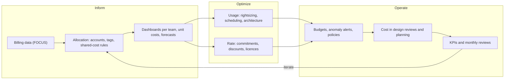

## TL;DR

- **FinOps** is an operational practice and culture that brings **engineering, finance and business** together to make data-driven decisions about cloud (and other variable technology) spend — maximising business value, not just cutting cost.
- It runs in iterative phases: **Inform** (visibility, allocation), **Optimize** (rates and usage), **Operate** (governance, continuous improvement).
- Foundations: **accurate allocation** (tagging, account structure, shared-cost rules), **timely data accessible to engineers**, and **ownership** by the teams who make spending decisions.
- Measure what matters: **unit economics** (cost per order, per customer, per inference) tell you whether growth is efficient; total spend alone doesn't.
- Optimisation has two levers: **rate** (commitments, discounts, licences) and **usage** (rightsizing, scheduling, architecture). Architects own the biggest usage lever — design.

## Core Concepts

### Principles (FinOps Foundation)

- Teams need to collaborate (finance, engineering, product, procurement).
- Business value drives technology decisions — cost is one input alongside speed and quality.
- Everyone takes ownership of their technology usage — engineers see and own their costs.
- FinOps data should be accessible, timely and accurate.
- FinOps should be enabled centrally (a small team providing tools, rates and governance), while decisions are decentralised.
- Take advantage of the variable cost model of the cloud.

### The lifecycle

| Phase | Goal | Typical activities |
|---|---|---|
| Inform | Visibility and allocation | Tagging strategy, account/subscription structure, cost allocation incl. shared costs, dashboards per team, budgets, forecasts, unit metrics |
| Optimize | Improve efficiency | Rightsizing, scheduling non-prod, storage tiering, commitments (savings plans/reservations), licence optimisation, architecture changes |
| Operate | Embed in how the org works | Policies and guardrails, anomaly response, cost reviews in design and planning, KPIs, continuous improvement cadence |

Organisations cycle through these repeatedly and mature from **crawl → walk → run** per capability.

### Allocation: who spends what

- **Structure first:** separate accounts/subscriptions/projects per workload and environment give clean allocation for free.
- **Tags/labels** for finer allocation: `owner`, `cost-centre`, `service`, `environment`; enforced by policy at creation; remediation for untagged spend.
- **Shared costs** (networking hubs, observability platform, support plans, Kubernetes clusters): allocate by usage proportion, fixed split, or keep central — agree the rule explicitly.
- **Kubernetes:** allocate node costs to namespaces/workloads by requests or usage (OpenCost, Kubecost, cloud-native split cost allocation).
- **Standard data format:** the **FOCUS** specification (FinOps Open Cost and Usage Specification) normalises billing data across providers and SaaS.

### Showback vs chargeback

- **Showback:** teams see their costs; no money moves. Builds awareness and accountability with less friction.
- **Chargeback:** costs are billed to business units' budgets. Strong incentives; requires accurate, trusted allocation and agreed shared-cost rules, or it creates disputes.

### Unit economics

Total spend rising can be good news if the business grows faster. Track **cost per unit of business value**:

```text
Cost per order            = (infrastructure + platform share) / orders processed
Cost per active customer  = monthly cloud cost attributable to product / monthly active customers
Cost per 1k API calls, per GB processed, per ML inference, per tenant
```

Unit costs make conversations concrete ("cost per order fell from £0.42 to £0.31 while volume doubled") and inform pricing, margins and architectural priorities.

### Optimisation levers

**Rate optimisation** (usually led centrally):
- Commitments: savings plans / reservations for steady baseline; manage coverage and utilisation; laddering commitments over time.
- Enterprise agreements and negotiated discounts; licence benefits (e.g. Azure Hybrid Benefit); marketplace commitments.

**Usage optimisation** (led by engineering teams):
- Rightsizing compute and databases; autoscaling; scale-to-zero; scheduling non-production.
- Spot/preemptible for interruptible work.
- Storage lifecycle and tiering; deleting orphans (disks, snapshots, IPs).
- Data transfer: CDN, keep chatty traffic within a zone/region, compress.
- Observability cost: sampling, retention tiers.
- Architecture: managed/serverless where it lowers total cost, caching, efficient queries, batch vs real-time.

## How It Works



Roles: a central FinOps team (finance + engineering skills) runs data, rates, tooling and cadence; engineering teams own usage decisions; finance owns budgeting and forecasting; product/business owns value and trade-offs; leadership sets targets and incentives.

## When to Use / Trade-offs

| Practice | Use when | Avoid when | Trade-off |
|---|---|---|---|
| Showback | Starting out; building awareness | — | Low friction; weaker incentives |
| Chargeback | Mature allocation, business units with P&L ownership | Allocation is inaccurate or disputed | Strong accountability; overhead and disputes |
| Commitments (1–3 yr) | Stable, well-understood baseline | Workloads about to change architecture or shrink | Big discounts; risk of unused commitment |
| Spot capacity | Interruptible, stateless, batch | Stateful or latency-critical without fallbacks | 60–90% savings typical; interruption handling |
| Central rate management | Almost always | — | Expertise and leverage; must coordinate with teams' plans |
| Cost targets per team | Clear ownership and unit metrics exist | Teams can't influence their costs | Focus; risk of cutting reliability or speed |
| Third-party FinOps platforms | Multi-cloud, complex allocation, large spend | Small single-cloud estates (native tools suffice) | Capability vs licence cost |

## Common Pitfalls & Anti-patterns

- **Cost-cutting campaigns instead of a practice** — one-off "cost blitzes" that regress within months.
- **Finance-only FinOps** — reports engineers never see; no one who can change usage is involved.
- **Tagging without enforcement** — 40% of spend "unallocated".
- **Buying commitments before rightsizing** — locking in waste.
- **Focusing only on total spend** — penalising growth instead of measuring efficiency.
- **Optimising pennies** — weeks of engineering to save £200/month while a £30k/month design inefficiency persists.
- **Ignoring data transfer and observability costs** — often among the fastest-growing line items.
- **Cost targets that undermine reliability** — removing redundancy from critical systems.
- **No anomaly detection** — a misconfigured job runs for a month before anyone notices.

## Real-world Scenario

**Context:** A SaaS company's cloud bill grew 70% in a year while revenue grew 25%. Finance produced a monthly PDF of top services; engineers didn't see costs; 35% of spend was untagged; commitments covered only 20% of steady compute.

**Decision:**
- **Inform:** restructured accounts per team/environment, enforced tags via policy, defined shared-cost allocation for the Kubernetes platform and observability; daily dashboards per team in the developer portal; defined unit costs (cost per active customer and per 1,000 API calls).
- **Optimize:** rightsizing sprints guided by utilisation data; non-prod scheduling; storage lifecycle policies; then savings plans to 70% coverage of the rightsized baseline; reduced log ingestion by sampling and retention tiers.
- **Operate:** anomaly alerts routed to owning teams; a "cost impact" section in design docs; monthly FinOps review with engineering and finance; quarterly unit-cost targets.

**Outcome:** Within two quarters spend dropped 28% while usage grew; cost per active customer fell 41%; unallocated spend went below 5%. The finance forecast error dropped from ±25% to ±7%.

**What I'd do differently:** Start with unit economics and team visibility *before* optimisation campaigns — teams engaged far more once they could see their own trends and the business context. And involve product earlier: some expensive features had little usage and were candidates for redesign or removal.

## Interview Questions

### What is FinOps, and how is it different from cost cutting? {#what-is-finops}

**Level:** Foundation

**Model answer:**
FinOps is an **operational framework and cultural practice** for managing variable cloud and technology spend. It brings engineering, finance, product and procurement together so that the people making technical decisions have timely cost data and accountability, and the organisation makes **value-based trade-offs** between cost, speed and quality.

Differences from cost cutting:
- It's **continuous**, not a one-off campaign.
- The goal is **business value per unit of spend**, not the lowest bill — spending more to grow faster can be the right answer.
- It's **decentralised ownership with central enablement**: engineers own usage decisions; a central team provides data, tools, rate optimisation and governance.
- It covers visibility, allocation, forecasting, optimisation and governance.

**What the interviewer is looking for:**
Culture and collaboration, value focus, continuous practice, and the central-enablement/decentralised-ownership model.

**Follow-ups:**
- Who should own cloud costs in an organisation?
- Why do one-off cost-cutting exercises fail?

**Red flags:**
- "FinOps is finance monitoring the cloud bill."
- Equating success with minimum spend.

### Describe the Inform, Optimize and Operate phases. {#finops-phases}

**Level:** Foundation

**Model answer:**
- **Inform:** create visibility and accountability — ingest billing data, allocate costs to teams/products (accounts, tags, shared-cost rules), build dashboards and reports, establish budgets, forecasts and unit metrics. Without this, nothing else works.
- **Optimize:** improve efficiency — usage optimisation (rightsizing, scheduling, autoscaling, storage tiering, architecture changes) and rate optimisation (commitments, negotiated discounts, licence benefits).
- **Operate:** embed FinOps into everyday processes — policies and guardrails, anomaly detection and response, cost considerations in design reviews and planning, KPIs, regular review cadences, and continuous improvement of the practice.

The phases are iterative; different capabilities can be at different maturity levels (crawl/walk/run).

**What the interviewer is looking for:**
Accurate descriptions with examples and the iterative nature.

**Follow-ups:**
- Which phase would you start with in an immature organisation?
- What does "run" maturity look like for anomaly management?

**Red flags:**
- Starting with commitments before visibility.
- Treating the phases as one-time sequential steps.

### What is the difference between showback and chargeback? {#showback-chargeback}

**Level:** Foundation

**Model answer:**
- **Showback:** report each team's/business unit's cloud costs to them without transferring money. Builds awareness and accountability, low friction, good starting point.
- **Chargeback:** actually bill costs to the consuming units' budgets/P&L. Creates strong incentives and accurate product profitability, but requires accurate, trusted allocation, agreed shared-cost rules and finance processes — otherwise it generates disputes and gaming.

Many organisations start with showback, mature their allocation and data quality, then move to chargeback where business units have real budget ownership. Either way, teams need to be able to **influence** the costs attributed to them, or the numbers just cause frustration.

**What the interviewer is looking for:**
Definitions, prerequisites and trade-offs, and the controllability point.

**Follow-ups:**
- How do you charge back a shared Kubernetes cluster?
- What happens if chargeback numbers are inaccurate?

**Red flags:**
- Jumping to chargeback with 40% unallocated spend.

### How do you allocate cloud costs to teams and products? {#cost-allocation}

**Level:** Foundation

**Model answer:**
- **Account/subscription structure:** dedicated accounts/subscriptions/projects per workload and environment — the most reliable allocation method.
- **Tags/labels:** a small mandatory set (owner/team, service, environment, cost centre) enforced by policy at creation (deny untagged or auto-inherit tags from resource groups/accounts), with reports on untagged spend and remediation.
- **Shared costs:** agree explicit rules — proportional to usage (e.g. Kubernetes node costs by namespace requests, network hub by traffic), even split, or kept central as platform overhead. Document and apply consistently.
- **Kubernetes and multi-tenant platforms:** allocation tools (OpenCost/Kubecost, cloud split-cost allocation) mapping pods/namespaces to teams.
- **Normalise data** (FOCUS format) across clouds and SaaS for one view.
- **Measure allocation quality:** % of spend allocated; target >90–95%.

**What the interviewer is looking for:**
Structure first, enforced tagging, explicit shared-cost rules, container allocation and a quality metric.

**Follow-ups:**
- Some resources don't support tags. What do you do?
- How do you allocate a shared observability platform?

**Red flags:**
- Tagging guidelines without enforcement.
- Ignoring shared costs.

### What are unit economics in cloud cost management, and how do you define good unit metrics? {#unit-economics}

**Level:** Senior

**Model answer:**
Unit economics relate cloud cost to a **unit of business value** — cost per order, per active customer, per transaction, per GB ingested, per tenant, per ML inference. They answer "are we getting more efficient as we grow?" which total spend can't.

Good unit metrics:
- **Meaningful to the business** — aligned with how the company earns money or delivers value (cost per active customer for SaaS, per order for e-commerce).
- **Driven by usage** — the numerator and denominator move with the actual workload.
- **Allocatable** — you can attribute the relevant costs (including shared platform costs) with reasonable accuracy.
- **Actionable** — teams can influence them through design and operational choices.
- **Tracked over time and against targets**, with context (seasonality, launches).

Uses: pricing and margin analysis, prioritising optimisation work, setting efficiency targets, and evaluating architecture changes ("this redesign cut cost per 1k API calls by 35%").

**What the interviewer is looking for:**
The concept, criteria for good metrics, and uses in decision-making.

**Follow-ups:**
- What unit metric would you choose for a B2B SaaS with very different tenant sizes?
- How do you handle shared costs in the numerator?

**Red flags:**
- Only tracking total spend.
- Unit metrics nobody can influence.

### How do you manage commitments such as savings plans and reservations? {#commitment-strategy}

**Level:** Senior

**Model answer:**
- **Rightsize and stabilise first** so you commit to an efficient baseline.
- **Analyse the baseline:** the steady minimum usage over recent months (excluding temporary peaks and planned decommissions), by service family/region.
- **Choose instruments:** flexible savings plans (apply across instance families/regions/services) for broad compute baselines; reservations for specific, stable resources (databases, specific VM families) where discounts are higher; consider 1-year vs 3-year terms against confidence in the roadmap.
- **Ladder commitments:** buy in tranches over time (e.g. monthly or quarterly) rather than one big purchase, so expirations are staggered and you can adjust.
- **Coordinate with engineering roadmaps:** planned migrations (VM → containers, x86 → ARM, region moves) affect what to commit to.
- **Track KPIs:** coverage (% of eligible usage covered) and utilisation (% of commitment used); effective savings rate.
- **Centralise management** (FinOps/procurement) with visibility for teams, and allocate the benefits fairly (amortised costs in showback).

**What the interviewer is looking for:**
Rightsizing first, baseline analysis, instrument selection, laddering, roadmap alignment, and coverage/utilisation metrics.

**Follow-ups:**
- What coverage level would you target and why not 100%?
- How do you handle unused reservations?

**Red flags:**
- Buying 3-year commitments on current peak usage.
- No tracking of utilisation.

### How do you allocate and optimise costs on shared Kubernetes clusters? {#kubernetes-costs}

**Level:** Senior

**Model answer:**
**Allocation:**
- Map namespaces/labels to teams and services; use OpenCost/Kubecost or the cloud's split cost allocation to divide node costs by resource **requests** (what's reserved) or max(requests, usage); allocate idle capacity and shared system components (ingress, monitoring) by agreed rules.
- Surface costs per namespace/workload in team dashboards.

**Optimisation:**
- **Right-size requests and limits** using actual usage (VPA recommendations); over-requested CPU/memory is the biggest waste — nodes look full but are idle.
- **Bin packing and autoscaling:** cluster autoscaler or node auto-provisioning (Karpenter-style) choosing cheaper instance types; consolidation of underused nodes.
- **Spot node pools** for stateless and batch workloads with disruption budgets.
- **Scale workloads to demand** (HPA/KEDA, scale to zero in non-prod), schedule non-prod clusters down off-hours.
- **Fewer, larger clusters** where tenancy allows, to reduce per-cluster overhead; but balance blast radius and isolation.
- Watch **cross-AZ traffic** and load balancer/egress costs from cluster networking.

**What the interviewer is looking for:**
Request-based allocation with idle/shared cost handling, and concrete optimisation techniques (requests rightsizing, autoscaling, spot, consolidation).

**Follow-ups:**
- Should teams be charged for requests or actual usage?
- How do you stop teams over-requesting resources?

**Red flags:**
- Charging everything to the platform team.
- Ignoring requests vs usage gaps.

### How do you detect and respond to cost anomalies? {#cost-anomalies}

**Level:** Senior

**Model answer:**
**Detection:**
- Native anomaly detection (AWS Cost Anomaly Detection, Azure Cost Management anomalies, GCP) or FinOps platforms, configured per account/service/team with sensible thresholds.
- Budgets with forecast-based alerts (alert when forecast exceeds budget, not just actuals).
- Near-real-time signals for fast-burning resources (e.g. usage metrics for data processing, API call counts for AI services), since billing data can lag by hours to a day.

**Response:**
- Route alerts to the **owning team** (via allocation) — not just a central inbox — with context (service, resource, delta).
- Triage: expected (launch, seasonal) vs unexpected (misconfiguration, runaway job, attack such as cryptomining on compromised credentials, logging loop).
- Contain quickly (scale down, stop jobs, revoke credentials if security-related), then fix the root cause.
- Track anomalies as lightweight incidents: time to detect, time to resolve, cost impact; feed learnings into guardrails (quotas, spend limits, policies).

**What the interviewer is looking for:**
Multi-layer detection, routing to owners, triage including security causes, fast containment and learning loops.

**Follow-ups:**
- Billing data is 24 hours delayed. How do you catch a runaway job sooner?
- How would you prevent the same anomaly recurring?

**Red flags:**
- Finding out from the monthly invoice.
- Alerts that go to nobody in particular.

### How do architects influence cost through design? {#cost-aware-architecture}

**Level:** Senior

**Model answer:**
Most cloud cost is determined at design time:
- **Compute model:** serverless/scale-to-zero for spiky or low workloads; containers or VMs with commitments for steady high utilisation; ARM-based instances where supported (often better price-performance).
- **Data architecture:** choose storage tiers and retention by access pattern; avoid over-provisioned databases; cache hot reads; batch where real-time isn't needed; partition and index to reduce scanned data (especially in pay-per-query warehouses).
- **Network topology:** minimise cross-AZ and cross-region chatter; use CDNs; keep data processing close to data (data gravity); beware NAT gateway processing costs.
- **Redundancy matched to requirements:** multi-region active-active only when the business case supports it.
- **Observability design:** sampling, retention tiers, avoiding high-cardinality metrics.
- **Tenancy model:** pooled vs siloed tenants trade cost for isolation.
- **Make cost a design criterion:** include a cost estimate and unit-cost impact in design docs/ADRs, and review it after launch against reality.

**What the interviewer is looking for:**
Concrete design levers across compute, data, network, resilience and observability, and cost as an explicit design input.

**Follow-ups:**
- Show how you'd estimate the monthly cost of a new service before building it.
- When is serverless more expensive than containers?

**Red flags:**
- Treating cost as an ops problem after deployment.
- Defaulting to maximum redundancy everywhere.

### How do you get engineers to care about cloud costs? {#engineering-engagement}

**Level:** Senior

**Model answer:**
- **Visibility where they work:** cost per service in dashboards, developer portals, PR comments with cost estimates for IaC changes (e.g. Infracost), Slack/Teams digests of their team's spend and trends.
- **Context, not blame:** show unit costs and business impact ("our cost per order rose 12% this month due to X"), celebrate improvements, and avoid public shaming.
- **Ownership and autonomy:** teams own their budgets/targets and the decisions; the central team supports rather than polices.
- **Make it easy:** paved-road modules with cost-efficient defaults (autoscaling, lifecycle policies, right-sized SKUs), automated recommendations, scheduled non-prod shutdown by default.
- **Integrate into existing rituals:** a cost section in design docs, a quick cost review in sprint reviews or monthly ops reviews.
- **Recognise efficiency work:** include it in engineering goals and performance conversations; share success stories.
- **Remove friction:** fast answers to "how much will this cost?", training on pricing models.

**What the interviewer is looking for:**
Visibility in workflow, context and positive framing, ownership, easy defaults, ritual integration and recognition.

**Follow-ups:**
- An engineer argues cost isn't their job. How do you respond?
- How do you balance cost goals with delivery pressure?

**Red flags:**
- Monthly finance reports emailed to managers only.
- Cost leaderboards that shame teams.

### How would you build a FinOps practice from scratch in a company spending £10M a year on cloud? {#finops-practice}

**Level:** Architect

**Model answer:**
**Month 0–3 (Inform foundations):**
- Executive sponsor (CFO + CTO) and a small central FinOps team (finance analyst + cloud engineer + part-time architect).
- Billing data pipeline (FOCUS-normalised where possible) into a reporting tool; account/subscription restructuring plan; mandatory tags enforced by policy; shared-cost allocation rules agreed.
- Team-level dashboards and a first unit metric; budgets and anomaly alerts per team.

**Month 3–6 (Quick-win optimisation):**
- Orphaned resources, non-prod scheduling, obvious rightsizing, storage lifecycle, log retention.
- Commitment strategy for the stabilised baseline, laddered purchases.
- Licence optimisation (bring-your-own-licence benefits).

**Month 6–12 (Operate):**
- FinOps embedded in design reviews (cost estimates in ADRs), IaC cost checks in PRs, quarterly unit-cost targets per product.
- Monthly review cadence with engineering and finance leads; forecasting integrated into financial planning.
- Showback, then chargeback where business units own P&L.
- Community of practice/champions in teams; training.

**KPIs:** allocation coverage, unit costs, commitment coverage/utilisation, forecast accuracy, anomaly time-to-resolve, savings realised vs identified, and engineering satisfaction.

**What the interviewer is looking for:**
Sponsorship, a lean central team, visibility first, quick wins then commitments, embedding in engineering processes, and KPIs.

**Follow-ups:**
- Would you buy a FinOps tool or use native tools?
- How do you prove the FinOps team's ROI?

**Red flags:**
- Starting with a big tool purchase and no process.
- Central team doing all optimisation work themselves.

### How do you forecast and budget cloud spend accurately? {#forecasting}

**Level:** Architect

**Model answer:**
- **Driver-based forecasting:** model spend as unit cost × business drivers (orders, active customers, data volume), not just trend lines. Product and sales forecasts feed the drivers; engineering provides unit costs and planned changes.
- **Layer in known events:** launches, migrations, decommissions, new regions, commitment purchases and expirations, price changes, seasonality (Black Friday).
- **Bottom-up + top-down:** teams forecast their services' spend for the planning period; finance reconciles with company-level targets.
- **Use tools for baseline trends** (native forecasts, ML-based tools), but adjust with business context.
- **Track accuracy:** forecast vs actual variance per team monthly; investigate large variances; improve the model.
- **Budgets with flexibility:** variable budgets tied to business volume (e.g. cost per order targets) rather than fixed caps that punish growth; alerts on forecast overruns.
- **Communicate uncertainty:** ranges and assumptions explicit for finance.

**What the interviewer is looking for:**
Driver-based models, event layering, collaboration between engineering and finance, accuracy tracking and volume-adjusted budgets.

**Follow-ups:**
- How do you forecast a brand-new AI feature with uncertain usage?
- What forecast accuracy is realistic?

**Red flags:**
- Last year's spend + 10%.
- Fixed budgets that penalise growth.

### How do you make trade-offs between cost, reliability and delivery speed? {#cost-tradeoffs}

**Level:** Architect

**Model answer:**
Make the trade-off **explicit and value-based**:
- **Tier workloads by business criticality** with matching SLOs, RPO/RTO and redundancy. Tier 1 (checkout, payments) justifies multi-AZ, headroom and perhaps multi-region; tier 3 (internal reporting) can run single-AZ, smaller and scheduled.
- **Quantify both sides:** the cost of an hour of downtime or a missed launch vs the cost of the additional infrastructure or engineering. Use data (incident history, revenue per hour).
- **Speed vs efficiency:** early-stage products prioritise learning speed — managed services and some over-provisioning are fine; optimise once usage is proven. Set "optimise by" triggers (e.g. when spend exceeds £X/month or usage stabilises).
- **Avoid false economies:** cutting observability or redundancy on critical systems, or spending expensive engineering time to save small amounts.
- **Record decisions** in ADRs with the reasoning and revisit triggers.
- **Governance:** cost targets that respect SLOs; reliability work and cost work both visible in planning.

**What the interviewer is looking for:**
Tiering, quantified trade-offs, stage-appropriate optimisation, avoiding false economies and documented decisions.

**Follow-ups:**
- A team wants to remove a DR region to save 30%. How do you evaluate it?
- How do you weigh engineering time against cloud savings?

**Red flags:**
- Treating cost reduction as always good.
- Uniform architecture standards regardless of criticality.

### How do you manage the cost of AI and LLM workloads? {#ai-costs}

**Level:** Architect

**Model answer:**
AI costs behave differently: per-token API pricing that scales with usage and prompt size, expensive GPUs with low utilisation if self-hosted, and costs that can spike with a single prompt change or agent loop.

Practices:
- **Visibility:** route model calls through a **gateway** that tags each call with team, feature and tenant; track tokens in/out, cost per request, cost per successful task, and unit metrics (cost per conversation resolved, per document processed).
- **Usage optimisation:** model routing (smaller models for simpler tasks), prompt and context trimming, **prompt caching** for stable prefixes, response caching, output length limits, batch APIs for offline work, limiting agent steps.
- **Rate optimisation:** provisioned throughput or committed-use options for steady volumes, negotiated pricing, comparing providers via evaluation.
- **Self-hosted GPUs:** maximise utilisation (batching, autoscaling, shared inference platforms, right GPU type), use spot for training/batch, and compare total cost honestly with APIs.
- **Guardrails:** per-user/tenant rate and spend limits, budgets and anomaly alerts with near-real-time usage signals, kill switches for runaway agents.
- **Value tracking:** measure business outcomes (deflection rate, time saved) so cost is judged against value, and include AI cost in product pricing decisions.

**What the interviewer is looking for:**
Gateway-based attribution, unit metrics, specific optimisation levers, GPU utilisation, guardrails and value measurement.

**Follow-ups:**
- An agent feature's cost tripled after a prompt change. How would you have caught it earlier?
- When is self-hosting cheaper than an API?

**Red flags:**
- No per-feature attribution of model spend.
- Optimising cost without tracking quality.

### After a cloud migration, costs are 40% above the business case and the CFO wants answers. What do you do? {#cost-escalation}

**Level:** Architect

**Model answer:**
**Week 1 — facts and containment:**
- Break down spend vs the business case by service, workload and cost type; find the variance drivers (typical: VMs migrated at on-demand prices and oversized, non-prod running 24/7, no commitments, data egress/hybrid connectivity, duplicated running during migration, storage/backups, logging).
- Distinguish **temporary** costs (dual running until decommission) from **structural** ones.
- Apply immediate safe wins: shut down/schedule non-prod, delete orphans, fix obvious oversizing, stop runaway logging.

**Report to the CFO** with honesty: what happened, why the business case missed (assumptions that didn't hold — e.g. it assumed optimisation that wasn't funded), what's temporary, and a plan with projected savings by month and owners.

**Weeks 2–12 — structural plan:**
- Rightsizing programme with application teams; commitments on the stabilised baseline; licence benefits.
- Decommission legacy and finish migrations to end dual running.
- Replatform high-cost workloads (managed databases, containers, autoscaling).
- Fix allocation and give teams visibility; anomaly alerts.

**Prevent recurrence:** FinOps practice and governance (cost in design reviews, budgets, unit metrics), and update the business-case method to include optimisation phases explicitly.

**What the interviewer is looking for:**
Calm, data-driven diagnosis, separating temporary from structural costs, quick wins, transparent executive communication and a sustainable plan.

**Follow-ups:**
- The CFO asks for 40% cuts in 30 days. How do you respond?
- What would you have done differently in the original business case?

**Red flags:**
- Defensive vagueness.
- Slashing reliability-critical resources to hit a number.

## Cheat Sheet

### Practice
- **FinOps** — collaborative practice maximising business value from variable cloud spend; not just cost cutting.
- **Phases** — Inform (visibility, allocation), Optimize (usage and rate), Operate (governance, continuous improvement).
- **Central enablement, decentralised ownership** — FinOps team provides data and rates; engineers own usage.
- **FOCUS** — open specification normalising billing data across clouds and SaaS.
- **Showback vs chargeback** — report costs vs bill them to budgets; chargeback needs trusted allocation.

### Allocation and metrics
- **Allocation hierarchy** — account/subscription structure first, then enforced tags, then shared-cost rules.
- **Unit economics** — cost per unit of business value (order, customer, inference).
- **Kubernetes allocation** — split node costs by requests (or max of requests and usage), handle idle and shared.
- **Anomaly detection** — native or tool-based, routed to owning teams, treated as lightweight incidents.

### Optimisation
- **Rate vs usage** — discounts and commitments vs rightsizing, scheduling and architecture.
- **Commitments** — rightsize first, cover the stable baseline, ladder purchases, track coverage and utilisation.
- **Spot** — deep discounts for interruptible, stateless or batch work.
- **Design is the biggest lever** — compute model, data tiers, network topology, redundancy by criticality.
- **AI costs** — gateway attribution, model routing, prompt caching, spend limits, value tracking.

## Further Reading

- [FinOps Foundation: FinOps Framework](https://www.finops.org/framework/) — principles, phases, capabilities and maturity model.
- [FOCUS specification](https://focus.finops.org/) — the open standard for cost and usage data.
- [Azure Cost Management documentation](https://learn.microsoft.com/en-us/azure/cost-management-billing/) — budgets, allocation, anomalies and exports on Azure.
- [AWS Cloud Financial Management](https://aws.amazon.com/aws-cost-management/) — AWS tools for cost visibility, savings plans and anomaly detection.
- [OpenCost](https://www.opencost.io/) — CNCF project for Kubernetes cost allocation.
- [AWS Well-Architected: Cost Optimization Pillar](https://docs.aws.amazon.com/wellarchitected/latest/cost-optimization-pillar/welcome.html) — design principles for cost-efficient architecture.
