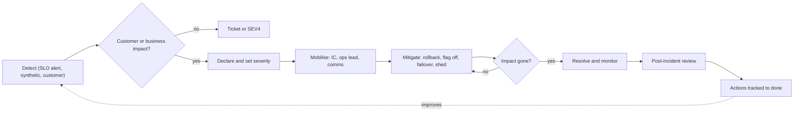
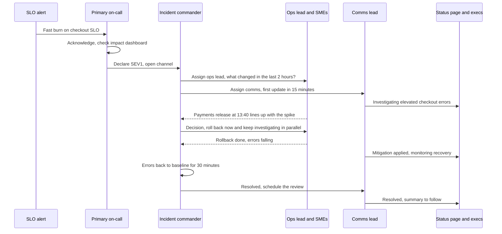

## TL;DR

- An incident process exists to **restore service fast and learn cheaply**. Define severity by **customer and business impact**, not by cause. Make declaring an incident cheap: anyone can declare, and downgrading is free.
- **Mitigate first, diagnose later.** Roll back, turn off the flag, fail over, shed load. The root cause can wait until customers are no longer hurting.
- Separate **roles**: an incident commander who coordinates and decides, an operations lead who works the problem, a communications lead who keeps stakeholders informed, and a scribe. The commander doesn't debug.
- **On-call has to be sustainable**: enough people in the rotation, few pages per shift, compensated time, and the authority to fix noisy alerts. Burnt-out responders make incidents longer.
- **Post-incident reviews** look for *contributing factors* in the system rather than a single root cause or a culprit. Track a few high-value actions to completion, and measure learning, not just MTTR.

## Core Concepts

### What counts as an incident

An incident is an **unplanned event that degrades, or threatens to degrade, a service your customers or the business depend on**, and that needs a coordinated response. That includes near misses: a failover that almost didn't work, or a certificate that expired in staging a week before production.

### Severity levels

Severity drives who gets involved, how fast, and how you communicate. Define it by impact, so that anyone can classify an incident without understanding the cause.

| Severity | Definition (example) | Response |
|---|---|---|
| **SEV1** | Core journey unavailable or badly degraded for many customers (checkout down, data loss, security breach in progress) | Page immediately, incident commander assigned, exec and customer comms, status page within 15 minutes |
| **SEV2** | Significant degradation for a subset (one region, one major feature, elevated errors) | Page the owning team, IC for coordination, status page if customers notice |
| **SEV3** | Minor impact with a workaround, or a risk that's contained | Business hours, tracked in the team's queue |
| **SEV4** | No customer impact; a near miss or internal tooling issue | Ticket, optional review |

Write the matrix with measurable triggers wherever possible ("> 5% of checkout attempts failing for 5 minutes"), and say what to do when you're unsure: **pick the higher severity, and downgrade later**.

```ts
// Classify by impact, never by suspected cause.
type Severity = 'SEV1' | 'SEV2' | 'SEV3' | 'SEV4';

interface Impact {
  coreJourneyDown: boolean;       // login, checkout, payments
  customersAffectedPct: number;   // estimated share of active customers
  dataLossOrBreach: boolean;
  workaroundExists: boolean;
}

export function classify(i: Impact): Severity {
  if (i.dataLossOrBreach || (i.coreJourneyDown && i.customersAffectedPct >= 10)) return 'SEV1';
  if (i.coreJourneyDown || i.customersAffectedPct >= 5) return 'SEV2';
  if (i.customersAffectedPct > 0 && i.workaroundExists) return 'SEV3';
  return i.customersAffectedPct > 0 ? 'SEV2' : 'SEV4';
}
```

### The lifecycle

1. **Detect.** Ideally through SLO burn-rate alerts or synthetic checks, not from customers or social media.
2. **Triage and declare.** Acknowledge, assess impact, assign severity, open the incident channel. With tooling (incident.io, PagerDuty, FireHydrant, Rootly) this is one command.
3. **Mobilise.** Page the incident commander and owning teams for the severity.
4. **Mitigate.** Stop the customer impact using the fastest safe lever.
5. **Resolve.** Confirm recovery with the same signals that detected the problem, and watch for recurrence.
6. **Learn.** Hold a post-incident review, take actions, and share the learning.

### Roles

Derived from the Incident Command System used by emergency services:

| Role | Responsibility | Not responsible for |
|---|---|---|
| **Incident commander (IC)** | Owns the incident: sets priorities, assigns work, makes decisions such as "roll back now", runs updates, decides when it's over | Debugging, typing commands |
| **Operations / tech lead** | Coordinates the hands-on investigation and mitigation, and the responders doing it | External comms |
| **Communications lead** | Status page, internal updates, customer support briefings, exec updates on a fixed cadence | Technical decisions |
| **Scribe** | Timeline of observations, decisions and actions with timestamps (tools can automate much of this) | — |
| **Subject-matter experts** | Investigate specific systems when asked | Running the incident |

For a SEV3, one person may hold every role. For a SEV1, separating them is what keeps the response from becoming 30 people talking at once.

### Mitigation levers

Have these ready *before* incidents happen, and make them fast and well rehearsed:

- **Roll back** the last deploy or config change. Most incidents follow a change.
- **Disable a feature flag**, or turn on a kill switch for a non-essential feature.
- **Fail over** to another region, zone or replica.
- **Shed load or rate-limit**: block abusive traffic, turn off batch jobs, lower prefetching.
- **Scale up or out** if it really is a capacity problem.
- **Degrade gracefully**: serve cached or static content, put a read-only mode in place.

The rule: if a lever is cheap and reversible, pull it early, even before you're sure it's the cause.

### Communication

- **One incident channel** per incident, named predictably (`#inc-2026-11-25-checkout-errors`), with a pinned summary.
- **Status updates on a cadence**, for example every 30 minutes for a SEV1, *even if nothing has changed*. Silence makes stakeholders invent their own updates.
- **A template** keeps updates consistent:

```markdown
**[SEV1] Checkout errors — update 3 (14:30 UTC)**
**Impact:** ~35% of checkout attempts failing in EU since 13:52. Other regions unaffected.
**Current status:** Rolled back the 13:40 payments release at 14:18. Error rate is falling (now 12%).
**Next steps:** Confirming recovery. Investigating residual errors on card payments.
**Next update:** 15:00 UTC, or sooner if status changes.
**IC:** Priya · **Comms:** Tom · Channel: #inc-2026-11-25-checkout-errors
```

- **Customer-facing updates** (status page) say what's affected and what users can do, in plain language. They don't speculate about causes.

### On-call

- **Rotation size.** Google's SRE book suggests at least eight engineers for a single-site 24/7 rotation, or six per site for two sites, so each person is on call about one week in six to eight.
- **Page budget.** Aim for at most a couple of actionable incidents per shift. More than that and the shift is all firefighting, with no follow-up.
- **Every page must be actionable and urgent.** Anything else is a ticket or a dashboard.
- **Handover notes** at the end of every shift, plus a weekly review of pages: which were noisy, which were missing.
- **Compensation and recovery**: pay or time off for out-of-hours work, and permission to start late after a night page.
- **Onboarding**: shadow shifts, reverse shadowing, and practised runbooks before going primary.

```yaml
# Example escalation policy (tool-agnostic)
service: checkout-api
urgency:
  high: page          # SLO fast-burn alerts
  low: ticket         # slow-burn and warnings, business hours
escalation:
  - after: 0m
    notify: primary-on-call
  - after: 10m        # not acknowledged
    notify: secondary-on-call
  - after: 20m
    notify: engineering-manager-on-call
```

### Post-incident review

- **Blameless**: assume people made reasonable decisions with the information and pressure they had. Ask *how* it made sense at the time, not *who* made a mistake.
- **Contributing factors, not a root cause**: complex failures need several conditions at once (the Swiss cheese model). "Root cause: human error" ends the learning exactly where it should start.
- **Timeline first**, then analysis: what did responders know, when, and what did they try?
- **A small number of strong actions**: changes that remove a class of problem (automation, guardrails, design changes) beat "be more careful" or "add more review".
- **Share widely**: write-ups, a monthly incident review forum, and a searchable archive.

### Metrics, carefully

- **Detection**: share of incidents detected by alerts rather than by customers, and time to detect.
- **Response**: time to acknowledge and time to mitigate, per severity.
- **Impact**: customer-minutes affected, or SLO budget consumed. That is more meaningful than incident count.
- **Learning**: action completion rate for high-priority actions, and repeat incidents with the same contributing factors.
- **MTTR caution**: incident durations are heavily skewed, so a mean over a few incidents is noisy and easy to game. The VOID report's analysis of thousands of public incidents makes this case. Use distributions and look at individual incidents.

### Security and regulatory incidents

Security incidents follow the same principles, plus evidence preservation, a smaller need-to-know group, legal and privacy involvement, and possibly law enforcement. NIST SP 800-61 (revised as Rev. 3 in 2025) is the standard reference. Regulatory clocks start early:

- **GDPR**: notify the supervisory authority of a personal data breach within **72 hours** of becoming aware, unless it's unlikely to result in risk to individuals.
- **EU DORA (Digital Operational Resilience Act)**, applying to financial entities from 17 January 2025: major ICT-related incidents need an initial notification to the regulator within hours of classification (4 hours, and no later than 24 hours after detection), then intermediate and final reports.
- **NIS2** and sector rules (health, telecoms) add their own deadlines.

Build these into the severity matrix and checklists so the clock is noticed during the incident, not discovered afterwards.

## How It Works

### Incident lifecycle



### A SEV1 in practice



## When to Use / Trade-offs

| Choice | Use when | Avoid when | Cost |
|---|---|---|---|
| Formal IC process (roles, cadence) | SEV1/SEV2, multi-team incidents | A single-team SEV3, where it's overhead | Training, a pool of trained ICs |
| Dedicated IC rotation | Large orgs with frequent multi-team incidents | Small orgs, where the on-call engineer leads and escalates | Senior people's time |
| Team-owned on-call ("you build it, you run it") | Teams that own their services end to end | Teams without the access or authority to fix their own alerts | Out-of-hours load on product teams |
| Central NOC or SRE first responders | Many services with similar failure modes, strict response SLAs | Teams that then lose the feedback from their own pages | Hand-off delays, less ownership |
| Follow-the-sun rotation | Teams in 2–3 time zones | A single site, where it can't be done | Coordination, handover quality |
| Incident tooling (incident.io, PagerDuty, FireHydrant, Rootly) | More than a few incidents a month | Very small teams, where Slack plus a checklist is enough | Licences, configuration |
| Full written review for every incident | SEV1/SEV2, novel failures, near misses with high potential | Repeats of a known, already-tracked issue | Review time |

Atlassian stopped selling Opsgenie in 2025 and has announced the end of support for 2027, so existing users need a migration plan, either to Jira Service Management or Compass, or to another tool.

## Common Pitfalls & Anti-patterns

- **Debugging before mitigating** — an hour spent understanding a bug that a two-minute rollback would have stopped.
- **The commander also fixing** — nobody is coordinating, and decisions stall.
- **Severity by cause** ("it's only a DNS change") — impact is underestimated and escalation is late.
- **Too many people in the channel** — noise, conflicting theories and actions nobody agreed. Keep observers in a separate channel.
- **Silent periods** — no updates for an hour, so executives start paging engineers directly.
- **"Root cause: human error"** — this closes the learning and teaches people to hide mistakes.
- **Action-item graveyards** — 40 low-value tickets from each review, none finished. The same incident repeats.
- **Alert fatigue** — non-actionable pages train responders to ignore pages.
- **Heroes** — the same two people fix everything, burn out and become single points of failure.
- **MTTR targets** — teams game them by closing incidents early or classifying them down.

## Real-world Scenario

**Context:** A B2B SaaS company with 120 engineers had about 6 SEV1s a quarter. Incidents started in whichever Slack channel noticed first, often a customer success channel. Median time from detection to mitigation was 95 minutes, and exec escalations to individual engineers were common.

**Decision:**
1. An impact-based severity matrix with measurable triggers, and a `/incident` command that creates a channel, a status-page draft and a timeline.
2. An IC rotation of 10 trained engineering managers and staff engineers, with a 2-hour training session and a shadowed incident before leading.
3. A mitigation-first checklist: "What changed in the last 4 hours? Can we roll it back or turn it off?" was pinned to every SEV1/SEV2 channel.
4. 30-minute update cadence, handled by a comms lead, with execs subscribed to updates instead of joining the channel.
5. Blameless reviews for SEV1/SEV2 within 5 working days, with at most 3 tracked actions each, reviewed in a monthly forum.

**Outcome:** Over two quarters, median time to mitigate fell to 35 minutes. Customer-detected incidents dropped from about 40% to 10% after the reviews kept surfacing missing SLO alerts. Exec escalations to individual engineers effectively stopped.

**What I'd do differently:** Fix on-call load earlier. Two teams had more than 20 pages a week, and the people best placed to lead incidents were also the most exhausted. A page-reduction push should have run in parallel from the start.

## Interview Questions

### What makes something an incident, and how would you define severity levels? {#severity-levels}

**Level:** Foundation

**Model answer:**
An incident is an unplanned event that degrades or threatens a service customers or the business depend on and needs a coordinated response. Near misses count too, because they're cheap lessons.

Severity should be defined by **impact**, so anyone can classify it without knowing the cause:
- **SEV1**: a core journey is down or badly degraded for many customers, or there's data loss or an active breach.
- **SEV2**: significant degradation for a subset of customers or a major feature.
- **SEV3**: minor impact with a workaround.
- **SEV4**: no customer impact, such as a near miss or internal tooling.

Each level maps to a response: who's paged, whether there's an incident commander, the communication cadence and whether there's a status-page update. Make triggers measurable where possible, and set the rule "if in doubt, pick the higher severity", since downgrading is cheap and escalating late is expensive.

**What the interviewer is looking for:**
Impact-based definitions tied to concrete response expectations, and a bias towards declaring.

**Follow-ups:**
- How do you handle an incident that affects only one very large customer?
- Who is allowed to declare a SEV1?

**Red flags:**
- Severity based on the suspected cause or the component.
- A culture where declaring an incident feels like admitting failure.

### What does an incident commander do, and why shouldn't they debug? {#incident-commander-role}

**Level:** Foundation

**Model answer:**
The incident commander owns the response, not the fix. They:
- Establish the facts: impact, severity, what's changed.
- Assign roles: an ops lead, a comms lead and a scribe.
- Set priorities and make decisions, especially the ones nobody else wants to make ("roll back now", "fail over", "page the database team").
- Run a cadence: regular check-ins, summaries and status updates.
- Manage people: keep observers out, rotate tired responders, call in help.
- Declare the incident resolved and hand off to the review.

They shouldn't debug because debugging absorbs your attention completely. When the commander is reading logs, nobody notices that two people are making conflicting changes, that the status page hasn't been updated for an hour, or that it's time to stop investigating and roll back. For small incidents one person may do both, but as soon as more than a couple of people are involved, the roles split.

**What the interviewer is looking for:**
Coordination and decision-making as distinct work, and an awareness of attention as the scarce resource.

**Follow-ups:**
- How does someone hand over the IC role mid-incident?
- Does the IC need to be the most senior or most technical person?

**Red flags:**
- "The most senior engineer runs it and fixes it."
- No notion of decisions as an IC responsibility.

### Why should you mitigate before finding the root cause? {#mitigate-first}

**Level:** Foundation

**Model answer:**
Because the customer impact is happening now, and understanding the cause can take hours. Most incidents follow a change (a deploy, a config change, a flag flip, a traffic shift), so the fastest lever is usually to undo the change or route around the failure: roll back, disable the flag, fail over, shed load.

The key principles:
- **Cheap and reversible levers get pulled early**, even on a hunch. A rollback that turns out not to help costs minutes.
- **Investigation continues in parallel**, or afterwards with preserved evidence: logs, heap dumps, a snapshot of the bad instance.
- **Recovery is confirmed** with the same signals that detected the problem.

The exceptions: when the mitigation itself is risky or irreversible (failing over a database with possible data loss), or for security incidents, where you may need to preserve evidence or avoid tipping off an attacker. Those decisions belong to the incident commander.

**What the interviewer is looking for:**
Prioritising restoration, knowing the common levers, and the nuance of risky or security-sensitive mitigations.

**Follow-ups:**
- What if rolling back isn't possible because of a schema change?
- How do you preserve evidence while mitigating?

**Red flags:**
- "We need to understand it before we touch anything" as a default.
- No prepared mitigation levers.

### What is MTTR, and why is it misleading on its own? {#mttr-limitations}

**Level:** Foundation

**Model answer:**
MTTR usually means mean time to restore (or recover, or resolve, since definitions vary): the average time from an incident's start or detection to service restoration. It's popular because it's easy to compute and is one of the DORA stability metrics (now called "failed deployment recovery time" for change-related failures).

Why it misleads:
- **Incident durations are heavily skewed.** A few long incidents dominate the mean, so it swings wildly from quarter to quarter on small numbers. The VOID report's analysis of public incident data makes this point strongly.
- **Incidents aren't comparable.** A 10-minute full outage and a 3-hour minor degradation have very different costs.
- **It's easy to game**: close incidents early, split them, classify them down.
- **It hides what matters**: detection gaps, customer impact and whether you're learning.

Better: look at distributions (median and percentiles) per severity, time to detect and time to mitigate separately, customer impact (SLO budget consumed, customer-minutes), and qualitative review of individual incidents.

**What the interviewer is looking for:**
Statistical awareness and suggested alternatives, not a wholesale dismissal of measurement.

**Follow-ups:**
- What would you report to the executive team each quarter instead?
- How would you measure time to detect?

**Red flags:**
- Setting MTTR targets per team.
- Treating incident count as a reliability measure.

### How do you design a sustainable on-call rotation? {#on-call-design}

**Level:** Senior

**Model answer:**
- **Enough people.** Google's SRE guidance suggests around 8 people for a single-site 24/7 rotation, or 6 per site for two sites, so each person is on call roughly one week in six to eight. Smaller teams should share rotations across related services, or limit on-call hours to business time with a fallback.
- **A low page volume**: aim for a couple of actionable incidents per shift at most. Every page must be urgent and actionable. Anything else becomes a ticket.
- **Escalation**: primary, then secondary, then the manager, with acknowledgement timeouts.
- **Preparation**: runbooks linked from alerts, access that works at 3 am (break-glass procedures tested), and shadowing before going primary.
- **Feedback loop**: weekly review of every page. Was it actionable? Could it be automated or tuned? Is there a missing alert? The team owns and has time to fix noise.
- **Fairness and care**: compensation or time off for out-of-hours work, recovery time after night pages, swaps without friction, and respect for different personal constraints.
- **Health metrics**: pages per shift, out-of-hours pages, and how the people on call actually feel about it (survey it).

**What the interviewer is looking for:**
Both the mechanics and the human side, plus a feedback loop that reduces pages over time.

**Follow-ups:**
- A team of 4 owns a critical service. How do you cover it?
- How would you handle someone who never wants to be on call?

**Red flags:**
- Accepting high page volume as normal.
- On-call with no compensation or recovery time.

### How should you communicate during a major incident, internally and to customers? {#incident-communication}

**Level:** Senior

**Model answer:**
**Internally:**
- **One incident channel** where responders work, plus a separate updates channel or broadcast for observers and execs, so the working channel stays focused.
- **A dedicated comms lead** for SEV1/SEV2, so responders aren't interrupted.
- **Updates on a fixed cadence** (every 30 minutes for a SEV1), even when nothing has changed. Include impact, status, next steps and the next update time.
- **A pinned summary** kept current, so anyone joining can catch up without asking.

**Externally:**
- **Status page** quickly, within about 15 minutes for a SEV1. Acknowledge the problem before you understand it.
- **Plain language** about what is affected and any workaround. No speculation about causes, no internal jargon, no blame on vendors in the heat of the moment.
- **Brief support and account teams** with the same facts, so customers hear one story.
- **Follow-up**: a resolution notice, and for significant incidents a customer-facing summary of what happened and what you're changing.

**What the interviewer is looking for:**
Separating working and broadcast channels, cadence over completeness, and audience-appropriate content.

**Follow-ups:**
- What would you say on the status page in the first 10 minutes?
- How do you handle a CEO who joins the working channel and starts asking questions?

**Red flags:**
- Waiting for the root cause before saying anything.
- Responders answering stakeholder DMs while mitigating.

### Why do many teams avoid the term "root cause", and what do they use instead? {#contributing-factors}

**Level:** Senior

**Model answer:**
In complex systems, incidents rarely have one cause. They need several conditions to line up: a latent bug, a config change, missing validation, an alert that didn't fire, a runbook that was out of date, and a busy on-call engineer. That's the Swiss cheese model. Picking one as "the root cause" has problems:
- It stops the investigation early, usually at the last human action ("engineer ran the wrong command").
- It hides the conditions that made that action easy and its effect large, which are the things you can actually fix.
- It encourages blame, so people share less next time.

Instead, teams describe **contributing factors** across technology, process and organisation, and ask questions such as:
- How did this make sense to the people involved at the time?
- What made the failure possible, what made it bigger, and what made it hard to detect or fix?
- What went well, and what helped recovery?

Actions then target the factors with the most leverage, often guardrails and automation rather than "be more careful".

**What the interviewer is looking for:**
Systems thinking, and an understanding that blame suppresses information.

**Follow-ups:**
- How would you respond to an executive who insists on knowing "whose fault it was"?
- Is "5 whys" a good technique?

**Red flags:**
- "Root cause: human error. Action: retrain the engineer."
- Treating blamelessness as having no accountability for follow-up.

### What makes a good runbook? {#runbooks}

**Level:** Senior

**Model answer:**
A runbook helps a tired person who didn't build the system act correctly at 3 am. Good ones:
- **Are linked from the alert** they relate to, so you don't need to search.
- **Start with what the alert means**: what is broken, who is affected, how bad it is.
- **Give diagnosis steps** with exact commands, queries and dashboard links, and say what normal and abnormal look like.
- **Give mitigation options in order of safety**, with expected effects and how to verify them.
- **Say when to escalate** and to whom.
- **Are tested**: used in game days or by new on-call engineers during shadowing, and updated after every incident where they were wrong or missing.
- **Are automated where possible.** A step that is always run the same way should become a button or an automatic remediation, with the runbook explaining it.

Signs of a bad runbook: stale commands, a wiki page nobody has opened in a year, "contact Dave", or steps that need access on-call engineers don't have.

**What the interviewer is looking for:**
Written for the responder's situation, tied to alerts, maintained through incidents, and moved towards automation.

**Follow-ups:**
- How do you keep runbooks current?
- When should a runbook step become automated remediation, and what are the risks?

**Red flags:**
- Runbooks as long architecture documents.
- No ownership or review process.

### How do you make sure post-incident actions get done without drowning teams in tickets? {#action-items-follow-through}

**Level:** Senior

**Model answer:**
- **Fewer, stronger actions.** Limit each review to a handful (for example three) of high-priority actions that remove or contain a class of failure. Record other ideas as "considered" rather than tickets.
- **Prefer strong fixes**: design changes, guardrails, automation and better detection, over weak ones such as more documentation, training or "be careful".
- **Clear owner and due date**, created in the team's normal backlog, not in a separate incident tool nobody looks at.
- **Prioritised with product**: agree up front that SEV1/SEV2 actions take precedence, ideally under the error-budget policy.
- **Visible tracking**: a dashboard of open high-priority actions by age and team, reviewed in a monthly forum with engineering leadership.
- **Close the loop**: when a similar incident happens, check whether earlier actions were done and whether they worked.

The metric that matters is the completion rate of high-priority actions within the agreed time, and the absence of repeat incidents, not the number of tickets created.

**What the interviewer is looking for:**
Prioritisation, a hierarchy of action strength, and leadership visibility.

**Follow-ups:**
- What would you do if a team consistently doesn't complete actions?
- How do you handle actions that need another team's work?

**Red flags:**
- Twenty actions per review.
- Actions living only in the postmortem document.

### How do security incidents differ from availability incidents in how you run them? {#security-incidents}

**Level:** Senior

**Model answer:**
The same structure applies (roles, cadence, mitigation, review), with important differences:
- **Need to know.** A smaller, private channel. The attacker may be watching your normal channels, or an insider may be involved.
- **Evidence preservation.** Don't wipe and rebuild compromised machines before capturing images, logs and memory if forensics may be needed. Mitigation sometimes means isolating rather than restoring.
- **Containment versus tipping off.** Revoking access immediately can alert an attacker who then destroys evidence or moves elsewhere. The IC weighs this with the security lead.
- **Specialists and outside parties**: security, legal, privacy (the DPO), PR, possibly an external forensics firm, insurers and law enforcement.
- **Regulatory clocks**: GDPR's 72-hour breach notification, sector rules such as EU DORA for financial services, and contractual notification obligations to customers.
- **Communication** is reviewed by legal, and status updates may be deliberately vague until facts are confirmed.
- **Recovery** includes credential rotation, patching, and verifying that persistence mechanisms are removed.

Reference: NIST SP 800-61 (Rev. 3, 2025) for the overall approach.

**What the interviewer is looking for:**
Evidence, confidentiality and regulatory awareness layered on the general process.

**Follow-ups:**
- An access key was pushed to a public repository 20 minutes ago. What are your first steps?
- When would you involve legal?

**Red flags:**
- Handling a breach in the public engineering channel.
- Rebuilding compromised hosts immediately without preserving evidence.

### Your company has a major outage most months, and the same teams keep getting paged. How do you break the cycle? {#recurring-incidents}

**Level:** Architect

**Model answer:**
**Diagnose the pattern before prescribing:**
- Gather 6–12 months of incidents. Classify trigger (deploy, config, capacity, dependency, data), contributing factors, detection source, and which systems and teams were involved.
- Look at follow-through: were previous actions completed? Did they target the real factors?
- Look at the people: page load per team, attrition, who leads incidents.

**Typical findings and responses:**
1. **Most incidents follow changes.** Invest in progressive delivery (canaries with automatic rollback), smaller changes, and config changes going through the same pipeline as code.
2. **Hotspot systems.** One or two services cause half the incidents. Fund a focused reliability investment (architecture changes, isolation, capacity) as a roadmap item, protected by an error-budget policy agreed with product.
3. **Detection gaps.** Customers find problems first. Add SLOs and synthetic checks for key journeys.
4. **Unfinished actions.** Introduce the high-priority action review with leadership and make completion visible.
5. **Exhausted responders.** Reduce noise, spread on-call more widely, and bring in help.

**Govern it:** a reliability review each month with engineering and product leadership, looking at SLO budgets, incident themes and action progress, plus explicit capacity for reliability work (for example 20% per team until targets are met).

**What the interviewer is looking for:**
Data-driven diagnosis, systemic fixes rather than individual ones, and organisational mechanisms such as error-budget policies and leadership review.

**Follow-ups:**
- How would you convince product leadership to pause features for reliability work?
- What would success look like after six months?

**Red flags:**
- "Add more process to change approval" as the main fix.
- Blaming the teams being paged.

### A SEV1 is in progress: 40% of checkouts are failing, the last deploy was 2 hours ago, and three teams are debating in the channel. You're the incident commander. Walk through the next 30 minutes. {#run-a-sev1}

**Level:** Architect

**Model answer:**
**Minutes 0–5: take control and establish facts.**
- Announce: "I'm IC. Ops lead is X, comms is Y. Please keep discussion here focused. Observers, use #inc-updates."
- Confirm impact from the dashboard: which regions, which payment methods, since when.
- Ask one question: "What has changed in the last 4 hours?" That covers deploys, config, flags, infrastructure, traffic, and third parties such as the payment provider's status.

**Minutes 5–15: mitigate on the best hypothesis, in parallel.**
- The deploy 2 hours ago doesn't line up with the start of errors unless it was a gradual rollout or a flag enabled later. Check that, and check for config or flag changes near the start time.
- Assign hypotheses to people explicitly, with a deadline: "Team A, rollback readiness for the 2-hour-old deploy. Team B, the payment provider's status and our outbound error codes. Team C, database and capacity. Report in 10 minutes."
- If a cheap, reversible lever is plausible (a flag flipped at the start time, or the deploy rolled out gradually), pull it now. If the payment provider is failing, fail over to a secondary provider or turn on a degraded mode ("pay later"), if that exists.

**Minutes 15–30: decide and communicate.**
- Comms has published the status page and the first internal update, with the next update at minute 30.
- Re-evaluate: is the error rate falling? If not, escalate: bring in the next team, consider a bigger lever such as a regional failover, and brief the exec liaison.
- Keep the scribe capturing decisions, and note any evidence to preserve.

Throughout: stop parallel conflicting changes ("nobody touches production without telling me"), timebox debates, and make a decision even with incomplete information.

**What the interviewer is looking for:**
Calm structure, "what changed?", parallel hypotheses with owners and deadlines, early reversible mitigations, and communication on cadence.

**Follow-ups:**
- The rollback makes things worse. What now?
- A senior engineer insists on continuing to debug instead of rolling back. How do you handle it?

**Red flags:**
- Joining the debugging as IC.
- No communication in the first 30 minutes.

### How do you run incidents that span several teams, vendors or a cloud provider outage? {#multi-party-incidents}

**Level:** Architect

**Model answer:**
**Multiple internal teams:**
- One incident commander and one channel. Each team sends a representative who reports to the ops lead. No team runs a separate incident for the same impact.
- Split work by hypothesis or system, with a clear owner for each.
- For very large incidents, use sub-leads per workstream (database, network, customer comms) under the IC, which is how ICS scales.

**Vendors and SaaS dependencies:**
- Have vendor escalation paths ready before you need them: support plan level, technical account manager, escalation contacts, contract SLAs.
- Assign one person as vendor liaison, so vendors get consistent information and you get updates on a schedule.
- Don't wait on a vendor's status page. Use your own measurements of their behaviour.

**Cloud provider outages:**
- Your options were mostly decided at design time: multi-AZ or multi-region, static stability, and degraded modes. The incident is where you execute them.
- Decide early whether to fail over or wait. Provider incidents can last hours, and a regional failover has its own risks. A pre-agreed decision rule ("if a region is impaired for more than 30 minutes and failover is tested, go") avoids debating under pressure.
- Communicate honestly. Customers care about impact, not whose fault it is.

**Afterwards:** joint reviews with vendors where possible, and a review of the dependency's real reliability against your assumptions.

**What the interviewer is looking for:**
A single command structure, prepared vendor relationships, and the recognition that resilience to provider outages is a design-time decision.

**Follow-ups:**
- How do you get a useful post-incident report from a large vendor?
- How would you test your failover decision rule?

**Red flags:**
- Separate parallel incidents per team.
- "We'll wait for AWS/Azure to fix it" with no pre-planned options.

### What regulatory obligations can an incident trigger, and how do you build them into the process? {#regulatory-reporting}

**Level:** Architect

**Model answer:**
Common obligations:
- **GDPR**: a personal data breach must be reported to the supervisory authority within 72 hours of becoming aware, and to affected individuals without undue delay if the risk is high.
- **EU DORA** (financial entities, applying since January 2025): major ICT incidents need an initial notification to the regulator within hours of classification, then intermediate and final reports, using defined classification criteria.
- **NIS2** for essential and important entities in the EU: an early warning within 24 hours, then fuller notifications.
- **Sector and contractual rules**: health data, payment card data (PCI DSS), customer contracts with notification clauses, and stock-exchange disclosure for listed companies (for example the US SEC's cyber incident disclosure rules).

Building it in:
1. **Map obligations** per jurisdiction and customer segment with legal and compliance, and keep the list current.
2. **Add triggers to the severity matrix and IC checklist**: "Could personal data be affected?" "Is this a major ICT incident under DORA criteria?" The answer pages the DPO or compliance on call.
3. **Start the clock at awareness**, and record the time in the timeline.
4. **Prepare templates** for regulator and customer notifications, pre-approved by legal.
5. **Rehearse** in tabletop exercises with legal and compliance present.
6. **Keep records** (timeline, impact, decisions) suitable for regulators. Your incident tooling's audit trail helps.

**What the interviewer is looking for:**
Awareness of the major regimes, and process integration: triggers, clocks, templates and rehearsal.

**Follow-ups:**
- Who decides whether an incident is notifiable?
- How do you notify within 72 hours when you don't yet know the scope?

**Red flags:**
- Leaving it all to legal after the incident ends.
- Not knowing that the clock starts at awareness.

### How would you build a learning culture from incidents across a 500-person engineering organisation? {#learning-culture}

**Level:** Architect

**Model answer:**
**Make it safe.** Leaders model blamelessness publicly. When a director asks "who did this?", someone redirects to "what made this possible?". Never use incident involvement in performance reviews. Thank people who report near misses and their own mistakes.

**Make it worth reading.** Review write-ups focus on the story (what people knew, the surprises, what helped) rather than a template filled in for compliance. Invest in trained facilitators for significant incidents, since a good interviewer surfaces far more than a group meeting does.

**Spread it:**
- A monthly incident review forum where one or two interesting incidents are presented, including near misses, with open attendance.
- A searchable archive tagged by system and contributing factor.
- Themed analysis each quarter across incidents: recurring factors such as config changes, alert gaps or dependency assumptions feed the engineering roadmap.
- Game days and tabletop exercises based on past incidents.

**Connect it to decisions.** Reliability themes appear in planning, the error-budget policy is honoured, and actions from reviews get capacity.

**Measure carefully**: action completion, repeat incidents, share of incidents detected by alerts, review participation and survey results on psychological safety. Avoid incident counts as targets.

**What the interviewer is looking for:**
Psychological safety led from the top, quality of analysis over quantity, mechanisms to spread learning, and links to planning.

**Follow-ups:**
- How do you handle a genuinely negligent action in a blameless culture?
- What would you change if reviews had become box-ticking?

**Red flags:**
- Postmortems as compliance paperwork.
- Using incident counts in team performance targets.

## Cheat Sheet

### Response

- **Severity** — defined by customer and business impact, not cause. If in doubt, pick higher and downgrade later.
- **Mitigate first** — roll back, disable the flag, fail over or shed load before finding the cause.
- **"What changed?"** — the first question in every incident: deploys, config, flags, traffic, dependencies.
- **Incident commander** — coordinates, assigns, decides and communicates, and doesn't debug.
- **Comms cadence** — update on a fixed interval (30 minutes for a SEV1) even when nothing has changed.
- **Separate channels** — a working channel for responders, a broadcast channel for observers and execs.

### On-call

- **Rotation size** — about 8 people for single-site 24/7 (Google SRE), so each is on call one week in six to eight.
- **Actionable pages** — every page must be urgent and need a human. Everything else is a ticket.
- **Page review** — weekly review of every page to tune noise and find missing alerts.

### Learning

- **Blameless review** — ask how actions made sense at the time, and fix the system, not the person.
- **Contributing factors** — complex failures need several conditions, so avoid a single "root cause".
- **Strong actions** — guardrails, automation and design changes over training and "be careful".
- **MTTR caution** — skewed durations make the mean noisy and gameable, so use distributions and impact.

### Regulatory

- **GDPR breach** — notify the supervisory authority within 72 hours of awareness.
- **EU DORA** — financial entities report major ICT incidents in stages, starting within hours of classification.

## Further Reading

- [Managing Incidents](https://sre.google/sre-book/managing-incidents/) — Google SRE book chapter on incident roles and command.
- [Postmortem Culture: Learning from Failure](https://sre.google/sre-book/postmortem-culture/) — blameless reviews and follow-up.
- [Being On-Call](https://sre.google/sre-book/being-on-call/) — rotation sizing, load and compensation.
- [PagerDuty Incident Response](https://response.pagerduty.com/) — an open, detailed incident response process with role guides.
- [Atlassian Incident Management Handbook](https://www.atlassian.com/incident-management/handbook) — severity levels, roles, comms and postmortem templates.
- [NIST SP 800-61 Rev. 3](https://csrc.nist.gov/pubs/sp/800/61/r3/final) — incident response recommendations for cybersecurity incidents.
- [The VOID](https://www.thevoid.community/) — public incident report database and the analysis behind the MTTR critique.
