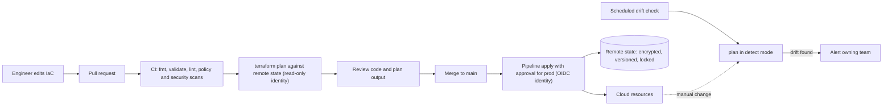
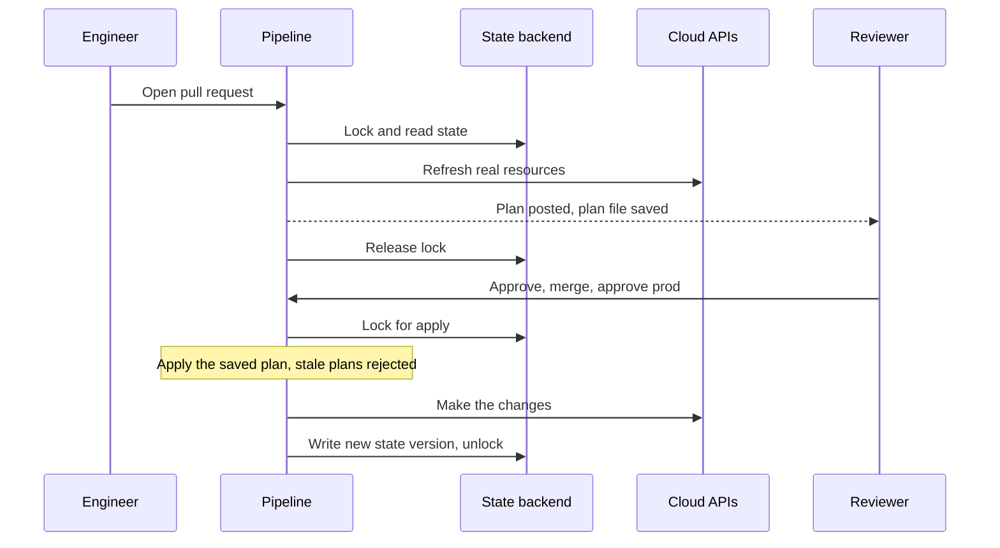

## TL;DR

- **Infrastructure as Code (IaC)** defines infrastructure in version-controlled files, applied by automation — giving reproducible environments, review, audit history and fast recovery.
- Prefer **declarative** tools (Terraform/OpenTofu, Bicep, CloudFormation, Pulumi's desired-state model): you describe the end state; the tool computes the changes.
- Terraform-style tools track reality in **state** — protect it (remote, encrypted, locked, least-privilege) and treat it as sensitive.
- The workflow is **PR → plan → review → apply from a pipeline**, never from laptops; plus **policy as code**, tests, and drift detection.
- At organisation scale, IaC becomes a **platform product**: versioned modules (golden paths), self-service, guardrails, and clear ownership per state boundary.

## Core Concepts

### Why IaC

- **Reproducibility:** identical dev/test/prod; rebuild an environment (or a region for DR) from code.
- **Change control:** every change reviewed in a PR with a plan showing exactly what will change.
- **Auditability:** Git history answers who changed what, when and why.
- **Speed and self-service:** new environments in minutes from modules.
- **Security and compliance:** policies checked before deployment; no undocumented click-ops.

### Declarative vs imperative

- **Declarative:** "there should be a storage account with these properties" — the tool diffs desired vs actual and converges. Idempotent; the plan is predictable. (Terraform/OpenTofu, Bicep/ARM, CloudFormation, Kubernetes manifests, Crossplane.)
- **Imperative:** scripts of steps ("create X, then update Y") — flexible but you handle ordering, idempotency and partial failures yourself (CLI scripts, some SDK usage).
- **General-purpose languages for declarative models:** Pulumi, AWS CDK, CDK for Terraform — loops, abstractions, testing in TypeScript/Python/Go/C#, still producing a desired-state graph.
- **Configuration management** (Ansible, Chef, Puppet) configures software inside servers; much less needed with immutable images and containers.

### Terraform example

```hcl
terraform {
  required_version = ">= 1.9"
  required_providers {
    azurerm = { source = "hashicorp/azurerm", version = "~> 4.0" }
  }
  backend "azurerm" {
    resource_group_name  = "rg-tfstate"
    storage_account_name = "acmetfstateprod"
    container_name       = "tfstate"
    key                  = "orders/prod.tfstate"
    use_azuread_auth     = true
  }
}

module "orders_db" {
  source  = "app.terraform.io/acme/postgres-flexible/azurerm" # versioned internal module
  version = "3.2.1"

  name                = "orders-prod"
  location            = var.location
  sku_name            = "GP_Standard_D4ds_v5"
  high_availability   = "ZoneRedundant"
  private_dns_zone_id = data.azurerm_private_dns_zone.postgres.id
  tags                = local.tags
}

output "orders_db_fqdn" {
  value = module.orders_db.fqdn
}
```

### State

Terraform/OpenTofu keep a **state file** mapping resources in code to real resource ids and storing attributes. It enables planning and dependency tracking, and it can contain **secrets** (e.g. generated passwords, connection strings).

- **Remote backend** (Azure Storage, S3, GCS, Terraform Cloud/HCP, Spacelift…) with **encryption**, **versioning** and **locking** to prevent concurrent applies.
- **Least privilege:** only the pipeline identity can read/write production state.
- **Split state by blast radius and ownership:** per service and environment, separate networking/platform state from application state. One giant state is slow, risky and a coordination bottleneck.
- **Refactor safely:** `moved` blocks to rename/restructure without destroy/create; `import` blocks to adopt existing resources; `terraform state` commands only with care and backups.
- **Keep secrets out of state where you can:** since Terraform 1.11, providers can offer **write-only arguments** (for example a database password) that are sent to the API but never stored in state or plan files, fed from ephemeral values such as a secret read from a vault at apply time.
- **Locking on S3** no longer needs a DynamoDB table: Terraform 1.11 made S3-native locking (`use_lockfile = true`) generally available and deprecated the DynamoDB arguments.

### Modules

- **Composable, opinionated building blocks** encoding standards: a "postgres" module that is always private, zone-redundant in prod, encrypted, with diagnostics and backups configured.
- **Versioned and published** (registry, Git tags) with semantic versioning, changelogs and examples; consumers pin versions and upgrade deliberately.
- **Small, focused interfaces:** sensible defaults, few required inputs, validation rules; avoid "god modules" exposing every provider argument.
- Cloud-provided curated modules exist (e.g. Azure Verified Modules) as a starting point.

### Workflow and guardrails

- PR opens → CI runs `fmt`, `validate`, lint (tflint), security/policy scans (Checkov, Trivy, Conftest/OPA, PSRule) and **`plan`**, posting the plan to the PR.
- Reviewers approve the code **and the plan**; production applies require approval in the pipeline.
- **Apply from the pipeline** using workload identity federation (OIDC) — no long-lived cloud credentials; humans have read-only access to prod by default.
- **Drift detection:** scheduled plans alert when reality differs from code; fix by reverting the manual change or codifying it.

### Worked example: a plan that wants to replace the database

A pull request "tidies up" a PostgreSQL server's name and moves the resource into a module. The plan posted to the PR ends with:

```text
  # azurerm_postgresql_flexible_server.orders will be destroyed
  # (because azurerm_postgresql_flexible_server.orders is not in configuration)
  - resource "azurerm_postgresql_flexible_server" "orders" { ... }

  # module.orders_db.azurerm_postgresql_flexible_server.this must be replaced
-/+ resource "azurerm_postgresql_flexible_server" "this" {
      ~ name = "orders-prod" -> "orders-prod-pg" # forces replacement
      ...
    }

Plan: 1 to add, 0 to change, 1 to destroy.
```

Two separate problems are hiding in it:
1. **The resource's address changed** (from `azurerm_postgresql_flexible_server.orders` to `module.orders_db.azurerm_postgresql_flexible_server.this`). Terraform doesn't know it's the same server, so it plans to destroy the old address and create the new one.
2. **The `name` attribute changed.** Most cloud resources can't be renamed in place, so the provider marks it `# forces replacement`.

**Fixes:**
- For the address, tell Terraform it's a move, not a delete:

```hcl
moved {
  from = azurerm_postgresql_flexible_server.orders
  to   = module.orders_db.azurerm_postgresql_flexible_server.this
}
```

- For the name, revert it. A cosmetic rename isn't worth recreating a production database. If a new name were truly required, it would be a migration project: a new server, data copied, traffic cut over.

The new plan reads `has moved to module.orders_db...` and `Plan: 0 to add, 0 to change, 0 to destroy.`

**Guardrails that would have stopped it even if a reviewer missed it:**
- `lifecycle { prevent_destroy = true }` on stateful resources in the module, so any plan that destroys them fails.
- A CI gate that reads `terraform show -json` and blocks any `delete` action on stateful resource types without an explicit override label.
- Cloud-side protection that IaC can't bypass by accident: deletion protection on databases, resource locks on the resource group, and tested backups.

## How It Works



### A change from pull request to apply



## When to Use / Trade-offs

| Tool | Strengths | Weaknesses | Best fit |
|---|---|---|---|
| Terraform / OpenTofu | Multi-cloud and SaaS providers, huge ecosystem, mature plan/apply | State management; HCL limits for complex logic; Terraform BSL licence (OpenTofu is the MPL fork) | Most organisations, multi-provider estates |
| Bicep (Azure) | Native, day-zero features, no state file, what-if, deployment stacks | Azure-only | Azure-centric teams |
| CloudFormation / CDK (AWS) | Native, managed state, drift detection, CDK in general-purpose languages | AWS-only; slower feature support at times | AWS-centric teams |
| Pulumi | Real programming languages, testing, abstractions | Smaller community than Terraform; risk of over-engineering in code | Teams wanting software-engineering practices for infra |
| Crossplane | Kubernetes-native control plane, continuous reconciliation, platform APIs via compositions | Requires running Kubernetes; complexity | Platform teams building internal APIs on Kubernetes |
| Ansible | Configuring OS/software, ad-hoc orchestration | Not ideal for cloud resource lifecycle | VM configuration, network devices |

## Common Pitfalls & Anti-patterns

- **Applying from laptops** — unreviewed changes, credential sprawl, state conflicts.
- **Local or Git-committed state** — lost state, leaked secrets.
- **One monolithic state** for everything — 20-minute plans, huge blast radius, team contention.
- **Click-ops alongside IaC** — drift, surprises on next apply (resources reverted or destroyed).
- **Copy-pasted configurations** per environment instead of modules/variables — environments diverge.
- **Unpinned providers and modules** — an upstream release changes behaviour unexpectedly.
- **Hard-coded secrets** in `.tf` files or variables files.
- **Ignoring the plan** — approving PRs without reading destroy/replace actions.
- **God modules** with 200 variables that mirror the provider, adding no standards.
- **No ownership of modules** — internal modules rot and every team forks them.

## Real-world Scenario

**Context:** A scale-up had Terraform in one repository with a single state for all environments, applied from engineers' laptops with personal admin credentials. A plan took 18 minutes; two engineers once applied concurrently and corrupted state; a junior engineer's apply accidentally destroyed a production Redis cache because a variable default changed.

**Decision:** Split state by domain and environment (networking/platform, shared services, then per-service stacks); remote backend with locking and versioning; all applies via pipelines with OIDC identities; production applies require plan review and approval; a module library (network, postgres, redis, service) with semantic versioning and examples; policy checks (no public endpoints, required tags, prevent-destroy lifecycle on stateful resources); nightly drift detection.

**Outcome:** Plans dropped to under 2 minutes per stack; no further state corruption; the next accidental destructive change was blocked by policy (`prevent_destroy` and a destroy-detection gate in CI); new service environments went from days to under an hour via the module library.

**What I'd do differently:** Introduce `moved` blocks and the refactoring plan earlier — splitting state was done with manual `terraform state mv`, which was risky and slow; and assign a named owner for the module library from day one.

## Interview Questions

### What is Infrastructure as Code, and what problems does it solve? {#what-is-iac}

**Level:** Foundation

**Model answer:**
IaC defines infrastructure — networks, compute, databases, permissions, DNS — in machine-readable files stored in version control, applied by tools rather than manual console clicks.

Problems it solves:
- **Inconsistency and drift** between environments ("works in staging").
- **Slow, error-prone manual provisioning** → environments created in minutes from code.
- **No audit trail** → Git history and PR reviews document every change.
- **Fragile recovery** → rebuild an environment or region from code for DR.
- **Hard-to-enforce standards** → reusable modules and automated policy checks.

It also enables self-service platforms and treats infrastructure changes with the same rigour as application code (review, testing, CI/CD).

**What the interviewer is looking for:**
Definition plus concrete benefits around consistency, review, audit, recovery and standards.

**Follow-ups:**
- What still can't easily be captured as code?
- How does IaC help disaster recovery?

**Red flags:**
- Describing IaC as "scripts we run sometimes".
- Ignoring version control and review.

### What's the difference between declarative and imperative IaC? {#declarative-vs-imperative}

**Level:** Foundation

**Model answer:**
- **Declarative:** you describe the desired end state ("a VNet with these subnets exists"); the tool compares it with reality and makes only the needed changes. Running it twice changes nothing the second time (idempotent). Plans/previews show the diff before applying. Examples: Terraform/OpenTofu, Bicep, CloudFormation, Kubernetes manifests.
- **Imperative:** you write the steps ("create the VNet, then add subnet A"). You handle existence checks, ordering, updates and partial failures yourself. Examples: shell scripts with CLI calls.

Declarative is the norm for cloud infrastructure because it's predictable and reviewable. Tools like Pulumi and CDK let you **write** in imperative general-purpose languages while still producing a **declarative desired state** the engine reconciles.

**What the interviewer is looking for:**
Clear distinction, idempotency and plans, and the nuance of Pulumi/CDK.

**Follow-ups:**
- When might an imperative script still be appropriate?
- Is Ansible declarative or imperative?

**Red flags:**
- Thinking Pulumi is imperative in its execution model.
- No mention of idempotency.

### What is Terraform state, and how do you manage it safely? {#terraform-state}

**Level:** Foundation

**Model answer:**
State is Terraform's record of which real resources correspond to which configuration blocks, plus their attributes and dependencies. Terraform uses it to plan changes and to know what it manages.

Managing it safely:
- **Remote backend** (Azure Storage, S3, GCS, HCP Terraform/Terraform Cloud) — never local for shared environments, never in Git.
- **Locking** to prevent concurrent applies corrupting state.
- **Encryption and versioning** (recover from bad writes); restrict access tightly — state may contain secrets.
- **Split by blast radius:** separate states per environment and per component/service.
- **Change it through code:** use `moved` and `import` blocks; manual `state` commands only with backups and review.

**What the interviewer is looking for:**
Purpose of state, remote backend with locking/encryption/versioning, sensitivity, and splitting.

**Follow-ups:**
- What happens if state is lost?
- Why might state contain secrets even if you never typed one?

**Red flags:**
- Committing state to Git.
- One state file for every environment.

### Describe a safe plan-and-apply workflow for infrastructure changes. {#plan-apply}

**Level:** Foundation

**Model answer:**
1. Engineer changes IaC on a branch and opens a PR.
2. CI runs formatting, validation, linting and policy/security checks.
3. CI runs **`plan`** against the target environment's remote state (with a read-only identity) and posts the plan to the PR.
4. Reviewers check the code **and the plan**, paying special attention to destroy/replace actions and changes to stateful resources.
5. After merge, the pipeline applies — ideally the **same saved plan** that was reviewed (or a fresh plan that's compared/approved) — using a workload identity (OIDC), with manual approval for production.
6. Results and logs are recorded; failures alert the team.

Humans don't apply from laptops; production access is read-only by default with break-glass procedures for emergencies.

**What the interviewer is looking for:**
PR-based workflow, plan review with destroy awareness, pipeline apply with workload identity and approvals.

**Follow-ups:**
- Why might the plan at apply time differ from the PR plan?
- How do you handle an emergency change during an incident?

**Red flags:**
- `terraform apply -auto-approve` from a laptop to prod.
- Skipping plan review.

### How do you design good reusable IaC modules? {#module-design}

**Level:** Senior

**Model answer:**
- **Encode standards, not just wrap resources:** a module should bake in organisational decisions (private networking, encryption, diagnostics, tagging, backups, HA in prod) so consumers get compliance by default.
- **Small, clear interface:** few required variables with validation, sensible defaults, outputs that consumers need (ids, endpoints); hide provider complexity.
- **Right granularity:** a composable building block (a "service database") rather than a god module (an entire environment) or a trivial wrapper (one resource with every argument exposed).
- **Versioning:** semantic versions, changelogs, published in a registry or tagged repo; consumers pin versions; breaking changes in major versions with migration notes (`moved` blocks where possible).
- **Documentation and examples:** README with usage examples, generated input/output docs.
- **Testing:** `terraform test`/Terratest for key behaviours, policy checks in the module's CI, example deployments in a sandbox.
- **Ownership:** a named owning team, contribution model (inner source), and deprecation policy.

**What the interviewer is looking for:**
Standards-encoding modules, interface design, granularity, versioning, docs, tests and ownership.

**Follow-ups:**
- How do you roll out a security fix in a module used by 80 stacks?
- When would you not create a module?

**Red flags:**
- Modules exposing every argument of the underlying resource.
- Unversioned modules referenced from `main`.

### What is configuration drift, and how do you handle it? {#drift}

**Level:** Senior

**Model answer:**
Drift is when real infrastructure differs from what the code describes — usually from manual console changes, emergency fixes, other tools modifying resources, or provider-side defaults changing.

Risks: the next apply silently reverts an emergency fix or destroys something; environments diverge; audits fail.

Handling:
- **Detect:** scheduled `plan` runs (or tool features like HCP Terraform drift detection, CloudFormation drift detection, Crossplane/GitOps continuous reconciliation) alerting the owning team.
- **Prevent:** read-only console access to production for humans; changes only via pipelines; policies that deny changes outside the deployment identity where feasible.
- **Resolve:** decide per case — revert to code (apply), or codify the change (update code so the plan is clean). Document emergency changes and codify them promptly.
- **Ignore deliberately** only for attributes legitimately managed elsewhere (`ignore_changes`, e.g. autoscaler-managed instance counts).

**What the interviewer is looking for:**
Causes, risks, detection mechanisms, prevention through access control, and deliberate resolution.

**Follow-ups:**
- An autoscaler changes instance counts — how do you avoid perpetual drift?
- How do you handle emergency changes made during an incident?

**Red flags:**
- Discovering drift only when an apply breaks production.
- Liberal use of `ignore_changes` to make plans quiet.

### How do you handle secrets in IaC? {#iac-secrets}

**Level:** Senior

**Model answer:**
- **Don't put secrets in code or variable files** committed to Git; secret scanning in CI as a safety net.
- **Prefer no secrets:** managed identities/IAM roles for service-to-service access, workload identity federation for pipelines.
- **Generate and store in a vault:** let IaC create secrets (e.g. random passwords) directly into Key Vault/Secrets Manager and have applications read them at runtime via identity — but be aware the generated value may still land in **state**, so state must be treated as sensitive (encrypted, restricted access).
- **Reference, don't copy:** pass vault references or secret ids to applications (Key Vault references, CSI drivers) rather than secret values as outputs or environment variables in plans.
- **Mark sensitive** variables/outputs so tools redact them in logs and plans (redaction only — not encryption).
- Consider ephemeral resources/values where the tool supports them (Terraform 1.10 added ephemeral values and resources, and 1.11 write-only arguments, so secrets need not be persisted in state).
- **Rotate** regularly, ideally automated.

**What the interviewer is looking for:**
No secrets in Git, identity over secrets, vault integration, awareness that state can contain secrets, sensitive marking and rotation.

**Follow-ups:**
- Where do the pipeline's cloud credentials come from?
- A secret was committed in a `.tfvars` file. What do you do?

**Red flags:**
- Assuming `sensitive = true` encrypts the value in state.
- Secrets passed as plain pipeline variables everywhere.

### How do you test infrastructure code? {#testing-iac}

**Level:** Senior

**Model answer:**
A layered approach, like application testing:
- **Static checks (seconds):** `fmt`, `validate`, linting (tflint, Bicep linter), and **policy/security scanning** (Checkov, Trivy, Conftest/OPA, PSRule) for misconfigurations like public storage or missing encryption.
- **Plan-based tests:** assertions on the plan output — e.g. `terraform test` with `command = plan`, OPA policies on plan JSON ("no resources destroyed in prod", "all storage has private endpoints").
- **Module integration tests:** deploy modules to a sandbox subscription/account, assert real behaviour (endpoints reachable privately, encryption enabled), then destroy — `terraform test` with `apply`, Terratest. Run on module changes and nightly, as they're slow and cost money.
- **End-to-end environment tests:** ephemeral environments per PR for complex stacks, plus smoke tests after deploy.
- **Compliance in production:** cloud policy engines (Azure Policy, AWS Config) continuously checking deployed resources.

Focus testing effort on shared modules and high-risk changes; keep the fast checks mandatory on every PR.

**What the interviewer is looking for:**
Layers from static to integration, plan-based policy assertions, sandboxed tests with cleanup, and production compliance checks.

**Follow-ups:**
- How do you keep integration test costs down?
- What would a policy to block destroying databases look like?

**Red flags:**
- "We test infrastructure by applying to prod."
- No policy scanning.

### How do you structure IaC for multiple environments? {#environments}

**Level:** Senior

**Model answer:**
Goals: environments that are **the same by construction**, with differences explicit and minimal.

Common structure:
- **Shared modules** define the infrastructure once.
- **Thin environment root configurations** (`envs/dev`, `envs/prod`) that call the modules with environment-specific variables (sizes, replica counts, SKUs, regions) and separate **backends/state** per environment.
- **Separate cloud accounts/subscriptions per environment** for isolation and blast radius; separate pipeline identities with least privilege (the dev pipeline can't touch prod).
- **Promotion:** the same module version flows dev → staging → prod; prod pins a version that has been proven in lower environments.

Terraform workspaces can separate state for near-identical environments, but many teams prefer directories (or Terragrunt/stack tooling) for clearer per-environment configuration and different backends/credentials. Avoid copy-pasting full configurations per environment — they drift.

**What the interviewer is looking for:**
Shared modules, thin env roots, separate state and accounts, version promotion, and pragmatic views on workspaces.

**Follow-ups:**
- What legitimately differs between dev and prod?
- How do you handle ephemeral per-PR environments?

**Red flags:**
- Full copies of the same code per environment.
- One pipeline identity with access to all environments.

### How do you refactor Terraform code without destroying resources? {#state-refactoring}

**Level:** Senior

**Model answer:**
When you rename resources, move them into modules, or split configurations, Terraform sees a new address and plans destroy + create — catastrophic for databases.

Tools:
- **`moved` blocks** (Terraform 1.1+): declare `from` and `to` addresses in code; the plan shows a move instead of destroy/create. Reviewed in PRs, works for every consumer of a module — preferred.
- **`import` blocks** (Terraform 1.5+): bring existing, unmanaged resources under management declaratively, with plan preview; can generate configuration.
- **`removed` blocks** (Terraform 1.7+) to stop managing a resource without destroying it.
- **`terraform state mv/rm`** for cases code can't express — run carefully with state backups, ideally via a reviewed script.
- **Splitting state:** import resources into the new state, remove them from the old, verify both plans are clean.

Safety nets: `prevent_destroy` lifecycle on stateful resources; CI gates that fail on unexpected destroy/replace in production; always review plans.

**What the interviewer is looking for:**
`moved`/`import`/`removed` blocks, careful state commands, and safety nets against accidental destroys.

**Follow-ups:**
- How would you move 30 resources from one state file to another?
- What changes force replacement rather than update?

**Red flags:**
- Renaming resources and applying without reading the plan.
- Editing state files by hand.

### How would you build an IaC platform for 50 product teams? {#iac-platform}

**Level:** Architect

**Model answer:**
Treat IaC as an **internal product**:
- **Golden modules** for common needs (service runtime, database, cache, queue, storage, networking spoke), versioned, documented, tested, embedding security and compliance defaults.
- **Self-service:** templates or a portal (Backstage scaffolder, or a platform API) that creates a repo/stack with the right structure, backends, pipelines and identities; subscription/account vending for new workloads.
- **Standard pipeline:** reusable CI/CD workflows (plan on PR, policy checks, approvals, apply via OIDC), so teams don't build their own.
- **State and identity model:** per-team/per-environment state with access scoped to the owning team's identity; platform state separate.
- **Guardrails:** policy as code in CI and cloud-native policies at runtime; exceptions via ADR with expiry.
- **Upgrades at scale:** automated dependency PRs (Renovate) for module and provider versions; deprecation policies; dashboards of module versions in use.
- **Support model:** docs, examples, office hours, an inner-source contribution path for teams to improve modules.
- **Metrics:** time to provision a new service, % of infra under IaC, drift incidents, policy violations, module adoption and version lag, developer satisfaction.

**What the interviewer is looking for:**
Product thinking: modules, self-service, standardised pipelines, scoped state and identity, guardrails, upgrade mechanisms, support and measurement.

**Follow-ups:**
- A team needs something the modules don't support. What happens?
- How do you push a critical fix to all module consumers quickly?

**Red flags:**
- A central team writing every team's Terraform.
- No versioning or upgrade strategy for modules.

### Terraform, Pulumi or Crossplane — how do you choose for an organisation? {#iac-tool-choice}

**Level:** Architect

**Model answer:**
Criteria: providers you need (clouds, SaaS), team skills, existing investment, licensing, operating model, and how infrastructure is consumed.

- **Terraform/OpenTofu:** the most widely known, huge provider ecosystem, mature workflows and tooling (Atlantis, Spacelift, HCP Terraform), easy hiring. HCL is limited for complex logic but that limits cleverness too. Licensing: Terraform moved to the Business Source Licence in 2023; **OpenTofu** is the open-source (MPL) fork under the Linux Foundation — choose based on your legal/commercial stance and needed features.
- **Pulumi:** infrastructure in TypeScript/Python/Go/C# — real abstractions, testing frameworks, IDE support, sharing via packages. Great for teams with strong software skills; risk of over-engineered, hard-to-read infra code.
- **Crossplane:** Kubernetes-native control plane that continuously reconciles cloud resources; **Compositions** let a platform team expose simple custom APIs (`kind: Database`) to developers via GitOps. Requires operating Kubernetes reliably and comfort with its model; good for Kubernetes-centric platform engineering.
- **Native tools (Bicep, CloudFormation/CDK):** strong for single-cloud organisations wanting day-zero features and no state management.

Many organisations combine: Terraform for foundations/landing zones, and Crossplane or a platform API for developer self-service — but avoid tool sprawl without a reason. Record the choice in an ADR.

**What the interviewer is looking for:**
Context-driven comparison including licensing, team skills, consumption model and the possibility of combining tools.

**Follow-ups:**
- How would you migrate from Terraform to OpenTofu or vice versa?
- What does continuous reconciliation give you that plan/apply doesn't?

**Red flags:**
- Tool choice by popularity alone.
- Ignoring the licence change.

### How would you apply GitOps to infrastructure and application deployment? {#gitops}

**Level:** Architect

**Model answer:**
**GitOps** principles (OpenGitOps): the desired state is **declarative**, **versioned and immutable** in Git, **pulled** automatically by agents, and **continuously reconciled** against the running system.

For Kubernetes workloads: Argo CD or Flux watches a config repo (Helm/Kustomize manifests per environment); merges to the repo deploy; manual cluster changes are reverted; promotions are PRs that bump image tags between environment folders; rollbacks are Git reverts.

For cloud infrastructure:
- Crossplane managed resources reconciled by controllers (true GitOps), or
- Terraform with GitOps-style workflows (PR-driven plan/apply via Atlantis, HCP Terraform, Spacelift, or Flux's Terraform controller).

Design considerations:
- **Repo structure:** separate app source and environment config repos (or directories), clear ownership via CODEOWNERS.
- **Secrets:** never plain in Git — external secrets operators pulling from a vault, or sealed/SOPS-encrypted secrets.
- **Promotion policy:** automated to dev, approval to prod, progressive delivery (Argo Rollouts/Flagger) with automated analysis.
- **Drift and break-glass:** reconciliation reverts manual changes — have an emergency process that pauses sync deliberately and records the change.
- **Observability:** sync status, failed reconciliations and deployment events surfaced to teams.

**What the interviewer is looking for:**
Core GitOps principles, practical tooling for apps and infra, secrets handling, promotion and break-glass.

**Follow-ups:**
- How do you promote a release across 3 environments and 5 clusters?
- What are the downsides of GitOps?

**Red flags:**
- Secrets committed in plaintext to the config repo.
- Equating GitOps with "we use Git".

### How do you implement policy as code for infrastructure guardrails? {#policy-as-code}

**Level:** Architect

**Model answer:**
Express rules as code, version them, test them and enforce them at several points:

- **Rules:** no public storage/databases; encryption at rest with approved keys; allowed regions and SKUs; required tags and owners; no `0.0.0.0/0` on management ports; TLS minimums; mandatory diagnostics; protect stateful resources from destroy in prod.
- **Where enforced:**
  1. **Developer/CI time:** Checkov, Trivy, Conftest/OPA on IaC and **plan JSON**, Sentinel or OPA in HCP Terraform/Spacelift — fast feedback in the PR.
  2. **Deploy time:** cloud-native policies (Azure Policy deny, AWS SCPs/Config rules, GCP Organization Policy) and Kubernetes admission control (Kyverno, OPA Gatekeeper) — catch anything that bypasses CI.
  3. **Runtime:** continuous compliance scanning and auto-remediation for drift.
- **Lifecycle:** policies in their own repo with tests (unit tests for Rego), reviewed by security and platform; new policies roll out in **audit mode** first with dashboards, then enforce.
- **Exceptions:** explicit, time-bound, documented (ADR or exception registry), visible in reports.
- **Developer experience:** clear messages explaining *why* and *how to fix*, linked docs; compliant modules make most policies invisible.

**What the interviewer is looking for:**
Concrete rules, multi-point enforcement, tested policies, audit-first rollout, time-bound exceptions and good developer feedback.

**Follow-ups:**
- What's the difference between CI policy checks and cloud-native policy enforcement, and why have both?
- How do you write a test for a Rego policy?

**Red flags:**
- Policies only as a wiki page.
- Deny policies enabled everywhere without audit.

### An existing cloud estate was built by hand. How do you bring it under IaC? {#brownfield-iac}

**Level:** Architect

**Model answer:**
1. **Inventory and prioritise:** discover resources (resource graph queries, cloud asset inventory), map them to owners and services; prioritise critical and frequently changed systems, and anything security-sensitive (networking, IAM).
2. **Decide per resource: import or rebuild.** Import stateful or hard-to-recreate resources (databases, networks, DNS, storage with data). Rebuild stateless ones from new, standardised modules (often cleaner than codifying messy existing config).
3. **Import declaratively:** `import` blocks with generated configuration (Terraform 1.5+), or tools like Azure Export for Terraform / Terraformer as a starting point — then refactor generated code into modules.
4. **Achieve a clean plan:** iterate until `plan` shows no changes against the imported resources — that's the proof the code matches reality.
5. **Lock it down:** move changes to the pipeline; restrict console write access; enable drift detection.
6. **Standardise gradually:** upgrade imported resources to module standards via planned changes (e.g. private endpoints, tagging), each reviewed.
7. **Track progress:** % of resources under IaC per subscription/account, drift incidents.

**What the interviewer is looking for:**
Inventory, import-vs-rebuild decisions, declarative import tooling, the clean-plan criterion, access lockdown and gradual standardisation.

**Follow-ups:**
- How do you handle resources nobody claims ownership of?
- What's the risk of auto-generated IaC?

**Red flags:**
- Recreating production databases to "get them into Terraform".
- Leaving console write access open after importing.

### What does idempotency mean for IaC, and why does a plan sometimes show changes when nothing has changed? {#perpetual-diffs}

**Level:** Foundation

**Model answer:**
**Idempotency** means applying the same configuration twice has the same effect as applying it once. After a successful apply, the next plan should show **no changes**. That's what makes a plan trustworthy: anything it shows should be a real difference.

When a plan keeps showing changes nobody made (a **perpetual diff**), the usual causes are:
- **The provider normalises a value**: you wrote `"10.0.0.0/16 "`, `"ALLOW"` or a JSON policy with keys in one order, and the API returns it trimmed, lowercased or reordered.
- **Defaults set by the cloud**: an attribute you didn't set gets a server-side default, or another system (an autoscaler, a policy engine) changes it after the apply. Tags added by Azure Policy or an AWS service are common.
- **Values computed at plan time**: `timestamp()`, random values without a stable seed, or data sources that change on every read.
- **Two owners for one setting**: a resource is managed in two stacks, or an inline rule list and a separate rule resource both manage the same security group.
- **Provider bugs**, fixed by upgrading the provider.

Fixes, in order of preference:
1. Write the value the way the API returns it, or use the provider's canonical form (for example `jsonencode` for policies).
2. Give each setting **one owner**.
3. Use `lifecycle { ignore_changes = [...] }` for attributes that another system legitimately manages (for example `desired_count` managed by an autoscaler), and document why.

Don't learn to ignore noisy plans. Once reviewers expect noise, they stop noticing the real destroy.

**What the interviewer is looking for:**
The idempotency definition, common causes of perpetual diffs, and fixing them instead of tolerating noise.

**Follow-ups:**
- When is `ignore_changes` the wrong tool?
- How would you detect perpetual diffs across 100 stacks?

**Red flags:**
- "The plan always shows a few changes; we just apply it."
- Using `ignore_changes = all` broadly.

### How do you share values between IaC stacks, such as network ids from a platform stack to application stacks? {#cross-stack-dependencies}

**Level:** Senior

**Model answer:**
Splitting state by ownership and blast radius means application stacks need values from platform stacks: VNet or subnet ids, DNS zones, a Key Vault, a cluster's OIDC issuer. Options, from tightest to loosest coupling:

| Option | How | Trade-offs |
|---|---|---|
| **Remote state data source** (`terraform_remote_state`) | Read another stack's outputs directly | Simple, but the consumer needs read access to the whole state, which may contain secrets. Tight coupling to that stack's outputs |
| **Provider data sources** | Look up the resource itself, by name or tags (`azurerm_subnet`, `aws_vpc` with filters) | No state access, and resilient to how the producer is built. Needs stable naming or tagging conventions |
| **Published parameters** | The producer writes values to a parameter store (SSM Parameter Store, App Configuration, Key Vault, a platform API), and consumers read them | A clear, versioned contract between teams, readable by non-Terraform tools too |
| **Orchestrators** | Terragrunt dependencies, Terraform Stacks, Spacelift or env0 stack dependencies | Manages run order and passes outputs automatically, at the cost of another tool |

Recommendations:
- Treat outputs a platform team exposes as an **API contract**: documented, versioned, and changed with notice.
- Prefer **data sources or published parameters** across team boundaries, and keep remote state reads within one team.
- **Avoid cycles.** If two stacks need each other's outputs, the split is wrong, so move the shared resource to a lower layer.
- Define the **apply order** for bootstrapping (network, then shared services, then applications), and make consumers fail clearly if a dependency is missing.

**What the interviewer is looking for:**
The options and their coupling, state-access security, outputs as contracts, and avoiding cycles.

**Follow-ups:**
- The platform team renames a subnet. How do you avoid breaking 40 application stacks?
- When would you merge two stacks back together?

**Red flags:**
- Giving every application pipeline read access to the network team's state.
- Hard-coding resource ids copied from the portal.

### How do you upgrade a Terraform provider across a major version safely? {#provider-upgrades}

**Level:** Senior

**Model answer:**
Major provider versions (for example `azurerm` 3 to 4, or `aws` 5 to 6) remove deprecated arguments, change defaults and sometimes change how resources are modelled. A careless upgrade can produce plans that replace resources.

1. **Read the upgrade guide** and changelog. Note removed arguments, renamed resources, new defaults and any "forces replacement" changes.
2. **Fix deprecation warnings on the current version first.** Most providers deprecate before removing, so warnings in today's plans are the to-do list.
3. **Upgrade the internal modules first**, release them as a new major version, and test them in a sandbox with realistic configurations. Use `terraform test` or Terratest where you have them.
4. **Upgrade stack by stack**, lowest risk first. For each stack:
   - Change the version constraint, then run `terraform init -upgrade`, which updates the **lock file** (`.terraform.lock.hcl`). Commit it.
   - Run a plan and read it closely. The target is **no changes** apart from expected ones. Investigate any replacement before going on.
   - Use `moved` blocks, or `removed` and `import` blocks, where resources were renamed or split.
5. **Apply in non-production first**, then production with the usual approvals.
6. **Automate the next one**: Renovate or Dependabot opens PRs for minor provider updates, with plans attached, so the gap never grows to several major versions.

**What the interviewer is looking for:**
Reading upgrade guides, clearing deprecations first, modules before stacks, lock files, zero-change plans and staying current.

**Follow-ups:**
- A new provider version changes a default, causing a diff on 300 resources. What do you do?
- Why commit the lock file?

**Red flags:**
- Unpinned providers in production stacks.
- Applying an upgrade plan with unexplained replacements.

### How would you use IaC to recover from the loss of a region? {#iac-for-dr}

**Level:** Architect

**Model answer:**
IaC makes infrastructure **rebuildable**, but a disaster tests things a normal apply never touches.

**What IaC can and can't restore:**
- It **recreates infrastructure**: networks, clusters, databases (empty), queues, roles and policies.
- It **doesn't restore data**. That comes from replicas, backups and object replication, each with its own RPO. The plan must say which data source each component uses after failover.

**Remove circular dependencies on the failed region:**
- **State**: if state lives only in the failed region, you can't plan. Replicate state storage to another region, and know how to point the backend at the replica.
- **Pipeline and tooling**: runners, secrets, artefact registries and module registries must be usable from the recovery region.
- **Identity and DNS**: deployment identities and DNS changes must work without the failed region.
- **Hard-coded regional values**: AMI ids, availability zone names, endpoints and ARNs written into code. Parameterise them by region.

**Make the recovery region deployable in advance:**
- The same modules deploy to both regions, with region-specific variables, tested regularly.
- **Quotas and capacity** in the recovery region are raised now, not during the disaster.
- For a tight RTO, keep a **pilot light** or warm standby already deployed, so recovery is "scale up and switch traffic" rather than "build everything".

**Prove it:** rebuild the recovery environment from scratch on a schedule, time it against the RTO, and fix whatever needed a person. A rebuild that has never been run is a guess.

**What the interviewer is looking for:**
Infrastructure versus data recovery, circular dependencies on the failed region, regional parameterisation, quotas, and timed rebuild tests.

**Follow-ups:**
- Your Terraform state backend is in the region that failed. What now?
- How long would a full rebuild of your largest stack take, and how would you find out?

**Red flags:**
- "It's all in Terraform, so DR is solved."
- A recovery region that has never been deployed to.

### How do you stop an IaC change from deleting production data across an organisation with 80 teams? {#destructive-change-protection}

**Level:** Architect

**Model answer:**
Assume a destructive plan will eventually be approved by someone in a hurry. Build layers so that no single mistake loses data.

**1. In the code and modules:**
- `prevent_destroy` on stateful resources in shared modules (databases, storage, key vaults, queues with data), so plans that would destroy them fail.
- Separate **stateful and stateless** resources into different stacks. An application stack that is torn down often shouldn't contain the database.

**2. In the pipeline:**
- Parse `terraform show -json` and **block delete or replace actions** on a list of stateful types unless the PR carries an explicit, reviewed override. This catches what `prevent_destroy` misses, such as resources outside shared modules.
- Show destroy and replace counts prominently in the PR, not buried in a long plan.
- Run production applies only from the pipeline, with saved plans and required approvals.

**3. In the cloud:**
- **Deletion protection** settings (RDS `deletion_protection`, Azure resource locks, GCP deletion protection flags), set by modules and enforced by policy. IaC would have to remove them in a separate, visible change first.
- **Least-privilege deploy identities**: application pipelines can't delete shared platform resources at all.
- Organisation policies (SCPs, Azure Policy) that deny deleting protected resources except through a break-glass role.

**4. Recovery:**
- **Backups and point-in-time restore** outside the blast radius of IaC (separate account or vault, immutable retention), restored in regular tests.
- State versioning, so a bad apply can be understood and the previous state recovered.

**5. Culture and process:** treat a near miss as an incident and review it. Publish the stateful-type list and the override process so they aren't surprises.

**What the interviewer is looking for:**
Defence in depth: module lifecycle rules, plan-parsing gates, cloud-side deletion protection, permissions and policies, and tested backups.

**Follow-ups:**
- A team legitimately needs to replace a database. How does the override work?
- What does `prevent_destroy` not protect against?

**Red flags:**
- Relying on reviewers reading every plan.
- Backups in the same account and blast radius as the IaC that might delete them.

## Cheat Sheet

### Fundamentals
- **IaC** — infrastructure defined in version-controlled code, applied by automation.
- **Declarative** — describe the end state; the tool computes the diff; idempotent.
- **State** — maps code to real resources; remote, locked, encrypted, versioned; may contain secrets.
- **Plan before apply** — review the diff, especially destroy/replace on stateful resources.
- **Apply from pipelines** — OIDC workload identity, approvals for prod, no laptop applies.

### Practice
- **Modules** — encode standards, small interface, semantic versions, pinned by consumers.
- **Split state** — by environment and component to limit blast radius and contention.
- **moved / import / removed blocks** — refactor and adopt resources without destroy/create.
- **prevent_destroy** — lifecycle guard on databases and other stateful resources.
- **Drift** — reality differs from code; detect with scheduled plans; revert or codify.
- **sensitive = true** — redacts output only; the value can still be in state.

### Organisation
- **Policy as code** — CI scans on plans plus cloud-native deny policies; audit first, then enforce.
- **GitOps** — declarative, versioned, pulled and continuously reconciled desired state.
- **OpenTofu** — the open-source (MPL) fork of Terraform after the 2023 BSL licence change.
- **Crossplane** — Kubernetes-native IaC with continuous reconciliation and composed platform APIs.

### Revisit

- **Two kinds of replacement** — an address change shows destroy and create (fix with `moved`). An attribute marked `# forces replacement` needs reverting or a planned migration.
- **Saved plans** — apply the exact reviewed plan file. Terraform rejects it if the state changed since it was made.
- **Perpetual diffs** — normalised values, server-side defaults, plan-time functions or two owners for one setting. Fix them so plans stay trustworthy.
- **Cross-stack values** — prefer data sources or published parameters across teams. Remote state reads expose the whole state. Avoid cycles.
- **Provider upgrades** — clear deprecations first, upgrade modules before stacks, commit the lock file, expect zero-change plans.
- **IaC and DR** — IaC rebuilds infrastructure, not data. Replicate state and tooling, parameterise regions, and time real rebuilds.
- **Destructive-change defence** — `prevent_destroy`, plan-parsing gates, cloud deletion protection, least-privilege identities, and backups outside the blast radius.

## Further Reading

- [Terraform documentation](https://developer.hashicorp.com/terraform/docs) — language, state, modules, `moved`/`import` blocks and testing.
- [OpenTofu documentation](https://opentofu.org/docs/) — the open-source Terraform-compatible fork.
- [Bicep documentation](https://learn.microsoft.com/en-us/azure/azure-resource-manager/bicep/overview) — Azure-native IaC.
- [Pulumi documentation](https://www.pulumi.com/docs/) — IaC in general-purpose languages.
- [Crossplane documentation](https://docs.crossplane.io/) — control-plane-based infrastructure management.
- [OpenGitOps principles](https://opengitops.dev/) — the CNCF definition of GitOps.
- [Open Policy Agent documentation](https://www.openpolicyagent.org/docs/latest/) — writing and testing policies in Rego.
