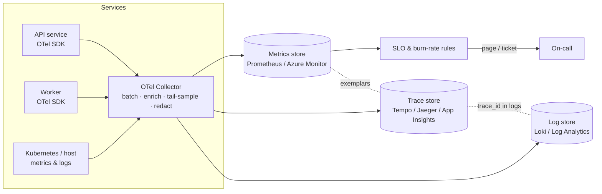

## TL;DR

- **Monitoring** tells you *whether* known things are broken; **observability** lets you ask *new* questions about why, using high-cardinality telemetry correlated across metrics, logs, traces (and profiles).
- **SLOs** turn reliability into a product decision. The **error budget** (100% − SLO) is the agreed amount of unreliability you can spend on shipping faster.
- Page on **symptoms users feel** (SLO burn rate), not causes (CPU at 80%). Multi-window, multi-burn-rate alerts catch fast and slow burns with few false pages.
- **OpenTelemetry** is the vendor-neutral standard for instrumentation; collect once, send anywhere via the OTel Collector.
- The expensive mistakes are **unbounded metric cardinality**, logging everything, and alert fatigue.

## Core Concepts

### Signals and how they relate

| Signal | Answers | Strength | Cost driver |
|---|---|---|---|
| Metrics | "How much / how often / how fast?" | Cheap aggregates, long retention, alerting | Number of unique label combinations (cardinality) |
| Logs | "What exactly happened in this event?" | Rich detail | Volume (GB ingested) |
| Traces | "Where did time go across services?" | Causality across hops | Span volume (sampling) |
| Profiles | "Which code burns CPU/memory?" | Code-level hotspots | Continuous profiling overhead |

Correlate them: put `trace_id` in every log line, attach **exemplars** (trace ids) to metric samples, and use the same resource attributes (`service.name`, `deployment.environment`) everywhere.

### Golden signals, RED and USE

- **Four golden signals** (Google SRE): latency, traffic, errors, saturation.
- **RED** for request-driven services: Rate, Errors, Duration.
- **USE** for resources: Utilisation, Saturation, Errors.

### SLIs, SLOs, SLAs and error budgets

- **SLI:** a measured ratio of good events, e.g. `requests with status < 500 and latency < 300 ms / all requests`.
- **SLO:** the target for that SLI over a window, e.g. 99.9% over 30 days.
- **SLA:** a contract with penalties. It should be looser than the SLO.
- **Error budget:** 0.1% of 30 days ≈ **43.2 minutes** of full unavailability, or the equivalent proportion of bad requests. If the budget is spent, reliability work takes priority over features. That policy needs to be agreed *in advance* with product leadership.

### Burn-rate alerting

Burn rate = how fast you're consuming the budget relative to an even spend. Burn rate 1 uses exactly the budget over the window. The SRE Workbook recommends multi-window, multi-burn-rate alerts, for example for a 30-day SLO:

| Severity | Burn rate | Long window | Short window | Budget consumed |
|---|---|---|---|---|
| Page | 14.4 | 1 h | 5 min | 2% in 1 hour |
| Page | 6 | 6 h | 30 min | 5% in 6 hours |
| Ticket | 1 | 3 days | 6 h | 10% in 3 days |

The short window makes the alert reset quickly once the problem is fixed.

### Instrumenting with OpenTelemetry

```ts
// instrumentation.ts — load before the app (node --import ./instrumentation.js app.js)
import { NodeSDK } from '@opentelemetry/sdk-node';
import { getNodeAutoInstrumentations } from '@opentelemetry/auto-instrumentations-node';
import { OTLPTraceExporter } from '@opentelemetry/exporter-trace-otlp-http';

// Service name and collector endpoint come from env: OTEL_SERVICE_NAME, OTEL_EXPORTER_OTLP_ENDPOINT
const sdk = new NodeSDK({
  traceExporter: new OTLPTraceExporter(),
  instrumentations: [getNodeAutoInstrumentations()],
});
sdk.start();
```

```ts
// Business-level span with attributes you will want to query by.
import { trace, SpanStatusCode } from '@opentelemetry/api';
const tracer = trace.getTracer('checkout');

export async function chargeCard(orderId: string, amountMinor: number) {
  return tracer.startActiveSpan('payment.charge', async (span) => {
    span.setAttributes({ 'order.id': orderId, 'payment.amount_minor': amountMinor });
    try {
      return await paymentGateway.charge(orderId, amountMinor);
    } catch (err) {
      span.recordException(err as Error);
      span.setStatus({ code: SpanStatusCode.ERROR });
      throw err;
    } finally {
      span.end();
    }
  });
}
```

### Sampling

- **Head sampling** decides at the start of a trace (e.g. keep 10%). It's cheap and simple, but you miss rare errors.
- **Tail sampling** decides after the trace completes, in the Collector: keep all errors and slow traces, sample the rest. It needs buffering and stateful routing (all spans of a trace to the same collector).

### SRE practices beyond telemetry

- **Toil:** manual, repetitive, automatable work. Google SRE caps it at ~50% of an SRE's time.
- **Blameless postmortems:** timeline, impact, contributing factors, action items with owners. Focus on the system, not the person.
- **Incident roles:** incident commander, communications lead, operations/subject experts.
- **Runbooks** linked from every alert.

## How It Works



## When to Use / Trade-offs

| Choice | Use when | Avoid when | Cost |
|---|---|---|---|
| Auto-instrumentation | Fast baseline across many services | Only option for business-level insight | Noisy spans, some overhead |
| Manual spans/attributes | Critical business flows (checkout, payment) | Every function | Engineering time |
| Head sampling | High volume, cost-sensitive, uniform traffic | You must keep all errors/slow traces | Lose rare events |
| Tail sampling | You need every error and outlier | Small scale where 100% is affordable | Collector memory, routing complexity |
| Vendor SaaS (Datadog, New Relic, etc.) | Small platform team, need features fast | Strict data residency, huge volumes | Per-GB/host pricing grows fast |
| Self-hosted (Prometheus, Grafana, Loki, Tempo) | Large scale, cost control, in-house skills | No team to operate it | Operational burden |

## Common Pitfalls & Anti-patterns

- **High-cardinality metric labels** — `user_id`, `request_id` or full URLs as labels explode series count and cost; put them on traces/logs instead.
- **Alerting on causes** — CPU, memory and queue depth pages that don't map to user impact cause alert fatigue.
- **SLOs nobody agreed to** — engineering-only SLOs with no error-budget policy change nothing.
- **100% availability target** — impossible, freezes change, and ignores dependencies' own SLOs.
- **Logs as metrics** — counting log lines in queries for dashboards is slow and expensive.
- **No context propagation** — traces break at queues, async jobs, or third-party gateways.
- **Dashboards for everything** — hundreds of unowned dashboards; nobody knows which one matters during an incident.

## Real-world Scenario

**Context:** A fintech with 60 microservices had three monitoring tools, ~400 alerts/week, and median time to restore of 3 hours. Most pages were CPU/memory thresholds; real customer-impacting incidents were often reported by support first.

**Decision:**
1. Standardised on OpenTelemetry SDKs + a Collector gateway, exporting to one backend.
2. Defined 12 user-journey SLOs (login, payment, statement view) with product owners, plus an error-budget policy signed off by the CPO.
3. Replaced cause-based pages with multi-burn-rate SLO alerts; cause metrics stayed on dashboards.
4. Added tail sampling (keep all errors and >1 s traces, 5% of the rest).

**Outcome:** Pages dropped from ~400 to ~25 a week, time to restore fell to ~40 minutes, and two quarters later the error-budget policy paused feature work for one team, which leadership supported because it had been agreed up front.

**What I'd do differently:** Budget for telemetry cost from day one. Log ingestion costs doubled before we introduced sampling and retention tiers.

## Interview Questions

### What is the difference between monitoring and observability? {#monitoring-vs-observability}

**Level:** Foundation

**Model answer:**
Monitoring checks predefined conditions: dashboards and alerts for known failure modes. Observability is a property of a system: how well you can understand its internal state from its outputs, including for failures you didn't anticipate. In practice that means rich, correlated, high-cardinality telemetry (traces with attributes, structured logs with trace ids, metrics with exemplars) that lets you slice by any dimension (customer, version, region) to find the "why".

**What the interviewer is looking for:**
Known-unknowns vs unknown-unknowns, and how correlation across signals makes debugging fast.

**Follow-ups:**
- Which signal would you invest in first for a new microservices platform, and why?
- How do you correlate a log line with a trace?

**Red flags:**
- "Observability is just the three pillars."
- Treating it as a tool purchase rather than an engineering practice.

### Explain SLIs, SLOs and error budgets. How do they change engineering decisions? {#slo-error-budget}

**Level:** Senior

**Model answer:**
An SLI is a ratio of good to valid events (e.g. successful requests under 300 ms). An SLO sets a target for that ratio over a window (99.9% over 30 days). The error budget is the allowed failure (0.1%, about 43 minutes of downtime equivalent per 30 days). The budget becomes a shared currency: while there is budget, teams ship faster and take risks; when it's exhausted, the agreed policy shifts effort to reliability (freeze risky releases, fix top contributors). It turns reliability arguments into data and makes the trade-off explicit with product.

**What the interviewer is looking for:**
The organisational mechanism (the policy agreed with product), not just definitions. Bonus: SLAs looser than SLOs, choosing SLIs close to the user.

**Follow-ups:**
- How do you pick the SLO target for a new service?
- What happens if a dependency's SLO is lower than yours?

**Red flags:**
- Setting SLOs to 100%.
- SLIs based on server CPU rather than user experience.

### Why alert on SLO burn rate instead of static thresholds like "error rate > 1%"? {#burn-rate-alerts}

**Level:** Senior

**Model answer:**
Static thresholds are either too sensitive (paging on brief blips that barely touch the budget) or too lax (missing slow, sustained degradation). Burn rate measures how quickly you're consuming the error budget, so severity matches business impact. Multi-window alerts (a long window for significance plus a short window to confirm it's ongoing) give high precision, good recall and fast reset. Typical setup: page at 14.4x over 1 h & 5 min (2% of the monthly budget in an hour), page at 6x over 6 h & 30 min, ticket at 1x over 3 days.

**What the interviewer is looking for:**
Understanding precision/recall/detection-time trade-offs and the workbook approach.

**Follow-ups:**
- How do you handle low-traffic services where one failure is 10% of requests?
- What should *not* page?

**Red flags:**
- No concept of error budget in alerting.
- "We page on anything abnormal."

### Your metrics bill tripled in a month. What's likely going on and how do you fix it? {#cardinality}

**Level:** Senior

**Model answer:**
Most likely a cardinality explosion: a label with unbounded values (user id, request path with ids, pod name in a churny autoscaling setup, error messages) creating millions of time series. Also possible: new auto-instrumentation emitting histograms with many buckets, or duplicated pipelines.

Fix:
1. Find the top series contributors (cardinality analysis in Prometheus/Mimir or the vendor's usage tooling).
2. Drop or aggregate labels in the Collector (`attributes`/`transform` processors), and normalise routes (`/orders/{id}`).
3. Move per-entity detail to traces/logs.
4. Set guardrails: limits per metric, CI linting of instrumentation, cost dashboards per team.

**What the interviewer is looking for:**
Knowing what drives cost per signal and fixing it at the pipeline with governance, not just deleting dashboards.

**Follow-ups:**
- How would you charge back telemetry cost to teams?
- When is high cardinality worth paying for?

**Red flags:**
- Blaming the vendor without investigating.
- Not knowing what cardinality means.

### You're the architect for 60 microservices with three monitoring tools and constant alert fatigue. Lay out a 6-month observability strategy. {#observability-rollout}

**Level:** Architect

**Model answer:**
**Month 0–1: Discover.** Inventory tools, costs, alerts, pages per week and time to restore. Pick 5–10 critical user journeys with product.

**Month 1–3: Standardise.**
- OpenTelemetry SDKs via a shared library/template with consistent resource attributes.
- A Collector gateway (redaction of PII, tail sampling, routing).
- Pick one backend, or a deliberate split with an exit plan.
- Trace context propagation through queues.

**Month 2–4: SLOs.** Journey SLIs/SLOs and an error-budget policy signed off by product leadership. Burn-rate paging; cause-based alerts demoted to dashboards/tickets. Every page links to a runbook.

**Month 4–6: Embed.** On-call training, blameless postmortem process, monthly SLO reviews, telemetry cost budgets per team, and retiring old tools.

**Success metrics:** pages/week, % actionable pages, time to restore, incidents detected by alert vs by customer, telemetry spend.

**What the interviewer is looking for:**
Sequencing, stakeholder alignment (product owns SLO trade-offs), standards via paved road rather than mandates, and measurable outcomes.

**Follow-ups:**
- How do you get teams to adopt the shared instrumentation library?
- How do you decide between a vendor and self-hosting?
- What would you do if leadership refuses an error-budget policy?

**Red flags:**
- "Buy tool X."
- Big-bang migration with no success measures.

### Compare head-based and tail-based trace sampling. Which would you choose for a payments platform? {#trace-sampling}

**Level:** Architect

**Model answer:**
Head sampling decides at the root span (e.g. 10%) and propagates the decision. It's cheap and stateless, but rare errors and slow outliers are mostly discarded. Tail sampling buffers complete traces in the Collector and applies policies (keep all errors, all >1 s latency, specific tenants, 5% of the rest). It needs all spans for a trace on the same Collector instance (load-balancing exporter by trace id), memory for buffering, and handling of late spans.

For payments: tail sampling, keeping 100% of errors and slow traces plus a baseline, with PII redaction in the Collector. If volume is extreme, combine light head sampling for low-value traffic (health checks) with tail sampling for the rest.

**What the interviewer is looking for:**
The operational implications of tail sampling, and tying the decision to business risk and cost.

**Follow-ups:**
- How do sampling decisions affect metrics derived from traces?
- How long should the Collector wait before deciding?

**Red flags:**
- Assuming 100% tracing is free at scale.
- Not knowing tail sampling requires trace-aware routing.

### What are logs, metrics and traces, and how should they connect to each other? {#telemetry-signals}

**Level:** Foundation

**Model answer:**
- **Metrics** are numeric aggregates over time (request rate, p99 latency, queue depth). They are cheap to store and fast to query, which makes them ideal for dashboards and alerts. They can't tell you *which* request was slow, because detail is aggregated away and label cardinality must stay bounded.
- **Traces** record the path of one request across services as a tree of spans with timings and attributes. They answer "where did the time go for *this* request?" They are usually sampled.
- **Logs** are timestamped records of discrete events, ideally structured (JSON). They carry the richest detail, such as error messages and business context, and are the most expensive per byte.
- **Profiles** (continuous profiling) show where CPU and memory go inside the code. They are increasingly treated as a fourth signal.

The value is in **correlation**. Every log line carries the `trace_id` and `span_id`. Metrics link to example traces through **exemplars**. All three share resource attributes (`service.name`, `deployment.environment`, version). A typical investigation runs from alert (metric), to an exemplar trace showing the slow span, to that span's logs explaining why.

**What the interviewer is looking for:**
What each signal is good and bad at, cost awareness, and correlation by trace id as the thing that makes them "observability" rather than three silos.

**Follow-ups:**
- Why not just derive every metric from logs?
- What are exemplars?

**Red flags:**
- "We have logs, so we're observable."
- No mention of a shared id to join the signals.

### What is OpenTelemetry, and why do organisations standardise on it? {#opentelemetry}

**Level:** Foundation

**Model answer:**
OpenTelemetry (OTel) is a CNCF project that provides a vendor-neutral standard for producing and shipping telemetry:
- **APIs and SDKs** per language for traces, metrics and logs.
- **Auto-instrumentation** for common frameworks (HTTP servers, database clients, messaging).
- **Semantic conventions**, which are standard attribute names such as `http.response.status_code` and `db.system`.
- **The OTLP wire protocol.**
- **The Collector:** a pipeline that receives, processes (batch, redact, sample, enrich) and exports telemetry to any backend.

Why standardise:
- **No vendor lock-in:** you instrument once and change backends (Grafana, Datadog, Azure Monitor, Honeycomb) by reconfiguring the Collector rather than re-instrumenting code.
- **Consistency:** the same attribute names across teams make cross-service queries possible.
- **Central control:** redaction of PII, sampling and routing happen in the Collector, not in 60 codebases.

Status: tracing and metrics are stable in the major languages, and logs are stable in the specification with SDK maturity varying by language (VERIFY: check per-language status). Profiles are a newer signal still being stabilised (VERIFY).

**What the interviewer is looking for:**
The components (API, SDK, Collector, OTLP, semantic conventions) and the strategic reason: decoupling instrumentation from the backend.

**Follow-ups:**
- Agent or gateway Collector deployment: when do you use each?
- How do you stop auto-instrumentation creating cost explosions?

**Red flags:**
- Thinking OpenTelemetry is a backend or a dashboard product.
- Instrumenting directly with a vendor SDK across the estate in 2026 without a reason.

### When do you use the golden signals, RED and USE? {#golden-signals}

**Level:** Foundation

**Model answer:**
They are checklists for "what should I measure first?":
- **RED** (rate, errors, duration) for **request-driven services**: APIs, gRPC services, queue consumers (messages per second, failures, processing time). It describes the experience of the service's callers.
- **USE** (utilisation, saturation, errors) for **resources**: CPU, memory, disks, connection pools, thread pools, queues. It finds the bottleneck. Saturation, meaning work waiting such as run-queue length or pool wait time, is the signal people most often miss.
- **The four golden signals** (latency, traffic, errors, saturation) from Google's SRE book combine both views for a user-facing system.

Practical tips:
- Measure latency as a histogram and look at percentiles. Track the latency of **failed** requests separately, because fast errors make averages look good.
- Count errors your users experience, including "200 OK with an error body".
- Page on symptoms (RED and SLOs). Use USE to diagnose.

**What the interviewer is looking for:**
Choosing the method by what is being measured, the saturation insight and the symptoms-versus-causes split for alerting.

**Follow-ups:**
- Why are averages misleading for latency?
- Which saturation metrics would you watch on a Node.js service?

**Red flags:**
- Paging on CPU utilisation as a primary alert.
- Measuring latency only as an average.

### How does distributed trace context propagate between services, including through queues and async jobs? {#context-propagation}

**Level:** Senior

**Model answer:**
Each request has a **trace id**, and each unit of work a **span id**. When service A calls B, A's instrumentation injects the context into the outgoing carrier. B extracts it and creates a child span with the same trace id.

- **HTTP and gRPC:** the W3C Trace Context headers, `traceparent` (`00-<32-hex trace id>-<16-hex parent span id>-<flags>`) and optionally `tracestate`. **Baggage** carries user-defined key-values (tenant id, for example) across hops. Treat it as visible to everything downstream and never put secrets in it.
- **Messaging:** inject the same context into **message headers or application properties** when publishing. On consume, extract it and start a span. For messages processed long after they were produced, or in batches, use **span links** rather than parent/child, because a batch has many parents.
- **In-process async work** (thread pools, promises, timers) relies on context propagation in the runtime: `AsyncLocalStorage` in Node.js, `Context` in Java and Go. Hand-rolled queues and executors often drop it.

Where it breaks: API gateways or proxies that strip headers, third-party SaaS, cron jobs, and legacy services on proprietary formats (B3). The fix is propagator configuration in the Collector or SDK, plus testing that a trace actually crosses each boundary.

**What the interviewer is looking for:**
`traceparent` specifics, the inject/extract model, the messaging case including span links, and the usual breakage points.

**Follow-ups:**
- How should a consumer represent a span for a batch of 500 messages?
- Is it safe to accept `traceparent` from the public internet?

**Red flags:**
- Believing tracing works across queues "automatically" in every SDK.
- Putting user PII in baggage.

### How do you run a blameless postmortem, and how do you make sure the actions actually happen? {#postmortems}

**Level:** Senior

**Model answer:**
**Trigger.** Agreed criteria, such as a SEV1 or SEV2, a large error-budget burn, a data-loss near miss, or anything customer-visible.

**Process:**
1. Build a **timeline from evidence**: chat logs, deploy history, telemetry.
2. Describe **contributing factors**, not a single root cause. Complex failures have several.
3. Ask *why the system allowed it*, not *who did it*. People acted reasonably given what they knew. If someone could break production with one command, that is the finding.
4. Record what **went well**: detection, mitigation, communication.
5. Review it in a meeting with the people involved, and publish it widely.

**Making actions stick:**
- Few, specific, prioritised actions, each with an owner and a date, tracked in the normal backlog rather than in a document.
- Distinguish **mitigations** (a guardrail that prevents recurrence) from "be more careful".
- Review open postmortem actions in a regular operations review. Use the **error-budget policy** to prioritise them over features when reliability is off-target.
- Look for patterns across incidents each quarter (themes, repeat offenders, detection gaps).

**What the interviewer is looking for:**
Real blamelessness (focus on systems, psychological safety), contributing factors over root cause, and a mechanism for follow-through.

**Follow-ups:**
- An engineer's mistake clearly triggered the outage. How do you write that up?
- How do you stop postmortems becoming a box-ticking exercise?

**Red flags:**
- "Human error" as the root cause.
- Thirty vague action items with no owners.

### What should structured logging look like in a production service? {#structured-logging}

**Level:** Senior

**Model answer:**
- **Structured, not prose:** JSON with consistent keys, so logs are queryable. `{"level":"warn","msg":"payment declined","order_id":"o-9","psp":"adyen","decline_code":"05","trace_id":"…"}` rather than string interpolation.
- **Correlation:** `trace_id`, `span_id`, request id, plus resource fields such as service, version and environment, ideally injected by the logging library from the current context.
- **Levels used consistently:** ERROR means someone may need to act, WARN means degraded but handled, INFO covers meaningful business and lifecycle events, DEBUG is off in production unless enabled per request or per tenant.
- **Log events, not every line of control flow.** One wide "canonical log line" per request, with all the useful fields, often beats 20 narrow lines.
- **Never log** secrets, tokens, full card numbers or unnecessary PII. Redact centrally (in the logger and in the Collector) and test the redaction.
- **Control cost:** sample noisy INFO, set retention tiers (hot for 7–30 days, archive beyond), and treat log volume per service as a budget with an owner.

```ts
logger.info({ orderId, amountMinor, currency, outcome: 'captured', durationMs }, 'payment processed');
```

**What the interviewer is looking for:**
Queryability, correlation, a disciplined level policy, PII hygiene and cost control.

**Follow-ups:**
- How would you debug one tenant's issue without turning DEBUG on for everyone?
- When is an event better recorded as a metric than as a log?

**Red flags:**
- Logging full request and response bodies by default.
- ERROR level for expected business outcomes such as a declined card.

### Design SLOs for a checkout journey that depends on five internal services and a third-party payment provider. {#journey-slos}

**Level:** Architect

**Model answer:**
**Start from the user journey, not the services.** The SLI is "a checkout attempt completes successfully within 3 s", measured at the edge (API gateway or real-user monitoring), because that is what customers experience.

**Define the SLIs precisely:**
- *Availability*: good = completed orders + correctly handled user errors (declined card, invalid address); valid = all checkout attempts excluding bots.
- *Latency*: the fraction of checkouts under 3 s, plus a looser bound such as 99% under 8 s.

**Set targets from data and business tolerance.** If the payment provider's SLA is 99.95%, a 99.99% journey SLO is impossible without redundancy, because a serial chain multiplies availabilities (`0.999^5 × 0.9995 ≈ 99.45%` if every dependency only just meets 99.9%). That forces either stricter internal SLOs, or design changes: retries with idempotency keys, a second payment provider, accepting orders asynchronously and charging later.

**Layer the SLOs.** One journey SLO owned jointly by the product area, plus internal per-service SLOs that are tighter than the journey's share, so each team has its own error budget and alerting.

**Third parties.** Measure the provider independently (calls to them as an SLI), keep a dashboard of their contribution to burn and attribute budget consumption, so you can renegotiate or fail over with evidence.

**Error-budget policy.** Agree in advance what happens when the budget is spent: freeze risky launches, prioritise reliability work, review the SLO quarterly.

**What the interviewer is looking for:**
Journey-level SLIs measured near the user, careful good/valid definitions, availability arithmetic across dependencies, ownership, and a policy with consequences.

**Follow-ups:**
- The payment provider has a 2-hour outage. Does it burn your error budget?
- How do you handle a checkout flow that is partly asynchronous?

**Red flags:**
- One SLO per microservice with no journey view.
- Targets copied from a competitor or set to 99.99% "because we're important".

### Set up incident management for an engineering organisation of 200 people. {#incident-management}

**Level:** Architect

**Model answer:**
**Severity levels** defined by customer impact, with examples. SEV1: checkout down or data loss, all hands, executive communication. SEV2: major degradation. SEV3: minor or internal. Anyone can declare an incident, and declaring one that turns out to be minor is never punished.

**Roles during an incident:**
- **Incident commander:** coordinates and decides, doesn't debug.
- **Operations lead:** hands on keyboard.
- **Communications lead:** status page, stakeholders, support.
- **Scribe:** keeps the timeline.

A dedicated channel and a video bridge are created automatically by the incident tool.

**On-call that people can sustain:**
- Team-owned services with primary and secondary rotations, follow-the-sun across time zones if possible.
- Page only on actionable, SLO-based symptoms.
- Compensation or time off in lieu; a target of a few pages per shift; review page load monthly and fix noisy alerts.

**Readiness:**
- Runbooks linked from alerts.
- Production access pre-approved (break-glass with audit).
- Incident training and regular game days, with wheel-of-misfortune exercises for new on-call staff.

**Learning:** postmortems for SEV1 and SEV2, a weekly operations review, and tracked actions. Measure time to detect, time to mitigate and recurrence rather than MTTR averages alone.

**Communication:** templated status updates at a fixed cadence (for example every 30 minutes for SEV1), and customer-facing wording agreed with support and legal.

**What the interviewer is looking for:**
Clear roles (incident commander separate from debugging), impact-based severity, humane on-call, preparation and a learning loop. Organisational design, not just tools.

**Follow-ups:**
- How do you handle an incident spanning three teams' services?
- The same team gets paged 40 times a week. What do you do?

**Red flags:**
- The most senior engineer is always the incident commander *and* the debugger.
- On-call with no compensation or limit on page load.

### Observability spend is now 18% of cloud cost. How do you bring it down without losing the ability to debug? {#observability-cost}

**Level:** Architect

**Model answer:**
**Measure first.** Break cost down by signal (logs, metrics, traces), by service and by team. Typically a handful of services and a few patterns, such as DEBUG logs in production, unbounded labels or 100% trace sampling, cause most of the spend.

**Levers per signal:**
- **Metrics:** cut cardinality (drop or aggregate `user_id`- or URL-style labels in the Collector), remove unused series (query-usage analysis), lower resolution for long retention.
- **Logs:** apply level policies, sample repetitive INFO, drop health-check noise at the Collector, keep 7–14 days hot and archive the rest cheaply in object storage, and convert high-volume "count" logs into metrics.
- **Traces:** tail sampling that keeps 100% of errors and slow requests and around 1–5% of normal traffic.

**Governance:**
- Show each team the cost of its own telemetry and give it a budget.
- Default Collector pipelines with sane limits.
- Pre-merge linting for new metrics labels.

**Platform choices:**
- Evaluate tiered or self-hosted backends (for example a Prometheus-compatible store or ClickHouse-based logs) against vendor pricing.
- Include the engineering cost of running it yourself; it's rarely free.
- Because instrumentation is OpenTelemetry, switching or splitting backends is a configuration change.

**Guardrail:** track debugging effectiveness (time to detect and time to mitigate, postmortem notes on missing data), so cuts don't quietly degrade incident response.

**What the interviewer is looking for:**
Data-driven cost attribution, concrete per-signal techniques, team-level accountability and protecting debuggability.

**Follow-ups:**
- Which data would you never sample?
- How would you justify the remaining spend to the CFO?

**Red flags:**
- A blanket 90% cut in retention or sampling with no analysis.
- Turning off tracing to save money.

## Cheat Sheet

- **Observability** — ask new questions of a system using correlated, high-cardinality telemetry.
- **Golden signals** — latency, traffic, errors, saturation.
- **RED** — rate, errors, duration (for services).
- **USE** — utilisation, saturation, errors (for resources).
- **SLI** — ratio of good events to valid events, measured close to the user.
- **SLO** — target for an SLI over a window, e.g. 99.9% / 30 days.
- **Error budget** — 100% − SLO; 99.9% over 30 days ≈ 43.2 minutes.
- **Burn rate** — budget consumption speed; 1 = exactly on budget over the window.
- **Fast-burn page** — 14.4x over 1 h and 5 min = 2% of the monthly budget in an hour.
- **Cardinality** — number of unique label combinations; the main metrics cost driver.
- **Tail sampling** — decide after the trace completes; keeps errors and outliers.
- **OTel Collector** — receives, processes (redact, sample, batch) and exports telemetry vendor-neutrally.
- **Toil** — manual, repetitive, automatable operational work; keep it under ~50%.
- **traceparent** — W3C header `00-<trace id>-<parent span id>-<flags>` that carries trace context between services.
- **Blameless postmortem** — find contributing factors in the system, not a culprit; actions get owners and dates.

## Further Reading

- [OpenTelemetry documentation](https://opentelemetry.io/docs/) — concepts, SDKs, Collector and semantic conventions.
- [Google SRE book](https://sre.google/sre-book/table-of-contents/) — SLOs, toil, incident management, postmortems.
- [SRE Workbook: Alerting on SLOs](https://sre.google/workbook/alerting-on-slos/) — burn-rate alerting explained step by step.
- [Azure Monitor documentation](https://learn.microsoft.com/en-us/azure/azure-monitor/) — Application Insights, Log Analytics and OpenTelemetry on Azure.
- [Prometheus documentation](https://prometheus.io/docs/introduction/overview/) — metrics model, labels and cardinality.
