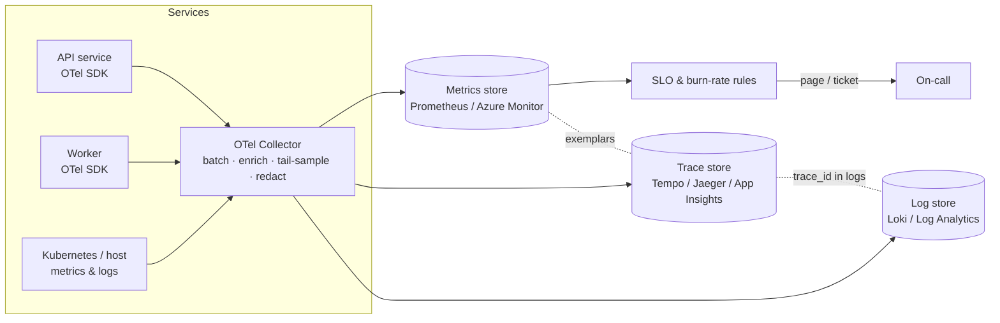

## TL;DR

- **Monitoring** tells you *whether* known things are broken; **observability** lets you ask *new* questions about why, using high-cardinality telemetry correlated across metrics, logs, traces (and profiles).
- **SLOs** turn reliability into a product decision. The **error budget** (100% − SLO) is the agreed amount of unreliability you can spend on shipping faster.
- Page on **symptoms users feel** (SLO burn rate), not causes (CPU at 80%). Multi-window, multi-burn-rate alerts catch fast and slow burns with few false pages.
- **OpenTelemetry** is the vendor-neutral standard for instrumentation; collect once, send anywhere via the OTel Collector.
- The expensive mistakes are **unbounded metric cardinality**, logging everything, and alert fatigue.

## Core Concepts

### Signals and how they relate

| Signal | Answers | Strength | Cost driver |
|---|---|---|---|
| Metrics | "How much / how often / how fast?" | Cheap aggregates, long retention, alerting | Number of unique label combinations (cardinality) |
| Logs | "What exactly happened in this event?" | Rich detail | Volume (GB ingested) |
| Traces | "Where did time go across services?" | Causality across hops | Span volume (sampling) |
| Profiles | "Which code burns CPU/memory?" | Code-level hotspots | Continuous profiling overhead |

Correlate them: put `trace_id` in every log line, attach **exemplars** (trace ids) to metric samples, and use the same resource attributes (`service.name`, `deployment.environment`) everywhere.

### Golden signals, RED and USE

- **Four golden signals** (Google SRE): latency, traffic, errors, saturation.
- **RED** for request-driven services: Rate, Errors, Duration.
- **USE** for resources: Utilisation, Saturation, Errors.

### SLIs, SLOs, SLAs and error budgets

- **SLI:** a measured ratio of good events, e.g. `requests with status < 500 and latency < 300 ms / all requests`.
- **SLO:** the target for that SLI over a window, e.g. 99.9% over 30 days.
- **SLA:** a contract with penalties. It should be looser than the SLO.
- **Error budget:** 0.1% of 30 days ≈ **43.2 minutes** of full unavailability, or the equivalent proportion of bad requests. If the budget is spent, reliability work takes priority over features. That policy needs to be agreed *in advance* with product leadership.

### Burn-rate alerting

Burn rate = how fast you're consuming the budget relative to an even spend. Burn rate 1 uses exactly the budget over the window. The SRE Workbook recommends multi-window, multi-burn-rate alerts, for example for a 30-day SLO:

| Severity | Burn rate | Long window | Short window | Budget consumed |
|---|---|---|---|---|
| Page | 14.4 | 1 h | 5 min | 2% in 1 hour |
| Page | 6 | 6 h | 30 min | 5% in 6 hours |
| Ticket | 1 | 3 days | 6 h | 10% in 3 days |

The short window makes the alert reset quickly once the problem is fixed.

### Instrumenting with OpenTelemetry

```ts
// instrumentation.ts — load before the app (node --import ./instrumentation.js app.js)
import { NodeSDK } from '@opentelemetry/sdk-node';
import { getNodeAutoInstrumentations } from '@opentelemetry/auto-instrumentations-node';
import { OTLPTraceExporter } from '@opentelemetry/exporter-trace-otlp-http';

// Service name and collector endpoint come from env: OTEL_SERVICE_NAME, OTEL_EXPORTER_OTLP_ENDPOINT
const sdk = new NodeSDK({
  traceExporter: new OTLPTraceExporter(),
  instrumentations: [getNodeAutoInstrumentations()],
});
sdk.start();
```

```ts
// Business-level span with attributes you will want to query by.
import { trace, SpanStatusCode } from '@opentelemetry/api';
const tracer = trace.getTracer('checkout');

export async function chargeCard(orderId: string, amountMinor: number) {
  return tracer.startActiveSpan('payment.charge', async (span) => {
    span.setAttributes({ 'order.id': orderId, 'payment.amount_minor': amountMinor });
    try {
      return await paymentGateway.charge(orderId, amountMinor);
    } catch (err) {
      span.recordException(err as Error);
      span.setStatus({ code: SpanStatusCode.ERROR });
      throw err;
    } finally {
      span.end();
    }
  });
}
```

### Sampling

- **Head sampling** decides at the start of a trace (e.g. keep 10%). It's cheap and simple, but you miss rare errors.
- **Tail sampling** decides after the trace completes, in the Collector: keep all errors and slow traces, sample the rest. It needs buffering and stateful routing (all spans of a trace to the same collector).

### SRE practices beyond telemetry

- **Toil:** manual, repetitive, automatable work. Google SRE caps it at ~50% of an SRE's time.
- **Blameless postmortems:** timeline, impact, contributing factors, action items with owners. Focus on the system, not the person.
- **Incident roles:** incident commander, communications lead, operations/subject experts.
- **Runbooks** linked from every alert.

## How It Works



## When to Use / Trade-offs

| Choice | Use when | Avoid when | Cost |
|---|---|---|---|
| Auto-instrumentation | Fast baseline across many services | Only option for business-level insight | Noisy spans, some overhead |
| Manual spans/attributes | Critical business flows (checkout, payment) | Every function | Engineering time |
| Head sampling | High volume, cost-sensitive, uniform traffic | You must keep all errors/slow traces | Lose rare events |
| Tail sampling | You need every error and outlier | Small scale where 100% is affordable | Collector memory, routing complexity |
| Vendor SaaS (Datadog, New Relic, etc.) | Small platform team, need features fast | Strict data residency, huge volumes | Per-GB/host pricing grows fast |
| Self-hosted (Prometheus, Grafana, Loki, Tempo) | Large scale, cost control, in-house skills | No team to operate it | Operational burden |

## Common Pitfalls & Anti-patterns

- **High-cardinality metric labels** — `user_id`, `request_id` or full URLs as labels explode series count and cost; put them on traces/logs instead.
- **Alerting on causes** — CPU, memory and queue depth pages that don't map to user impact cause alert fatigue.
- **SLOs nobody agreed to** — engineering-only SLOs with no error-budget policy change nothing.
- **100% availability target** — impossible, freezes change, and ignores dependencies' own SLOs.
- **Logs as metrics** — counting log lines in queries for dashboards is slow and expensive.
- **No context propagation** — traces break at queues, async jobs, or third-party gateways.
- **Dashboards for everything** — hundreds of unowned dashboards; nobody knows which one matters during an incident.

## Real-world Scenario

**Context:** A fintech with 60 microservices had three monitoring tools, ~400 alerts/week, and median time to restore of 3 hours. Most pages were CPU/memory thresholds; real customer-impacting incidents were often reported by support first.

**Decision:**
1. Standardised on OpenTelemetry SDKs + a Collector gateway, exporting to one backend.
2. Defined 12 user-journey SLOs (login, payment, statement view) with product owners, plus an error-budget policy signed off by the CPO.
3. Replaced cause-based pages with multi-burn-rate SLO alerts; cause metrics stayed on dashboards.
4. Added tail sampling (keep all errors and >1 s traces, 5% of the rest).

**Outcome:** Pages dropped from ~400 to ~25 a week, time to restore fell to ~40 minutes, and two quarters later the error-budget policy paused feature work for one team, which leadership supported because it had been agreed up front.

**What I'd do differently:** Budget for telemetry cost from day one. Log ingestion costs doubled before we introduced sampling and retention tiers.

## Interview Questions

### What is the difference between monitoring and observability? {#monitoring-vs-observability}

**Level:** Foundation

**Model answer:**
Monitoring checks predefined conditions: dashboards and alerts for known failure modes. Observability is a property of a system: how well you can understand its internal state from its outputs, including for failures you didn't anticipate. In practice that means rich, correlated, high-cardinality telemetry (traces with attributes, structured logs with trace ids, metrics with exemplars) that lets you slice by any dimension (customer, version, region) to find the "why".

**What the interviewer is looking for:**
Known-unknowns vs unknown-unknowns, and how correlation across signals makes debugging fast.

**Follow-ups:**
- Which signal would you invest in first for a new microservices platform, and why?
- How do you correlate a log line with a trace?

**Red flags:**
- "Observability is just the three pillars."
- Treating it as a tool purchase rather than an engineering practice.

### Explain SLIs, SLOs and error budgets. How do they change engineering decisions? {#slo-error-budget}

**Level:** Senior

**Model answer:**
An SLI is a ratio of good to valid events (e.g. successful requests under 300 ms). An SLO sets a target for that ratio over a window (99.9% over 30 days). The error budget is the allowed failure (0.1%, about 43 minutes of downtime equivalent per 30 days). The budget becomes a shared currency: while there is budget, teams ship faster and take risks; when it's exhausted, the agreed policy shifts effort to reliability (freeze risky releases, fix top contributors). It turns reliability arguments into data and makes the trade-off explicit with product.

**What the interviewer is looking for:**
The organisational mechanism (the policy agreed with product), not just definitions. Bonus: SLAs looser than SLOs, choosing SLIs close to the user.

**Follow-ups:**
- How do you pick the SLO target for a new service?
- What happens if a dependency's SLO is lower than yours?

**Red flags:**
- Setting SLOs to 100%.
- SLIs based on server CPU rather than user experience.

### Why alert on SLO burn rate instead of static thresholds like "error rate > 1%"? {#burn-rate-alerts}

**Level:** Senior

**Model answer:**
Static thresholds are either too sensitive (paging on brief blips that barely touch the budget) or too lax (missing slow, sustained degradation). Burn rate measures how quickly you're consuming the error budget, so severity matches business impact. Multi-window alerts (a long window for significance plus a short window to confirm it's ongoing) give high precision, good recall and fast reset. Typical setup: page at 14.4x over 1 h & 5 min (2% of the monthly budget in an hour), page at 6x over 6 h & 30 min, ticket at 1x over 3 days.

**What the interviewer is looking for:**
Understanding precision/recall/detection-time trade-offs and the workbook approach.

**Follow-ups:**
- How do you handle low-traffic services where one failure is 10% of requests?
- What should *not* page?

**Red flags:**
- No concept of error budget in alerting.
- "We page on anything abnormal."

### Your metrics bill tripled in a month. What's likely going on and how do you fix it? {#cardinality}

**Level:** Senior

**Model answer:**
Most likely a cardinality explosion: a label with unbounded values (user id, request path with ids, pod name in a churny autoscaling setup, error messages) creating millions of time series. Also possible: new auto-instrumentation emitting histograms with many buckets, or duplicated pipelines.

Fix:
1. Find the top series contributors (cardinality analysis in Prometheus/Mimir or the vendor's usage tooling).
2. Drop or aggregate labels in the Collector (`attributes`/`transform` processors), and normalise routes (`/orders/{id}`).
3. Move per-entity detail to traces/logs.
4. Set guardrails: limits per metric, CI linting of instrumentation, cost dashboards per team.

**What the interviewer is looking for:**
Knowing what drives cost per signal and fixing it at the pipeline with governance, not just deleting dashboards.

**Follow-ups:**
- How would you charge back telemetry cost to teams?
- When is high cardinality worth paying for?

**Red flags:**
- Blaming the vendor without investigating.
- Not knowing what cardinality means.

### You're the architect for 60 microservices with three monitoring tools and constant alert fatigue. Lay out a 6-month observability strategy. {#observability-rollout}

**Level:** Architect

**Model answer:**
**Month 0–1: Discover.** Inventory tools, costs, alerts, pages per week and time to restore. Pick 5–10 critical user journeys with product.

**Month 1–3: Standardise.**
- OpenTelemetry SDKs via a shared library/template with consistent resource attributes.
- A Collector gateway (redaction of PII, tail sampling, routing).
- Pick one backend, or a deliberate split with an exit plan.
- Trace context propagation through queues.

**Month 2–4: SLOs.** Journey SLIs/SLOs and an error-budget policy signed off by product leadership. Burn-rate paging; cause-based alerts demoted to dashboards/tickets. Every page links to a runbook.

**Month 4–6: Embed.** On-call training, blameless postmortem process, monthly SLO reviews, telemetry cost budgets per team, and retiring old tools.

**Success metrics:** pages/week, % actionable pages, time to restore, incidents detected by alert vs by customer, telemetry spend.

**What the interviewer is looking for:**
Sequencing, stakeholder alignment (product owns SLO trade-offs), standards via paved road rather than mandates, and measurable outcomes.

**Follow-ups:**
- How do you get teams to adopt the shared instrumentation library?
- How do you decide between a vendor and self-hosting?
- What would you do if leadership refuses an error-budget policy?

**Red flags:**
- "Buy tool X."
- Big-bang migration with no success measures.

### Compare head-based and tail-based trace sampling. Which would you choose for a payments platform? {#trace-sampling}

**Level:** Architect

**Model answer:**
Head sampling decides at the root span (e.g. 10%) and propagates the decision. It's cheap and stateless, but rare errors and slow outliers are mostly discarded. Tail sampling buffers complete traces in the Collector and applies policies (keep all errors, all >1 s latency, specific tenants, 5% of the rest). It needs all spans for a trace on the same Collector instance (load-balancing exporter by trace id), memory for buffering, and handling of late spans.

For payments: tail sampling, keeping 100% of errors and slow traces plus a baseline, with PII redaction in the Collector. If volume is extreme, combine light head sampling for low-value traffic (health checks) with tail sampling for the rest.

**What the interviewer is looking for:**
The operational implications of tail sampling, and tying the decision to business risk and cost.

**Follow-ups:**
- How do sampling decisions affect metrics derived from traces?
- How long should the Collector wait before deciding?

**Red flags:**
- Assuming 100% tracing is free at scale.
- Not knowing tail sampling requires trace-aware routing.

## Cheat Sheet

- **Observability** — ask new questions of a system using correlated, high-cardinality telemetry.
- **Golden signals** — latency, traffic, errors, saturation.
- **RED** — rate, errors, duration (for services).
- **USE** — utilisation, saturation, errors (for resources).
- **SLI** — ratio of good events to valid events, measured close to the user.
- **SLO** — target for an SLI over a window, e.g. 99.9% / 30 days.
- **Error budget** — 100% − SLO; 99.9% over 30 days ≈ 43.2 minutes.
- **Burn rate** — budget consumption speed; 1 = exactly on budget over the window.
- **Fast-burn page** — 14.4x over 1 h and 5 min = 2% of the monthly budget in an hour.
- **Cardinality** — number of unique label combinations; the main metrics cost driver.
- **Tail sampling** — decide after the trace completes; keeps errors and outliers.
- **OTel Collector** — receives, processes (redact, sample, batch) and exports telemetry vendor-neutrally.
- **Toil** — manual, repetitive, automatable operational work; keep it under ~50%.

## Further Reading

- [OpenTelemetry documentation](https://opentelemetry.io/docs/) — concepts, SDKs, Collector and semantic conventions.
- [Google SRE book](https://sre.google/sre-book/table-of-contents/) — SLOs, toil, incident management, postmortems.
- [SRE Workbook: Alerting on SLOs](https://sre.google/workbook/alerting-on-slos/) — burn-rate alerting explained step by step.
- [Azure Monitor documentation](https://learn.microsoft.com/en-us/azure/azure-monitor/) — Application Insights, Log Analytics and OpenTelemetry on Azure.
- [Prometheus documentation](https://prometheus.io/docs/introduction/overview/) — metrics model, labels and cardinality.
