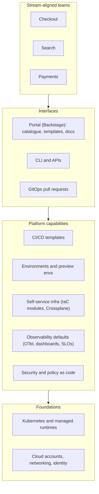
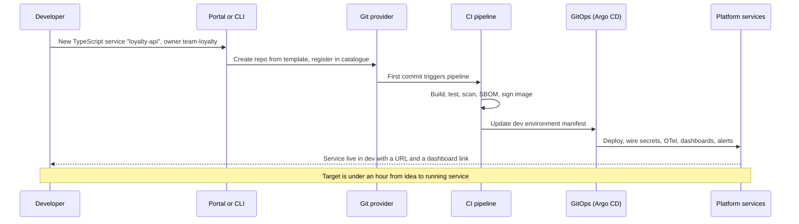

## TL;DR

- Platform engineering builds **self-service capabilities** (environments, pipelines, infrastructure, observability, security defaults) that let stream-aligned teams ship and run software **without having to become experts in everything**. Its core purpose is reducing **cognitive load**.
- Run the platform **as a product**. Developers are its customers, adoption is earned, and it needs discovery, a roadmap, documentation, support and a product manager. A platform nobody chooses to use has failed, however good its engineering.
- **Golden paths** are opinionated, supported, end-to-end ways to do common things, such as a new service from template to production in an afternoon. They are **paved roads, not walls**: teams can step off them, and then they own the difference.
- Start with the **thinnest viable platform**. Solve the top developer pain points first, which are usually environments, CI/CD and onboarding, before building a portal or abstracting Kubernetes.
- Measure **outcomes**: adoption, time to first deploy, lead time, developer satisfaction and reduced toil. Not the number of features the platform team shipped.

## Core Concepts

### Why platforms exist

"You build it, you run it" moved operational ownership to product teams, but it also landed every team with Kubernetes manifests, Terraform, CI pipelines, secrets, observability, compliance evidence and cloud networking. The result is **duplicated effort** (40 teams each writing their own pipeline) and **cognitive overload** (feature teams spending a third of their time on infrastructure).

*Team Topologies* frames the answer: a **platform team** provides internal services **as a service** to **stream-aligned teams**, reducing their cognitive load so they can focus on their domain. **Enabling teams** help teams adopt new capabilities, and **complicated-subsystem teams** own specialist components.

### Platform as a product

| Product practice | Applied to a platform |
|---|---|
| Know your users | Interview developers, shadow onboarding, review support tickets, survey friction |
| Value proposition | "A new service in production in under a day with logging, alerts and security scans already working" |
| Roadmap | Prioritised by developer pain and business impact, published and discussed openly |
| Adoption | Earned through being better than the alternative, not mandated |
| Documentation and support | Docs written for the user's task, office hours, a support channel with response times |
| Product manager | A dedicated platform product manager, or an engineer who explicitly plays that role |
| Deprecation | Versioned interfaces, migration guides, sunset dates |

### Golden paths

A golden path (Spotify's term; Netflix calls it a "paved road") is a **supported, opinionated, end-to-end route** for a common task, for example:

- Create a new TypeScript service: repository, CI, container build, deployment to dev, staging and production, dashboards, alerts and an SLO.
- Add a PostgreSQL database with backups, encryption and secrets wired in.
- Publish an event to the shared broker with a registered schema.

Properties: it's the **easiest** way to do the job correct by default (secure, observable, compliant), it's **maintained** by the platform team (upgrades flow to users), and it's **optional**. Teams with special needs can diverge, accepting more ownership.

### The thinnest viable platform

Team Topologies' **thinnest viable platform** (TVP) is the smallest set of capabilities that meaningfully accelerates teams. Sometimes it's just a well-curated wiki page of recommended practices and existing cloud services. Grow it only when demand is proven. Common first capabilities, in rough order of value:

1. **CI/CD templates**: reusable pipelines with build, test, scan and deploy.
2. **Environments on demand**: preview or ephemeral environments, and standardised dev, staging and production.
3. **Service templates** with observability and security baked in.
4. **Self-service infrastructure**: databases, queues and buckets via vetted IaC modules or a control plane.
5. **A catalogue**: who owns what, where the docs are, what depends on what.

### Internal developer platform versus developer portal

- An **internal developer platform (IDP)** is the *capabilities*: pipelines, provisioning, runtime, observability, secrets, policy.
- A **developer portal** is one *interface* to them: a UI with a software catalogue, templates and documentation. **Backstage** (open-sourced by Spotify, a CNCF incubating project) is the most common example.

Many platforms fail by building a portal first, a shiny front end over capabilities that don't exist yet. Interfaces can also be a CLI, Git (GitOps pull requests), APIs or plain IaC modules.

### Interfaces and abstraction

Platforms offer capabilities at different levels of abstraction:

| Level | Example | Developer writes | Trade-off |
|---|---|---|---|
| Raw | "Here's a Kubernetes cluster and an AWS account" | Full manifests and Terraform | Maximum flexibility, maximum cognitive load |
| Modules | Vetted Terraform modules, Helm charts | Inputs to modules | Reuse with familiar tools, still infrastructure-heavy |
| Workload spec | Score, an internal `app.yaml`, KubeVela | What the app needs (CPU, a database, a route) | Less to learn, and the platform translates it to infrastructure |
| Fully managed | "Push to main, it runs" (Heroku-like) | Code only | Simplest, least flexible, so escape hatches are needed |

Aim for **layered abstractions**: a high-level default path, with the option to drop down a level for a specific need *without leaving the platform entirely*.

```yaml
# catalog-info.yaml — every component registers ownership and metadata (Backstage format)
apiVersion: backstage.io/v1alpha1
kind: Component
metadata:
  name: checkout-api
  description: Checkout and order submission
  annotations:
    github.com/project-slug: acme/checkout-api
    backstage.io/techdocs-ref: dir:.
  tags: [typescript, payments]
spec:
  type: service
  lifecycle: production
  owner: team-checkout
  system: commerce
  dependsOn: [resource:orders-db]
  providesApis: [checkout-api]
```

```yaml
# A golden-path template (Backstage scaffolder): new service → repo → catalogue
apiVersion: scaffolder.backstage.io/v1beta3
kind: Template
metadata:
  name: typescript-service
  title: TypeScript service
  description: Node.js service with CI/CD, OpenTelemetry, dashboards and an SLO
spec:
  owner: team-platform
  type: service
  parameters:
    - title: Service details
      required: [name, owner]
      properties:
        name: { type: string, pattern: '^[a-z][a-z0-9-]{2,40}$' }
        owner: { type: string, ui:field: OwnerPicker }
        needsDatabase: { type: boolean, default: false }
  steps:
    - id: fetch
      action: fetch:template
      input: { url: ./skeleton, values: { name: '${{ parameters.name }}', owner: '${{ parameters.owner }}' } }
    - id: publish
      action: publish:github
      input: { repoUrl: 'github.com?owner=acme&repo=${{ parameters.name }}' }
    - id: register
      action: catalog:register
      input: { repoContentsUrl: '${{ steps.publish.output.repoContentsUrl }}', catalogInfoPath: /catalog-info.yaml }
```

### Guardrails, not gates

Security and compliance belong *inside* the paved road:
- Templates come with secure defaults: non-root containers, dependency and image scanning, SBOM generation, signed artefacts and secrets from a vault.
- **Policy as code** (OPA/Gatekeeper, Kyverno, Azure Policy, AWS SCPs) enforces the few hard rules automatically, with clear error messages.
- **Evidence is generated** by the pipeline for audits, instead of manual change tickets.

The goal is that the compliant way is also the fastest way.

### Measuring a platform

- **Adoption**: share of services on golden paths, active users of the portal or CLI, and voluntary adoption of new capabilities.
- **Speed**: time to first production deploy for a new service or new joiner, and lead time for changes (DORA) on and off the platform.
- **Experience**: regular developer surveys (satisfaction, perceived friction, a DevEx or SPACE-style instrument), and support ticket volume and themes.
- **Efficiency**: toil removed, duplicated tools retired, infrastructure cost per service.
- **Reliability of the platform itself**: SLOs for CI, deployments and provisioning. Platform outages stop every team at once.

The CNCF platform engineering maturity model describes a progression across investment, adoption, interfaces, operations and measurement, from *provisional* through *operational* and *scalable* to *optimising*. It's a useful self-assessment, not a target.

### Worked example: a business case for the platform team

Leadership asks whether a 7-person platform team is worth it for 35 product teams (210 engineers). Build the case from measured time, and show how sensitive it is to the assumptions.

**Evidence gathered first:** a two-week time study and a survey showed engineers spending about **4 hours a week** on work the platform could absorb: pipeline fixes, environment setup, upgrades and evidence for audits. New services took about **10 engineer-days** of setup each, and there are about 25 a year. Audit evidence took 3 people about 6 weeks, twice a year.

**Capacity returned, if the platform halves the infrastructure toil:**

| Source | Calculation | Full-time equivalents a year |
|---|---|---|
| Toil saved | 2 h × 210 engineers × 46 weeks ÷ 1,840 h | 10.5 |
| Faster service setup | 9 days saved × 25 services ÷ 230 days | 1.0 |
| Automated audit evidence | 2 × 6 weeks × 3 people ÷ 46 weeks | 0.8 |
| **Total** | | **≈ 12.3** |

At a fully loaded £100k per engineer, that's about **£1.23M a year**, against about **£850k** for the platform team (7 × £100k) plus £150k of tooling. The return is about 1.4 times the cost.

**Sensitivity:** if the platform saves only **1 hour** a week instead of 2, the total falls to about 7.0 FTE (£0.70M), and the time savings alone no longer pay for it. So:
- Say which assumption matters most (hours of toil saved), and **measure it** after the first quarter with the same time study.
- List the benefits left out of the sum: fewer incidents from consistent pipelines, faster security fixes across all services at once, quicker onboarding, and retention.
- Start with the **thinnest viable platform**, and grow the team only as adoption and measured savings justify it.

A business case that shows its assumptions and a measurement plan is more credible than a bigger number.

## How It Works

### Platform layers



### A golden path, end to end



## When to Use / Trade-offs

| Option | Use when | Avoid when | Cost |
|---|---|---|---|
| No platform team; shared docs and conventions | Fewer than ~5 teams, simple stack | Duplication and inconsistency are already hurting | Some duplicated effort |
| Thinnest viable platform (templates, modules, docs) | 5–20 teams, early platform effort | — | A small team, 2–4 people |
| Full IDP with a portal and orchestration | 20+ teams, many services, compliance needs | Before core capabilities exist | A team of 8–20+, ongoing product investment |
| Backstage (self-hosted) | You need deep customisation and have TypeScript skills to run it | You lack people to maintain plugins and upgrades | Significant ongoing engineering |
| Commercial portal (for example Port, Cortex, or a hosted Backstage) | You want catalogue and scorecards quickly | Heavy customisation needs | Licences, less control |
| High abstraction (workload spec, "push to deploy") | Mostly standard web services and workers | Very varied workloads, specialist infrastructure | Escape hatches to maintain |
| Low abstraction (modules, raw Kubernetes) | Infrastructure-savvy teams, varied needs | Teams overloaded by infrastructure | Higher cognitive load |

## Common Pitfalls & Anti-patterns

- **Portal first** — a Backstage instance with a catalogue nobody updates and templates that produce half-working services.
- **Ticket-ops platform** — "raise a ticket and we'll provision it in 5 days". It's a platform in name only, and it becomes the bottleneck.
- **Mandate without value** — forcing adoption of an immature platform breeds resentment and shadow tooling.
- **Building for imagined users** — no discovery, so the platform solves the platform team's interests (a new service mesh) rather than developers' pain (slow CI).
- **Leaky or rigid abstractions** — the high-level spec covers 80% of needs, and the rest require leaving the platform completely.
- **No product management** — a feature backlog driven by whoever shouts loudest, and no deprecation or communication.
- **Platform team as gatekeeper** — reviewing every team's infrastructure change instead of encoding policy.
- **Unreliable platform** — CI or deployment outages without SLOs or incident response block everyone and destroy trust.
- **Big-bang migrations** — "everyone onto the new platform by Q3", without migration tooling or incentives.

## Real-world Scenario

**Context:** An insurer with 35 product teams across AWS and Azure took on average 6 weeks to get a new service to production: tickets for a repository, pipeline, cloud account, database, firewall rules and a security review. Each team maintained its own pipeline YAML, 14 different logging setups existed, and audits needed weeks of manual evidence gathering.

**Decision:**
1. Formed a platform team of 7 with a product manager. Interviewed 20 developers, and the top pains were environment setup, pipeline maintenance and security reviews.
2. **TVP in quarter one**: a reusable pipeline template (build, test, scan, SBOM, sign, deploy), a TypeScript and a Java service template with OpenTelemetry and dashboards, and Terraform modules for PostgreSQL and storage with policy checks.
3. **Quarter two**: self-service via pull requests to a platform repository (GitOps), automated security evidence from the pipeline (agreed with the risk team to replace the manual review for golden-path services), and preview environments per pull request.
4. **Quarter three**: Backstage for the catalogue and templates, only once the capabilities behind them worked.
5. Adoption was voluntary. Golden-path services got the fast compliance route, which was the strongest incentive.

**Outcome:** After a year, 70% of services were on the golden path, the median time from new service to production dropped from 6 weeks to 2 days, and audit evidence for golden-path services was produced automatically. Developer satisfaction with tooling rose from 2.9 to 4.1 out of 5.

**What I'd do differently:** Set SLOs and on-call for the platform's CI runners earlier. Two CI outages in the first months blocked every team and nearly undid the trust the platform team had built.

## Interview Questions

### What is platform engineering, and what problem does it solve? {#what-is-platform-engineering}

**Level:** Foundation

**Model answer:**
Platform engineering is designing and building self-service capabilities and workflows (an internal developer platform) that product teams use to build, deploy and run software. Typical capabilities are CI/CD, environments, infrastructure provisioning, observability, security and secrets.

The problem it solves is the cognitive load and duplication that came with "you build it, you run it". Every team had to master Kubernetes, Terraform, pipelines, networking and compliance, and each solved the same problems differently. A platform team turns that common work into products, so stream-aligned teams spend their time on their domain, and the organisation gets consistency in security, observability and cost without central gatekeeping.

It's not just "DevOps renamed" or an ops team with a portal. The defining features are self-service and treating developers as customers.

**What the interviewer is looking for:**
Cognitive load, self-service and the product mindset, rather than a list of tools.

**Follow-ups:**
- How is platform engineering different from DevOps or SRE?
- At what organisation size does a dedicated platform team make sense?

**Red flags:**
- "It's when the ops team builds a portal."
- Describing a ticket-driven provisioning team as a platform.

### What is a golden path? {#golden-path}

**Level:** Foundation

**Model answer:**
A golden path (or paved road) is an opinionated, supported, end-to-end way to accomplish a common task. For example, creating a new service that arrives in production with CI/CD, logging, metrics, tracing, alerts, security scanning and a catalogue entry already set up.

Key properties:
- **Easiest**: it's the fastest way to get the job done, so people choose it.
- **Correct by default**: security, compliance and observability are built in.
- **Supported and maintained**: the platform team upgrades it, so improvements flow to every user.
- **Optional**: teams can leave it for good reasons, and accept owning the difference.

It's typically delivered as templates, reusable pipelines, IaC modules and docs, sometimes surfaced through a portal.

**What the interviewer is looking for:**
The combination of ease, defaults, maintenance and optionality.

**Follow-ups:**
- How do you keep services created from a template up to date as the template changes?
- What would be on your first golden path?

**Red flags:**
- Golden path as a mandatory standard enforced by review.
- One-off templates that nobody maintains after creation.

### What's the difference between an internal developer platform and a developer portal? {#platform-vs-portal}

**Level:** Foundation

**Model answer:**
- The **internal developer platform** is the set of capabilities: pipelines, provisioning, runtime environments, observability, secrets, policy enforcement, and the automation that connects them.
- The **developer portal** is a user interface on top: a software catalogue (who owns what, dependencies, docs), templates to start new things, documentation and scorecards. Backstage is the best-known open-source example.

A portal without a working platform behind it is just a directory with forms. A platform without a portal can be perfectly effective through a CLI, Git-based workflows or IaC modules. Portals become valuable at scale, when discoverability, ownership and consistent entry points matter.

**What the interviewer is looking for:**
Capabilities versus interface, and the order to build them in.

**Follow-ups:**
- When would you introduce a portal?
- What would make a software catalogue stay accurate?

**Red flags:**
- Equating the platform with Backstage.
- Starting with a portal before capabilities exist.

### What does "platform as a product" mean? {#platform-as-product}

**Level:** Foundation

**Model answer:**
Treating internal developers as customers and the platform as something they choose to use:
- **Discovery**: understand developers' biggest pain points through interviews, data and shadowing.
- **Clear value proposition**: each capability solves a real problem better than the alternative.
- **Roadmap and prioritisation** based on user impact, shared openly.
- **Good user experience**: documentation, onboarding, sensible defaults, clear errors.
- **Support**: a support channel, office hours, response times.
- **Lifecycle management**: versioning, deprecation with migration help.
- **Measurement**: adoption and satisfaction, not output.

Usually that means a dedicated product manager for the platform, or a senior engineer explicitly playing that role.

**What the interviewer is looking for:**
Concrete product practices, and adoption as the measure of success.

**Follow-ups:**
- How would you run discovery with 300 developers?
- What does a platform product manager do day to day?

**Red flags:**
- "We know what developers need."
- Measuring success by features delivered.

### How do you decide what to build into the platform first? {#platform-first-capabilities}

**Level:** Senior

**Model answer:**
Start from the **biggest, most common pain**, not from technology:
1. **Discovery**: survey developers on where time goes and what frustrates them, analyse support requests and lead-time data, and shadow a new joiner and a new service through to production.
2. **Map the value stream** from idea to production for a typical change and a new service. Find the waits (tickets, approvals, environment setup) and the repeated work.
3. **Prioritise** by how many teams are affected, how much time it costs, risk (security and compliance gaps), and how feasible it is to fix quickly.
4. **Build the thinnest viable version**: often a reusable CI/CD template, a service template with observability, and a few IaC modules. Ship to a couple of pilot teams, iterate, then expand.

Typical early winners: pipeline templates, preview environments, self-service databases, and automated security evidence. Typical things to defer: a portal, a custom Kubernetes abstraction, or a multi-cloud orchestration layer.

**What the interviewer is looking for:**
Evidence-based prioritisation, the thinnest viable platform, and pilots.

**Follow-ups:**
- How would you pick pilot teams?
- What if the loudest teams want something different from what the data shows?

**Red flags:**
- Starting with a technology choice ("first we deploy Backstage and a service mesh").
- No user research.

### Should adoption of the internal platform be mandatory? {#mandate-vs-adoption}

**Level:** Senior

**Model answer:**
Mostly no, for the platform as a whole, but some **guardrails** can be mandatory.

- **Mandating the platform** removes the feedback signal that tells the platform team whether it's valuable. It breeds resentment and workarounds when the platform is immature, and it makes the platform team a bottleneck for everyone's edge cases.
- **Earning adoption** forces the platform to be genuinely better: faster, easier, and with compliance done for you.

Where mandates make sense:
- **Non-negotiable controls**, expressed as policy rather than tooling: "all production workloads must use approved identities, encrypt data, produce an SBOM, and send logs to the central store". Teams may meet them on or off the golden path. The golden path is simply the easiest way.
- **Retiring legacy** platforms with a long notice period and migration support.

Use incentives instead of mandates: the fast compliance route for golden-path services, shared on-call coverage, cost savings and automatic upgrades.

**What the interviewer is looking for:**
Distinguishing mandatory outcomes from mandatory tools, and using incentives.

**Follow-ups:**
- What would you do about a team that refuses the golden path and keeps having security findings?
- How would you sunset an old platform?

**Red flags:**
- "Mandate it from day one."
- No controls at all, with the platform optional for security baselines too.

### How do you choose the abstraction level of a platform, for example whether to expose Kubernetes or hide it? {#abstraction-level}

**Level:** Senior

**Model answer:**
It depends on the users and workloads:
- **Hide Kubernetes** (a workload spec such as Score or an internal `app.yaml`, or "push to deploy") when most teams build standard web services and workers, aren't infrastructure specialists, and the platform team can cover 80–90% of needs with sensible defaults.
- **Expose curated Kubernetes** (Helm charts or Kustomize bases with policy) when teams are infrastructure-savvy, workloads vary, or tooling depends on native resources.
- **Layer it**: a high-level default, with the ability to override or add native resources for specific needs, validated by policy. That avoids the cliff where one unsupported requirement forces a team off the platform completely.

Design principles:
- Abstractions should express **intent** ("I need a PostgreSQL database and a public HTTPS route"), not mirror infrastructure parameters.
- Keep the **escape hatch** inside the platform, with policies still applied.
- **Version** the spec and support migrations.
- Make the generated resources visible, so debugging doesn't require reverse-engineering the platform.

**What the interviewer is looking for:**
User-driven choice, layered abstractions with escape hatches, and debuggability.

**Follow-ups:**
- How do you debug an incident through an abstraction layer?
- What happens when Kubernetes introduces a feature teams want?

**Red flags:**
- Hiding everything with no escape hatch.
- Exposing raw clusters and calling it a platform.

### How do you measure whether an internal platform is succeeding? {#platform-metrics}

**Level:** Senior

**Model answer:**
Use a small set across several dimensions, and track trends rather than absolute targets:
- **Adoption**: share of services and teams on golden paths, voluntary uptake of new capabilities, and active users.
- **Speed**: time from new service to first production deploy, onboarding time for a new engineer (first PR merged, first deploy), and DORA lead time and deployment frequency for platform users versus non-users.
- **Experience**: periodic developer surveys (satisfaction, friction points), platform NPS or CSAT, and support ticket volume and themes.
- **Quality and risk**: security findings and compliance exceptions on and off the path, and change failure rate.
- **Efficiency**: toil hours removed, tools consolidated, and cost per service.
- **Platform reliability**: SLOs for CI, deployment and provisioning.

Combine quantitative data with qualitative interviews. Avoid vanity metrics such as the number of templates or portal page views, and don't use the metrics to rank teams.

**What the interviewer is looking for:**
Outcome and experience metrics, comparison between users and non-users, and the platform's own reliability.

**Follow-ups:**
- Adoption is high but satisfaction is low. What does that tell you?
- How would you attribute lead-time improvements to the platform?

**Red flags:**
- Counting features shipped.
- No developer satisfaction measure.

### How do you handle teams whose needs the golden path doesn't cover? {#off-path-teams}

**Level:** Senior

**Model answer:**
- **Understand the need.** Is it a real requirement (GPU workloads, ultra-low latency, a regulated data store) or a preference? Often it reveals a gap the platform should fill.
- **Support them inside the platform where possible**: escape hatches at a lower level of abstraction, extension points (custom Helm values, extra Terraform modules) and policies still applied.
- **Contribution model**: let teams contribute new templates or modules ("inner source"), with platform-team review and a clear ownership agreement.
- **Explicit off-path agreements**: if a team goes fully off-path, they own their tooling, must still meet mandatory guardrails, and accept that platform upgrades won't cover them. Record it as a lightweight decision.
- **Feed the roadmap**: if several teams need the same thing, it becomes a candidate for the golden path.

**What the interviewer is looking for:**
Flexibility without fragmentation, contribution models, and learning from divergence.

**Follow-ups:**
- How do you keep contributed templates maintained?
- When would you refuse to support a requirement?

**Red flags:**
- "No exceptions."
- Uncontrolled divergence with no guardrails.

### How do security and compliance fit into a platform? {#platform-guardrails}

**Level:** Senior

**Model answer:**
The platform is the best place to make secure behaviour the default:
- **Secure templates**: non-root containers, minimal base images, dependency and image scanning, SBOMs, signed artefacts (Sigstore or cosign), secrets from a vault, least-privilege workload identities.
- **Policy as code** for hard rules, enforced automatically: Kubernetes admission control (Kyverno, OPA Gatekeeper), cloud policies (Azure Policy, AWS SCPs), and Terraform policy checks (OPA or Sentinel). Fail with clear messages that link to the fix.
- **Pipelines generate evidence**: test results, scans, approvals and deployment records stored for audit, replacing manual change tickets for standard changes.
- **Central visibility**: a catalogue with scorecards (owner, on-call, SLO, vulnerability status), so security teams see risk without chasing people.
- **Shift the security team's role** from reviewing every change to co-owning the golden path and its policies.

The goal: the compliant path is the fastest path, so teams don't trade security for speed.

**What the interviewer is looking for:**
Guardrails built into defaults and policy, automated evidence, and a changed role for security teams.

**Follow-ups:**
- How would you roll out a new mandatory policy without breaking 200 services?
- How do you persuade auditors to accept pipeline evidence?

**Red flags:**
- Manual security review gates for every deployment.
- Policies that fail without explanation.

### Design an internal developer platform for 40 teams running on Kubernetes across two clouds. {#design-idp}

**Level:** Architect

**Model answer:**
**Start with users and constraints**: languages, workload types, compliance regime, why there are two clouds (acquisitions, data residency, customer demand), and current pain points from discovery.

**Architecture, by layer:**
1. **Foundations**: managed Kubernetes on each cloud (EKS and AKS), with clusters per environment and region provisioned by Terraform. Federated workload identity, one identity provider, and a shared networking pattern (hub and spoke) per cloud.
2. **Delivery**: a reusable CI pipeline (build, test, scan, SBOM, sign), images in a registry replicated to both clouds, and GitOps (Argo CD or Flux) per cluster with environment promotion through pull requests.
3. **Workload abstraction**: a versioned workload spec (Score or an internal CRD) that renders to Kubernetes manifests, with the cloud-specific parts (load balancer annotations, storage classes) handled by the platform. Native manifests are allowed as an escape hatch, validated by Kyverno.
4. **Resources**: self-service databases, queues and buckets via Crossplane compositions or Terraform modules exposing a cloud-neutral interface where it's genuinely the same (PostgreSQL, object storage), and cloud-specific where it isn't. Don't pretend everything is portable.
5. **Observability**: OpenTelemetry collectors per cluster to one backend. Default dashboards, alerts and an SLO template per service.
6. **Security**: policy as code, secrets from a vault per cloud via a common interface (External Secrets Operator), and image signing verification at admission.
7. **Portal**: Backstage with the catalogue, templates, TechDocs and scorecards, added once steps 2–4 work.

**Organisation and rollout**: a platform team of around 10 with a product manager, split into delivery, runtime and developer-experience sub-teams. Pilot with 3 teams, golden path for the top two service types, voluntary migration with incentives, and SLOs and on-call for the platform itself.

**What the interviewer is looking for:**
Layered design, honest handling of multi-cloud differences, GitOps and policy, and an incremental, product-led rollout.

**Follow-ups:**
- Where would you accept cloud-specific differences rather than abstract them?
- How do you upgrade Kubernetes versions across 20 clusters without disrupting teams?

**Red flags:**
- A lowest-common-denominator abstraction over both clouds.
- Starting with the portal.

### Your 12-person platform team is overloaded with tickets, and teams complain it's a bottleneck. What do you change? {#ticket-ops-bottleneck}

**Level:** Architect

**Model answer:**
**Diagnose the tickets.** Categorise 3 months of tickets: provisioning requests, access requests, how-to questions, incidents, special requests. Usually a handful of types make up most of the volume.

**Change the operating model:**
1. **Self-service the top request types**: databases, DNS, access, environments, through pull requests to a platform repository, a CLI or a portal, with policy checks instead of human approval. Measure the ticket types that disappear.
2. **Docs and examples** for the top how-to questions, linked from error messages and templates.
3. **A support rotation** (one or two people per week) handles interrupts, protecting the rest of the team for roadmap work.
4. **Stop doing bespoke work.** Special requests become either a roadmap item, if many teams need it, or a supported escape hatch the team implements itself.
5. **An enabling mode**: for teams adopting a new capability, offer short-term pairing rather than doing it for them.
6. **Product management**: a published roadmap and explicit prioritisation, so "no, not now" has a rationale.

**Track**: ticket volume by type, time to fulfil, share of requests self-served, and developer satisfaction. Communicate the change, because teams need to know the new routes and that they're faster.

**What the interviewer is looking for:**
Analysis first, then converting repeated requests into self-service, protecting roadmap capacity, and product discipline.

**Follow-ups:**
- Which ticket types would you never self-serve?
- How do you handle a senior stakeholder demanding their special request be done this week?

**Red flags:**
- "Hire more platform engineers" as the only fix.
- Continuing to fulfil tickets manually and adding automation "later".

### Build or buy for a developer portal and platform orchestration? {#build-vs-buy-platform}

**Level:** Architect

**Model answer:**
Separate the layers, because the answer differs:

- **Foundations** (Kubernetes, CI runners, observability backends): buy or use managed services almost always. Differentiation is low and operational cost is high.
- **Developer portal**:
  - **Backstage, self-hosted**: very flexible with a large plugin ecosystem, but a significant TypeScript and React codebase to maintain, upgrade and extend. Expect at least 2–3 engineers' ongoing effort at scale.
  - **Commercial portals** (Port, Cortex, OpsLevel, or hosted Backstage offerings): faster time to value for catalogue, scorecards and self-service actions, with less customisation and an ongoing licence cost.
- **Orchestration and abstraction** (rendering workload specs, provisioning resources): open-source building blocks (Crossplane, Score, Argo CD) or commercial platform orchestrators. Building a bespoke orchestrator is rarely worth it unless needs are unusual.

Decision factors: the platform team's size and skills, how much customisation is needed (for example integrating internal systems), time to value, total cost over 3 years (people as well as licences), lock-in and exit cost, and the compliance and hosting constraints.

A common pattern: buy or adopt managed foundations, use open-source standards for interfaces (GitOps, OpenTelemetry, Kubernetes APIs), and build only the thin glue specific to your organisation.

**What the interviewer is looking for:**
Layered build-versus-buy reasoning, an honest estimate of Backstage's maintenance cost, and total cost of ownership.

**Follow-ups:**
- How would you avoid lock-in with a commercial portal?
- What would make you switch from bought to built later?

**Red flags:**
- "Backstage is free."
- Building everything in-house by default.

### How do you structure and staff a platform organisation as engineering grows from 50 to 500? {#platform-org-scaling}

**Level:** Architect

**Model answer:**
**At around 50 engineers**: no separate platform team, or a small one of 2–4 people building the thinnest viable platform (CI templates, IaC modules, docs) with strong pairing with product teams. Probably part of an infrastructure or DevOps function.

**At around 150**: a dedicated platform team of 6–10 with a product manager. Capabilities: CI/CD, runtime, self-service infrastructure, observability defaults. Clear interaction modes per Team Topologies: X-as-a-service for mature capabilities, collaboration while building new ones.

**At around 500**: a platform *group* of several teams, each owning a product area, for example:
- Developer experience: portal, templates, local development, CI.
- Runtime: Kubernetes, networking, service mesh.
- Data platform: databases, streaming, analytics infrastructure.
- Observability and reliability.
- Security engineering partnering on policy and supply chain.
Plus enabling teams for adoption, platform product management, and an internal developer relations function (docs, onboarding, community).

**Rules of thumb:**
- Keep the platform roughly 10–20% of engineering. More suggests it's doing work product teams should do, or is building too much.
- Each team owns outcomes and an interface, not a technology silo.
- Keep feedback loops tight: embedded rotations, user councils and shared on-call for platform components.

**What the interviewer is looking for:**
Progressive structure tied to scale, Team Topologies interaction modes, and product management at every stage.

**Follow-ups:**
- How do you avoid the platform group becoming a new central IT?
- Where does SRE fit?

**Red flags:**
- A large platform team before there are users.
- Organising purely by technology with no product ownership.

### How would you migrate 200 services onto a new golden path without a big-bang mandate? {#golden-path-migration}

**Level:** Architect

**Model answer:**
1. **Make it clearly better first.** Measure the current pain (pipeline maintenance hours, upgrade effort, compliance effort) and make sure the new path wins on those: faster builds, automatic upgrades, the fast compliance route.
2. **Segment the services** by similarity and value: a large group of standard web services and workers, specialised ones, and legacy services due for retirement (don't migrate those).
3. **Migration tooling**: automated codemods or a CLI that converts existing pipelines and manifests, opens pull requests and reports gaps. Use large-scale change tooling (OpenRewrite, scripted pull requests) where possible.
4. **Pilot and reference teams**: migrate 5–10 services with friendly teams, fix the rough edges, and publish case studies with numbers.
5. **Waves with support**: an enabling team pairs with each wave. Migration is scheduled with each team's product manager, not imposed mid-sprint.
6. **Incentives and deadlines**: new capabilities only on the new path, the old path frozen (security fixes only), then a clear sunset date announced well in advance, with exceptions reviewed.
7. **Track progress publicly**: services migrated, blockers and satisfaction. Treat blockers as roadmap input.

**What the interviewer is looking for:**
Value first, automation, segmentation, waves with enablement, and a sunset that is eventually firm.

**Follow-ups:**
- What would you do with the last 10% of services that resist?
- How do you budget migration time with product managers?

**Red flags:**
- Announcing a deadline before the path is proven.
- Doing all migrations centrally by hand.

### What is a software catalogue, and why does its ownership data matter so much? {#software-catalogue}

**Level:** Foundation

**Model answer:**
A software catalogue is a **registry of everything the organisation runs**: services, websites, libraries, data pipelines, APIs and infrastructure resources. Each entry records:
- **Who owns it**: a team, not a person, with how to contact them and their on-call rotation.
- **What it is**: type, lifecycle stage (experimental, production, deprecated), system or domain.
- **How it connects**: APIs it provides and consumes, and the resources it depends on.
- **Where everything is**: repository, docs, dashboards, runbooks, pipelines.

In Backstage it's built from a `catalog-info.yaml` file in each repository. Commercial portals and cloud tools work similarly.

Why ownership matters most:
- **Incidents**: "who owns this failing dependency?" needs an answer in seconds, not a Slack thread.
- **Security**: when a critical vulnerability lands, you need every affected service and its owner today.
- **Change**: deprecations and migrations need a list of consumers to contact.
- **Cost and compliance**: spend and audit evidence are allocated to owners.

Keeping it accurate is the hard part:
- Store metadata **with the code**, reviewed in pull requests, rather than in a separate spreadsheet.
- **Discover automatically** where possible: repositories, cloud resources, Kubernetes workloads and API specs.
- **Validate**: CI fails if `owner` is missing or names a team that doesn't exist. Find orphans regularly.
- **Use it daily**: when paging, cost reports and scorecards are driven by the catalogue, wrong data gets noticed and fixed.

**What the interviewer is looking for:**
What the catalogue contains, why ownership drives incidents, security and change, and how to keep it accurate.

**Follow-ups:**
- A team is reorganised and 30 services lose their owner. What should happen?
- How would you find services that aren't in the catalogue?

**Red flags:**
- Owners recorded as individuals.
- A catalogue filled once and never validated.

### How would you design self-service infrastructure provisioning for product teams? {#self-service-provisioning}

**Level:** Senior

**Model answer:**
The goal: a team gets a correctly configured database, queue or bucket **in minutes, without a ticket**, and the result complies with security, cost and reliability standards automatically.

**Common interaction models:**

| Model | How it works | Fits when |
|---|---|---|
| **IaC modules by pull request** | Teams add a module call (for example `module "db" { source = "platform/postgres" }`) to their repository, and the shared pipeline plans and applies it | Teams are comfortable with Terraform. Simple to start |
| **Platform repository (GitOps)** | Teams add a small request file to a platform repository, and automation provisions it | Teams shouldn't touch IaC at all |
| **Control-plane APIs** | Crossplane compositions or a platform orchestrator expose resources such as `PostgresInstance` as Kubernetes-style APIs, reconciled continuously | A Kubernetes-centred platform with many resource types |
| **Workload spec** | The app declares "I need a PostgreSQL database" (Score, an internal `app.yaml`), and the platform decides how to provide it per environment | High abstraction, mostly standard services |

**Design principles whatever the model:**
- **Opinionated defaults with a few choices**: size, environment and high availability yes or no. Not every provider argument.
- **Secure and compliant by construction**: private networking, encryption, backups, diagnostics and tags are in the module, not left to the requester.
- **Credentials delivered automatically**: workload identity or secrets synced into the app's environment, so nobody copies passwords.
- **Policy checks** in the pipeline for the hard rules, with clear error messages.
- **Day-2 operations covered**: upgrades, resizing, restoring from backup and deletion are self-service too, not only creation.
- **Ownership is recorded**: every resource is tagged with its owning team and appears in the catalogue.

Measure time from request to usable resource, the share of resources provisioned through self-service, and support tickets per capability.

**What the interviewer is looking for:**
The interaction models and when each fits, secure defaults, credential delivery, day-2 operations and measurement.

**Follow-ups:**
- A team needs a database setting the module doesn't expose. What happens?
- How do you upgrade 200 databases created from version 1 of the module?

**Red flags:**
- Self-service that still needs a ticket for the credentials.
- Modules that expose every provider argument.

### How do you run the platform itself reliably, when every team depends on it? {#platform-reliability}

**Level:** Senior

**Model answer:**
A platform outage blocks every team at once, and a slow CI system taxes every engineer every day. Run the platform as a **production service** with the same disciplines product teams follow.

**Define what reliable means:**
- **SLOs per capability**: CI queue time and success rate (excluding test failures), deployment success and duration, provisioning time, portal availability, and the availability of shared runtime components (ingress, DNS, secrets, the container registry).
- An **error budget policy**: when CI reliability drops below target, platform work shifts from features to reliability.

**Operate it properly:**
- **On-call** for the platform team, with alerts on those SLOs and runbooks.
- **Incident process**: platform incidents are declared like any other, with status updates to the engineering organisation. Developers should hear about a CI outage from the platform, not discover it.
- **Capacity planning** for runners, the registry, the cluster control planes and API rate limits, ahead of growth and peak periods.

**Change safely, because changes reach everyone:**
- **Version shared things**: pipeline templates, modules and base images get versions. Teams adopt new versions through automated pull requests (Renovate), or a canary group gets them first.
- Roll out platform changes **progressively**: a few internal teams, then early adopters, then everyone.
- **Avoid single points of failure**: CI that depends on one runner pool, one region or one secrets store can stop every team at once.

**Communicate**: a status page for platform services, a changelog, and advance notice of breaking changes.

**What the interviewer is looking for:**
Platform SLOs and error budgets, on-call and incident handling, capacity planning, versioned and progressive change, and communication.

**Follow-ups:**
- A pipeline template change broke 60 builds. How do you prevent the next one?
- Which three platform SLOs would you start with?

**Red flags:**
- No on-call for CI because it's "internal".
- Pushing template changes to every team at once.

### How do you build the business case for a platform team and keep it funded? {#platform-business-case}

**Level:** Architect

**Model answer:**
**Start from measured pain, not the platform's features.**
- Quantify where product engineers' time goes: time studies, surveys and support tickets. Typical findings are pipeline maintenance, environment setup, waiting for tickets and manual compliance evidence.
- Measure lead times: new service to production, new joiner to first deploy, and time to patch a critical vulnerability across all services.

**Turn it into a case leadership can test:**
- **Capacity returned**: hours saved × engineers × weeks, converted to full-time equivalents and money, with the assumptions stated.
- **Speed**: faster time to market for new services and features, expressed with the business's examples.
- **Risk**: fewer incidents from inconsistent pipelines, the ability to patch every service in a day, and audit evidence produced automatically.
- **Cost avoided**: tools consolidated, and fewer people needed in each team for infrastructure work.
- Show **sensitivity**: which assumption, if wrong, breaks the case.

**Start small and earn the rest:**
- Fund the **thinnest viable platform** first, with targets for the first two quarters (for example, adoption of the pipeline template by 10 teams, and new-service setup down from 10 days to 1).
- Report outcomes quarterly against the baseline: adoption, time saved, lead times and developer satisfaction, alongside one or two stories from teams.

**Keep it funded:**
- Treat it as a **product investment with a roadmap**, not a cost centre. Tie roadmap items to the pains you measured.
- Make the value visible where leadership looks: DORA metrics on and off the platform, and the time-to-patch for the last big vulnerability.
- Be honest when something doesn't land. Stopping a capability nobody uses builds credibility for the next request.

**What the interviewer is looking for:**
Measured baselines, a quantified case with stated assumptions and sensitivity, risk and speed benefits, starting thin with targets, and ongoing outcome reporting.

**Follow-ups:**
- The CFO asks why product teams can't just do this themselves. What do you say?
- After a year, adoption is at 30%. What do you do?

**Red flags:**
- A case built on the number of features the platform will have.
- No baseline, so value can never be shown.

### How should an internal developer platform support AI coding agents? {#platform-ai-agents}

**Level:** Architect

**Model answer:**
AI coding agents now write and change code, open pull requests and run commands. They benefit from a platform even more than people do, because golden paths give them **one correct way** to do common tasks. They also need guardrails people take for granted.

**Make the platform usable by agents:**
- **Machine-readable golden paths**: templates, modules and conventions documented in the repository (for example in agent instruction files), so an agent creating a service uses the template instead of inventing a pipeline.
- **APIs and tools** for the platform's capabilities, for example through MCP servers: look up a service's owner and docs in the catalogue, create a preview environment, query logs for a service, check a deployment's status.
- **Fast, reliable feedback**: agents iterate on CI results, so flaky tests and slow pipelines cost even more with agents than with people.

**Keep control with the same guardrails:**
- **Identity**: agents act with their own identities and least-privilege permissions, visible in audit logs. No shared human credentials or broad tokens.
- **The same gates**: agent changes go through pull requests, required reviews, CI, policy checks and protected environments. Production deploys follow the normal path. An agent never gets a shortcut.
- **Sandboxes**: agents run in isolated, ephemeral environments with limited network access, so a prompt injection hidden in a dependency or a web page can't reach secrets or production.
- **Cost and limits**: model spend attributed to teams, with quotas and caching through a shared gateway.

**Measure the effect:** change failure rate and review time for agent-authored changes, the share of changes landing on golden paths, and developer satisfaction. The platform team should own the agent tooling as a product, like any other capability.

**What the interviewer is looking for:**
Golden paths that agents can read, platform capabilities exposed as tools, agent identity and least privilege, unchanged gates, sandboxing, and measuring outcomes.

**Follow-ups:**
- An agent opens 200 pull requests overnight to upgrade a library. How should the platform handle that?
- What would you never let an agent do directly?

**Red flags:**
- Agents using an engineer's personal token.
- A separate fast path for agent changes that skips review or CI.

## Cheat Sheet

### Concepts

- **Platform engineering** — self-service capabilities that reduce stream-aligned teams' cognitive load.
- **Platform as a product** — developers are customers: discovery, roadmap, docs, support and earned adoption.
- **Golden path** — the easiest, supported, secure-by-default way to do a common task, and it's optional.
- **Thinnest viable platform** — the smallest set of capabilities that accelerates teams, grown on demand.
- **IDP vs portal** — the platform is the capabilities; the portal (such as Backstage) is one interface to them.
- **Team Topologies platform team** — provides capabilities X-as-a-service to stream-aligned teams.

### Design

- **Abstraction layering** — a high-level default plus escape hatches inside the platform with policies still applied.
- **Guardrails not gates** — policy as code and secure templates instead of manual review.
- **Evidence from pipelines** — test, scan, approval and deploy records generated automatically for audit.
- **Software catalogue** — ownership, dependencies and docs per component, kept in the repository (catalog-info.yaml).
- **Platform SLOs** — CI, deploy and provisioning reliability matter because an outage blocks every team.

### Measuring and running

- **Platform success metrics** — adoption, time to first deploy, lead time, developer satisfaction, toil removed.
- **Ticket-ops anti-pattern** — manual provisioning via tickets makes the platform a bottleneck.
- **Mandate outcomes, not tools** — require controls, and earn adoption of the golden path.
- **Platform size heuristic** — roughly 10–20% of engineering at scale.

### Revisit

- **Platform business case** — capacity returned (hours saved × engineers × weeks), speed and risk benefits, with assumptions stated and sensitivity shown. Measure after the first quarter.
- **Golden path value** — from a short form to a running, observable, secure service in about an hour, with no pipeline YAML written by the team.
- **Software catalogue** — team ownership, lifecycle, dependencies and links, stored with the code, validated in CI and used daily.
- **Self-service models** — modules by PR, a platform GitOps repository, control-plane APIs, or workload specs. Cover day-2 operations, not just creation.
- **Platform reliability** — SLOs for CI, deployments and provisioning, on-call, versioned templates and progressive rollout.
- **Funding** — start with the thinnest viable platform, set quarterly targets, report outcomes against a baseline.
- **AI agents on the platform** — readable golden paths and tool APIs, own identities with least privilege, the same gates, sandboxes.

## Further Reading

- [CNCF Platforms White Paper](https://tag-app-delivery.cncf.io/whitepapers/platforms/) — what platforms are, their capabilities and how to build them.
- [CNCF Platform Engineering Maturity Model](https://tag-app-delivery.cncf.io/whitepapers/platform-eng-maturity-model/) — a self-assessment across investment, adoption, interfaces, operations and measurement.
- [Team Topologies key concepts](https://teamtopologies.com/key-concepts) — platform, stream-aligned and enabling teams, and interaction modes.
- [What I Talk About When I Talk About Platforms](https://martinfowler.com/articles/talk-about-platforms.html) — Evan Bottcher on platforms as self-service products.
- [Backstage documentation](https://backstage.io/docs/overview/what-is-backstage) — software catalogue, templates and TechDocs.
- [Crossplane documentation](https://docs.crossplane.io/) — building self-service infrastructure APIs on Kubernetes.
- [Score specification](https://score.dev/) — a platform-agnostic workload specification.
