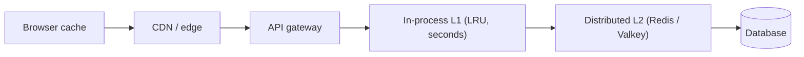
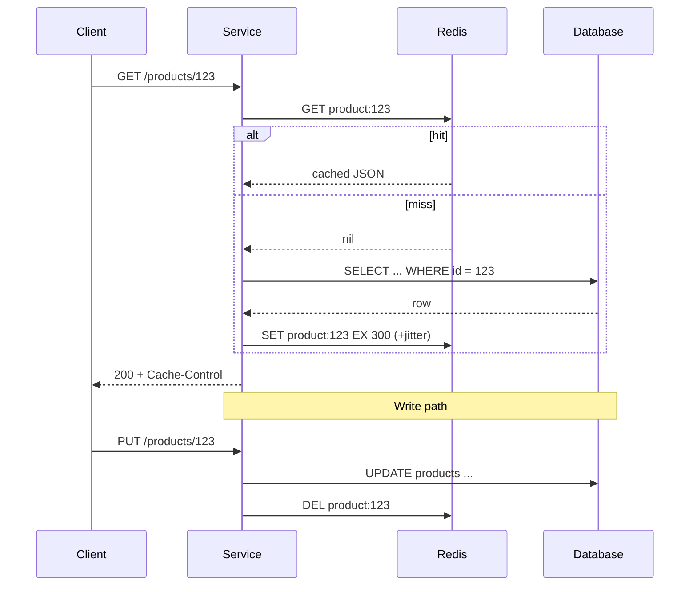
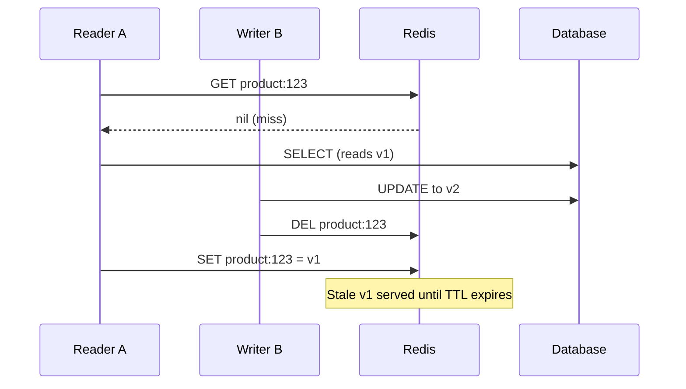
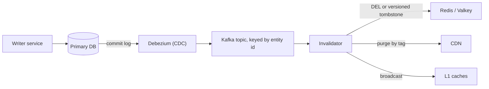

## TL;DR

- A cache trades **freshness and complexity for latency and load reduction**. Decide how stale is acceptable *per data type* (a "staleness budget") before choosing a pattern, and get the product owner to agree to it.
- **Cache-aside + TTL (with jitter) + delete-on-write** is the sensible default. Write-through, write-behind and refresh-ahead each solve a specific problem and bring a specific risk.
- The hard failures are **stampedes, hot keys, invalidation races, cold starts and cache outages**, not "cache misses". Design for them up front.
- Cache in layers (browser → CDN → in-process L1 → distributed L2 → DB). The cheapest request is the one that never reaches you, and hit ratio matters non-linearly: going from 90% to 99% cuts backend load by 10x.
- A cache must be **optional for correctness**: if the system breaks when the cache is empty, the cache has become your database, and you need to run it like one.

## Core Concepts

### Staleness budget: the decision before the design

Most caching arguments are really arguments about consistency that nobody wrote down. Agree a budget per data type, then pick the mechanism that meets it at the lowest cost.

| Data | Typical staleness budget | Mechanism |
|---|---|---|
| Product description, images | Minutes to hours | Long TTL + CDN + purge on publish |
| Price | Seconds, or event-driven | Short TTL + event/CDC invalidation |
| Stock level | Seconds for display, **zero** for reservation | Cache for display only, reserve against the DB |
| Account balance, payments | Zero | Don't cache, or cache only per-request |
| Feature flags, config | Seconds to a minute | In-process cache with push or polling refresh |

The architect move is to split a single entity by volatility: cache the static 95% of a product page for an hour and fetch the volatile 5% (stock, price) separately.

### Read and write patterns

| Pattern | Read path | Write path | Notes |
|---|---|---|---|
| Cache-aside (lazy loading) | App checks cache → on miss reads DB → populates cache | App writes DB → deletes cache key | Default choice; cache holds only what's read |
| Read-through | Cache library/provider loads from DB on miss | — | Same as cache-aside but encapsulated (e.g. a `LoadingCache`, a CDN in front of an origin) |
| Write-through | Reads hit cache | Write to cache and DB synchronously | Cache always warm for written data; write latency up; still needs a rule for which write wins if one side fails |
| Write-behind (write-back) | Reads hit cache | Write to cache; flush to DB asynchronously | Fast writes; **data loss risk** if cache fails before flush |
| Write-around | Cache-aside reads | Write DB only | Avoids caching write-once data |
| Refresh-ahead | Reads hit cache | — | Refreshes hot keys before expiry; wasted work if prediction is wrong |

### Hit ratio maths

Hit ratio is not linear in its effect. With a 1 ms cache and a 20 ms database:

- 90% hit ratio → average ≈ 0.9 × 1 + 0.1 × 21 = **3.0 ms**, and 10% of traffic reaches the DB.
- 99% hit ratio → average ≈ 0.99 × 1 + 0.01 × 21 = **1.2 ms**, and 1% reaches the DB.

The latency gain is modest; the **load** gain is 10x. That is why a cache that drops from 99% to 90% (a bad deploy that changes key format, a cold restart) can take the database down even though "the cache is still working". Capacity-plan the DB for the realistic *worst* hit ratio, not the average.

### Cache key design

The key *is* the cache contract. A good key is deterministic, namespaced, versioned by schema, and bounded in cardinality.

```ts
// <service>:<schemaVersion>:<entity>:<tenant>:<id>[:<variant>]
const SCHEMA_VERSION = 'v3'; // bump when the cached shape changes

export function productKey(tenantId: string, productId: string, locale: string): string {
  return `catalog:${SCHEMA_VERSION}:product:${tenantId}:${productId}:${locale.toLowerCase()}`;
}

// Normalise query-shaped keys, or every permutation becomes its own entry.
export function searchKey(params: Record<string, string>): string {
  const canonical = Object.keys(params)
    .sort()
    .map((k) => `${k}=${params[k].trim().toLowerCase()}`)
    .join('&');
  return `catalog:${SCHEMA_VERSION}:search:${hash(canonical)}`;
}
```

- The **schema version** means a deploy that changes the serialised shape reads new keys instead of failing to deserialise old ones. The cost is a cold cache for that entity, so roll it out gradually.
- **Tenant id in the key** is a security control in multi-tenant systems, not a convenience.
- Keep values small: a 2 MB JSON blob costs more to serialise and move than the query it replaces. Above roughly 100 KB, look at compression (and measure CPU), a binary format, or splitting the value.

### Expiry and eviction

- **TTL** bounds staleness and cleans up keys nobody invalidates. Add **jitter** (e.g. ±10%) so keys written together don't expire together.
- **Eviction** under memory pressure: Redis/Valkey offer approximated LRU and LFU (`maxmemory-policy`, e.g. `allkeys-lru`, `allkeys-lfu`, `volatile-lfu`). The default is `noeviction`, which makes writes fail when memory is full; choose `allkeys-*` for a pure cache, `volatile-*` only if the same instance also holds keys that must never be evicted (and then question why it does).
- **TTL and eviction are different tools**: TTL is a correctness/freshness decision, eviction is a capacity decision. If eviction is doing your expiry for you, you are under-provisioned or caching the wrong things.
- **Negative caching:** cache "not found" briefly (seconds, not minutes), so repeated lookups for missing ids, including bots enumerating ids, don't hammer the DB.
- Since Redis 7.4 (2024), individual **hash fields can have their own TTL** (`HEXPIRE`), which helps when one hash mixes volatile and stable fields. Valkey added hash field expiration in Valkey 9.0 (2025).

### Invalidation

Prefer **delete** over **update** on writes: updating the cache from the writer races with concurrent readers and concurrent writers (two writers can apply DB updates in one order and cache updates in the other). Even delete has a race (a reader loads old data, the writer deletes, the reader writes old data back). Mitigations:

- Short TTLs as a backstop.
- Versioned keys (`product:123:v42`) or versioned values, where the version comes from the DB row.
- Delayed double-delete.
- CDC-driven invalidation (Debezium → invalidator) so invalidation follows commit order and works across services.
- Leases, as in Facebook's memcache design: the cache hands a token to the first misser, and a `SET` is rejected if the key was deleted after the token was issued.

A versioned compare-and-set closes the stale write-back race without distributed transactions:

```ts
// Store { v, data } in a hash. Only write if our version is not older than what's there.
// On writes, store a tombstone with the new version instead of a plain DEL,
// so a delayed reader holding an older version can't resurrect stale data.
const SET_IF_NOT_OLDER = `
local cur = redis.call('HGET', KEYS[1], 'v')
if cur and tonumber(cur) > tonumber(ARGV[1]) then return 0 end
redis.call('HSET', KEYS[1], 'v', ARGV[1], 'data', ARGV[2])
redis.call('EXPIRE', KEYS[1], ARGV[3])
return 1
`;

export async function cacheRow(key: string, row: { version: number }, ttlSeconds: number) {
  return redis.eval(SET_IF_NOT_OLDER, 1, key, String(row.version), JSON.stringify(row), String(ttlSeconds));
}

export async function invalidate(key: string, newVersion: number) {
  // Tombstone: empty data, newer version, short TTL. Readers treat empty data as a miss.
  return redis.eval(SET_IF_NOT_OLDER, 1, key, String(newVersion), '', '30');
}
```

### Stampede protection

When a hot key expires, thousands of concurrent requests miss at once and all hit the DB.

```ts
// Single-flight: collapse concurrent misses for the same key into one DB call (per process).
const inFlight = new Map<string, Promise<unknown>>();

export async function getOrLoad<T>(key: string, ttlSeconds: number, load: () => Promise<T>): Promise<T> {
  const cached = await redis.get(key);
  if (cached !== null) return JSON.parse(cached) as T;

  const existing = inFlight.get(key) as Promise<T> | undefined;
  if (existing) return existing;

  const promise = (async () => {
    try {
      const value = await load();
      const jitter = Math.floor(ttlSeconds * 0.1 * Math.random());
      await redis.set(key, JSON.stringify(value), 'EX', ttlSeconds + jitter);
      return value;
    } finally {
      inFlight.delete(key);
    }
  })();
  inFlight.set(key, promise);
  return promise;
}
```

Single-flight is per process: 200 pods still means up to 200 DB calls per expiry. Across many instances, add a short distributed lock (`SET lock:key token NX PX 5000`, released with a compare-and-delete on the token), **serve stale while one caller refreshes**, or use probabilistic early refresh (XFetch, from Vattani et al., VLDB 2015): each reader recomputes early with a probability that rises as expiry approaches and with how expensive the recompute is.

```ts
// XFetch: deltaMs = how long the last recompute took, expiresAt = absolute expiry in ms.
// beta > 1 favours earlier refresh. Math.log(Math.random()) is negative, so this adds headroom.
export function shouldRefreshEarly(deltaMs: number, expiresAt: number, beta = 1): boolean {
  return Date.now() - deltaMs * beta * Math.log(Math.random()) >= expiresAt;
}
```

### Two-level caching (L1 in-process + L2 distributed)

An in-process L1 removes the network hop (nanoseconds to microseconds instead of ~0.5–1 ms) and absorbs hot keys, but every instance holds its own copy. Keep L1 TTLs short (seconds) and invalidate via a broadcast.

```ts
import { LRUCache } from 'lru-cache';

const l1 = new LRUCache<string, unknown>({ max: 10_000, ttl: 2_000 });

// Every instance subscribes. Writers publish after their DB commit and L2 delete.
subscriber.subscribe('cache-invalidate', (key) => l1.delete(key));

export async function get<T>(key: string, ttlSeconds: number, load: () => Promise<T>): Promise<T> {
  const local = l1.get(key) as T | undefined;
  if (local !== undefined) return local;
  const value = await getOrLoad(key, ttlSeconds, load); // L2 + single-flight from above
  l1.set(key, value);
  return value;
}
```

Pub/sub is fire-and-forget: a disconnected instance misses invalidations, which is why the short L1 TTL is non-negotiable. Redis 6+ also offers **server-assisted client-side caching** (`CLIENT TRACKING`, best with RESP3): the server remembers which keys a connection read and pushes invalidation messages, either per key (default mode) or per prefix (broadcasting mode). node-redis v5 exposes this through a built-in client-side cache option that requires RESP3.

### HTTP and CDN caching

- `Cache-Control: public, max-age=60, stale-while-revalidate=300` lets browsers and CDNs serve instantly while refreshing in the background. `stale-if-error=86400` serves stale content if the origin fails (both from RFC 5861).
- `s-maxage` overrides `max-age` for shared caches only, so you can give the CDN 5 minutes and browsers 30 seconds. `CDN-Cache-Control` (RFC 9213, 2022) targets CDNs specifically.
- `ETag` / `If-None-Match` gives cheap revalidation (304 Not Modified).
- `private` for per-user responses; `no-store` for sensitive data.
- Fingerprinted static assets (`app.3f9a1c.js`) get `max-age=31536000, immutable`.
- `Vary` controls the cache key (e.g. `Accept-Encoding`); a careless `Vary: Cookie` destroys the hit rate.
- **Purge by tag / surrogate key** (Fastly `Surrogate-Key`, Cloudflare `Cache-Tag`) lets one product update purge every page that shows it, without knowing the URLs.
- Security: **web cache poisoning** (unkeyed headers such as `X-Forwarded-Host` influencing a cached response) and **web cache deception** (tricking a CDN into caching `/account/profile.css` that actually returns the user's profile) are real attack classes. Any header the origin uses must be in the cache key or stripped at the edge.

### Platform notes

- In March 2024 Redis moved from BSD to source-available licences (RSALv2/SSPL) starting with Redis 7.4, and the Linux Foundation fork **Valkey** followed (forked from Redis 7.2.4), backed by AWS, Google, Oracle and others. Redis 8 (2025) added **AGPLv3** as a third licence option and folded the former Redis Stack modules (JSON, search, time series, probabilistic) into the core distribution.
- Managed services have followed: AWS ElastiCache and MemoryDB and Google Cloud Memorystore offer Valkey. AWS prices ElastiCache for Valkey roughly 20% lower (node-based) and 33% lower (serverless) than the Redis OSS engine.
- Azure is steering new workloads from Azure Cache for Redis to **Azure Managed Redis** (built on Redis Enterprise). Retirement dates are 31 March 2027 for the Enterprise/Enterprise Flash tiers and 30 September 2028 for Basic/Standard/Premium, and new Basic/Standard/Premium caches can no longer be created from October 2026.
- Other options worth knowing: **Memcached** (simple, multi-threaded, no persistence, still excellent for pure key-value), **Dragonfly** and Microsoft's **Garnet** (Redis-protocol-compatible, multi-threaded). Protocol compatibility is rarely 100%; test your commands, Lua scripts and cluster behaviour.

## How It Works

### Layers of caching on a request path



Each layer further left is cheaper per hit but harder to invalidate and less shared. Freshness budgets usually get shorter as you move left (browser) and right (L1), because those are the layers you can't purge centrally.

### Cache-aside read and write paths



### The stale write-back race



### Event-driven invalidation across services



Keying the topic by entity id preserves per-entity ordering; making invalidations idempotent means replays and duplicates are harmless.

## When to Use / Trade-offs

| Option | Use when | Avoid when | Cost |
|---|---|---|---|
| In-process (LRU map) | Small, hot, rarely-changing data (config, feature flags) | Data must be consistent across instances | Memory per instance; N copies to invalidate |
| Distributed (Redis/Valkey) | Shared cache across instances, sessions, rate limits | Sub-millisecond needs at extreme QPS where a network hop matters | Another stateful system to run |
| L1 + L2 (two-level) | Hot keys, very high read QPS, tolerance of seconds of staleness | Strict read-after-write across instances | Two invalidation paths; harder to reason about |
| CDN / edge | Public or semi-public GETs, static assets, API responses keyed by URL | Personalised, highly dynamic data | Invalidation latency, cache-key design, poisoning risk |
| Write-through | Read-after-write consistency for cached data | Write-heavy data rarely read | Higher write latency |
| Write-behind | Absorbing write bursts (counters, analytics) | Money, orders: anything you can't lose | Durability risk, complex recovery |
| Refresh-ahead | Predictably hot keys with expensive recomputation | Long-tail keys | Wasted recomputation |
| Materialised view / read model | Expensive queries needing consistency guarantees | Simple key lookups | Storage, refresh pipeline |
| Read replica | Read scaling with query flexibility | You need sub-millisecond reads | Replication lag, cost of another DB node |

### Invalidation strategies

| Strategy | Staleness | Complexity | Good for |
|---|---|---|---|
| TTL only | Up to TTL | Lowest | Data with a generous staleness budget |
| Delete on write (in the writer) | Small, with races | Low | Single service owning its data |
| Versioned values / tombstones | Near zero for the cached entity | Medium | Hot entities where stale write-back hurts |
| CDC-driven | Commit-ordered, seconds of lag | High (pipeline to run) | Many services, many caches, CDN purge |
| Leases | Near zero, with stampede protection | Medium to high (needs cache support) | Very high-scale memcache-style tiers |

## Common Pitfalls & Anti-patterns

- **No TTL** — keys live forever, invalidation bugs become permanent, memory grows until eviction kicks in unpredictably.
- **Synchronized expiry** — warming 1M keys with the same TTL creates a thundering herd an hour later.
- **Caching errors or partial results** — a timeout cached as "empty" for 10 minutes. Cache only successful, complete responses, and give negative results a much shorter TTL.
- **Hot keys** — one key (a homepage, a celebrity) saturates a single Redis shard; sharding never spreads a single key.
- **Big keys** — a 50 MB list or hash blocks Redis's single command thread on read, `DEL` or migration. Use `UNLINK` and split the value.
- **Unbounded key cardinality** — caching every search query permutation evicts everything useful.
- **Cache as source of truth** — sessions or carts only in a non-persistent cache, lost on failover.
- **Ignoring serialisation cost** — 2 MB JSON blobs make the cache slower than the DB.
- **Caching personalised responses as public** — one user's data served to others. Steam's December 2015 CDN misconfiguration exposed account pages to other users. Valve reported about 34,000 affected users.
- **Unkeyed inputs at the CDN** — a header the origin reflects but the CDN doesn't key on enables cache poisoning.
- **No timeout on cache calls** — a slow Redis with a default multi-second client timeout turns a cache problem into a full outage. Cache calls need tight timeouts (tens of milliseconds) and a circuit breaker.
- **`KEYS *` in production** — blocks the server; use `SCAN`.
- **Not measuring** — no hit ratio, latency or eviction metrics, so nobody knows if the cache helps.

## Real-world Scenario

**Context:** A product catalogue served 40k RPS at peak, behind a CDN, with a 6-shard Redis cluster in front of PostgreSQL. Each product page fanned out to price, stock and reviews services. A flash sale drove a single product to 30% of traffic; its Redis shard hit 100% CPU (Redis executes commands on one thread per shard), and p99 latency went from 15 ms to 2 s. Because the cache client had a 1-second timeout and no circuit breaker, the slow shard also tied up application threads for unrelated products.

**Constraints:** The sale was still running, so changes had to be safe to ship within hours. Prices had to be accurate within seconds (legal and trust requirement); stock display could lag by a few seconds as long as checkout reserved against the database.

**Options considered:**
- Scale the shard vertically: doesn't help, because the bottleneck was one CPU thread on one key.
- Add more shards: doesn't help, because one key lives on one shard.
- Absorb the reads before they reach Redis: chosen.

**Decision:**
1. Added a 2-second **in-process L1 cache** in front of Redis for the top-N hot keys (detected by sampling client-side key counts).
2. **Replicated** hot keys with a suffix (`product:123#0..7`) so reads spread across shards; writers update all copies, and the short TTL bounds any copy that misses an update.
3. **Single-flight + stale-while-revalidate** on the price service, so expiry of the hot price key caused one recompute rather than thousands.
4. CDN caching for the anonymous product page with `stale-while-revalidate`, with stock loaded by a separate small, uncached call.
5. Cut the Redis client timeout to 50 ms and added a circuit breaker that falls back to the DB behind a concurrency limit.

**Outcome:** Redis CPU dropped below 40% during the next sale, p99 returned to ~20 ms, and DB load stayed flat despite 3x traffic. The circuit breaker fired twice in the following quarter during Redis maintenance, and the site stayed up both times.

**What I'd do differently:** Load-test with a skewed (Zipfian) key distribution. Uniform load tests hid the hot-key problem. I'd also make hot-key promotion automatic from day one instead of a manually maintained list, and write the staleness budget per field into the design doc before the first sale rather than after the incident.

## Interview Questions

### Compare cache-aside and write-through. When would you choose each? {#cache-aside-vs-write-through}

**Level:** Foundation

**Model answer:**
Cache-aside loads data into the cache on a miss and the writer invalidates (deletes) the key. Only data that is actually read gets cached, and a cache outage degrades to DB reads. Write-through writes to the cache and DB together, so recently written data is always warm and read-after-write is consistent, at the cost of slower writes and caching data that may never be read. Write-through also needs a rule for partial failure: if the DB write succeeds and the cache write fails, you must delete the key or you serve stale data.

Choose cache-aside by default; choose write-through when reads immediately follow writes and staleness is unacceptable. Many real systems combine them: write-through for the entity just written, cache-aside for everything else.

**What the interviewer is looking for:**
Understanding both paths (read and write), failure behaviour, and a sensible default. A great answer mentions the partial-failure case and that the two are often combined.

**Follow-ups:**
- Why delete the key on write instead of updating it?
- Where does write-behind fit, and what's the risk?
- What happens to each pattern when the cache is unavailable?

**Red flags:**
- No mention of invalidation or TTLs.
- Not knowing what happens when the cache is down.
- Assuming write-through gives atomicity across the cache and the DB.

### Where can you cache along a typical web request path, and what decides which layer to use? {#cache-layers}

**Level:** Foundation

**Model answer:**
From the client inwards:
- **Browser**: controlled by `Cache-Control`; free, but you can't purge it, so keep TTLs short for anything that changes, and fingerprint static assets.
- **CDN / edge**: absorbs traffic before it reaches you, cuts latency for distant users; keyed by URL and `Vary` headers; purgeable, but purges take seconds and personalised content is risky.
- **API gateway / reverse proxy**: response caching for shared GETs.
- **In-process (L1)**: fastest (no network hop), but one copy per instance, so short TTLs.
- **Distributed (L2, Redis/Valkey/Memcached)**: shared across instances, ~sub-millisecond to 1 ms.
- **Database**: buffer pool and materialised views.

The deciding factors are who can share the result (public vs per-user), how stale it can be, whether you can invalidate that layer, and where the load or latency problem actually is.

**What the interviewer is looking for:**
A layered mental model and the trade-off between proximity to the user and controllability. Great answers note that the layers you can't purge (browser, L1) need the shortest TTLs.

**Follow-ups:**
- How do you cache a page that is 90% public and 10% personalised?
- What happens to staleness when you stack three layers, each with a 60-second TTL?

**Red flags:**
- Thinking "caching" only means Redis.
- Caching per-user responses at a shared layer without discussing the key.

### What's the difference between TTL expiry and eviction, and how do you pick an eviction policy? {#ttl-vs-eviction}

**Level:** Foundation

**Model answer:**
**TTL** is a freshness decision: the key is removed after a set time regardless of memory. **Eviction** is a capacity decision: when memory reaches `maxmemory`, the server removes keys according to a policy.

In Redis/Valkey:
- `noeviction` (the default) rejects writes when full. Fine for a primary datastore, wrong for a cache.
- `allkeys-lru` evicts the least recently used key: good general default for a pure cache.
- `allkeys-lfu` evicts the least frequently used: better when a stable set of popular keys must survive a one-off scan or batch job.
- `volatile-*` evicts only keys with a TTL: only for a mixed instance that also stores keys that must persist.

Both LRU and LFU are approximations based on sampling, tunable with `maxmemory-samples`.

**What the interviewer is looking for:**
Clear separation of the two concepts and knowing that the default policy is wrong for a cache. A great answer links rising evictions to either under-provisioning or caching low-value data.

**Follow-ups:**
- What metric tells you eviction is hurting you?
- Why might a nightly batch job wreck the hit ratio under LRU?

**Red flags:**
- Treating eviction as the expiry mechanism.
- Not knowing the default policy, or not knowing a policy exists.

### What is the cache hit ratio, and why can it mislead you? {#hit-ratio}

**Level:** Foundation

**Model answer:**
Hit ratio = hits / (hits + misses). It's the headline metric, but:
- **Its effect on load is non-linear**: 99% → 90% means 10x more traffic to the database, even though the number "only" fell by 9 points.
- **An average hides the distribution**: a 95% overall ratio can mean the hot keys hit 99.9% and an important endpoint hits 40%. Measure per key prefix or per endpoint.
- **A high ratio can hide staleness bugs**: you are serving wrong data very efficiently.
- **It ignores cost per miss**: a 1% miss rate on a 2-second query matters more than 20% on a 2 ms lookup.

Alongside it, watch evictions, memory, p99 latency of cache calls, key count, and the backing store's load.

**What the interviewer is looking for:**
Understanding that the metric should be read with the cost of misses and the DB's headroom. Great answers do the 90% vs 99% arithmetic unprompted.

**Follow-ups:**
- What hit ratio would you need for the DB to survive peak traffic?
- How would you alert on a cache problem before users notice?

**Red flags:**
- "Higher is always better" with no mention of freshness.
- Only measuring hit ratio, with no DB-side view.

### What is a cache stampede and how do you prevent it? {#cache-stampede}

**Level:** Senior

**Model answer:**
When a popular key expires (or the cache restarts), many concurrent requests miss simultaneously and all hit the backing store, often overloading it and causing further timeouts. Prevention:
- **Request coalescing / single-flight** per process.
- **Distributed lock** so one caller recomputes while others wait briefly or serve stale.
- **Stale-while-revalidate**: keep serving the old value while refreshing asynchronously (store a soft expiry inside the value and a longer hard TTL on the key).
- **Probabilistic early expiration** (XFetch).
- **TTL jitter** to avoid synchronised expiry.
- **Pre-warming** after deploys or failovers, and ramping traffic gradually onto a cold cache.

**What the interviewer is looking for:**
Multiple complementary techniques and awareness of the cold-start case (whole cache empty), not just single-key expiry. Great answers note single-flight is per process and that locks need timeouts and a fallback.

**Follow-ups:**
- How do you warm a cache after a regional failover?
- What timeout should waiters use when another caller holds the lock?
- What happens if the lock holder crashes?

**Red flags:**
- "Make the TTL longer."
- No awareness that this can take down the database.

### Can you walk me through a race condition that can leave stale data in a cache-aside setup, and how you'd mitigate it? {#invalidation-race}

**Level:** Senior

**Model answer:**
Classic race: reader A misses and reads value v1 from the DB. Writer B updates the DB to v2 and deletes the key. Reader A, delayed, now writes v1 to the cache. The cache holds stale v1 until TTL expiry.

Mitigations:
- A short TTL bounds the damage.
- **Versioned values**: write only if the version is not older (a Lua compare-and-set on a version field), and have writers leave a versioned tombstone rather than a plain delete.
- **Delayed double delete**: delete again after a short delay (cheap, but only probabilistic).
- **Leases** (Facebook memcache): a `SET` is rejected if the key was invalidated after the lease was issued.
- Invalidate from **CDC** on the DB commit log so ordering follows commits.
- For critical reads, bypass the cache (read-your-writes for the writer's session).

**What the interviewer is looking for:**
The ability to reason about interleavings, and choosing mitigation by business impact rather than chasing perfect consistency.

**Follow-ups:**
- How would you detect this happening in production?
- Why is "update cache on write" worse than "delete on write"?

**Red flags:**
- Believing cache-aside is strongly consistent.
- Distributed transactions across Redis and the DB as the first answer.

### How do HTTP caching headers let you cache API responses safely? {#http-caching}

**Level:** Senior

**Model answer:**
`Cache-Control` sets freshness and audience: `max-age` (browser), `s-maxage` (shared caches/CDN), `public`/`private`, `no-store` for sensitive data. `stale-while-revalidate` serves stale content while revalidating in the background; `stale-if-error` serves stale content when the origin fails. Validators (`ETag` with `If-None-Match`, or `Last-Modified`) allow cheap 304 responses. `Vary` defines which request headers change the representation. Personalised responses must be `private` or keyed carefully at the CDN, otherwise you risk leaking one user's data to another. Any request header the origin uses to build the response must be part of the cache key, or an attacker can poison the cache.

**What the interviewer is looking for:**
Practical header knowledge, the security risk of caching personalised data, and edge caching as an architecture lever.

**Follow-ups:**
- How do you purge a CDN when a product price changes?
- What's the difference between `no-cache` and `no-store`?
- What is web cache deception and how do you prevent it?

**Red flags:**
- Thinking `no-cache` means "don't cache".
- Caching authenticated responses as `public`.

### How do you design cache keys, and what goes wrong when you get them wrong? {#cache-key-design}

**Level:** Senior

**Model answer:**
A key should be deterministic, namespaced and bounded: `service:schemaVersion:entity:tenant:id[:variant]`.
- **Namespace and schema version**: lets you change the cached shape on deploy without deserialisation errors, and lets you drop a whole namespace.
- **Tenant/user scope**: in multi-tenant systems a missing tenant id is a data leak, not a bug.
- **Normalisation**: sort and lower-case query parameters, strip tracking parameters (`utm_*`), or every permutation is a new entry.
- **Bounded cardinality**: don't key on free text or timestamps; if you must cache search, cache only popular queries or the first page.
- **Cluster hash tags** (`{user:42}:cart`, `{user:42}:prefs`) when multi-key operations must land on one shard, but watch that they don't create hot shards.

Failure modes: low hit ratio from fragmented keys, memory pressure evicting valuable keys, cross-tenant leaks, and a "big bang" cold cache when a key format changes everywhere at once.

**What the interviewer is looking for:**
Treating the key as a contract with security and capacity implications. Great answers mention schema versioning and gradual rollout of key changes.

**Follow-ups:**
- How would you change a key format for 100M existing entries without a stampede?
- How do hash tags interact with hot keys in Redis Cluster?

**Red flags:**
- Using raw serialised request objects as keys.
- No mention of tenant isolation in a multi-tenant system.

### When would you add an in-process L1 cache in front of Redis, and how do you keep it consistent? {#two-level-cache}

**Level:** Senior

**Model answer:**
Add L1 when the network hop or Redis CPU is the bottleneck: hot keys, very high read QPS per instance, or reference data read on every request (config, feature flags, permissions). L1 reads cost nanoseconds to microseconds against ~0.5–1 ms for Redis, and L1 also protects Redis from hot keys.

The cost is N copies. Consistency options, cheapest first:
- **Short TTL** (1–5 s) as the backstop, always.
- **Pub/sub broadcast** of invalidations after the DB commit. It's fire-and-forget, so a reconnecting instance should flush L1.
- **Redis server-assisted client-side caching** (`CLIENT TRACKING`, Redis 6+), where the server pushes invalidations for keys the client read.
- Bound L1 by entry count and by memory, so it can't cause GC pressure or OOM.

Don't use L1 where a user must see their own write immediately across instances, unless you route that user's reads around L1.

**What the interviewer is looking for:**
Knowing the latency numbers, the multiplied-copies problem, and that broadcast invalidation is lossy. Great answers bring up memory/GC impact on the service.

**Follow-ups:**
- How would you handle an instance that missed invalidations during a network blip?
- How does L1 change your capacity planning for Redis?

**Red flags:**
- Long L1 TTLs with no invalidation.
- Not realising each instance has its own copy.

### Your team is facing a Redis outage during peak traffic. How should the application behave, and how would you design for it in advance? {#cache-outage-degradation}

**Level:** Senior

**Model answer:**
First, the cache must not take the service down with it:
- **Tight client timeouts** (tens of ms) and a **circuit breaker**, so a slow cache fails fast instead of exhausting threads or connections.
- **Fallback to the DB behind a concurrency limit / load shedding**, because the DB was sized for, say, 5% of reads, not 100%. Shed low-priority traffic (recommendations, reviews) before core paths (checkout).
- **Serve from other layers**: L1, CDN `stale-if-error`.
- **Decide fail-open vs fail-closed per use case**: a rate limiter usually fails open; a distributed lock guarding a payment must fail closed.

Recovery is the dangerous part: a cold cache plus full traffic is a stampede. Warm the top-N keys first, ramp traffic back gradually, and rely on single-flight. In advance: game days that kill Redis in staging, a documented degradation mode, and capacity planning for the DB at a realistic worst-case hit ratio. Facebook's "gutter" pool (a small standby cache that takes over failed servers' keys with short TTLs) is a reference design.

**What the interviewer is looking for:**
Recognising that cache failure becomes DB overload, and that recovery causes a second incident if unmanaged. Great answers distinguish caches used for performance from caches used for coordination (locks, rate limits, sessions).

**Follow-ups:**
- How would you test this before it happens?
- What would you change if sessions are stored in that Redis?

**Red flags:**
- "Fall back to the database" with no consideration of DB capacity.
- No timeouts or circuit breaker.
- "Redis doesn't go down, it's managed."

### A single product key receives 30% of traffic during a sale and saturates one Redis shard. What do you do, immediately and long term? {#hot-key}

**Level:** Architect

**Model answer:**
**Immediately:** add a short-TTL in-process L1 cache for that key (seconds), enable CDN caching for the page with `stale-while-revalidate`, and if needed, rate-limit non-critical calls that fetch it. Check that cache client timeouts are short so the hot shard doesn't drag down unrelated requests.

**Long term:**
- **Hot-key detection** (`redis-cli --hotkeys` with an LFU policy, client-side sampling, or proxy metrics) that feeds automatic L1 promotion.
- **Key replication**: write N copies (`key#0..N`) on different shards and read a random one.
- Use read replicas and spread reads across them (accepting replication lag).
- Separate rapidly changing fields (stock count) from static ones (description) so the static part can be cached longer.
- Capacity planning and load tests with skewed distributions.

**What the interviewer is looking for:**
Calm incident triage first, then a structural fix; layered caching; understanding of sharding limits.

**Follow-ups:**
- How do you keep N replicated copies consistent on update?
- How would you show stock levels accurately if the page is cached at the CDN?

**Red flags:**
- "Scale Redis vertically" as the only answer.
- Not recognising that sharding doesn't spread a single key.

### When would you decide *not* to add a cache? {#when-not-to-cache}

**Level:** Architect

**Model answer:**
- When the real bottleneck is elsewhere (a missing index, N+1 queries, a chatty API design). Caching hides it and adds a system.
- When data must be strongly consistent (balances, inventory reservation) and the invalidation complexity outweighs the gain.
- When the hit ratio would be low (high-cardinality, rarely repeated reads).
- When the team can't operate another stateful component.
- When cheaper options exist: HTTP caching, a read replica, a materialised view, or denormalisation.

I'd require a measured latency/load problem, an expected hit ratio, a staleness budget agreed with the product owner, and a degradation plan for when the cache is down.

**What the interviewer is looking for:**
Judgement and cost awareness; treating a cache as an architectural decision with operational cost (an ADR-worthy choice).

**Follow-ups:**
- How would you justify the cache in an ADR?
- What metrics prove the cache is worth keeping a year later?

**Red flags:**
- "Always cache everything."
- No mention of measuring first.

### How would you design caching for a multi-region, active-active service? {#multi-region-caching}

**Level:** Architect

**Model answer:**
Principles: **keep cache reads region-local** (a cross-region read costs 50–150 ms and defeats the point), and **treat invalidation as the cross-region problem**.

Design:
- One cache cluster per region, populated from the region's own DB replica.
- **Invalidate from each region's own replication stream** (region-local CDC). If you broadcast invalidations from the writer's region, they can arrive before the local DB replica has applied the change, and a local reader repopulates the old value. Invalidating from the local commit log ties invalidation to local visibility.
- Staleness budget = replication lag + invalidation lag + TTL. Make it explicit and monitor it.
- For data that must be read-your-writes, route the user to their write region for a short window, or carry a version/timestamp token the reader can check.
- Managed options: ElastiCache Global Datastore (one primary region, read replicas elsewhere) or active-active CRDT-based replication (Redis Enterprise / Azure Managed Redis). CRDTs resolve concurrent writes deterministically, but "deterministically" isn't "correctly" for every business rule.
- Plan failover warm-up: a region that takes over another's traffic sees a cold working set.

**What the interviewer is looking for:**
Understanding that the hard part is the interaction between DB replication and invalidation ordering. Great answers spot the "invalidation arrives before the replica" race and give an explicit staleness budget.

**Follow-ups:**
- How would you monitor end-to-end staleness?
- What changes if one region is write-primary and others are read-only?
- How do you handle the CDN layer in this design?

**Red flags:**
- A single global Redis read from all regions.
- Assuming invalidation messages and DB replication arrive in order.

### Your team is facing stale data bugs because a dozen services cache data owned by other services. How would you fix invalidation across the organisation? {#cross-service-invalidation}

**Level:** Architect

**Model answer:**
The root cause is usually that each consumer invents its own TTLs and nobody tells it when data changes. Fixes, from structural to tactical:

1. **Ownership**: the owning service publishes change events; consumers never infer changes. Make it part of the service's contract.
2. **Reliable change events**: CDC (Debezium on the commit log) or the transactional outbox pattern, so events can't be lost between the DB commit and publishing. Dual writes (commit, then publish) lose events on crashes.
3. **Ordering and idempotency**: partition the topic by entity id, include the entity version, make invalidations idempotent (delete or versioned tombstone), so replays are safe.
4. **Consumer standards**: a shared caching library with key conventions, jittered TTLs as a backstop, metrics, and a documented staleness budget per consumed entity.
5. **Reduce the number of caches**: sometimes the right answer is for the owner to expose a cached read API or a replicated read model instead of a dozen bespoke caches.
6. **Observability**: sample-compare cache vs source of truth in production to measure the actual stale rate.

**What the interviewer is looking for:**
Socio-technical thinking: ownership and contracts, not just a technology. Great answers name the dual-write problem and the outbox/CDC fix, and measure staleness rather than assert it.

**Follow-ups:**
- How do you migrate twelve teams onto this without a big bang?
- What happens if the CDC pipeline lags by ten minutes?
- When is a shared read model better than per-service caches?

**Red flags:**
- "Just lower all the TTLs."
- Publishing invalidations from application code after commit with no outbox, without acknowledging lost events.
- A central team owning everyone's caches.

### How would you choose between Redis, Valkey, Memcached and a managed service for a new platform in 2026? {#cache-platform-choice}

**Level:** Architect

**Model answer:**
Start from requirements, then licensing and operations:
- **Workload**: pure key-value at high throughput → Memcached is still a strong, simple choice (multi-threaded, no persistence). Data structures, Lua, streams, pub/sub, rate limiting, sorted-set leaderboards → Redis or Valkey.
- **Licensing**: since 2024, Redis is source-available (RSALv2/SSPL), with AGPLv3 added in Redis 8. That matters if you embed or offer it as a service, and some legal teams reject AGPL outright. Valkey stays BSD and is backed by the Linux Foundation and major clouds.
- **Features**: Redis 8 bundles JSON, search and vector features; Valkey has its own feature roadmap. Check the specific commands you rely on.
- **Managed vs self-hosted**: managed (ElastiCache/Memorystore for Valkey, Azure Managed Redis, Redis Cloud) moves patching, failover and scaling to the provider. Self-hosting rarely pays off below significant scale.
- **Cloud direction**: on Azure, new work should target Azure Managed Redis, since older Azure Cache for Redis tiers have announced retirements.
- **Exit cost**: stick to the common command subset and wrap the client behind your own interface, so switching engines is a configuration and test exercise, not a rewrite.

I'd capture the decision in an ADR with cost per GB and per million ops, licence review, the failure model, and a migration path.

**What the interviewer is looking for:**
Up-to-date platform awareness, licensing literacy and reversibility. Great answers connect a technical choice to legal, cost and vendor-strategy concerns.

**Follow-ups:**
- How would you migrate a live Redis cluster to Valkey with no downtime?
- What would make you choose a Redis-compatible engine like Dragonfly or Garnet?

**Red flags:**
- Unaware of the 2024 licence change.
- Choosing purely on benchmark numbers.
- Tight coupling to engine-specific modules without acknowledging lock-in.

## Cheat Sheet

### Patterns

- **Cache-aside** — read miss → DB → populate; write → DB → delete key. The default.
- **Write-through** — write cache + DB synchronously; warm and consistent, slower writes.
- **Write-behind** — write cache, flush DB later; fast but can lose data.
- **Delete, don't update** — updating the cache on write races with readers.
- **Versioned keys** — store the DB row version with the value and reject older writes, closing the stale write-back race.

### Failure modes

- **TTL jitter** — randomise expiry to avoid synchronised mass misses.
- **Stampede** — many concurrent misses on one key; use single-flight, locks, serve-stale, early refresh.
- **Hot key** — one key overloads one shard; use L1 cache, key replication, CDN.
- **Negative caching** — briefly cache "not found" to protect the DB.
- **Probabilistic early expiration** — XFetch: refresh before expiry with rising probability, so one caller recomputes instead of all.

### HTTP

- **`stale-while-revalidate`** — serve stale instantly, refresh in the background.
- **`no-cache` vs `no-store`** — `no-cache` = revalidate before use; `no-store` = never store.
- **`s-maxage`** — freshness for shared caches (CDN) only; overrides `max-age` there.

### Operations

- **Hit ratio** — the key cache metric; also watch evictions, memory and latency.
- **Valkey** — Linux Foundation fork of Redis after the 2024 licence change.

## Further Reading

- [Redis documentation](https://redis.io/docs/latest/) — data types, eviction policies and client-side caching.
- [Redis: client-side caching reference](https://redis.io/docs/latest/develop/reference/client-side-caching/) — how `CLIENT TRACKING` and server-pushed invalidation work.
- [Redis: key eviction](https://redis.io/docs/latest/develop/reference/eviction/) — every `maxmemory-policy` and how the LRU/LFU approximations behave.
- [Valkey documentation](https://valkey.io/docs/) — the open-source Redis fork.
- [MDN: HTTP caching](https://developer.mozilla.org/en-US/docs/Web/HTTP/Caching) — headers, freshness and validation explained.
- [RFC 9111: HTTP Caching](https://www.rfc-editor.org/rfc/rfc9111) — the specification.
- [RFC 5861: HTTP Cache-Control Extensions for Stale Content](https://www.rfc-editor.org/rfc/rfc5861) — the source of `stale-while-revalidate` and `stale-if-error`.
- [RFC 9213: Targeted HTTP Cache Control](https://www.rfc-editor.org/rfc/rfc9213) — `CDN-Cache-Control` and CDN-specific directives.
- [Cache-Aside pattern (Azure Architecture Center)](https://learn.microsoft.com/en-us/azure/architecture/patterns/cache-aside) — pattern guidance and considerations.
- [Cloudflare Cache documentation](https://developers.cloudflare.com/cache/) — cache keys, purge by tag and edge caching rules in a major CDN.
- [Azure Managed Redis documentation](https://learn.microsoft.com/en-us/azure/redis/) — the successor to Azure Cache for Redis, including migration guidance.
- [Amazon ElastiCache caching strategies](https://docs.aws.amazon.com/AmazonElastiCache/latest/dg/Strategies.html) — lazy loading, write-through and TTL guidance from AWS.
