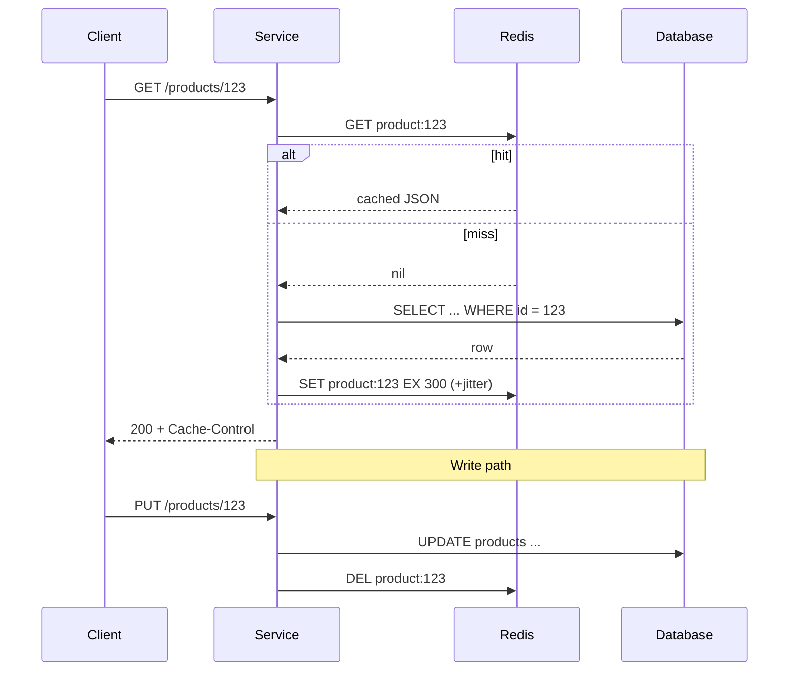

## TL;DR

- A cache trades **freshness and complexity for latency and load reduction**. Decide how stale is acceptable *per data type* before choosing a pattern.
- **Cache-aside + TTL + delete-on-write** is the sensible default. Write-through and write-behind solve specific problems and bring specific risks.
- The hard failures are **stampedes, hot keys, invalidation races and cold starts**, not "cache misses".
- Cache in layers (browser → CDN → app/in-process → distributed → DB). The cheapest request is the one that never reaches you.
- A cache must be **optional for correctness**: if the system breaks when the cache is empty, the cache has become your database.

## Core Concepts

### Read and write patterns

| Pattern | Read path | Write path | Notes |
|---|---|---|---|
| Cache-aside (lazy loading) | App checks cache → on miss reads DB → populates cache | App writes DB → deletes cache key | Default choice; cache holds only what's read |
| Read-through | Cache library/provider loads from DB on miss | — | Same as cache-aside but encapsulated |
| Write-through | Reads hit cache | Write to cache and DB synchronously | Cache always warm for written data; write latency up |
| Write-behind (write-back) | Reads hit cache | Write to cache; flush to DB asynchronously | Fast writes; **data loss risk** if cache fails before flush |
| Write-around | Cache-aside reads | Write DB only | Avoids caching write-once data |

### Expiry and eviction

- **TTL** bounds staleness and cleans up keys nobody invalidates. Add **jitter** (e.g. ±10%) so keys written together don't expire together.
- **Eviction** under memory pressure: LRU and LFU approximations in Redis (`maxmemory-policy`, e.g. `allkeys-lru`, `volatile-lfu`). Choose `allkeys-*` for pure caches.
- **Negative caching:** cache "not found" briefly, so repeated lookups for missing ids don't hammer the DB.

### Invalidation

Prefer **delete** over **update** on writes: updating the cache from the writer races with concurrent readers repopulating stale values. Even delete has a race (a reader loads old data, the writer deletes, the reader writes old data back). Mitigations:

- Short TTLs as a backstop.
- Versioned keys (`product:123:v42`) where the version comes from the DB row.
- Delayed double-delete.
- CDC-driven invalidation (Debezium → invalidator) for consistency across services.

### Stampede protection

When a hot key expires, thousands of concurrent requests miss at once and all hit the DB.

```ts
// Single-flight: collapse concurrent misses for the same key into one DB call (per process).
const inFlight = new Map<string, Promise<unknown>>();

export async function getOrLoad<T>(key: string, ttlSeconds: number, load: () => Promise<T>): Promise<T> {
  const cached = await redis.get(key);
  if (cached !== null) return JSON.parse(cached) as T;

  const existing = inFlight.get(key) as Promise<T> | undefined;
  if (existing) return existing;

  const promise = (async () => {
    try {
      const value = await load();
      const jitter = Math.floor(ttlSeconds * 0.1 * Math.random());
      await redis.set(key, JSON.stringify(value), 'EX', ttlSeconds + jitter);
      return value;
    } finally {
      inFlight.delete(key);
    }
  })();
  inFlight.set(key, promise);
  return promise;
}
```

Across many instances, add a short distributed lock (`SET lock:key token NX PX 5000`), **serve stale while one caller refreshes**, or use probabilistic early refresh (recompute before expiry with increasing probability as TTL approaches).

### HTTP and CDN caching

- `Cache-Control: public, max-age=60, stale-while-revalidate=300` lets browsers and CDNs serve instantly while refreshing in the background.
- `ETag` / `If-None-Match` gives cheap revalidation (304 Not Modified).
- `private` for per-user responses; `no-store` for sensitive data.
- Fingerprinted static assets (`app.3f9a1c.js`) get `max-age=31536000, immutable`.
- `Vary` controls the cache key (e.g. `Accept-Encoding`); a careless `Vary: Cookie` destroys the hit rate.

### Platform notes

- In 2024 Redis moved from BSD to source-available licences (RSALv2/SSPL), and the Linux Foundation fork **Valkey** followed. VERIFY: Redis 8 later added AGPLv3 as a licence option.
- VERIFY: Azure is steering new workloads from Azure Cache for Redis to **Azure Managed Redis**. Check the retirement timeline for existing tiers.

## How It Works



## When to Use / Trade-offs

| Option | Use when | Avoid when | Cost |
|---|---|---|---|
| In-process (LRU map) | Small, hot, rarely-changing data (config, feature flags) | Data must be consistent across instances | Memory per instance; N copies to invalidate |
| Distributed (Redis/Valkey) | Shared cache across instances, sessions, rate limits | Sub-millisecond needs at extreme QPS where a network hop matters | Another stateful system to run |
| CDN / edge | Public or semi-public GETs, static assets, API responses keyed by URL | Personalised, highly dynamic data | Invalidation latency, cache-key design |
| Write-through | Read-after-write consistency for cached data | Write-heavy data rarely read | Higher write latency |
| Write-behind | Absorbing write bursts (counters, analytics) | Money, orders: anything you can't lose | Durability risk, complex recovery |
| Materialised view / read model | Expensive queries needing consistency guarantees | Simple key lookups | Storage, refresh pipeline |

## Common Pitfalls & Anti-patterns

- **No TTL** — keys live forever, invalidation bugs become permanent, memory grows until eviction kicks in unpredictably.
- **Synchronized expiry** — warming 1M keys with the same TTL creates a thundering herd an hour later.
- **Caching errors or partial results** — a timeout cached as "empty" for 10 minutes.
- **Hot keys** — one key (a homepage, a celebrity) saturates a single Redis shard.
- **Unbounded key cardinality** — caching every search query permutation evicts everything useful.
- **Cache as source of truth** — sessions or carts only in a non-persistent cache, lost on failover.
- **Ignoring serialisation cost** — 2 MB JSON blobs make the cache slower than the DB.
- **Not measuring** — no hit ratio, latency or eviction metrics, so nobody knows if the cache helps.

## Real-world Scenario

**Context:** A product catalogue served 40k RPS at peak. Each product page fanned out to price, stock and reviews services. A flash sale drove a single product to 30% of traffic; its Redis shard hit 100% CPU and p99 latency went from 15 ms to 2 s.

**Decision:**
1. Added a 2-second **in-process L1 cache** in front of Redis for the top-N hot keys (detected by sampling).
2. **Replicated** hot keys with a suffix (`product:123#0..7`) so reads spread across shards.
3. **Single-flight + stale-while-revalidate** on the price service.
4. CDN caching for the anonymous product page with `stale-while-revalidate`.

**Outcome:** Redis CPU dropped below 40% during the next sale, p99 returned to ~20 ms, and DB load stayed flat despite 3x traffic.

**What I'd do differently:** Load-test with a skewed (Zipfian) key distribution. Uniform load tests hid the hot-key problem.

## Interview Questions

### Compare cache-aside and write-through. When would you choose each? {#cache-aside-vs-write-through}

**Level:** Foundation

**Model answer:**
Cache-aside loads data into the cache on a miss and the writer invalidates (deletes) the key. Only data that is actually read gets cached, and a cache outage degrades to DB reads. Write-through writes to the cache and DB together, so recently written data is always warm and read-after-write is consistent, at the cost of slower writes and caching data that may never be read. Choose cache-aside by default; choose write-through when reads immediately follow writes and staleness is unacceptable.

**What the interviewer is looking for:**
Understanding both paths (read and write), failure behaviour, and a sensible default.

**Follow-ups:**
- Why delete the key on write instead of updating it?
- Where does write-behind fit, and what's the risk?

**Red flags:**
- No mention of invalidation or TTLs.
- Not knowing what happens when the cache is down.

### What is a cache stampede and how do you prevent it? {#cache-stampede}

**Level:** Senior

**Model answer:**
When a popular key expires (or the cache restarts), many concurrent requests miss simultaneously and all hit the backing store, often overloading it and causing further timeouts. Prevention:
- **Request coalescing / single-flight** per process.
- **Distributed lock** so one caller recomputes while others wait briefly or serve stale.
- **Stale-while-revalidate**: keep serving the old value while refreshing asynchronously.
- **Probabilistic early expiration**.
- **TTL jitter** to avoid synchronised expiry.
- **Pre-warming** after deploys or failovers.

**What the interviewer is looking for:**
Multiple complementary techniques and awareness of the cold-start case (whole cache empty), not just single-key expiry.

**Follow-ups:**
- How do you warm a cache after a regional failover?
- What timeout should waiters use when another caller holds the lock?

**Red flags:**
- "Make the TTL longer."
- No awareness that this can take down the database.

### Walk me through a race condition that can leave stale data in a cache-aside setup, and how you'd mitigate it. {#invalidation-race}

**Level:** Senior

**Model answer:**
Classic race: reader A misses and reads value v1 from the DB. Writer B updates the DB to v2 and deletes the key. Reader A, delayed, now writes v1 to the cache. The cache holds stale v1 until TTL expiry.

Mitigations:
- A short TTL bounds the damage.
- **Versioned values**: write only if the version is newer (a Lua script compare-and-set on a version field).
- **Delayed double delete**: delete again after a short delay.
- Invalidate from **CDC** on the DB commit log so ordering follows commits.
- For critical reads, bypass the cache (read-your-writes for the writer's session).

**What the interviewer is looking for:**
The ability to reason about interleavings, and choosing mitigation by business impact rather than chasing perfect consistency.

**Follow-ups:**
- How would you detect this happening in production?
- Why is "update cache on write" worse than "delete on write"?

**Red flags:**
- Believing cache-aside is strongly consistent.
- Distributed transactions across Redis and the DB as the first answer.

### How do HTTP caching headers let you cache API responses safely? {#http-caching}

**Level:** Senior

**Model answer:**
`Cache-Control` sets freshness and audience: `max-age` (browser), `s-maxage` (shared caches/CDN), `public`/`private`, `no-store` for sensitive data. `stale-while-revalidate` serves stale content while revalidating in the background; `stale-if-error` serves stale content when the origin fails. Validators (`ETag` with `If-None-Match`, or `Last-Modified`) allow cheap 304 responses. `Vary` defines which request headers change the representation. Personalised responses must be `private` or keyed carefully at the CDN, otherwise you risk leaking one user's data to another.

**What the interviewer is looking for:**
Practical header knowledge, the security risk of caching personalised data, and edge caching as an architecture lever.

**Follow-ups:**
- How do you purge a CDN when a product price changes?
- What's the difference between `no-cache` and `no-store`?

**Red flags:**
- Thinking `no-cache` means "don't cache".
- Caching authenticated responses as `public`.

### A single product key receives 30% of traffic during a sale and saturates one Redis shard. What do you do, immediately and long term? {#hot-key}

**Level:** Architect

**Model answer:**
**Immediately:** add a short-TTL in-process L1 cache for that key (seconds), enable CDN caching for the page with `stale-while-revalidate`, and if needed, rate-limit non-critical calls that fetch it.

**Long term:**
- **Hot-key detection** (Redis `--hotkeys` with LFU policy, client-side sampling, or proxy metrics) that feeds automatic L1 promotion.
- **Key replication**: write N copies (`key#0..N`) on different shards and read a random one.
- Use read replicas and spread reads across them.
- Separate rapidly changing fields (stock count) from static ones (description) so the static part can be cached longer.
- Capacity planning and load tests with skewed distributions.

**What the interviewer is looking for:**
Calm incident triage first, then a structural fix; layered caching; understanding of sharding limits.

**Follow-ups:**
- How do you keep N replicated copies consistent on update?
- How would you show stock levels accurately if the page is cached at the CDN?

**Red flags:**
- "Scale Redis vertically" as the only answer.
- Not recognising that sharding doesn't spread a single key.

### When would you decide *not* to add a cache? {#when-not-to-cache}

**Level:** Architect

**Model answer:**
- When the real bottleneck is elsewhere (a missing index, N+1 queries, a chatty API design). Caching hides it and adds a system.
- When data must be strongly consistent (balances, inventory reservation) and the invalidation complexity outweighs the gain.
- When the hit ratio would be low (high-cardinality, rarely repeated reads).
- When the team can't operate another stateful component.
- When cheaper options exist: HTTP caching, a read replica, a materialised view, or denormalisation.

I'd require a measured latency/load problem, an expected hit ratio, a staleness budget agreed with the product owner, and a degradation plan for when the cache is down.

**What the interviewer is looking for:**
Judgement and cost awareness; treating a cache as an architectural decision with operational cost (an ADR-worthy choice).

**Follow-ups:**
- How would you justify the cache in an ADR?
- What metrics prove the cache is worth keeping a year later?

**Red flags:**
- "Always cache everything."
- No mention of measuring first.

## Cheat Sheet

- **Cache-aside** — read miss → DB → populate; write → DB → delete key. The default.
- **Write-through** — write cache + DB synchronously; warm and consistent, slower writes.
- **Write-behind** — write cache, flush DB later; fast but can lose data.
- **TTL jitter** — randomise expiry to avoid synchronised mass misses.
- **Stampede** — many concurrent misses on one key; use single-flight, locks, serve-stale, early refresh.
- **Hot key** — one key overloads one shard; use L1 cache, key replication, CDN.
- **Negative caching** — briefly cache "not found" to protect the DB.
- **Delete, don't update** — updating the cache on write races with readers.
- **`stale-while-revalidate`** — serve stale instantly, refresh in the background.
- **`no-cache` vs `no-store`** — `no-cache` = revalidate before use; `no-store` = never store.
- **Hit ratio** — the key cache metric; also watch evictions, memory and latency.
- **Valkey** — Linux Foundation fork of Redis after the 2024 licence change.

## Further Reading

- [Redis documentation](https://redis.io/docs/latest/) — data types, eviction policies and client-side caching.
- [Valkey documentation](https://valkey.io/docs/) — the open-source Redis fork.
- [MDN: HTTP caching](https://developer.mozilla.org/en-US/docs/Web/HTTP/Caching) — headers, freshness and validation explained.
- [RFC 9111: HTTP Caching](https://www.rfc-editor.org/rfc/rfc9111) — the specification.
- [Cache-Aside pattern (Azure Architecture Center)](https://learn.microsoft.com/en-us/azure/architecture/patterns/cache-aside) — pattern guidance and considerations.
