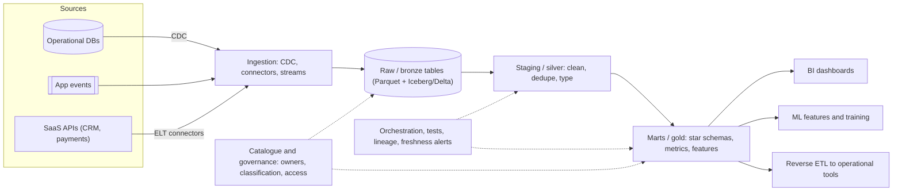
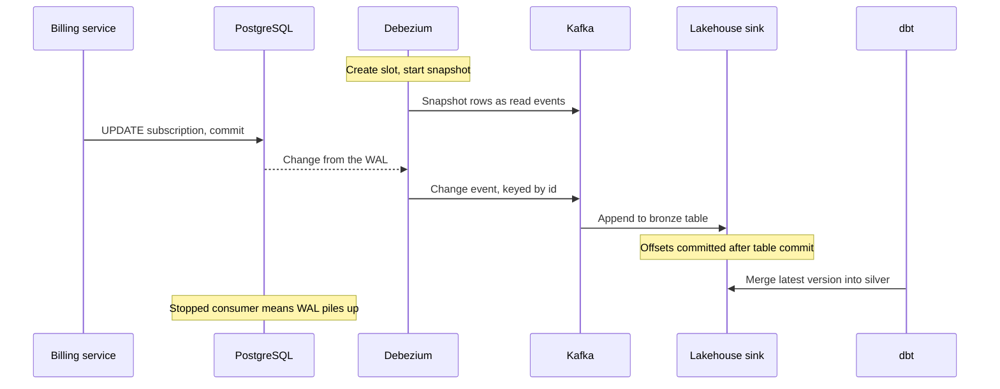

## TL;DR

- Data engineering moves data from operational systems to where it creates value — analytics, reporting, ML, data products — **reliably, correctly and on time**.
- Operational (OLTP) databases are optimised for transactions; analytical (OLAP) stores — warehouses, lakehouses — are optimised for scanning and aggregating large volumes with columnar storage.
- Modern stacks favour **ELT**: land raw data, then transform inside the warehouse/lakehouse with versioned SQL (e.g. dbt), in layers (raw → cleaned → business-ready).
- Pipelines must be **idempotent, observable and tested**: re-runnable without duplicates, with data quality checks, lineage and freshness SLAs.
- At scale, treat data as a **product** with owners and **contracts** — schema changes in source systems are the most common cause of broken pipelines.

## Core Concepts

### OLTP vs OLAP

| | OLTP (operational) | OLAP (analytical) |
|---|---|---|
| Workload | Many small reads/writes, transactions | Large scans and aggregations |
| Storage | Row-oriented | Column-oriented, compressed |
| Schema | Normalised | Dimensional / wide tables |
| Examples | PostgreSQL, SQL Server, DynamoDB | BigQuery, Snowflake, Redshift, Databricks, Microsoft Fabric, ClickHouse |
| Users | Applications | Analysts, data scientists, BI tools |

Running heavy analytics on production OLTP databases hurts application performance and complicates schema evolution — replicate data to an analytical store.

### Ingestion

- **Batch extracts:** scheduled queries/exports (full or incremental by `updated_at` watermark).
- **Change data capture (CDC):** stream row-level changes from the database log (Debezium, cloud DMS, native change feeds) — captures deletes and preserves order, minimal source load.
- **Event streams:** application events via Kafka/Event Hubs/Kinesis.
- **SaaS connectors:** managed ELT tools (Fivetran, Airbyte, cloud data factories) for CRM, ads, payments.
- **Files:** CSV/JSON drops to object storage.

### Storage: warehouse, lake, lakehouse

- **Data warehouse:** managed analytical database with SQL, strong governance and performance; structured data.
- **Data lake:** cheap object storage holding raw files in any format; flexible but historically weak on transactions and governance ("data swamp" risk).
- **Lakehouse:** open table formats (**Apache Iceberg, Delta Lake, Apache Hudi**) on object storage add ACID transactions, schema evolution, time travel and efficient queries — warehouse-like capabilities on lake storage, readable by multiple engines.
- **File formats:** **Parquet** (columnar, compressed, the default for analytics), Avro (row-based, schema evolution, streaming), JSON/CSV (interchange only).

### Transformation and layering

ELT with SQL transformations versioned in Git (dbt is the de facto standard) — with tests, documentation and lineage. Common layering ("medallion"):

| Layer | Contents | Consumers |
|---|---|---|
| Bronze / raw | Data as ingested, append-only, with load metadata | Reprocessing, audit |
| Silver / staging + intermediate | Cleaned, deduplicated, typed, conformed keys | Data engineers, analysts |
| Gold / marts | Business-ready models: star schemas, metrics, feature tables | BI, analysts, ML, data products |

```sql
-- dbt model: models/marts/fct_orders.sql (incremental, idempotent by unique key)
{{ config(materialized='incremental', unique_key='order_id') }}
select
  o.order_id,
  o.customer_id,
  o.placed_at::date            as order_date,
  o.total_minor / 100.0         as order_total,
  o.currency,
  c.country,
  o.updated_at                -- needed by the incremental filter below
from {{ ref('stg_orders') }} o
join {{ ref('dim_customers') }} c using (customer_id)

-- Look back an hour to catch late-committing rows; the merge on order_id keeps re-runs idempotent.
where o.updated_at >= (select max(updated_at) - interval '1 hour' from {{ this }})

```

### Worked example: the rows an incremental load never saw

An incremental model loads orders every 15 minutes with `where updated_at > (select max(updated_at) from target)`. In PostgreSQL, `now()` returns the **transaction's start time**, so a row's `updated_at` can be well before the moment it becomes visible.

| Time | What happens |
|---|---|
| 10:00:05 | Transaction T1 starts, sets order A's `updated_at` to 10:00:05, then waits on a slow payment call |
| 10:00:20 | Transaction T2 updates order B (`updated_at` 10:00:20) and commits at once |
| 10:00:30 | The load runs. It sees B but not A, because A isn't committed. The target's maximum `updated_at` becomes 10:00:20 |
| 10:00:40 | T1 commits. Order A is now visible, with `updated_at` 10:00:05 |
| 10:15:00 | The next load reads rows with `updated_at > 10:00:20`. Order A is older than the watermark, so it's **never loaded** |

Nothing fails and no alert fires. The warehouse is just quietly missing rows, until finance reconciles revenue and finds the gap.

**Fixes, from simplest to most robust:**
- **A lookback window, plus a merge on the unique key.** Re-read the last hour on every run (`updated_at >= max(updated_at) - interval '1 hour'`) and merge by `order_id`. Rows seen twice are simply updated again, so the run stays idempotent, and late commits up to an hour are caught. Choose the window from the longest transaction you expect, and monitor transaction duration.
- **Watermark on commit order, not on a timestamp column.** CDC reads the database log in commit order, so a late commit simply arrives later. That's why CDC is preferred for important tables.
- **Reconcile.** A daily check compares row counts and totals per day between the source and the warehouse, and alerts on gaps. It catches this class of bug whatever the cause.

The dbt model above uses the lookback and merge pattern. It also selects `updated_at`, because an incremental filter on the target can only use columns the target stores.

### Orchestration

Pipelines are DAGs of tasks with dependencies, schedules, retries and alerts — orchestrated by Airflow, Dagster, Prefect, cloud services (Data Factory, Step Functions, Workflows) or dbt Cloud. Prefer **asset/data-aware** orchestration (run when upstream data changes) over blind cron schedules where possible.

### Pipeline properties

- **Idempotent:** re-running a run for the same period produces the same result (overwrite partitions or merge by keys; never blind appends).
- **Incremental:** process only new/changed data, with watermarks — plus a way to **backfill**.
- **Observable:** freshness, volume, schema and distribution checks; lineage to trace impact; alerts routed to owners.
- **Tested:** uniqueness, not-null, accepted values, referential integrity, row-count reconciliation with sources.

### Batch vs streaming

- **Batch** (hourly/daily): simpler, cheaper, easier to reprocess; latency of minutes to hours.
- **Streaming** (seconds): stream processors (Flink, Spark Structured Streaming, Kafka Streams, cloud stream analytics) handle windows, late events (watermarks), exactly-once state; more complex to build and operate.
- Many organisations use **micro-batch** or streaming ingestion with batch transformations; choose real-time only where the decision needs it (fraud, operational alerts, personalisation).

## How It Works



### Change data capture, from commit to table



## When to Use / Trade-offs

| Choice | Use when | Avoid when | Trade-off |
|---|---|---|---|
| Managed warehouse (BigQuery, Snowflake, Fabric) | Most analytics needs, SQL-centric teams | Massive unstructured/ML workloads only | Simplicity vs cost at scale and lock-in |
| Lakehouse (Iceberg/Delta on object storage) | Large volumes, multiple engines, ML + BI, open formats | Small teams wanting minimal ops | Openness and cost vs more engineering |
| ELT with dbt | SQL transformations, versioned, tested | Complex non-SQL processing (use Spark/Python) | Accessibility vs compute in warehouse |
| CDC ingestion | Operational DB changes incl. deletes, low source impact | Tiny datasets where batch extracts suffice | Freshness vs operational complexity |
| Streaming processing | Decisions needing seconds (fraud, alerts) | Daily reporting | Latency vs complexity and cost |
| Reverse ETL | Push modelled data into CRM/support tools | When source systems should own the data | Activation vs data duplication |

## Common Pitfalls & Anti-patterns

- **Analytics on production OLTP** — slow queries hurting customers.
- **Non-idempotent pipelines** — re-runs create duplicates; backfills impossible.
- **No data quality checks** — dashboards silently wrong; trust lost.
- **Schema changes breaking pipelines** — upstream teams unaware of downstream consumers.
- **Data swamp** — undocumented raw files with no owners or catalogue.
- **Real-time everything** — streaming complexity where daily batches would do.
- **Business logic duplicated** across dashboards with different metric definitions.
- **PII sprawl** — personal data copied into every layer and tool without controls.
- **Cron-only orchestration** — jobs run whether or not upstream data arrived.

## Real-world Scenario

**Context:** A subscription company's finance and product teams reported different monthly recurring revenue (MRR) numbers. Data came from nightly CSV exports of production tables, transformed by ad-hoc scripts and spreadsheet logic; pipelines broke weekly after application schema changes, and backfills required manual SQL.

**Decision:** Introduced CDC from the billing database into raw tables in a cloud warehouse; dbt models in staging and mart layers with tests (uniqueness, not-null, accepted values, reconciliation of totals against the billing system); a single, documented `mrr` metric in the semantic layer used by all dashboards; incremental idempotent models with backfill support; data contracts with the billing team (schema changes reviewed in CI with downstream impact shown via lineage); freshness alerts routed to owners.

**Outcome:** One agreed MRR figure across finance and product; pipeline breakages from schema changes fell to near zero; finance month-end reporting shortened by several days.

**What I'd do differently:** Agree the metric definitions with finance first — technical improvements didn't matter until the definitions were settled.

## Interview Questions

### What's the difference between OLTP and OLAP systems? {#oltp-vs-olap}

**Level:** Foundation

**Model answer:**
- **OLTP** (online transaction processing) systems run applications: many small, concurrent reads and writes with transactions, row-oriented storage, normalised schemas, low latency — e.g. PostgreSQL behind an e-commerce site.
- **OLAP** (online analytical processing) systems answer analytical questions over large volumes: scans and aggregations over many rows but few columns, columnar compressed storage, denormalised/dimensional models — e.g. BigQuery, Snowflake, Databricks, ClickHouse.

Separating them protects production performance, allows analytical modelling without constraining application schemas, and lets each be optimised for its workload. Data moves from OLTP to OLAP via batch extracts, CDC or events.

**What the interviewer is looking for:**
Workload, storage and schema differences, and why to separate them.

**Follow-ups:**
- Why is columnar storage faster for analytics?
- What are HTAP databases?

**Red flags:**
- Running BI dashboards directly against the production database by default.

### ETL or ELT — what's the difference and which do you prefer? {#etl-vs-elt}

**Level:** Foundation

**Model answer:**
- **ETL (extract, transform, load):** transform data in a separate processing layer before loading it into the warehouse. Traditional when warehouse compute was expensive and storage limited.
- **ELT (extract, load, transform):** load raw data first, then transform inside the warehouse/lakehouse using its scalable compute (often SQL with dbt).

ELT is the modern default: raw data is preserved for reprocessing and audit; transformations are versioned SQL that analysts can contribute to; scaling is handled by the platform. ETL still makes sense when data must be cleaned, masked or reduced **before** landing (e.g. removing PII for compliance), for heavy non-SQL processing, or when the target can't do transformations.

**What the interviewer is looking for:**
Clear distinction, reasons ELT dominates, and valid ETL cases.

**Follow-ups:**
- How does keeping raw data help when a transformation bug is found?
- Where would you mask PII?

**Red flags:**
- No awareness of reprocessing needs.

### When should you use batch processing versus streaming? {#batch-vs-streaming}

**Level:** Foundation

**Model answer:**
- **Batch:** process accumulated data on a schedule (hourly, daily). Simpler, cheaper, easier to test and backfill. Fits reporting, finance, most analytics and ML training.
- **Streaming:** process events continuously with seconds of latency. Needed when decisions or user experiences depend on freshness: fraud detection, operational monitoring, real-time personalisation, inventory updates, IoT alerts.

Streaming adds complexity: event-time vs processing-time, watermarks for late data, windowing, stateful processing, exactly-once semantics, reprocessing and operational overhead. Many teams use streaming **ingestion** (CDC/events landing continuously) with batch or micro-batch **transformation**, getting reasonable freshness without full streaming complexity.

**What the interviewer is looking for:**
Use cases for each, streaming complexity, and the hybrid approach.

**Follow-ups:**
- What's a watermark in stream processing?
- How fresh does a sales dashboard really need to be?

**Red flags:**
- "Everything should be real-time."

### What are data warehouses, data lakes and lakehouses? {#warehouse-lake-lakehouse}

**Level:** Foundation

**Model answer:**
- **Data warehouse:** an analytical database for structured data — SQL, schemas, governance, high performance; e.g. Snowflake, BigQuery, Redshift, Synapse/Fabric warehouse.
- **Data lake:** cheap, scalable object storage holding raw data in any format (Parquet, JSON, images, logs). Flexible, supports ML and diverse data — but without table semantics, it lacks transactions, consistent schemas and governance, risking a "data swamp".
- **Lakehouse:** adds **open table formats** (Apache Iceberg, Delta Lake, Apache Hudi) on top of lake storage, providing ACID transactions, schema evolution, time travel, partition management and efficient queries — warehouse-like features on open, cheap storage, accessible from multiple engines (Spark, Trino, warehouses).

Many organisations converge on a lakehouse or a warehouse that can read open table formats, choosing based on scale, ML needs, openness and team skills.

**What the interviewer is looking for:**
Definitions, the problems each solves, and table formats as the lakehouse enabler.

**Follow-ups:**
- What does "time travel" in table formats enable?
- Why does Parquet matter?

**Red flags:**
- Treating a data lake as a dumping ground without catalogues or formats.

### How do you make data pipelines idempotent and re-runnable? {#idempotent-pipelines}

**Level:** Senior

**Model answer:**
- **Deterministic inputs per run:** process a defined slice (date partition, watermark range) rather than "everything since last time" without bounds.
- **Overwrite or merge, don't append blindly:** replace the target partition for that period (`INSERT OVERWRITE`), or `MERGE` on unique keys so re-runs update instead of duplicating.
- **Deduplicate on natural/event keys** in staging (CDC and events contain duplicates).
- **Atomic writes:** write to a temporary location/table and swap, or rely on table-format transactions, so partial failures don't leave half-written data.
- **Separate logic from schedule:** parameterise by logical date so backfills reuse the same code.
- **Track state explicitly:** watermarks and run metadata stored, not inferred.
- **Test re-runs:** run twice in CI or staging and compare results.

**What the interviewer is looking for:**
Bounded slices, overwrite/merge strategies, dedupe, atomicity, parameterised dates and testing re-runs.

**Follow-ups:**
- How do you backfill two years of data after a logic change?
- How do CDC deletes affect idempotency?

**Red flags:**
- Pipelines that append on every run and break on retries.

### How do you ensure data quality in pipelines? {#data-quality}

**Level:** Senior

**Model answer:**
- **Tests in transformations:** not-null, unique, accepted values, relationships (referential integrity), custom business rules (e.g. order total ≥ 0) — dbt tests or Great Expectations/Soda checks.
- **Reconciliation:** row counts and key totals compared with source systems (e.g. revenue matches billing).
- **Freshness checks:** alert when data hasn't arrived by its SLA.
- **Volume and distribution monitoring:** anomaly detection on row counts, null rates, value distributions (data observability tools).
- **Schema change detection** from sources with contracts and CI checks.
- **Circuit breakers:** stop publishing to downstream marts when critical tests fail, rather than spreading bad data.
- **Ownership and incident handling:** alerts routed to owners, documented runbooks, data incidents tracked like software incidents, consumers notified.

**What the interviewer is looking for:**
Layered checks (tests, reconciliation, freshness, anomalies), stopping bad data and ownership.

**Follow-ups:**
- What's the difference between data testing and data observability?
- Who should own data quality — producers or consumers?

**Red flags:**
- Discovering data issues from executives looking at dashboards.

### How does CDC work for feeding analytics? {#cdc-analytics}

**Level:** Senior

**Model answer:**
Change data capture reads the database's transaction log (Postgres WAL, MySQL binlog, SQL Server CDC) and emits row-level insert/update/delete events in commit order — via Debezium on Kafka Connect, cloud DMS, or native change feeds.

For analytics:
- Land change events in raw tables (append-only, with operation type, timestamps and log positions).
- Build **current-state tables** by merging changes (latest version per key, applying deletes) and **history tables** (SCD Type 2) when needed.
- Handle **initial snapshots** plus ongoing changes; **schema changes** (new columns) via schema registry/evolution; **ordering and duplicates** via log positions and keys.

Benefits over batch extracts: captures deletes, near-real-time freshness, low load on the source, no reliance on `updated_at` columns. Costs: operational complexity (connectors, replication slots that can bloat the source if consumers stall), and coupling to source schemas — mitigate with contracts or publishing curated events instead.

**What the interviewer is looking for:**
Mechanics, current-state and history modelling, edge cases and operational risks.

**Follow-ups:**
- What happens if a CDC consumer stops for a day on Postgres?
- CDC from tables vs publishing domain events — trade-offs?

**Red flags:**
- Ignoring deletes and schema changes.

### Why do file formats and partitioning matter for analytical performance? {#file-formats}

**Level:** Senior

**Model answer:**
**Formats:**
- **Parquet** (and ORC): columnar, compressed, with column statistics — queries read only needed columns and skip row groups via min/max stats. The default for analytics.
- **Avro:** row-based with schema evolution; good for streaming and ingestion.
- **CSV/JSON:** human-friendly interchange; slow and loosely typed for analytics.

**Table formats** (Iceberg, Delta, Hudi) add metadata for transactions, schema evolution, partition evolution and time travel over Parquet files.

**Partitioning and layout:**
- Partition by columns used in filters, commonly date (`event_date`) — enabling partition pruning.
- Avoid over-partitioning (millions of tiny files) — **small files** kill performance; compact regularly.
- Clustering/sorting (Z-ordering, clustering keys) co-locate related rows for better skipping.
- Choose file sizes in the hundreds-of-MB range for typical engines (for example Apache Iceberg's default target file size is 512 MB, and Delta Lake's `OPTIMIZE` aims for about 1 GB).

**What the interviewer is looking for:**
Columnar benefits, table formats, partition pruning and the small-files problem.

**Follow-ups:**
- What's partition evolution in Iceberg?
- How do you fix a table with 2 million small files?

**Red flags:**
- Storing analytical data as CSV at scale.

### How do you handle late-arriving data and backfills? {#late-data-backfills}

**Level:** Senior

**Model answer:**
**Late-arriving data** (events delayed by offline devices, retries, upstream outages):
- Partition by **event time**, but process by **ingestion time** windows and reprocess affected event-time partitions (e.g. re-run the last 3 days each night).
- In streaming, use **watermarks** and allowed lateness; route very late events to correction processes.
- Late dimension data (fact arrives before its customer record): use placeholder/"unknown" dimension members and update later, or delay processing.

**Backfills** (new logic, bug fixes, new sources):
- Pipelines parameterised by logical date and idempotent, so historical runs reuse the same code.
- Run in controlled batches with resource limits; compare outputs with previous versions; publish atomically.
- Communicate to consumers when historical numbers change, with explanations.

**What the interviewer is looking for:**
Event vs ingestion time, reprocessing windows, watermarks, late dimensions and safe backfills with communication.

**Follow-ups:**
- How far back should you reprocess each day?
- How do you backfill a streaming pipeline?

**Red flags:**
- Assuming data always arrives on time.

### How do you structure transformations in a modern analytics stack? {#transformation-layers}

**Level:** Senior

**Model answer:**
Use layered, version-controlled transformations (typically dbt):
- **Sources/raw (bronze):** declared sources with freshness checks; no business logic.
- **Staging (silver):** one model per source table — rename, cast types, standardise units and time zones, deduplicate; one-to-one with sources.
- **Intermediate:** reusable joins and business logic building blocks.
- **Marts (gold):** business-facing models — facts and dimensions, aggregated metrics, feature tables — organised by domain (finance, product, marketing).
- **Semantic layer/metrics definitions:** single definitions for metrics like MRR or active users, used consistently across BI tools.

Practices: tests and documentation on every model, code review in PRs, CI that builds changed models and their dependents against a sample or clone, environments (dev/prod), lineage graphs to understand impact, naming conventions (`stg_`, `int_`, `fct_`, `dim_`).

**What the interviewer is looking for:**
Clear layering, metric consistency, software engineering practices for SQL.

**Follow-ups:**
- Where should business logic live — BI tool or dbt?
- How do you test dbt changes before production?

**Red flags:**
- Metric logic duplicated in every dashboard.

### Design an analytics platform for a 300-person company. {#analytics-platform}

**Level:** Architect

**Model answer:**
**Requirements:** questions the business needs answered, data sources (product DB, payments, CRM, marketing, support), freshness needs (mostly daily; some hourly), data sensitivity, team skills and budget.

**Architecture (pragmatic, managed-first):**
- **Ingestion:** managed ELT connectors for SaaS sources; CDC for the product database; product events via an event pipeline or analytics SDK.
- **Storage/compute:** a managed cloud warehouse (or lakehouse if ML-heavy or large volumes), with raw/staging/marts layers.
- **Transformation:** dbt with tests, documentation and CI; orchestration via dbt Cloud, Dagster or Airflow.
- **Semantic layer and BI:** one BI tool with certified dashboards and governed metric definitions; self-service exploration on marts.
- **Data quality and observability:** freshness/volume checks, alerts to owners.
- **Governance:** catalogue (owners, descriptions, classification), role-based access, PII masking, retention policies, audit.
- **Activation:** reverse ETL for sales/support tools if needed.
- **Team:** a small central data team (analytics engineers, data engineer) plus embedded analysts; clear ownership of key domains.

Start with the highest-value use cases (revenue reporting, product funnel), deliver iteratively, and avoid over-building (no streaming or lakehouse until justified).

**What the interviewer is looking for:**
Requirements-first, managed components, layered modelling, governance, quality and a right-sized team and roadmap.

**Follow-ups:**
- How would you control warehouse costs?
- When would you add streaming?

**Red flags:**
- Starting with a complex big-data stack for modest volumes.

### What is data mesh, and when does it make sense? {#data-mesh}

**Level:** Architect

**Model answer:**
Data mesh (Zhamak Dehghani) is a socio-technical approach to analytical data at scale, based on four principles:
1. **Domain ownership:** domains (teams owning business capabilities) own their analytical data, not a central data team.
2. **Data as a product:** domains publish discoverable, trustworthy, documented datasets with SLAs, owners and contracts.
3. **Self-serve data platform:** a platform team provides infrastructure and tooling so domains can build data products without deep expertise.
4. **Federated computational governance:** global standards (interoperability, security, privacy, quality) defined federally and enforced automatically.

When it fits: large organisations where a central data team has become a bottleneck, with many domains and mature engineering teams. When it doesn't: small/medium companies — a central team with good practices is simpler; mesh adds organisational overhead and requires domain teams to take on data responsibilities.

Most organisations adopt elements (data products, contracts, ownership) without a full mesh.

**What the interviewer is looking for:**
Principles, conditions for success, costs, and pragmatic partial adoption.

**Follow-ups:**
- How do you avoid inconsistent metrics across domains in a mesh?
- What's in a data product?

**Red flags:**
- Presenting data mesh as a technology to buy.

### What are data contracts, and how do you implement them? {#data-contracts}

**Level:** Architect

**Model answer:**
A data contract is an agreement between data producers and consumers about a dataset or event stream:
- **Schema** (fields, types, nullability) and **semantics** (meaning, units, business definitions).
- **Quality expectations** (uniqueness, completeness, valid ranges), **freshness/SLAs**, and **ownership/contacts**.
- **Evolution rules:** compatible changes allowed; breaking changes require versioning and notice.
- **Access and classification** (PII, retention).

Implementation:
- Define contracts as code (YAML/JSON, schema registry entries, dbt model contracts) in the producer's repository.
- **CI enforcement:** producer changes are checked for compatibility; downstream impact shown via lineage.
- **Runtime checks:** validate data against the contract at ingestion or publication; quarantine violations.
- Prefer publishing **curated events or data products** from producers rather than consumers scraping internal tables.
- Make producers accountable (alerts go to them) and include contracts in definition of done for schema changes.

**What the interviewer is looking for:**
Contract contents, enforcement in CI and runtime, producer accountability and publishing curated interfaces.

**Follow-ups:**
- How do you introduce contracts for existing tables consumed by 50 dashboards?
- Who approves breaking changes?

**Red flags:**
- Consumers reading application tables directly with no agreements.

### Design a real-time analytics pipeline for live operational dashboards. {#real-time-pipeline}

**Level:** Architect

**Model answer:**
**Requirements:** which metrics, latency target (e.g. under 30 seconds), accuracy needs (exact vs approximate), volume (events/sec), retention and query patterns.

**Design:**
- **Event sources:** application events and CDC into a durable log (Kafka/Event Hubs/Kinesis), partitioned by a sensible key, with schemas in a registry.
- **Stream processing:** Flink or Spark Structured Streaming (or managed equivalents) computing windowed aggregates on **event time** with watermarks; stateful processing with checkpoints for fault tolerance; deduplication by event id.
- **Serving store:** a real-time OLAP database (ClickHouse, Apache Druid/Pinot) or the warehouse's streaming ingestion for low-latency queries; or materialised aggregates in a key-value store for fixed dashboards.
- **Dashboards:** query the serving layer; show data freshness explicitly.
- **Reconciliation with batch:** the batch pipeline remains the source of truth for financial reporting; real-time numbers may differ slightly — communicate and reconcile.
- **Operations:** lag monitoring, backpressure, replay capability from the log, schema evolution, cost controls.

**What the interviewer is looking for:**
Requirements, log-based architecture, event-time processing, appropriate serving stores, reconciliation with batch and operability.

**Follow-ups:**
- How do you handle a bug in the streaming job that produced wrong aggregates for 2 hours?
- When is a Lambda/Kappa architecture appropriate?

**Red flags:**
- Polling the production database every second.

### How do you implement data governance and privacy in data pipelines? {#data-governance}

**Level:** Architect

**Model answer:**
- **Catalogue and lineage:** every dataset has an owner, description, classification and lineage from source to consumption.
- **Classification-driven controls:** tag PII and sensitive fields at ingestion; apply masking/tokenisation, column- and row-level security automatically based on tags.
- **Minimisation:** don't ingest data you don't need; pseudonymise early (e.g. replace emails with hashed or tokenised ids in analytical layers).
- **Access management:** role-based and purpose-based access via groups; just-in-time access for sensitive data; audited queries.
- **Retention and deletion:** retention policies per dataset; propagate deletion requests (GDPR) through layers — design for it (keys that allow deletion, partitioning, crypto-shredding where data is immutable).
- **Residency:** keep data in permitted regions.
- **Quality and contracts** as part of governance; certified datasets for key metrics.
- **Federated model:** central standards and tooling, domain teams responsible for their data.

**What the interviewer is looking for:**
Catalogue/lineage, tag-based controls, minimisation, access, retention/erasure, residency and operating model.

**Follow-ups:**
- How do you propagate a deletion request through raw, staging and mart layers and backups?
- How do you let analysts work with sensitive data safely?

**Red flags:**
- Full production PII copied into every analytical layer and tool.

### What is data lineage, and what is it used for? {#data-lineage}

**Level:** Foundation

**Model answer:**
**Data lineage** is the map of where data comes from and where it goes: which sources feed which tables, which transformations produce which columns, and which dashboards, models and exports use them. It can be recorded at **table** level or, more usefully, at **column** level.

Where it comes from:
- **Transformation tools** know their own graph. dbt builds lineage from `ref()` and `source()`.
- **Query parsing** of warehouse logs reconstructs which queries read and write which tables.
- **Orchestrators and the OpenLineage standard** emit lineage events from jobs, collected by catalogues such as Marquez, DataHub, OpenMetadata or the warehouse's own catalogue.

What it's used for:
- **Impact analysis before a change**: "if the billing team renames this column, which 14 models and 3 dashboards break?" This is how data contracts are enforced in CI.
- **Root-cause analysis**: a dashboard number is wrong, so trace upstream to the job or source that changed.
- **Trust and governance**: show where a published metric comes from, and trace personal data through every layer to apply access controls, retention and erasure.
- **Clean-up**: find tables nobody reads and stop paying for them.

Lineage is only valuable if it's **automatic and current**. A hand-drawn diagram is out of date within a month.

**What the interviewer is looking for:**
The definition, how lineage is captured, and concrete uses for change, debugging and governance.

**Follow-ups:**
- How would you use lineage to support a right-to-erasure request?
- Why is column-level lineage harder to capture than table-level?

**Red flags:**
- Lineage maintained by hand.
- Not knowing what would break if a source column changed.

### How do open table formats such as Apache Iceberg work? {#open-table-formats}

**Level:** Senior

**Model answer:**
A data lake is just files in object storage, which has no transactions: a reader can see half-written data, and two writers can overwrite each other. **Open table formats** (Iceberg, Delta Lake, Hudi) add a **metadata layer** that turns a set of Parquet files into a table with database-like guarantees.

**How Iceberg does it:**
- Data lives in immutable **data files** (usually Parquet).
- **Manifest files** list data files with statistics (row counts, column minimum and maximum values), and a **manifest list** groups manifests into a **snapshot**: the table's complete state at one commit.
- A **metadata file** records the schema, partitioning and the list of snapshots. The **catalog** (a REST catalog, AWS Glue, Polaris, Unity Catalog, Nessie) holds a pointer to the current metadata file.
- A commit writes new files, then **atomically swaps the catalog's pointer**. Readers see either the old snapshot or the new one, never a mixture. If two writers conflict, one retries (optimistic concurrency).

**What that gives you:**
- **ACID commits** on object storage.
- **Time travel**: query an older snapshot, which helps with audits, debugging and reproducing ML training data.
- **Schema evolution** by column id, so renaming or reordering columns doesn't break old files.
- **Hidden partitioning and partition evolution**: queries filter on `event_time`, and Iceberg prunes by the partition transform (such as day). The partitioning can change later without rewriting old data.
- **Fast planning**: manifest statistics let engines skip files without listing directories.
- **Several engines on one copy**: Spark, Trino, Flink, Snowflake, BigQuery, DuckDB and others read and write the same table.

**What it needs from you:** maintenance. Run **compaction** of small files (common with streaming writes), **expire old snapshots** and remove orphaned files, or costs and planning times grow. Updates and deletes can be copy-on-write (rewrite files) or merge-on-read (write delete files and merge when reading). Choose per table based on update frequency.

**What the interviewer is looking for:**
The metadata hierarchy, atomic catalog commits, the features that follow, multi-engine access, and the need for maintenance.

**Follow-ups:**
- A streaming job writes thousands of tiny files an hour. What happens, and what do you do?
- How would you choose between Iceberg and Delta Lake?

**Red flags:**
- Treating a folder of Parquet files as a transactional table.
- No compaction or snapshot expiry.

### How do you keep warehouse costs under control as usage grows? {#warehouse-costs}

**Level:** Senior

**Model answer:**
**Know the pricing model first,** because the levers differ:
- **Pay per data scanned** (for example BigQuery on-demand, about $6.25 per TiB): cost follows bytes read, so query design matters most.
- **Pay for compute time** (Snowflake warehouses billed in credits per second while running, BigQuery capacity editions, Databricks SQL warehouses): cost follows how long and how large the compute runs, so sizing, auto-suspend and concurrency matter most.

**Reduce what queries read:**
- **Partition** large tables by date and **cluster** by common filters, so queries prune most of the data. Require a partition filter on the biggest tables.
- Avoid `SELECT *` on wide tables, because columnar storage charges by the columns you read.
- **Materialise** expensive, frequently used results (incremental models, aggregate tables) instead of recomputing them in every dashboard refresh.

**Control compute:**
- **Auto-suspend** warehouses after a minute or two of idleness, and right-size them. Bigger isn't always faster per dollar.
- Separate warehouses or reservations per workload (ELT, BI, data science), so each can be sized and attributed.
- Schedule heavy jobs sensibly, and stop dashboards refreshing every 5 minutes when the data changes daily.

**Guardrails and visibility:**
- **Limits**: maximum bytes billed per query, resource monitors and budgets per warehouse or project.
- **Attribution**: query tags or labels by team, model and dashboard, and a weekly report of the most expensive queries and models.
- **Remove waste**: tables and models nobody reads (find them with lineage and access logs), and old snapshots and retention you don't need.

**What the interviewer is looking for:**
Pricing models and their levers, pruning and materialisation, compute sizing and auto-suspend, guardrails and attribution.

**Follow-ups:**
- One dashboard costs $20,000 a month. How do you investigate?
- When would you move from on-demand to capacity pricing?

**Red flags:**
- Warehouses that never suspend.
- No idea which team or model drives cost.

### How do you build training data for ML models without leaking future information? {#point-in-time-features}

**Level:** Architect

**Model answer:**
A model trained on features computed with **information that wasn't available at prediction time** looks excellent offline and fails in production. This is **data leakage**, and the commonest kind in data pipelines is time-travel leakage. Example: predicting churn on 1 March using the customer's support-ticket count "as of today", which includes tickets raised after 1 March, often *because* they were about to churn.

**Point-in-time correctness:**
- Every training example has an **event time**: when the prediction would have been made.
- Each feature value is taken **as of that time**: the latest value with a timestamp at or before it, and never after. This is an **as-of join** (supported natively by many engines, and by feature stores).
- Features need **history**, not just current values: slowly changing dimension tables, event logs or time-travel snapshots. A table that only holds the latest value can't produce correct training data.
- Account for **availability delay**: if a feature lands in the warehouse 6 hours after the event, the training join must reflect that delay too, or it uses data the live model won't have.

**Keep training and serving consistent:**
- Compute features with **one definition** used for both the offline training data and the online serving path (a feature store such as Feast, Tecton or the cloud platforms', or shared transformation code), to avoid training–serving skew.
- Log the feature values actually served at prediction time, and use those logs for future training where possible.

**Validate:**
- Hold out data by **time** (train on earlier periods, test on later ones), not with random splits.
- Treat suspiciously strong features as leakage until proven otherwise.
- Compare the distributions of features online and offline, and monitor for drift.

**What the interviewer is looking for:**
Understanding of time-travel leakage, as-of joins with history and availability delay, a single feature definition for training and serving, and time-based validation.

**Follow-ups:**
- How would you backfill a new feature for three years of training data?
- What's training–serving skew, and how would you detect it?

**Red flags:**
- Joining training examples to today's version of a table.
- Random train-test splits for a time-dependent problem.

### Your company has 4,000 dbt models, and nobody trusts the numbers. How do you restore trust? {#restore-data-trust}

**Level:** Architect

**Model answer:**
Trust breaks when numbers disagree, change without explanation, or are late. Fixing 4,000 models at once is impossible, so **focus on what the business actually relies on**.

**1. Find what matters.**
- Use query logs, BI usage and lineage to find the dashboards and metrics people actually use, and the models upstream of them. Often a few hundred models feed nearly all real usage.
- Agree the **critical metrics** (revenue, active customers, churn) with their business owners.

**2. Make critical metrics unambiguous.**
- One **definition per metric** in a semantic or metrics layer, used by every dashboard, with a named business owner and a technical owner. Retire duplicate definitions.

**3. Make the critical path reliable.**
- **Tests** on those models: uniqueness, not-null, relationships and accepted values, plus **reconciliation** with source systems (totals per day match billing).
- **Freshness and volume monitoring**, with alerts routed to the owning team.
- **Data contracts** with the source teams for the critical inputs, checked in CI.
- **Certify** these models and dashboards visibly in the catalogue and BI tool, so people know which ones to trust.

**4. Shrink and organise the rest.**
- Deprecate unused models and dashboards (announce, wait, then remove), often a large share of the total.
- Give every remaining model an owner and a layer (staging, intermediate, mart), with style and testing standards enforced in CI.

**5. Make problems visible, then rare.**
- When a number is wrong, say so quickly with an incident-style notice, fix it, and publish what changed. Silence destroys trust faster than errors.
- Track data incidents, time to detect, and time to fix as health metrics for the data platform.

**What the interviewer is looking for:**
Prioritising by real usage, single metric definitions with owners, tests, reconciliation and monitoring on the critical path, certification, pruning, and transparent incident handling.

**Follow-ups:**
- Finance and product disagree about the definition of an active customer. How do you resolve it?
- How would you measure whether trust has improved?

**Red flags:**
- Adding tests to all 4,000 models before talking to the business.
- Fixing numbers silently.

## Cheat Sheet

### Foundations
- **OLTP vs OLAP** — row-oriented transactions vs columnar scans and aggregations.
- **ELT** — load raw first, transform in the warehouse with versioned SQL (dbt).
- **CDC** — stream row changes from the DB log; captures deletes with low source load.
- **Warehouse / lake / lakehouse** — managed SQL store / raw object storage / open table formats adding ACID.
- **Parquet** — columnar, compressed default for analytics.
- **Iceberg / Delta / Hudi** — open table formats: transactions, schema evolution, time travel.

### Pipelines
- **Idempotent pipeline** — re-runs give the same result: overwrite partitions or merge on keys.
- **Medallion layers** — bronze (raw), silver (cleaned), gold (business-ready).
- **Data quality** — tests, reconciliation, freshness and volume checks; stop bad data publishing.
- **Event time vs processing time** — partition by event time; reprocess late windows.
- **Watermark** — streaming threshold for how late events can be before a window closes.
- **Small files problem** — too many tiny files kill query performance; compact.

### Organisation
- **Semantic layer** — single definitions of business metrics across tools.
- **Data contract** — schema, semantics, quality, SLAs and evolution rules between producer and consumers.
- **Data mesh** — domain ownership, data as a product, self-serve platform, federated governance.

### Revisit

- **Late-committing rows** — a timestamp watermark with `>` misses rows committed after the load. Use a lookback window with a merge on the key, or CDC, and reconcile daily.
- **CDC pipeline** — a snapshot, then log changes in commit order, keyed by primary key. Commit offsets after the table commit, and alert on replication slot lag.
- **Data lineage** — automatic, ideally column-level, from dbt, query parsing and OpenLineage. Use it for impact analysis, debugging and governance.
- **Iceberg** — data files, manifests, snapshots and an atomic catalog pointer swap. Gives ACID, time travel and multi-engine access, but needs compaction and snapshot expiry.
- **Warehouse costs** — pay-per-scan needs pruning, pay-per-compute needs auto-suspend and sizing. Add query limits and attribution by team.
- **Point-in-time features** — as-of joins on history, allowing for availability delay, one definition for training and serving, time-based splits.
- **Restoring trust** — focus on used metrics, one definition with owners, reconcile with sources, certify, prune, and announce data incidents.

## Further Reading

- [dbt documentation](https://docs.getdbt.com/docs/introduction) — ELT transformations, tests, documentation and best-practice project structure.
- [Apache Iceberg documentation](https://iceberg.apache.org/docs/latest/) — open table format concepts: snapshots, schema and partition evolution.
- [Delta Lake documentation](https://docs.delta.io/latest/index.html) — ACID tables on object storage.
- [Debezium documentation](https://debezium.io/documentation/) — change data capture connectors and semantics.
- [Apache Airflow documentation](https://airflow.apache.org/docs/) — orchestration concepts and idempotent task design.
- [Data Mesh Principles (Zhamak Dehghani)](https://martinfowler.com/articles/data-mesh-principles.html) — the original articulation of data mesh.
- [Fundamentals of Data Engineering (Reis & Housley)](https://www.oreilly.com/library/view/fundamentals-of-data/9781098108298/) — a broad, vendor-neutral overview of the data lifecycle.
