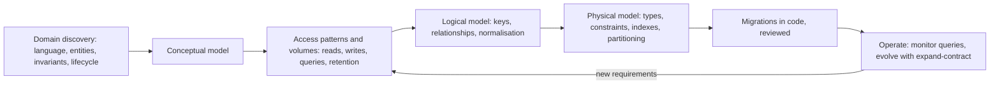
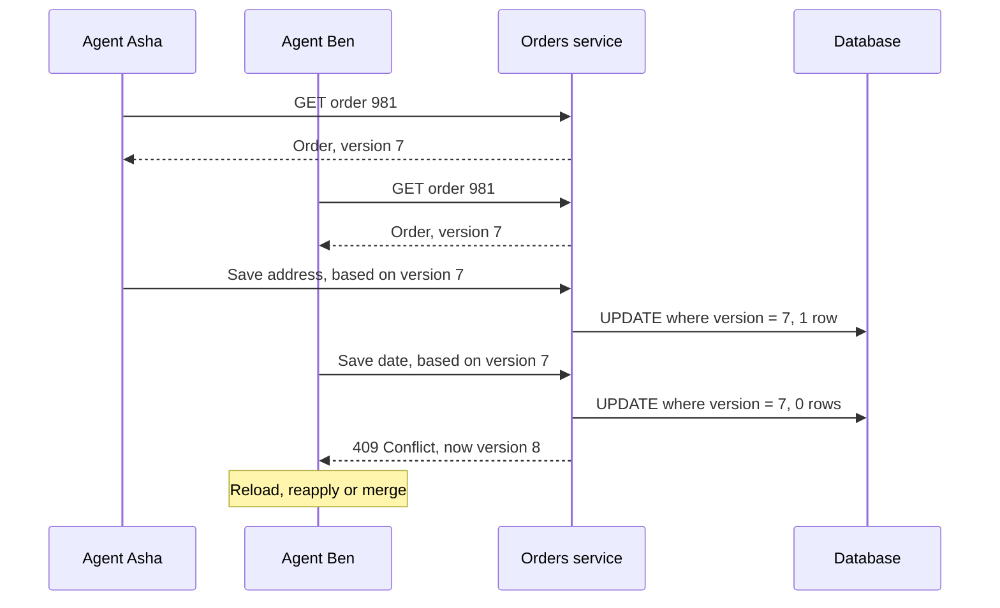

## TL;DR

- Data models outlive code. Model the **domain** first (entities, relationships, invariants, lifecycle), then map to storage for your **access patterns**.
- Work at three levels: **conceptual** (business concepts), **logical** (entities, attributes, keys, relationships), **physical** (tables, types, indexes, partitions).
- Use constraints to protect invariants: primary/foreign keys, unique constraints, check constraints, NOT NULL. Normalise transactional data; denormalise deliberately for reads.
- Get the hard parts right early: **identifiers**, **money**, **time and time zones**, **history/temporal data**, **soft deletes**, **multi-tenancy**, and **personal data** (retention, erasure).
- Analytical models differ: **dimensional modelling** (facts and dimensions, star schemas) optimises for queries over history; event-sourced and NoSQL models optimise for specific access patterns.

## Core Concepts

### Levels of modelling

| Level | Audience | Contents |
|---|---|---|
| Conceptual | Business and engineering | Key concepts and relationships: Customer places Order; Order contains Product |
| Logical | Engineers, analysts | Entities, attributes, keys, cardinality, normalisation; technology-agnostic |
| Physical | Engineers, DBAs | Tables/collections, data types, indexes, partitioning, constraints for a specific engine |

### Entity-relationship modelling

- **Entities** with identity (Customer, Order), **attributes** (email, placed_at), **relationships** with **cardinality**: one-to-one, one-to-many, many-to-many (via a junction table, which often deserves its own name and attributes — `Enrolment` between Student and Course with a grade).
- **Optionality:** must an Order have a Customer? Can a Product exist without a Category?
- **Weak entities:** OrderLine depends on Order for identity.

### Keys

- **Surrogate keys** (UUID/ULID/bigint identity) — stable, meaningless, never change; default for most tables.
- **Natural keys** (email, ISBN, country code) — meaningful but can change or be reused; enforce with **unique constraints** in addition to the surrogate key.
- **UUIDv7/ULID** give time-ordered IDs (better index locality than random UUIDv4) and can be generated anywhere. PostgreSQL 18 (2025) generates UUIDv7 natively with `uuidv7()`; the example below uses `gen_random_uuid()` (v4), which works on older versions.
- Public identifiers: consider prefixed, opaque IDs (`ord_01J…`) for APIs; never expose sequential IDs that leak volumes or allow enumeration without authorisation checks.

### Normal forms (briefly)

- **1NF:** atomic values, no repeating groups.
- **2NF:** no partial dependency on part of a composite key.
- **3NF:** no transitive dependencies ("every non-key attribute depends on the key, the whole key, and nothing but the key").
- **BCNF** tightens 3NF. Most OLTP schemas aim for 3NF and denormalise selectively.

### Modelling money, time and identity details

```sql
CREATE TABLE orders (
  id            uuid PRIMARY KEY DEFAULT gen_random_uuid(),
  tenant_id     uuid NOT NULL REFERENCES tenants(id),
  customer_id   uuid NOT NULL REFERENCES customers(id),
  status        text NOT NULL CHECK (status IN ('draft','placed','paid','shipped','cancelled')),
  currency      char(3) NOT NULL,                 -- ISO 4217
  total_minor   bigint NOT NULL CHECK (total_minor >= 0), -- money as integer minor units
  placed_at     timestamptz,                      -- an instant, stored in UTC
  delivery_date date,                             -- a calendar date, no time zone
  shipping_addr jsonb NOT NULL,                   -- snapshot at time of order, not a live reference
  version       integer NOT NULL DEFAULT 1,       -- optimistic concurrency
  created_at    timestamptz NOT NULL DEFAULT now(),
  updated_at    timestamptz NOT NULL DEFAULT now()
);
CREATE INDEX orders_tenant_customer_placed ON orders (tenant_id, customer_id, placed_at DESC);
```

- **Money:** integer minor units (or exact `numeric`) plus currency; never floating point. Store FX rates and rounding rules explicitly.
- **Time:** instants as UTC timestamps (`timestamptz`); local calendar concepts (birthdays, delivery dates, store opening hours) as dates/local times plus an IANA time zone where needed; never store local times without the zone for events.
- **Snapshots:** copy data that must not change with the source (address and prices on an order).
- **Enums:** check constraints or reference tables; plan how values evolve.

### Worked example: a future appointment and a time-zone rule change

In September 2022 a clinic in Mexico City books a follow-up for **09:00 on 15 April 2023**, local time. Under the rules at the time, Mexico observed daylight saving time from the first Sunday of April, so 15 April 2023 would be UTC−5.

| Stored as | What was saved | What happened in October 2022 | What the clinic shows in April 2023 |
|---|---|---|---|
| **Instant (UTC)** | `2023-04-15T14:00Z`, converted at booking with the old rules | Mexico abolished daylight saving time. The time-zone database update made 15 April UTC−6 | 14:00Z is now **08:00** local. The patient is told the wrong time |
| **Local time + zone** | `2023-04-15 09:00`, `America/Mexico_City` | Same rule change | Converted when needed with current rules: 09:00 local = 15:00Z. **Correct** |

The rule that follows:
- **Past events and exact moments** (a payment captured, a message sent): store the **instant** in UTC (`timestamptz`). What happened can't be changed by later rule changes.
- **Future events defined in people's local time** (appointments, store opening hours, a daily 09:00 report): store the **local date-time plus an IANA zone id**, not an offset such as `-05:00`. Compute the instant at the last responsible moment, such as when scheduling the reminder.
- Keep the time-zone database (tzdata) up to date in every runtime and database. Rule changes happen several times a year somewhere, sometimes with only weeks' notice.

Recurring events need the same care. "Every Monday at 09:00 London time" is a rule plus a zone. It isn't a list of instants computed once, because the offset changes twice a year.

### History and temporal data

- **Audit tables / change data capture:** who changed what and when.
- **Slowly changing dimensions (SCD)** in analytics: Type 1 overwrite, Type 2 new row with `valid_from`/`valid_to` and a current flag.
- **Bitemporal modelling:** *valid time* (when it was true in the real world) and *transaction time* (when we recorded it) — essential in insurance, finance and compliance ("what did we believe on 1 March about the policy as of 1 January?").
- **Event sourcing:** store the sequence of events as the source of truth and derive current state.

### Soft deletes and lifecycle

Soft deletes (`deleted_at`) keep history and enable undo, but complicate every query, unique constraints (use partial unique indexes) and privacy erasure. Alternatives: move to an archive table, use status-based lifecycles (`cancelled`, `archived`), or event history. Define retention per data class.

### Multi-tenancy models

| Model | Isolation | Ops cost | Typical use |
|---|---|---|---|
| Shared tables with `tenant_id` | Logical (enforce in queries + row-level security) | Lowest | Most SaaS, many small tenants |
| Schema per tenant | Medium | Migrations across many schemas | Moderate tenant counts, some customisation |
| Database per tenant | Strong | Highest | Large/regulated tenants, noisy-neighbour isolation |
| Hybrid | Pooled for small, dedicated for large | Medium | Tiered SaaS |

## How It Works



### Two people editing the same order



Over HTTP, the same idea uses `ETag` and `If-Match` headers, with `412 Precondition Failed` on a mismatch.

## When to Use / Trade-offs

| Approach | Use when | Avoid when | Trade-off |
|---|---|---|---|
| Normalised relational (3NF) | Transactional systems with invariants and varied queries | Pure append-only analytics at huge scale | Integrity and flexibility vs joins |
| Denormalised read models | Read-heavy screens, search, dashboards | As the system of record without sync strategy | Fast reads vs duplication and sync |
| JSON/JSONB columns | Variable attributes, snapshots, rarely queried details | Data with relationships, constraints or heavy filtering | Flexibility vs weaker integrity |
| Dimensional (star schema) | Analytics, BI, history over time | OLTP | Query simplicity and speed vs ETL effort |
| Event sourcing | Audit-critical domains, temporal queries, complex workflows | Simple CRUD | Full history vs complexity, projections |
| Access-pattern NoSQL models | Known queries at very high scale | Ad-hoc querying needs | Performance vs flexibility |

## Common Pitfalls & Anti-patterns

- **Floating-point money** — rounding errors in financial data.
- **Local timestamps without time zones** — ambiguous events, DST bugs.
- **Missing constraints** — "the application validates it" until a second writer arrives.
- **Generic EAV tables** (entity-attribute-value) for everything — unqueryable, no integrity.
- **God tables** — `customers` with 150 columns serving five departments.
- **Natural keys as primary keys** that later change (emails, codes).
- **Referencing live data where a snapshot is needed** — order totals changing when product prices change.
- **Soft deletes everywhere** — broken unique constraints, leaked "deleted" data, GDPR non-compliance.
- **Cross-service database sharing** — schema changes break other teams.
- **No plan for history** — "we need to know what the value was last March" with no data.

## Real-world Scenario

**Context:** An insurance platform stored policies in a single `policies` table updated in place. Regulators asked for the policy terms *as known on a specific date* for a set of claims, and finance needed premium recalculations for back-dated endorsements. The team couldn't answer either reliably.

**Decision:** Introduced a **bitemporal model** for policy versions: each change creates a new row with `valid_from/valid_to` (business-effective period) and `recorded_from/recorded_to` (when the system knew it). Endorsements became explicit domain events (`PolicyEndorsed`) feeding the model. Money moved from `decimal(10,2)` mixed currencies to minor units with currency codes; all instants moved to `timestamptz`. Reporting moved to a dimensional model in the warehouse with SCD Type 2 policy dimensions.

**Outcome:** Regulatory queries ("as of" and "as known on") became single SQL queries; back-dated recalculations were reproducible; audit findings closed. Query complexity increased for developers, mitigated by views and a small library.

**What I'd do differently:** Identify temporal requirements in initial domain discovery — retrofitting history onto years of in-place updates required painful reconstruction from logs.

## Interview Questions

### What are conceptual, logical and physical data models? {#model-levels}

**Level:** Foundation

**Model answer:**
- **Conceptual:** the main business concepts and how they relate, in business language — Customer places Order, Order contains Products. Used to align with domain experts; no technical detail.
- **Logical:** entities with attributes, keys, relationships and cardinality, normalised, independent of a specific database — e.g. Order(id, customer_id, status, total, currency), OrderLine(order_id, line_no, product_id, quantity, unit_price).
- **Physical:** the implementation in a specific engine — table and column names, data types, constraints, indexes, partitioning, storage parameters.

Moving through the levels separates "what the business means" from "how we store it", making it easier to validate the model with experts and to change technology later.

**What the interviewer is looking for:**
Clear distinctions, audiences and examples.

**Follow-ups:**
- Which level would you show a product owner?
- How does DDD's domain model relate to these?

**Red flags:**
- Jumping straight to tables without understanding the domain.

### How do you model relationships and cardinality in an ER model? {#er-modelling}

**Level:** Foundation

**Model answer:**
- **One-to-many:** foreign key on the "many" side — `order_lines.order_id → orders.id`.
- **One-to-one:** foreign key with a unique constraint, or the same primary key in both tables; often a sign the entities could be merged unless lifecycles or access differ.
- **Many-to-many:** a junction table with foreign keys to both sides and a composite unique constraint — `enrolments(student_id, course_id)`. Junction tables often become real entities with attributes (grade, enrolled_at) and deserve a domain name.
- **Optionality:** nullable vs NOT NULL foreign keys express whether the relationship is required.
- **Referential actions:** `ON DELETE RESTRICT/CASCADE/SET NULL` chosen deliberately — cascades can delete more than intended.

Draw ER diagrams (crow's foot notation) to validate cardinality with domain experts using concrete examples ("Can an order have zero lines? Can a product belong to two categories?").

**What the interviewer is looking for:**
Correct implementation of each cardinality, junction tables as entities, optionality and referential actions.

**Follow-ups:**
- When would you avoid foreign keys?
- How do you model a self-referencing relationship (manager/employee)?

**Red flags:**
- Comma-separated ids in a column for many-to-many.

### Natural or surrogate keys? {#keys}

**Level:** Foundation

**Model answer:**
- **Surrogate keys** (generated identifiers: bigint identity, UUID/ULID) are meaningless, stable and never change — the usual choice for primary keys. Time-ordered variants (UUIDv7, ULID) improve index locality compared with random UUIDv4 and can be generated client-side or in distributed systems.
- **Natural keys** (email, VAT number, ISO country code) carry business meaning but can change (emails), be reused, or have formatting issues. Enforce them with **unique constraints** rather than making them primary keys — except for stable, standardised codes (ISO currency codes) in reference tables.
- **Composite keys** fit junction tables and some partitioned designs.

For external APIs, expose opaque identifiers (optionally prefixed by type, like `cus_…`); never rely on obscurity — always authorise access.

**What the interviewer is looking for:**
Stability argument, unique constraints for natural keys, UUID ordering considerations and API exposure.

**Follow-ups:**
- What's the downside of random UUIDs as clustered primary keys?
- Why might sequential IDs in URLs be a problem?

**Red flags:**
- Email as primary key with foreign keys pointing to it.

### What is normalisation, and what problems does it prevent? {#normal-forms}

**Level:** Foundation

**Model answer:**
Normalisation organises data so each fact is stored once, preventing **update anomalies** (changing a customer's address in many rows), **insertion anomalies** (can't record a product until it's ordered) and **deletion anomalies** (deleting the last order removes the customer's details).

- **1NF:** atomic values; no repeating groups or lists in a column.
- **2NF:** in tables with composite keys, non-key attributes depend on the whole key.
- **3NF:** non-key attributes depend only on the key, not on other non-key attributes (no transitive dependencies — e.g. `city → country` stored on orders).
- **BCNF:** every determinant is a candidate key.

OLTP systems usually target 3NF, then **denormalise deliberately** for performance (read models, materialised views, cached totals) or for correctness (snapshots of prices and addresses at order time).

**What the interviewer is looking for:**
Anomalies prevented, normal forms in plain terms, and deliberate denormalisation.

**Follow-ups:**
- Give an example of a transitive dependency.
- When is duplication required for correctness?

**Red flags:**
- Unable to explain why normalisation matters.

### How do you model hierarchies and graphs in a relational database? {#hierarchies}

**Level:** Senior

**Model answer:**
Options for trees (categories, org charts, comment threads):
- **Adjacency list:** `parent_id` foreign key. Simple writes; recursive queries (`WITH RECURSIVE`) for subtrees — fine for moderate depth and size.
- **Materialised path:** store the path (`/1/4/9/`) or use Postgres `ltree`; fast subtree queries via prefix/index; moves require updating descendants.
- **Nested sets:** left/right numbers; fast reads, expensive writes — rarely worth it now.
- **Closure table:** a table of all ancestor–descendant pairs with depth; fast queries for any ancestor/descendant, more storage and write complexity.

For general graphs (many-to-many with traversal, like social networks or fraud rings), use edge tables with recursive queries at small scale, or a graph database when traversals are deep and central to the product.

Choose by read/write ratio, depth, frequency of moves, and query types.

**What the interviewer is looking for:**
Multiple techniques with trade-offs and when to switch to a graph database.

**Follow-ups:**
- How would you prevent cycles in an adjacency list?
- How do you find all descendants efficiently in Postgres?

**Red flags:**
- Only knowing parent_id without considering query needs.

### How do you model data that changes over time? {#temporal-data}

**Level:** Senior

**Model answer:**
First, decide what questions you must answer:
- "What is the value now?" → simple current-state tables.
- "Who changed what, when?" → **audit log** (application-level or CDC to an audit store).
- "What was the value on date X?" → **valid-time history**: version rows with `valid_from`/`valid_to` (e.g. prices, employee departments). In analytics, **SCD Type 2** dimensions.
- "What did we *know* on date Y about date X?" → **bitemporal** model: valid time plus transaction (recorded) time — needed for back-dated corrections in insurance, finance, payroll and regulatory reporting.
- "How did we get here, step by step?" → **event sourcing**: events as the source of truth, state derived by projection.

Implementation details: non-overlapping periods enforced with exclusion constraints (Postgres `EXCLUDE USING gist` with ranges) or application logic; views for "current" rows; indexes on period columns; SQL:2011 temporal features where supported (SQL Server/MariaDB system-versioned tables).

**What the interviewer is looking for:**
Mapping questions to techniques, bitemporal understanding and implementation details.

**Follow-ups:**
- How do you correct a past value that was wrong?
- What's the difference between valid time and transaction time?

**Red flags:**
- In-place updates for regulated data with no history.

### What are the trade-offs of soft deletes? {#soft-deletes}

**Level:** Senior

**Model answer:**
**Soft delete** sets a flag or `deleted_at` instead of removing the row.

Benefits: undo/restore, audit trails, preserving references from other records, simpler recovery from mistakes.

Costs:
- **Every query must filter** deleted rows — easy to forget, leaking "deleted" data (use views, ORM default scopes, or row-level security).
- **Unique constraints break** — a deleted user's email blocks re-registration; use partial unique indexes (`WHERE deleted_at IS NULL`).
- **Privacy and retention:** GDPR erasure and retention policies require actual deletion or anonymisation; soft-deleted personal data is still personal data.
- **Table bloat** and slower queries over time.

Alternatives: explicit lifecycle states (`cancelled`, `archived`) where they're domain concepts; moving records to archive tables; event history or audit logs for recovery; hard delete plus backups for mistakes. Choose per entity, with explicit retention rules.

**What the interviewer is looking for:**
Balanced trade-offs, unique index technique, privacy implications and alternatives.

**Follow-ups:**
- How do you implement GDPR erasure with soft deletes?
- When is a lifecycle status better than soft delete?

**Red flags:**
- Soft delete on everything by default with no retention plan.

### How should money and time be modelled? {#money-and-time}

**Level:** Senior

**Model answer:**
**Money:**
- Store as **integer minor units** (pence/cents) or exact decimals (`numeric`), plus an **ISO 4217 currency code**; never floats.
- Be aware of currencies with zero or three decimal places.
- Store FX rates with their timestamp and source when converting; define rounding rules (banker's rounding vs half-up) explicitly, and where rounding happens (per line vs total).
- Snapshot prices and taxes on transactions.

**Time:**
- **Instants** (when something happened) as UTC timestamps (`timestamptz` in Postgres).
- **Civil/local times** (a meeting at 09:00 in London next March, store opening hours, birthdays) as local date/time plus an **IANA time zone** (`Europe/London`), because offsets change with DST and law.
- **Dates without time** (delivery date, date of birth) as `date`.
- **Durations** separately from instants.
- Convert to local time only at presentation.

**What the interviewer is looking for:**
Integer/decimal money with currency, rounding and FX; instants vs civil times with IANA zones.

**Follow-ups:**
- How would you store a recurring meeting at 9am London time?
- Why not store everything as local time?

**Red flags:**
- `float` for money.
- Timestamps without time zone information for events.

### When would you use JSON columns instead of relational columns? {#json-columns}

**Level:** Senior

**Model answer:**
JSON/JSONB columns are good for:
- **Variable or sparse attributes** that differ by type (product specifications across categories).
- **Snapshots** of data at a point in time (shipping address, pricing breakdown on an order).
- **External payloads** stored for audit or reprocessing (webhook bodies).
- **Rarely queried details** displayed as a whole.

Prefer relational columns when:
- Data has **relationships** (foreign keys), **constraints** (NOT NULL, unique, check), or participates in joins.
- You **filter, sort or aggregate** on it frequently (JSON indexes exist — GIN, expression indexes — but are more limited and harder to maintain).
- Multiple services/reports depend on a stable schema.

Middle ground: promote frequently queried JSON fields to generated columns or real columns; validate JSON with schema checks (check constraints or application validation).

**What the interviewer is looking for:**
Appropriate uses, limitations, indexing options and hybrid approaches.

**Follow-ups:**
- How would you index a JSONB attribute used in filters?
- How do you evolve the structure of JSON data over time?

**Red flags:**
- Storing everything as one JSON blob per entity "for flexibility".

### How do you model data for a multi-tenant SaaS application? {#multi-tenant-schema}

**Level:** Senior

**Model answer:**
Choose the isolation model by tenant count, size variance, compliance and customisation:
- **Shared schema with `tenant_id`** on every tenant-owned table: cheapest and simplest to operate; enforce isolation with tenant-scoped data access (automatic filters), **row-level security** as defence in depth, composite indexes leading with `tenant_id`, and tests for cross-tenant access.
- **Schema per tenant:** stronger separation, per-tenant customisation; migrations across thousands of schemas are slow and error-prone.
- **Database per tenant:** strongest isolation, per-tenant backup/restore and residency; highest operational cost; good for large or regulated tenants.
- **Hybrid:** pooled for most tenants, dedicated for enterprise tiers — design the data access layer so a tenant can move between pools.

Other considerations: tenant id in every unique constraint (`UNIQUE (tenant_id, email)`), noisy-neighbour controls, per-tenant data export and deletion, sharding by tenant when scaling.

**What the interviewer is looking for:**
Options with trade-offs, enforcement mechanisms, constraint design and mobility between tiers.

**Follow-ups:**
- How do you move a large tenant to its own database without downtime?
- How do you run analytics across tenants?

**Red flags:**
- Relying only on developers remembering `WHERE tenant_id = ?`.

### Explain dimensional modelling and the star schema. {#dimensional-modelling}

**Level:** Architect

**Model answer:**
Dimensional modelling (Kimball) structures analytical data around business processes:
- **Fact tables:** measurements of events at a declared **grain** (one row per order line, per payment, per daily account balance) — numeric measures (amount, quantity) plus foreign keys to dimensions. Types: transaction, periodic snapshot, accumulating snapshot.
- **Dimension tables:** descriptive context — customer, product, date, store, channel — with attributes for filtering and grouping.
- **Star schema:** a fact table surrounded by denormalised dimensions; simple joins, fast aggregation, intuitive for analysts. **Snowflake** schemas normalise dimensions further (less common now with cheap storage).
- **Slowly changing dimensions:** Type 1 (overwrite), Type 2 (new row with validity dates, preserving history), others for special cases.
- **Conformed dimensions** shared across fact tables enable cross-process analysis.

Process: choose the business process → declare the grain → identify dimensions → identify facts. Modern warehouses (BigQuery, Snowflake, Fabric, Databricks) still benefit from dimensional models, often built with dbt from raw/staging layers.

**What the interviewer is looking for:**
Facts, dimensions, grain, star vs snowflake, SCDs, conformed dimensions and the design process.

**Follow-ups:**
- What happens if you mix grains in one fact table?
- When is a wide denormalised table preferable to a star schema?

**Red flags:**
- Running analytics directly on normalised OLTP schemas at scale.

### How does the data model change with event sourcing? {#event-sourcing-model}

**Level:** Architect

**Model answer:**
With event sourcing, the **source of truth is an append-only stream of domain events** per aggregate (`OrderPlaced`, `ItemAdded`, `OrderShipped`); current state is derived by replaying events.

Model elements:
- **Event store:** streams keyed by aggregate id with sequence numbers (optimistic concurrency on expected version), event type, payload, metadata (causation/correlation ids, timestamp, actor).
- **Events as contracts:** versioned schemas; upcasting old events to new shapes when reading.
- **Snapshots** to avoid replaying long streams.
- **Projections/read models:** denormalised tables built from events for queries (CQRS); rebuildable by replaying.
- **Process managers/sagas** reacting to events.

Benefits: complete audit history, temporal queries, ability to build new read models from history, natural integration via events. Costs: complexity (projections, eventual consistency between write and read sides), event schema evolution, GDPR erasure (crypto-shredding — encrypting personal data per subject and deleting keys), and harder ad-hoc querying.

**What the interviewer is looking for:**
Event store structure, concurrency, versioning, snapshots, projections and the costs including privacy.

**Follow-ups:**
- How do you handle a bug that wrote incorrect events?
- What's crypto-shredding?

**Red flags:**
- Event sourcing for simple CRUD.
- Treating events as mutable records.

### How do you manage schema evolution across services and data consumers? {#schema-evolution-strategy}

**Level:** Architect

**Model answer:**
- **Ownership:** each schema (database, API, event) has a single owning team; others consume through contracts, not by reading internal tables.
- **Compatibility rules:** additive changes by default (new optional fields/columns); no renames or type changes in place; breaking changes via **expand–migrate–contract** or new versions (new topic/API version).
- **Contracts and registries:** schema registry for events with compatibility modes; OpenAPI for APIs; data contracts for analytical datasets (schema, semantics, SLAs, owners).
- **Automated checks:** CI detects breaking changes (schema diffs, compatibility checks, dbt tests); consumers' contract tests.
- **CDC and analytics:** changes in source tables affect pipelines — publish data products with stable interfaces rather than exposing raw tables to the warehouse.
- **Communication:** deprecation notices, timelines, consumer inventories (lineage tools show who reads what).

**What the interviewer is looking for:**
Ownership, additive evolution, contracts/registries, automated detection, data products and lineage.

**Follow-ups:**
- A team wants to rename a column used by 12 dashboards. What's the process?
- What's a data contract?

**Red flags:**
- Consumers reading other services' tables directly.

### How do you handle data ownership and consistency in a microservices architecture? {#data-ownership}

**Level:** Architect

**Model answer:**
- **Database per service** (or schema per service with strict access control): each service owns its data and exposes it via APIs/events — no shared tables.
- **Data duplication is expected:** services keep local copies of data they need (e.g. Shipping stores the delivery address), updated via events (event-carried state transfer). Define which service is the **system of record** for each piece of data.
- **Consistency:** strong consistency within a service's transaction; **eventual consistency** across services with outbox-based events, idempotent consumers and sagas for multi-step processes.
- **Queries across services:** API composition for simple cases; dedicated read models or a reporting data store fed by events/CDC for complex queries and analytics.
- **Reference data:** owned by one service and published; cached elsewhere.
- **Governance:** data catalogue documenting ownership, classification (PII), retention and lineage.

**What the interviewer is looking for:**
Ownership boundaries, system of record, event-fed copies, consistency patterns, cross-service queries and governance.

**Follow-ups:**
- How do you handle a GDPR deletion request across 10 services?
- When is a shared database acceptable?

**Red flags:**
- Shared database across services "for simplicity" at scale.

### How do you design a data model that supports privacy requirements like GDPR? {#privacy-by-design-model}

**Level:** Architect

**Model answer:**
- **Data minimisation:** collect only what's needed; question every personal field.
- **Classification:** tag columns/fields by sensitivity (PII, special category, payment data) in a data catalogue; drive access control, masking and retention from it.
- **Separation:** keep personal data in a limited number of well-protected stores/tables, referenced by pseudonymous ids elsewhere — makes erasure and access control easier.
- **Retention:** explicit retention periods per data class, implemented with automated deletion/anonymisation jobs; legal holds when required.
- **Erasure and access requests:** know every location of a subject's data (lineage), including derived stores, analytics, logs and backups; implement deletion or anonymisation workflows; for immutable stores (event logs, backups), use **crypto-shredding** (encrypt per subject, delete the key) or documented backup expiry.
- **Pseudonymisation/anonymisation** for analytics and non-production environments; never copy production PII to dev/test unmasked.
- **Residency:** model region attributes and route storage accordingly.
- **Audit:** log access to sensitive data.

**What the interviewer is looking for:**
Minimisation, classification, separation, retention automation, erasure across stores (incl. crypto-shredding), masking and residency.

**Follow-ups:**
- How do you delete someone's data from an append-only event log?
- How do you test with realistic data without using PII?

**Red flags:**
- Production data copied to test environments.
- No inventory of where personal data lives.

### Why enforce rules with database constraints rather than only in application code? {#database-constraints}

**Level:** Foundation

**Model answer:**
Constraints state facts that must always be true about the data, and the database checks them on **every write, from every writer**:
- `NOT NULL`: the value must exist.
- `UNIQUE`: no two rows share the value, such as one account per email per tenant.
- `FOREIGN KEY`: the referenced row exists, so there are no orders for missing customers.
- `CHECK`: a condition on the row, such as `total_minor >= 0` or a status from an allowed list.
- **Exclusion constraints** (PostgreSQL): no two rows overlap, such as two bookings of the same room at the same time.

Why application checks aren't enough:
- **Concurrency**: "check that the email is free, then insert" fails when two requests run at once. Both checks pass. A unique constraint makes the second insert fail, atomically.
- **More than one writer**: scripts, migrations, admin tools, a second service or a future rewrite all bypass application code.
- **Bugs**: validation gets missed in one code path. The constraint catches it at write time instead of in a report months later.

Keep validation in the application too, for friendly error messages, and treat a constraint violation as a normal, handled outcome (such as mapping a unique violation to `409 Conflict`).

Costs to know: foreign keys need indexes on the referencing column to stay fast, and adding a constraint to a large existing table needs care. In PostgreSQL, add it as `NOT VALID` and then `VALIDATE` it separately to avoid a long lock.

**What the interviewer is looking for:**
The constraint types, the concurrency argument, multiple writers, and handling violations gracefully.

**Follow-ups:**
- How would you prevent double-booking a meeting room?
- How do you add a foreign key to a 500-million-row table without downtime?

**Red flags:**
- "We validate in the app, so constraints aren't needed."
- Check-then-insert for uniqueness.

### How do you model an entity's status lifecycle so invalid transitions can't happen? {#modelling-state-machines}

**Level:** Senior

**Model answer:**
Entities such as orders, payments and claims move through **states** (draft, placed, paid, shipped, cancelled) by **transitions** (place, pay, ship, cancel). Bugs come from transitions that shouldn't be possible: shipping a cancelled order, or paying twice.

**In the schema:**
- A `status` column restricted by a `CHECK` constraint or a reference table, so only known states exist.
- **Timestamps per milestone** (`placed_at`, `paid_at`, `shipped_at`) with constraints tying them to the status, such as "status `paid` requires `paid_at`". These double as useful history.
- A **transitions table** (`from_status`, `to_status`) as the single definition of allowed moves, which the code and a trigger can both use if needed.

**In the code:**
- Make each transition a **conditional update**: `UPDATE orders SET status = 'shipped', shipped_at = now() WHERE id = $1 AND status = 'paid'`. If no row matches, the transition wasn't allowed or someone else got there first. That's atomic, without locks held across requests.
- Keep the state machine in **one place** in the domain code, rather than spread across handlers.
- **Record each transition** as an event or history row (who, when, from, to, why), for audit and debugging.

**Design choices:**
- Avoid a single status for things that are really **independent dimensions**. Payment status and fulfilment status often progress separately, and combining them makes the number of states explode.
- Decide which states are **terminal**, and whether "undo" is a reverse transition or a new state (refunded, not unpaid).
- For long-running, multi-step processes, consider a workflow engine or saga instead of a hand-built status column.

**What the interviewer is looking for:**
Constrained states, conditional updates as atomic transitions, one definition of allowed moves, a transition history, and separating independent dimensions.

**Follow-ups:**
- How do you add a new state to a busy production table?
- How would you report how long orders spend in each state?

**Red flags:**
- Free-text status values.
- Read-check-write transitions without a condition on the current state.

### How do you model "comments can belong to posts, photos or videos"? {#polymorphic-associations}

**Level:** Senior

**Model answer:**
This is a **polymorphic association**: one entity relates to one of several parent types. Common designs:

| Design | Shape | Pros | Cons |
|---|---|---|---|
| **Type + id columns** (Rails-style `commentable_type`, `commentable_id`) | One `comments` table | Simple, popular in ORMs | **No foreign key** is possible, so orphans and wrong types can creep in |
| **One nullable FK per parent** | `post_id`, `photo_id`, `video_id`, with a `CHECK` that exactly one is set | Real foreign keys and cascades | A new column for each new parent type |
| **Separate tables** | `post_comments`, `photo_comments` | Clean constraints per type | Duplicated logic. "All comments by a user" needs a `UNION` |
| **Shared supertype** | A `commentable` table that posts, photos and videos each reference with a 1:1 key, and comments reference `commentable` | Real foreign keys, one comments table, extensible | One more table and join, and parents are created in two steps |

**Choosing:**
- A **small, stable set** of parent types → one nullable foreign key per parent with an exactly-one check. Integrity is enforced and it's easy to query.
- **Many or growing types**, such as comments, reactions and tags on anything → the shared supertype. It keeps integrity, and new types just reference it.
- The **type + id pattern** is acceptable when integrity is enforced in code and you accept orphan clean-up jobs. It's the common default in ORMs mainly because it's convenient.

Also consider whether the parents really share behaviour. If "comments" mean different things for different types (moderation rules, notifications), separate tables can be clearer.

**What the interviewer is looking for:**
The options, the loss of referential integrity in the type + id pattern, and a choice tied to the number of types and integrity needs.

**Follow-ups:**
- How would you find all comments by one user across all types efficiently?
- What happens to comments when a photo is deleted in each design?

**Red flags:**
- Not noticing that the type + id pattern can't have a foreign key.
- An entity-attribute-value table as the answer.

### Design the schema for a product catalogue whose attributes vary widely by category. {#variable-attributes}

**Level:** Architect

**Model answer:**
A television has screen size and refresh rate, a shirt has size and fabric, and new categories arrive monthly. Options:

| Approach | How | Fits | Breaks down |
|---|---|---|---|
| **Columns for common fields + JSONB for the rest** | `products(id, name, brand, price, category_id, attributes jsonb)` with GIN or expression indexes | Most catalogues | Weak typing inside the JSON unless validated |
| **Table per category** | `tvs`, `shirts`, each with typed columns | Few, stable categories with heavy category-specific logic | Many categories, or cross-category queries |
| **Entity–attribute–value** | `product_attributes(product_id, attribute, value)` | Rarely. Highly sparse, user-defined attributes | Every query becomes a self-join. Types and constraints are lost |
| **Document store** | One document per product | Catalogue owned by one service with document-shaped reads | Cross-product reporting, transactions with other data |

**A design that usually works:**
- **Typed columns** for what every product has and what you filter, join or report on: id, SKU, name, brand, price, currency, category, status.
- **JSONB** for category-specific attributes, **validated against a schema per category**. Store attribute definitions (name, type, unit, allowed values, whether it's filterable) in an `attribute_definitions` table, and validate with JSON Schema in the service, or check constraints for critical fields.
- **Normalise units and values** on write ("55 inch", "55in" and `55` become `{ "screen_size_in": 55 }`), so filtering works.
- **Index what's filtered**: expression indexes on the few attributes used in database queries, and leave faceted search to a **search index** built from the catalogue, which handles dynamic facets far better than SQL.
- **Version attribute definitions**, so changes migrate deliberately rather than leaving old products in a different shape.

Ownership matters as much as structure: merchandisers define attributes through a managed process, rather than free-text fields that diverge.

**What the interviewer is looking for:**
The options and their failure modes, typed core plus validated JSONB, attribute definitions as data, unit normalisation, and search for faceting.

**Follow-ups:**
- How do you migrate when an attribute's type changes from text to number?
- Where do translations of attribute values live?

**Red flags:**
- EAV as the default.
- Unvalidated JSON with every team inventing keys.

### Design the data model for a double-entry ledger that a payments product relies on. {#ledger-model}

**Level:** Architect

**Model answer:**
**Principles:** every movement of money is recorded as a **balanced set of entries** (debits equal credits), entries are **immutable**, and balances are **derived** from entries, so the history explains every number.

**Core tables:**
- `accounts(id, owner_id, type, currency, normal_balance)`: customer wallets, merchant payables, fees revenue, the bank clearing account. One currency per account.
- `transactions(id, type, idempotency_key UNIQUE, created_at, effective_at, metadata)`: one business event, such as "card payment captured".
- `entries(id, transaction_id, account_id, amount_minor, direction)`: two or more per transaction. **For each transaction and currency, debits must equal credits.** Amounts are integers in minor units.

**Enforcing the invariants:**
- Write a transaction and all its entries **in one database transaction**, through one service. Check the balance in the same transaction, for example with a deferred constraint trigger that sums the entries at commit.
- The **idempotency key** makes retries safe: a repeated request returns the original transaction.
- **No updates or deletes** on entries. Corrections are **reversing transactions** plus new correct ones, so the audit trail stays intact. Enforce it with permissions or triggers.

**Balances at scale:**
- Summing all entries per request doesn't scale. Keep a **balance table** updated in the same transaction as the entries, with a version or row lock per account to serialise concurrent postings, or periodic **balance snapshots** plus entries since the snapshot.
- Distinguish **pending** (authorised) from **posted** (settled) amounts, so the available balance and the ledger balance can both be shown.
- **Hot accounts** (a platform fees account touched by every payment) become a bottleneck. Split them into sub-accounts and aggregate when reporting.

**Time and reconciliation:**
- Keep `created_at` (when recorded) separate from `effective_at` (when it counts for accounting), for back-dated adjustments.
- Reconcile daily against external statements (bank, card processor) and alert on differences.

**What the interviewer is looking for:**
Balanced, immutable entries, idempotency, reversals instead of edits, scalable balances with concurrency control, pending versus posted, hot accounts and reconciliation.

**Follow-ups:**
- How would you handle a transfer between accounts in different currencies?
- How do you answer "what was this wallet's balance at midnight on 31 March?"

**Red flags:**
- A single mutable `balance` column with no entries behind it.
- Floating-point amounts or editable history.

## Cheat Sheet

### Foundations
- **Conceptual → logical → physical** — business concepts, then entities and keys, then engine-specific tables.
- **Many-to-many** — junction table, often a real entity with its own attributes.
- **Surrogate PK + unique natural key** — stable identity plus enforced business uniqueness.
- **UUIDv7 / ULID** — time-ordered IDs with better index locality than UUIDv4.
- **3NF** — every non-key attribute depends on the key, the whole key, and nothing but the key.

### Tricky details
- **Money** — integer minor units or exact decimals plus ISO 4217 currency; never floats.
- **Time** — instants in UTC; civil times as local time plus IANA zone; dates as `date`.
- **Snapshots** — copy prices and addresses onto transactions.
- **Soft deletes** — need filters, partial unique indexes and real erasure for privacy.
- **Bitemporal** — valid time (true in reality) plus transaction time (when recorded).
- **Hierarchies** — adjacency list, materialised path/ltree, closure table; choose by query pattern.

### Architecture
- **Multi-tenancy** — shared tables + RLS, schema per tenant, DB per tenant, or hybrid.
- **Star schema** — facts at a declared grain plus denormalised dimensions; SCD Type 2 for history.
- **Event sourcing** — append-only events as truth; projections for reads; crypto-shredding for erasure.
- **Data ownership** — one system of record per datum; others hold event-fed copies.
- **Data contracts** — owned, versioned schemas with semantics and SLAs for consumers.

### Revisit

- **Future local events** — store local date-time plus an IANA zone, not a UTC instant or a fixed offset. Time-zone rules change, sometimes at short notice.
- **Optimistic concurrency** — `UPDATE ... WHERE id = ? AND version = ?`. Zero rows means someone changed it first, so return 409 (or 412 with `If-Match`).
- **Constraints** — the only checks that cover every writer and every race. Add them to large tables with `NOT VALID`, then `VALIDATE`.
- **State machines** — constrained status values, conditional updates as transitions, a transition history, and separate columns for independent dimensions.
- **Polymorphic associations** — type + id columns lose foreign keys. Prefer one nullable FK per parent with an exactly-one check, or a shared supertype.
- **Variable attributes** — typed core columns plus validated JSONB, with attribute definitions as data. Leave facets to a search index.
- **Ledger** — balanced, immutable entries, an idempotency key, reversals instead of edits, and balances maintained in the same transaction.

## Further Reading

- [PostgreSQL documentation: Data Definition](https://www.postgresql.org/docs/current/ddl.html) — constraints, schemas, partitioning and row-level security.
- [PostgreSQL: Date/Time Types](https://www.postgresql.org/docs/current/datatype-datetime.html) — timestamp with/without time zone semantics.
- [Kimball Group: Dimensional Modeling Techniques](https://www.kimballgroup.com/data-warehouse-business-intelligence-resources/kimball-techniques/dimensional-modeling-techniques/) — the canonical reference for star schemas and SCDs.
- [Martin Fowler: Bitemporal History](https://martinfowler.com/articles/bitemporal-history.html) — an accessible explanation of bitemporal modelling.
- [Microsoft: Multitenant SaaS database tenancy patterns](https://learn.microsoft.com/en-us/azure/azure-sql/database/saas-tenancy-app-design-patterns) — tenancy models and trade-offs.
- [Designing Data-Intensive Applications](https://dataintensive.net/) — data models, storage and schema evolution in depth.
