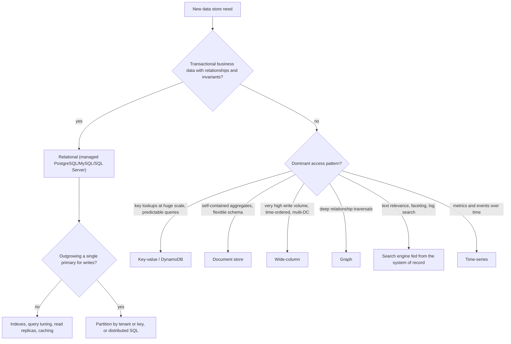

## TL;DR

- **Default to a relational database** (PostgreSQL, MySQL, SQL Server, managed) for transactional business data: ACID, joins, constraints, flexible queries, mature tooling. Modern Postgres also covers JSON documents, full-text search and vectors well enough for many cases.
- Choose **NoSQL for specific access patterns and scale profiles**: key-value for massive simple lookups, document for aggregate-shaped data, wide-column for huge write volumes, graph for relationship traversal, search engines for relevance ranking.
- NoSQL modelling is **access-pattern first**: design keys and denormalised items for the queries you know; ad-hoc queries become expensive or impossible.
- Understand **isolation levels, indexes, replication lag and partition keys** — most production database problems come from these, not from the SQL vs NoSQL choice.
- Scaling path: optimise queries and indexes → vertical scaling → read replicas and caching → partitioning/sharding or distributed SQL. Don't start at the end.

## Core Concepts

### Relational fundamentals

- **ACID:** Atomicity (all or nothing), Consistency (constraints hold), Isolation (concurrent transactions don't interfere beyond the chosen level), Durability (committed data survives crashes, via the write-ahead log).
- **Schema and constraints:** types, `NOT NULL`, foreign keys, unique and check constraints — the database enforces invariants for every application that writes to it.
- **Normalisation** removes duplication (3NF) so updates happen in one place; **denormalise deliberately** for read performance (materialised views, summary tables).
- **Indexes:** B-tree for equality and range; composite indexes follow the leftmost-prefix rule; covering indexes avoid table lookups; partial and expression indexes; GIN for JSONB/arrays/full-text. Each index speeds reads and slows writes.
- **MVCC:** readers don't block writers; old row versions are cleaned up later (Postgres `VACUUM`).

### Isolation levels and anomalies

| Level | Dirty read | Non-repeatable read | Phantom | Write skew | Notes |
|---|---|---|---|---|---|
| Read uncommitted | possible | possible | possible | possible | Postgres treats as read committed |
| Read committed | — | possible | possible | possible | Default in Postgres, SQL Server, Oracle |
| Repeatable read / snapshot | — | — | depends on engine | possible | Default in MySQL InnoDB; Postgres RR = snapshot isolation |
| Serializable | — | — | — | — | Postgres SSI aborts conflicting transactions; retry needed |

The classic bug at read committed: two requests read `stock = 1`, both decrement, stock becomes −1. Fixes: atomic update (`UPDATE ... SET stock = stock - 1 WHERE id = $1 AND stock > 0`), `SELECT ... FOR UPDATE`, optimistic version columns, or serializable isolation with retries.

```sql
-- Atomic conditional decrement: safe at read committed
UPDATE inventory SET stock = stock - 1
WHERE sku = 'ABC-1' AND stock > 0
RETURNING stock;   -- zero rows returned => out of stock
```

### NoSQL families

| Family | Examples | Data model | Strengths | Watch out for |
|---|---|---|---|---|
| Key-value | Redis, DynamoDB (also document), Memcached | Key → value | Extreme throughput, low latency | Only key lookups; modelling for every query |
| Document | MongoDB, Cosmos DB, Firestore, Couchbase | JSON documents, nested | Aggregate-shaped data, flexible schema | Cross-document transactions and joins are limited/costly |
| Wide-column | Cassandra, ScyllaDB, Bigtable, HBase | Partition key → sorted rows | Massive write throughput, multi-DC | Query-first modelling; tunable consistency trade-offs |
| Graph | Neo4j, Neptune, Cosmos Gremlin | Nodes + edges | Multi-hop traversals (fraud rings, recommendations) | Scaling writes; niche skills |
| Search | Elasticsearch, OpenSearch | Inverted index | Full-text relevance, faceting, log analytics | Not a system of record; eventual indexing |
| Time series | TimescaleDB, InfluxDB, Prometheus | Time-ordered points | Compression, downsampling, time queries | Specialised query models |
| Distributed SQL | Spanner, CockroachDB, YugabyteDB, Aurora DSQL | Relational, sharded | SQL + horizontal scale + strong consistency | Latency of distributed transactions; cost; hot keys still matter |

### Access-pattern-first modelling (DynamoDB / Cassandra style)

1. List every query the application needs, with frequency and latency requirements.
2. Choose partition keys that spread load evenly and group items queried together.
3. Use sort keys for ranges and hierarchies; secondary indexes for alternative access paths.
4. Denormalise (duplicate attributes, pre-joined items) — writes become more complex to keep reads cheap.

```text
Table: app   PK                 SK                         Attributes
             CUSTOMER#c42       PROFILE                    name, email, tier
             CUSTOMER#c42       ORDER#2026-03-01#o981      total, status
             CUSTOMER#c42       ORDER#2026-03-04#o1002     total, status
             ORDER#o981         LINE#1                     sku, qty, price
Query "customer's orders in March" => PK = CUSTOMER#c42 AND SK BETWEEN ORDER#2026-03-01 AND ORDER#2026-03-31
```

### Replication and partitioning

- **Leader–follower replication:** writes to the leader; followers serve reads with **replication lag** (read-your-writes issues). Synchronous replicas for durability cost latency.
- **Multi-leader / leaderless** (Cassandra, DynamoDB global tables): writes anywhere, conflicts resolved (last-write-wins or app logic); quorum reads/writes (`R + W > N`) for stronger consistency.
- **Partitioning/sharding:** by hash (even spread, no range scans) or range (range scans, hotspot risk); choosing the key is the critical decision; resharding is painful — plan for it.

## How It Works



## When to Use / Trade-offs

| Need | Good default | Why | Trade-off |
|---|---|---|---|
| Orders, payments, accounts | PostgreSQL / SQL Server | ACID, constraints, joins, reporting | Horizontal write scaling needs effort |
| Product catalogue with varied attributes | Postgres JSONB or document DB | Flexible schema per product type | Document DB: weaker cross-entity queries |
| Session store, rate limits, leaderboards | Redis | Sub-ms latency, data structures | Memory cost; persistence/durability settings |
| 100k+ writes/s of events, IoT telemetry | Cassandra/ScyllaDB, time-series DB | Linear write scaling | Query flexibility, consistency tuning |
| Serverless app with known access patterns | DynamoDB / Cosmos DB | Managed, scales, pay-per-use | Ad-hoc queries, modelling skill required |
| Global app needing strong consistency | Spanner / CockroachDB | SQL with geo-distribution | Cost, cross-region latency on writes |
| Search and filtering by relevance | OpenSearch/Elasticsearch | Inverted index, scoring | Separate system to sync; eventual consistency |
| Fraud networks, recommendations | Graph DB (or Postgres recursive CTEs at small scale) | Traversals | Operational niche |

## Common Pitfalls & Anti-patterns

- **NoSQL for "web scale" with relational data** — then re-implementing joins, transactions and constraints in application code.
- **Missing or wrong indexes** — full table scans at scale; composite index columns in the wrong order.
- **Too many indexes** — write amplification and bloat.
- **N+1 queries from ORMs** — 1 query for orders, 100 for their customers.
- **Assuming serializable behaviour at read committed** — lost updates, oversold inventory.
- **Reading from replicas right after writing** — user doesn't see their own change.
- **Hot partitions** — low-cardinality or time-based partition keys concentrating traffic.
- **Using the search engine as the system of record** — reindexing and consistency pain.
- **Unbounded queries** — `SELECT *` without limits; large result sets in memory.
- **Shared database across services** — schema changes become cross-team coordination problems.
- **Locking migrations** — adding a column with a default or an index without `CONCURRENTLY` on a hot table (engine-dependent) blocking production.

## Real-world Scenario

**Context:** A marketplace stored everything — listings, orders, payments, messages — in MongoDB, chosen early for schema flexibility. As it grew, payment reconciliation needed multi-document consistency; finance reports required complex joins done in application code; and a bug let two buyers purchase the same unique item because the "check then update" spanned two documents.

**Decision:** Kept MongoDB for listings (flexible, attribute-rich, read-heavy, aggregate-shaped) and moved orders and payments to PostgreSQL, with constraints (unique active purchase per item), atomic conditional updates, and outbox events to keep listing availability in sync. Search moved to OpenSearch fed by change streams. Reporting moved to a warehouse fed by CDC.

**Outcome:** Double-sell incidents stopped (the unique constraint made them impossible); reconciliation went from a nightly script with manual fixes to SQL queries; finance reporting time dropped from days to hours. Listing performance was unaffected.

**What I'd do differently:** Start transactional data in Postgres from day one — JSONB would have covered the early flexibility needs — and introduce specialised stores only when a measured access pattern justified them.

## Interview Questions

### What does ACID mean, and why does it matter? {#acid}

**Level:** Foundation

**Model answer:**
- **Atomicity:** a transaction's changes apply entirely or not at all — no half-applied transfers.
- **Consistency:** a transaction moves the database from one valid state to another; constraints (foreign keys, uniqueness, checks) always hold.
- **Isolation:** concurrent transactions don't see each other's intermediate states, to the degree set by the isolation level.
- **Durability:** once committed, data survives crashes (write-ahead log, replication).

It matters because business invariants — money isn't created or lost, an item isn't sold twice — are much easier and safer to enforce in the database than in every application that writes to it. Many NoSQL databases now offer ACID transactions within a partition or even across documents, but often with limits on scope, performance or isolation.

**What the interviewer is looking for:**
Correct definitions with business examples, and nuance on NoSQL transaction support.

**Follow-ups:**
- Is the "C" in ACID the same as the "C" in CAP?
- What isolation level do you get by default in PostgreSQL?

**Red flags:**
- "NoSQL databases have no transactions" (outdated generalisation).
- Confusing durability with backups.

### What are the main types of NoSQL databases, and what is each good at? {#nosql-types}

**Level:** Foundation

**Model answer:**
- **Key-value** (Redis, DynamoDB): fast lookups by key; caching, sessions, counters, simple high-scale access patterns.
- **Document** (MongoDB, Cosmos DB, Firestore): JSON-like documents with nested structures; aggregate-shaped data read and written as a unit (a product with variants, a user profile).
- **Wide-column** (Cassandra, ScyllaDB, Bigtable): partitioned, sorted rows; very high write throughput, time-ordered data, multi-datacentre replication.
- **Graph** (Neo4j, Neptune): nodes and edges; multi-hop relationship queries (fraud rings, social graphs, recommendations).
- **Search engines** (Elasticsearch/OpenSearch): inverted indexes for full-text relevance and faceting; usually a secondary store.
- **Time series** (InfluxDB, TimescaleDB): metrics and events over time with compression and downsampling.

Each trades general query flexibility for performance or scale on particular access patterns.

**What the interviewer is looking for:**
Accurate categories with fitting use cases and the access-pattern trade-off.

**Follow-ups:**
- Where would you store a shopping cart and why?
- Is DynamoDB a key-value or document database?

**Red flags:**
- Treating "NoSQL" as one thing.
- Using a search engine as the primary store without justification.

### How do database indexes work, and what are their costs? {#indexes}

**Level:** Foundation

**Model answer:**
An index is a separate data structure that lets the database find rows without scanning the table. The common **B-tree** index keeps keys sorted, supporting equality and range queries and ordered results in O(log n).

Key ideas:
- **Composite indexes** follow the leftmost-prefix rule: an index on `(tenant_id, created_at)` serves `WHERE tenant_id = ?` and `WHERE tenant_id = ? AND created_at > ?`, but not `WHERE created_at > ?` alone.
- **Covering indexes** (or `INCLUDE` columns) let queries be answered from the index alone.
- **Selectivity:** indexes help most on selective predicates; low-cardinality columns (boolean) rarely benefit alone.
- Specialised types: hash, GIN (JSONB, arrays, full-text), GiST, BRIN (huge naturally ordered tables), partial and expression indexes.

Costs: every insert/update/delete maintains each index (write amplification), more storage and memory, and locking during creation on large tables (use online/concurrent builds). Index for real query patterns, verified with `EXPLAIN`.

**What the interviewer is looking for:**
B-tree basics, composite index ordering, covering indexes and write costs.

**Follow-ups:**
- Why might the planner ignore your index?
- How would you index a query filtering on `status` and sorting by `created_at`?

**Red flags:**
- "Index every column."
- Not knowing the leftmost-prefix rule.

### What is normalisation, and when do you denormalise? {#normalisation}

**Level:** Foundation

**Model answer:**
**Normalisation** organises data to remove redundancy: each fact stored once (up to third normal form, roughly "every non-key column depends on the key, the whole key and nothing but the key"). Benefits: no update anomalies (changing a customer's address in one place), smaller storage, constraints that keep data consistent.

**Denormalise** deliberately when reads dominate and joins become a bottleneck:
- Read models and materialised views for dashboards.
- Storing a computed total on an order instead of summing lines on every read.
- Snapshotting data that should *not* change with the source (the price at the time of purchase, the shipping address on an order) — that's actually correct modelling, not just optimisation.
- NoSQL designs where the access pattern requires items pre-joined.

Cost: you must keep the copies in sync (triggers, application logic, events) and accept that they can drift.

**What the interviewer is looking for:**
Purpose of normalisation, valid reasons to denormalise (including historical snapshots), and the sync cost.

**Follow-ups:**
- How would you keep a denormalised `order_count` on customers accurate?
- Give an example where duplication is required for correctness.

**Red flags:**
- Treating denormalisation as always bad or always good.
- Storing current product price on orders by reference only.

### Explain transaction isolation levels and a bug each one allows. {#isolation-levels}

**Level:** Senior

**Model answer:**
- **Read committed** (default in Postgres, SQL Server, Oracle): you never see uncommitted data, but each statement sees the latest committed data, so a value can change between two reads in one transaction (non-repeatable read). Classic bug: **lost update** — two transactions read stock = 1, both write stock = 0 after "decrementing", selling two items.
- **Repeatable read / snapshot isolation** (MySQL InnoDB default; Postgres RR): the transaction sees a consistent snapshot. Prevents non-repeatable reads, but allows **write skew**: two doctors each check "at least one other doctor is on call", both go off call — each read was valid, the combination violates the invariant.
- **Serializable:** results equal some serial order. Postgres implements serializable snapshot isolation, aborting transactions that would create anomalies — applications must **retry** on serialisation failures.

Practical approach: use atomic conditional updates, unique constraints and `SELECT ... FOR UPDATE` for hotspots at read committed; use serializable for complex invariants with retry logic; know your engine's exact semantics (they differ).

**What the interviewer is looking for:**
Concrete anomalies (lost update, write skew), engine defaults, and practical fixes including retries.

**Follow-ups:**
- How would you prevent the doctors on-call write skew?
- What is a phantom read?

**Red flags:**
- Assuming transactions alone prevent all concurrency bugs.
- Not knowing serializable requires retries.

### How would you choose between SQL and NoSQL for a new service? {#choosing-database}

**Level:** Senior

**Model answer:**
Start from **data and access patterns**, not fashion:
1. **Shape of the data:** relational (entities with relationships, many-to-many), aggregates read and written whole, graph, time series?
2. **Queries:** known, few access patterns (key lookups) vs ad-hoc filtering, reporting, joins?
3. **Consistency and invariants:** money, inventory, uniqueness across entities → transactions and constraints.
4. **Scale profile:** reads vs writes, peak throughput, data volume growth, latency targets, global distribution.
5. **Operational factors:** managed offerings, team skills, backup/restore and PITR, compliance, cost model (provisioned vs per-request).

Default: **managed PostgreSQL** (or the organisation's standard relational DB) for transactional services — it handles JSON, full-text and moderate scale well. Choose NoSQL when a specific requirement justifies it: predictable key-based access at very high scale (DynamoDB), massive write throughput (Cassandra), document aggregates with flexible schema (MongoDB/Cosmos), or graph traversals. Record the decision in an ADR with the access patterns.

**What the interviewer is looking for:**
A structured decision driven by access patterns, consistency needs and operations, with a sensible default.

**Follow-ups:**
- Your access patterns are unknown — what do you pick?
- When would you pick DynamoDB over Postgres for a new service?

**Red flags:**
- "NoSQL because it scales."
- Ignoring operational and skill factors.

### How do you handle replication lag with read replicas? {#replication-lag}

**Level:** Senior

**Model answer:**
Asynchronous replicas trail the primary by milliseconds to seconds (more under load or long transactions). Problems: a user saves a profile and immediately sees the old one; a workflow reads stale state and makes a wrong decision.

Techniques:
- **Read-your-writes routing:** after a user writes, route their reads to the primary for a short window (session flag or timestamp), or include the write's log position/LSN and read from a replica only once it has caught up (some drivers and proxies support this).
- **Route by consistency need:** critical reads (balances, inventory checks before purchase) go to the primary; browsing, search and reports go to replicas.
- **Monitor lag** and take lagging replicas out of rotation automatically.
- **Avoid replica reads in transactional decision logic** entirely.
- **UI design:** optimistic updates so users see their change immediately from the client state.

Synchronous replication removes lag for durability but adds write latency and doesn't automatically make replicas readable-consistent in every engine.

**What the interviewer is looking for:**
Understanding the read-your-writes problem and practical routing strategies plus monitoring.

**Follow-ups:**
- How would a cache in front of replicas make this worse?
- What causes replication lag to spike?

**Red flags:**
- Sending all reads to replicas without thought.
- Unaware that replicas can be stale.

### How do you model data for DynamoDB or Cosmos DB? {#access-pattern-modelling}

**Level:** Senior

**Model answer:**
**Access patterns first:**
1. Enumerate every query (e.g. "get customer profile", "list customer's orders by date", "get order with lines", "orders by status for a warehouse").
2. Choose a **partition key** with high cardinality and even traffic, grouping data accessed together (customer id, tenant id + entity id). Avoid hot keys (a single tenant or a date as the key).
3. Use **sort keys** for ranges and hierarchies (`ORDER#2026-03-04#o1002`), enabling "between" and "begins with" queries.
4. Add **secondary indexes** (GSIs in DynamoDB, composite indexes in Cosmos) for alternative access patterns, knowing they're eventually consistent (DynamoDB GSIs) and cost extra writes.
5. **Denormalise**: duplicate attributes into items to avoid joins; maintain them via streams/change feed.
6. Consider **single-table design** in DynamoDB to fetch related entities in one query — powerful but harder to evolve and reason about; many teams prefer a few well-designed tables.

Cosmos DB specifics: choose the partition key carefully (it can't be changed easily), and choose a consistency level (strong, bounded staleness, session, consistent prefix, eventual — session is the common default). Monitor RU (request unit) consumption per query.

**What the interviewer is looking for:**
Access-pattern-driven design, partition and sort key reasoning, indexes and denormalisation trade-offs, and platform-specific details.

**Follow-ups:**
- A new query requirement appears after launch. What are your options?
- How do you avoid a hot partition for a tenant that is 30% of traffic?

**Red flags:**
- Modelling it like a relational schema with one table per entity and expecting joins.
- Using a low-cardinality partition key.

### A query that used to take 20 ms now takes 4 s. How do you diagnose it? {#slow-queries}

**Level:** Senior

**Model answer:**
1. **Confirm and scope:** which query, since when, all executions or some parameters? Check query stats (`pg_stat_statements`, Query Store in SQL Server) and APM traces.
2. **What changed?** Deploys (new query shape, ORM change), data growth or distribution changes, dropped/invalid index, statistics out of date, configuration changes, increased concurrency.
3. **Examine the plan:** `EXPLAIN (ANALYZE, BUFFERS)` — look for sequential scans on large tables, row estimate vs actual mismatches (stale statistics → `ANALYZE`), nested loops over large sets, sorts spilling to disk.
4. **Check contention:** locks (`pg_locks`, blocking chains), long-running transactions, I/O or CPU saturation, connection pool exhaustion, autovacuum and bloat.
5. **Parameter sensitivity:** a cached generic plan that's bad for some parameter values (common with skewed data).
6. **Fix:** add or adjust an index (composite order, covering), rewrite the query (avoid functions on indexed columns, paginate with keysets), update statistics, reduce lock scope, or fix the N+1 in the application.
7. **Prevent recurrence:** slow-query alerting, plan regression checks for critical queries, load tests with production-like data volumes.

**What the interviewer is looking for:**
A systematic process: scope, change analysis, execution plans, contention, fixes and prevention.

**Follow-ups:**
- What does a big gap between estimated and actual rows tell you?
- How would you find which application code issued the query?

**Red flags:**
- Immediately scaling up the database.
- Adding indexes blindly without reading the plan.

### How do you run schema migrations without downtime? {#schema-migrations}

**Level:** Senior

**Model answer:**
Use **expand–migrate–contract** so old and new application versions work during rollout:
1. **Expand:** additive, backward-compatible changes — add nullable columns or new tables, create indexes concurrently/online.
2. **Deploy code that writes both** old and new structures (dual write) and reads the old.
3. **Backfill** existing data in small batches (throttled, resumable), monitoring replication lag and locks.
4. **Switch reads** to the new structure (feature flag), verify.
5. **Contract:** stop writing the old structure, then drop it in a later release.

Engine gotchas:
- Some operations take heavy locks (e.g. adding a column with a volatile default on older engines, changing column types, adding foreign keys without `NOT VALID` then `VALIDATE` in Postgres). Check each operation's locking behaviour for your engine and version.
- Set `lock_timeout` so a migration waiting for a lock doesn't queue all traffic behind it.
- Renames are breaking: add new, copy, switch, drop old.

Process: migrations versioned in code (Flyway, Liquibase, Prisma, Alembic…), run automatically in the pipeline, tested against production-sized data, with rollback plans (forward fixes are usually safer than down migrations).

**What the interviewer is looking for:**
Expand/contract, batched backfills, lock awareness with concrete examples, and pipeline-driven migrations.

**Follow-ups:**
- How do you rename a heavily used column safely?
- How do you handle a migration on a 2 TB table?

**Red flags:**
- Running `ALTER TABLE` on a hot table at peak without checking locks.
- Coupling the schema change and code change in one atomic release.

### Your relational database is approaching the limits of a single primary. What are your options? {#scaling-relational}

**Level:** Architect

**Model answer:**
First verify it's really the limit:
- **Optimise:** slow queries, missing indexes, N+1s, connection pooling (PgBouncer), long transactions, bloat, chatty ORMs.
- **Offload reads:** read replicas for tolerant reads, caching (Redis), search engine for search, warehouse for analytics/reporting.
- **Scale up:** bigger instance, faster storage — often the cheapest option for a long time.
- **Reduce write load:** batch writes, move high-volume append-only data (events, logs, telemetry) to a better-suited store, archive cold data.

If writes still outgrow one node:
- **Functional partitioning:** split by domain/service — each bounded context gets its own database (needs the domain boundaries to be real).
- **Sharding** by a key (tenant id is the natural one for B2B SaaS): routing layer (application, Citus for Postgres, Vitess for MySQL), cross-shard queries and transactions become hard; resharding needs tooling; big tenants may need their own shard.
- **Distributed SQL** (Spanner, CockroachDB, YugabyteDB, Aurora DSQL): horizontal scale with SQL and strong consistency; higher per-transaction latency, cost, compatibility differences — evaluate with your workload.

Decide with load tests on realistic data and an ADR; plan migration (dual writes or CDC, tenant-by-tenant moves).

**What the interviewer is looking for:**
Exhausting cheaper options first, then a clear comparison of partitioning approaches with operational realities.

**Follow-ups:**
- How would you move one tenant between shards with no downtime?
- What breaks when you shard by tenant?

**Red flags:**
- Jumping straight to sharding or a new database.
- Ignoring cross-shard query and transaction implications.

### How do you approach polyglot persistence across a platform? {#polyglot-persistence}

**Level:** Architect

**Model answer:**
Polyglot persistence — using different stores for different needs — is powerful but every additional technology adds operational cost (expertise, backups, security patching, monitoring, on-call).

Principles:
- **One system of record per piece of data**, owned by one service/context. Other stores (cache, search index, analytics warehouse, read models) are **derived** and rebuildable from it.
- **Sync via events or CDC** (outbox, Debezium, change feeds), not dual writes from application code.
- **A small approved portfolio** — e.g. Postgres (default), Redis (cache), OpenSearch (search), a warehouse (analytics), plus one NoSQL option for specific scale profiles — with managed services where possible. New technologies require an ADR showing the access pattern justifies it.
- **Platform support** for the approved stores: provisioning templates, backups and PITR tested, observability, security baselines, runbooks.
- **Data governance:** classification, retention and erasure across all copies (GDPR), lineage showing where data flows.

**What the interviewer is looking for:**
System-of-record discipline, derived stores fed by CDC, a curated portfolio, platform support and governance across copies.

**Follow-ups:**
- How do you handle a GDPR erasure request across five stores?
- A team wants to adopt a graph database. What do you ask?

**Red flags:**
- Each team choosing any database with no support model.
- Application-level dual writes to keep stores in sync.

### Design the database layer for an application serving users in Europe, the US and Asia. {#multi-region-database}

**Level:** Architect

**Model answer:**
Start with requirements: latency targets per region, consistency needs per data type, data residency laws, RPO/RTO, write patterns (is data naturally regional?).

Options:
- **Single primary region + read replicas in other regions:** simple; reads local, writes cross-region (100–250 ms extra). Good when writes are rare or latency-tolerant. Failover promotes a replica (RPO = replication lag).
- **Data partitioned by home region (geo-partitioning):** each user's or tenant's data lives in their region (also solves residency); writes local; cross-region operations are rare and explicit. Global reference data replicated everywhere. Requires a routing layer and handling users who travel.
- **Multi-region active-active stores:** DynamoDB global tables or Cosmos DB multi-region writes — local writes everywhere, conflicts resolved (last-writer-wins or custom); design data to avoid conflicts (per-region ownership, CRDT-like counters).
- **Globally consistent distributed SQL** (Spanner, CockroachDB): strong consistency with geo-partitioned leaders; writes needing global consensus pay cross-region latency.

Cross-cutting: residency rules may require EU personal data stay in the EU (including backups and logs); test regional failover; monitor replication lag; make the consistency model explicit to product teams.

**What the interviewer is looking for:**
Requirements-driven choice among topologies, latency physics, residency, conflict handling and DR testing.

**Follow-ups:**
- A user from the EU travels to the US — where are their writes handled?
- How do you handle a globally unique username?

**Red flags:**
- Assuming active-active multi-region writes are free of conflicts.
- Ignoring data residency.

### How would you migrate a critical service from one database technology to another with no downtime? {#database-migration}

**Level:** Architect

**Model answer:**
1. **Justify and plan:** the reason (cost, consistency, scale, support), target data model designed for the new engine's strengths (not a blind copy), and success criteria.
2. **Abstraction:** route all data access through a repository/data-access layer so the switch happens behind one interface.
3. **Initial load + continuous sync:** bulk copy a snapshot, then stream changes via CDC (Debezium, native change streams, DMS) to keep the target current.
4. **Verify continuously:** row counts, checksums per partition, and **shadow reads** — read from both, compare results, log mismatches — until the mismatch rate is ~zero.
5. **Switch reads gradually** (feature flags, percentage rollout, per tenant), monitoring latency and errors.
6. **Switch writes:** brief write freeze or dual-write with the new store as primary and CDC back to the old for rollback; per-tenant cut-over limits blast radius.
7. **Rollback plan** at each stage; keep the old database in sync for a period after cut-over.
8. **Decommission** after a stability window: remove sync, archive, delete.

**What the interviewer is looking for:**
Data-access abstraction, CDC-based sync, verification with shadow reads, gradual cut-over and rollback at every step.

**Follow-ups:**
- How do you handle schema differences (document → relational)?
- What's your plan if CDC falls behind during peak?

**Red flags:**
- A weekend big-bang export/import.
- No verification beyond row counts.

### How would you define the database platform strategy for an organisation with 50 teams? {#database-platform-strategy}

**Level:** Architect

**Model answer:**
- **Portfolio:** a small set of supported engines, mostly **managed services** — e.g. PostgreSQL as the default, Redis, one document/key-value option, OpenSearch, a warehouse — each with a documented "use when" and "avoid when". Others need an ADR and the team owns the extra operational burden.
- **Self-service provisioning** with paved-road templates (Terraform modules / platform API): encryption, backups with PITR, monitoring, alerting, connection pooling, least-privilege credentials via workload identity — all by default.
- **Reliability standards:** tested restores (quarterly restore drills), RPO/RTO per tier, high availability configurations for tier-1 data, upgrade policy (no end-of-life versions).
- **Ownership:** one service owns each database; no cross-service schema access; data sharing via APIs, events or the warehouse.
- **Expertise:** a small database reliability/platform team for engine upgrades, performance consulting, migration tooling and incident support; office hours and guides for teams.
- **Cost and governance:** cost per database visible to owners, rightsizing reviews, data classification and retention policies applied automatically.
- **Metrics:** restore success, time to provision, incidents caused by database issues, end-of-life version count, cost trends.

**What the interviewer is looking for:**
A curated managed portfolio, self-service with secure defaults, restore testing, ownership rules, central expertise and measurable outcomes.

**Follow-ups:**
- A team insists on self-hosting a database on VMs. How do you respond?
- How do you run major version upgrades across 300 databases?

**Red flags:**
- Every team picking and operating their own engines.
- Backups that are never restore-tested.

## Cheat Sheet

### Relational
- **ACID** — atomicity, consistency, isolation, durability.
- **Read committed** — default in Postgres/SQL Server; allows lost updates without atomic updates or locks.
- **Write skew** — two transactions each read valid state, combined writes break an invariant; needs serializable or locks.
- **Serializable in Postgres** — SSI aborts conflicting transactions; applications must retry.
- **Composite index rule** — leftmost prefix; order columns by equality filters first, then range/sort.
- **EXPLAIN ANALYZE** — compare estimated vs actual rows; mismatches suggest stale statistics.
- **Expand–migrate–contract** — zero-downtime schema changes across app versions.

### NoSQL and scale
- **Access-pattern-first** — NoSQL schemas are designed around known queries.
- **Partition key** — high cardinality, even traffic, groups data read together.
- **Hot partition** — one key receiving disproportionate traffic; throttling and latency.
- **Replication lag** — replicas are stale; route read-your-writes to the primary.
- **Cosmos DB consistency levels** — strong, bounded staleness, session, consistent prefix, eventual.
- **Sharding by tenant** — natural for B2B SaaS; cross-shard queries and big tenants are the hard parts.
- **Distributed SQL** — Spanner/CockroachDB-style horizontal SQL; pays latency for global consistency.
- **System of record** — one owner per datum; caches, search and warehouses are derived via CDC.

## Further Reading

- [PostgreSQL documentation: Transaction Isolation](https://www.postgresql.org/docs/current/transaction-iso.html) — precise semantics of each isolation level in Postgres.
- [PostgreSQL documentation: Indexes](https://www.postgresql.org/docs/current/indexes.html) — index types, multicolumn indexes and planner behaviour.
- [Amazon DynamoDB best practices](https://docs.aws.amazon.com/amazondynamodb/latest/developerguide/best-practices.html) — partition key design and data modelling for access patterns.
- [Azure Cosmos DB consistency levels](https://learn.microsoft.com/en-us/azure/cosmos-db/consistency-levels) — the five consistency levels and their trade-offs.
- [MongoDB data modeling](https://www.mongodb.com/docs/manual/data-modeling/) — embedding vs referencing for document databases.
- [Designing Data-Intensive Applications (Martin Kleppmann)](https://dataintensive.net/) — the canonical book on storage engines, replication, partitioning and transactions.
