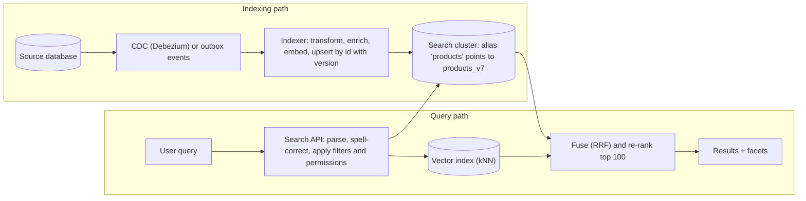
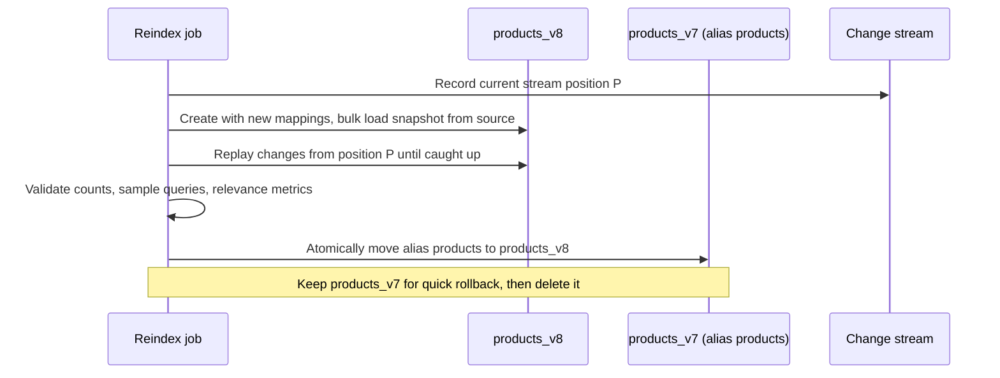

## TL;DR

- Search engines are built on the **inverted index**: a map from terms to the documents containing them. **Analysis** (tokenising, lowercasing, stemming, synonyms) decides which terms exist, so it largely decides what can be found.
- **Relevance** is ranking, not matching. BM25 is the standard text-scoring baseline. Real systems blend it with business signals (popularity, freshness, availability) and, increasingly, **vector (semantic) similarity** in **hybrid search**.
- A search index is a **derived, eventually consistent copy** of your source of truth. Feed it with change data capture or events, make indexing idempotent, and reindex through **aliases** with zero downtime.
- In Elasticsearch and OpenSearch, **shard and mapping design** decide performance and cost. Too many small shards is a classic failure, and mapping changes need a reindex.
- **Measure relevance** with judged query sets (NDCG, MRR, precision@k) and online metrics (click-through, zero-result rate, conversion). Without evaluation, tuning is guesswork. Often PostgreSQL full-text search or a hosted engine is enough. Don't run a cluster you don't need.

## Core Concepts

### The inverted index

For each term, the index stores a **postings list**: the documents containing it, often with term frequencies and positions (for phrase queries).

```text
"red"    → [doc1 (tf=1, pos 0), doc4 (tf=2, pos 3,9)]
"running"→ analysed to "run" → [doc2, doc4, doc7]
"shoe"   → [doc1, doc2, doc7]
```

A query for "red running shoes" is analysed the same way (`red`, `run`, `shoe`), the postings lists are combined (AND/OR), and the matching documents are scored. Columnar structures (**doc values**) support sorting, filtering and aggregations.

### Analysis

| Step | Example | Why |
|---|---|---|
| Character filtering | Strip HTML, normalise accents (`café` → `cafe`) | Consistent matching |
| Tokenising | `"Wi-Fi 6E router"` → `wi`, `fi`, `6e`, `router` | Defines the units of matching |
| Lowercasing | `Router` → `router` | Case-insensitive search |
| Stop words | Remove `the`, `and` (use cautiously) | Smaller index, but harms phrase queries such as "to be or not to be" |
| Stemming / lemmatisation | `running` → `run` | Matches word variants, at some cost in precision |
| Synonyms | `tv` ⇄ `television` | Matches users' vocabulary to the catalogue's |
| N-grams / edge n-grams | `iph` → `iphone` | Partial matching and autocomplete |

Index-time and query-time analysis must be compatible. Language matters: stemming for English differs from German compound words or Chinese segmentation.

### Scoring: BM25

**BM25** (the default in Lucene, Elasticsearch and OpenSearch) scores a document higher when:
- The query term appears **more often in it** (term frequency), with diminishing returns (parameter `k1`).
- The term is **rare across the corpus** (inverse document frequency): matching "ultrawide" says more than matching "monitor".
- The document is **shorter** than average (length normalisation, parameter `b`), so a match in a title beats one in a long description.

Real ranking adds **field boosts** (title above description), **business signals** (popularity, margin, stock, freshness, through `function_score` or rank features), **personalisation**, and **learning to rank** (a model re-ranking the top results using click data).

### Vector and hybrid search

**Embeddings** map text (or images) to vectors where similar meanings are close. **Approximate nearest neighbour** indexes (HNSW is the most common) find the closest vectors quickly. Vector search handles paraphrases and natural-language queries ("something warm for hiking in the rain") that keyword search misses. Keyword search handles exact terms (SKUs, error codes, names) that embeddings blur.

**Hybrid search** runs both and merges them, commonly with **reciprocal rank fusion** (RRF): each document scores `Σ 1 / (k + rank)` across the result lists (with `k` often 60), which avoids having to normalise incompatible scores. A **re-ranker** (a cross-encoder model) can then reorder the top 50–100 results for precision. This is the same retrieval stack used in RAG.

### Elasticsearch / OpenSearch architecture

- An **index** is split into **primary shards** (each a Lucene index), and each primary has **replicas** on other nodes for availability and read throughput.
- Each shard is made of immutable **segments**. New documents become searchable after a **refresh** (default every 1 second, which is why search is "near real-time"). Segments merge in the background.
- **Mappings** define field types: `text` (analysed, for full-text) versus `keyword` (exact, for filters, aggregations and sorting). Changing an existing field's type or analyser requires a **reindex**.
- **Shard sizing**: aim for shards of roughly 10–50 GB. Thousands of tiny shards waste memory and slow the cluster state. A few huge shards make recovery and rebalancing slow.
- **Licensing**: Elastic moved Elasticsearch off Apache 2.0 in 2021 and added AGPL as an option in 2024. OpenSearch is the Apache-licensed fork started by AWS, now governed by the Linux Foundation's OpenSearch Software Foundation (since 2024).

```ts
// Index with explicit mappings, a custom analyser and an alias (OpenSearch/Elasticsearch JS clients are similar).
await client.indices.create({
  index: 'products_v7',
  body: {
    settings: {
      number_of_shards: 3,
      number_of_replicas: 1,
      analysis: {
        filter: { product_synonyms: { type: 'synonym_graph', synonyms: ['tv, television', 'laptop, notebook'] } },
        analyzer: {
          product_text: { tokenizer: 'standard', filter: ['lowercase', 'asciifolding', 'product_synonyms', 'porter_stem'] },
        },
      },
    },
    mappings: {
      properties: {
        title: { type: 'text', analyzer: 'product_text', fields: { raw: { type: 'keyword' } } },
        description: { type: 'text', analyzer: 'product_text' },
        brand: { type: 'keyword' },
        price: { type: 'scaled_float', scaling_factor: 100 },
        inStock: { type: 'boolean' },
        popularity: { type: 'rank_feature' },
      },
    },
  },
});
await client.indices.updateAliases({
  body: { actions: [{ remove: { index: 'products_v6', alias: 'products' } }, { add: { index: 'products_v7', alias: 'products' } }] },
});
```

```ts
// A typical product query: relevance + filters + a popularity boost + facets.
const result = await client.search({
  index: 'products',
  body: {
    query: {
      bool: {
        must: [{ multi_match: { query: q, fields: ['title^3', 'description'], fuzziness: 'AUTO' } }],
        filter: [{ term: { inStock: true } }, { range: { price: { lte: maxPrice } } }],   // filters: cached, not scored
        should: [{ rank_feature: { field: 'popularity', boost: 0.5 } }],
      },
    },
    aggs: { brands: { terms: { field: 'brand', size: 20 } } },
    size: 24,
  },
});
```

### Keeping the index in sync

The index is a **projection**. Never treat it as the source of truth.

- **Change data capture** (Debezium on the database log) or **domain events** from an outbox feed an indexer service, which transforms and upserts documents by id (idempotent).
- **Versioning**: use the source's version or update timestamp with external versioning, so out-of-order events don't overwrite newer data.
- **Full reindex**: build a new index from the source (for mapping changes or recovery), catch up with the change stream from a recorded position, then **swap the alias** atomically.
- **Deletes**: propagate them explicitly (tombstone events). Missing deletes are a common source of "ghost" results.

### Search in PostgreSQL and hosted engines

- **PostgreSQL full-text search** (`tsvector`, `tsquery`, GIN indexes, `ts_rank`) plus **`pg_trgm`** for fuzzy and partial matching, and **pgvector** for embeddings, is often enough for up to millions of rows, with no second system to sync.
- **Hosted search** (Algolia, Elastic Cloud, Amazon OpenSearch Service, Azure AI Search, Typesense Cloud, Meilisearch Cloud) removes cluster operations, with different trade-offs in cost, relevance controls and lock-in.

### Measuring relevance

- **Offline**: a judged set of queries with graded relevance labels for results. Metrics: **precision@k**, **recall**, **MRR** (how high the first good result appears), and **NDCG** (graded relevance discounted by position). Run it on every ranking change.
- **Online**: click-through rate, **zero-result rate**, reformulation rate (users rephrasing), time to first click, add-to-cart and conversion from search, and A/B or interleaving tests.
- **Query analytics**: top queries, failing queries and zero-result queries drive synonym lists and content fixes.

## How It Works

### Indexing and query paths



### Zero-downtime reindex



## When to Use / Trade-offs

| Option | Use when | Avoid when | Cost |
|---|---|---|---|
| Database `LIKE` / `ILIKE` | Tiny tables, admin screens | Anything user-facing at scale (no relevance, slow without trigram indexes) | None, until it's slow |
| PostgreSQL full-text + `pg_trgm` (+ pgvector) | Up to millions of rows, modest relevance needs, one database to run | Rich faceting at scale, heavy relevance tuning, very high query volume | Low |
| Elasticsearch / OpenSearch (self-managed) | Large catalogues, logs, complex relevance and aggregations, full control | No team to operate clusters | High operational cost |
| Managed OpenSearch / Elastic Cloud | You need the engine but not its operations | Strict cost limits at small scale | Service premium |
| Hosted search APIs (Algolia, Typesense, Meilisearch) | E-commerce and site search where speed to market and typo tolerance matter | Heavy custom ranking or very large indexes on a budget | Per-record or per-request pricing, lock-in |
| Vector-only search | Natural-language and semantic queries | Exact identifiers, filters-heavy queries | Embedding cost, ANN memory |
| Hybrid (keyword + vector + re-rank) | Mixed query types, RAG retrieval | Very simple catalogues | More components and latency |

## Common Pitfalls & Anti-patterns

- **Search as source of truth** — writing data only to the index. It can't be rebuilt when mappings change or the cluster fails.
- **Dynamic mappings in production** — the engine guesses field types, a string lands as `text` instead of `keyword`, and filters and aggregations break. Use explicit mappings.
- **Oversharding** — hundreds of tiny shards per node exhaust heap and slow the cluster state. Size shards deliberately.
- **Deep pagination with `from`/`size`** — page 500 forces every shard to collect and sort thousands of hits. Use `search_after` with a point-in-time.
- **Scoring when you mean filtering** — putting exact conditions in `must` instead of `filter`, so they're scored and not cached.
- **Missing deletes** — products that were removed keep appearing because delete events weren't propagated.
- **Untested synonym changes** — a broad synonym ("apple" ⇄ "fruit") ruins precision. Evaluate synonyms against judged queries.
- **No relevance evaluation** — tuning boosts by anecdote ("the CEO searched for X") without measuring the overall effect.
- **Ignoring permissions** — returning documents a user isn't allowed to see. Filter by access control in the query, or index per tenant.

## Real-world Scenario

**Context:** An online retailer with 2 million products ran search with SQL `LIKE` queries plus a cache. Zero-result searches were 14% of all queries, the search conversion rate trailed competitors', and queries such as "tv 55 inch" or misspellings ("samsng") returned nothing.

**Decision:**
1. **Measured first**: built a judged set of 500 top and failing queries, with merchandisers grading results, and tracked zero-result rate, click-through and conversion from search.
2. **Managed OpenSearch** with explicit mappings: `text` fields with an English analyser plus a synonym graph built from query logs, `keyword` subfields for facets, and `rank_feature` fields for popularity and margin.
3. **Indexing via CDC** (Debezium from PostgreSQL) into an idempotent indexer using the product version, with deletes propagated. Full reindexes through aliases.
4. **Relevance**: BM25 with title boosts, fuzzy matching (`fuzziness: AUTO`), unit normalisation ("55 inch" ⇄ "55\""), and a popularity boost. Six months later, added hybrid vector search for long natural-language queries, merged with RRF.
5. **Operations**: 3 primary shards of about 15 GB, 1 replica, and `search_after` for deep pagination.

**Outcome:** Zero-result rate fell from 14% to 2.5%, NDCG@10 on the judged set rose from 0.41 to 0.72, and search-driven conversion increased by 11% in an A/B test. p95 search latency was 85 ms.

**What I'd do differently:** Set up query analytics and the judged set before choosing the engine. Half the early gains came from synonyms and unit normalisation that would have helped any engine, and the data would have made the engine decision faster.

## Interview Questions

### What is an inverted index, and why is it fast for text search? {#inverted-index}

**Level:** Foundation

**Model answer:**
An inverted index maps each **term** to a **postings list** of the documents containing it, usually with term frequencies and positions. It's "inverted" because instead of document → words, it stores word → documents.

Why it's fast:
- A query only touches the postings lists for its terms, not every document. Finding documents containing "kafka" is a lookup, not a scan.
- Postings are sorted and compressed, so intersecting lists (AND) or merging them (OR) is efficient, with skip structures to jump ahead.
- Positions support phrase and proximity queries without re-reading documents.
- Other per-field structures handle other needs: doc values (columnar) for sorting and aggregations, BKD trees for numbers and geo, and HNSW graphs for vectors.

The trade-off: writes are more expensive (analysis, segment creation and merging), and the index is near-real-time rather than instantly consistent.

**What the interviewer is looking for:**
Term-to-documents structure, why queries avoid scanning, and awareness of supporting structures.

**Follow-ups:**
- How does a phrase query use positions?
- Why are segments immutable in Lucene?

**Red flags:**
- "It's like a B-tree index on the text column."
- No mention of analysis.

### What does text analysis do, and why does it matter for search quality? {#text-analysis}

**Level:** Foundation

**Model answer:**
Analysis turns raw text into the terms stored in the index (at index time) and the terms looked up (at query time). Typical steps:
- **Character filters**: strip HTML, normalise accents and special characters.
- **Tokeniser**: split into tokens (on whitespace and punctuation, or language-aware segmentation).
- **Token filters**: lowercasing, stop words, stemming or lemmatisation (`running` → `run`), synonyms (`tv` ⇄ `television`), n-grams for partial matching.

It matters because **a document can only be found by the terms analysis produced**. Without lowercasing, "Router" won't match "router". Without stemming, "running shoes" won't match "run shoe". Without synonyms, users' words won't match catalogue terms.

Trade-offs: aggressive stemming and synonyms increase recall but can hurt precision ("universe" and "university" stemming to the same root). Index-time and query-time analysis must be compatible, and changing the analyser for existing data requires a reindex. Different languages need different analysers.

**What the interviewer is looking for:**
The pipeline, the recall/precision trade-off and the reindex implication.

**Follow-ups:**
- When would you apply synonyms at query time rather than index time?
- How would you handle product codes like "XPS-13-9340"?

**Red flags:**
- Not knowing that the same analysis must apply at query time.
- Using stop-word removal everywhere without considering phrase queries.

### What is BM25, and what does each part of it reward? {#bm25}

**Level:** Foundation

**Model answer:**
BM25 is the standard relevance scoring function in Lucene-based engines (Elasticsearch, OpenSearch, Solr). For each query term, it combines:

- **Term frequency (TF)**: more occurrences of the term in the document increase the score, with **saturation** controlled by `k1` (default about 1.2). The tenth mention adds much less than the second, unlike classic TF-IDF.
- **Inverse document frequency (IDF)**: rarer terms across the collection count more. Matching "anamorphic" is more informative than matching "lens".
- **Length normalisation**: controlled by `b` (default 0.75). A match in a short field (a title) counts more than the same match in a long description.

The document's score is the sum over query terms. In practice it's one input to ranking: field boosts, filters, business signals (popularity, freshness), and learning-to-rank or vector similarity are layered on top.

**What the interviewer is looking for:**
TF saturation, IDF and length normalisation, and the understanding that BM25 is a baseline, not the whole ranking.

**Follow-ups:**
- When would you set `b` to 0?
- Why can IDF behave oddly across shards?

**Red flags:**
- "It counts how many times the word appears."
- Not knowing BM25 is the default.

### What is the difference between `text` and `keyword` fields, and between queries and filters? {#text-vs-keyword}

**Level:** Foundation

**Model answer:**
**Field types:**
- **`text`**: analysed into terms for full-text search, scored by relevance. Use it for titles, descriptions and bodies.
- **`keyword`**: stored as a single exact value, not analysed. Use it for IDs, tags, statuses, brands, and anything you filter, sort or aggregate on.
- A common pattern is a **multi-field**: `title` as `text` with `title.raw` as `keyword` for sorting or exact matching.

**Query versus filter context:**
- **Query** clauses (`must`, `should`) answer "how well does this match?" and contribute to the score.
- **Filter** clauses (`filter`, `must_not`) answer "does this match, yes or no?". They're not scored and their results can be **cached**, which makes them faster.

So: put exact constraints such as `inStock: true`, price ranges and permissions in `filter`, and only relevance-related conditions in `must` or `should`.

**What the interviewer is looking for:**
Correct mapping choices and use of filter context for performance.

**Follow-ups:**
- What goes wrong if `status` is mapped as `text`?
- Why can't you change a field from `text` to `keyword` in place?

**Red flags:**
- Relying on dynamic mappings.
- Exact filters placed in scoring clauses.

### How do you keep a search index in sync with the primary database? {#index-sync}

**Level:** Senior

**Model answer:**
Treat the index as a **derived projection** of the source of truth:

1. **Capture changes reliably**: change data capture (Debezium reading the database's log) or domain events published through a transactional **outbox**. Avoid dual writes from application code (write the database, then the index), which diverge on partial failure.
2. **An indexer service** consumes changes, loads related data (joins, enrichment, embeddings), builds the search document and **upserts by id**.
3. **Idempotency and ordering**: use the source row's version or update timestamp with external versioning, so a late, older event can't overwrite newer data. Retries are then safe.
4. **Deletes**: propagate them explicitly. CDC delete events or tombstones remove documents.
5. **Denormalised fields**: when a brand name changes, which product documents need updating? Track dependencies, or reindex affected documents in batches.
6. **Full rebuild capability**: a job that rebuilds a fresh index from the source, catches up from a recorded stream position, and swaps the alias. You need it for mapping changes and recovery.
7. **Monitor lag and drift**: indexing lag, error queues (DLQ), and periodic reconciliation comparing counts and checksums against the source.

**What the interviewer is looking for:**
CDC or outbox rather than dual writes, versioned idempotent upserts, deletes, rebuilds and monitoring.

**Follow-ups:**
- How do you handle denormalised data that changes in a related table?
- What indexing lag is acceptable, and how do you show it to users?

**Red flags:**
- Writing to the index inside the request handler after the database commit, with no recovery.
- No way to rebuild the index.

### How do you change a mapping or analyser on a live index without downtime? {#zero-downtime-reindex}

**Level:** Senior

**Model answer:**
Existing fields' types and analysers can't be changed in place, so build a new index and switch:

1. **Applications always use an alias** (for example `products`), never the concrete index name.
2. **Record the change stream position** (CDC offset or event log position).
3. **Create the new index** (`products_v8`) with the new mappings and settings. Temporarily set `refresh_interval: -1` and zero replicas to speed up bulk loading.
4. **Bulk load** a snapshot from the source of truth (or use the engine's `_reindex` from the old index if the source data is all there).
5. **Catch up** by replaying changes from the recorded position until lag is near zero. Keep both indexes receiving live updates for a while if you need a rollback window.
6. **Restore settings** (refresh interval, replicas) and **validate**: document counts, sample queries, relevance metrics on the judged set, and latency.
7. **Swap the alias atomically** in one `updateAliases` call.
8. **Keep the old index** briefly for rollback, then delete it.

Also consider writing to both indexes during the transition if updates can't be replayed from a stream.

**What the interviewer is looking for:**
Aliases, catch-up from a stream position, validation, atomic swap and rollback.

**Follow-ups:**
- How would you test that relevance didn't regress before swapping?
- What if the reindex takes 12 hours and the source changes heavily meanwhile?

**Red flags:**
- Deleting and recreating the index in place.
- Applications pointing at concrete index names.

### How would you implement autocomplete and typo tolerance? {#autocomplete-typos}

**Level:** Senior

**Model answer:**
**Autocomplete (search-as-you-type):**
- **Edge n-grams** at index time on a dedicated field (`iph`, `ipho`, `iphon` → "iPhone"), with a normal analyser at query time. Flexible and supports matching anywhere in the text, at the cost of index size.
- **Completion suggester** (an in-memory finite state transducer): very fast prefix completion of known phrases, with weights such as popularity. Limited to prefix matching.
- **`search_as_you_type` field type** in Elasticsearch and OpenSearch, combining shingles and prefixes.
- **Query-log based suggestions**: suggest popular past queries that start with the prefix, which often works better than suggesting product names.

**Typo tolerance:**
- **Fuzzy queries** with edit distance (Levenshtein). `fuzziness: AUTO` allows 0 edits for short terms, 1 for medium and 2 for longer ones. Keep a `prefix_length` of 1–2 for performance.
- **Phonetic analysers** for names.
- **"Did you mean"** suggestions using term or phrase suggesters, or from query logs (people who searched "samsng" then searched "samsung").

**UX and performance**: debounce keystrokes (around 100–150 ms), cancel stale requests, keep the autocomplete query cheap (few fields, small size), and cache popular prefixes.

**What the interviewer is looking for:**
Several techniques with trade-offs, and the UX and performance side.

**Follow-ups:**
- How would you rank suggestions?
- How do you stop fuzzy matching from returning irrelevant results for short words?

**Red flags:**
- Running wildcard queries (`*iph*`) on every keystroke.
- Unlimited fuzziness.

### How do you measure and improve search relevance? {#measuring-relevance}

**Level:** Senior

**Model answer:**
**Offline evaluation:**
- Build a **judged query set**: a few hundred representative queries (head, torso and tail, plus known problem queries), with graded relevance labels for the top results, from domain experts or careful crowd-sourcing.
- Compute **NDCG@k** (graded relevance discounted by position), **MRR** (position of the first relevant result), **precision@k** and **recall**.
- Run it in CI for every ranking change (analysers, synonyms, boosts, models), and compare against the baseline.

**Online evaluation:**
- **Zero-result rate**, click-through rate, position of clicks, reformulation rate, add-to-cart or conversion from search, and abandonment.
- **A/B tests or interleaving** (mixing results from two rankers in one list and seeing which gets more clicks), which is more sensitive with less traffic.

**Improvement loop:**
1. Analyse query logs: top queries, zero-result queries, queries with low click-through.
2. Fix the cause: missing synonyms, analysis problems (units, plurals, codes), data quality (missing attributes), boosts, or content gaps.
3. Evaluate offline, then A/B test online.
4. For mature systems: **learning to rank** using click features, and **hybrid vector search** for natural-language queries.

**What the interviewer is looking for:**
Both offline and online metrics, a loop driven by query logs, and controlled experiments.

**Follow-ups:**
- How do you avoid position bias in click data?
- What's the difference between NDCG and MRR, and when would you prefer each?

**Red flags:**
- Tuning by individual complaints.
- No offline evaluation.

### How do you design shards and replicas for an Elasticsearch or OpenSearch index? {#shard-design}

**Level:** Senior

**Model answer:**
**Primary shards** split the data. **Replicas** copy each primary for availability and read throughput.

Guidelines:
- **Size shards to roughly 10–50 GB** (search-heavy indexes towards the smaller end). Calculate primaries from expected data size plus growth: 120 GB expected → about 3–6 primaries.
- **Avoid oversharding**: every shard costs heap, file handles and cluster-state size. Many tiny shards (for example a daily index with 5 shards per day for small log volumes) is a common cause of unstable clusters.
- **Replicas**: at least 1 for availability. More replicas increase read throughput (queries can run on any copy) at the cost of storage and indexing work.
- **Changing primary count** requires reindexing, or the shrink and split APIs, so plan for growth, or use time-based indexes or rollover for append-only data such as logs.
- **Routing**: custom routing (for example by tenant) can send a query to one shard instead of all. Beware hotspots from large tenants.
- **Time-series data**: index lifecycle management with rollover by size or age, hot-warm-cold tiers, and deletion by dropping whole indexes rather than deleting documents.

Validate with load tests using production-like data and queries, watching latency, heap usage and garbage collection.

**What the interviewer is looking for:**
Concrete sizing, the oversharding trap, replica trade-offs and lifecycle management for time-series data.

**Follow-ups:**
- How would you design indexes for 2 TB of logs a day kept for 30 days?
- What happens to query latency with too many shards?

**Red flags:**
- "More shards means more parallelism, so always use many."
- Deleting old log documents one by one.

### Design product search for an e-commerce site with 10 million products in 5 languages. {#design-product-search}

**Level:** Architect

**Model answer:**
**Requirements**: p95 under 150 ms, typo tolerance, facets (brand, price, attributes), multilingual, merchandising controls (boosts, pinned results), near-real-time stock and price updates, personalisation later.

**Architecture:**
1. **Source of truth**: the product catalogue and inventory services. **CDC or events** feed an indexer that builds denormalised search documents (product, variants, price, stock per region, attributes, popularity signals), upserted by id with versions.
2. **Index design**: one index per language (or language-specific fields) with language-appropriate analysers (stemming, compound splitting for German, decompounding, ICU normalisation). Explicit mappings, `keyword` fields for facets, `rank_feature` fields for popularity and margin. Fast-changing data such as stock and price is updated separately (partial updates) or kept as filters applied from a fast store.
3. **Sizing**: 10 million products × 5 languages, at about 2–5 KB each, is roughly 100–250 GB across languages. Say 4–6 primaries per language index with 1–2 replicas, on a managed service.
4. **Query service**: query understanding (language detection, spell correction, unit normalisation, category intent detection), BM25 with field boosts, filters for availability and region, facets, merchandising rules (pins, buries, boosts), then hybrid vector retrieval and RRF for long natural-language queries.
5. **Performance**: filter caching, `search_after` for deep pagination, caching of popular queries at the API layer, and autocomplete from a separate lightweight index.
6. **Relevance programme**: judged sets per language, query analytics dashboards, and A/B testing infrastructure.
7. **Operations**: alias-based reindexing, indexing lag monitoring, reconciliation jobs, and capacity planning for peak events (Black Friday) with load tests.

**What the interviewer is looking for:**
End-to-end design: data flow, multilingual analysis, sizing, query understanding, merchandising, relevance measurement and operations.

**Follow-ups:**
- How do you keep stock filtering accurate during a flash sale?
- How would you add personalisation?

**Red flags:**
- A single analyser for all languages.
- No plan for relevance measurement.

### When would you use PostgreSQL full-text search instead of a dedicated search engine? {#postgres-vs-search-engine}

**Level:** Architect

**Model answer:**
**PostgreSQL is often enough when:**
- Data volume is moderate (up to millions of rows), and query volume fits within the database's capacity.
- Relevance needs are simple: ranked full-text search on a few fields, with `ts_rank`, plus fuzzy matching via `pg_trgm` and possibly semantic search via `pgvector`.
- Consistency matters: search results reflect the latest committed data, with no sync pipeline.
- The team wants to run one system, not two.
- Search is combined tightly with relational filters and permissions in the same query.

**A dedicated engine is better when:**
- You need rich faceting and aggregations over large result sets, at scale.
- Relevance tuning is central to the product: complex analysers, synonyms per language, field boosts, learning to rank, merchandising.
- Query volume or data size would overload the primary database (although a read replica can buy time).
- Advanced features matter: highlighting, autocomplete at scale, geo search, log analytics.

**Middle grounds:** start with PostgreSQL behind a search abstraction in your code, add a dedicated engine when requirements grow, or use a hosted search API to avoid running a cluster.

**What the interviewer is looking for:**
An honest evaluation that avoids adding infrastructure without need, plus clear triggers for moving to a dedicated engine.

**Follow-ups:**
- How would you implement ranking with `tsvector` and weights?
- What would trigger a migration?

**Red flags:**
- "Always use Elasticsearch for search."
- `LIKE '%term%'` on large tables as the plan.

### Design the retrieval layer for a RAG system over 5 million internal documents with permissions. {#rag-retrieval-design}

**Level:** Architect

**Model answer:**
**Ingestion:**
- Connectors pull documents from sources (wikis, tickets, drives, code) with **change detection**, and capture each document's **access control list** and metadata (source, owner, date, type).
- **Chunking**: split by structure (headings, sections) into a few hundred tokens with overlap, and keep the parent document id and title with each chunk.
- **Embedding** each chunk with a versioned embedding model, plus a keyword index of the same chunks.

**Indexes:**
- One engine with both BM25 and vector (HNSW) fields, such as OpenSearch or Elasticsearch, or a vector database plus a keyword engine. Store ACL fields (allowed users and groups) on every chunk.

**Query path:**
1. Resolve the user's identity and groups.
2. **Permission filter in the query itself** (pre-filtering), never after retrieval, so unauthorised content can't leak into the prompt.
3. **Hybrid retrieval**: BM25 and vector search in parallel, merged with reciprocal rank fusion.
4. **Re-rank** the top 50–100 with a cross-encoder for precision.
5. Return the top chunks with citations (source, link, date) to the LLM.

**Quality and operations:**
- An evaluation set of questions with known relevant documents. Measure recall@k and answer quality with every change of chunking, embedding model or ranking.
- **Freshness**: incremental updates, permission changes propagated quickly (revoked access must take effect fast), and deletes honoured.
- **Re-embedding** strategy when the embedding model changes (a new index built and swapped through an alias).
- Monitor latency, cost (embedding and re-ranking) and zero-hit queries.

**What the interviewer is looking for:**
Permission-aware pre-filtering, hybrid retrieval with re-ranking, evaluation, and the lifecycle of embeddings and permissions.

**Follow-ups:**
- How do you handle a user whose group membership changed five minutes ago?
- How do you evaluate retrieval separately from generation?

**Red flags:**
- Filtering permissions after retrieval, or in the prompt.
- Vector-only retrieval for queries with exact identifiers.

### Your search cluster's latency spikes and nodes run out of heap during peak traffic. How do you stabilise it? {#search-cluster-stability}

**Level:** Architect

**Model answer:**
**Diagnose:**
- Node stats: heap usage and GC pauses, thread pool queues and rejections (search, write), field data and query cache sizes, circuit breaker trips.
- The slow query log and profile API: which queries are expensive? Typical culprits are deep pagination (`from` in the thousands), leading wildcards, large `terms` aggregations on high-cardinality fields, scripts, and aggregations on `text` fields (field data).
- Shard counts and sizes per node, and hot shards (custom routing skew, a hot index).
- Indexing load during peak: bulk imports or reindexing competing with search.

**Stabilise:**
- **Expensive queries**: replace deep pagination with `search_after`, remove leading wildcards (use n-grams), limit aggregation sizes, avoid scripts in hot paths, and enforce query timeouts and limits in the search API layer.
- **Shards**: consolidate tiny shards, rebalance hot ones, and add replicas for read-heavy peaks.
- **Separate workloads**: schedule bulk indexing off-peak, raise `refresh_interval` during heavy indexing, and use separate node roles (dedicated masters, and coordinating nodes for heavy aggregations).
- **Capacity**: right-size the heap (about half of RAM, up to around 31 GB to keep compressed object pointers), leave memory for the filesystem cache, and scale out ahead of known peaks.
- **Protect the cluster**: rate limiting and caching at the API layer, circuit breakers, and admission control so one tenant or query type can't take everything.
- **Verify** with load tests replaying production query logs.

**What the interviewer is looking for:**
Methodical diagnosis with the right tools, knowledge of common expensive patterns, and both immediate and structural fixes.

**Follow-ups:**
- Why keep the heap below about 31 GB?
- How would you isolate a noisy tenant?

**Red flags:**
- "Add more nodes" without diagnosis.
- Giving the heap all of the RAM.

### How would you build a multi-tenant search service for a B2B SaaS product with 5,000 customers? {#multi-tenant-search}

**Level:** Architect

**Model answer:**
**Isolation models:**
1. **Shared index with a tenant id filter**: every query includes a mandatory `tenant_id` filter, ideally enforced by the search API layer (or filtered aliases per tenant), never trusted from the client. Use custom **routing by tenant id**, so a tenant's documents live on one shard and queries hit only that shard. Efficient for many small tenants.
2. **Index per tenant**: strong isolation and per-tenant mappings, but thousands of indexes means thousands of shards. Fine for dozens or hundreds of large tenants, not 5,000.
3. **Hybrid**: shared indexes for the long tail of small tenants, dedicated indexes (or clusters) for large or regulated tenants.

**Design concerns:**
- **Security**: tenant filtering enforced server-side, plus tests that try cross-tenant queries. For dedicated indexes, separate credentials or roles.
- **Noisy neighbours**: per-tenant rate limits and query cost limits, and moving heavy tenants to dedicated indexes.
- **Hot shards**: routing by tenant concentrates big tenants. Use routing partitions (`routing_partition_size`) to spread a tenant over several shards.
- **Relevance**: IDF statistics across a shared index mix tenants' vocabularies, which can skew scoring. Usually acceptable, but notice it for small tenants.
- **Lifecycle**: tenant offboarding (delete by query or drop the index), data residency (regional clusters), per-tenant reindexing.

**What the interviewer is looking for:**
Trade-offs between shared and dedicated models, enforced tenant filtering, routing and noisy-neighbour controls.

**Follow-ups:**
- How would you migrate a tenant from the shared index to a dedicated one without downtime?
- How do you prove to an auditor that tenants can't see each other's data?

**Red flags:**
- An index per tenant for 5,000 tenants.
- Tenant filtering done in the frontend.

### How do you implement faceted search efficiently? {#faceted-search}

**Level:** Senior

**Model answer:**
Facets show counts for filter values (brands, price ranges, sizes) for the current result set, and let users narrow it down.

**Implementation:**
- Map facet fields as **`keyword`** (or numeric) with doc values, never as analysed `text`.
- Use **`terms` aggregations** for categorical facets and **`range`** or **`histogram`** aggregations for prices and ratings.
- Put selected filters in **filter context**, so they're cached and don't affect scores.

**Multi-select facets** are the tricky part: when a user selects "Brand: Sony", the brand facet should still show counts for other brands, while other facets narrow. Use **`post_filter`** for the selected facet's own filter (so it applies to hits but not to that facet's aggregation), or run each facet's aggregation inside a filter aggregation that applies all *other* selected filters.

**Performance:**
- Limit facet sizes (top 20 values, with "show more" fetching more).
- Avoid aggregations on very high-cardinality fields in the hot path.
- Dynamic attribute facets (different per category) can be modelled as nested or flattened key-value fields, at some cost. Decide which attributes are facetable per category from data.
- Cache facet results for popular queries and category pages.

**Correctness**: `terms` aggregation counts across shards are approximate for large cardinalities. Increase `shard_size` when accuracy matters.

**What the interviewer is looking for:**
Correct field types, filter context, the multi-select facet technique, and performance and accuracy caveats.

**Follow-ups:**
- How would you model product attributes that vary by category?
- Why can facet counts be slightly wrong, and when does it matter?

**Red flags:**
- Facets on `text` fields.
- Selected filters that make their own facet show only one value.

## Cheat Sheet

### Fundamentals

- **Inverted index** — maps each term to the list of documents (and positions) containing it.
- **Analysis** — tokenise, lowercase, stem and add synonyms. A document is only findable by the terms analysis produces.
- **BM25** — term frequency with saturation (k1), inverse document frequency, and length normalisation (b).
- **text vs keyword** — analysed full-text versus exact values for filters, sorting and aggregations.
- **Filter context** — unscored, cacheable yes/no clauses, so put exact constraints there.
- **Near real-time** — documents become searchable after a refresh, every 1 s by default.

### Operations

- **Alias swap** — reindex into a new index, then atomically move the alias for zero-downtime changes.
- **Shard size** — roughly 10–50 GB per shard. Oversharding wastes heap and destabilises clusters.
- **Deep pagination** — use search_after with a point-in-time, not large from/size offsets.
- **Index sync** — CDC or outbox into an idempotent, versioned upsert, with deletes propagated.

### Relevance and modern retrieval

- **Hybrid search** — keyword plus vector retrieval merged, often with reciprocal rank fusion.
- **Reciprocal rank fusion** — score = Σ 1 / (k + rank) across result lists, with k around 60.
- **HNSW** — a graph-based approximate nearest-neighbour index used for vector search.
- **NDCG / MRR** — offline relevance metrics for graded results and for the first relevant hit.
- **Zero-result rate** — the share of queries returning nothing. Drive it down with synonyms, analysis fixes and content.

## Further Reading

- [OpenSearch documentation](https://docs.opensearch.org/latest/) — mappings, analysers, queries, kNN and cluster operations.
- [Elasticsearch documentation](https://www.elastic.co/docs) — the Elasticsearch reference, including relevance and vector search.
- [Elastic: Size your shards](https://www.elastic.co/docs/deploy-manage/production-guidance/optimize-performance/size-shards) — shard sizing guidance.
- [PostgreSQL: Full Text Search](https://www.postgresql.org/docs/current/textsearch.html) — tsvector, tsquery, ranking and indexing.
- [Practical BM25: the algorithm and its variables](https://www.elastic.co/blog/practical-bm25-part-2-the-bm25-algorithm-and-its-variables) — how BM25 scoring works in Lucene, term by term.
- [Reciprocal Rank Fusion paper](https://plg.uwaterloo.ca/~gvcormac/cormacksigir09-rrf.pdf) — Cormack, Clarke and Büttcher's original RRF paper.
