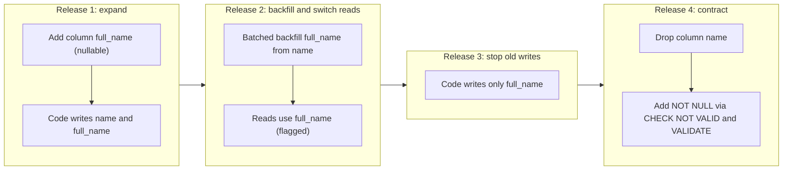
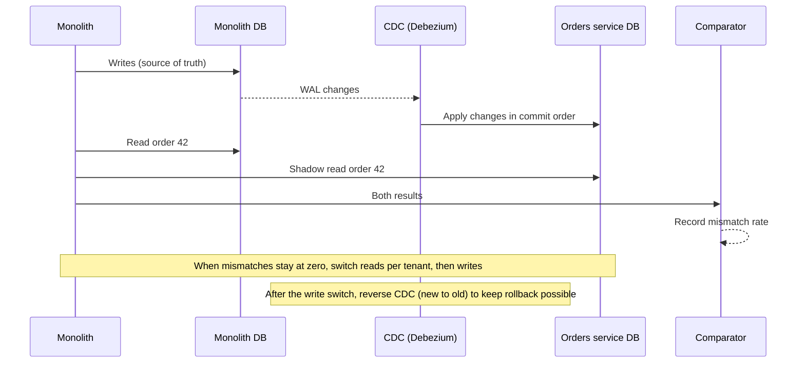

## TL;DR

- During a rolling or blue/green deploy, **old and new code run against the same database at the same time**. Every schema change must therefore work with both versions. Breaking changes are split into several backward-compatible steps: **expand → migrate → contract** (also called parallel change).
- The danger in DDL is usually **locks, not duration**. A statement that needs a brief exclusive lock can queue behind a long transaction and block every query behind it. Always set a **`lock_timeout`**, and use the online variants: `CREATE INDEX CONCURRENTLY`, `NOT VALID` constraints followed by `VALIDATE`, and MySQL's `ALGORITHM=INSTANT`.
- **Backfills** run as small, idempotent, resumable batches, throttled by replication lag. Never as one giant `UPDATE`.
- Moving data **between stores or services** uses change data capture (or an outbox) instead of application dual writes, then shadow reads and automated comparison before an incremental, reversible cutover.
- Run migrations as a **separate, single step in the pipeline**, not on application startup. Contract steps ship only after every running version has stopped using the old shape.

## Core Concepts

### Why "just run the migration" breaks production

A deploy is not instantaneous:

1. **Rolling deploys** replace instances one by one. For minutes, version N and N+1 both serve traffic.
2. **Blue/green and canary** releases keep the old version alive on purpose, so you can roll back.
3. **Rollbacks** put version N back in front of a schema that N+1 changed.
4. **Async consumers, batch jobs and other services** may read the table on their own release schedule.

So a migration that renames a column, drops one, or adds a `NOT NULL` column without a default breaks whichever version doesn't expect it. The rule: **each deployed schema must be compatible with the code currently running and the code about to run.**

### Expand and contract

Break every incompatible change into compatible steps, each shipped and verified separately:

| Phase | Schema | Code |
|---|---|---|
| **Expand** | Add the new structure (column, table, index). It is nullable or has a default, and the old structure stays untouched | Old code ignores it |
| **Migrate (write)** | — | New code writes **both** old and new, or a trigger keeps them in sync |
| **Backfill** | Copy historical data into the new structure in batches | — |
| **Migrate (read)** | — | Switch reads to the new structure, behind a flag so you can switch back |
| **Contract** | Drop the old structure, add final constraints | Stop writing the old structure first, then drop it in a later release |

Each step is a separate deploy, and you can stop or roll back at any of them. The cost is calendar time, and that is the trade you're making for zero downtime.

### Lock behaviour you must know (PostgreSQL)

| Change | Safe online? | Notes |
|---|---|---|
| `ADD COLUMN` nullable, or with a constant default | Yes | Metadata-only since PostgreSQL 11. A *volatile* default such as `clock_timestamp()` still rewrites the table |
| `ADD COLUMN … NOT NULL` without a default | No | Fails if rows exist. Add it nullable, backfill, then enforce |
| `CREATE INDEX` | No | Blocks writes for the whole build. Use `CREATE INDEX CONCURRENTLY` instead |
| `CREATE INDEX CONCURRENTLY` | Yes | Can't run inside a transaction. If it fails it leaves an `INVALID` index, which you drop and retry |
| `ADD CONSTRAINT … CHECK/FOREIGN KEY` | No | Scans the table under a strong lock. Use `NOT VALID`, then `VALIDATE CONSTRAINT` |
| `VALIDATE CONSTRAINT` | Yes | Takes a `SHARE UPDATE EXCLUSIVE` lock, which doesn't block reads or writes |
| `ALTER COLUMN … SET NOT NULL` | Mostly | Scans the table unless a validated `CHECK (col IS NOT NULL)` exists, in which case the scan is skipped (PostgreSQL 12+) |
| `ALTER COLUMN TYPE` | Usually no | Rewrites the table under `ACCESS EXCLUSIVE`, apart from binary-compatible changes such as increasing a `varchar` length |
| `RENAME COLUMN` / `DROP COLUMN` | Fast, but break code | Instant, but incompatible with code still using the old name |

### The lock queue

Even an instant `ALTER TABLE` needs an `ACCESS EXCLUSIVE` lock for a moment. If a long-running transaction (a report, an idle-in-transaction connection) holds any lock on the table, the `ALTER` waits, and **every new query on that table queues behind the waiting `ALTER`**. A metadata-only change can take the site down for as long as the long transaction runs.

```sql
-- Fail fast instead of blocking everyone, then retry with backoff.
SET lock_timeout = '3s';
SET statement_timeout = '15min';   -- only for statements expected to run long, such as VALIDATE
ALTER TABLE orders ADD COLUMN currency_code text;
```

Wrap DDL in a retry loop with jitter, and alert on long-running and idle-in-transaction sessions (`pg_stat_activity`).

### Safe patterns in SQL

```sql
-- Index without blocking writes (run outside a transaction block).
CREATE INDEX CONCURRENTLY IF NOT EXISTS idx_orders_customer_created
  ON orders (customer_id, created_at);

-- Foreign key in two steps: enforce for new rows now, check old rows later.
ALTER TABLE orders
  ADD CONSTRAINT fk_orders_customer FOREIGN KEY (customer_id)
  REFERENCES customers (id) NOT VALID;
ALTER TABLE orders VALIDATE CONSTRAINT fk_orders_customer;

-- NOT NULL without a long exclusive scan (PostgreSQL 12+).
ALTER TABLE orders ADD CONSTRAINT orders_currency_not_null
  CHECK (currency_code IS NOT NULL) NOT VALID;
ALTER TABLE orders VALIDATE CONSTRAINT orders_currency_not_null;
ALTER TABLE orders ALTER COLUMN currency_code SET NOT NULL;   -- uses the validated CHECK, no scan
ALTER TABLE orders DROP CONSTRAINT orders_currency_not_null;
```

**MySQL** has its own rules. InnoDB online DDL supports `ALGORITHM=INSTANT` for adding columns (at the end since 8.0.12, at any position since 8.0.29) and `ALGORITHM=INPLACE, LOCK=NONE` for many index changes. Tools such as **gh-ost** and **pt-online-schema-change** copy the table in the background and swap it in. Always state the algorithm and lock explicitly, so MySQL fails instead of silently falling back to a blocking copy.

### Backfills

```ts
// Batched, idempotent, resumable backfill that throttles on replica lag.
import { setTimeout as sleep } from 'node:timers/promises';

const BATCH = 5_000;
const MAX_LAG_SECONDS = 5;

export async function backfillCurrency(db: Db, startAfterId = 0n) {
  let lastId = startAfterId;
  for (;;) {
    const { rows } = await db.query<{ max_id: string | null; updated: number }>(
      `WITH batch AS (
         SELECT id FROM orders
          WHERE id > $1 AND currency_code IS NULL
          ORDER BY id
          LIMIT $2
       ), upd AS (
         UPDATE orders o
            SET currency_code = s.currency_code
           FROM batch b, stores s
          WHERE o.id = b.id AND s.id = o.store_id
            AND o.currency_code IS NULL                      -- idempotent: skip rows already done
          RETURNING o.id
       )
       SELECT (SELECT max(id) FROM batch)::text AS max_id, (SELECT count(*) FROM upd)::int AS updated`,
      [lastId.toString(), BATCH],
    );
    if (!rows[0].max_id) break;                      // no more rows to process
    lastId = BigInt(rows[0].max_id);
    await checkpoint.save('backfill-currency', lastId); // resume from here after a crash or pause

    while ((await replicaLagSeconds(db)) > MAX_LAG_SECONDS) await sleep(1_000);
  }
}
```

Principles:
- **Walk the primary key** in ranges. Don't use `OFFSET`, which gets slower with every batch.
- **Small transactions** (thousands of rows, well under a second each), so locks are short, WAL is spread out and vacuum keeps up.
- **Idempotent and resumable**, with a checkpoint table. Expect to stop and restart.
- **Throttle** on replication lag, CPU or p99 latency. Run during quieter hours if you can.
- **Verify** afterwards: count the remaining `NULL`s, and compare sampled rows.

### Moving data between stores or services

Extracting a table into a new service's database, or switching storage engines, follows the same expand/contract idea at a larger scale:

1. **Replicate** old → new continuously with change data capture (CDC). Debezium reads the PostgreSQL WAL or MySQL binlog, and managed options include AWS DMS and Azure's Database Migration Service. Or publish domain events through a transactional outbox. Do the initial bulk copy as a snapshot coordinated with the CDC position.
2. **Shadow reads**: serve from the old store, read from the new one in parallel, compare, and log mismatches. Fix them until the mismatch rate is zero for a sustained period.
3. **Switch reads** gradually behind a flag, by tenant or percentage.
4. **Switch writes.** Make the new store the source of truth, and reverse the replication direction (new → old) so rollback stays possible.
5. **Decommission** the old path once nothing reads it, confirmed by access logs and query statistics.

### Tooling and process

- **Migration tools** version and order changes: Flyway, Liquibase, Atlas, Prisma Migrate, Sqitch, EF Core migrations.
- **Linters** catch dangerous DDL in review: `squawk` for PostgreSQL, Rails' `strong_migrations`, and Atlas's analysers.
- **Pipeline placement**: run the expand migration as its own job *before* the application deploy, guarded by a lock so only one runner executes. Run contract migrations in a later release, after the code that used the old shape is gone everywhere.

## How It Works

### Renaming a column with expand and contract



At every boundary, the version before and the version after both work with the schema in place, so any single release can be rolled back.

### Extracting data into a new service with CDC



## When to Use / Trade-offs

| Approach | Use when | Avoid when | Cost |
|---|---|---|---|
| Single-step DDL with `lock_timeout` | The change is metadata-only and compatible (add a nullable column) | Any rewrite or long scan | Minimal |
| Expand/contract over several releases | Renames, type changes, splitting or merging columns | Throwaway prototypes or a maintenance window that is genuinely acceptable | Several releases and temporary duplicate code |
| Database triggers to sync old and new columns | Many writers you can't change at once | Logic that is complex or slow per row | Hidden behaviour, write overhead |
| Online schema change tools (gh-ost, pt-osc) | MySQL changes that can't be done instantly or in place | PostgreSQL, which has different mechanisms | Extra disk for the shadow table, long runtimes |
| CDC replication + shadow reads | Moving data between stores or services | Tiny datasets that can be copied in a short maintenance window | Pipeline to operate, schema mapping, comparison tooling |
| Application dual writes | Almost never, except short periods with reconciliation | Anything needing consistency | Silent divergence on partial failure |
| Planned maintenance window | Regulatory or vendor constraints, internal tools | Customer-facing 24/7 products | Downtime, plus pressure to finish within the window |

## Common Pitfalls & Anti-patterns

- **Renaming or dropping in one step** — the old version, still running or rolled back to, throws errors immediately.
- **No `lock_timeout`** — an instant `ALTER` waits behind a long transaction and blocks all traffic to the table.
- **`CREATE INDEX` without `CONCURRENTLY`** on a big table — writes stop for the whole build.
- **Forgetting the `INVALID` index** — a failed concurrent build leaves an index that costs writes and is never used.
- **One huge `UPDATE` backfill** — long locks, WAL spikes, replication lag, bloat and an all-or-nothing rollback.
- **Migrations on app startup** — twenty pods race to run them, startup probes time out, and a failed migration crash-loops the whole fleet.
- **Contracting too early** — dropping a column while a batch job, report or another service still reads it.
- **Application dual writes without reconciliation** — when one write fails, the stores diverge silently.
- **Down migrations as a rollback plan** — `DROP COLUMN` in a down script destroys data written since. Roll forward, or keep schemas compatible so a code rollback is enough.
- **ORM-generated migrations unreviewed** — the ORM may emit a table rewrite or a blocking index build for an innocent-looking model change.

## Real-world Scenario

**Context:** A payments company's `transactions` table used a 32-bit `integer` primary key. It had 1.6 billion rows and was growing by 15 million a day, so it would hit the 2,147,483,647 limit in about 7 weeks. `ALTER COLUMN id TYPE bigint` would rewrite 900 GB under an exclusive lock, which would mean hours of downtime.

**Decision:**
1. **Expand:** added `id_new bigint`, plus a trigger that sets `id_new = id` on insert and update.
2. **Backfill:** a resumable job copied `id` to `id_new` in 20,000-row batches by primary key, throttled to keep replica lag under 3 seconds. It took 4 days.
3. **Index:** `CREATE UNIQUE INDEX CONCURRENTLY` on `id_new`, then checked for `INVALID` indexes.
4. **Foreign keys:** the 3 referencing columns in other tables went through the same process, with new constraints added `NOT VALID` and then validated.
5. **Swap**, in one short transaction with `lock_timeout = '5s'` and retries: dropped the old primary key constraint, added the new one `USING INDEX`, renamed the columns, changed the sequence to `AS bigint` and moved its ownership, and dropped the trigger.
6. Application code used the column by name and was already typed as a 64-bit integer, so no code change was needed apart from removing an `int32` assumption found by a search of the codebase.

**Outcome:** The swap transaction held its lock for 1.2 seconds. Two `lock_timeout` retries were needed because of a long-running analytics query. There was no downtime, and the cutover happened 3 weeks before the overflow date.

**What I'd do differently:** Add a monitoring check on every sequence's remaining headroom years earlier, and create all new tables with `bigint` (or UUIDv7) keys by default. The migration was routine. The deadline pressure was the real risk.

## Interview Questions

### Why must schema changes be backward compatible with the previous application version? {#backward-compatible-schema}

**Level:** Foundation

**Model answer:**
Because the old version is still running when the schema changes, and may run again after it:
- **Rolling deploys** replace instances gradually, so versions N and N+1 serve traffic together.
- **Blue/green and canary** releases keep N alive deliberately.
- **Rollbacks** put N back in front of whatever schema N+1 left behind.
- **Other consumers** (batch jobs, reports, other services, CDC pipelines) read the same tables on their own schedules.

If a migration renames or drops something N uses, or adds a constraint N violates, those instances start failing. Schema changes must therefore be compatible with both the running and the incoming code. Incompatible changes are split into several compatible releases using expand and contract.

**What the interviewer is looking for:**
Understanding that deploys aren't atomic, and that rollback is part of the compatibility requirement.

**Follow-ups:**
- Which common changes are compatible in a single step, and which aren't?
- How does this change if you deploy with a short maintenance window?

**Red flags:**
- "We run the migration and deploy at the same time, so it's fine."
- Relying on down migrations for rollback.

### What is the expand/contract pattern? {#expand-contract}

**Level:** Foundation

**Model answer:**
Expand/contract (Martin Fowler calls it *parallel change*) turns one breaking change into several backward-compatible ones:

1. **Expand:** add the new structure alongside the old. For example, a new nullable column, table or API field.
2. **Migrate:** write to both (in code or with a trigger), backfill historical data, then switch reads to the new structure, ideally behind a flag.
3. **Contract:** stop writing the old structure, then remove it once nothing reads it, and add final constraints.

Each step is its own release and can be rolled back individually. The same idea applies beyond databases: API fields, event schemas, configuration keys and feature-flag names.

**What the interviewer is looking for:**
The three phases, the fact that they ship separately, and that the pattern generalises beyond SQL.

**Follow-ups:**
- How would you apply it to removing a field from a public API?
- How do you know when it's safe to contract?

**Red flags:**
- Collapsing expand and contract into one release.
- Not mentioning a backfill.

### Why shouldn't you run database migrations on application startup? {#migrations-on-startup}

**Level:** Foundation

**Model answer:**
- **Races:** with many replicas, every instance tries to migrate at once. Tools use locks, but contention slows startup, and some tools or custom scripts don't lock correctly.
- **Probes and timeouts:** a long migration delays startup past readiness or liveness probes, so the orchestrator kills the pods and they restart the migration.
- **Blast radius:** a failing migration crash-loops the whole fleet, including the instances that were serving traffic happily.
- **Privileges:** the application needs DDL rights at runtime, which violates least privilege.
- **Ordering:** you can't sequence "migrate, then deploy" or "deploy, then contract" explicitly.

Better: run migrations as a separate pipeline step or Kubernetes Job, with a dedicated, privileged identity, before the app rollout (for expand changes). Make the pipeline fail the deploy if the migration fails, and run contract changes in a later release.

**What the interviewer is looking for:**
Operational failure modes and the least-privilege argument, plus a concrete alternative.

**Follow-ups:**
- How would you handle a migration that takes 3 hours?
- Where would you run migrations in a GitOps setup?

**Red flags:**
- "The ORM handles it."
- Giving the runtime database user full DDL permissions without considering it.

### How do you safely add an index to a large production table in PostgreSQL? {#create-index-concurrently}

**Level:** Foundation

**Model answer:**
A plain `CREATE INDEX` takes a lock that blocks writes (`INSERT`, `UPDATE`, `DELETE`) for the entire build, which could be minutes or hours on a large table.

Use `CREATE INDEX CONCURRENTLY`:
- It builds the index in several passes without blocking writes. Reads were never blocked.
- It takes longer and uses more resources, and it waits for existing transactions that could see the table.
- It **can't run inside a transaction block**, so your migration tool must run that statement outside its usual transaction (Flyway and Liquibase both support this).
- If it fails (for example a uniqueness violation, or a cancel), it leaves an **`INVALID`** index that still slows writes. Find it in `pg_index` (`indisvalid = false`), drop it with `DROP INDEX CONCURRENTLY` and retry.

Also set `lock_timeout` so the brief locks at the start and end don't queue behind a long transaction, and check disk space and replica impact first.

**What the interviewer is looking for:**
`CONCURRENTLY`, its constraints (no transaction block, `INVALID` indexes on failure), and awareness of lock queues.

**Follow-ups:**
- How do you add a unique constraint using a concurrently built index?
- What's the MySQL equivalent?

**Red flags:**
- Running a plain `CREATE INDEX` on a busy table.
- Not knowing what happens when a concurrent build fails.

### How would you rename a column with zero downtime? {#rename-column}

**Level:** Senior

**Model answer:**
A direct `RENAME COLUMN` is instant but breaks any code still using the old name. Use expand and contract:

1. **Release 1 (expand):** add `new_name` (nullable). Deploy code that writes both `old_name` and `new_name`. Alternatively, use a trigger that copies one to the other, which also covers writers you don't control.
2. **Backfill** `new_name` from `old_name` in batches, idempotently.
3. **Release 2:** switch reads to `new_name`, behind a flag if the read path is risky. Keep writing both.
4. **Release 3:** stop writing `old_name`. Remove the trigger.
5. **Release 4 (contract):** once logs and query statistics show nothing reads `old_name` (including reports, ETL and other services), drop it. Add any `NOT NULL` with the `CHECK … NOT VALID` → `VALIDATE` → `SET NOT NULL` sequence.

Alternative for simple cases: rename the column and add a **view** or a generated column exposing the old name for the transition. That works only if all access goes through something you can point at the view.

**What the interviewer is looking for:**
The multi-release sequence, handling writers you don't control, and checking consumers before contracting.

**Follow-ups:**
- How would you do the same for a column used in a unique index?
- What changes if the ORM caches the schema at startup?

**Red flags:**
- A single `RENAME` with a coordinated deploy.
- Dropping the old column in the same release that stops writing it.

### How would you backfill a column on a 500-million-row table? {#large-backfill}

**Level:** Senior

**Model answer:**
Never a single `UPDATE` across the table. It would hold row locks for its whole duration, generate a huge WAL spike, cause replication lag, bloat the table, and if it fails, roll everything back.

Instead:
- **Batch by primary key range** (`WHERE id > :last ORDER BY id LIMIT 5000`), not `OFFSET`. Each batch is its own short transaction.
- **Make it idempotent**: `WHERE new_col IS NULL`, so reruns skip completed rows and concurrent new writes aren't overwritten.
- **Checkpoint progress** in a table, so the job can pause and resume.
- **Throttle** on replica lag, p99 latency or CPU. Sleep between batches, and back off automatically.
- **Run it as a job**, not a migration in the deploy pipeline. It may take days.
- **Make sure new writes already fill the column** (via code or trigger) before starting, so the backfill only chases historical rows.
- **Verify** at the end: count the remaining rows and sample-compare values. Then add constraints with `NOT VALID` and `VALIDATE`.
- Watch autovacuum. Tune it for the table, or run `VACUUM` between phases.

Rough sizing: at 5,000 rows per batch with 200 ms per batch plus throttling, 500 million rows is about 100,000 batches, roughly 6–12 hours. Plan for that.

**What the interviewer is looking for:**
Batching by key, idempotence, resumability, throttling on real signals, and an estimate of duration.

**Follow-ups:**
- How would you handle rows updated by users during the backfill?
- How would you backfill a value that depends on a slow external API?

**Red flags:**
- One big `UPDATE` "overnight".
- Pagination with `OFFSET`.

### Why can a "quick" ALTER TABLE take your database down, and how do you prevent it? {#lock-queue}

**Level:** Senior

**Model answer:**
Even metadata-only DDL such as adding a nullable column needs an `ACCESS EXCLUSIVE` lock on the table, briefly. Locks are granted in queue order. If a long-running transaction holds even a weak lock on that table (an analytics query, a migration tool's open transaction, or a connection left "idle in transaction"), the `ALTER` waits. **Every subsequent query on the table, including simple `SELECT`s, queues behind the waiting `ALTER`.** Connection pools fill, and the application goes down until the long transaction ends.

Prevention:
- **`SET lock_timeout = '2s'`** (or a few seconds) for DDL, so it gives up instead of blocking everyone, and **retry with backoff and jitter**.
- **Kill or avoid long transactions**: set `idle_in_transaction_session_timeout`, run analytics on replicas, and alert on old transactions in `pg_stat_activity`.
- **Check before running**: a pre-flight query for long transactions on the target table.
- Keep DDL transactions tiny. Don't mix DDL and data changes in one transaction that holds the lock for long.

MySQL has the same issue with metadata locks (`Waiting for table metadata lock`), and its `lock_wait_timeout` serves the same purpose.

**What the interviewer is looking for:**
The lock-queue mechanism (not the DDL's duration) and `lock_timeout` with retries.

**Follow-ups:**
- How would you find which session is blocking the migration?
- How do PgBouncer's pool modes interact with session settings such as `lock_timeout`?

**Red flags:**
- "Adding a column is instant, so there's no risk."
- Not knowing what idle-in-transaction means.

### How do you add a NOT NULL constraint or a foreign key to a large existing table without blocking? {#not-valid-constraints}

**Level:** Senior

**Model answer:**
Adding a constraint normally scans every row to check it, while holding a lock that blocks writes. PostgreSQL lets you split that:

**Foreign key:**
```sql
ALTER TABLE orders ADD CONSTRAINT fk_customer
  FOREIGN KEY (customer_id) REFERENCES customers (id) NOT VALID;   -- brief lock, new rows checked
ALTER TABLE orders VALIDATE CONSTRAINT fk_customer;                -- scans existing rows, weaker lock
```

**NOT NULL** (PostgreSQL 12+):
```sql
ALTER TABLE orders ADD CONSTRAINT chk_currency CHECK (currency_code IS NOT NULL) NOT VALID;
ALTER TABLE orders VALIDATE CONSTRAINT chk_currency;
ALTER TABLE orders ALTER COLUMN currency_code SET NOT NULL;   -- skips the scan thanks to the valid CHECK
ALTER TABLE orders DROP CONSTRAINT chk_currency;
```

`NOT VALID` enforces the constraint for new and updated rows immediately. `VALIDATE` checks existing rows under a `SHARE UPDATE EXCLUSIVE` lock, which allows reads and writes to continue. Before validating, make sure the backfill or clean-up is complete, otherwise validation fails after scanning for a long time.

Always run these with `lock_timeout` set.

**What the interviewer is looking for:**
The `NOT VALID`/`VALIDATE` split and the PostgreSQL 12 `SET NOT NULL` optimisation.

**Follow-ups:**
- What lock does the referenced table get during FK validation?
- How would you find violating rows before validating?

**Red flags:**
- Adding the constraint directly on a huge, busy table.
- Not cleaning the data before validating.

### How do you roll back a deployment that included a schema change? {#rollback-schema}

**Level:** Senior

**Model answer:**
Ideally you don't roll back the schema at all. You **roll back the code**, which only works if the schema is compatible with the previous version. That's the main reason for expand/contract:

- **Expand migrations** (new nullable columns, new tables, new indexes) are harmless to the old code, so a code rollback is enough. The extra column stays and is used again on the next attempt.
- **Contract migrations** (drops, renames, new constraints) ship only after the code that needed the old shape is gone, and after a soak period. At that point you're never rolling back to the code that needed it.
- **Data changes** (backfills, transformations) should be additive. Write new values to new columns rather than overwriting old ones, so the old data remains for the old code.

**Down migrations** are risky. Dropping a column added in the up-migration destroys any data written since. Prefer **roll forward**: fix the issue in a new migration. Keep down scripts for development, and treat production downs as an exception that needs review.

For destructive steps, take a backup or a point-in-time-recovery marker first, and record which release can no longer be restored afterwards.

**What the interviewer is looking for:**
Decoupling code rollback from schema rollback, and preferring roll forward.

**Follow-ups:**
- How do you test that release N works against release N+1's schema?
- What would you do if a backfill wrote wrong values?

**Red flags:**
- "We run the down migration."
- No idea what happens to data written between deploy and rollback.

### Your primary key column is a 32-bit integer and will overflow in two months. What do you do? {#int-to-bigint}

**Level:** Senior

**Model answer:**
`ALTER COLUMN id TYPE bigint` rewrites the whole table under an exclusive lock, which on a large table means hours of downtime. Do it online instead:

1. **Buy time if needed.** If the deadline is very close, consider starting a fresh sequence at negative values (`-2147483648`) as an emergency measure, if the application tolerates negative ids. It doubles the runway.
2. **Expand:** add `id_new bigint`, and a trigger that sets it from `id` on insert and update.
3. **Backfill** `id_new` in batches, throttled.
4. **Build a unique index concurrently** on `id_new`.
5. **Repeat for foreign keys** in referencing tables (new `bigint` columns, backfill, new FK constraints `NOT VALID` then `VALIDATE`).
6. **Swap in one short transaction** with `lock_timeout` and retries: drop the old primary key, add the new one using the prebuilt index (`ADD CONSTRAINT … PRIMARY KEY USING INDEX`), rename the columns, change the sequence to `bigint` and attach it to the new column, and drop the trigger.
7. **Check the application and every consumer** for 32-bit assumptions: ORM types, protobuf `int32` fields, JavaScript precision (numbers above 2^53 aren't safe, so send ids as strings), and analytics schemas.
8. **Add monitoring** for sequence headroom on every table, and make `bigint` or UUIDv7 the default for new tables.

**What the interviewer is looking for:**
A full online procedure, handling foreign keys, the short final swap, and checking consumers beyond the database.

**Follow-ups:**
- How would you do this in MySQL?
- When would you choose UUIDs instead of `bigint`, and which UUID version?

**Red flags:**
- Running `ALTER COLUMN TYPE` during peak hours.
- Ignoring client-side integer limits.

### Design the migration of a core table from a monolith's database to a new service's database without downtime. {#extract-service-data}

**Level:** Architect

**Model answer:**
**Before data, fix the access pattern.** Inventory every reader and writer of the table: monolith modules, reports, jobs and other services. Route all monolith access through one module interface, so later there's a single place to switch. Agree the new service's model, which need not match the old table.

**Phases:**
1. **Replicate.** Snapshot the table into the new store, then stream changes with CDC (for example Debezium on the WAL), transformed into the new model. Track lag and per-row checksums.
2. **Shadow reads.** The monolith module reads from the old database, and asynchronously from the new service's API, and compares. Fix mapping bugs until mismatches stay at zero for an agreed period, such as two weeks including a month-end.
3. **Switch reads** behind a flag by tenant or percentage, starting with internal users. Writes still go to the monolith.
4. **Switch writes.** The new service becomes the source of truth. Stop CDC old → new, and start replicating new → old (via the service's outbox events, or CDC on its database), so legacy readers and a rollback still work. A brief write pause per tenant (seconds) during the flip simplifies ordering.
5. **Migrate remaining readers** (reports, jobs) to the service's API or events.
6. **Contract.** Stop reverse replication, drop the old table, and remove the module's legacy code.

**Hard parts to call out:** joins the monolith did across this table and others (replace them with API composition or a read model), transactions that spanned both (sagas or the outbox), id generation (keep the same ids), and reporting that expected a single database.

**What the interviewer is looking for:**
Access-path consolidation first, CDC over dual writes, comparison before cutover, reversible switching, and attention to joins and transactions.

**Follow-ups:**
- How do you keep ordering correct during the write flip?
- What metrics decide each phase gate?

**Red flags:**
- The monolith writing to both databases directly.
- A big-bang cutover weekend.

### Why are dual writes from application code dangerous, and what would you use instead? {#dual-writes}

**Level:** Architect

**Model answer:**
"Write to database A, then to B" (or A and a message broker) has no atomicity:
- **Partial failure:** A commits and the process crashes, times out or gets an error before B. Now they differ, often silently.
- **Ordering:** two concurrent requests can write A in one order and B in the other, so B ends up with the older value.
- **Retries** after an ambiguous failure produce duplicates unless B is idempotent.

Wrapping both in a distributed transaction (XA, two-phase commit) is rarely available across modern stores, couples their availability and doesn't scale well.

Alternatives:
- **Change data capture:** write only to A, and let a CDC connector stream A's commit log to B in commit order. One source of truth, and ordering preserved per key.
- **Transactional outbox:** write the business change and an event row in the *same* local transaction, then relay events to the broker or B with at-least-once delivery. Consumers are idempotent.
- **Event sourcing**, where the log is the source of truth and both stores are projections.
- If dual writes are temporarily unavoidable, add **continuous reconciliation** (a comparison job plus repair) and treat A as authoritative.

**What the interviewer is looking for:**
Partial failure *and* ordering problems, and CDC or the outbox as standard solutions.

**Follow-ups:**
- How does the outbox relay avoid publishing duplicates, or tolerate them?
- What are the operational costs of running Debezium?

**Red flags:**
- "Wrap both writes in try/catch and roll back A if B fails."
- Not recognising the ordering issue.

### Your company is moving the orders domain from MongoDB to PostgreSQL. How do you plan the cutover and verify correctness? {#cross-store-migration}

**Level:** Architect

**Model answer:**
**Plan:**
1. **Model mapping.** Design the relational schema from the domain, not by mirroring documents. Decide how to handle embedded arrays (child tables or `jsonb`), polymorphic documents and missing fields. Document every transformation rule and its edge cases.
2. **Repository seam.** Make sure all order access goes through a repository interface in the application, with implementations for both stores.
3. **Replicate.** Take an initial snapshot, then stream changes from MongoDB change streams into PostgreSQL with transformation. Make it resumable from a stored resume token.
4. **Verify:**
   - **Counts and checksums** per partition (per day, per tenant).
   - **Field-level comparison** of a large random sample, plus the full set for critical fields such as amounts and statuses.
   - **Shadow reads** in production: execute the real queries against both stores, and compare results and latency.
   - **Business invariants**: totals per day match the finance reports.
5. **Cut over reads** per tenant, then **writes** with a short per-tenant write freeze. Reverse replication to MongoDB keeps rollback possible for a defined period.
6. **Decommission** after a soak period that includes a month-end and peak traffic.

**Risks to manage:** precision differences (Mongo `double` versus PostgreSQL `numeric` for money), timezone handling, string collation in sorted queries, undocumented consumers of the Mongo collection, and query performance on the new schema (test with production-like volumes).

**What the interviewer is looking for:**
Verification at several levels, including business invariants, rollback capability, and type and semantic differences between stores.

**Follow-ups:**
- What mismatch rate would you accept before cutover, and why?
- How would you migrate change streams' history if the oplog window is too short for the snapshot?

**Red flags:**
- "Export, import, switch the connection string."
- Verifying with record counts only.

### How would you govern schema changes across 30 teams that share tooling and databases? {#migration-governance}

**Level:** Architect

**Model answer:**
Aim for **safety by default with minimal central gatekeeping**:

1. **Paved road.** One supported migration tool per stack, with a pipeline template that runs migrations as a separate, locked job before deploy, with `lock_timeout` and `statement_timeout` set by default.
2. **Automated linting in CI.** `squawk`, `strong_migrations` or Atlas lint rules block known-dangerous operations: non-concurrent indexes, `NOT NULL` without the safe sequence, type changes, renames or drops without an expand phase, and volatile defaults. Overrides need a justified annotation reviewed by a database-savvy reviewer.
3. **Classification.** Additive changes merge with normal review. Destructive or rewrite operations need a short design note (expand/contract plan, backfill estimate, rollback) and an explicit reviewer from a guild or platform team.
4. **Pre-production realism.** Run migrations against a production-sized copy (masked) to measure duration and locks. Report the lock types each statement takes.
5. **Ownership.** Each table has an owning team (in a catalogue). Cross-team readers are registered, so contract steps can check who still depends on a column.
6. **Observability.** Alerts for long-running transactions, lock waits, replication lag and sequence headroom, and a dashboard of migrations in flight.
7. **Learning loop.** Incidents caused by migrations feed new lint rules.

The goal is that the safe way is the easy way, and humans review only the genuinely risky minority.

**What the interviewer is looking for:**
Automation over review boards, risk-based escalation, and clear table ownership.

**Follow-ups:**
- How do you handle a shared legacy database with no clear owners?
- What would your top five lint rules be?

**Red flags:**
- A central DBA team approving every migration manually.
- No ownership model for shared tables.

### How do you evolve event schemas and API contracts when you don't control all the consumers? {#evolve-contracts}

**Level:** Architect

**Model answer:**
The same expand/contract principle, applied to contracts:

- **Additive changes only** within a version: new optional fields, new enum values (only if consumers are documented to tolerate unknown values), new endpoints. Consumers must ignore unknown fields (the tolerant reader pattern).
- **Never** rename, remove, change the type or meaning of a field, or make an optional field required, in place.
- **Breaking changes** get a new version: a new event type (`OrderPlaced.v2`) or topic, or a new API version. Publish both in parallel during the migration window.
- **Schema registry with compatibility rules** (Confluent Schema Registry, Azure Schema Registry), set to `BACKWARD` or `FULL` so incompatible producer changes are rejected at build or publish time.
- **Consumer-driven contract tests** (Pact) for consumers you know about, run in the producer's pipeline.
- **Deprecation process**: announce, measure usage per consumer (who still reads v1?), set a sunset date, use `Deprecation` and `Sunset` HTTP headers for APIs, and remove only when usage reaches zero or the date passes with notice.
- **Semantic changes** (a field's meaning changes, such as amounts now including tax) are breaking even if the schema is identical. Treat them as a new field or version.

**What the interviewer is looking for:**
Compatibility rules enforced by tooling, parallel versions, usage-driven deprecation, and awareness of semantic breaks.

**Follow-ups:**
- How long would you run v1 and v2 in parallel for external API consumers?
- How do you replay historical events that use an old schema?

**Red flags:**
- "We'll just tell consumers to update."
- Treating only structural changes as breaking.

## Cheat Sheet

### Principles

- **Compatibility rule** — each schema must work with both the running and the incoming code version.
- **Expand/contract** — add new, migrate writes and reads, backfill, then remove old, in separate releases.
- **Rollback strategy** — roll back code against a compatible schema, and roll the schema forward.
- **Migrations placement** — a separate, locked pipeline job before deploy, never on app startup.

### PostgreSQL mechanics

- **Lock queue danger** — DDL waiting for a lock blocks every later query on the table, so set `lock_timeout`.
- **ADD COLUMN with constant default** — metadata-only since PostgreSQL 11. Volatile defaults still rewrite.
- **CREATE INDEX CONCURRENTLY** — doesn't block writes, can't run in a transaction, and leaves an INVALID index on failure.
- **NOT VALID + VALIDATE** — enforce for new rows now, and check old rows later under a lock that allows reads and writes.
- **Safe SET NOT NULL** — a validated `CHECK (col IS NOT NULL)` lets PostgreSQL 12+ skip the scan.
- **ALTER COLUMN TYPE** — usually a full table rewrite under an exclusive lock, so add a new column and swap instead.

### Data movement

- **Backfill shape** — primary-key-range batches, idempotent, checkpointed, throttled on replica lag.
- **Dual writes** — no atomicity and no ordering guarantee, so use CDC or a transactional outbox.
- **Shadow reads** — query both stores, compare results, and cut over only after mismatches stay at zero.
- **Reverse replication** — after the write switch, replicate new to old so rollback remains possible.
- **gh-ost / pt-online-schema-change** — MySQL tools that copy to a shadow table and swap it in.

## Further Reading

- [PostgreSQL: ALTER TABLE](https://www.postgresql.org/docs/current/sql-altertable.html) — which forms rewrite the table, `NOT VALID`, `VALIDATE` and the locks each needs.
- [PostgreSQL: Building indexes concurrently](https://www.postgresql.org/docs/current/sql-createindex.html#SQL-CREATEINDEX-CONCURRENTLY) — the rules and failure behaviour of `CONCURRENTLY`.
- [PostgreSQL: Explicit locking](https://www.postgresql.org/docs/current/explicit-locking.html) — the lock modes and which statements conflict.
- [MySQL: InnoDB online DDL](https://dev.mysql.com/doc/refman/8.4/en/innodb-online-ddl.html) — `INSTANT`, `INPLACE` and locking options.
- [gh-ost](https://github.com/github/gh-ost) — GitHub's triggerless online schema migration tool for MySQL.
- [Debezium documentation](https://debezium.io/documentation/) — change data capture for moving data between stores.
- [ParallelChange](https://martinfowler.com/bliki/ParallelChange.html) — Martin Fowler's description of the expand/contract pattern.
- [Online migrations at scale](https://stripe.com/blog/online-migrations) — Stripe's four-step dual-writing migration pattern in practice.
