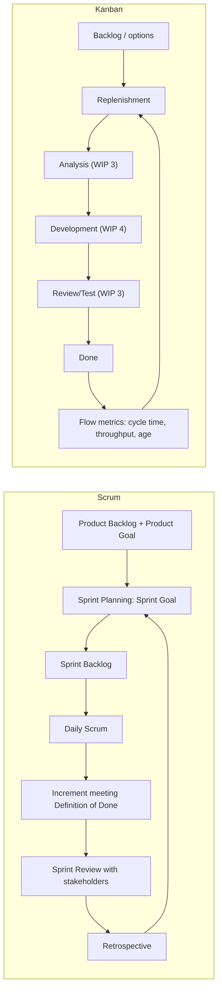

## TL;DR

- Agile is a set of **values and principles** (2001 Manifesto): working software, customer collaboration, responding to change, short feedback loops. Frameworks are tools to apply them, not the goal.
- **Scrum** structures work in fixed-length sprints with clear accountabilities (Product Owner, Scrum Master, Developers), events and a Definition of Done — good for product teams needing cadence and focus.
- **Kanban** optimises **flow**: visualise work, limit work in progress, manage flow with metrics (cycle time, throughput, WIP, work item age) — good for continuous or interrupt-heavy work.
- **Little's Law** (WIP = throughput × cycle time) explains why limiting WIP reduces lead time: starting less finishes more.
- Scaling frameworks (**SAFe**, LeSS, Nexus) coordinate many teams; they help with alignment and dependencies but can become heavyweight. Prefer reducing dependencies through architecture and team design.

## Core Concepts

### The Agile Manifesto

Values (2001):
- **Individuals and interactions** over processes and tools.
- **Working software** over comprehensive documentation.
- **Customer collaboration** over contract negotiation.
- **Responding to change** over following a plan.

"While there is value in the items on the right, we value the items on the left more." The 12 principles add frequent delivery, sustainable pace, technical excellence, simplicity, self-organising teams and regular reflection.

### Scrum (Scrum Guide 2020)

- **Accountabilities:** Product Owner (maximises value; owns the Product Backlog), Scrum Master (team effectiveness, coaching, removing impediments), Developers (create the Increment; own the Sprint Backlog).
- **Events:** the Sprint (≤1 month, typically 1–2 weeks) containing Sprint Planning, Daily Scrum, Sprint Review and Sprint Retrospective.
- **Artifacts and commitments:** Product Backlog → **Product Goal**; Sprint Backlog → **Sprint Goal**; Increment → **Definition of Done**.
- Empiricism: transparency, inspection, adaptation.

Scrum works when there is a meaningful Sprint Goal, a real Definition of Done (including tests and deployment readiness), a Product Owner who can make decisions, and a team protected from mid-sprint churn.

### Kanban

The Kanban Method (David J. Anderson) practices:
1. **Visualise** the workflow (columns reflecting real stages, including waiting states).
2. **Limit WIP** per column or per person.
3. **Manage flow:** watch for blocked and ageing items; swarm to finish.
4. **Make policies explicit:** definitions of each stage, pull criteria, classes of service (expedite, fixed date, standard, intangible).
5. **Implement feedback loops:** replenishment, stand-ups focused on flow, service delivery reviews.
6. **Improve collaboratively**, evolve experimentally.

No prescribed roles or iterations; you start with what you do now and evolve.

### Flow metrics and Little's Law

- **Cycle time:** time from start to done for an item (report percentiles, e.g. 85% finish within 6 days).
- **Throughput:** items finished per unit of time.
- **WIP:** items started but not finished.
- **Work item age:** how long in-progress items have been open — the best early warning signal.

**Little's Law:** average WIP = average throughput × average cycle time. With throughput fixed by capacity, **cutting WIP cuts cycle time**. A team with 20 items in progress and throughput of 5/week has an average cycle time of 4 weeks; cutting WIP to 10 halves it.

### Scaling frameworks

- **SAFe (Scaled Agile Framework):** organises teams into Agile Release Trains (50–125 people), with **PI (Program Increment) Planning** every 8–12 weeks, a Release Train Engineer, portfolio management layers and many roles. Gives large enterprises a structured way to align; criticised for heaviness and for re-creating waterfall planning at a larger scale.
- **LeSS (Large-Scale Scrum):** one Product Owner and one Product Backlog for many teams; emphasises organisational simplification.
- **Nexus:** Scrum.org's framework for 3–9 Scrum teams with an integration team.
- **"Spotify model":** squads, tribes, chapters, guilds — a description of one company's organisation at a point in time, not a framework to copy (Spotify itself has said so).

### Supporting practices

Agile without technical practices fails. XP practices: continuous integration, test-driven development, refactoring, pair/mob programming, small releases, collective ownership. DevOps practices: deployment automation, trunk-based development, observability.

## How It Works

## When to Use / Trade-offs

| Approach | Use when | Avoid when | Trade-off |
|---|---|---|---|
| Scrum | Product development needing focus, cadence and regular stakeholder feedback | Highly interrupt-driven work; ops/support teams | Rhythm and goals vs ceremony overhead, artificial sprint boundaries |
| Kanban | Continuous flow, support, platform/ops, mixed work types | Teams needing strong time-boxed goals to focus | Flexibility and flow vs risk of no goals or cadence |
| Scrumban | Teams wanting cadence plus WIP limits | — | Pragmatic hybrid; needs discipline |
| Shape Up (6-week cycles + cooldown) | Product teams wanting appetite-based scoping and autonomy | Highly interdependent orgs | Big chunks of autonomy vs less frequent replanning |
| SAFe | Large enterprises (hundreds of people) with heavy dependencies and governance needs | Small/medium orgs; teams that can be decoupled | Alignment and predictability vs bureaucracy, slower change |
| LeSS / Nexus | Several teams on one product wanting Scrum-based scaling | Many unrelated products | Simplicity vs need for strong product ownership |

## Common Pitfalls & Anti-patterns

- **Cargo-cult agile** — ceremonies without the values: stand-ups as status reports, retros with no actions, sprints as mini-waterfalls.
- **Velocity as a performance metric** — inflated estimates, gaming, comparisons between teams.
- **No Definition of Done** — "done" work that isn't tested, deployed or usable.
- **Product Owner without authority** — a proxy who must ask someone else for every decision.
- **Too much WIP** — everyone busy, nothing finishing, long cycle times.
- **Sprint goals that are just a list of tickets.**
- **Ignoring technical practices** — agile planning on top of manual testing and big-bang releases.
- **Scaling before fixing team-level basics** — adding SAFe to dysfunctional teams.
- **Copying the "Spotify model"** as an org chart.
- **Agile as fixed scope + fixed date + fixed team** — no room for learning or adaptation.

## Real-world Scenario

**Context:** A platform team of eight ran two-week Scrum sprints but rarely met sprint goals: 40–60% of their work was unplanned requests and incidents from product teams. Morale was low, and stakeholders complained of unpredictability.

**Decision:** Switched to Kanban with explicit classes of service (expedite for incidents, fixed-date for compliance, standard for requests and roadmap), WIP limits per column, a weekly replenishment meeting with stakeholders, and a fortnightly service delivery review using cycle-time percentiles. They reserved capacity for roadmap work by setting a WIP allocation (max two expedite items, at least three roadmap items in progress).

**Outcome:** Within three months, 85th percentile cycle time for standard requests dropped from 19 to 7 days; stakeholders received forecasts based on throughput data ("85% chance within 8 days"); roadmap work progressed steadily for the first time in a year.

**What I'd do differently:** Visualise the waiting states (awaiting review, awaiting other team) from the start — they revealed that half the cycle time was waiting on external approvals, which became the next improvement focus.

## Interview Questions

### What are the four values of the Agile Manifesto, and what do they mean in practice? {#agile-manifesto}

**Level:** Foundation

**Model answer:**
- **Individuals and interactions over processes and tools:** collaboration and conversation solve problems better than rigid process; tools support people.
- **Working software over comprehensive documentation:** progress is measured by usable increments; documentation is valuable when it serves a purpose (ADRs, runbooks), not as a substitute for delivery.
- **Customer collaboration over contract negotiation:** work with customers continuously to learn what they need, rather than fixing everything upfront.
- **Responding to change over following a plan:** plans are useful, but adapt as you learn.

The right-hand items still have value — the manifesto says the left ones are valued **more**. In practice: short feedback cycles, small increments delivered frequently, close collaboration with users, sustainable pace and continuous improvement.

**What the interviewer is looking for:**
Correct values, the "over, not instead of" nuance, and practical interpretation.

**Follow-ups:**
- Which of the 12 principles do teams most often ignore?
- Does agile mean no documentation?

**Red flags:**
- "Agile means no planning or documentation."
- Equating agile with Scrum.

### Describe Scrum's accountabilities, events and artifacts. {#scrum-basics}

**Level:** Foundation

**Model answer:**
**Accountabilities (Scrum Guide 2020):**
- **Product Owner:** maximises product value; owns and orders the Product Backlog; one person (not a committee).
- **Scrum Master:** accountable for the team's effectiveness — coaches Scrum, removes impediments, helps the organisation work with the team.
- **Developers:** everyone building the Increment; they plan the Sprint and own the Sprint Backlog.

**Events:** the **Sprint** (fixed length, ≤1 month) contains **Sprint Planning** (why/what/how — produces the Sprint Goal), **Daily Scrum** (15 minutes, progress toward the Sprint Goal, adapt the plan), **Sprint Review** (inspect the Increment with stakeholders, adapt the backlog), and **Sprint Retrospective** (improve how the team works).

**Artifacts and commitments:** **Product Backlog** → Product Goal; **Sprint Backlog** → Sprint Goal; **Increment** → Definition of Done.

**What the interviewer is looking for:**
Accurate, current terminology including commitments, and the purpose of each event.

**Follow-ups:**
- Can the Sprint Backlog change during the sprint?
- Who attends the Daily Scrum?

**Red flags:**
- Treating the Scrum Master as a project manager who assigns tasks.
- Daily Scrum as a status report to a manager.

### What are Kanban's core practices, and why do WIP limits matter? {#kanban-basics}

**Level:** Foundation

**Model answer:**
Kanban practices: **visualise** the workflow; **limit work in progress**; **manage flow**; **make policies explicit**; **implement feedback loops**; **improve collaboratively and evolve experimentally**.

WIP limits matter because:
- **Context switching** wastes time; finishing work is faster than juggling many items.
- **Little's Law:** with the same throughput, lower WIP means shorter cycle times.
- **Bottlenecks become visible:** when a column hits its limit, upstream stops pulling and people help downstream (e.g. reviewing PRs instead of starting new work).
- **Predictability improves:** less variability in cycle times, enabling probabilistic forecasts.

Start with WIP limits slightly below current WIP and adjust based on flow data.

**What the interviewer is looking for:**
The practices, Little's Law reasoning and the "stop starting, start finishing" behaviour.

**Follow-ups:**
- How do you set initial WIP limits?
- What do you do when an urgent item arrives and WIP is at the limit?

**Red flags:**
- Kanban as "just a board".
- No understanding of why limiting WIP helps.

### When would you choose Scrum and when Kanban? {#scrum-vs-kanban}

**Level:** Foundation

**Model answer:**
- **Scrum** suits product teams building new capabilities where a cadence of planning, goals and stakeholder reviews creates focus and feedback; work can be planned for 1–2 weeks without frequent interruption.
- **Kanban** suits continuous flow work — platform/ops/support teams, maintenance, mixed and interrupt-driven work — where fixed sprints create artificial boundaries and constant replanning; also teams wanting to improve flow without changing roles.
- **Hybrids** (Scrumban) combine cadence (regular planning, reviews, retros) with WIP limits and flow metrics.

The right choice depends on work type, predictability of demand, and what problem the team has. Whatever the framework, the fundamentals are the same: small batches, clear priorities, fast feedback, continuous improvement.

**What the interviewer is looking for:**
Context-based choice and openness to hybrids.

**Follow-ups:**
- A Scrum team has 50% unplanned work every sprint. What would you change?
- How do you keep goals in Kanban?

**Red flags:**
- Dogmatic preference.
- Choosing a framework without understanding the work.

### Explain Little's Law and the flow metrics you'd track. {#flow-metrics}

**Level:** Senior

**Model answer:**
**Little's Law:** average WIP = average throughput × average cycle time (for a stable system). Rearranged: cycle time = WIP / throughput. If throughput is fixed by capacity, reducing WIP directly reduces how long each item takes.

Flow metrics:
- **Cycle time** (start → done): report as a distribution and percentiles (50th, 85th, 95th), not averages; a scatterplot shows trends and outliers.
- **Throughput:** items completed per week; use it for **probabilistic forecasting** (Monte Carlo simulation: "85% chance of finishing these 30 items by 14 March").
- **WIP:** items in progress; compare to limits.
- **Work item age:** how long current items have been in progress; ageing items are the earliest warning of trouble — act on them in stand-ups.
- **Flow efficiency:** active time / total time — often 10–20%, showing that waiting dominates.

Use them to find bottlenecks, improve predictability, and replace story-point estimation where appropriate.

**What the interviewer is looking for:**
Correct formula and implication, percentile-based metrics, work item age, forecasting with throughput, flow efficiency.

**Follow-ups:**
- How would you run a Monte Carlo forecast?
- Why are averages misleading for cycle time?

**Red flags:**
- Tracking only velocity.
- Misapplying Little's Law to unstable systems without caveats.

### How do you run retrospectives that actually lead to improvement? {#retrospectives}

**Level:** Senior

**Model answer:**
- **Psychological safety first:** a blameless tone, the facilitator (often rotating) protects quieter voices; the prime directive ("everyone did the best job they could…") helps.
- **Use data:** cycle time trends, incidents, sprint goal outcomes, survey results — not only memory.
- **Vary formats** to keep them fresh (start/stop/continue, sailboat, timeline, 4Ls), and sometimes focus on one theme deeply.
- **Converge on a few actions:** dot-vote, then pick 1–3 concrete, owned, time-boxed actions — small experiments, not vague resolutions ("communicate better").
- **Follow through:** put actions in the backlog, review last retro's actions at the start of the next one, and celebrate improvements.
- **Escalate systemic issues** outside the team's control to the right people, and report back.
- **Keep it short and regular** (45–90 minutes per fortnight is typical).

**What the interviewer is looking for:**
Safety, data, few concrete actions with owners, follow-through and escalation of systemic issues.

**Follow-ups:**
- The same complaints come up every retro. What do you do?
- How do you run a retro after a major incident?

**Red flags:**
- Retros that produce long lists and no change.
- Blame-focused discussions.

### What's wrong with using velocity as a performance metric? {#velocity-misuse}

**Level:** Senior

**Model answer:**
Velocity (story points completed per sprint) is a **team-internal planning aid**, not a productivity measure:
- **Points are relative and team-specific** — comparing teams is meaningless.
- **Easy to game:** inflate estimates and velocity "improves" without any change in output (Goodhart's law).
- **Measures output, not outcomes** — completing points doesn't mean customer value or quality.
- **Encourages bad behaviour:** avoiding bug fixes and improvement work that "don't have points", splitting stories artificially, cutting quality to finish.

Better: use velocity (or throughput) only for the team's own forecasting; measure **outcomes** (customer and business metrics), **flow** (cycle time, throughput, predictability), **quality** (change failure rate, escaped defects) and **DORA** metrics at team or system level, plus team health.

**What the interviewer is looking for:**
Understanding of velocity's purpose, gaming risk, and better alternatives.

**Follow-ups:**
- Leadership wants to see velocity increase quarter over quarter. How do you respond?
- Would you drop story points entirely?

**Red flags:**
- Comparing teams by velocity.
- Targets on velocity.

### How do you handle a team constantly disrupted by unplanned work? {#unplanned-work}

**Level:** Senior

**Model answer:**
1. **Measure it:** track unplanned work explicitly (tickets tagged, time spent) for a few weeks — sources, types, urgency.
2. **Reduce it at the source:** fix the top recurring causes — noisy alerts, fragile components, unclear documentation causing support questions, missing self-service for common requests.
3. **Make policies explicit:** classes of service (expedite vs standard), what qualifies as urgent, who can approve interruptions.
4. **Allocate capacity:** reserve a buffer (e.g. 20–30%) for unplanned work based on data, or rotate an "interrupt handler"/on-call person each week so the rest of the team can focus.
5. **Consider Kanban** if sprints are constantly broken.
6. **Make the cost visible** to stakeholders: what roadmap work slipped because of interruptions, to justify investment in the fixes.

**What the interviewer is looking for:**
Data first, root-cause reduction, explicit policies, capacity allocation or rotation, and stakeholder transparency.

**Follow-ups:**
- How would you design an interrupt rotation?
- A senior stakeholder keeps marking everything urgent. What do you do?

**Red flags:**
- Treating interruptions as unavoidable.
- Ignoring them in planning.

### What are a Definition of Done and a Definition of Ready, and how strict should they be? {#definition-of-done}

**Level:** Senior

**Model answer:**
- **Definition of Done (DoD):** the shared quality standard an increment must meet to be considered done — e.g. code reviewed, automated tests passing, security scans clean, documentation updated, deployed to production (or releasable) behind a flag, monitoring and alerts in place, accessibility checked. It's a commitment in Scrum; without it, "done" hides undone work and technical debt.
- **Definition of Ready (DoR):** optional criteria for backlog items before starting (clear acceptance criteria, dependencies identified, small enough). Useful as a guide, but if applied rigidly it becomes a gate that slows flow and creates handoffs — teams should be able to refine items collaboratively.

Make the DoD strict and evolve it upward as capabilities improve (e.g. add "deployed to production" once CD is in place). Keep DoR lightweight.

**What the interviewer is looking for:**
Clear definitions, examples, DoD as non-negotiable quality and DoR as a lightweight guide.

**Follow-ups:**
- Should "deployed to production" be in the DoD?
- How do you handle a story that's "done except testing"?

**Red flags:**
- No DoD.
- DoR used as a contract between business and developers.

### How do you make daily stand-ups useful? {#better-standups}

**Level:** Senior

**Model answer:**
- **Focus on the work, not the people:** walk the board right to left (closest to done first), asking what's needed to finish each item and what's blocked or ageing — instead of round-robin "yesterday/today/blockers" status reports.
- **Keep it short** (≤15 minutes) and at a consistent time; detailed discussions move to follow-ups with only the people needed.
- **Make it the team's meeting,** not a report to a manager.
- **Use flow signals:** WIP limits, blocked items, work item age, the Sprint Goal.
- **Act:** swarm on blocked or ageing items, re-plan if the goal is at risk.
- **Adapt for distributed teams:** async written updates plus a short sync for blockers, if time zones make daily meetings painful.

**What the interviewer is looking for:**
Work-focused format, brevity, team ownership, use of flow signals and adaptation for remote teams.

**Follow-ups:**
- How do you handle someone who always gives long updates?
- Would you ever drop the stand-up?

**Red flags:**
- Status reporting to the manager.
- 45-minute stand-ups.

### What's your view on scaling frameworks like SAFe? {#scaling-frameworks}

**Level:** Architect

**Model answer:**
**What they try to solve:** alignment across many teams, managing dependencies, portfolio prioritisation and governance in large organisations.

**SAFe:** Agile Release Trains of 50–125 people with PI Planning every 8–12 weeks, roles like Release Train Engineer and product management layers, portfolio Kanban and lean budgeting. Strengths: a common language and cadence for large enterprises, visible dependencies and a structured route from waterfall. Criticisms: heavyweight, many roles and ceremonies, risk of quarterly mini-waterfalls, reduced team autonomy, and certification-driven adoption that changes labels more than behaviour.

**Alternatives:** LeSS (organisational simplification, one backlog), Nexus, or no framework — **reducing dependencies** via architecture (independently deployable services, clear domain boundaries) and team design (Team Topologies: stream-aligned teams with platforms) so less coordination is needed.

My approach: fix team-level fundamentals and technical practices first; design teams and architecture to minimise dependencies; introduce lightweight coordination (shared planning cadence, dependency boards, quarterly planning) only as needed; adopt a framework when its specific mechanisms solve a real coordination problem — and adapt it.

**What the interviewer is looking for:**
Balanced understanding of SAFe's purpose, strengths and criticisms, alternatives, and the architecture/team-design lever.

**Follow-ups:**
- Your organisation already runs SAFe. How would you improve it?
- When is PI planning valuable?

**Red flags:**
- Uncritical adoption or blanket dismissal.
- Scaling as a substitute for decoupling.

### How would you lead an agile transformation in a traditional organisation? {#agile-transformation}

**Level:** Architect

**Model answer:**
- **Start with outcomes, not frameworks:** what's the business problem — slow time to market, poor quality, low predictability, customer dissatisfaction? Baseline metrics (lead time, DORA, customer satisfaction, engagement).
- **Leadership alignment:** executives must change how they fund, plan and measure work (outcomes over output, persistent teams over projects, empowered decisions). Without that, teams revert.
- **Pilot with willing teams:** cross-functional, long-lived teams with real product ownership; support with coaches; make technical practices (CI/CD, automated testing) part of the change.
- **Change the system around teams:** funding (product/value-stream funding instead of annual projects), governance (lightweight, outcome-based), HR (career paths, roles like product owner), architecture (reduce coupling).
- **Scale by spreading what works,** not by mandating a framework overnight; build internal coaching capability.
- **Measure and communicate:** outcome metrics, team health; share stories of improvements and failures.
- **Expect a dip** and plan for resistance — middle managers' roles change most; give them a meaningful new role (coaching, capability building).

**What the interviewer is looking for:**
Outcome-driven, leadership and system change (funding, governance), technical practices, pilots, measurement and people considerations.

**Follow-ups:**
- What role do project managers play after the transformation?
- How do you know the transformation is working?

**Red flags:**
- "Train everyone in Scrum and rename the roles."
- Ignoring funding and governance models.

### How do you manage dependencies between multiple teams? {#cross-team-dependencies}

**Level:** Architect

**Model answer:**
**Reduce dependencies structurally** (the best fix):
- Align teams to business capabilities/bounded contexts so most features are delivered by one team.
- Decouple architecture: well-defined APIs and events, backward-compatible changes, contract testing, feature flags — so teams can deploy independently.
- Platform teams providing self-service capabilities instead of ticket queues.

**Manage the remaining dependencies:**
- Make them **visible early**: dependency mapping in quarterly planning, a shared dependency board, explicit agreements (what, by when, owner).
- **Sequence work** to tackle dependencies first; use mocks/stubs and contract-first development to work in parallel.
- **Shared cadence** for planning across interdependent teams; regular sync for the specific teams involved (not all-hands status meetings).
- **Escalation path** for priority conflicts.
- **Measure** dependency-related delays (blocked time in flow metrics) to justify structural fixes.

**What the interviewer is looking for:**
Structural reduction first (team design and architecture), then visibility, planning and escalation, with measurement.

**Follow-ups:**
- One platform team is a dependency for 15 teams. What do you do?
- How do you handle a dependency on another company?

**Red flags:**
- Adding coordination meetings as the only answer.
- Ignoring architecture as the root cause.

### How do you apply agile in regulated environments or fixed-price contracts? {#agile-fixed-contracts}

**Level:** Architect

**Model answer:**
**Regulated environments:**
- Agile and compliance are compatible: build compliance into the Definition of Done and pipeline (automated tests, traceability via linked requirements and commits, security scans, audit trails), producing evidence continuously instead of in a big phase at the end.
- Involve compliance/QA specialists in the team or in regular reviews; risk-based validation with heavier controls only where risk is high.
- Release frequently to internal/test environments even if production releases are gated.

**Fixed-price/fixed-scope contracts:**
- Fix time and budget, flex scope: agree goals and a prioritised backlog, with a change mechanism (swap equal-sized items, "money for nothing, change for free" clauses).
- Incremental delivery with acceptance per increment and staged payments, reducing risk for both sides.
- Discovery phase first (fixed-price) to reduce uncertainty, then delivery contracts based on better knowledge.
- Transparency: shared backlog, demos, flow metrics, burn-up charts.

**What the interviewer is looking for:**
Compliance built into the pipeline, risk-based controls, and contract structures that fix time/budget while managing scope transparently.

**Follow-ups:**
- An auditor asks for a requirements traceability matrix. How do you provide it?
- The client insists on fixed scope. What do you negotiate?

**Red flags:**
- "Agile can't work with regulation."
- Pretending fixed scope + fixed date + fixed cost is compatible with learning.

### How do you measure whether teams are effectively agile? {#measuring-agility}

**Level:** Architect

**Model answer:**
Avoid measuring ceremonies ("do they hold retros?"); measure **outcomes and capabilities**:
- **Delivery:** DORA metrics (deployment frequency, lead time, change failure rate, recovery time), flow metrics (cycle time percentiles, throughput, work item age), predictability (forecast vs actual).
- **Customer and business outcomes:** adoption, satisfaction, conversion, value delivered per initiative.
- **Quality:** escaped defects, incident trends.
- **Team health:** engagement surveys, team health checks (e.g. a regular self-assessment on mission clarity, autonomy, learning, pace), retention.
- **Adaptability:** time from customer insight to shipped change; how often plans changed based on learning.

Use metrics **for team learning, not ranking**; combine quantitative and qualitative data; look at trends rather than absolute numbers; involve teams in choosing their metrics.

**What the interviewer is looking for:**
Outcome-based, multi-dimensional measurement used for learning, with awareness of gaming.

**Follow-ups:**
- What would a team health check look like?
- How do you report agility to executives?

**Red flags:**
- Measuring adherence to ceremonies or velocity.
- Ranking teams.

## Cheat Sheet

### Foundations
- **Agile values** — individuals and interactions, working software, customer collaboration, responding to change (valued more, not instead).
- **Scrum accountabilities** — Product Owner, Scrum Master, Developers.
- **Scrum commitments** — Product Goal, Sprint Goal, Definition of Done.
- **Scrum events** — Sprint, Sprint Planning, Daily Scrum, Sprint Review, Sprint Retrospective.
- **Kanban practices** — visualise, limit WIP, manage flow, explicit policies, feedback loops, improve.

### Flow
- **Little's Law** — WIP = throughput × cycle time; lower WIP, shorter cycle time.
- **Work item age** — the earliest warning of trouble; act on ageing items daily.
- **Cycle time percentiles** — report 85th percentile, not averages.
- **Monte Carlo forecasting** — use historical throughput to give probabilistic delivery dates.
- **Flow efficiency** — active time ÷ total time; waiting usually dominates.

### Practice and scaling
- **Velocity** — team-internal planning aid; never a performance metric or comparison.
- **Definition of Done** — strict shared quality bar; ideally includes deployable to production.
- **Walk the board** — stand-ups right to left on work items, not round-robin status.
- **SAFe** — Agile Release Trains and PI Planning; alignment at scale, risk of heaviness.
- **Reduce dependencies first** — team design and architecture before coordination frameworks.

## Further Reading

- [Manifesto for Agile Software Development](https://agilemanifesto.org/) — the original values and principles.
- [The Scrum Guide](https://scrumguides.org/scrum-guide.html) — the official, current definition of Scrum.
- [Kanban University: The Kanban Method](https://kanban.university/kanban-guide/) — VERIFY: link path; the official Kanban Method guide.
- [Scaled Agile Framework](https://scaledagileframework.com/) — SAFe's official documentation.
- [LeSS framework](https://less.works/) — Large-Scale Scrum principles and rules.
- [Team Topologies](https://teamtopologies.com/key-concepts) — reducing dependencies through team design.
