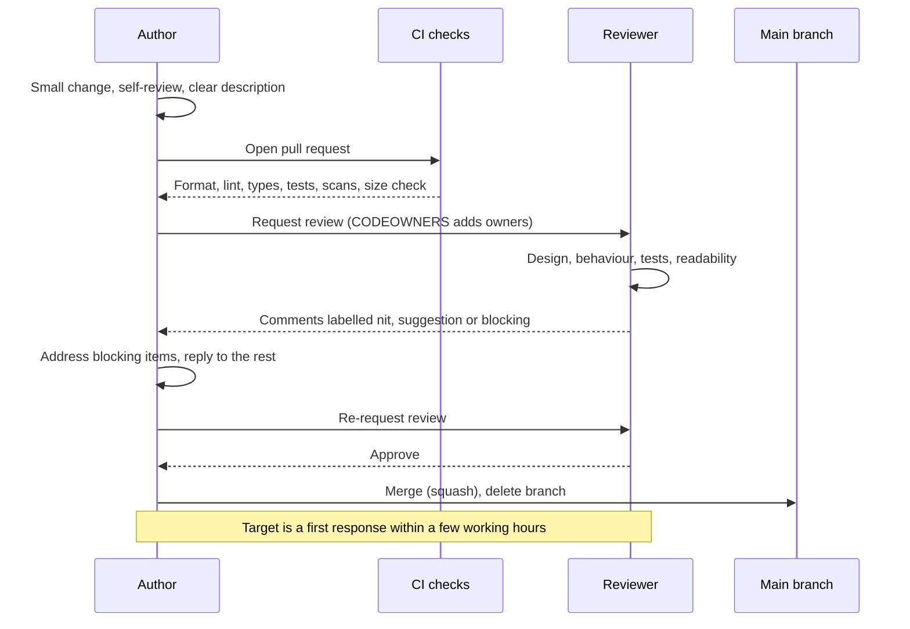
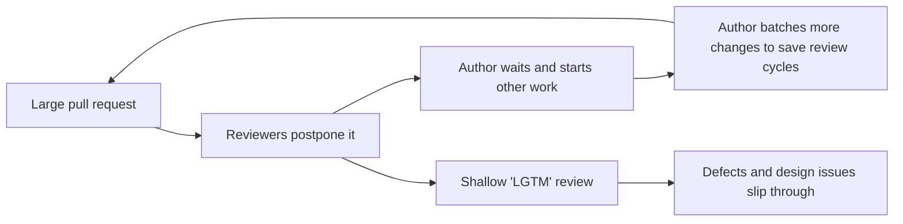

## TL;DR

- Code review's biggest payoffs are **shared understanding, design consistency and mentoring**, more than catching bugs. Research at Microsoft and Google found knowledge transfer and awareness to be central outcomes. Automated tests and tools catch most defects more cheaply.
- **Small pull requests reviewed quickly** are the core of a healthy process. Review quality drops sharply on large changes, and waiting days for review destroys flow and encourages even bigger batches.
- **Automate the mechanical** (formatting, linting, types, tests, security scanning, size limits) so humans review **design, behaviour, readability and risk**.
- Comments should be **kind, specific and labelled by importance** ("nit", "suggestion", "blocking"). Approve when the change improves the codebase, even if it isn't perfect.
- Match the review mode to the risk. Use **pairing or mobbing** for complex work, **Ship/Show/Ask** to skip pre-merge review for trivial changes, and **required owners or a second reviewer** where compliance or risk demands it.

## Core Concepts

### What review is for

| Goal | How review delivers it | Cheaper alternatives for part of it |
|---|---|---|
| Knowledge sharing | At least two people understand every change, which reduces key-person risk | Pairing, mobbing, documentation |
| Design and consistency | Catches misplaced responsibilities, leaky abstractions, inconsistent patterns | Design discussions before coding, ADRs, architecture fitness functions |
| Readability and maintainability | A fresh reader spots what's confusing | — |
| Defect finding | Spots logic errors and missing cases, especially in edge cases and concurrency | Tests, static analysis, type checking |
| Security | Spots risky patterns and sensitive changes | SAST, dependency scanning, threat modelling |
| Mentoring | Both directions: juniors learn from feedback, seniors learn new approaches | Pairing |
| Compliance (separation of duties) | A second person approves every production change | Automated evidence from pipelines |

Bacchelli and Bird's 2013 study at Microsoft found that developers *expected* review to find defects, but much of its actual value was knowledge transfer, awareness and finding alternative solutions. Google's 2018 case study found most of its changes are small and reviewed by one reviewer, with a median wait of a few hours.

### Reviewable pull requests

- **Small**: one logical change, typically a few hundred lines at most. A widely cited Cisco/SmartBear study found defect detection falls off markedly beyond roughly 200–400 lines per review session.
- **A clear description**: *why* the change is needed, *what* it does, how it was tested, risks and rollout, and screenshots for UI changes.
- **Self-reviewed first**: the author reads their own diff, removes debugging code and adds comments where the reviewer will have questions.
- **Separate refactors from behaviour changes**, in separate commits or pull requests.
- **Green CI before asking for review.**
- **Stacked** when a feature is large: a chain of small dependent pull requests, each reviewable on its own.

```markdown
## Why
Customers in the EU see prices without VAT on the basket page (JIRA PRICE-412).

## What
- Adds `PriceDisplayPolicy` that applies regional tax rules at presentation time.
- Basket and product pages use it; checkout already did.

## How I tested
- Unit tests for each region's rules; snapshot tests for the basket.
- Manually checked DE, FR, UK in staging (screenshots below).

## Risk and rollout
Behind flag `price-display-policy`, rolled out to 10% of EU traffic first.
Reviewer focus: the rounding in `applyVat` — I'm not sure banker's rounding is right here.
```

### Worked example: splitting a 1,400-line pull request

A pull request titled "Add bank transfer payments" has been waiting four days. Nobody wants to review 1,400 lines. Here's what's in it:

| Part | Lines |
|---|---|
| Rename `PaymentMethod` values and move files into a `payments/methods/` folder | 420 |
| Database migration: add `bank_reference` column, and backfill it | 90 |
| New `BankTransferProvider` client and its tests | 380 |
| Wire the provider into checkout | 120 |
| Checkout UI for choosing bank transfer | 310 |
| Remove old card-only code paths | 80 |

**Re-cut it as a stack**, where each pull request is reviewable on its own, safe to merge, and goes to the right reviewers:

| # | Pull request | Lines | Reviewer focus | Safe to merge because |
|---|---|---|---|---|
| 1 | Rename and move, **no behaviour change** | 420 | Quick scan, since it's mechanical. The description says how it was done (IDE refactoring) and tests are unchanged | Nothing behaves differently |
| 2 | Add a nullable `bank_reference` column (expand only) | 30 | Platform or DBA: locks and compatibility | Old code ignores the column |
| 3 | `BankTransferProvider` client and tests, not wired in | 380 | Payments team: API handling, retries, error mapping | Unused code |
| 4 | Wire into checkout behind the `bank-transfer` flag, off by default | 120 | Payments: the flow and its failure handling | The flag is off |
| 5 | Checkout UI behind the same flag | 310 | Frontend: UX, accessibility | The flag is off |
| 6 | After rollout: remove the card-only paths and the flag | 80 | Owning team | All traffic uses the new path |

The backfill becomes a separate job, run between PRs 2 and 4.

What changes:
- Each pull request takes **under 30 minutes** to review, so reviews arrive the same day instead of after four days.
- **The right expertise reviews each part.** The DBA doesn't read UI code, and the frontend reviewer doesn't read migration SQL.
- Problems surface earlier and in isolation. A design objection to the provider client doesn't block the rename.
- **Rollout is controlled by the flag**, not the merge, so merging early carries little risk.

Plan the stack before writing the code next time. The split follows the same seams as expand and contract and feature flags.

### What reviewers look at

Google's engineering practices give a good order:
1. **Design**: does the change belong here, and does it fit the system?
2. **Functionality**: does it do what's intended, including edge cases, concurrency and failure handling? Is it good for users?
3. **Complexity**: could it be simpler? Is anything over-engineered for imagined future needs?
4. **Tests**: are there appropriate tests that would fail if the code broke?
5. **Naming and comments**: clear names, and comments that explain *why* rather than *what*.
6. **Style**: mostly automated. Humans shouldn't spend time on formatting.
7. **Documentation**: updated alongside the change.

The standard: **approve once the change definitely improves the overall health of the codebase**, even if it isn't how you'd have written it. Perfection isn't the bar. Continuous improvement is.

### Writing comments

- **Be kind and specific**: comment on the code, not the person. "This loop runs a query per item, which could be N+1 with large baskets. Could we batch it?" rather than "This is inefficient."
- **Explain why**, and link to docs or examples.
- **Label severity**, for example with Conventional Comments: `nit:`, `suggestion:`, `question:`, `issue (blocking):`, `praise:`.
- **Ask questions** when you're unsure. The author may know something you don't.
- **Praise good work**. Review isn't only about faults.
- **Move long discussions to a call**, then record the outcome in the pull request.

### Automating the mechanical

```ts
// dangerfile.ts — automated review checks with Danger JS, run in CI on every pull request.
import { danger, fail, warn, message } from 'danger';

const pr = danger.github.pr;
const changedLines = pr.additions + pr.deletions;

if (changedLines > 600) warn(`This PR changes ${changedLines} lines. Consider splitting it to make review easier.`);
if (!pr.body || pr.body.length < 50) fail('Please add a description: why, what, how you tested it, and risks.');

const changed = [...danger.git.modified_files, ...danger.git.created_files];
const touchedSrc = changed.some((f) => f.startsWith('src/') && !/\.test\.tsx?$/.test(f));
const touchedTests = changed.some((f) => /\.test\.tsx?$/.test(f));
if (touchedSrc && !touchedTests) warn('Source files changed without test changes. Is that intended?');

if (changed.some((f) => f.startsWith('db/migrations/'))) {
  message('This PR includes a database migration. Check it follows the expand/contract rules.');
}
```

Formatting (Prettier), linting (ESLint), type checking, tests, coverage on changed lines, dependency and secret scanning, SAST and size warnings all belong in CI, so human attention goes to what machines can't judge.

### Ownership and approvals

```text
# .github/CODEOWNERS — the owning team must review changes to its areas
/src/payments/            @acme/team-payments
/src/checkout/            @acme/team-checkout
/infra/                   @acme/team-platform
/db/migrations/           @acme/team-platform @acme/dba-guild
/.github/workflows/       @acme/team-platform @acme/security
```

With branch protection set to "require review from code owners", these teams must approve changes to their areas. Use it for genuinely owned or risky areas, not every directory. Too many required reviewers turns review into a queue.

### Review modes

| Mode | How it works | Fits |
|---|---|---|
| **Pre-merge asynchronous review** | Pull request, reviewer approves, then merge | The default for most teams |
| **Pair programming** | Two people write the code together, so review is continuous | Complex or risky changes, onboarding, knowledge transfer |
| **Mob or ensemble programming** | The whole team works on one change | Hard design problems, spreading knowledge quickly |
| **Ship / Show / Ask** | *Ship*: merge without review. *Show*: merge, then ask for post-merge feedback. *Ask*: open a pull request and wait | High-trust teams with strong automation, mixing modes by change risk |
| **Post-commit review** | Review after merge to trunk | Trunk-based teams with very strong tests and feature flags |

### Review latency

Waiting is the hidden cost. If reviews take a day or more, authors start new work, context-switch back later, and batch changes into bigger pull requests to "save" review cycles, which makes the next review even slower. Healthy teams aim for a **first response within a few working hours** (Google's guidance is at most one business day) and treat reviewing as higher priority than starting new work.

## How It Works

### The review loop



### Why big pull requests slow everything down



## When to Use / Trade-offs

| Choice | Use when | Avoid when | Cost |
|---|---|---|---|
| One required approval | The default for most product code | Regulated or high-risk areas that need more | A short wait per change |
| Two approvals or code-owner approval | Security-sensitive code, shared platforms, migrations, compliance scope | Everywhere, since it creates queues | Longer waits, reviewer load |
| Pair or mob programming | Complex design, unfamiliar code, onboarding | Simple, well-understood changes | Two or more people's time per change |
| Ship/Show/Ask | Mature teams with strong automated checks | Low trust, weak tests, compliance requiring pre-merge approval | Needs judgement and trust |
| Stacked pull requests | Large features that can be split into dependent steps | Teams without tooling support (rebasing stacks by hand is painful) | Tooling (Graphite, ghstack, Gerrit, Sapling) |
| AI review assistants | A fast first pass on common issues | As a replacement for human review | Noise if untuned, plus cost |

## Common Pitfalls & Anti-patterns

- **Giant pull requests** — thousands of lines get either a rubber stamp or a week of back-and-forth.
- **Review as gatekeeping** — reviewers who demand changes to match their personal style, or block on nits.
- **Nitpicking what tools should catch** — formatting and import-order comments waste everyone's time.
- **Slow reviews** — multi-day waits that drive batching, context switching and frustration.
- **Rubber-stamping** — "LGTM" without reading, often from social pressure or overload.
- **Single-reviewer bottlenecks** — one senior engineer must approve everything and becomes the constraint.
- **Harsh tone** — sarcasm or vague criticism that damages psychological safety, especially for juniors.
- **Design debates at review time** — big design disagreements discovered after the code is written. Discuss significant designs earlier.
- **Comment-count metrics** — rewarding reviewers for comment volume, which encourages nitpicking.

## Real-world Scenario

**Context:** A 60-engineer SaaS company had a median pull request wait of 2.5 days for first review. Pull requests averaged 900 changed lines, and three staff engineers were required reviewers for most of the codebase through a broad CODEOWNERS file. Lead time was 11 days, and engineers complained that review was where work went to die.

**Decision:**
1. **Measured** wait time, size and reviewer load per person. The three staff engineers were handling 55% of all reviews.
2. **Narrowed CODEOWNERS** to genuinely sensitive areas (payments, auth, migrations, CI). Elsewhere any team member could approve.
3. **Automated the mechanical**: Prettier, ESLint, type checks and a Danger check warning above 400 changed lines and failing on empty descriptions.
4. **Working agreement**: reviews before starting new work, a first response within 4 working hours, and a daily "review window" after stand-up.
5. **Smaller changes**: trunk-based development with feature flags, stacked pull requests via Graphite for large features, and pairing for risky work.
6. **Comment labels** (Conventional Comments), so authors knew what was blocking.

**Outcome:** After three months, median time to first review fell to 3 hours, median pull request size to 180 lines, and lead time to 4 days. Production defects didn't rise, and the staff engineers' review share fell to 20%, freeing time for design work.

**What I'd do differently:** Bring the staff engineers into designing the change from the start. Initially they felt their quality bar was being removed, and it took a few weeks of data to show that smaller, faster reviews were actually more thorough.

## Interview Questions

### What is code review for? {#purpose-of-review}

**Level:** Foundation

**Model answer:**
- **Knowledge sharing**: at least two people understand every change, and the team builds a shared picture of the system.
- **Design and consistency**: keeping the codebase coherent, with responsibilities in the right places.
- **Readability and maintainability**: a fresh reader catches what's confusing.
- **Defect detection**: especially logic, edge cases and concurrency, though tests and static analysis find many defects more cheaply.
- **Security**: spotting risky patterns and changes to sensitive areas.
- **Mentoring**, in both directions.
- **Compliance**: a second person approving production changes, where regulations require it.

Research (Bacchelli and Bird at Microsoft, 2013) found that developers expected review to be mostly about finding bugs, but knowledge transfer and awareness were among its main real outcomes. That matters when designing the process: optimising for fast, readable, small changes serves the real goals better than exhaustive defect hunting.

**What the interviewer is looking for:**
A broad view of review's purposes, and an awareness that defect-finding is not its only or even main value.

**Follow-ups:**
- If review isn't mainly for finding bugs, what does that change about how you do it?
- What can replace code review entirely?

**Red flags:**
- "To catch bugs" as the only answer.
- Review as a gate to control other engineers.

### What makes a pull request easy to review? {#reviewable-pr}

**Level:** Foundation

**Model answer:**
- **Small and focused**: one logical change. Ideally a few hundred lines or less, since review effectiveness falls off sharply with size.
- **Good description**: why the change is needed (link the ticket), what it does, how it was tested, risks and rollout plan, and where you'd like the reviewer to focus.
- **Self-reviewed**: the author reads the diff first, removes leftover debugging and adds comments for non-obvious decisions.
- **Refactoring separate from behaviour change**: in separate commits or pull requests.
- **Green CI**: formatting, lint, types and tests pass before review is requested.
- **Visual evidence** for UI changes: screenshots or recordings.
- **Feature flags** for incomplete work, so large features can merge in small pieces.

**What the interviewer is looking for:**
Concrete author-side practices, with size and description as priorities.

**Follow-ups:**
- How do you split a large feature into small pull requests?
- What should go in commit messages versus the pull request description?

**Red flags:**
- "Reviewers should just read the code."
- Regularly opening thousand-line pull requests.

### How should you write review comments? {#review-comments}

**Level:** Foundation

**Model answer:**
- **Address the code, not the person**: "This function handles three responsibilities" rather than "you made this too complicated".
- **Be specific and explain why**, ideally with a suggested alternative or a link.
- **Label severity** so the author knows what's blocking: `nit:`, `suggestion:`, `question:`, `issue (blocking):`, using a convention such as Conventional Comments.
- **Ask genuine questions** when unsure. The author may have context you lack.
- **Praise** good solutions and improvements.
- **Avoid style debates** that tools or the agreed style guide settle.
- **Take long discussions offline**, then summarise the decision in the pull request.
- **Approve when the change improves the codebase**, even if minor suggestions remain.

Tone matters especially across seniority levels and in written, asynchronous communication, where criticism reads more harshly than intended.

**What the interviewer is looking for:**
Kind, specific, labelled feedback, and the "improves overall health" approval standard.

**Follow-ups:**
- How would you give feedback on a pull request that's fundamentally the wrong approach?
- How do you review a much more senior engineer's code?

**Red flags:**
- Sarcastic or vague comments.
- Blocking on personal preferences.

### What should a reviewer look at, and what should be automated? {#what-to-review}

**Level:** Foundation

**Model answer:**
**Automate:**
- Formatting and import order (Prettier, gofmt).
- Lint rules and common bugs (ESLint, static analysis).
- Type checking.
- Tests and coverage on changed lines.
- Dependency vulnerabilities, secrets and SAST findings.
- Pull request hygiene: size warnings, description present, migration labels (Danger and similar tools).

**Humans review**, in rough priority order:
1. **Design**: does this belong here, does it fit the architecture, and is the abstraction right?
2. **Behaviour**: does it work, including edge cases, error handling, concurrency, performance and security implications?
3. **Complexity**: is anything harder than it needs to be, or over-engineered?
4. **Tests**: do they test the right things, and would they fail if the code broke?
5. **Readability**: names, structure, and comments that explain why.
6. **Docs and operability**: are docs, logs, metrics and runbooks updated?

**What the interviewer is looking for:**
A clear split between machine and human checks, and prioritising design and behaviour.

**Follow-ups:**
- How do you review tests effectively?
- What do you look for in a database migration?

**Red flags:**
- Human comments on formatting.
- Only looking at the diff, never the surrounding code.

### How do you reduce review latency without lowering the bar? {#review-latency}

**Level:** Senior

**Model answer:**
1. **Make pull requests smaller**: they're faster and more thorough to review. Encourage trunk-based development with feature flags, and stacked pull requests for large work.
2. **Team working agreement**: reviewing comes before starting new work, with a first-response target such as 4 working hours, and review windows (after stand-up and after lunch) to reduce interruptions.
3. **Spread the load**: avoid a single required reviewer. Narrow CODEOWNERS to genuinely sensitive areas, and use round-robin assignment tools.
4. **Automate the mechanical**, so reviewers spend time only on what matters.
5. **Pair on complex work**, so it arrives already reviewed.
6. **Make latency visible**: time to first review, time to merge and pull request size on a team dashboard, discussed in retrospectives. Not for ranking individuals.
7. **Ship/Show/Ask** for low-risk changes in mature teams, where allowed.

The bar actually goes *up*: small pull requests reviewed promptly get real attention, while large ones waiting for days get rubber-stamped.

**What the interviewer is looking for:**
Systemic fixes (size, agreements, load distribution), and the insight that speed and quality reinforce each other.

**Follow-ups:**
- What would you do about one engineer whose pull requests always wait the longest?
- How does time-zone distribution affect this?

**Red flags:**
- "Just approve faster."
- Adding required reviewers to improve quality.

### When are pair or mob programming better than asynchronous review? {#pairing-vs-review}

**Level:** Senior

**Model answer:**
Pair or mob programming gives continuous review while the code is being written, so feedback arrives before effort is invested in the wrong direction.

Better when:
- **The design is uncertain or complex**: discussing it while building avoids a costly rewrite after review.
- **Knowledge transfer is the goal**: onboarding, spreading knowledge of a critical system, or reducing a bus factor.
- **The change is risky**: security-critical code, data migrations, incident fixes.
- **Asynchronous review is slow** because of back-and-forth on a contentious change.

Asynchronous review is better when:
- The change is straightforward and well understood.
- The team is distributed across time zones.
- You need a record of review for compliance. Pairing can still count if your policy accepts the pair as the second person, which is worth agreeing with auditors.
- Deep individual focus is needed.

Many teams combine them: pair on the hard parts, and do a light asynchronous review for the rest. Mobbing is powerful for hard design problems and for teams learning a new domain together.

**What the interviewer is looking for:**
Choosing by risk, uncertainty and goals rather than dogma.

**Follow-ups:**
- Does a paired change still need a pull request review?
- How do you introduce pairing to a team that's sceptical?

**Red flags:**
- "Pairing halves productivity."
- Pairing on everything regardless of context.

### What are stacked pull requests, and when do they help? {#stacked-prs}

**Level:** Senior

**Model answer:**
A stack is a chain of small, dependent pull requests: PR 2 builds on PR 1, PR 3 on PR 2, and so on. Each is reviewed separately, and they merge in order. For example: (1) add a database column and repository method, (2) add the domain logic, (3) add the API endpoint, (4) add the UI behind a flag.

Benefits:
- Each pull request is small and focused, so review is fast and thorough.
- The author keeps working on the next step without waiting for review of the previous one.
- Reviewers can approve the early parts while discussing later ones.

Costs and requirements:
- Rebasing a stack after changes to an earlier pull request is painful by hand. Tooling (Graphite, ghstack, Sapling, Gerrit's change chains, `git rebase --update-refs`) helps a lot.
- Reviewers need to see the overall direction: link the stack and describe the end goal.
- Each step should be safe to merge on its own (behind a flag if incomplete).

Alternative without tooling: trunk-based development with small independent pull requests and feature flags.

**What the interviewer is looking for:**
Understanding of the workflow, its benefits for size and flow, and the tooling requirement.

**Follow-ups:**
- How do you handle review feedback on the first pull request in a stack of five?
- How does squash-merging interact with stacks?

**Red flags:**
- Stacks so long that reviewers lose the plot.
- Merging steps that break the main branch.

### How do you handle a disagreement in code review? {#review-disagreement}

**Level:** Senior

**Model answer:**
1. **Clarify whether it's blocking.** Many disagreements are preferences. If the change improves the codebase and the concern is a nit, approve and note it.
2. **Seek to understand**: ask why the author chose their approach. They may have context the reviewer lacks.
3. **Argue from principles and evidence**: team conventions, documented style guides, performance data, past incidents. Not personal taste.
4. **Talk synchronously** if more than a couple of rounds go back and forth. A 10-minute call resolves what 20 comments can't. Record the outcome in the pull request.
5. **Escalate to an agreed decision-maker** if still stuck: the tech lead, code owner or architecture forum. Agree this path in advance.
6. **Fix the root cause**: if the same disagreement recurs, document a convention, write an ADR or add a lint rule, so it isn't re-argued in every pull request.

Throughout, keep it about the code and the system, and remember the goal is a better codebase, not winning.

**What the interviewer is looking for:**
Distinguishing blocking from preference, moving to synchronous talk, a clear escalation path, and turning recurring disagreements into conventions.

**Follow-ups:**
- What if the disagreement is with someone much more senior?
- When should a reviewer block a merge outright?

**Red flags:**
- Endless comment threads.
- "My way, because I've been here longer."

### How should CODEOWNERS and required approvals be set up? {#codeowners-approvals}

**Level:** Senior

**Model answer:**
- **Default**: one approval from any qualified team member for most code, with branch protection requiring passing checks and at least one review.
- **CODEOWNERS** for areas with genuine ownership or risk: other teams' services in a monorepo, security-sensitive code (auth, payments, cryptography), infrastructure and CI configuration, database migrations, and public API contracts. Code-owner approval is required there.
- **Teams, not individuals**, as owners, so review load spreads and holidays don't block merges.
- **Keep it narrow**: a CODEOWNERS file that covers everything with a few senior people creates a bottleneck.
- **Two approvals** only where risk or compliance requires it.
- **Protect the protections**: CODEOWNERS and workflow files themselves need owner review, so nobody can quietly remove a requirement.
- **Dismiss stale approvals** when new commits are pushed, for sensitive areas at least.
- **Review the setup** periodically against data on wait times and reviewer load.

**What the interviewer is looking for:**
Risk-based configuration, team-level ownership, protecting the configuration and watching for bottlenecks.

**Follow-ups:**
- How do you handle a monorepo with 30 teams?
- Should admins be able to bypass branch protection?

**Red flags:**
- Individuals as code owners for large areas.
- Required approvals everywhere "for safety".

### How do AI code review tools fit into the process? {#ai-code-review}

**Level:** Senior

**Model answer:**
**Useful for:**
- A **fast first pass** before a human looks: likely bugs, missing error handling, security smells, unclear naming, missing tests.
- **Summarising** large changes for reviewers.
- **Consistency checks** against documented conventions, when given good context (repository instructions, architecture rules).
- **Helping authors self-review** before requesting human review.

**Limits:**
- They lack full context about business intent, team decisions and system history, so they may miss what matters or flag what doesn't.
- **Noise** erodes trust: too many low-value comments and people stop reading them. Tune rules and severity.
- They don't provide **shared understanding** or mentoring, which are among review's main benefits.
- They can't serve as the accountable second person for compliance purposes in most frameworks.

**How to adopt:** start as an optional first pass, measure the useful-comment rate (accepted versus dismissed suggestions), give it repository context, keep human approval required, and review the same standards for AI-*generated* code as for human-written code.

**What the interviewer is looking for:**
A balanced view: AI augments but doesn't replace human review, and adoption needs measurement and tuning.

**Follow-ups:**
- How would you measure whether the AI reviewer adds value?
- Should AI-generated pull requests have different review rules?

**Red flags:**
- "AI review means we can drop human review."
- Dismissing the tools without trying them.

### Code review has become the main bottleneck in a 60-engineer organisation, with pull requests waiting 3 days. How do you fix it? {#review-bottleneck}

**Level:** Architect

**Model answer:**
**Diagnose with data**: time to first review and to merge, pull request size distribution, reviewer load per person, CODEOWNERS coverage, rounds of review, and differences by team and time zone. Talk to authors and reviewers.

**Typical causes and fixes:**
1. **Large pull requests** → feature flags and trunk-based development, stacked pull requests, size warnings in CI, and splitting refactors from behaviour changes.
2. **Concentrated reviewer load** (a few seniors on everything) → narrow CODEOWNERS to sensitive areas, owners as teams, round-robin assignment, and growing more reviewers through pairing and paired reviews.
3. **No team norms** → a working agreement (review before new work, a first-response target, review windows), discussed in retrospectives.
4. **Humans doing machine work** → automate formatting, linting, types and hygiene checks.
5. **Late design disagreements** → short design reviews or RFCs for significant changes before coding.
6. **Time zones** → reviewer pairs within overlapping hours, and clear descriptions so reviews need fewer rounds.

**Roll out** with a couple of pilot teams, track the metrics, and share results. Watch quality signals (change failure rate, escaped defects) to show the bar hasn't dropped.

**What the interviewer is looking for:**
Data-driven diagnosis, systemic fixes, piloting, and checking quality alongside speed.

**Follow-ups:**
- Senior engineers argue that faster reviews mean lower quality. How do you respond?
- What target would you set for time to first review?

**Red flags:**
- Removing review requirements without analysis.
- Blaming individuals for slow reviews.

### How do you satisfy separation-of-duties requirements (SOC 2, PCI DSS) without slowing delivery? {#review-compliance}

**Level:** Architect

**Model answer:**
Separation of duties requires that no single person can make and release a production change unchecked. Code review is the common control. To meet it efficiently:

- **Enforce in tooling, not process documents**: branch protection requiring an approval from someone other than the author, no direct pushes to main, admins included, and status checks required.
- **Automate the evidence**: the pull request record (author, reviewer, approval time, linked ticket, passing checks) plus the deployment record from the pipeline form the audit trail. No separate change tickets for standard changes.
- **Pairing can count** if your auditors agree that two people working together satisfy the control. Document the policy and record the pair (co-author commit trailers).
- **Risk-based depth**: standard changes need one approval and automated checks. Higher-risk areas (payment flows, cryptography, access control) need code-owner approval.
- **Protect the pipeline**: changes to CI/CD configuration, branch protection and CODEOWNERS themselves need review by platform or security owners.
- **Emergency changes**: a documented break-glass path (merge with retrospective review within 24 hours), audited and alerted.
- **Work with auditors early**: show them the automated controls and evidence. Most accept well-designed pipeline controls in place of manual change boards.

Done this way, compliance adds almost no delay beyond the review you'd do anyway.

**What the interviewer is looking for:**
Controls enforced by tooling, automatic evidence, risk-based depth and a break-glass path.

**Follow-ups:**
- How would you handle a solo engineer on call who needs to ship a fix at 3 am?
- What evidence would an auditor ask for?

**Red flags:**
- A change advisory board meeting for every deploy.
- Relying on people to remember the policy.

### How would you use code review to raise engineering standards across many teams? {#review-standards}

**Level:** Architect

**Model answer:**
Review spreads norms. Use it deliberately, without turning it into central gatekeeping:

1. **Write the standards down**: a short engineering handbook (conventions, testing expectations, observability, security basics) and a review guide (what to look for, how to comment). Link it from pull request templates.
2. **Encode what you can**: lint rules, architecture fitness functions, templates and Danger checks, so standards are enforced consistently and reviews discuss judgement calls.
3. **Grow reviewers**: paired reviews (a senior and a junior reviewing together), review guilds or communities of practice, and examples of excellent reviews shared in a channel.
4. **Cross-team review for sensitive areas**: a security champion or platform engineer reviews a rotating sample, or specific risky changes, to spread expertise.
5. **Review the reviews**: occasionally sample pull requests in retrospectives. Were important issues caught? Was the tone constructive? Were nits marked as nits?
6. **Make good review visible and valued**: recognise it in career frameworks and performance conversations as part of senior engineers' impact.

Avoid a central approval group for all changes. It doesn't scale and removes ownership.

**What the interviewer is looking for:**
Documented and automated standards, growing reviewers' skills, and recognising review in career frameworks.

**Follow-ups:**
- How do you get teams to adopt a shared review guide?
- How would you include review quality in performance evaluation without gaming?

**Red flags:**
- A central team reviewing everything.
- Standards that exist only in senior engineers' heads.

### What code review metrics would you track, and which would you avoid? {#review-metrics}

**Level:** Architect

**Model answer:**
**Track at team level, for improvement:**
- **Time to first review** and **time from open to merge** (medians and 90th percentiles).
- **Pull request size** distribution.
- **Review rounds** per pull request.
- **Reviewer load distribution**: is it concentrated on a few people?
- **Outcome signals**: change failure rate and escaped defects, to check that speed isn't hurting quality.
- Optionally the share of pull requests merged without any review comment, as a rubber-stamping indicator to investigate, not a target.

**Avoid:**
- **Comments per reviewer** or "issues found": rewards nitpicking.
- **Pull requests or lines per developer**: rewards splitting or bloating changes and says nothing about value.
- **Individual leaderboards** of any kind: they destroy collaboration and invite gaming (Goodhart's law).
- **Approval time per individual as a performance metric**: people will approve without reading.

Use metrics in retrospectives to find system problems: large changes, overloaded reviewers, slow areas of the codebase. Combine them with qualitative feedback from developer surveys.

**What the interviewer is looking for:**
Flow and distribution metrics at team level, quality as a counterweight, and awareness of gaming.

**Follow-ups:**
- Time to merge improved but change failure rate went up. What do you do?
- How would you present these metrics to leadership?

**Red flags:**
- Ranking engineers by review activity.
- Measuring only speed.

### Design the review process for an inner-source platform that receives contributions from many teams. {#inner-source-review}

**Level:** Architect

**Model answer:**
**Goals**: let other teams contribute without overloading the owning team, while keeping quality and coherence.

**Process:**
1. **CONTRIBUTING guide**: how to propose changes, coding standards, how to run tests locally, what makes a good pull request, and expected response times.
2. **Propose before building** for anything non-trivial: an issue or short RFC, so the owning team can say "yes", "yes, but differently" or "no" before effort is spent.
3. **Strong automation**: full test suites, contract tests for consumers, lint and type checks, and preview environments, so contributors get feedback without needing the owners.
4. **Trusted committers**: experienced contributors from other teams who've earned review rights in parts of the codebase, spreading the load (a common inner-source pattern).
5. **Service levels**: the owning team commits to a first response within, say, two working days, with a rotating reviewer of the week.
6. **CODEOWNERS** for core or risky areas that only the owning team can approve.
7. **Good first issues** and mentoring for new contributors.
8. **Feedback loop**: track contribution volume, time to first response and acceptance rate, and adjust the platform's extension points if many contributions are workarounds.

**What the interviewer is looking for:**
Up-front proposals, automation, trusted committers, explicit service levels and owner control of the core.

**Follow-ups:**
- What happens to a contribution the owning team doesn't want to maintain?
- How do you avoid the owning team becoming a bottleneck again?

**Red flags:**
- "Contributions welcome" without process or capacity.
- Owners rewriting every contribution themselves.

### How should you review the tests in a pull request? {#reviewing-tests}

**Level:** Foundation

**Model answer:**
Tests are code that protects the rest of the code, so they deserve as much attention as the change itself. Often more, because bad tests give false confidence for years.

What to check:
- **Do they test the behaviour that changed?** For a bug fix, there should be a test that fails without the fix. For a feature, tests for the main path *and* the edge cases: empty input, limits, errors, concurrency, permissions.
- **Would they fail if the code broke?** Mentally break the code (invert a condition, remove a line). If no test would notice, the tests are decoration. Asserting only that "no exception was thrown", or snapshotting huge outputs nobody reads, are common examples.
- **Are they testing behaviour, not implementation?** Tests coupled to private details (call counts on internal mocks, the exact order of internal steps) break on every refactor without catching bugs.
- **Is the test at the right level?** Logic in unit tests, integration with the database or another service in integration or contract tests, and only critical journeys end to end.
- **Are they readable?** A clear name stating the behaviour, arrange–act–assert structure, and only the setup that matters for this test.
- **Are they deterministic?** No real time, randomness, network calls or ordering assumptions that make them flaky. Use controlled clocks and seeds.

If a change has no tests, ask why. Sometimes the answer is reasonable, such as a configuration change covered by an existing smoke test. Often it isn't.

**What the interviewer is looking for:**
Tests that would fail on breakage, coverage of edge cases, behaviour over implementation, the right level, readability and determinism.

**Follow-ups:**
- How would you check that a bug-fix test really reproduces the bug?
- When are snapshot tests useful, and when are they harmful?

**Red flags:**
- Approving because "coverage went up".
- Tests that mock the unit under test.

### Some changes can't be small, such as a generated migration, a framework upgrade or a large refactor. How do you review them? {#reviewing-large-changes}

**Level:** Senior

**Model answer:**
**First, challenge whether it really can't be split.** Most large changes can be cut into preparatory refactors, a mechanical part and a behavioural part, or staged behind a flag. When it truly can't, change *how* it's reviewed.

**Separate the mechanical from the meaningful:**
- Put **generated or mechanical changes** (codemods, renames, lockfile updates, generated clients, formatting) in their own commits or pull requests, with the exact command used to produce them. Reviewers check the command and its configuration, spot-check the output, and rely on CI.
- Keep the **hand-written changes** separate and small, and review them properly.

**Guide the reviewer:**
- A description with a **map**: what changed, in what order to read it, which files carry the real logic, and which are mechanical.
- **Comments on the diff** by the author, pointing at the risky parts and explaining decisions.
- A **walkthrough call** for very large changes, recorded or summarised for others.

**Use more verification, not just more eyes:**
- Strong automated evidence: the full test suite, contract tests, performance comparisons, and a **canary or shadow run** in production where possible.
- For framework or major dependency upgrades, a staged rollout with monitoring, and a tested rollback.

**Share the work:** split the review by area among several reviewers, each owning a part, with one person accountable for the whole.

**What the interviewer is looking for:**
Pushing back on size first, separating mechanical from behavioural changes, guiding reviewers, and leaning on automated and production evidence.

**Follow-ups:**
- How would you review a codemod applied to 3,000 files?
- What would make you reject a large change outright?

**Red flags:**
- "LGTM" on 5,000 lines after ten minutes.
- Generated code mixed into hand-written changes.

### What should every reviewer look for from a security point of view? {#security-in-review}

**Level:** Senior

**Model answer:**
Reviewers don't need to be security specialists, but they should recognise the common patterns behind real vulnerabilities, and know when to call in a specialist.

**Look for:**
- **Input reaching dangerous places**: user-controlled data in SQL (use parameters), shell commands, file paths, HTML output (escaping), redirects, URLs fetched by the server (SSRF), and deserialisation.
- **Authorisation**: does every new endpoint or query check that *this user* may access *this resource*? Insecure direct object references (`/orders/{id}` without an ownership check) are one of the commonest serious bugs.
- **Authentication and sessions**: changes to login, tokens, password reset, cookies (`Secure`, `HttpOnly`, `SameSite`) and CORS.
- **Secrets and sensitive data**: credentials in code or config, personal data in logs, error messages that reveal internals.
- **Dependencies**: new packages. Are they needed, maintained, popular, and spelled correctly (typosquatting)?
- **Cryptography**: home-made crypto, weak algorithms, predictable random values for tokens.
- **Infrastructure and pipeline changes**: public exposure, broad IAM permissions, workflow changes that grant secrets to untrusted code.

**Make it systematic:**
- Automated checks catch much of this first: SAST, dependency and secret scanning, and IaC policy checks. Reviewers focus on logic, especially authorisation, which tools handle poorly.
- **CODEOWNERS** routes security-sensitive areas (authentication, payments, crypto, workflows) to people with the right expertise.
- A short checklist in the pull request template for changes touching those areas, and threat modelling for new features before the code exists.

**What the interviewer is looking for:**
Common vulnerability patterns with authorisation emphasised, dependency and pipeline risks, automation first, and routing sensitive changes to experts.

**Follow-ups:**
- How would you spot a missing authorisation check in a diff?
- What would you do if you found a vulnerability in a colleague's merged code?

**Red flags:**
- Assuming security scanning tools catch authorisation bugs.
- Approving new dependencies without a look.

### How should design review and code review work together for changes that span many pull requests and teams? {#design-review-vs-code-review}

**Level:** Architect

**Model answer:**
Code review is the **wrong place** to discover that the design is wrong. By then the work is done, the author is invested, and the reviewer sees one slice of a bigger change. So separate the two.

**Before the code: design review.**
- For changes that are architecturally significant (new services, data model changes, new dependencies, cross-team contracts, security-sensitive flows), write a **short design doc or RFC**: the problem, options considered, the chosen approach, risks, and rollout and migration plans.
- Review it with the right people: the owning teams of affected systems, platform and security where relevant, and a senior engineer from outside the team for perspective.
- Record the decision as an **ADR**, so later code reviews can point to it instead of reopening the debate.
- Keep it proportionate. A one-page doc and a 30-minute discussion is often enough.

**During implementation: code review against the agreed design.**
- Reviewers check that the code **implements the design well**: correctness, tests, readability. Design debates in code review are a sign the design step was skipped or unclear.
- Link pull requests to the design doc, and note any **deviations** found during implementation. Significant ones go back to the design discussion.
- **Contract changes** between teams (APIs, events, schemas) get their own pull requests reviewed by consuming teams, ideally with contract tests.

**Decide what counts as significant**, with written criteria such as "new public API, new data store, change to authentication". Otherwise either everything gets a design review (slow) or nothing does (rework).

**What the interviewer is looking for:**
Design discussions before code, proportionate design docs and ADRs, code review focused on implementation, contract changes reviewed by consumers, and clear criteria for what needs design review.

**Follow-ups:**
- A reviewer raises a fundamental design objection on a nearly finished change. What now?
- How do you stop design reviews becoming a bottleneck?

**Red flags:**
- Architecture decided in pull request comments.
- Design reviews required for every change.

### A respected senior engineer's reviews are harsh and slow, and several people have started avoiding them. What do you do? {#harsh-reviewer}

**Level:** Architect

**Model answer:**
This hurts the team twice: people route work away from the most experienced reviewer, and others learn that harshness is the standard. It needs addressing directly, but fairly.

**Understand it first:**
- Look at examples: the comments, their tone, how many are blocking, and turnaround times. Talk to a few people who've received them.
- Talk privately with the engineer. Often they care deeply about quality, are overloaded, and don't realise the effect. Ask how they see their reviews and what's making them slow.

**Give specific feedback:**
- Use examples and their impact: "On these three pull requests, comments like 'this is wrong' without an explanation left authors unsure what to change. Two of them waited four days."
- Be clear about expectations: **kind, specific, explained** comments, labelled by importance, and a response within the team's agreed time.
- Separate standards from style: their standards may be right, and the goal is to keep them while changing the delivery.

**Change the system too:**
- **Team review norms** in writing: comment labels, response times, and "approve when it improves the codebase". That makes it a team standard rather than one person's problem.
- **Reduce their load**: if they're the only reviewer for critical areas, grow other reviewers through pairing on reviews, and spread CODEOWNERS.
- **Move recurring issues upstream**: if they keep flagging the same patterns, turn them into lint rules, templates or a short guide. That's a great use of their expertise.
- **Use their strength**: invite them to run design reviews or teach a session on the areas they care about.

**Afterwards:** check in after a few weeks, ask the team how it's going, and recognise improvement. If nothing changes, escalate it as a performance issue, because behaviour that drives people away from collaboration affects the whole team.

**What the interviewer is looking for:**
Gathering evidence, a private and specific conversation, clear expectations, structural fixes (norms, load, automation), using their expertise well, and follow-through.

**Follow-ups:**
- What if they say the team's code quality really is poor?
- How do you handle it if they're senior to you?

**Red flags:**
- Ignoring it because they're "the best engineer".
- Public criticism in a team meeting.

## Cheat Sheet

### Purpose and principles

- **Main value of review** — shared understanding, design consistency and mentoring, as well as catching defects.
- **Approval standard** — approve when the change improves overall code health, not when it's perfect.
- **Automate the mechanical** — formatting, linting, types, tests and scans in CI, so humans review design and behaviour.
- **Review order** — design, functionality, complexity, tests, naming and comments, then style (automated).

### Pull requests

- **Small pull requests** — review effectiveness falls sharply beyond roughly 200–400 lines.
- **Good description** — why, what, how it was tested, risks and rollout, and where to focus.
- **Stacked pull requests** — a chain of small dependent pull requests reviewed and merged in order.
- **Separate refactors** — keep behaviour changes and refactoring in separate commits or pull requests.

### Process

- **Review latency target** — first response within a few working hours, at most one business day.
- **Conventional Comments** — label comments as nit, suggestion, question, issue (blocking) or praise.
- **CODEOWNERS** — required owner review for genuinely sensitive areas, with teams rather than individuals as owners.
- **Ship / Show / Ask** — merge directly, merge then show, or ask before merging, chosen by risk.
- **Separation of duties** — enforced by branch protection, with pull request and pipeline records as audit evidence.
- **Metrics to avoid** — comments per reviewer, lines per developer and individual leaderboards.

### Revisit

- **Splitting a big PR** — mechanical refactor, expand-only migration, unwired new code, flagged wiring, flagged UI, later clean-up. Each piece is safe to merge and goes to the right reviewer.
- **Review loop** — self-review and green CI first, labelled comments, same-day turnaround, and approve when it improves the codebase.
- **Reviewing tests** — would they fail if the code broke? Edge cases, behaviour over implementation, the right level, deterministic.
- **Unavoidably large changes** — separate generated or mechanical changes with the command that made them, map the diff, and lean on automated and production evidence.
- **Security in review** — input reaching dangerous sinks, authorisation on every resource, secrets and logs, new dependencies, pipeline changes.
- **Design review first** — proportionate design docs and ADRs before code. Code review checks the implementation against them.
- **Harsh reviewer** — evidence, a private specific conversation, written team norms, spread the load, and turn repeated comments into tooling.

## Further Reading

- [Google Engineering Practices: Code Review](https://google.github.io/eng-practices/review/) — the reviewer's and author's guides, including the approval standard.
- [Modern Code Review: A Case Study at Google](https://research.google/pubs/modern-code-review-a-case-study-at-google/) — data on change size, reviewers and latency at Google.
- [Expectations, Outcomes, and Challenges of Modern Code Review](https://www.microsoft.com/en-us/research/publication/expectations-outcomes-and-challenges-of-modern-code-review/) — Bacchelli and Bird's study at Microsoft.
- [Ship / Show / Ask](https://martinfowler.com/articles/ship-show-ask.html) — Rouan Wilsenach's branching and review strategy.
- [Conventional Comments](https://conventionalcomments.org/) — a lightweight standard for labelling review comments.
- [About code owners](https://docs.github.com/en/repositories/managing-your-repositorys-settings-and-features/customizing-your-repository/about-code-owners) — GitHub's CODEOWNERS documentation.
- [Danger JS](https://danger.systems/js/) — automating pull request checks in CI.
