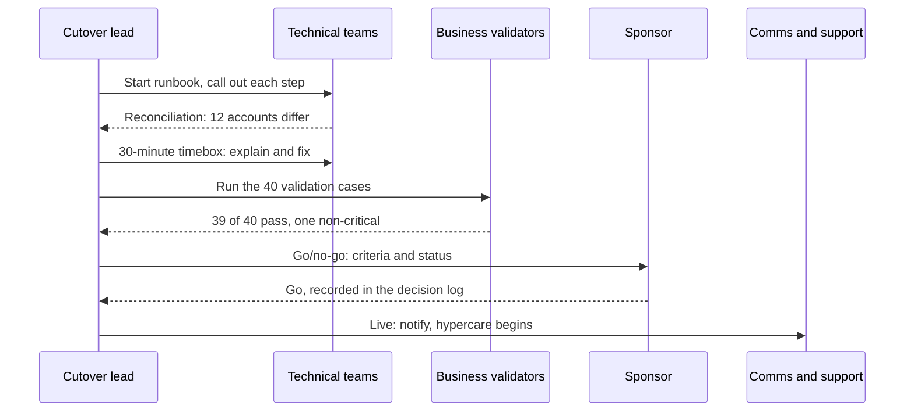
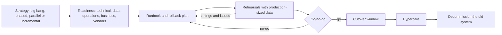

## TL;DR

- A **cutover** moves users, data and integrations from an old system to a new one. It's often the riskiest few hours of a programme, so treat it as an operation to be **designed, rehearsed and timed**, not a task at the end of the plan.
- Prefer **incremental cutovers** (by customer cohort, region or capability, as in the strangler fig approach) over a single big bang, unless data or business constraints force one moment of switch-over.
- A **cutover runbook** lists every step with an owner, timing, dependencies and a verification. **Dress rehearsals** with production-sized data prove the timings and expose the surprises.
- Know your **point of no return**: the step after which going back costs more than going forward, usually the first irreversible effect outside the system. Decide **go/no-go** before it, against criteria agreed in advance.
- Go-live isn't the end: **hypercare** gives intensive support for a few weeks, with exit criteria, and the old system is **decommissioned** deliberately afterwards.

## Core Concepts

### Cutover strategies

| Strategy | How it works | Fits | Risks |
|---|---|---|---|
| **Big bang** | Everyone moves at once, usually in a maintenance window | Tightly coupled data that can't be split; hard deadlines such as a contract ending | Everything at stake at once; rollback is hard |
| **Phased** | Groups move in waves: by region, customer segment, product or business unit | Most migrations where users or data can be partitioned | Two systems running at once; integration between them |
| **Parallel run** | Old and new run side by side on the same inputs; outputs are compared before switching | Calculations, finance, payroll, regulated systems | Double effort for operations and users; comparing outputs is work |
| **Pilot** | One site or team goes live first, then the rest | New business processes, physical sites, training-heavy changes | Pilot users may not be representative |
| **Incremental (strangler)** | Capabilities move one at a time behind a routing layer | Replacing a large system over months | Needs a routing layer and data sync between old and new |

### Readiness

Go-live needs more than working software. Readiness is usually assessed in five areas:
- **Technical:** functionality, performance at expected load, security, integrations and monitoring.
- **Data:** migration tested with production-sized data, reconciliation designed and accepted.
- **Operational:** runbooks, alerts, on-call rota, support processes and access for the people who'll run it.
- **Business:** trained users, updated procedures, communications sent, and business owners ready to validate.
- **Third parties:** vendors, banks and partners ready, with contacts and support confirmed for the window.

### The cutover runbook

A minute-by-minute plan for the cutover itself:
- **Every step** with an ID, description, owner, planned start, duration, dependencies and **a verification** ("row counts match", "40 test cases pass").
- **Decision points:** go/no-go checkpoints with named decision-makers and criteria.
- **The point of no return,** marked clearly, and the **rollback steps** before it.
- **Communication steps:** who is told what, and when.
- **Contacts:** everyone involved, including vendors, with backups.

Runbooks are best kept as **shared, live documents or tools**, so everyone sees which step is in progress, and the timing of each step is recorded for comparison with the rehearsals.

### Freezes

- **Code freeze:** no changes to either system during the cutover, except approved fixes.
- **Data freeze:** writes to the old system stop, so the final migration is complete and consistent.
- **Business freeze:** some business activity pauses, such as no new orders taken for two hours, or no month-end close during the window.

Freezes should be **as short as possible**, so the migration design aims to move most data beforehand and only the changes since then during the window.

### Hypercare and decommissioning

**Hypercare** is a period, typically 2–6 weeks, of heightened support after go-live: extra staff on support and engineering, daily check-ins, fast fixes, and close monitoring of business metrics. It ends against **exit criteria**, such as incident rates back to normal and no open critical defects.

**Decommissioning** the old system follows: a read-only period, data archived according to retention rules, integrations removed, access revoked, licences cancelled and infrastructure deleted, with evidence kept for auditors.

### Worked example: a weekend billing cutover

A company moves billing for 180,000 customers from a legacy platform to a new one. Most data was migrated weeks earlier and kept in sync with change data capture. The window is **Saturday 20:00 to Sunday 08:00**, and billing must be available by 08:00.

| Step | Start | Duration | Owner | Verification |
|---|---|---|---|---|
| 1. Freeze writes to the legacy platform (maintenance page) | 20:00 | 0:15 | Operations | No writes for 5 minutes |
| 2. Drain the final change-data-capture sync | 20:15 | 1:15 | Data team | Lag at zero, row counts match |
| 3. Reconcile: counts, balances, checksums | 21:30 | 1:30 | Data team and Finance | Account balances match to the penny |
| 4. Switch internal routing to the new platform | 23:00 | 0:30 | Platform team | Health checks green |
| 5. Business validation: 40 scripted test cases | 23:30 | 2:00 | Business testers | 40 of 40 pass, or failures accepted |
| **6. Go/no-go: the point of no return** | **01:30** | 0:15 | Cutover lead and sponsor | All criteria met |
| 7. Enable payment runs and bank integrations | 01:45 | 1:00 | Integrations team | First payment batch accepted by the bank |
| 8. Open to customers and monitor | 02:45 | — | Everyone | SLO dashboards normal |

**Why the point of no return is at step 6:** until step 7, nothing has left the company. Rolling back means pointing routing at the legacy platform and lifting the freeze: about **one hour**. Once payment instructions reach the bank in step 7, they can't be recalled. Going back would mean reconciling two systems against the bank, which takes days. So the final go/no-go comes **before** step 7.

**What the rehearsals showed:**
- **Rehearsal 1** took 8 hours 10 minutes to reach step 8. Reconciliation queries on unindexed columns took over 3 hours.
- After adding indexes and parallelising the checks, **rehearsal 2** took **6 hours 45 minutes**, the timing in the table.
- The plan keeps over **5 hours of slack** before 08:00, enough for a step to take twice as long, or for a full rollback at the go/no-go point (01:30 plus one hour) with time to spare.

## How It Works

### Go-live night in the war room

### Cutover lifecycle

## When to Use / Trade-offs

| Approach | Use when | Avoid when | Trade-off |
|---|---|---|---|
| Big bang in a maintenance window | Data can't be partitioned; downtime is acceptable | Users can't tolerate downtime; rollback would be impossible | Simple coordination vs all risk at once |
| Phased waves | Users, regions or customers can move separately | Data is shared so tightly that groups can't be split | Lower risk per wave vs running two systems |
| Parallel run | Correctness of outputs is critical (finance, payroll) | Outputs can't be compared, or double effort is unaffordable | Strong evidence vs cost and user burden |
| Zero-downtime incremental cutover | Always-on services; a routing layer is possible | Short-lived systems where the engineering cost isn't worth it | No downtime vs significant engineering |
| Several dress rehearsals | Any cutover with a fixed window or irreversible steps | Trivial, easily reversed switches | Confidence and accurate timings vs preparation time |
| Long hypercare | Many users, new business processes | Small internal tools | Fast support vs staff cost |

## Common Pitfalls & Anti-patterns

- **No rehearsal with real data volumes** — the migration that took 20 minutes in test takes 9 hours in production.
- **A rollback plan that's never been tested** — or that doesn't exist past the first few steps.
- **Go/no-go criteria invented on the night** — under pressure, everything starts to look acceptable.
- **The point of no return discovered by accident** — an integration sends real messages earlier than anyone realised.
- **Forgetting downstream consumers** — reports, data feeds, partner integrations and spreadsheets that read the old system.
- **Exhausted teams** — 20-hour shifts with no handover plan, making mistakes in the final steps.
- **No business validation** — technical checks pass, but nobody confirms the business can actually work.
- **Hypercare with no exit** — or the old system kept running indefinitely "just in case".

## Real-world Scenario

**Context:** A retailer replaced its order management system, used by 600 store and warehouse staff, with a new platform. The original plan was a single big-bang weekend for all 120 stores and 3 warehouses, and only one rehearsal, on a test environment with 5% of the data.

**Decision:** After the first rehearsal overran by 14 hours, the programme changed approach:
1. **Phased by region:** one region of 15 stores and one warehouse first, then three further waves two weeks apart. A routing layer sent each store's orders to the right system.
2. **Three dress rehearsals** per wave on production-sized data, timing each runbook step. The runbook shrank from 31 to 22 hours of work, mainly by migrating historic orders weeks in advance.
3. **Go/no-go criteria** agreed with the business a month ahead, including reconciliation thresholds, validation results and support staffing.
4. **The point of no return** set before warehouse pick lists were generated from the new system.
5. **Hypercare** of three weeks per wave, with floor-walkers in stores and a daily review of issues.

**Outcome:** All four waves went live in their windows. The first wave found an integration issue with the carrier labels that would have affected every store in a big bang. It was fixed before wave 2. The legacy system was decommissioned six weeks after the last wave.

**What I'd do differently:** Involve store managers in the rehearsals from the start. Their validation scripts found more real issues than the technical checks.

## Interview Questions

### What is a cutover, and what are the main cutover strategies? {#cutover-strategies}

**Level:** Foundation

**Model answer:**
A **cutover** is the move from an old system, process or platform to a new one: switching users, data and integrations so the new system becomes the system of record. It's usually the highest-risk part of a migration, because many things change at once and some steps can't be undone.

**Main strategies:**
- **Big bang:** everyone moves at once, typically during a maintenance window. Simple to coordinate, but everything is at risk at the same moment.
- **Phased:** waves by region, customer segment, product or business unit. Each wave is smaller and lessons carry forward, but two systems run side by side and may need to exchange data.
- **Parallel run:** both systems process the same inputs and the outputs are compared before switching. Strong evidence of correctness, at the cost of double work.
- **Pilot:** one site or team goes first, then the rest follow.
- **Incremental (strangler fig):** capabilities move one at a time behind a routing layer, often with no single cutover moment at all.

**Choosing:** prefer incremental or phased cutovers when users or data can be split, because they limit the blast radius. Use a big bang when tightly coupled data or a hard deadline leaves no alternative, and then invest heavily in rehearsals.

**What the interviewer is looking for:**
A clear definition, the main strategies with their trade-offs, and a preference for limiting blast radius unless constraints force a big bang.

**Follow-ups:**
- What makes data hard to split into phases?
- How do users work across two systems during a phased cutover?

**Red flags:**
- Assuming big bang is the default.
- Treating cutover as just "deploying the new system".

### What goes into a cutover runbook? {#cutover-runbook}

**Level:** Foundation

**Model answer:**
A **cutover runbook** is the detailed, time-sequenced plan for the cutover window. Anyone on the team should be able to see what happens next, who does it, and how they'll know it worked.

**For every step:**
- An **ID** and short description.
- An **owner** and a named backup.
- **Planned start time and duration,** based on rehearsals.
- **Dependencies:** which steps must finish first.
- **A verification:** how to know the step succeeded ("row counts match", "health checks green").
- What to do if it **fails:** retry, fix within a timebox, or escalate.

**Across the plan:**
- **Go/no-go checkpoints** with criteria and decision-makers.
- **The point of no return,** clearly marked.
- **Rollback steps** for every stage before that point.
- **Communication steps:** notices to users, support, partners and leadership, at set times.
- **A contact list,** including vendors, and the escalation path.
- **Breaks and shift handovers** for long windows.

**Keep it live:** use a shared document or tool where step status and actual times are updated in real time, and keep a **decision log** for anything that deviates from the plan.

**What the interviewer is looking for:**
Owners, timings, dependencies and verifications per step, failure handling, checkpoints, the point of no return, rollback, communications, contacts, shift planning and live tracking.

**Follow-ups:**
- How detailed should a runbook be?
- How do you keep it accurate between rehearsals?

**Red flags:**
- A runbook with no verifications.
- Steps owned by "the team" rather than named people.

### What are go/no-go criteria, and who should decide? {#go-no-go-criteria}

**Level:** Foundation

**Model answer:**
**Go/no-go criteria** are the conditions that must be true to proceed with a cutover, or to pass a checkpoint during it. They turn a stressful judgement call into a check against an agreed list.

**Typical criteria:**
- **Testing:** no open critical or high defects; agreed test cases passed.
- **Data:** reconciliation within agreed tolerances (for example, exact match on balances, under 0.1% difference on non-financial records with explanations).
- **Rehearsals:** the last rehearsal completed within the window, with rollback tested.
- **Operations:** monitoring, runbooks and on-call ready.
- **Business:** users trained, validators available, communications sent.
- **Third parties:** vendors and partners confirmed ready and on call.
- **Environment:** no conflicting events, such as a major incident or a peak trading period.

**Agree them early:** criteria should be set and signed off **weeks before** the cutover, by the business and technical owners. Criteria invented on the night tend to bend under pressure.

**Who decides:** a single **accountable business owner or sponsor** makes the final call, advised by the cutover lead and the technical and business leads. Everyone involved should feel able to raise a no-go concern.

**Multiple checkpoints:** a go/no-go before the window opens, and another before the point of no return.

**What the interviewer is looking for:**
Concrete criteria across testing, data, rehearsals, operations, business and third parties, agreeing them in advance, a single accountable decision-maker, and multiple checkpoints.

**Follow-ups:**
- One criterion is just below its threshold. What do you do?
- How do you make it safe for someone junior to call a no-go?

**Red flags:**
- "We'll decide on the night."
- A decision by committee where nobody is accountable.

### What is hypercare, and when should it end? {#hypercare}

**Level:** Foundation

**Model answer:**
**Hypercare** is a period of **intensive support straight after go-live**, when problems are most likely and users are least familiar with the new system. It typically lasts 2–6 weeks, depending on the size and complexity of the change.

**What it includes:**
- **Extra support capacity:** more help-desk staff, floor-walkers or super-users on site, and engineers dedicated to fixes rather than new work.
- **Fast triage:** a dedicated channel, daily (or more frequent) issue reviews, and quick release of fixes.
- **Close monitoring:** technical health and **business metrics,** such as order volumes, payment success and processing times compared with before.
- **Communication:** regular updates to users and stakeholders on known issues and fixes.
- **Old system available** in read-only mode for reference, if needed.

**Exit criteria,** agreed in advance:
- Incident and ticket volumes back to normal levels for, say, two weeks.
- No open critical or high defects.
- Business metrics stable.
- Support handed over to the normal support teams, with knowledge articles and runbooks updated.

**Why the exit matters:** without one, hypercare drags on, the project team never moves on, and normal support never takes ownership.

**What the interviewer is looking for:**
The purpose and typical length, staffing, triage, technical and business monitoring, communication, and explicit exit criteria with handover.

**Follow-ups:**
- Hypercare is ending, but users still raise many "how do I" questions. What do you do?
- Who pays for hypercare staff?

**Red flags:**
- No hypercare: the project team moves on the day after go-live.
- Hypercare with no end date or criteria.

### What kinds of freeze does a cutover need? {#cutover-freezes}

**Level:** Foundation

**Model answer:**
A freeze stops certain changes so the cutover happens against a **stable, known state**. There are usually three kinds, each with a different purpose.

- **Code and configuration freeze:** no changes to the old or new system, or to the integrations between them, for a period before and during the cutover, except approved fixes. This keeps the rehearsed setup identical to the real one.
- **Data freeze:** writes to the old system stop, so the final data migration is complete and consistent. Without it, changes made during the migration would be lost.
- **Business freeze:** some business activity pauses, such as no new orders for a few hours, no month-end close during the window, or no account changes for a weekend. This is the freeze users feel, so it must be agreed and communicated.

**Keep freezes short:**
- **Migrate most data in advance,** and keep it in sync (for example, with change data capture), so the data freeze only covers the final changes.
- Choose a **window** when business activity is naturally low.
- Provide **workarounds** for essential activity during a business freeze, such as manual order capture to enter later.

**Communicate them:** dates, times, what's affected and who to contact, sent well in advance and repeated close to the date.

**What the interviewer is looking for:**
The three freeze types and their purposes, ways to shorten freezes, workarounds for business activity, and clear communication.

**Follow-ups:**
- A critical bug appears during the code freeze. What happens?
- How short can a data freeze be?

**Red flags:**
- Forgetting the data freeze, so changes during migration are lost.
- A business freeze users hear about on the day.

### How do you run cutover rehearsals, and how many do you need? {#cutover-rehearsals}

**Level:** Senior

**Model answer:**
Rehearsals turn a cutover plan from a guess into a **measured, practised procedure**. They're the most effective way to reduce cutover risk.

**Make them realistic:**
- **Production-sized data,** masked if necessary. Timings and failures change completely with volume.
- **Production-like environments** and the real integrations or realistic stand-ins.
- **The real people,** following the real runbook, at a similar time of day if possible, including shift handovers for long windows.

**Measure and learn:**
- Record the **actual time of every step** and compare it with the plan.
- Log every issue, decision and deviation.
- After each rehearsal, update the runbook, fix the problems, and agree what must be true before the next one.

**Rehearse the bad paths too:**
- **Roll back** from the go/no-go point at least once, and time it.
- Practise handling a failed step: timeboxes, escalation and decisions.

**How many:**
- Usually **at least two or three** full dress rehearsals for significant cutovers: the first finds the big problems, the second confirms the fixes, and the last proves the timing.
- Keep rehearsing until **the last rehearsal runs cleanly within the window,** with enough slack, rather than to a fixed number.
- Run the **final rehearsal close to the real date,** with the final runbook and no changes afterwards.

**What the interviewer is looking for:**
Production-sized data and realistic environments, real people and runbooks, timing every step, updating after each rehearsal, rehearsing rollback and failures, and an outcome-based number of rehearsals.

**Follow-ups:**
- The last rehearsal overran by an hour. Do you still go ahead?
- How do you rehearse when the production-sized data contains personal data?

**Red flags:**
- One rehearsal on a small test dataset.
- A rollback plan that has never been tried.

### How do you define the point of no return and the rollback plan? {#point-of-no-return}

**Level:** Senior

**Model answer:**
The **point of no return** is the step after which **going back would cost more, or take longer, than fixing forward**. Before it, the plan is to roll back if something goes wrong. After it, the plan is to fix forward.

**Find it by looking for irreversible effects:**
- Messages or payments sent to **external parties:** banks, partners, regulators and customers.
- **Notifications** to customers, such as emails and SMS.
- **New data written** in the new system that the old one can't take back.
- **Physical actions,** such as warehouse pick lists printed or shipments dispatched.
- **Decommissioning steps,** such as deleting the old data or cancelling an old integration.

The point of no return comes **just before the first of these.** Keep everything before it reversible: for example, keep external integrations disabled until the final go/no-go.

**The rollback plan:**
- Specific, **rehearsed steps** to return to the old system from each stage before the point of no return, with their timings.
- **Data:** what happens to anything written to the new system during the window. Ideally nothing is written until the point of no return.
- **Communications** for a rollback, prepared in advance.
- **Time budget:** the window must leave enough time to roll back from the go/no-go point and still meet the deadline.

**Beyond the point of no return,** prepare **fix-forward playbooks** for likely problems, and keep the old system available read-only for reference.

**What the interviewer is looking for:**
The definition, finding irreversible external effects, delaying them until a final go/no-go, rehearsed and timed rollback, time budgeting in the window, and fix-forward plans afterwards.

**Follow-ups:**
- An integration must be enabled early for testing. How do you keep the cutover reversible?
- Can you ever roll back after the point of no return?

**Red flags:**
- "We'll restore from backup if it goes wrong."
- Discovering an irreversible step during the cutover itself.

### How do you run the command centre on go-live day? {#war-room}

**Level:** Senior

**Model answer:**
A cutover **command centre** (often called a war room, physical or virtual) keeps everyone working from the same information, with clear roles and fast decisions.

**Roles:**
- **Cutover lead:** runs the runbook, calls each step and owns the timeline. Doesn't do technical work.
- **Technical leads** for each area, who execute and verify steps.
- **Business validators** who confirm the business works.
- **Decision-maker:** the sponsor or business owner for go/no-go calls, available at checkpoints.
- **Communications lead:** updates stakeholders, support and customers on a set schedule.
- **Scribe:** keeps the decision log and the timeline.

**Ways of working:**
- **One channel and one bridge** for the cutover, with side channels for technical work.
- **Steps called out by ID,** with start, finish and verification announced and recorded.
- **Status updates on a fixed cadence,** such as every hour to leadership, so they don't interrupt the team.
- **Timeboxes for problems:** "We have 30 minutes to explain the mismatch, then we decide."
- **A decision log:** every deviation, who decided and why.

**Look after people:**
- **Shifts and handovers** for long windows, with rested backups for key roles.
- Food, breaks, and a firm rule against heroics: tired people make mistakes in the final steps.

**After:** a short review the next week while memories are fresh, feeding the next wave or project.

**What the interviewer is looking for:**
Clear roles with a cutover lead who coordinates rather than executes, one communication channel, step tracking, regular stakeholder updates, timeboxes, a decision log, fatigue management and a review.

**Follow-ups:**
- A senior executive joins the bridge and starts directing engineers. What do you do?
- How do you run a command centre across three time zones?

**Red flags:**
- Everyone talking on one bridge with no lead.
- The cutover lead fixing a technical issue while the runbook stalls.

### How do you assess readiness for go-live? {#go-live-readiness}

**Level:** Senior

**Model answer:**
Readiness is about **the whole system of people, process, data and technology**, not just whether the software works. Assess it in structured areas, with evidence.

**Areas to assess:**
- **Technical:** functional tests passed, performance tested at expected peak load, security testing completed, integrations tested end to end, monitoring and alerting in place.
- **Data:** migration rehearsed at production scale, reconciliation designed, tolerances agreed and results accepted by the data owners.
- **Operational:** runbooks, on-call rotas, support processes, access for support staff, backup and recovery tested, and disaster recovery if required.
- **Business:** users trained, procedures and documentation updated, business validators identified, and communications sent.
- **Third parties:** vendors, banks and partners ready, tested, and committed to supporting the window.
- **Compliance and legal:** approvals, data protection assessments and regulatory notifications done.

**How to assess:**
- A **readiness scorecard** with criteria per area, an owner for each, and red, amber or green status backed by evidence.
- **Readiness reviews** at fixed points, such as four weeks, two weeks and one week before go-live, so problems surface while there's time to fix them.
- Amber items need a mitigation and an owner; red items in critical areas mean a no-go.

**Be honest:** readiness reviews fail when people report green to avoid being the one who delays the project. Leaders must make it safe to report red.

**What the interviewer is looking for:**
Readiness across technical, data, operational, business, third-party and compliance areas, evidence-based scorecards with owners, staged reviews, and honest reporting.

**Follow-ups:**
- Training is only 70% complete a week before go-live. What do you do?
- How do you stop readiness reviews becoming box-ticking?

**Red flags:**
- Readiness judged only by test results.
- A single readiness check the day before go-live.

### How do you choose the cutover window? {#cutover-window}

**Level:** Senior

**Model answer:**
The window is chosen to **minimise business impact while maximising your chances of success**. That means balancing the business calendar, the time the work needs and the people available.

**Business factors:**
- **Low activity:** nights, weekends or seasonal quiet periods.
- **Avoid critical dates:** month-end and year-end close, payroll runs, peak trading, regulatory reporting deadlines and big marketing events.
- **Time zones:** for global users, there may be no quiet time, which pushes towards phased or zero-downtime approaches.
- **Recovery time:** leave business days after the cutover to fix issues before the next critical date. Going live just before month-end leaves no room.

**Technical factors:**
- The **rehearsed duration,** plus contingency (often 30–50%) and the time to **roll back** from the last go/no-go point.
- Batch jobs, backups and maintenance that would clash.

**People and partners:**
- Availability of key people, vendors and banks, including their support hours. A partner who only supports business hours rules out a Sunday morning step that needs them.
- Avoid holidays when key staff are away, and make sure the following days are fully staffed for hypercare.

**Commercial and contractual:** contract end dates for the old system, data centre leases and licence renewals may set a hard deadline. Plan backwards from it with buffer.

**What the interviewer is looking for:**
Balancing business calendars, critical dates, time zones and recovery time with rehearsed duration, contingency and rollback time, plus people, partners and contractual deadlines.

**Follow-ups:**
- The only possible window is too short for the rehearsed timing. What are your options?
- Is a Friday night cutover a good idea?

**Red flags:**
- Choosing the window before knowing how long the cutover takes.
- Going live the day before a critical business deadline.

### How do you decommission the old system after go-live? {#decommissioning}

**Level:** Senior

**Model answer:**
Decommissioning is where the **benefits of a migration are realised:** savings, reduced risk and simpler operations. Left undone, old systems linger for years, costing money and holding unpatched data.

**1. Read-only period:**
- Keep the old system available **read-only** during hypercare, for reference and dispute handling.
- Watch its **access logs** to find people or processes still using it.

**2. Find remaining dependencies:**
- Reports, data feeds, scheduled jobs, spreadsheets and partner integrations that read from it.
- Move them to the new system or retire them, with their owners' agreement.

**3. Handle the data:**
- Apply **retention rules:** what must be kept, for how long, and in what form, such as seven years of financial records.
- **Archive** required data in an accessible format, with a way to retrieve it, and test the retrieval.
- **Delete** the rest securely, including backups, replicas and test copies, with evidence for compliance.

**4. Switch everything off:**
- Integrations, credentials, service accounts and firewall rules removed.
- Licences and support contracts cancelled.
- Infrastructure deleted, and monitoring and on-call entries removed.
- DNS names and URLs redirected or retired.

**5. Close it out:**
- Record **savings and risk reduction** against the business case.
- Keep the evidence of deletion and archiving for auditors.

**What the interviewer is looking for:**
A read-only period with usage monitoring, finding hidden dependencies, retention, archiving and secure deletion, removing access and infrastructure, cancelling contracts, and evidence and savings tracking.

**Follow-ups:**
- Finance wants to keep the old system "just in case". How do you respond?
- How do you archive data from a system whose software you're no longer licensed to run?

**Red flags:**
- Old systems left running indefinitely after go-live.
- Deleting data without checking retention obligations.

### When is a parallel run worth it, and how do you run one? {#parallel-running}

**Level:** Senior

**Model answer:**
In a **parallel run,** the old and new systems process the same real inputs for a period, and their outputs are compared before the new one becomes the system of record. It provides **strong evidence of correctness,** but it's expensive.

**Worth it when:**
- **Correctness is critical** and hard to prove by testing alone: finance, payroll, billing, tax, pricing or regulated calculations.
- The old system's behaviour isn't fully documented, so comparing outputs reveals hidden rules.
- Regulators or auditors expect evidence.

**Not worth it when:** outputs can't be meaningfully compared (very different processes), or running two systems would overload users or operations.

**How to run one:**
- **Feed both systems the same inputs,** ideally automatically, such as by copying transactions or events to the new system without users entering data twice.
- **Decide which is authoritative:** usually the old system, so customers aren't affected by the new one's mistakes.
- **Compare outputs automatically:** totals, individual records and key fields, with **tolerances** agreed in advance, for example exact for money and small differences allowed for rounding in reports.
- **Investigate every difference:** each is a bug in the new system, a bug in the old one, or an undocumented rule. Record the decision for each.
- **Run through full business cycles,** such as a complete month-end, because many differences only appear in periodic processes.
- **Exit criteria:** for example, two consecutive cycles with no unexplained differences.

**What the interviewer is looking for:**
When the cost is justified, automated input feeding, an authoritative system, automated comparison with tolerances, investigating every difference, covering full business cycles and clear exit criteria.

**Follow-ups:**
- The new system is right and the old one is wrong. What do you do?
- How do you avoid users entering everything twice?

**Red flags:**
- Comparing only grand totals.
- An open-ended parallel run with no exit criteria.

### Something goes wrong midway through a cutover. How do you decide whether to fix forward, pause or roll back? {#mid-cutover-issues}

**Level:** Senior

**Model answer:**
Problems during a cutover are normal. What matters is deciding **quickly and calmly, using rules agreed beforehand,** rather than improvising under pressure.

**First, understand it:**
- **What's the impact?** Does it block the next step, threaten data integrity, or only affect something non-critical?
- **Is it known?** Did a rehearsal see something similar, with a prepared fix?
- **Where are we** relative to the point of no return, and how much time is left in the window?

**Then apply the decision rules:**
- **Fix forward** if the fix is understood, low-risk and fits inside a **timebox** agreed in advance (for example 30 minutes for a single step), and the remaining plan still fits the window.
- **Pause** if more investigation is needed and the window has slack: hold at a safe point, keep the freeze in place and investigate within a set time.
- **Roll back** if the issue threatens data integrity, has no clear fix, or the remaining time can't cover both the rest of the plan and a rollback. Rolling back early is cheaper than rolling back late.

**Who decides:** the cutover lead recommends; the **accountable decision-maker** decides on anything that changes the plan, quickly, with a record in the decision log.

**Protect the window:** track the **latest time a rollback can start** and still finish before the business needs the system. Don't let it pass while debating.

**Communicate:** update stakeholders on the decision and the new expected times.

**What the interviewer is looking for:**
Assessing impact, familiarity and position against the point of no return, pre-agreed timeboxes and rules for fix, pause and rollback, clear decision rights, tracking the latest rollback start time, and communication.

**Follow-ups:**
- The team is confident it can fix the problem in "about an hour" but the timebox was 30 minutes. What do you do?
- How do you avoid sunk-cost thinking in the middle of the night?

**Red flags:**
- Debugging past the latest rollback start time.
- Rolling back without a decision-maker's agreement, or refusing to roll back out of pride.

### A bank wants to replace its core lending system. Big bang or phased, and how do you decide? {#big-bang-vs-phased}

**Level:** Architect

**Model answer:**
For a core banking system, the default should be **phased or incremental,** because the cost of a failed big bang is enormous: customers can't access money, regulators get involved, and rollback after days of new transactions is close to impossible. A big bang is justified only if the constraints genuinely rule out phasing.

**Questions that decide it:**
- **Can the data be partitioned?** By product (mortgages first, then personal loans), by customer segment, or by new versus existing loans. If loans can be split cleanly, phase by those groups.
- **How are the systems coupled?** General ledger, payments, statements and regulatory reporting must all stay correct during a phased migration. Can they read from two lending systems at once, or does that need an integration layer?
- **What do customers and staff experience** if some loans are on each system? Can branches and call centres handle both?
- **Regulatory expectations:** regulators expect operational resilience and evidence of testing, and may need to be told about the plan in advance.
- **Deadlines:** a vendor contract or data centre exit may create pressure, but it should be renegotiated rather than force an unsafe approach.

**A typical phased plan:**
1. **New loans** originate on the new system first, while existing loans stay on the old one.
2. **Existing loans migrate in tranches** by product, starting with the simplest.
3. A **routing and integration layer** presents one view to channels, the ledger and reporting.
4. **Parallel runs** for interest calculation and statements on migrated tranches before each becomes authoritative.
5. **Rehearsals** at full scale for each tranche, with go/no-go criteria agreed with risk and compliance.

**The trade-off:** phasing costs more (integration, two systems for longer), but it caps the risk of each step. For a bank's core systems, that's almost always worth it.

**What the interviewer is looking for:**
Phasing as the default for critical systems, deciding by data partitioning, coupling, user experience, regulation and deadlines, a concrete phased plan with new-business-first, tranches, an integration layer and parallel runs, and an honest view of the cost.

**Follow-ups:**
- The vendor's contract ends in nine months. How does that change the plan?
- How do you produce regulatory reports while loans are split across two systems?

**Red flags:**
- Choosing a big bang because it's simpler to plan.
- No parallel run for interest calculations.

### Plan the cutover for an order management system used by 2,000 staff in five countries. {#erp-cutover-plan}

**Level:** Architect

**Model answer:**
With five countries and 2,000 staff, the **people and process change** is as big as the technical one. Plan a **phased cutover by country**, with a strong readiness and hypercare model.

**1. Strategy:**
- Pilot in **the smallest or most supportive country,** then waves of one or two countries, a few weeks apart.
- An **integration layer** so finance, warehouses and reporting can work with orders from both systems during the transition.
- **Country-specific constraints:** tax rules, languages, local holidays, financial year ends and labour rules for weekend work.

**2. Data:**
- Migrate **master data** (customers, products and prices) ahead of each wave, with owners in each country validating it.
- Move **open orders** during the cutover window; **historic orders** in advance or archived.
- Reconciliation per country: open order counts, values and stock positions.

**3. People:**
- **Super-users** in each country, trained early, who help train others and support colleagues during hypercare.
- Training timed close to go-live, with a practice environment.
- Updated procedures and quick-reference guides in local languages.

**4. The cutover itself (per wave):**
- A business freeze that's as short as possible, with manual order capture as a fallback.
- Two or three **rehearsals** per wave with production-sized data, and the runbook refined each time.
- **Go/no-go criteria** per wave, including country readiness scores.

**5. Hypercare:** three to four weeks per wave, with super-users and floor-walkers, daily issue reviews and business metrics such as orders processed per hour and late shipments.

**6. Learn between waves:** a retrospective after each wave, with changes applied to the next runbook.

**7. Decommission** the old system after the final wave and the agreed read-only period.

**What the interviewer is looking for:**
Phasing by country with a pilot, an integration layer, local constraints, data sequencing and reconciliation, super-users and training, rehearsals and go/no-go per wave, hypercare with business metrics, learning between waves, and decommissioning.

**Follow-ups:**
- One country is far less ready than the others. What do you do?
- How do you handle orders that span two countries in different waves?

**Red flags:**
- All five countries on one weekend.
- Training users months before they'll use the system.

### Plan the cutover of 60 applications from a data centre to the cloud before the lease ends. {#cloud-migration-cutover}

**Level:** Architect

**Model answer:**
A fixed lease date creates pressure to rush. The plan should **work backwards from the deadline with buffer,** and move applications in **waves grouped by dependency**.

**1. Discover and group:**
- Map every application's **dependencies:** databases, shared services, file shares, batch jobs, network flows and hard-coded IP addresses. Network flow data finds the ones nobody documented.
- Group tightly coupled applications into **move groups** that must migrate together, because splitting them adds latency or breaks things.
- Decide the approach per application: rehost, replatform, refactor, replace or retire. Retiring a few saves the most effort.

**2. Plan the waves:**
- Start with **low-risk, low-dependency** applications to prove the tooling and process.
- Put the hardest, most coupled systems in the **middle,** not at the end, so there's buffer if they slip.
- Leave **contingency** of several weeks before the lease end.

**3. Prepare each wave:**
- **Data replication** set up in advance, so cutover only needs a final sync.
- **DNS TTLs lowered** days before, so switching is fast and reversible.
- Firewall rules, identity, monitoring, backups and runbooks ready in the cloud.
- Rehearse with test cutovers where possible.

**4. Cut over each wave:**
- A short window per move group: freeze, final sync, switch DNS or routing, validate, and decide go/no-go.
- **Rollback** by switching back to the data centre while it still runs.

**5. After each wave:** hypercare, fix issues, update the plan, and **decommission** the data-centre copies to reduce dual running costs.

**6. Track progress visibly:** applications migrated against the plan, and risks to the lease date, reviewed weekly with leadership. Escalate early if the date is at risk, including options such as a short lease extension for a few racks.

**What the interviewer is looking for:**
Working back from the deadline, dependency discovery and move groups, the 6Rs, wave planning with hard systems not last, replication and DNS preparation, per-wave rollback, hypercare and decommissioning, and visible tracking with early escalation.

**Follow-ups:**
- One application can't move without a rewrite. What are your options?
- How do you handle a shared database used by 15 applications?

**Red flags:**
- Leaving the most complex systems until the final month.
- No dependency mapping.

### When is a maintenance window acceptable, and when must a cutover be zero-downtime? {#downtime-decision}

**Level:** Architect

**Model answer:**
Zero-downtime cutovers are possible for most systems, but they cost significant engineering: dual writes or change data capture, compatible schemas, routing layers and careful sequencing. The decision is **economic and contractual,** not a matter of pride.

**What a window costs:**
- **Lost business** during the outage: revenue, orders or transactions that won't come back later.
- **Contractual and regulatory exposure:** SLAs with customers, availability obligations, and regulators' views on planned outages for critical services.
- **Reputation:** consumer services with users in every time zone feel any outage.
- **Users' ability to plan around it:** internal business users or B2B customers can often plan a weekend outage easily.

**What zero downtime costs:**
- **Engineering time** for replication, compatibility and routing.
- **Complexity and risk** in the cutover mechanics themselves.
- **Longer transition periods,** with both systems live.

**When a window is usually fine:**
- Internal systems with clear business hours.
- B2B products whose customers accept scheduled maintenance in their contracts.
- One-off migrations where the outage is short, rare and well announced.

**When zero downtime is usually needed:**
- Consumer services operating globally around the clock.
- Payment, trading or safety-critical systems.
- Contracts or regulations that don't allow planned outages of that length.

**Middle grounds:** a **read-only mode** during the cutover (users can view but not change data), or **phasing by customer group** so each group has a much shorter impact.

**Decide with numbers:** estimate the cost of the outage and the cost of the engineering, involve the business owner, and record the decision.

**What the interviewer is looking for:**
Treating it as an economic decision, costs on both sides, typical cases for each, middle grounds such as read-only mode and phasing, and a recorded decision with the business owner.

**Follow-ups:**
- How would you estimate the cost of a four-hour outage for an e-commerce site?
- What does a read-only mode require from the application?

**Red flags:**
- "Zero downtime always" regardless of cost.
- Choosing a window without asking what it costs the business.

### Your go-live depends on three external vendors and a bank. How do you manage the cutover risk? {#cutover-third-parties}

**Level:** Architect

**Model answer:**
Third parties are often the **least controllable part** of a cutover: different priorities, support hours, change processes and test environments. Manage them as **first-class participants** in the plan.

**Early alignment:**
- Share the **cutover plan and dates** early, and get written confirmation of each party's role, readiness and support during the window.
- Know their **constraints:** change-request lead times (banks often need weeks), freeze periods, certification steps and support hours.
- Check **contracts:** do they cover weekend support, and what are the escalation routes?

**Testing together:**
- **End-to-end tests** with each party in their test environment, including failure cases: rejected files, timeouts and duplicate messages.
- **Joint rehearsals** where possible, at least for the steps involving them.
- Confirm **production configuration** in advance: certificates, IP allow-lists, credentials and endpoints. These cause many go-live failures.

**On the day:**
- **Named contacts and backups** from each party, on the bridge or reachable within agreed times.
- Their steps in the runbook, with **verifications** you can see, such as "the bank confirms receipt of the test file".
- **Fallbacks** for each: manual processing, a delayed file or the old integration kept available.

**The point of no return:** often defined by a third party, such as the first payment file sent to the bank. Plan the go/no-go before it.

**Afterwards:** include them in hypercare reviews, and agree how issues found after go-live will be handled.

**What the interviewer is looking for:**
Early written alignment, understanding their constraints and contracts, end-to-end and failure testing, verifying production configuration, named contacts, runbook steps with verifications, fallbacks, and the point of no return around external effects.

**Follow-ups:**
- A vendor announces a change freeze that overlaps your window. What do you do?
- The bank's test environment differs from production. How do you reduce that risk?

**Red flags:**
- Assuming vendors will be available at 3 am on a Sunday.
- First testing the production certificates during the cutover.

### The business wants to roll back three days after a difficult go-live. What do you do? {#late-rollback-decision}

**Level:** Architect

**Model answer:**
After days of live use, a rollback is no longer a quick switch: the new system holds **new data and real-world effects** the old one knows nothing about. Treat it as a **major decision,** made on evidence, comparing options properly.

**1. Understand the problems:** which issues are hurting, how many users and customers are affected, how it's trending, and which have fixes in progress. Often a few severe issues drive the pressure.

**2. Assess what rolling back really involves:**
- **Data written since go-live:** orders, payments, changes and new customers must be migrated back, with reverse mappings that may not exist.
- **External effects:** messages, payments and documents already sent from the new system.
- **The old system's state:** is it still intact and runnable? Have its integrations been switched off or changed?
- **Time and risk:** a reverse migration is a new, unrehearsed cutover.

**3. Compare the options:**
- **Fix forward** with focused effort on the top issues, extra support staff, and workarounds.
- **Partial rollback:** move back one function, region or customer group while keeping the rest.
- **Full rollback,** with its real cost and risk.

**4. Decide with the accountable owner,** using the comparison, and record it. In most cases, fixing forward with strong support is safer than a rushed reverse migration, but not always: if data integrity is being damaged, stopping the damage comes first.

**5. Either way:** communicate clearly, staff up support, and run a review of how readiness and testing missed the problems.

**What the interviewer is looking for:**
Understanding the issues, the true cost of rolling back after live use (new data, external effects, the old system's state), comparing fix-forward, partial and full rollback, a recorded decision by the accountable owner, and prioritising data integrity.

**Follow-ups:**
- The old system's integrations were switched off on day one. How does that change things?
- How do you stop this pressure building in the first place?

**Red flags:**
- Agreeing to roll back without assessing the data written since go-live.
- Refusing to consider rollback at all.

### How do you govern cutovers across a large transformation programme with several releases? {#cutover-governance}

**Level:** Architect

**Model answer:**
In a large programme, cutovers happen repeatedly, often overlapping, and they compete for the same people, environments and business calendar. Treat cutover as a **discipline with an owner,** not something each project invents.

**Roles and structure:**
- A **cutover manager** (or small team) for the programme, owning standards, the calendar and lessons learned.
- **Cutover leads** for each release or wave, using shared templates.
- Clear **decision rights:** who sets go/no-go criteria, who decides, and how disputes are escalated.

**Shared standards:**
- Templates for **runbooks, readiness scorecards, go/no-go criteria and decision logs.**
- A **rehearsal policy:** for example, at least two dress rehearsals with production-sized data for any cutover with irreversible steps.
- Standard **hypercare exit criteria** and decommissioning checklists.

**An integrated calendar:**
- All cutovers, freezes and critical business dates on one calendar, to avoid clashes over people, environments and business events.
- **Environment management:** rehearsals need production-like environments, which are scarce, so schedule them centrally.

**Readiness gates** at programme level, such as four weeks, two weeks and one week before each cutover, reviewed with business and technical owners.

**Learning loop:** a short review after every cutover, with actions tracked and templates updated. Measures across the programme: rehearsal accuracy (planned versus actual timings), go-live incidents, hypercare length and rollbacks.

**Proportionality:** small, reversible releases shouldn't need the full process. Define tiers so effort matches risk.

**What the interviewer is looking for:**
A cutover owner and leads, shared templates and rehearsal policy, an integrated calendar and environment scheduling, staged readiness gates, a learning loop with measures, and proportional tiers.

**Follow-ups:**
- Two releases want the same weekend. How do you decide?
- How do you stop the cutover process becoming bureaucracy?

**Red flags:**
- Every project inventing its own cutover approach.
- One heavy process for every change regardless of risk.

## Cheat Sheet

### Planning
- **Cutover strategies** — big bang, phased, parallel run, pilot and incremental; prefer limiting blast radius.
- **Readiness areas** — technical, data, operational, business, third parties and compliance, scored with evidence.
- **Runbook** — every step with owner, timing, dependencies and a verification; checkpoints and rollback marked.
- **Freezes** — code, data and business freezes; keep them short by migrating most data beforehand.
- **Window** — rehearsed duration plus contingency and rollback time, away from critical business dates.

### Execution
- **Go/no-go** — criteria agreed weeks ahead; one accountable decision-maker; a checkpoint before the point of no return.
- **Command centre** — a cutover lead who coordinates, one channel, timeboxes, a decision log, shifts.
- **Mid-cutover problems** — fix within a timebox, pause at a safe point, or roll back; watch the latest rollback start time.
- **Hypercare** — 2–6 weeks of intensive support with business metrics and explicit exit criteria.
- **Decommissioning** — read-only period, hidden dependencies, retention and archiving, access and licences removed.

### Revisit
- **Point of no return** — just before the first irreversible external effect, such as payments reaching a bank.
- **Rollback budget** — the window must fit the go/no-go point plus a full, rehearsed rollback.
- **Rehearsals** — production-sized data; time every step; keep going until the last one runs cleanly with slack.
- **Parallel run** — same inputs, automated comparison with tolerances, every difference explained, full business cycles.
- **Big bang vs phased** — phase when data can be partitioned; for core systems, phasing is almost always worth its cost.
- **Late rollback** — new data and external effects make it a new migration; compare fix-forward, partial and full options.
- **Cutover governance** — an owner, shared templates, an integrated calendar, staged readiness gates and proportional tiers.

## Further Reading

- [Google SRE Book: Reliable Product Launches at Scale](https://sre.google/sre-book/reliable-product-launches/) — launch checklists and the launch coordination role.
- [Martin Fowler: Strangler Fig Application](https://martinfowler.com/bliki/StranglerFigApplication.html) — replacing a system incrementally instead of in one cutover.
- [Microsoft Cloud Adoption Framework: Migrate](https://learn.microsoft.com/en-us/azure/cloud-adoption-framework/migrate/) — planning and executing migration waves to the cloud.
- [GOV.UK Service Manual: How the live phase works](https://www.gov.uk/service-manual/agile-delivery/how-the-live-phase-works) — running and improving a service after go-live.
