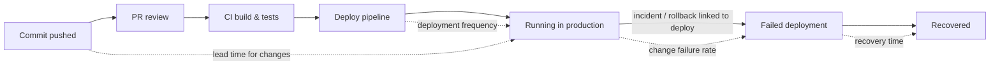
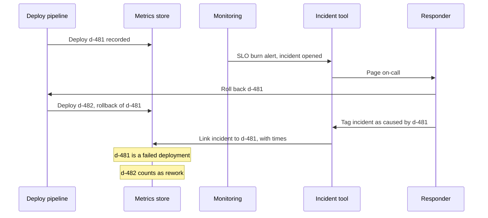

## TL;DR

- DORA's software delivery metrics measure **throughput** (deployment frequency, lead time for changes, failed deployment recovery time) and **instability** (change failure rate, rework rate).
- The research's central finding: **speed and stability are not a trade-off**. High performers do both, enabled by small batches, automation and fast feedback.
- They are **system-level, team-owned improvement signals**, not individual performance targets or a league table between teams.
- Measure them automatically from source control, CI/CD and incident data; manual surveys are fine to start but drift.
- The metrics show *that* something is slow; **capabilities** (trunk-based development, test automation, loosely coupled architecture, culture) are what you change.

## Core Concepts

### The metrics

| Metric | Definition | Measures | Typical data source |
|---|---|---|---|
| Deployment frequency | How often a team deploys to production | Throughput | CD pipeline / deploy events |
| Lead time for changes | Time from commit to running in production | Throughput | VCS commit time + deploy time |
| Failed deployment recovery time | Time to recover from a deployment that caused a failure in production | Throughput (moved here from stability in the 2024 report) | Incident/rollback data |
| Change failure rate | % of deployments needing immediate remediation (rollback, hotfix) | Instability | Deploys linked to incidents/rollbacks |
| Rework rate | Share of deployments that are unplanned, made to fix user-facing bugs | Instability | Deploy metadata (added in the 2024 report) |

"Time to restore service" was renamed **failed deployment recovery time** (in the 2023 report) to focus on failures caused by changes rather than all incidents. **Reliability** (meeting operational goals such as SLOs) is tracked alongside as an outcome.

The 2025 DORA report dropped the low/medium/high/elite clusters in favour of seven team profiles that combine delivery performance with well-being and friction. Use the published benchmarks for context, not as targets.

### Measuring lead time precisely

Lead time starts at **commit** (not ticket creation) and ends when the change is **running in production**. For a deploy containing several commits, compute per commit and report the median (p50) and p90.

```ts
interface Deploy { id: string; finishedAt: Date; commits: { sha: string; committedAt: Date }[]; causedFailure: boolean }

const median = (xs: number[]) => {
  const s = [...xs].sort((a, b) => a - b);
  const mid = Math.floor(s.length / 2);
  return s.length % 2 ? s[mid]! : (s[mid - 1]! + s[mid]!) / 2;
};

export function doraSummary(deploys: Deploy[], days: number) {
  const leadTimesHours = deploys.flatMap((d) =>
    d.commits.map((c) => (d.finishedAt.getTime() - c.committedAt.getTime()) / 3_600_000),
  );
  return {
    deploymentsPerDay: deploys.length / days,
    leadTimeMedianHours: leadTimesHours.length ? median(leadTimesHours) : null,
    changeFailureRate: deploys.length ? deploys.filter((d) => d.causedFailure).length / deploys.length : null,
  };
}
```

### Worked example: where does the lead time go?

A team's median lead time for changes is **6 days**, and leadership wants it lower. Splitting each change's journey into stages (from Git and CI/CD timestamps) shows where the time goes:

| Stage | Median | Share |
|---|---|---|
| Commit → pull request opened | 0.4 days | 7% |
| PR opened → first review | 1.6 days | 27% |
| First review → approval | 0.7 days | 12% |
| Approval → merge | 0.2 days | 3% |
| Merge → running in production | 3.1 days | 52% |
| **Total** | **≈ 6 days** | |

(Stage medians don't add up exactly to the overall median, but they're close enough to show the shape.)

**Reading it:**
- **Half the lead time is waiting after merge.** Merged code waits for a weekly release train and a manual deploy. No amount of faster coding helps.
- **A quarter is waiting for the first review.** That's queueing, not reviewing: the review itself takes under an hour.
- Coding is a small share. The team isn't slow. Its work waits.

**Experiments, one at a time:**
1. **Deploy on merge**: automated deployment to production with canaries and automatic rollback, replacing the weekly train. Merge to production falls from 3.1 days to about 2 hours.
2. **Review within half a day**: a team agreement, smaller pull requests, and pairing on review. Pickup falls from 1.6 to about 0.3 days.

The result is roughly 0.4 + 0.3 + 0.7 + 0.2 + 0.1 ≈ **1.7 days**, a 70% reduction, without anyone typing faster. Watch the **change failure rate** and **rework rate** at the same time, so speed doesn't come at the cost of stability. The DORA research says it shouldn't, if the automation is good.

### What drives the metrics

DORA's research links performance to **capabilities**:
- **Technical**: version control, trunk-based development, continuous integration, test automation, deployment automation, loosely coupled architecture, monitoring/observability, shifting security left.
- **Process**: small batches, a streamlined change approval process (not heavyweight CABs), visibility of work.
- **Cultural**: generative (Westrum) culture, learning climate, psychological safety, user focus.

### Complementary frameworks

- **SPACE**: Satisfaction, Performance, Activity, Communication, Efficiency. Developer productivity is multidimensional.
- **DevEx**: feedback loops, cognitive load, flow state.
- **Flow metrics** (flow time, flow load, flow efficiency) for value streams beyond deployment.

## How It Works



### Linking a failure to the deploy that caused it



## When to Use / Trade-offs

| Use of DORA metrics | Good for | Risky when | Mitigation |
|---|---|---|---|
| Team self-improvement | Spotting bottlenecks, tracking experiments | — | Pair with retros and capability assessment |
| Org-wide trend reporting | Showing direction of travel to leadership | Aggregated so far it hides variation | Report distributions and trends, not single averages |
| Comparing teams | Sharing practices between similar teams | Used for ranking, bonuses, or across very different contexts | Compare a team to its own past |
| Individual performance | — | Always | Don't |
| Vendor/benchmark comparison | Context for ambition | Treated as targets | Use as conversation starters |

## Common Pitfalls & Anti-patterns

- **Goodhart's law** — once a measure becomes a target, it stops being a good measure (splitting deploys, reclassifying incidents).
- **Ranking teams** — drives gaming and hides problems; context differs (mobile app store releases vs web services).
- **Measuring only speed** — deployment frequency up while change failure rate quietly doubles.
- **Lead time from ticket creation** — mixes product discovery and backlog wait with delivery capability; track those separately.
- **Averages over medians** — one 30-day outlier skews the mean; use p50/p90.
- **Dashboards without action** — collecting metrics without retros, experiments or capability investment.
- **Ignoring rework** — high throughput that's mostly hotfixes is not high performance.

## Real-world Scenario

**Context:** A bank's digital division (14 teams) released fortnightly through a Change Advisory Board. Leadership wanted "elite DORA" in a year and proposed a team leaderboard.

**Decision:** I argued against the leaderboard and proposed:
1. Automated metrics from GitHub + Azure DevOps + ServiceNow, shown per team as trends with p50/p90.
2. Each team picked one constraint per quarter (for most it was the CAB and long-lived branches).
3. A risk-based change policy co-designed with risk & compliance: low-risk changes with automated evidence (tests, scans, peer review) became pre-approved standard changes.
4. Quarterly reviews focused on capabilities and experiments, not ranks.

**Outcome:** Median lead time fell from 19 days to 2.5 days, deployment frequency rose from fortnightly to daily for 9 teams, and change failure rate fell from 22% to 11%. Audit findings decreased because evidence was automated.

**What I'd do differently:** Bring the risk function in from day one rather than month three. They became the strongest advocates once they saw the evidence trail.

## Interview Questions

### What are the DORA metrics and what does each tell you? {#four-keys}

**Level:** Foundation

**Model answer:**
- **Deployment frequency**: how often you deploy to production. A proxy for batch size.
- **Lead time for changes**: commit to production. How fast a change flows through review, build, test and release.
- **Change failure rate**: the share of deployments causing a production failure needing remediation. Stability.
- **Failed deployment recovery time**: how quickly you recover when a deployment fails. Resilience and detection.

Recent reports add **rework rate** (unplanned fix deployments) as a second instability measure, alongside reliability as an operational outcome. Together they show throughput and stability, and the research shows high performers achieve both.

**What the interviewer is looking for:**
Accurate definitions, the throughput/stability framing, and awareness that the set has evolved.

**Follow-ups:**
- Why does deployment frequency correlate with stability?
- What data would you need to automate these?

**Red flags:**
- Confusing lead time for changes with cycle time from ticket creation.
- Not knowing what counts as a change failure.

### How exactly would you measure lead time for changes, and what traps would you avoid? {#measuring-lead-time}

**Level:** Senior

**Model answer:**
Per commit: time from the commit (or merge to main, if defined consistently) to the moment the deployment containing it finished in production. Link deploys to commit SHAs via the pipeline. Report median and p90 over a rolling window, per service/team.

Traps:
- Starting the clock at ticket creation (that measures backlog wait).
- Averaging (outliers dominate).
- Ignoring commits that never deploy (abandoned branches).
- Counting staging deploys.
- Mixing services with different release models.
- Rebases rewriting commit timestamps: use first-push or PR-open time if needed and document it.

**What the interviewer is looking for:**
Operational precision and awareness of data-quality issues.

**Follow-ups:**
- How would you break lead time down to find the bottleneck?
- How do feature flags affect what "in production" means?

**Red flags:**
- "We ask teams to estimate it."
- No distinction between median and mean.

### Leadership wants to set DORA targets per team and tie them to performance reviews. What do you advise? {#goodhart}

**Level:** Senior

**Model answer:**
Advise against tying them to individual or team performance ratings. That invites Goodhart's law: teams split deploys into trivial ones, reclassify failures as "not deployment-related", or avoid risky but valuable work. Instead:
- use the metrics as team-owned improvement signals, compared against each team's own trend
- set goals on **capabilities** (e.g. remove manual approval for standard changes, achieve trunk-based development)
- review the metrics in retros and quarterly reviews with context

Offer leadership an org-level trend view so they still get visibility.

**What the interviewer is looking for:**
Understanding metric gaming and offering a constructive alternative that still meets leadership's need for visibility.

**Follow-ups:**
- What would you show the executive team monthly?
- How would you detect gaming?

**Red flags:**
- Accepting targets uncritically.
- Refusing visibility to leadership entirely.

### A manager says "if we deploy more often we'll break more things." How do you respond? {#speed-vs-stability}

**Level:** Senior

**Model answer:**
DORA's multi-year research shows the opposite on average: teams that deploy more frequently also have lower change failure rates and faster recovery. The mechanism is **batch size**. Smaller changes are easier to review and test, have a smaller blast radius, are easier to diagnose, and are quick to roll back. Frequent deployment forces automation (tests, pipelines, rollbacks) and feedback.

I'd propose an experiment: pick one service, add the safety nets (automated tests, canary, feature flags, fast rollback), reduce batch size, and track change failure rate and recovery time alongside deployment frequency for a quarter.

**What the interviewer is looking for:**
Evidence-based persuasion, the batch-size mechanism, and an experiment rather than an argument.

**Follow-ups:**
- What safety nets must be in place before increasing deploy frequency?
- What if the experiment shows failures did increase?

**Red flags:**
- Dismissing the concern without evidence.
- Increasing frequency without investing in safety.

### Your CTO wants a dashboard ranking all 30 teams by DORA metrics. Design the measurement programme you'd propose instead. {#comparing-teams}

**Level:** Architect

**Model answer:**
**Goal alignment first.** What decisions will the data inform? Usually investment (where are we constrained?) and progress (are improvements working?).

**Design:**
- **Automated collection**: VCS, CI/CD and incident tooling feeding a data model of deployments ↔ commits ↔ incidents, with clear, documented definitions per metric.
- **Team view**: trends and distributions (p50/p90) for the team's own services; teams own their data and annotate context.
- **Org view**: aggregated trends and distributions across teams, segmented by context (web vs mobile vs data platforms), with no named ranking.
- **Capability assessment**: periodic DORA capability survey per team to connect the metrics to causes.
- **Operating rhythm**: teams pick improvement experiments quarterly, and leadership reviews themes and funds cross-cutting constraints (e.g. a shared CAB, test environments).
- **Complementary signals**: developer experience surveys (SPACE/DevEx), reliability/SLOs, and business outcomes.

Explain the risk of ranking (gaming, hidden problems, unfair comparisons) and show how this design still gives the CTO the visibility they want.

**What the interviewer is looking for:**
Systems thinking, data definitions, context segmentation, linking metrics to capabilities and investment, and influencing a senior stakeholder well.

**Follow-ups:**
- How do you handle teams whose releases go through app stores?
- How would you show ROI from platform investments using this data?
- What would you do if one team's data looks suspiciously good?

**Red flags:**
- Building the leaderboard as asked.
- Proposing metrics with no plan for acting on them.

### Why measure software delivery performance at all? What did the DORA research show? {#why-dora}

**Level:** Foundation

**Model answer:**
DORA (DevOps Research and Assessment) has surveyed tens of thousands of professionals since 2014, with the results published in the yearly *State of DevOps* reports and the book *Accelerate* (Forsgren, Humble and Kim, 2018). The core findings:

- A small set of **outcome metrics** (throughput: deployment frequency and lead time; stability: change failure rate and recovery time) reliably separates high-performing teams from low-performing ones.
- **Throughput and stability go together.** High performers are both faster and more stable, so you don't have to trade one for the other.
- Software delivery performance predicts **organisational performance** (profitability, market share, goals met) and is associated with lower burnout.
- It is driven by **capabilities** you can invest in: continuous integration, trunk-based development, test and deployment automation, loosely coupled architecture, and a generative culture.

So measuring isn't about scoring teams. It tells you whether investments in those capabilities are working, using signals that are hard to fake when they are measured from systems.

**What the interviewer is looking for:**
Knowing where the metrics come from, the throughput-plus-stability finding and the link to capabilities.

**Follow-ups:**
- What does the research say about change approval boards?
- Why are these metrics outcome metrics rather than activity metrics?

**Red flags:**
- Treating DORA metrics as a team leaderboard.
- Not knowing that speed and stability correlate positively.

### Why do small batches matter so much in delivery performance? {#small-batches}

**Level:** Foundation

**Model answer:**
Deployment frequency is largely a proxy for **batch size**. Smaller changes, deployed more often, improve everything else:

- **Lower risk per change:** a 50-line deploy has fewer ways to fail, and when it does, the cause is obvious.
- **Faster recovery:** rolling back or fixing forward one small change is quick. A big release often has to be untangled.
- **Faster feedback:** you learn from users and production within hours rather than at the end of a quarter.
- **Less work in progress and fewer merge conflicts:** long-lived branches and big integration phases disappear.
- **Less coordination:** small independent changes don't need release meetings.

Enablers: trunk-based development with short-lived branches (or none), feature flags so unfinished work can ship dark, automated tests and pipelines, and an architecture that lets services deploy independently.

**What the interviewer is looking for:**
The batch-size reasoning behind deployment frequency and the practices that make small batches safe.

**Follow-ups:**
- How do feature flags help, and what is their cost?
- How would you shrink the batch size of a mobile app release?

**Red flags:**
- "We deploy rarely so each deploy can be tested thoroughly."
- Equating feature flags with permanent configuration.

### What counts as a "failure" for change failure rate? {#change-failure-definition}

**Level:** Foundation

**Model answer:**
Change failure rate is the percentage of deployments to production that cause degraded service and **need remediation**: a rollback, a hotfix, a forward-fix, a patch or a feature-flag kill switch.

Decisions to make explicit:
- **Count** incidents linked to a deployment, rollbacks (manual or automatic), and emergency fixes deployed within a short window because of the previous deploy.
- **Usually exclude** failures caught *before* production (a failed pipeline is the system working), and production incidents not caused by a change, such as a cloud outage. Track those separately.
- **Grey areas:** bugs found weeks later. Many teams count only issues detected within a window. Whatever you pick, apply it consistently and document it.
- **Attribution:** link incidents to the deployment that caused them (deploy markers, incident tooling fields). Without this, the metric is guesswork.

DORA's newer **rework rate** complements it by counting unplanned deployments made to fix user-facing bugs.

**What the interviewer is looking for:**
A precise, consistent definition and awareness of the attribution problem.

**Follow-ups:**
- Your automatic canary rollback caught a bad release at 1% traffic. Is that a change failure?
- How do you collect this data without manual tagging?

**Red flags:**
- Counting failed CI builds as change failures.
- Defining it so loosely that it is always 0%.

### How would you collect DORA metrics automatically across 30 teams with different tooling? {#collecting-metrics}

**Level:** Senior

**Model answer:**
Derive them from **system events, not surveys or spreadsheets**:

- **Deployments:** emit a deployment event from every pipeline (or GitOps controller) with service, version, environment, commit SHAs and timestamp. Standardise this with a shared pipeline step or a webhook to a small "delivery events" service.
- **Lead time:** for each deployed commit, the time from commit (or PR merge, if that's your definition, stated clearly) to the production deployment event. Use git history to map the commits included between two deploys.
- **Change failures and recovery:** link incidents and rollbacks to deployments, using incident-tool fields, automatic rollbacks reported by the deployment system, or hotfix labels. Recovery time runs from the failed deploy (or detection) to restoration.
- **Normalise** into one store (a warehouse table), report p50 and p90 per service and team, and show trends over time.

Tools: the open-source Four Keys project from Google (now archived) showed the pattern. Commercial platforms (LinearB, Sleuth, GitLab and Azure DevOps analytics, internal developer portals such as Backstage plugins) offer it ready-made.

Make it trustworthy: publish the definitions, let teams see the raw events behind their numbers, and fix data-quality issues before anyone draws conclusions.

**What the interviewer is looking for:**
An event-driven, automated approach, clear definitions, linking incidents to deploys and attention to data quality.

**Follow-ups:**
- How do you handle a monorepo where one commit deploys 12 services?
- What would you do about teams that deploy by hand?

**Red flags:**
- Manual monthly spreadsheets.
- Using Jira ticket timestamps as lead time.

### How do DORA metrics apply to mobile apps or heavily regulated environments? {#dora-in-constraints}

**Level:** Senior

**Model answer:**
The principles hold, but the measurement points and targets need adapting. **Don't compare these teams to web services.**

**Mobile:**
- App store review and user upgrade adoption add delays outside the team's control. Measure **lead time to release candidate** (or to store submission) separately from store and adoption latency.
- Deployment frequency becomes release cadence. Weekly release trains are good for mobile.
- Feature flags and remote config give continuous *delivery of behaviour* between binaries.
- Track change failure through crash-free sessions, hotfix releases and server-side kill switches.

**Regulated (finance, health):**
- Replace manual change boards with **automated, auditable controls**: peer review enforced in git, pipeline evidence (tests, scans, approvals) attached to each release, segregation of duties via the pipeline rather than manual handoffs.
- DORA research found heavyweight external change approval correlates with worse performance, not better stability.
- Some steps may legitimately remain, such as validation for medical device software. Measure them explicitly so you can see their cost.

**Embedded and firmware:** use hardware-in-the-loop test automation, and measure lead time to a validated build.

**What the interviewer is looking for:**
Adapting definitions to context, separating what's controllable from what isn't, and turning compliance into automated evidence.

**Follow-ups:**
- An auditor insists on a change advisory board approval for every deploy. How do you negotiate?
- What does recovery time mean for a mobile app bug?

**Red flags:**
- "DORA doesn't apply to us."
- Ranking a mobile team against a web team on deployment frequency.

### A team deploys once a month with a 3-week lead time. How do you diagnose and improve it? {#improving-deploy-frequency}

**Level:** Senior

**Model answer:**
**Map the value stream first.** Pick recent changes and trace where the time went from commit to production: code review wait, CI duration and failures, test environment queues, manual QA cycles, release approval, the deployment window. Most of the lead time is usually **waiting**, not working.

Typical findings and fixes:
- **Long-lived feature branches** → trunk-based development with feature flags.
- **Manual regression testing** → automate the critical paths and move QA to exploratory testing.
- **Shared, contended test environment** → ephemeral environments per PR or per service.
- **Change board or release-window approval** → automated controls and a standard-change classification for low-risk deploys.
- **Slow or flaky CI** → parallelise, cache and quarantine flaky tests. Target under 10–15 minutes.
- **Coupled deployments with other teams** → contract tests, backward-compatible APIs and independent deploys.
- **Fear from past incidents** → canaries, automated rollback and better observability, so the risk per deploy is genuinely lower.

Run it as a series of experiments: fix the biggest wait, measure again and repeat. Celebrate stability alongside speed so the team sees that more frequent deploys are *safer*.

**What the interviewer is looking for:**
Value-stream thinking, wait time as the main target, concrete capability fixes and an iterative, measured approach.

**Follow-ups:**
- The team says the business won't accept more frequent releases. What do you do?
- Which single change usually gives the biggest improvement?

**Red flags:**
- "Tell them to deploy more often."
- Adding metrics dashboards without changing any practice.

### How do DORA, SPACE and DevEx fit together in a developer productivity programme? {#space-devex}

**Level:** Architect

**Model answer:**
They answer different questions and work best together:

- **DORA:** "How well does our system *deliver* software?" These are outcome metrics for the delivery pipeline: throughput and stability. They are objective and system-derived, but blind to developer experience and to work that isn't deployments.
- **SPACE** (Forsgren, Storey et al., 2021): a framework, not a metric set. Productivity is multidimensional: **S**atisfaction and well-being, **P**erformance (outcomes), **A**ctivity, **C**ommunication and collaboration, **E**fficiency and flow. Pick metrics from several dimensions, mixing system data with perception data, and never rely on activity counts alone.
- **DevEx** (Noda, Storey, Forsgren, Greiler, 2023): focuses on developers' lived experience through three dimensions: **feedback loops** (how fast builds, tests and reviews respond), **cognitive load**, and **flow state** (uninterrupted focus time). It is measured mainly through regular surveys, with system data as support.

A programme design:
1. DORA from system telemetry as the delivery baseline.
2. A quarterly DevEx survey for friction, such as "How often do flaky tests block you?" or "How easy is it to understand the codebase?"
3. Targeted system metrics for the friction points found (CI duration, review wait time, environment provisioning time).
4. Business outcomes that the platform and product work should move.

Use the combination to choose platform investments, then check whether they changed both perception and system metrics.

**What the interviewer is looking for:**
What each framework is for, combining perception and system data, and turning measurement into investment decisions.

**Follow-ups:**
- Survey scores and system metrics disagree. Which do you trust?
- How do you keep survey participation high?

**Red flags:**
- Measuring productivity by commits, lines of code or story points.
- Treating SPACE as five metrics to put on a dashboard.

### How would you show the impact of a platform engineering team to the executive team? {#platform-roi}

**Level:** Architect

**Model answer:**
Treat the platform as a **product** with internal customers and outcomes. Before building anything, agree what success looks like and baseline it.

**Adoption:** the share of services on the golden-path templates, the pipeline, the observability stack. Track adoption by choice, not by mandate, as a signal of product fit.

**Developer outcomes** (before and after, for adopting teams):
- Lead time, deployment frequency and change failure rate for adopters against non-adopters.
- Time to first deploy for a new service (for example from 3 weeks to 1 day) and onboarding time to first PR.
- CI duration and flake rate; DevEx survey friction scores on the areas the platform targets.

**Business translation:**
- Engineering hours saved per month multiplied by loaded cost. Be honest and conservative, and show the assumptions.
- Incidents avoided or shortened (security patching time across the fleet, recovery time).
- Cloud cost savings from standardised right-sizing.
- Risk reduction: time to patch a critical CVE across all services, audit evidence produced automatically.

**Narrative:** one page each quarter: two or three headline outcomes, one customer story ("the payments team launched X in 2 weeks instead of 2 months") and the next bets. Include what didn't work.

**What the interviewer is looking for:**
Product thinking, baselines, adoption as a signal, credible translation into money and risk, and executive-level storytelling.

**Follow-ups:**
- Adoption is stuck at 30%. What does that tell you?
- How do you separate the platform's effect from other changes happening at the same time?

**Red flags:**
- Reporting only outputs ("we shipped 14 features of the platform").
- Mandating adoption and calling it success.

### The CEO asks for a metric to identify the least productive developers. How do you respond? {#developer-productivity}

**Level:** Architect

**Model answer:**
Take the underlying concern seriously. Usually it is "are we getting value for our engineering spend?" or "where are we slow?". Then redirect firmly away from individual metrics.

**Why individual output metrics fail:**
- Software is a team sport. The people who unblock others, review, mentor and do architecture often produce fewer commits.
- Every individual activity metric (commits, PRs, lines, story points) is trivially gamed, and Goodhart's law applies immediately.
- It destroys collaboration and trust, and your best people leave first.
- It conflates performance management (a manager's job, based on observed impact) with system improvement.

**What to offer instead:**
1. **Team and system-level delivery metrics** (DORA, flow metrics) to find bottlenecks.
2. **DevEx surveys** to find friction that wastes engineering time.
3. **Investment allocation:** what share of capacity goes to new features, maintenance, unplanned work and toil, and how that maps to strategy.
4. **Outcome reviews:** for major initiatives, the business result against cost.
5. For individual performance, **manager-led assessment** against clear role expectations, with evidence of impact, not activity counts.

Close with a concrete proposal and timeline, so the CEO gets an answer to the real question.

**What the interviewer is looking for:**
Respectful pushback grounded in evidence, understanding of the CEO's real need and a constructive alternative. Leadership and influence, not just metrics knowledge.

**Follow-ups:**
- The CEO insists. What do you do next?
- How do you deal with a genuinely underperforming engineer?

**Red flags:**
- Building the requested leaderboard.
- Refusing without offering an alternative.

### Your organisation releases on a 6-week train with a 2-week hardening phase. Plan the move to continuous delivery. {#release-train-to-cd}

**Level:** Architect

**Model answer:**
**Understand why the train exists.** Usually it is fear and coupling: manual regression testing, shared databases, coordinated releases between teams, a change board, and contractual release notes. The plan has to remove those reasons, not just the calendar.

**Phase 0 (baseline, about 1 month):** DORA metrics, a value-stream map, an inventory of cross-team couplings, and failure data from the last few releases. Agree goals with the business, for example "any team can safely release any working day within 12 months".

**Phase 1 (technical foundations):**
- Trunk-based development and feature flags, so incomplete work no longer blocks a release.
- Automated regression suites for the critical journeys. Hardening moves into each change's pipeline.
- One deployment pipeline per service with automated evidence for audit.
- Observability and canary deploys with automatic rollback.

**Phase 2 (decouple):**
- Break coordinated releases using backward-compatible APIs and contract tests.
- Expand-and-contract database migrations.
- Pilot one or two volunteer teams releasing off-train, then share their results.

**Phase 3 (process):**
- Redefine the change board as standard changes (pre-approved, low-risk, automated evidence) versus exceptional changes.
- Shrink the train: 6 weeks, then 2, then on demand. Keep the train as an optional bus for teams not yet ready.

**People:** QA shifts towards automation and exploratory testing, release managers become platform or delivery coaches, and executives get a regular readout on outcomes. Throughout, measure change failure rate and recovery time to show that stability improves rather than suffers.

**What the interviewer is looking for:**
Diagnosing the causes, incremental phases, technical and organisational change together, compliance handled through automation, and evidence-based communication.

**Follow-ups:**
- One legacy team can't get off the train for a year. How do you prevent them blocking everyone?
- How do you handle customer-facing release notes without a release train?

**Red flags:**
- "Just deploy every day from next month."
- Ignoring the human roles that the train currently employs.

### What is rework rate, and why did DORA add it? {#rework-rate}

**Level:** Foundation

**Model answer:**
**Rework rate** is the share of deployments that were **unplanned and made to fix a user-facing problem**: hotfixes, emergency patches and rollbacks, as opposed to planned feature and improvement work. DORA added it in the 2024 report as a second **instability** measure, alongside change failure rate.

Why it was needed:
- **Change failure rate misses some instability.** A team might never formally "fail" a deployment, but ship a stream of quick fixes for bugs users found. That's instability, and it eats capacity, even if no incident was declared.
- **Throughput can look great for the wrong reason.** High deployment frequency made up largely of fix-ups isn't high performance. Rework rate exposes it.
- It reflects **quality reaching users**, which matters more than the internal mechanics of a release.

How to measure it:
- Mark deployments as planned or unplanned: from the linked work item type (bug versus feature), a label on the pull request, or the release process (a hotfix path).
- Report it alongside the other metrics as a trend, per team, not as a target. A temporary rise after a big launch is expected.

How to improve it: better testing before release, smaller changes, progressive delivery that catches problems before most users see them, and feature flags so a problem can be switched off instead of hot-fixed.

**What the interviewer is looking for:**
The definition, why change failure rate alone missed instability, how to classify deployments, and how to act on it.

**Follow-ups:**
- How would you tell a planned fix from an unplanned one automatically?
- Could reducing rework rate slow a team down?

**Red flags:**
- Counting all bug-fix deployments as failures of individuals.
- Celebrating deployment frequency without looking at what the deployments were.

### How do you break lead time down to find the bottleneck? {#lead-time-breakdown}

**Level:** Senior

**Model answer:**
The overall lead time tells you *that* changes are slow. Splitting it into stages tells you *where*, which is what you need to act.

**Stages from timestamps you already have:**
1. First commit → pull request opened (working time, and batching before opening).
2. Pull request opened → first review (**pickup time**: pure waiting).
3. First review → approval (review rounds and rework).
4. Approval → merge (CI, merge queue, waiting for someone to press the button).
5. Merge → running in production (the **deployment pipeline**, release trains, approvals, manual steps).

Sources: Git and the code host's API for commits and review events, CI/CD for build and deploy times. Engineering-intelligence tools do this automatically, but a SQL query over exported events works too.

**Reading it:**
- **Report medians and p90 per stage**, per team or repository. Averages are distorted by a few very old branches.
- **Look for waiting stages.** In most teams, waiting (review pickup, release trains, manual approvals) dominates working time.
- Check **batch size**: large pull requests slow every later stage, so correlate stage times with PR size.

**Acting on it:**
- **Post-merge stages dominate** → automate deployment, replace release trains with continuous delivery, and turn manual change approvals into automated evidence.
- **Pickup dominates** → review agreements, smaller pull requests, pairing, and reviewer rotation.
- **Review rounds dominate** → agree designs earlier, use clearer standards and automated checks.
- Change one thing at a time, and compare the stage times before and after.

**What the interviewer is looking for:**
Stage definitions from existing data, medians and percentiles, separating waiting from working time, and matching interventions to the dominant stage.

**Follow-ups:**
- Lead time is short, but changes still take weeks from idea to customer. What's missing from the measurement?
- How do you handle long-lived branches in the calculation?

**Red flags:**
- Measuring only the total.
- Concluding that developers need to code faster.

### What has DORA's research found about AI-assisted development and delivery performance? {#ai-delivery-performance}

**Level:** Senior

**Model answer:**
**2024 report:** AI adoption was associated with gains that individuals reported (productivity, flow, job satisfaction), but at team level the picture was mixed. DORA estimated that a 25% increase in AI adoption was associated with about a **1.5% decrease in delivery throughput** and a **7.2% decrease in delivery stability**. The likely explanation: AI makes it easy to produce **larger changes**, and large batches have always hurt delivery.

**2025 report (State of AI-assisted Software Development):** with around 90% of respondents now using AI at work, AI adoption was associated with **higher throughput**, but still with **more instability**. The central conclusion was that AI acts as an **amplifier**: it magnifies an organisation's existing strengths and weaknesses. Teams with loosely coupled systems, fast feedback, small batches, strong version control practices and good internal platforms benefit. Teams with tightly coupled systems and slow processes see little gain, or more problems.

**What that means in practice:**
- **Keep batches small** even when code is cheap to generate. Review and testing capacity, not typing speed, is the limit.
- **Invest in the fundamentals** that the research says AI amplifies: fast CI, test automation, progressive delivery, clear ownership and good platforms.
- **Measure stability alongside throughput.** Watch change failure rate, rework rate and pull-request size as AI adoption grows, not just output.
- Address **trust**. Many developers report productivity gains while still not fully trusting generated code, so review and testing practices matter more, not less.

**What the interviewer is looking for:**
Accurate knowledge of the findings across both reports, the batch-size explanation, AI as an amplifier, and practical guardrails.

**Follow-ups:**
- Your teams' deployment frequency rose after rolling out coding assistants, but so did incidents. What do you look at?
- How would you evaluate an AI coding tool's impact in your own organisation?

**Red flags:**
- "AI makes every team faster", with no mention of stability.
- Measuring AI's impact by lines of code or pull requests opened.

### How would you turn a capability assessment into an improvement roadmap? {#capability-roadmap}

**Level:** Architect

**Model answer:**
DORA's metrics show outcomes. Its **capabilities** (technical, process and cultural) are what teams actually change. A roadmap connects the two.

**1. Assess per team, not centrally.**
- Use a short survey based on DORA's capabilities (such as its quick check), plus the team's own metrics and a facilitated discussion. Teams know where it hurts.
- Typical findings: slow or flaky CI, manual deployments, heavyweight change approval, tightly coupled services, limited test automation, unclear ownership, low psychological safety.

**2. Find each team's constraint.**
- Use the metrics and lead-time breakdown to pick the **one capability** most limiting the team now. Theory of constraints applies: improving anything else won't show up in outcomes.
- Expect different answers: one team's constraint is the change board, another's is a monolith shared with five teams.

**3. Separate team work from organisational work.**
- **Team-level** improvements (trunk-based development, test automation, smaller batches) go into the team's own backlog, with time protected for them.
- **Organisation-level** constraints (change approval policy, shared environments, architecture coupling, platform gaps) need a sponsor and a cross-team plan. These often unlock the most.

**4. Run it as experiments with a review rhythm.**
- Each improvement has a hypothesis ("automating deployment will cut merge-to-production from 3 days to under a day"), a measure, and a date to check.
- A quarterly review looks at capability progress and metric trends together, retires finished items, and picks the next constraints.

**5. Sustain it:** share what worked between teams, fund platform work for shared constraints, and keep metrics as the team's tool rather than a management scorecard.

**What the interviewer is looking for:**
Capabilities as the levers, team-level assessment, constraint focus, separating team and organisational changes, experiments with measures, and a review cadence.

**Follow-ups:**
- Three teams name the same constraint, the shared staging environment. Who owns fixing it?
- How long before you'd expect the metrics to move?

**Red flags:**
- A single central roadmap imposed on every team.
- Improving many capabilities at once with no measure of effect.

### How do value stream mapping and DORA metrics complement each other? {#value-stream-mapping}

**Level:** Architect

**Model answer:**
**DORA metrics** measure the delivery part of the stream, from commit to production, and its stability. **Value stream mapping** looks at the **whole flow** from idea or customer request to value in users' hands, including everything before the first commit and after the deploy.

**A value stream mapping session:**
- Bring together the people who touch the work: product, design, engineering, testing, operations, security, compliance and support.
- Map each step from request to value, and record **process time** (working) and **lead time** (elapsed, including waiting), plus the **percentage complete and accurate**: how often the next step receives work it can use without rework.
- Calculate **flow efficiency** = total process time ÷ total lead time. Values below 15% are common: most of the time, work is waiting.

**What it typically finds that DORA alone doesn't:**
- Weeks of waiting for prioritisation, funding approval, design sign-off or another team's API before any code is written.
- Manual handoffs (requirement documents thrown over walls), security reviews queued at the end, and release notes or customer communications done by hand after the deploy.
- Rework loops from unclear requirements.

**Using them together:**
- The map identifies the **biggest delays across the whole stream**. Sometimes they're in delivery (then DORA metrics track the improvement), often upstream or downstream (then flow metrics such as flow time and flow efficiency track it).
- Design a **future-state map** with fewer handoffs and queues, and pick a few improvements to run as experiments.
- Repeat every six to twelve months, because the bottleneck moves.

**What the interviewer is looking for:**
The difference in scope, the mapping method, flow efficiency, upstream and downstream delays, and combining the two to prioritise.

**Follow-ups:**
- Your delivery metrics are excellent, but customers wait three months for features. Where do you look?
- Who should own the value stream as a whole?

**Red flags:**
- Optimising deployment while ideas wait months for approval.
- A value stream map drawn by one person without the people doing the work.

## Cheat Sheet

- **Deployment frequency** — how often you deploy to production; a proxy for batch size.
- **Lead time for changes** — commit to running in production; report p50/p90.
- **Change failure rate** — % of deployments that need remediation (rollback, hotfix, patch).
- **Failed deployment recovery time** — time to recover from a failed deployment (formerly "time to restore").
- **Rework rate** — share of deployments that are unplanned bug fixes; newer instability metric.
- **Speed vs stability** — not a trade-off; high performers achieve both through small batches.
- **Goodhart's law** — a measure that becomes a target stops being a good measure.
- **Capabilities** — trunk-based dev, CI, test & deploy automation, loose coupling, generative culture.
- **SPACE** — Satisfaction, Performance, Activity, Communication, Efficiency.
- **Use** — team-owned improvement signals; never individual performance ratings.
- **Value stream map** — trace a change from commit to production; most lead time is waiting, not working.
- **DevEx** — feedback loops, cognitive load and flow state; measured mainly with developer surveys.
- **Batch size** — deployment frequency is mostly a proxy for it; smaller batches mean lower risk and faster recovery.

### Revisit

- **Lead-time breakdown** — commit to PR, review pickup, review rounds, merge, then deploy. Waiting stages (pickup, release trains) usually dominate, so act on the biggest one.
- **Deploy-to-incident link** — tag incidents with the deploy that caused them. That one field makes change failure rate, recovery time and rework rate measurable.
- **Rework rate** — the share of deployments that are unplanned fixes for user-facing problems. DORA's second instability metric since 2024.
- **AI in DORA research** — 2024 found lower throughput and stability with more AI adoption. In 2025, AI correlated with higher throughput but still more instability, acting as an amplifier.
- **Keep batches small with AI** — generated code is cheap, but review, testing and stability are the limits.
- **Capabilities roadmap** — assess per team, fix one constraint at a time, separate team work from organisational work, and run experiments with measures.
- **Value stream mapping** — the whole flow from idea to value. Flow efficiency is often below 15%, and delays often sit outside delivery.

## Further Reading

- [DORA](https://dora.dev/) — research programme home: reports, capabilities and quick check.
- [DORA's software delivery metrics guide](https://dora.dev/guides/dora-metrics-four-keys/) — definitions and measurement guidance.
- [DORA capabilities catalogue](https://dora.dev/capabilities/) — the practices that drive the metrics.
- [Google Cloud: State of DevOps reports](https://cloud.google.com/devops/state-of-devops) — the annual research reports.
- [ACM Queue: The SPACE of Developer Productivity](https://queue.acm.org/detail.cfm?id=3454124) — the SPACE framework paper.
