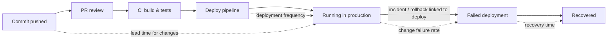

## TL;DR

- DORA's software delivery metrics measure **throughput** (deployment frequency, lead time for changes, failed deployment recovery time) and **instability** (change failure rate, rework rate).
- The research's central finding: **speed and stability are not a trade-off**. High performers do both, enabled by small batches, automation and fast feedback.
- They are **system-level, team-owned improvement signals**, not individual performance targets or a league table between teams.
- Measure them automatically from source control, CI/CD and incident data; manual surveys are fine to start but drift.
- The metrics show *that* something is slow; **capabilities** (trunk-based development, test automation, loosely coupled architecture, culture) are what you change.

## Core Concepts

### The metrics

| Metric | Definition | Measures | Typical data source |
|---|---|---|---|
| Deployment frequency | How often a team deploys to production | Throughput | CD pipeline / deploy events |
| Lead time for changes | Time from commit to running in production | Throughput | VCS commit time + deploy time |
| Failed deployment recovery time | Time to recover from a deployment that caused a failure in production | Throughput (VERIFY: classed as throughput since the 2024 report) | Incident/rollback data |
| Change failure rate | % of deployments needing immediate remediation (rollback, hotfix) | Instability | Deploys linked to incidents/rollbacks |
| Rework rate | Share of deployments that are unplanned, made to fix user-facing bugs | Instability | Deploy metadata (VERIFY: added in the 2024 report) |

"Time to restore service" was renamed **failed deployment recovery time** (VERIFY: in the 2023 report) to focus on failures caused by changes rather than all incidents. **Reliability** (meeting operational goals such as SLOs) is tracked alongside as an outcome.

VERIFY: DORA moved away from the fixed low/medium/high/elite cluster labels in recent reports. Use the published benchmarks for context, not as targets.

### Measuring lead time precisely

Lead time starts at **commit** (not ticket creation) and ends when the change is **running in production**. For a deploy containing several commits, compute per commit and report the median (p50) and p90.

```ts
interface Deploy { id: string; finishedAt: Date; commits: { sha: string; committedAt: Date }[]; causedFailure: boolean }

const median = (xs: number[]) => {
  const s = [...xs].sort((a, b) => a - b);
  const mid = Math.floor(s.length / 2);
  return s.length % 2 ? s[mid]! : (s[mid - 1]! + s[mid]!) / 2;
};

export function doraSummary(deploys: Deploy[], days: number) {
  const leadTimesHours = deploys.flatMap((d) =>
    d.commits.map((c) => (d.finishedAt.getTime() - c.committedAt.getTime()) / 3_600_000),
  );
  return {
    deploymentsPerDay: deploys.length / days,
    leadTimeMedianHours: leadTimesHours.length ? median(leadTimesHours) : null,
    changeFailureRate: deploys.length ? deploys.filter((d) => d.causedFailure).length / deploys.length : null,
  };
}
```

### What drives the metrics

DORA's research links performance to **capabilities**:
- **Technical**: version control, trunk-based development, continuous integration, test automation, deployment automation, loosely coupled architecture, monitoring/observability, shifting security left.
- **Process**: small batches, a streamlined change approval process (not heavyweight CABs), visibility of work.
- **Cultural**: generative (Westrum) culture, learning climate, psychological safety, user focus.

### Complementary frameworks

- **SPACE**: Satisfaction, Performance, Activity, Communication, Efficiency. Developer productivity is multidimensional.
- **DevEx**: feedback loops, cognitive load, flow state.
- **Flow metrics** (flow time, flow load, flow efficiency) for value streams beyond deployment.

## How It Works



## When to Use / Trade-offs

| Use of DORA metrics | Good for | Risky when | Mitigation |
|---|---|---|---|
| Team self-improvement | Spotting bottlenecks, tracking experiments | — | Pair with retros and capability assessment |
| Org-wide trend reporting | Showing direction of travel to leadership | Aggregated so far it hides variation | Report distributions and trends, not single averages |
| Comparing teams | Sharing practices between similar teams | Used for ranking, bonuses, or across very different contexts | Compare a team to its own past |
| Individual performance | — | Always | Don't |
| Vendor/benchmark comparison | Context for ambition | Treated as targets | Use as conversation starters |

## Common Pitfalls & Anti-patterns

- **Goodhart's law** — once a measure becomes a target, it stops being a good measure (splitting deploys, reclassifying incidents).
- **Ranking teams** — drives gaming and hides problems; context differs (mobile app store releases vs web services).
- **Measuring only speed** — deployment frequency up while change failure rate quietly doubles.
- **Lead time from ticket creation** — mixes product discovery and backlog wait with delivery capability; track those separately.
- **Averages over medians** — one 30-day outlier skews the mean; use p50/p90.
- **Dashboards without action** — collecting metrics without retros, experiments or capability investment.
- **Ignoring rework** — high throughput that's mostly hotfixes is not high performance.

## Real-world Scenario

**Context:** A bank's digital division (14 teams) released fortnightly through a Change Advisory Board. Leadership wanted "elite DORA" in a year and proposed a team leaderboard.

**Decision:** I argued against the leaderboard and proposed:
1. Automated metrics from GitHub + Azure DevOps + ServiceNow, shown per team as trends with p50/p90.
2. Each team picked one constraint per quarter (for most it was the CAB and long-lived branches).
3. A risk-based change policy co-designed with risk & compliance: low-risk changes with automated evidence (tests, scans, peer review) became pre-approved standard changes.
4. Quarterly reviews focused on capabilities and experiments, not ranks.

**Outcome:** Median lead time fell from 19 days to 2.5 days, deployment frequency rose from fortnightly to daily for 9 teams, and change failure rate fell from 22% to 11%. Audit findings decreased because evidence was automated.

**What I'd do differently:** Bring the risk function in from day one rather than month three. They became the strongest advocates once they saw the evidence trail.

## Interview Questions

### What are the DORA metrics and what does each tell you? {#four-keys}

**Level:** Foundation

**Model answer:**
- **Deployment frequency**: how often you deploy to production. A proxy for batch size.
- **Lead time for changes**: commit to production. How fast a change flows through review, build, test and release.
- **Change failure rate**: the share of deployments causing a production failure needing remediation. Stability.
- **Failed deployment recovery time**: how quickly you recover when a deployment fails. Resilience and detection.

Recent reports add **rework rate** (unplanned fix deployments) as a second instability measure, alongside reliability as an operational outcome. Together they show throughput and stability, and the research shows high performers achieve both.

**What the interviewer is looking for:**
Accurate definitions, the throughput/stability framing, and awareness that the set has evolved.

**Follow-ups:**
- Why does deployment frequency correlate with stability?
- What data would you need to automate these?

**Red flags:**
- Confusing lead time for changes with cycle time from ticket creation.
- Not knowing what counts as a change failure.

### How exactly would you measure lead time for changes, and what traps would you avoid? {#measuring-lead-time}

**Level:** Senior

**Model answer:**
Per commit: time from the commit (or merge to main, if defined consistently) to the moment the deployment containing it finished in production. Link deploys to commit SHAs via the pipeline. Report median and p90 over a rolling window, per service/team.

Traps:
- Starting the clock at ticket creation (that measures backlog wait).
- Averaging (outliers dominate).
- Ignoring commits that never deploy (abandoned branches).
- Counting staging deploys.
- Mixing services with different release models.
- Rebases rewriting commit timestamps: use first-push or PR-open time if needed and document it.

**What the interviewer is looking for:**
Operational precision and awareness of data-quality issues.

**Follow-ups:**
- How would you break lead time down to find the bottleneck?
- How do feature flags affect what "in production" means?

**Red flags:**
- "We ask teams to estimate it."
- No distinction between median and mean.

### Leadership wants to set DORA targets per team and tie them to performance reviews. What do you advise? {#goodhart}

**Level:** Senior

**Model answer:**
Advise against tying them to individual or team performance ratings. That invites Goodhart's law: teams split deploys into trivial ones, reclassify failures as "not deployment-related", or avoid risky but valuable work. Instead:
- use the metrics as team-owned improvement signals, compared against each team's own trend
- set goals on **capabilities** (e.g. remove manual approval for standard changes, achieve trunk-based development)
- review the metrics in retros and quarterly reviews with context

Offer leadership an org-level trend view so they still get visibility.

**What the interviewer is looking for:**
Understanding metric gaming and offering a constructive alternative that still meets leadership's need for visibility.

**Follow-ups:**
- What would you show the executive team monthly?
- How would you detect gaming?

**Red flags:**
- Accepting targets uncritically.
- Refusing visibility to leadership entirely.

### A manager says "if we deploy more often we'll break more things." How do you respond? {#speed-vs-stability}

**Level:** Senior

**Model answer:**
DORA's multi-year research shows the opposite on average: teams that deploy more frequently also have lower change failure rates and faster recovery. The mechanism is **batch size**. Smaller changes are easier to review and test, have a smaller blast radius, are easier to diagnose, and are quick to roll back. Frequent deployment forces automation (tests, pipelines, rollbacks) and feedback.

I'd propose an experiment: pick one service, add the safety nets (automated tests, canary, feature flags, fast rollback), reduce batch size, and track change failure rate and recovery time alongside deployment frequency for a quarter.

**What the interviewer is looking for:**
Evidence-based persuasion, the batch-size mechanism, and an experiment rather than an argument.

**Follow-ups:**
- What safety nets must be in place before increasing deploy frequency?
- What if the experiment shows failures did increase?

**Red flags:**
- Dismissing the concern without evidence.
- Increasing frequency without investing in safety.

### Your CTO wants a dashboard ranking all 30 teams by DORA metrics. Design the measurement programme you'd propose instead. {#comparing-teams}

**Level:** Architect

**Model answer:**
**Goal alignment first.** What decisions will the data inform? Usually investment (where are we constrained?) and progress (are improvements working?).

**Design:**
- **Automated collection**: VCS, CI/CD and incident tooling feeding a data model of deployments ↔ commits ↔ incidents, with clear, documented definitions per metric.
- **Team view**: trends and distributions (p50/p90) for the team's own services; teams own their data and annotate context.
- **Org view**: aggregated trends and distributions across teams, segmented by context (web vs mobile vs data platforms), with no named ranking.
- **Capability assessment**: periodic DORA capability survey per team to connect the metrics to causes.
- **Operating rhythm**: teams pick improvement experiments quarterly, and leadership reviews themes and funds cross-cutting constraints (e.g. a shared CAB, test environments).
- **Complementary signals**: developer experience surveys (SPACE/DevEx), reliability/SLOs, and business outcomes.

Explain the risk of ranking (gaming, hidden problems, unfair comparisons) and show how this design still gives the CTO the visibility they want.

**What the interviewer is looking for:**
Systems thinking, data definitions, context segmentation, linking metrics to capabilities and investment, and influencing a senior stakeholder well.

**Follow-ups:**
- How do you handle teams whose releases go through app stores?
- How would you show ROI from platform investments using this data?
- What would you do if one team's data looks suspiciously good?

**Red flags:**
- Building the leaderboard as asked.
- Proposing metrics with no plan for acting on them.

## Cheat Sheet

- **Deployment frequency** — how often you deploy to production; a proxy for batch size.
- **Lead time for changes** — commit to running in production; report p50/p90.
- **Change failure rate** — % of deployments that need remediation (rollback, hotfix, patch).
- **Failed deployment recovery time** — time to recover from a failed deployment (formerly "time to restore").
- **Rework rate** — share of deployments that are unplanned bug fixes; newer instability metric.
- **Speed vs stability** — not a trade-off; high performers achieve both through small batches.
- **Goodhart's law** — a measure that becomes a target stops being a good measure.
- **Capabilities** — trunk-based dev, CI, test & deploy automation, loose coupling, generative culture.
- **SPACE** — Satisfaction, Performance, Activity, Communication, Efficiency.
- **Use** — team-owned improvement signals; never individual performance ratings.

## Further Reading

- [DORA](https://dora.dev/) — research programme home: reports, capabilities and quick check.
- [DORA's software delivery metrics guide](https://dora.dev/guides/dora-metrics-four-keys/) — definitions and measurement guidance.
- [DORA capabilities catalogue](https://dora.dev/capabilities/) — the practices that drive the metrics.
- [Google Cloud: State of DevOps reports](https://cloud.google.com/devops/state-of-devops) — the annual research reports.
- [ACM Queue: The SPACE of Developer Productivity](https://queue.acm.org/detail.cfm?id=3454124) — the SPACE framework paper.
