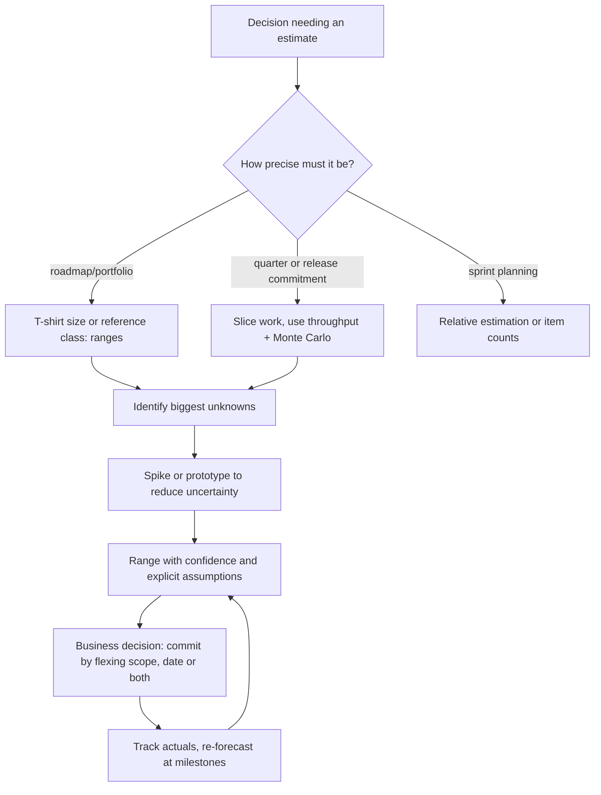

## TL;DR

- Estimates exist to **support decisions** (should we do this? what fits? when can we commit?). Match the effort to the decision — not every item needs a precise number.
- Software estimates are **uncertain by nature**: express them as **ranges with confidence** ("6–10 weeks, 80% confident"), not single dates, and narrow them as you learn (the cone of uncertainty).
- **Relative estimation** (story points, t-shirt sizes) is fast and useful for team planning; **historical throughput** and **Monte Carlo forecasting** are often more accurate than summing estimates.
- Big estimates go wrong because of unknowns, the planning fallacy, missing work (integration, testing, deployment, coordination) and optimism under pressure. Counter with decomposition, reference-class data, spikes and explicit assumptions.
- **Estimates are not commitments**; commitments are business decisions taken with the estimate's uncertainty in view, usually by flexing scope.

## Core Concepts

### Why estimate?

- **Prioritisation:** value vs cost (Cost of Delay ÷ duration).
- **Feasibility and go/no-go:** is it worth doing at all?
- **Coordination:** marketing launches, contracts, dependent teams, regulatory dates.
- **Capacity planning:** what fits in the next quarter.

If no decision depends on the estimate, skip it.

### Units

| Approach | How | Strengths | Weaknesses |
|---|---|---|---|
| Hours/days | Absolute effort | Intuitive; needed for some contracts | False precision; ignores waiting time; easily turned into deadlines |
| Story points | Relative size/complexity/uncertainty vs reference stories | Fast, team-relative, includes uncertainty | Misused as productivity metric; not comparable across teams |
| T-shirt sizes | S/M/L/XL buckets | Very fast for roadmaps and portfolios | Coarse |
| Item counts + throughput | Right-size items, count them, use historical throughput | Data-driven, no debate on sizes | Needs consistent slicing and history |

### Ranges, confidence and the cone of uncertainty

Early in a project, actual outcomes can plausibly range widely around the estimate — the classic "cone of uncertainty" (Boehm/McConnell) shows the range narrowing as requirements and design solidify. The often-quoted 0.25×–4× range at initial concept comes from Boehm's data as popularised by McConnell; treat it as illustrative, not a law.

Practical rules:
- Give **ranges** with an explicit **confidence level** (P50 vs P85).
- State **assumptions** ("assumes payment provider sandbox is available by week 2").
- **Re-estimate** at milestones and when assumptions change.

### Three-point estimation (PERT)

For each task: optimistic (O), most likely (M), pessimistic (P). PERT mean ≈ (O + 4M + P) / 6; standard deviation ≈ (P − O) / 6. Summing means across tasks and combining variances gives a total with a range. Useful for larger work packages; the value is mostly in forcing people to think about the pessimistic case.

### Forecasting with historical data

Instead of estimating every item, use **throughput** (items finished per week) and **Monte Carlo simulation**:
1. Slice backlog items to a similar, small size.
2. Take historical weekly throughput samples (e.g. last 12 weeks: 4, 6, 3, 7, 5…).
3. Simulate thousands of possible futures by randomly sampling weeks until the backlog (including expected growth from discovered work) is done.
4. Read percentiles: "50% by 3 March, 85% by 24 March".

```ts
// Minimal Monte Carlo: weeks to finish `items` given historical weekly throughput samples
function forecastWeeks(items: number, history: number[], runs = 10_000): { p50: number; p85: number } {
  const results: number[] = [];
  for (let r = 0; r < runs; r++) {
    let done = 0, weeks = 0;
    while (done < items) {
      done += history[Math.floor(Math.random() * history.length)]!;
      weeks++;
    }
    results.push(weeks);
  }
  results.sort((a, b) => a - b);
  return { p50: results[Math.floor(runs * 0.5)]!, p85: results[Math.floor(runs * 0.85)]! };
}
```

### Why estimates go wrong

- **Planning fallacy:** people underestimate their own tasks even when they know similar tasks overran (Kahneman & Tversky).
- **Missing work:** testing, code review, integration, deployment, data migration, documentation, coordination, onboarding, bug fixing, on-call interruptions.
- **Unknown unknowns:** discovered complexity in legacy code or third-party systems.
- **Waiting time:** estimates count effort; elapsed time is dominated by waiting (reviews, approvals, dependencies).
- **Anchoring and pressure:** someone mentions a number first, or the "desired" date becomes the estimate.
- **Scope growth:** backlogs typically grow during delivery.

Counter-measures: reference class forecasting (how long did similar projects actually take?), decomposition, explicit lists of non-coding work, spikes for unknowns, independent estimates before discussion (planning poker), and tracking actuals to calibrate.

## How It Works



## When to Use / Trade-offs

| Technique | Use when | Avoid when | Trade-off |
|---|---|---|---|
| Planning poker (points) | Team sprint planning, building shared understanding | Large backlogs for long-range forecasts | Discussion value vs time spent |
| T-shirt sizing | Roadmaps, portfolio triage | Sprint-level commitments | Speed vs precision |
| Three-point / PERT | Larger work packages, bids | Small stories | Captures risk vs effort to estimate each part |
| Monte Carlo on throughput | Forecasting completion of a backlog with history | No history, or items wildly different in size | Data-driven vs needs consistent slicing |
| Reference class forecasting | Big projects, migrations, rewrites | Truly novel work with no comparables | Corrects optimism vs finding comparable data |
| #NoEstimates (slice small, count) | Mature teams with stable flow | Contracts requiring effort estimates | Less overhead vs less familiar to stakeholders |

## Common Pitfalls & Anti-patterns

- **Single-point estimates treated as promises.**
- **Estimates becoming deadlines** without anyone agreeing to the commitment.
- **Negotiating estimates down** under pressure without changing scope.
- **Ignoring non-coding work** — testing, deployment, migration, coordination.
- **Converting story points to hours** and comparing teams.
- **Estimating everything precisely** up front, months in advance.
- **Padding secretly** — hidden buffers erode trust; make buffers and risks explicit.
- **Never comparing estimates with actuals** — no learning.
- **Ignoring backlog growth** — forecasts assume today's scope is final.

## Real-world Scenario

**Context:** Leadership asked a team for a date to migrate 140 internal APIs from an old gateway to a new one. The first estimate (sum of per-API estimates) was 12 weeks. The previous migration had taken twice as long as planned.

**Decision:** The tech lead used **reference class forecasting** (the last two migrations' actual throughput: 6–9 APIs/week) and a **Monte Carlo** forecast including expected discovered work (15% of APIs needing special handling, based on a sample). They ran a two-week **spike** migrating 10 representative APIs to validate assumptions, then presented: "50% by week 18, 85% by week 22", with assumptions and the biggest risk (three APIs with custom auth). They proposed committing to week 22 for the hard deadline (old gateway end of support) and reporting progress weekly against the forecast.

**Outcome:** Migration finished in week 20. Leadership valued the transparent range; the special-auth APIs indeed caused the biggest delays, but the buffer absorbed it.

**What I'd do differently:** Run the spike before giving any number — the initial 12-week figure had anchored some stakeholders and required effort to reset.

## Interview Questions

### Why do we estimate, and when is estimation waste? {#why-estimate}

**Level:** Foundation

**Model answer:**
Estimates support **decisions**: whether to do something (value vs cost), what to prioritise, what fits in a period, and when to coordinate dependent activities (launches, contracts, other teams). They also surface shared understanding — when estimates differ widely, people have different assumptions.

Estimation is waste when no decision depends on it (e.g. precise estimates for items that will be done anyway in priority order), when it's more precise than the decision needs, or when the effort of estimating exceeds the value. Teams with stable flow often forecast from throughput instead of estimating each item.

**What the interviewer is looking for:**
Decision-oriented view and recognising when to skip or simplify.

**Follow-ups:**
- How much time should a team spend estimating?
- What decisions genuinely need precise estimates?

**Red flags:**
- "We estimate because the process requires it."
- Estimating everything months ahead in hours.

### Story points or time estimates — which do you prefer and why? {#story-points-vs-hours}

**Level:** Foundation

**Model answer:**
- **Story points** are relative measures of size, complexity and uncertainty compared to reference items. They're fast, avoid false precision, and work well for team-level planning (with velocity as a planning aid). Downsides: they're often misunderstood, converted to hours, compared across teams or used as productivity metrics.
- **Time estimates** are intuitive and sometimes necessary (contracts, effort-based billing), but they encourage false precision, ignore waiting time and tend to become deadlines.

Pragmatic view: use relative sizing for team planning if it helps the conversation; for forecasting, increasingly rely on **item counts and historical throughput** (slice items to similar size and count them). Whatever the unit, communicate forecasts as ranges with confidence.

**What the interviewer is looking for:**
Understanding of both, their misuse, and throughput-based forecasting.

**Follow-ups:**
- How do you explain story points to stakeholders?
- What's the conversion from points to days? (trick question)

**Red flags:**
- Fixed points-to-hours conversion tables.
- Comparing velocity across teams.

### How does planning poker work, and what's its real value? {#relative-estimation}

**Level:** Foundation

**Model answer:**
Each team member privately chooses an estimate (often from a Fibonacci-like scale: 1, 2, 3, 5, 8, 13) for a backlog item, then everyone reveals simultaneously. If estimates differ, the highest and lowest explain their reasoning; the team discusses and re-votes until it converges.

Its real value is less the number and more:
- **Avoiding anchoring:** simultaneous reveal prevents the senior person's number dominating.
- **Surfacing different assumptions:** "I gave it 13 because the API doesn't support pagination" — exposes risks and misunderstandings early.
- **Shared understanding** of the work and acceptance criteria.

Use reference stories to keep sizing consistent; time-box discussion; split items that are too large (e.g. above 8) or too uncertain (spike first).

**What the interviewer is looking for:**
Mechanics, anti-anchoring, the conversation value and splitting/spikes.

**Follow-ups:**
- Why use a Fibonacci-like scale?
- What do you do when estimates never converge?

**Red flags:**
- Taking the average without discussion.
- Manager setting estimates.

### What is the cone of uncertainty? {#cone-of-uncertainty}

**Level:** Foundation

**Model answer:**
The cone of uncertainty (popularised by Barry Boehm and Steve McConnell) illustrates that estimates made early in a project — at the idea stage — have a very wide range of possible outcomes, and the range narrows as requirements, design and implementation progress and uncertainty is resolved. (The specific multipliers often quoted are illustrative, not universal.)

Implications:
- Early estimates should be **wide ranges**, not commitments.
- **Re-estimate** as you learn (after discovery, after spikes, at milestones).
- The cone only narrows if you **actively reduce uncertainty** — making decisions, prototyping risky parts, clarifying requirements. It doesn't narrow by itself.
- Commitments made at the wide end of the cone should flex scope.

**What the interviewer is looking for:**
The concept, its implications for communication and re-estimation, and that uncertainty must be actively reduced.

**Follow-ups:**
- How would you reduce uncertainty early in a project?
- How do you communicate an early estimate to executives?

**Red flags:**
- Single-date commitments at the concept stage.

### How do you estimate a large project with many unknowns? {#estimating-large-projects}

**Level:** Senior

**Model answer:**
1. **Clarify the goal and scope boundaries**, including non-goals.
2. **Decompose** into major components/milestones; list the non-coding work explicitly (integration, testing, data migration, security review, documentation, rollout, training).
3. **Identify the biggest unknowns** and run **spikes** to reduce them (prototype the risky integration, sample the legacy data).
4. **Use multiple methods and compare:** bottom-up (three-point estimates for components), top-down **reference class** (how long did similar projects take here or elsewhere?), and throughput-based forecasting if the work is sliceable.
5. **Express a range with confidence** and explicit assumptions and risks.
6. **Plan for scope growth** (backlogs typically grow during delivery) and dependencies.
7. **Re-forecast at milestones** and track actuals vs forecast transparently.

**What the interviewer is looking for:**
Decomposition, explicit non-coding work, spikes, multiple methods including reference class, ranges and re-forecasting.

**Follow-ups:**
- The business wants a single date. What do you give them?
- How do you account for team members being new?

**Red flags:**
- Summing developer task estimates as the answer.
- No mention of unknowns.

### Explain three-point estimation (PERT). {#three-point-estimates}

**Level:** Senior

**Model answer:**
For each work item, estimate:
- **Optimistic (O):** everything goes well.
- **Most likely (M):** realistic.
- **Pessimistic (P):** significant problems (but not catastrophe).

PERT approximates the expected duration as (O + 4M + P) / 6 and the standard deviation as (P − O) / 6. For a set of independent tasks, sum the means and combine variances (square root of the sum of variances) to get a range — e.g. mean ± 2σ for roughly 95% confidence under the (questionable) normal assumption.

Value and caveats:
- Forces people to consider the pessimistic case, revealing risk.
- Software task durations are skewed (long tails) and tasks are rarely independent — so treat results as indicative, and consider Monte Carlo simulation with the three-point distributions for better aggregation.
- Still subject to optimism bias in all three numbers — calibrate with historical data.

**What the interviewer is looking for:**
Correct formulas, aggregation, and caveats about skew and dependence.

**Follow-ups:**
- Why might summing most-likely estimates underestimate the total?
- How would you combine this with Monte Carlo?

**Red flags:**
- Treating PERT output as precise.

### How does Monte Carlo forecasting work, and why might it beat traditional estimation? {#monte-carlo}

**Level:** Senior

**Model answer:**
Monte Carlo forecasting uses **historical throughput** (items completed per week) to simulate many possible futures:
1. Collect recent weekly throughput samples.
2. For the remaining number of items (plus expected discovered work), repeatedly sample random weeks from history until the work is done — record how many weeks it took.
3. Repeat thousands of times and read the distribution: P50, P85, P95 completion dates.

Why it often beats summing estimates:
- It's based on **what the team actually achieved**, including interruptions, waiting, bugs and meetings that estimates ignore.
- It produces **probabilistic forecasts** that communicate uncertainty honestly.
- It's cheap — no need to estimate every item; just slice consistently.
- It's easy to update continuously.

Requirements: reasonably consistent item sizing, stable team and process (or adjust for changes), and accounting for backlog growth.

**What the interviewer is looking for:**
The method, its advantages and its assumptions.

**Follow-ups:**
- How do you handle a team that just doubled in size?
- How would you forecast "how many items by date X?"

**Red flags:**
- Not understanding that it's based on historical data.
- Using it with wildly varying item sizes.

### What is #NoEstimates, and do you agree with it? {#no-estimates}

**Level:** Senior

**Model answer:**
#NoEstimates is a movement questioning the value of detailed effort estimates. Its practical core:
- **Slice work into small, similar-sized items** so counting them is enough.
- **Forecast from throughput and cycle time** (often with Monte Carlo) rather than estimating each item.
- **Deliver value incrementally** and use real progress for decisions.
- Focus on reducing the need for estimates (small batches, frequent delivery, prioritising by value).

My view: the core ideas are sound for teams with stable flow — they reduce overhead and often improve forecast accuracy. But "no estimates" doesn't mean no forecasting: stakeholders still need answers about cost and timing for decisions, budgets and contracts. Rough sizing remains useful for prioritisation (e.g. Cost of Delay ÷ duration) and for large initiatives without historical data.

**What the interviewer is looking for:**
Accurate understanding, balanced view, and that forecasting still happens.

**Follow-ups:**
- How would you introduce it to a team used to story points?
- How do you prioritise without estimates?

**Red flags:**
- "We never tell the business when things will be done."

### Your manager pressures you to reduce an estimate to fit a deadline. What do you do? {#estimate-pressure}

**Level:** Senior

**Model answer:**
- **Separate the estimate from the commitment:** the estimate is our best assessment of reality; the deadline is a business need. Changing the number doesn't change the work.
- **Understand the deadline:** why that date, what's truly required by then, and what happens if it's missed.
- **Offer options that change the work, not the number:** reduce scope to the essential (MVP), phase delivery, remove dependencies, add specific help where it actually speeds things up (not just more people — Brooks's law), accept specific risks explicitly.
- **Show the data:** past actuals vs estimates, the range and confidence, the biggest risks.
- **Agree a decision and document assumptions;** commit to transparent progress tracking and early warning.
- If leadership still demands the original scope by the date, make the risk explicit and visible — and keep reporting honestly.

**What the interviewer is looking for:**
Estimate vs commitment distinction, understanding the deadline, scope/approach options, data and transparency.

**Follow-ups:**
- What if the deadline is legally fixed?
- How do you rebuild trust after past overruns?

**Red flags:**
- Simply lowering the estimate.
- Refusing without options.

### Why are software estimates so often wrong? {#estimation-errors}

**Level:** Senior

**Model answer:**
- **Uncertainty:** much software work is novel; requirements and solutions are discovered along the way.
- **Planning fallacy:** people underestimate their own tasks even with evidence that similar tasks overran.
- **Missing work:** estimates cover coding but forget testing, reviews, integration, environments, data migration, deployment, documentation, coordination and support interruptions.
- **Effort vs elapsed time:** estimates measure effort; elapsed time includes waiting for reviews, approvals and dependencies — often most of the lead time.
- **Anchoring and social pressure:** first numbers or desired dates bias estimates.
- **Scope growth:** discovered work and changing requirements during delivery.
- **Hofstadter's law:** "It always takes longer than you expect, even when you take into account Hofstadter's law."

Mitigations: reference class data, explicit checklists of non-coding work, independent estimates, spikes, ranges, tracking actuals, and smaller batches that reduce the cost of being wrong.

**What the interviewer is looking for:**
Multiple causes including cognitive biases and waiting time, with mitigations.

**Follow-ups:**
- How would you measure your team's estimation accuracy?
- What's the difference between effort and duration?

**Red flags:**
- "Developers are just bad at estimating."

### Leadership needs a fixed-date commitment for a major launch. How do you approach it? {#fixed-date-commitments}

**Level:** Architect

**Model answer:**
1. **Clarify why the date is fixed** (regulation, contract, marketing event) and the cost of missing it — this determines how much buffer and scope flexibility is needed.
2. **Define the minimum viable scope** that must ship by the date, separately from desirable scope.
3. **Forecast with ranges** for the minimum scope (reference class + throughput + three-point for unknowns) and commit at a high confidence level (e.g. P85–P90), using the gap between P50 and P85 as an explicit buffer.
4. **Front-load risk:** tackle the riskiest/most uncertain parts first with spikes and early integration.
5. **Plan scope flex:** an ordered list of what drops if needed, agreed in advance with stakeholders.
6. **Track progress vs forecast weekly** with burn-up charts and re-forecasts; trigger scope decisions early, not in the last week.
7. **Protect quality and the team:** avoid planning on sustained overtime.

**What the interviewer is looking for:**
Understanding the date's nature, minimum scope, high-confidence commitments with explicit buffers, risk-first sequencing, pre-agreed scope flex and early tracking.

**Follow-ups:**
- Halfway through, the forecast says P50 is two weeks after the date. What do you do?
- How do you explain buffers so they aren't cut?

**Red flags:**
- Committing to everything by the date at P50.
- Discovering problems in the final week.

### How do you communicate uncertainty in estimates to executives? {#communicating-uncertainty}

**Level:** Architect

**Model answer:**
- **Use ranges and probabilities in plain language:** "We have a 50% chance of finishing by 3 March and 85% by 24 March. If you need certainty, plan around the later date."
- **Explain the drivers:** the top two or three assumptions and risks, and what would change the forecast.
- **Tie it to decisions:** what they need to decide now (commit to the later date, reduce scope, add resources for a specific bottleneck) and what can wait.
- **Show the trend:** forecast updates over time (narrowing range) build confidence; burn-up charts with forecast bands.
- **Be consistent and early:** report changes as soon as they happen, with the cause and options.
- **Use visuals:** probability distributions or simple "likely / possible / unlikely" bands.

Executives generally handle uncertainty well when it's explained honestly with options; they react badly to surprises.

**What the interviewer is looking for:**
Probabilistic communication, assumptions, decision focus, trends and early updates.

**Follow-ups:**
- An executive says "just give me one date". What do you say?
- How do you present a forecast that slipped?

**Red flags:**
- A single date with no caveats.
- Hiding uncertainty until it materialises.

### How would you estimate a large migration or rewrite? {#migration-estimates}

**Level:** Architect

**Model answer:**
Migrations and rewrites are notorious for overruns because of hidden functionality and long tails. Approach:
1. **Inventory precisely:** components, endpoints, jobs, data volumes, integrations, edge cases, undocumented behaviours (from logs and traffic analysis), consumers.
2. **Classify** items into categories by complexity (standard, custom, unknown) using a sample.
3. **Pilot:** migrate a representative sample (including a hard case) to measure actual effort and discover hidden work.
4. **Forecast from pilot throughput** per category, plus reference class data from previous migrations; add explicit work for data migration, dual running, cut-over, decommissioning and the long tail (the last 10–20% often takes disproportionately long).
5. **Range and milestones:** P50/P85 forecast; milestones with exit criteria (e.g. "100% of read traffic on the new system").
6. **Re-forecast** after each wave using actual throughput.

For rewrites specifically, challenge whether incremental migration (strangler pattern) is possible — it reduces risk and makes progress measurable.

**What the interviewer is looking for:**
Inventory, sampling/pilot, category-based forecasting, explicit long-tail and dual-running work, milestones and re-forecasting.

**Follow-ups:**
- How do you discover undocumented behaviour?
- What usually causes the long tail?

**Red flags:**
- Estimating a rewrite from the original system's development time.
- Ignoring dual running and decommissioning.

### How do you forecast delivery across a portfolio of many teams and initiatives? {#portfolio-forecasting}

**Level:** Architect

**Model answer:**
- **Size initiatives roughly** (t-shirt sizes or reference classes calibrated against past initiatives' actual durations and team-weeks).
- **Use capacity, not wishful thinking:** each team's real capacity after KTLO and unplanned work (from historical data).
- **Limit portfolio WIP:** fewer initiatives in flight at once finish sooner (Little's Law at portfolio level) and reduce context switching.
- **Model dependencies and bottlenecks:** shared teams (platform, data, security) often constrain the whole portfolio.
- **Forecast probabilistically:** feature-level throughput and Monte Carlo across teams where data exists.
- **Re-plan regularly** (quarterly with monthly checks), and track forecast accuracy to calibrate sizes.
- **Communicate** as ranges with the main risks; make trade-offs explicit when new initiatives are added (what stops or slows).

**What the interviewer is looking for:**
Calibrated sizing, realistic capacity, portfolio WIP limits, bottleneck awareness, probabilistic methods and regular re-planning.

**Follow-ups:**
- How do you handle an urgent new initiative mid-quarter?
- How do you calibrate t-shirt sizes?

**Red flags:**
- Assuming 100% of capacity is available for new initiatives.
- Starting everything at once.

### How would you improve estimation and forecasting across an engineering organisation? {#improving-estimation}

**Level:** Architect

**Model answer:**
- **Clarify purpose:** agree which decisions need estimates and at what precision; drop estimation rituals that don't feed decisions.
- **Data foundations:** track cycle time, throughput and initiative actuals (start/end, team-weeks) consistently in tooling.
- **Standard practices:** ranges with confidence levels everywhere; explicit assumptions; reference class data for large initiatives; Monte Carlo tools available to teams.
- **Smaller batches:** slicing work smaller improves predictability more than better estimation.
- **Calibration loop:** compare forecasts with actuals per initiative; share lessons (common missed work, dependency delays) and update checklists.
- **Culture:** separate estimates from commitments; never punish honest estimates; leaders model asking "what's the range and what drives it?"
- **Education:** teach teams and stakeholders how to read probabilistic forecasts.
- **Measure:** forecast accuracy and predictability (e.g. % of initiatives delivered within their P85 forecast).

**What the interviewer is looking for:**
Purpose-driven estimation, data, probabilistic standards, smaller batches, calibration, culture and measurement.

**Follow-ups:**
- Teams resist tracking data as "surveillance". How do you respond?
- What's a good target for predictability?

**Red flags:**
- Mandating more detailed upfront estimates.
- Blaming teams for missed estimates.

## Cheat Sheet

- **Estimates serve decisions** — no decision, no estimate; match precision to the decision.
- **Estimate ≠ commitment** — commitments are business decisions that flex scope against uncertainty.
- **Ranges with confidence** — "6–10 weeks, 85% confident", plus explicit assumptions.
- **Cone of uncertainty** — early estimates are wide; narrow them by actively reducing unknowns.
- **Story points** — relative size and uncertainty; team planning aid, not a productivity metric.
- **Planning poker** — simultaneous reveal avoids anchoring; value is in surfacing assumptions.
- **PERT** — mean ≈ (O + 4M + P) ÷ 6; forces thinking about the pessimistic case.
- **Monte Carlo** — simulate from historical throughput; read P50/P85 dates.
- **Reference class forecasting** — use actual outcomes of similar past projects to correct optimism.
- **Planning fallacy** — we underestimate our own tasks despite past evidence.
- **Missing work** — testing, review, integration, migration, deployment, coordination, waiting.
- **Spike** — time-boxed investigation to reduce a key uncertainty before estimating.
- **Long tail** — the last 10–20% of migrations takes disproportionately long.
- **Commit at P85** — use the P50–P85 gap as an explicit buffer for fixed dates.

## Further Reading

- [Software Estimation: Demystifying the Black Art (Steve McConnell)](https://www.microsoftpressstore.com/store/software-estimation-demystifying-the-black-art-9780735605350) — the classic reference on estimation techniques and the cone of uncertainty.
- [Actionable Agile Metrics for Predictability (Daniel Vacanti)](https://actionableagile.com/books/) — flow metrics and Monte Carlo forecasting.
- [Scrum.org: Estimation in Scrum](https://www.scrum.org/resources/blog/practical-fibonacci-beginners-guide-relative-sizing) — relative sizing guidance.
- [Shape Up (Basecamp)](https://basecamp.com/shapeup) — appetite-based scoping as an alternative to estimation.
