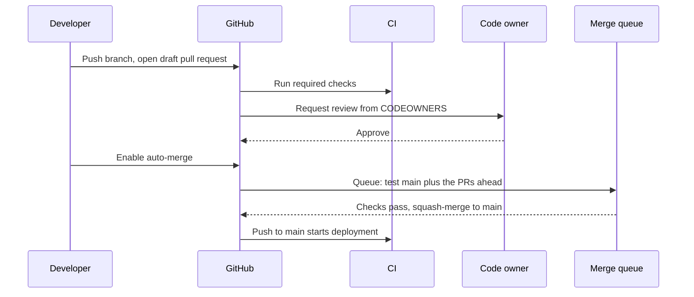
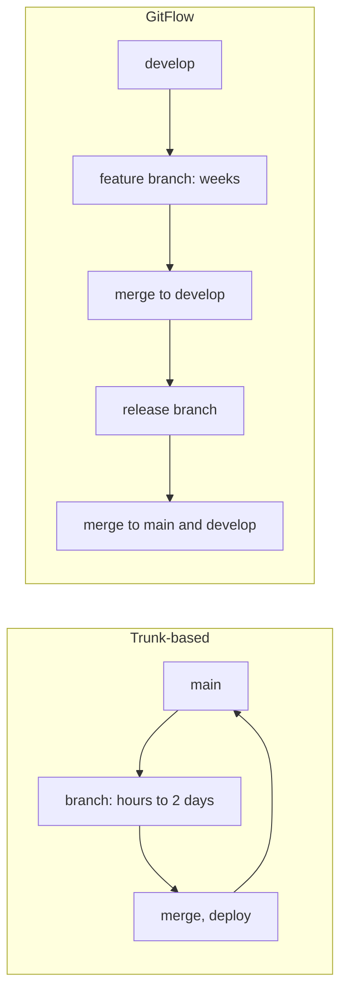

## TL;DR

- Choose a **branching strategy** for how you release: short-lived branches into one main branch (trunk-based development or GitHub Flow) suit continuously delivered services; GitFlow's long-lived branches mostly add delay, and its author says so.
- **Protect main with rules, not trust:** required status checks, required reviews from code owners, no force pushes, and a merge queue when many people merge. On GitHub, **rulesets** apply these consistently across repositories.
- **History is a tool:** small, focused commits with messages that explain *why* make `git bisect`, `git revert` and reviews work. Pick one merge strategy per repository (often squash) and stick to it.
- **Git is forgiving if you know the tools:** `revert` for shared history, `reset` and `restore` for local work, and the **reflog** to recover almost anything.
- At organisation scale, treat GitHub as a platform: teams from the identity provider, least-privilege access, settings as code, and governed GitHub Actions with pinned actions and short-lived credentials.

## Core Concepts

### Branching strategies

| Strategy | How it works | Fits | Costs |
|---|---|---|---|
| **Trunk-based development** | Everyone integrates into `main` at least daily, through very short-lived branches or directly; unfinished work hides behind feature flags | Continuously delivered services and web apps | Needs strong CI, fast reviews and feature flags |
| **GitHub Flow** | Branch from `main`, open a pull request, review, merge, deploy | Most teams on GitHub; close to trunk-based when branches are short | Long-lived branches creep back in without discipline |
| **GitLab Flow** | GitHub Flow plus environment or release branches (`production`, `release/2.4`) | Products with scheduled releases or several supported versions | More branches to keep in sync |
| **GitFlow** | Long-lived `develop` and `main`, plus feature, release and hotfix branches | Software shipped in explicit versions, such as installed products | Slow integration and merge pain; Vincent Driessen, its author, added a 2020 note that it isn't suited to continuously delivered web apps |

The key variable is **how long work stays unintegrated**. The longer a branch lives, the bigger the merge, the later the feedback and the higher the risk.

### Merging and history

| Strategy | Result on `main` | Good for | Watch out for |
|---|---|---|---|
| **Merge commit** | All branch commits plus a merge commit | Keeping exact history of how work was done | Noisy history; harder bisecting unless you use first-parent views |
| **Squash and merge** | One commit per pull request | Clean, linear history; one revert undoes one change | Loses intermediate commits; big pull requests become big commits |
| **Rebase and merge** | Branch commits replayed on top of `main`, linear | Well-crafted commit series worth keeping | Every commit must build and pass, or bisect suffers |

**Rebase versus merge on your own branch:** `git rebase main` replays your commits on the latest `main` for a clean history. Never rebase commits others have already based work on. Merging `main` into your branch is safer for shared branches.

### Commits that help later

- **One logical change per commit,** which builds and passes tests.
- **A subject line in the imperative,** about 50 characters, and a body that explains *why*: "Retry payment capture on 503 from the provider" plus the reason and link.
- **Conventional Commits** (`feat:`, `fix:`, `docs:`, `feat!:` for breaking changes) make history machine-readable, so tools can generate changelogs and versions.
- **Signed commits** (with SSH or GPG keys, or keyless with Sigstore's gitsign) prove who made a commit. GitHub shows them as "Verified".

### Protecting main on GitHub

**Rulesets** (the successor to classic branch protection) define rules for branches and tags, can be layered, and can be applied across an organisation by repository properties:

- **Require a pull request** with approvals, including from **CODEOWNERS** for the paths changed, and dismiss stale approvals after new pushes.
- **Require status checks** to pass, with the branch up to date or through a **merge queue**.
- **Block force pushes and deletions,** and optionally require linear history and signed commits.
- **Restrict bypass** to a small list, such as a break-glass team, with every bypass recorded.

A **merge queue** tests each pull request combined with the ones ahead of it before merging, so `main` stays green when many people merge at once. Workflows must listen for the `merge_group` event as well as `pull_request`.

### GitHub as a platform

- **Access:** teams synced from the identity provider, roles by least privilege (read, triage, write, maintain, admin), and GitHub Apps rather than personal tokens for automation.
- **Settings as code:** repository templates, organisation rulesets and tools such as the Terraform GitHub provider keep hundreds of repositories consistent.
- **Actions governance:** an allow-list of actions, third-party actions **pinned to a full commit SHA**, default `GITHUB_TOKEN` permissions set to read-only, OIDC instead of stored cloud keys, and environments with required reviewers for production.

### Worked example: finding a regression with git bisect

A pricing bug appears in production. Version 4.12 was fine; `main` now has **120 commits** since then. Checking each commit by hand could take a day.

`git bisect` does a binary search: mark one good and one bad commit, and Git checks out the midpoint each time. 120 commits need at most **⌈log₂ 120⌉ = 7 steps**.

```bash
git bisect start
git bisect bad main
git bisect good v4.12.0
# Let Git run the test at each step: exit code 0 = good, 1–124 = bad, 125 = skip this commit.
git bisect run npx vitest run src/pricing/discounts.test.ts
# ... "a3f9c21 is the first bad commit"
git bisect reset
```

**What makes this work, or not:**
- **Every commit on `main` must build.** Commits that don't would have to be skipped (`git bisect skip`), which weakens the search. Squash merging or a merge queue helps.
- **With merge commits,** `git bisect start --first-parent` (Git 2.29 and later) follows only the merges into `main`, so it finds which pull request broke things.
- **A focused test** that reproduces the bug is the key input. Write it first; it becomes the regression test afterwards.

Here the bad commit was a one-line change in how discounts rounded, inside a large refactoring pull request. That's a reminder that small pull requests make culprits obvious.

## How It Works

### A pull request through rulesets and the merge queue



### Branch lifetimes



## When to Use / Trade-offs

| Choice | Use when | Avoid when | Trade-off |
|---|---|---|---|
| Trunk-based development | Continuous delivery, strong CI, feature flags available | Teams without automated tests or fast reviews | Fast integration vs discipline required |
| Release branches | You support several versions in the field | A single always-latest web service | Supports customers on old versions vs backport effort |
| Squash merge | Most application repositories | Commit series that are worth keeping individually | Clean history vs lost detail |
| Merge queue | Many merges a day into one branch with slow checks | Small teams with rare conflicts | Green main vs a little extra waiting |
| Monorepo | Shared code changes together often; one toolchain | Unrelated products with different lifecycles | Atomic cross-project changes vs tooling investment |
| Required signed commits | Regulated or high-assurance code | Teams not yet ready for key management | Provable authorship vs setup and bot handling |

## Common Pitfalls & Anti-patterns

- **Long-lived feature branches** — weeks of divergence, painful merges and late surprises.
- **`develop` branch theatre** — GitFlow adopted for a continuously deployed web app, adding a branch that only delays integration.
- **Force-pushing shared branches** — rewriting history other people have built on.
- **"WIP" and "fix" commit messages** on `main` — history nobody can use to understand a change.
- **Unprotected main** — direct pushes, skipped checks, and admins bypassing rules without a trace.
- **Unpinned third-party actions** — a moved tag runs someone else's new code with your secrets, as in the 2025 compromise of the `tj-actions/changed-files` action.
- **Personal access tokens for automation** — long-lived, over-privileged, and tied to someone who might leave.
- **Committing secrets or huge binaries** — both are painful to remove from history once pushed.

## Real-world Scenario

**Context:** A 70-engineer company used GitFlow across 120 repositories. Features lived on branches for an average of 11 days, release branches needed a week of stabilisation, and merge conflicts regularly broke `develop`. Repository settings differed everywhere: some had no required checks, and 30 people had organisation admin rights.

**Decision:**
1. Moved services to **GitHub Flow with short-lived branches**, with feature flags for unfinished work. The two installed products kept release branches.
2. Introduced **organisation rulesets** targeted by a repository property: required checks, code-owner review, no force pushes, and a merge queue on the five busiest repositories.
3. Set **squash merge** as the only method for services, with Conventional Commit titles checked in CI.
4. Cut organisation admins to 4, synced teams from the identity provider, and replaced personal tokens with GitHub Apps.
5. Pinned all third-party actions to commit SHAs with Dependabot updating them, and set default token permissions to read-only.

**Outcome:** Median branch age fell from 11 days to under 2, the stabilisation week disappeared for services, and deploy frequency rose from weekly to several times a day. A later attempt to push directly to `main` with a stolen token was blocked by the rulesets.

**What I'd do differently:** Publish the branch-age and pull-request-size data from day one. Teams changed habits faster once they could see their own numbers.

## Interview Questions

### Compare GitFlow, GitHub Flow and trunk-based development. When does each fit? {#branching-strategies}

**Level:** Foundation

**Model answer:**
The strategies differ mainly in **how long work stays separate from the main line**.

- **Trunk-based development:** everyone integrates into `main` at least daily, through branches that live hours or a day or two. Unfinished work hides behind feature flags. It needs good automated tests and fast reviews, and it supports continuous delivery best.
- **GitHub Flow:** branch from `main`, open a pull request, review, merge and deploy. With short branches, it's effectively trunk-based development using pull requests.
- **GitFlow:** long-lived `develop` and `main` branches, plus feature, release and hotfix branches. It suits products released as explicit versions, such as installed software, but it delays integration. Its author, Vincent Driessen, added a note in 2020 saying it isn't a good fit for continuously delivered web apps.
- **GitLab Flow** sits in between, adding environment or release branches to GitHub Flow.

**How to choose:**
- A web service deployed continuously: trunk-based or GitHub Flow.
- Several versions supported in the field: `main` plus release branches, fixing on `main` first and backporting.
- Very rarely: GitFlow, and only if release cycles are genuinely long and versioned.

The DORA research associates trunk-based development, with three or fewer active branches and merges at least daily, with higher delivery performance.

**What the interviewer is looking for:**
Branch lifetime as the core difference, a clear description of each, matching the strategy to how the software is released, and awareness of the evidence.

**Follow-ups:**
- How do you ship unfinished work with trunk-based development?
- What would you change first in a team using GitFlow for a web app?

**Red flags:**
- Choosing GitFlow by default for a continuously deployed service.
- "Branches can live as long as the feature takes."

### What's the difference between merge and rebase, and when do you use each? {#merge-vs-rebase}

**Level:** Foundation

**Model answer:**
Both bring changes from one branch into another, but they treat history differently.

- **Merge** creates a new commit with two parents. History shows exactly what happened, including when branches diverged and joined. Nothing is rewritten.
- **Rebase** replays your commits on top of another branch, creating **new commits** with new IDs. History becomes linear, as if you'd started from the latest `main`.

**When to use each:**
- **Rebase your own, unshared branch** onto `main` to pick up the latest changes and keep a tidy history. Interactive rebase (`git rebase -i`) also lets you squash, reorder and reword commits before review.
- **Merge** when the branch is shared with others, because rebasing rewrites commits they may have built on.
- **The golden rule:** never rebase commits that others have already pulled.

**Practical details:**
- After rebasing a branch you've already pushed, you need `git push --force-with-lease`, which refuses to overwrite work you haven't seen. Plain `--force` can silently delete a colleague's commits.
- Resolving the same conflicts repeatedly? `git rerere` remembers your resolutions.
- What lands on `main` is a separate choice, made by the repository's merge strategy (merge commit, squash or rebase-and-merge).

**What the interviewer is looking for:**
The mechanics of each, rebasing private work versus merging shared work, the golden rule, `--force-with-lease`, and separating this from the repository's merge strategy.

**Follow-ups:**
- Your rebase hit conflicts in ten commits. What are your options?
- How do you undo a rebase that went wrong?

**Red flags:**
- Rebasing a shared branch and force-pushing without warning.
- Using `--force` instead of `--force-with-lease`.

### Merge commit, squash, or rebase and merge: how do you choose a repository's merge strategy? {#merge-strategies}

**Level:** Foundation

**Model answer:**
The merge strategy decides what `main`'s history looks like, which affects reading history, reverting and bisecting. **Pick one per repository and enforce it in settings.**

**Squash and merge:**
- Each pull request becomes **one commit** on `main`.
- Clean, linear history; reverting a pull request means reverting one commit; every commit on `main` passed CI.
- Loses intermediate commits, so big pull requests become big, opaque commits.
- The best default for most application repositories with small pull requests.

**Rebase and merge:**
- The branch's commits are replayed individually onto `main`, keeping a linear history.
- Good when contributors craft meaningful commit series, as in many open-source projects.
- Every commit must build and pass tests, or bisecting suffers.

**Merge commits:**
- Keeps every commit and shows when work was integrated.
- History is harder to read, though `git log --first-parent` shows just the merges.
- Useful where the exact history matters, such as some release branches.

**Make it consistent:** disable the other options in repository settings, check pull request titles (for example against Conventional Commits) because squash uses them as the commit message, and auto-delete merged branches.

**What the interviewer is looking for:**
The effect of each on history, reverting and bisecting, squash as a sensible default, rebase-and-merge for curated series, and enforcing one strategy.

**Follow-ups:**
- How does the strategy affect `git bisect`?
- Why does the pull request title matter more with squash merging?

**Red flags:**
- All three allowed, so history is inconsistent.
- Squashing a 3,000-line pull request into one commit and calling history "clean".

### What makes a good commit message, and what are Conventional Commits? {#commit-messages}

**Level:** Foundation

**Model answer:**
A commit message is a note to the future person, often you, who runs `git blame` on a confusing line. The code shows **what** changed; the message should explain **why**.

**A good message:**
- **A short subject** (about 50 characters) in the imperative: "Retry payment capture on provider timeouts".
- **A blank line, then a body** explaining the reason, the context and any trade-offs: what was wrong, why this approach, what was considered.
- **References:** the issue or incident ID, and co-authors.
- **One logical change** per commit, so the message can describe it honestly.

**Conventional Commits** is a lightweight convention that makes messages machine-readable:

```text
feat(checkout): support saved cards for returning customers

fix(pricing): round discounts per line, not per order

feat(api)!: remove the deprecated v1 orders endpoint

BREAKING CHANGE: clients must use /v2/orders.
```

- Types such as `feat`, `fix`, `docs`, `refactor`, `test` and `chore`, with an optional scope.
- `!` or a `BREAKING CHANGE:` footer marks breaking changes.
- Tools can then **generate changelogs and choose the next semantic version** automatically: `fix` gives a patch, `feat` a minor and a breaking change a major release.

With squash merging, the **pull request title** becomes the commit subject, so check titles in CI.

**What the interviewer is looking for:**
Why over what, subject and body structure, references, one change per commit, the Conventional Commits format and its benefits for automation.

**Follow-ups:**
- How do you enforce a convention without annoying people?
- What would you put in the body of a revert commit?

**Red flags:**
- Messages like "fix", "WIP" or "changes".
- Treating the convention as bureaucracy rather than a tool for releases.

### How do you undo mistakes in Git safely? {#undoing-mistakes}

**Level:** Foundation

**Model answer:**
The right tool depends on **whether the change is shared** and **what you want to keep**.

**Shared history (already pushed to a shared branch):**
- **`git revert <commit>`** creates a new commit that undoes the old one. History stays intact and nobody's work breaks. This is the standard way to undo a change on `main`.
- Reverting a merge commit needs `-m 1` to say which parent to keep.

**Local, unshared work:**
- **`git restore <file>`** discards uncommitted changes to a file. `git restore --staged <file>` unstages it.
- **`git commit --amend`** fixes the last commit's message or content.
- **`git reset`** moves the branch pointer back:
  - `--soft` keeps the changes staged.
  - `--mixed` (the default) keeps them in the working tree.
  - `--hard` **throws them away**.
- **`git stash`** sets changes aside temporarily.

**Recovering "lost" work:**
- **`git reflog`** lists where `HEAD` and branches have pointed recently, including commits lost after a bad reset or rebase. `git reset --hard <reflog entry>` or a new branch at that point brings them back.
- Unreferenced commits stay recoverable until garbage collection, normally for weeks.

**If you pushed something sensitive,** such as a secret, reverting isn't enough: the secret stays in history. Revoke it first, then decide whether to rewrite history.

**What the interviewer is looking for:**
Revert for shared history, restore, amend and reset modes for local work, the reflog for recovery, and knowing that secrets need revoking, not just reverting.

**Follow-ups:**
- You ran `git reset --hard` and lost a day's work. What do you do?
- How do you undo a merge that's already on main?

**Red flags:**
- Using `reset --hard` and force-pushing to undo a change on `main`.
- Not knowing the reflog exists.

### How should you protect the main branch on GitHub? {#branch-protection}

**Level:** Senior

**Model answer:**
`main` should always be releasable, and nobody, including admins, should be able to break that by accident. Use **rulesets**, GitHub's newer and more flexible successor to classic branch protection.

**Core rules for `main`:**
- **Require a pull request,** with at least one approval, and **review from CODEOWNERS** for the paths changed.
- **Dismiss stale approvals** when new commits are pushed, and require conversations to be resolved.
- **Require status checks** to pass: build, tests, linting and security scans. Name them explicitly so a renamed job can't silently stop being required.
- **Require the branch to be up to date** before merging, or use a **merge queue** in busy repositories.
- **Block force pushes and branch deletion.**
- Optionally, **require linear history** and **signed commits**.

**Handle exceptions deliberately:**
- Keep the **bypass list** tiny, such as a break-glass team, and review bypass events in the audit log.
- Don't let release bots or deployment automation use admin rights; give them the narrowest permissions they need.

**Apply it at scale:** organisation-level rulesets, targeted by repository name patterns or **custom properties**, so every new repository is protected from its first day. Rulesets can be tested in **evaluate** mode (on GitHub Enterprise) before enforcing.

**Also protect tags,** such as `v*`, so release tags can't be moved or deleted.

**What the interviewer is looking for:**
Required reviews and code owners, stale approval dismissal, named required checks, up-to-date or merge queue, no force pushes, a minimal and audited bypass list, organisation-level rulesets, and tag protection.

**Follow-ups:**
- An incident needs an urgent fix and CI is down. What should happen?
- How do you roll out new rules to 300 repositories without breaking teams?

**Red flags:**
- Admins exempt from all rules by default.
- Required checks configured by a job name that no longer exists.

### How do you find which commit introduced a regression? {#git-bisect}

**Level:** Senior

**Model answer:**
Start by narrowing the window, then let **`git bisect`** do a binary search.

1. **Find a known good version and a known bad one,** such as the last release and current `main`.
2. **Write a test or script that reproduces the problem** and exits with 0 when good and non-zero when bad. This is the most important step.
3. **Run the search:**

```bash
git bisect start main v4.12.0        # bad, then good
git bisect run ./scripts/repro-pricing-bug.sh
git bisect reset
```

Git checks out the midpoint each time, so 1,000 commits need only about 10 steps.

**Make it reliable:**
- If a commit can't be tested, such as one that doesn't build, the script can exit with **125** to skip it.
- With merge-commit history, **`--first-parent`** (Git 2.29 and later) bisects only the merges into `main`, identifying the guilty pull request.
- Flaky tests mislead bisect. Run the check a few times per step if needed.
- For problems that depend on the environment or data, check whether the bug is really in the code; a configuration or dependency change may be the cause.

**Make it easier next time:** every commit on `main` should build and pass, which squash merging and merge queues ensure, and pull requests should be small, so the guilty commit is easy to understand. Keep the reproduction as a regression test.

**What the interviewer is looking for:**
Narrowing to good and bad points, an automated reproduction, bisect mechanics including skip and first-parent, awareness of flakiness and non-code causes, and history practices that make bisecting effective.

**Follow-ups:**
- The bad behaviour only appears in production data. How do you bisect?
- How do you bisect a monorepo where most commits don't touch the area?

**Red flags:**
- Reading through hundreds of commits by hand.
- Not keeping the reproduction as a test afterwards.

### A feature branch has diverged from main for three months. How do you bring it home? {#long-lived-branch-recovery}

**Level:** Senior

**Model answer:**
The longer a branch lives, the worse the merge, so the goal is to **stop it growing, then integrate in steps**, not to attempt one heroic merge.

**First, stop the bleeding:**
- Freeze new feature work on the branch until it's integrated.
- Find out what's on it: which changes are finished, which are experiments, and which depend on each other.

**Integrate in slices:**
- **Extract independent pieces** (refactorings, new modules, dependency upgrades) into small pull requests against `main` and merge them first. Each one shrinks the branch.
- **Hide unfinished behaviour behind a feature flag,** so the rest can land in `main` switched off.
- For large structural changes, use **branch by abstraction:** add an interface in `main`, move callers onto it, then swap the implementation behind it.

**Handle conflicts sensibly:**
- Merge `main` into the branch regularly while you work, resolving conflicts in small batches. `git rerere` reuses resolutions you've already made.
- Pair with the people who changed the conflicting code in `main`.
- Rely on tests from both sides; run the full suite after each integration step.

**Prevent it next time:** limit branch lifetimes (track branch age), use feature flags from the start, and break big features into slices that each merge to `main`.

**What the interviewer is looking for:**
Stopping growth, triaging the contents, extracting independent changes, feature flags and branch by abstraction, incremental conflict resolution, and preventing long-lived branches.

**Follow-ups:**
- The branch contains a schema change that `main` doesn't. How do you land it?
- How do you convince a team that the "big merge at the end" is the risky option?

**Red flags:**
- One giant merge and a weekend of conflict resolution.
- Continuing to add features to the branch while planning the merge.

### A repository has become huge and slow to clone. What can you do? {#large-repos}

**Level:** Senior

**Model answer:**
Repository size usually comes from **large binary files in history** or simply **very large monorepos**. The fixes differ.

**Find the cause:** `git count-objects -vH` shows the size, and `git filter-repo --analyze` (or `git rev-list --objects --all` with size sorting) shows the largest files and directories in history.

**Large binaries:**
- Move binary assets to **Git LFS,** which stores pointers in Git and the files in separate storage.
- Removing existing large files from history requires **rewriting history** with `git filter-repo`. It changes every later commit ID, so it needs coordination: everyone re-clones, open pull requests are rebased, and forks keep the old data.
- Prevent recurrence with a push rule or pre-receive check on file size, and a `.gitattributes` file routing binary types to LFS.

**Large monorepos:**
- **Partial clone** (`git clone --filter=blob:none`) downloads file contents only when needed.
- **Sparse checkout** (in cone mode) checks out only the directories a person works on.
- **Shallow clones** (`--depth=1`) in CI jobs that don't need history.
- **Scalar,** included with Git since 2.38, configures these settings and background maintenance for large repositories.
- Regular **`git maintenance`** keeps local repositories fast.

**In CI:** cache the repository between jobs, use shallow or partial fetches, and only fetch tags when needed.

**What the interviewer is looking for:**
Diagnosing the cause, LFS and history rewriting for binaries with its coordination cost, partial clone, sparse checkout, shallow clones and Scalar for large repositories, and CI-specific techniques.

**Follow-ups:**
- What happens to forks and open pull requests after you rewrite history?
- When would you split a monorepo instead?

**Red flags:**
- Rewriting shared history without warning anyone.
- Storing build artefacts in Git.

### Why sign commits and tags, and how would you roll it out? {#signed-commits}

**Level:** Senior

**Model answer:**
Anyone can set any name and email in Git, so an unsigned commit's author field proves nothing. **Signing** proves that the commit or tag was made by someone holding a specific key.

**Why it matters:**
- **Supply-chain integrity:** combined with branch rules, it ensures the code in `main` came from verified people or approved automation.
- **Release tags:** a signed tag shows a release was cut by an authorised person or pipeline.
- **Compliance:** some regulated environments require provable authorship.

**Options:**
- **SSH signing** (Git 2.34 and later) reuses keys developers already have, and GitHub verifies SSH signatures. It's usually the easiest option.
- **GPG** is the traditional option, with more key-management overhead.
- **Keyless signing with Sigstore's gitsign** uses short-lived certificates tied to the developer's identity provider login, so there are no long-lived keys to manage.
- **Commits made through GitHub's web interface or by GitHub Apps** can be signed by GitHub itself.

**Rolling it out:**
1. Document the setup and provide a script; start with volunteers.
2. Turn on GitHub's **vigilant mode** for early adopters, which marks unsigned commits attributed to them as unverified.
3. Make sure bots and automation sign their commits, or commit through the API.
4. Enforce **"require signed commits"** in rulesets on critical repositories first, then widen.
5. Verify signatures on release tags in the release pipeline.

**Limits:** signing proves who made a commit, not that the code is safe. It complements review and CI.

**What the interviewer is looking for:**
Why authorship needs proof, SSH, GPG and keyless options, automation, a staged rollout with rulesets, verifying tags in pipelines, and knowing what signing doesn't prove.

**Follow-ups:**
- A developer's signing key is compromised. What do you do?
- How do squash merges interact with commit signing?

**Red flags:**
- Treating the author field as proof of identity.
- Requiring signatures before automation can produce them, blocking every bot.

### How should access and permissions be organised in a GitHub organisation? {#github-org-access}

**Level:** Senior

**Model answer:**
A GitHub organisation holds a company's code, so access needs the same care as production systems. The principles are **central identity, least privilege and no personal credentials for automation**.

**Identity:**
- **Single sign-on** through the company identity provider, with SCIM provisioning so leavers lose access automatically.
- **Two-factor authentication required,** preferably with passkeys or security keys.

**Teams and roles:**
- Manage **teams from identity provider groups,** and grant repository access to teams, not individuals.
- Use the **smallest role that works:** read, triage, write, maintain or admin. Very few people need admin on a repository, and fewer still need organisation owner rights.
- Treat **outside collaborators** as exceptions, with an owner and an expiry.

**Automation:**
- Prefer **GitHub Apps,** whose installation tokens are scoped to specific repositories and permissions and expire after an hour.
- If tokens are unavoidable, use **fine-grained personal access tokens** with expiry, and set an organisation policy requiring approval.
- Avoid deploy keys with write access, and never share one machine user across many purposes.

**Oversight:**
- Stream the **audit log** to your security tooling, and alert on events such as new owners, ruleset changes, bypasses and visibility changes.
- Review access quarterly, especially admin and owner roles.
- Turn on **secret scanning with push protection** and Dependabot across the organisation.

**What the interviewer is looking for:**
SSO and SCIM, strong 2FA, team-based access from identity provider groups, least-privilege roles, GitHub Apps over personal tokens, audit logging and alerts, and regular reviews.

**Follow-ups:**
- An engineer needs temporary admin rights to fix a repository's settings. How do you handle it?
- How do you find and replace old personal access tokens used by automation?

**Red flags:**
- Dozens of organisation owners.
- A shared "bot" account whose password several people know.

### Monorepo or polyrepo: how do you decide? {#monorepo-vs-polyrepo}

**Level:** Senior

**Model answer:**
Neither is better in general. Choose based on **how often code changes together, how you want ownership to work, and how much you'll invest in tooling**.

**A monorepo helps when:**
- Projects share code that changes often, and you want **atomic changes** across them in one pull request.
- You want **one set of tooling** and standards: one lint configuration, one dependency version policy, one CI system.
- **Large refactorings** across many projects are common, such as upgrading a framework everywhere.
- Code discovery and reuse matter.

**A monorepo costs:**
- **Tooling investment:** affected-only builds and tests, remote caching, code ownership by path and sparse checkouts as it grows.
- **A shared blast radius:** a broken shared build or flaky test affects everyone, so CI quality matters more.
- **Access control** is coarser, since GitHub permissions apply per repository.

**Polyrepos help when:**
- Projects are **independent,** with different lifecycles, languages or owners.
- You need **strict access boundaries,** such as for partner-visible code or regulated components.
- Teams want full autonomy over tooling and release.

**Polyrepos cost:**
- **Cross-repository changes** need coordinated pull requests and version bumps.
- **Dependency drift:** many repositories on different versions of shared libraries.
- **Duplication** of CI configuration and standards, unless templates and reusable workflows are maintained.

**Common middle ground:** a monorepo per product or domain, with shared libraries published as versioned packages.

**What the interviewer is looking for:**
Deciding by change coupling, ownership and tooling capacity, concrete benefits and costs of each, and middle-ground options.

**Follow-ups:**
- What tooling would you need before moving 50 repositories into one?
- How do you handle a monorepo where one project needs restricted access?

**Red flags:**
- "Google does it, so we should."
- Choosing a monorepo without planning for affected-only builds.

### How do you cherry-pick and backport fixes safely? {#cherry-picks-backports}

**Level:** Senior

**Model answer:**
When you support older release branches, fixes need to reach them. The safe pattern is **upstream first:** fix on `main`, then copy the fix to the release branches that need it.

**Why upstream first:**
- A fix made only on a release branch is easily **forgotten** and reappears in the next version: a regression customers notice.
- `main` gets the full review and test pipeline.

**The mechanics:**
- **`git cherry-pick -x <commit>`** applies the change to the release branch and records the original commit ID in the message, so you can trace it.
- With squash merging, one commit per pull request makes the fix easy to cherry-pick.
- Open the backport as a **pull request** against the release branch, so it runs that branch's CI. Code may have changed between versions.
- **Backport bots** (labels such as `backport release/2.4`) can open these pull requests automatically, and flag conflicts for a person to resolve.

**When it's hard:**
- **Conflicts** mean the code has diverged. Adapt the fix rather than forcing the same diff, and test it on that branch's code.
- If the fix depends on earlier changes not on the release branch, decide whether to backport those too, or write a version-specific fix.

**Know when not to backport:** only fixes that matter to customers on that version (security, data loss, serious bugs) should go back. Each backport is a risk to a stable release.

**What the interviewer is looking for:**
Upstream first, `-x` for traceability, backport pull requests with CI, automation, handling diverged code, and selective backporting.

**Follow-ups:**
- The fix on `main` relies on a refactoring that isn't on the release branch. What now?
- How many release branches is too many to maintain?

**Red flags:**
- Fixing only on the release branch.
- Pushing cherry-picks straight to a release branch without CI.

### How do you govern GitHub Actions across an organisation? {#actions-governance}

**Level:** Architect

**Model answer:**
GitHub Actions runs code with access to your source, secrets and cloud accounts, so it's part of your attack surface. Govern it as a **platform**: secure defaults, shared building blocks and visibility.

**Control what runs:**
- An **allow-list** of actions: GitHub-authored, verified creators and specific approved third-party actions.
- **Pin third-party actions to a full commit SHA,** not a tag, and let Dependabot update the pins. In 2025, the `tj-actions/changed-files` action was compromised by repointing its tags, exposing secrets in thousands of workflows.
- **Reusable workflows** owned by a platform team for common pipelines, so fixes apply everywhere.

**Least privilege:**
- Set the default **`GITHUB_TOKEN` permissions to read-only,** and grant extra permissions per job.
- Use **OIDC federation** to cloud providers instead of long-lived cloud keys stored as secrets.
- Use **environments** with required reviewers and branch restrictions for production deployments, and scope secrets to those environments.

**Untrusted code:**
- Treat pull requests from forks as untrusted. Avoid `pull_request_target` workflows that check out untrusted code with secrets available.
- Isolate **self-hosted runners:** ephemeral, one job per runner, separate pools for public repositories, and no standing access to production.

**Enforce and observe:**
- **Required workflows through rulesets,** such as security scans that every repository must run.
- Audit-log monitoring for workflow changes, new secrets and permission changes.
- Static checks for workflow files (for example, tools that flag injection through untrusted inputs such as pull request titles in `run:` scripts).

**What the interviewer is looking for:**
Allow-lists and SHA pinning with automated updates, reusable workflows, read-only token defaults, OIDC, environment protections, untrusted pull request handling, runner isolation, required workflows and monitoring.

**Follow-ups:**
- A popular action you use is reported compromised. What do you do in the first hour?
- How do you stop teams copying insecure workflow snippets?

**Red flags:**
- `uses: some/action@main` in production pipelines.
- Write permissions for every workflow by default.

### Your organisation uses GitFlow with long-lived develop and release branches. How would you move to trunk-based development? {#migrating-to-trunk-based}

**Level:** Architect

**Model answer:**
Moving to trunk-based development is mostly about building the **safety net that makes frequent integration safe**, then shortening branches step by step. Removing `develop` on day one, without that net, just moves the pain.

**Build the prerequisites:**
- **Fast, reliable CI** on every pull request: under about 10–15 minutes, with flaky tests fixed or quarantined.
- **Feature flags,** so unfinished work can merge switched off.
- **Fast reviews,** with small pull requests and a target turnaround, such as within half a working day.
- **Automated deployment** from `main` to at least one environment.

**Shorten branches progressively:**
1. **Measure** branch age, pull request size and time to merge per team, and share them.
2. Set a **branch lifetime target,** such as two days, and help teams split work: vertical slices, branch by abstraction, and flags.
3. **Merge `develop` and `main`:** treat `main` as the integration branch, and create release branches from it only where versioned releases need them.
4. Remove the hardening phase gradually as automated tests and progressive delivery take over its job.

**Support the change:**
- Start with **one or two willing teams,** publish their results, and let others follow.
- Pairing and mob programming help teams integrate continuously.
- Address fears directly: incomplete features are hidden by flags, and rollbacks are rehearsed.

**Watch the outcomes:** lead time, deploy frequency, change failure rate and the number of merge conflicts, to show the change is working.

**What the interviewer is looking for:**
Prerequisites first (CI, flags, reviews, deployment), progressive branch shortening with measurement, merging the long-lived branches, a pilot-based rollout, and tracking outcomes.

**Follow-ups:**
- One team's tests take 50 minutes. Can they still adopt trunk-based development?
- How do you handle work that genuinely can't be hidden behind a flag?

**Red flags:**
- Deleting `develop` and declaring victory.
- Moving to trunk-based development without feature flags or reliable CI.

### Plan the migration of 400 repositories from another Git platform to GitHub. {#git-platform-migration}

**Level:** Architect

**Model answer:**
Moving the Git history is the easy part. The work is in **everything around the code**: pipelines, permissions, integrations and people's habits. Plan it as a phased migration with waves and rehearsals.

**1. Inventory and decide what moves:**
- Repositories, with activity, owners and size. **Archive inactive ones** rather than migrating them.
- What else must move: pull request history and comments, issues, wikis, CI pipelines, webhooks, deploy keys, secrets, branch rules and integrations such as ticketing and chat.

**2. Choose tools:**
- **GitHub Enterprise Importer** supports some sources, such as Azure DevOps and Bitbucket Server, including pull request metadata.
- For others, push the full history with `git push --mirror` and migrate metadata through APIs, or accept that old discussions stay read-only in the old system.

**3. Prepare the destination first:**
- Organisation structure, teams synced from the identity provider, rulesets, Actions policies and reusable workflows.
- **Rewrite pipelines** for GitHub Actions. This is usually the largest effort. Convert common patterns into reusable workflows, and pilot them on a few repositories.

**4. Migrate in waves:**
- Start with a few low-risk repositories, then teams in waves, grouped by dependency.
- For each repository: announce a short freeze, migrate, verify (commit counts, branches, tags, LFS objects), switch CI and webhooks, then make the old repository **read-only** with a pointer to the new one.

**5. Handle dependencies and references:** submodules, package registries, scripts and documentation that point at old URLs.

**6. Support people:** training, office hours and a migration channel.

**7. Decommission** the old platform after a read-only retention period agreed with compliance.

**What the interviewer is looking for:**
Inventory and archiving, recognising pipelines as the main effort, tool choice, preparing the destination, waves with verification and read-only cut-offs, updating references, training, and decommissioning.

**Follow-ups:**
- How would you migrate pull request discussions that compliance must keep?
- What's your rollback plan if a wave goes badly?

**Red flags:**
- "We'll just push the code."
- Migrating everything at once over one weekend.

### A maintainer's GitHub token was leaked and used to push to several repositories. How do you respond? {#leaked-token-response}

**Level:** Architect

**Model answer:**
Treat it as a **security incident**: contain fast, find everything the attacker touched, and fix the conditions that made it possible.

**Contain (first minutes):**
- **Revoke the token** and the user's sessions; reset credentials and check for other tokens, SSH keys, OAuth apps and GitHub Apps the user authorised.
- If the account itself may be compromised, suspend it through the identity provider.

**Scope (first hours):**
- Use the **audit log** and each repository's activity to list every action by that identity: pushes, branch and tag changes, ruleset or setting changes, new deploy keys, webhooks, secrets, workflow edits and new collaborators.
- **Workflow changes are the priority:** a modified workflow could exfiltrate secrets or publish artefacts. Check runs since the leak.
- Check for **published releases or packages** built from tampered code.

**Remediate:**
- Revert malicious changes, restore moved tags and branches, and remove added keys, webhooks and collaborators.
- **Rotate every secret** that tampered workflows could have reached.
- If artefacts were published, withdraw them and notify users.

**Find the cause:** how did the token leak (a public commit, a log, a laptop)? Why was it long-lived and so powerful?

**Prevent recurrence:**
- **Rulesets** so no single identity can push directly to protected branches or move release tags.
- GitHub Apps and fine-grained, expiring tokens instead of classic tokens; organisation token approval policies.
- **Secret scanning with push protection**; GitHub also revokes some of its own token types automatically when found in public repositories.
- Alerts on unusual audit-log events.

**What the interviewer is looking for:**
Fast revocation, systematic scoping with the audit log, priority on workflows and published artefacts, secret rotation, root cause, and preventive controls such as rulesets and short-lived scoped credentials.

**Follow-ups:**
- How do you tell an attacker's changes from the maintainer's normal work?
- Do you need to notify customers?

**Red flags:**
- Revoking the token and closing the incident.
- Ignoring workflow and release changes.

### Design a policy for engineers contributing to open source and publishing company projects on GitHub. {#open-source-policy}

**Level:** Architect

**Model answer:**
Open source brings real benefits: better tools, hiring and influence. It also carries **legal, security and reputational risks**. A good policy makes the safe path easy, rather than requiring a committee for every pull request.

**Contributing to other projects:**
- **Pre-approved for most contributions:** bug fixes and small improvements to projects the company uses, under common permissive licences.
- **Contributor agreements:** know whether the company allows engineers to sign a project's CLA, or whether a corporate CLA is needed. Some projects use the **Developer Certificate of Origin** instead, with a `Signed-off-by` line (`git commit -s`).
- **No confidential information:** no internal code, data, hostnames or credentials in contributions.
- Use **company or personal accounts** consistently, as the policy defines.

**Publishing company projects:**
- **A light review:** legal (licence choice and IP), security (secret scanning of the full history, no internal details) and an owner committed to maintaining it.
- **Standard files:** `LICENSE`, `README`, `CONTRIBUTING`, `CODE_OF_CONDUCT` and `SECURITY.md` with a vulnerability reporting route.
- **Secure defaults for the repository:** rulesets, required reviews, Dependabot, secret scanning and signed releases.
- **A home:** a dedicated organisation for open-source projects, separate from private code.

**Lifecycle:** projects need owners. Archive unmaintained projects clearly, rather than leaving them looking active.

**Track it:** an inventory of company projects and major contributions, and licence compliance for the open source the company uses.

**What the interviewer is looking for:**
Balancing benefit and risk, pre-approval for routine contributions, CLA and DCO awareness, protecting confidential information, a review for publishing, standard files and security defaults, a separate organisation, ownership and archiving.

**Follow-ups:**
- An engineer wants to open-source an internal tool they built. What happens next?
- How do you handle a copyleft licence in a dependency?

**Red flags:**
- Banning all contributions outright.
- Publishing a repository whose history contains secrets.

### Twelve teams each use Git differently. As the new principal engineer, how do you converge on shared ways of working? {#converging-ways-of-working}

**Level:** Architect

**Model answer:**
Standardising everything by decree creates resentment and workarounds. Converge on **what genuinely needs to be shared**, make the standard the easiest path, and leave the rest to teams.

**Find out what's actually different, and what it costs:**
- Branch lifetimes, merge strategies, review rules, release practices and CI per team.
- Where the differences cause real pain: engineers moving between teams, broken shared libraries, inconsistent security, or audit findings.

**Decide what to standardise:**
- **Must be shared:** protection of `main` and release tags, required reviews and checks, security settings, access management and commit conventions where releases depend on them.
- **Should default but can vary:** merge strategy, pull request templates, CI building blocks.
- **Teams decide:** how they organise their own work within those guardrails.

**Make the standard easy:**
- **Repository templates** and **reusable workflows** that already follow it.
- **Organisation rulesets** for the must-haves, applied by repository properties.
- A short written guide with the reasons behind each choice.

**Bring people with you:**
- Draft the guide with a working group from several teams, and pre-wire it with the leads of the most different teams.
- Pilot with willing teams, share the results, and adjust.
- Roll out enforcement in stages, with **evaluate mode** or warnings before hard rules.

**Measure and revisit:** branch age, time to merge, rule bypasses and teams' feedback, reviewed every few months.

**What the interviewer is looking for:**
Diagnosing differences and their costs, separating must-share from team choices, paved roads through templates and rulesets, co-creating the standard, staged rollout and measurement.

**Follow-ups:**
- One senior team refuses to change its GitFlow process. What do you do?
- Which single change would you make first, and why?

**Red flags:**
- One mandatory, detailed process for every team from day one.
- Standards with no reasoning or no tooling support.

### How do you keep repository settings consistent across 300 repositories? {#repo-settings-as-code}

**Level:** Architect

**Model answer:**
Clicking through settings for each repository doesn't scale and drifts quickly. Treat repository configuration like infrastructure: **defined centrally, applied automatically and audited**.

**Layer the controls:**
- **Organisation-level settings:** default token permissions, allowed actions, secret scanning and push protection, Dependabot, and base member permissions. These apply everywhere without per-repository work.
- **Organisation rulesets,** targeted by **custom properties** such as `tier: critical` or `type: service`. A new repository gets the right protection as soon as its properties are set.
- **Repository templates** for new repositories: CODEOWNERS, pull request template, `SECURITY.md`, standard workflows and `.gitattributes`.

**Manage the rest as code:**
- The **Terraform GitHub provider,** or a settings app, defines repository settings, team access and properties in version control, changed through pull requests and reviewed like any other code.
- **Reusable workflows** keep CI consistent; repositories call them instead of copying them.

**Detect drift:**
- A scheduled job compares actual settings with the definitions and reports or corrects differences.
- Alerts on audit-log events such as ruleset changes and visibility changes to public.

**Handle exceptions explicitly:** a property or a documented override with an owner and a review date, rather than silent manual changes.

**Roll out safely:** apply new rules in **evaluate mode** or as warnings first, check which repositories would fail, help those teams, then enforce.

**What the interviewer is looking for:**
Organisation-level defaults, property-targeted rulesets, templates, settings as code with review, reusable workflows, drift detection, explicit exceptions and staged rollout.

**Follow-ups:**
- How do you classify 300 existing repositories with the right properties?
- A team needs a setting that conflicts with the standard. What happens?

**Red flags:**
- Manual settings changes with no record.
- Copy-pasted workflow files in every repository.

## Cheat Sheet

### Branching and history
- **Branch lifetime** — the key risk factor; aim for hours to two days.
- **Trunk-based vs GitFlow** — trunk-based for continuous delivery; GitFlow only for genuinely versioned, slow release cycles.
- **Squash merge** — one commit per pull request; clean history and one-commit reverts.
- **Rebase private, merge shared** — never rebase commits others have pulled; push with `--force-with-lease`.
- **Commit messages** — short imperative subject, body explaining why.
- **Conventional Commits** — `feat:`, `fix:`, `!` for breaking; drives changelogs and versions.
- **Undo** — `revert` for shared history; `restore`, `amend` and `reset` locally; the reflog recovers lost commits.

### GitHub
- **Rulesets** — required reviews, code owners, required checks, no force pushes, a tiny audited bypass list.
- **Merge queue** — tests each pull request with those ahead of it; workflows need the `merge_group` event.
- **Access** — SSO and SCIM, team-based roles, GitHub Apps over personal tokens, audit-log alerts.
- **Actions** — pin to SHAs, read-only token default, OIDC to clouds, environments for production.
- **Large repositories** — LFS for binaries; partial clone, sparse checkout and Scalar for monorepos.

### Revisit
- **git bisect** — binary search for the first bad commit; 120 commits need at most 7 steps; automate with `bisect run`.
- **Bisect-friendly history** — every commit on main builds; `--first-parent` finds the guilty pull request.
- **Signed commits** — SSH, GPG or keyless gitsign; enforce with rulesets once automation signs too.
- **Upstream first** — fix on main, then cherry-pick with `-x` to release branches through a pull request.
- **Long-lived branch recovery** — freeze it, extract independent changes, hide the rest behind flags, integrate in steps.
- **Git platform migration** — inventory and archive, rewrite pipelines, migrate in verified waves, leave old repos read-only.
- **Leaked token** — revoke, scope with the audit log, check workflows and releases, rotate secrets, add rulesets.

## Further Reading

- [Pro Git (Scott Chacon and Ben Straub)](https://git-scm.com/book/en/v2) — the free, comprehensive book on Git.
- [Trunk Based Development](https://trunkbaseddevelopment.com/) — practices, branch by abstraction and release branches.
- [A successful Git branching model (Vincent Driessen)](https://nvie.com/posts/a-successful-git-branching-model/) — the original GitFlow post, with the author's 2020 note on when not to use it.
- [GitHub Docs: About rulesets](https://docs.github.com/en/repositories/configuring-branches-and-merges-in-your-repository/managing-rulesets/about-rulesets) — protecting branches and tags across repositories.
- [GitHub Docs: Managing a merge queue](https://docs.github.com/en/repositories/configuring-branches-and-merges-in-your-repository/configuring-pull-request-merges/managing-a-merge-queue) — how the queue tests and merges pull requests.
- [GitHub Docs: Secure use reference for Actions](https://docs.github.com/en/actions/reference/security/secure-use) — pinning, token permissions and untrusted input.
- [Conventional Commits 1.0.0](https://www.conventionalcommits.org/en/v1.0.0/) — the commit message specification.
- [git-filter-repo](https://github.com/newren/git-filter-repo) — the recommended tool for rewriting history.
