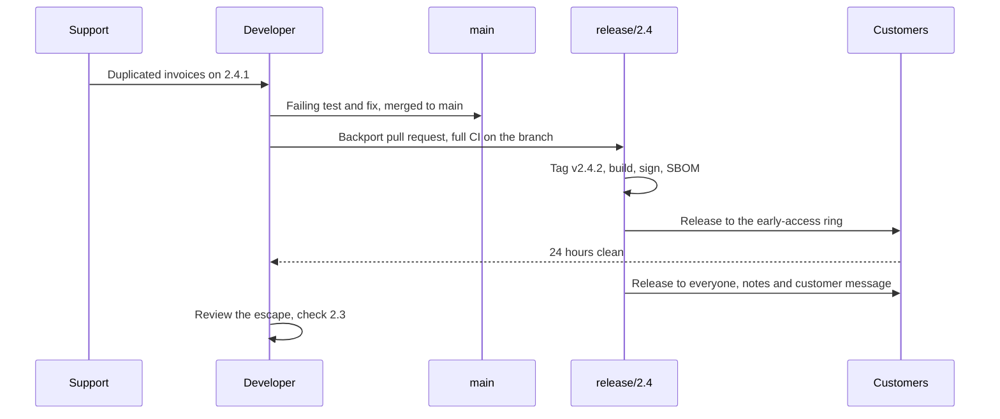
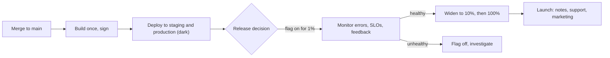

## TL;DR

- **Deploying is technical; releasing is a business decision.** Release management decides what reaches which users when, communicates it, and makes it reversible. Feature flags and progressive delivery separate the two.
- Choose a **release model** that fits the product: continuous release for web services, scheduled trains where app stores, installed software or customers' change windows impose a rhythm.
- **Version numbers are a promise.** Semantic versioning tells consumers whether an upgrade can break them; calendar versioning or build IDs suit applications nobody depends on programmatically. Automate versions and changelogs from commit history.
- **Heavyweight change approval doesn't make releases safer.** DORA's research found external approval boards slow delivery without reducing failures. Peer review, automated checks and small, reversible changes do.
- Plan for **hotfixes, support windows and security releases** before you need them: upstream-first fixes, clear support policies, and a rehearsed path from bug report to patched customers.

## Core Concepts

### Deploy, release and launch

| Term | What it means | Who decides |
|---|---|---|
| **Deploy** | New code is running in an environment | Engineering, many times a day |
| **Release** | Users can use a change | Product and engineering, often by flag or rollout percentage |
| **Launch** | A coordinated, announced business event | Product, marketing, sales and support together |

A feature can be deployed for weeks behind a flag, released gradually to 1%, 10% and 100% of users, and launched with a press release once it's proven.

### Release models

| Model | How it works | Fits | Watch out for |
|---|---|---|---|
| **Continuous** | Every change that passes the pipeline can go out, often automatically | Web services and SaaS back ends | Needs strong automated testing, monitoring and rollback |
| **Release train** | Releases leave on a fixed schedule; whatever is ready goes, whatever isn't waits | Mobile apps, installed products, customers who need predictability | Trains that grow hardening phases and big batches |
| **On demand** | Releases when a set of features is ready | Low-change products, or teams early in automation | Batches grow, so each release gets riskier |
| **Channels** | Several streams at once: preview, stable and long-term support | Platforms and products with mixed customer appetite for change | More versions to support |

### Versioning

**Semantic versioning (SemVer 2.0.0):** `MAJOR.MINOR.PATCH`.
- **MAJOR** for incompatible changes, **MINOR** for backwards-compatible features, **PATCH** for backwards-compatible fixes.
- **Pre-releases** such as `3.0.0-rc.1` sort *before* `3.0.0`. Build metadata (`+build.42`) is ignored when comparing versions.
- `0.y.z` means initial development: anything may change.

**Calendar versioning (CalVer):** versions based on dates, such as `2026.11.28` or Ubuntu's `24.04`. It suits applications and services where "how old is this?" matters more than compatibility.

**Build identifiers:** for internal services, the commit SHA and build number identify exactly what's running. Many teams show CalVer plus the commit to users and support.

### Changelogs and release notes

- A **changelog** is the developer-facing record, grouped as in *Keep a Changelog*: Added, Changed, Deprecated, Removed, Fixed and Security.
- **Release notes** are written for a specific audience: customers care about what they can now do and what changes for them, support cares about known issues and workarounds.
- **Automate the mechanical part:** tools such as release-please, semantic-release and Changesets read Conventional Commits or change files, choose the next version, write the changelog and open the release pull request.

### Change management without the drag

ITIL 4's **change enablement** practice distinguishes **standard** changes (pre-approved, low-risk and routine), **normal** changes (assessed) and **emergency** changes. In a modern pipeline:
- Most changes become **standard changes**, pre-approved because they pass automated tests, peer review and progressive rollout.
- Risky changes get **peer review by people who understand them,** not a weekly board of people who don't.
- **Evidence is automatic:** who reviewed, which checks passed, when it deployed and to where.

DORA's research (*Accelerate*, 2018) found that approval by an external body, such as a change advisory board, was associated with slower delivery and had **no correlation with lower change failure rates**.

### Hotfixes and support windows

- **Upstream first:** fix on `main`, then backport to the release branches still supported.
- **A support policy** says which versions get which fixes, and for how long: for example, the latest two minor versions get bug fixes; the current long-term-support (LTS) version gets security fixes for 24 months.
- **Security releases** follow a coordinated process: a private fix, an advisory, a CVE where appropriate, and patches for every supported version released together.

### Worked example: working out the next version

The last release was **v2.3.1**. The commits since then, written as Conventional Commits:

```text
fix(pricing): round discounts per line instead of per order
feat(export): add CSV export for invoices
docs: explain export limits
feat(api)!: remove the deprecated v1 orders endpoint
```

**Each commit implies a bump; the largest one wins:**

| Commit | Implies |
|---|---|
| `fix(pricing)` | Patch → 2.3.2 |
| `feat(export)` | Minor → 2.4.0 |
| `docs` | Nothing |
| `feat(api)!` | **Major → 3.0.0** |

**The next version is 3.0.0.** Without the breaking change it would be 2.4.0; with only the fix, 2.3.2.

**Release candidates first:** `3.0.0-rc.1`, `3.0.0-rc.2` and so on. SemVer compares numeric identifiers as numbers, so `rc.10` correctly sorts after `rc.2`, and every `rc` sorts before `3.0.0` itself.

**The generated changelog:**

```markdown
## [3.0.0] - 2026-12-01
### Removed
- The deprecated v1 orders endpoint. Use /v2/orders. (BREAKING)
### Added
- CSV export for invoices.
### Fixed
- Discounts are now rounded per line rather than per order.
```

The tool gets this right only if the commit messages are honest. A breaking change labelled `fix:` ships as a patch and breaks every consumer who trusted the version number.

## How It Works

### A hotfix for a versioned product



### From commit to customer



## When to Use / Trade-offs

| Choice | Use when | Avoid when | Trade-off |
|---|---|---|---|
| Continuous release | Web services with strong tests, monitoring and flags | Customers need advance notice of every change | Fast feedback vs less predictability for customers |
| Release train | App stores, installed software, regulated customers | Web services that could release continuously | Predictable rhythm vs bigger batches |
| SemVer | Libraries, SDKs, APIs and anything others depend on | End-user apps where compatibility isn't the question | Clear compatibility promise vs discipline required |
| CalVer | Applications, services, operating systems | Libraries whose consumers need compatibility signals | Shows age at a glance vs says nothing about breaking changes |
| LTS releases | Enterprise or on-premise customers who upgrade slowly | Products where everyone is on the latest version | Customer stability vs backport cost |
| Change freeze | Short, genuinely high-risk business periods | As a substitute for safe release practices | Fewer changes at peak vs larger batches afterwards |

## Common Pitfalls & Anti-patterns

- **Big-batch releases** — months of changes in one release, so every release is risky and every failure is hard to diagnose.
- **CAB theatre** — a weekly meeting that approves almost everything without reading it, adding days of lead time.
- **Version numbers that lie** — breaking changes shipped as minor or patch versions.
- **Fixing only on the release branch** — the bug returns in the next version.
- **Release notes as commit dumps** — hundreds of lines no customer can use.
- **Unlimited support** — every old version supported forever, so backports consume the team.
- **Releasing without a way back** — no flag, no rollback and no rehearsal.
- **Freezes that last weeks** — work piles up, and the first release after the freeze is the riskiest of the year.

## Real-world Scenario

**Context:** A B2B software company released its SaaS product and an on-premise edition every quarter. Each release contained about 400 changes, needed three weeks of regression testing, and was approved by a weekly change advisory board. One release in three needed an emergency patch within a fortnight, and customers on the on-premise edition were spread over 11 versions.

**Decision:**
1. **SaaS:** moved to continuous deployment behind feature flags, with releases controlled per tenant and progressive rollout rings (internal, early access, everyone).
2. **Change management:** most changes became **standard changes**, pre-approved by passing automated checks, peer review and canary analysis. The board now reviews only the policy and the few high-risk changes, such as data migrations.
3. **On-premise:** a predictable **monthly release train**, SemVer, an **LTS version every 12 months** supported for 24 months, and a published policy: bug fixes for the two latest minor versions, security fixes for the LTS.
4. **Automation:** Conventional Commits, generated changelogs and release pull requests, and backport bots.

**Outcome:** SaaS change failure rate fell from about 30% of releases to under 8% of changes, lead time fell from weeks to under two days, and emergency patches became rare. On-premise customers consolidated onto 3 supported versions within a year.

**What I'd do differently:** Publish the support policy before the first LTS release. Customers on old versions felt it was imposed on them, and early notice would have avoided several difficult renewals.

## Interview Questions

### What is semantic versioning, and when is it the wrong choice? {#semantic-versioning}

**Level:** Foundation

**Model answer:**
**Semantic versioning (SemVer)** uses `MAJOR.MINOR.PATCH` to tell consumers what an upgrade means:
- **PATCH** (2.3.1 → 2.3.2): backwards-compatible bug fixes.
- **MINOR** (2.3.2 → 2.4.0): new, backwards-compatible functionality.
- **MAJOR** (2.4.0 → 3.0.0): incompatible changes. Consumers may need to change their code.

**Details that matter:**
- **Pre-releases** such as `3.0.0-rc.1` sort before `3.0.0`, and numeric parts compare as numbers, so `rc.10` comes after `rc.2`.
- **Build metadata** (`+build.42`) is ignored for ordering.
- **`0.y.z`** means initial development, where anything may change.
- The "public API" must be defined: what consumers can rely on. Changing undocumented internals isn't a breaking change, but changing documented behaviour is, even without a signature change.

**It's the right choice for** anything others depend on programmatically: libraries, SDKs, CLIs used in scripts, APIs and plugins. Package managers use version ranges such as `^2.4.0` that rely on the promise.

**It's often the wrong choice for:**
- **End-user applications and web services,** where nobody pins a dependency on them. Every release is effectively "minor", and calendar versioning or build IDs say more.
- **Products where "major" has become a marketing decision.**

**The key point:** SemVer only works if teams are honest. A breaking change shipped as a minor version breaks everyone who trusted it.

**What the interviewer is looking for:**
The meaning of each part, pre-release and build metadata rules, defining the public API, where it fits and where calendar versions or build IDs are better, and honesty as the foundation.

**Follow-ups:**
- Is fixing a bug that customers rely on a breaking change?
- How do you version a monorepo with 30 packages?

**Red flags:**
- Bumping the major version only for marketing launches.
- "Breaking changes are fine in a minor release if they're small."

### What release models exist, and how do you choose one? {#release-models}

**Level:** Foundation

**Model answer:**
A release model decides **when changes reach users**. Choose it from the product's constraints, not from habit.

- **Continuous release:** every change that passes the pipeline can reach users, usually progressively and behind flags. Best for web services and SaaS back ends with strong testing, monitoring and rollback.
- **Release train:** releases leave on a fixed schedule (weekly, fortnightly, monthly). Whatever is ready goes; whatever isn't waits for the next one. Good when external factors set the rhythm: app store reviews, installed software, enterprise customers who need predictable change windows, or hardware.
- **On demand:** a release when a planned set of features is ready. Simple, but batches grow and dates slip, so each release becomes riskier.
- **Channels:** several streams at once, such as preview, stable and long-term support, so customers choose their own appetite for change.

**Questions to ask:**
- Can we update users silently (web), or do they have to install something (mobile, desktop, on-premise)?
- How much automated testing and monitoring do we have?
- Do customers or regulators need advance notice of changes?
- How costly is a bad release, and how fast can we undo one?

**Many products mix models:** a web front end released continuously, mobile apps on a weekly train, and an on-premise edition monthly with LTS versions.

**What the interviewer is looking for:**
Clear descriptions of continuous, train, on-demand and channels, choosing from distribution, automation, customer and risk constraints, and recognising that products often mix models.

**Follow-ups:**
- What stops a release train from becoming a big-batch release?
- How do you release a mobile app if a train is already running?

**Red flags:**
- One model for every product regardless of how it's distributed.
- On-demand releases that wait months for "everything" to be ready.

### How do you generate versions and changelogs automatically? {#changelog-automation}

**Level:** Foundation

**Model answer:**
Working out the next version and writing the changelog by hand is slow and error-prone. Automate it from **structured information the team already produces**.

**Two common inputs:**
- **Conventional Commits:** commit or pull request titles such as `fix(pricing): …`, `feat(export): …` or `feat(api)!: …`. A tool reads them since the last release: fixes give a patch, features a minor and breaking changes a major bump.
- **Change files:** with tools such as **Changesets**, each pull request adds a small file describing the change and its bump level. This suits monorepos with many packages and lets people write user-friendly descriptions.

**Common tools:**
- **release-please** opens and maintains a release pull request with the next version and changelog; merging it creates the tag and release.
- **semantic-release** releases fully automatically from the main branch.
- **Changesets** collects change files and versions packages together.

**Make it work well:**
- **Validate the inputs in CI:** check pull request titles against the convention, or require a change file.
- **Review the generated changelog** in the release pull request. Automation gets the structure right, but people improve the wording.
- **Group entries** as Added, Changed, Deprecated, Removed, Fixed and Security, following Keep a Changelog.
- **Tag releases** and publish artefacts from the same pipeline, so the version, tag, changelog and artefact always match.

**What the interviewer is looking for:**
Conventional Commits or change files as inputs, tools and how they differ, CI validation, human review of wording, standard groupings, and one pipeline for version, tag and artefact.

**Follow-ups:**
- How would you version 30 packages in a monorepo?
- Who should write customer-facing release notes?

**Red flags:**
- A changelog that is just `git log`.
- Version numbers chosen by hand in a hurry before each release.

### How do you write release notes people actually read? {#release-notes}

**Level:** Foundation

**Model answer:**
Release notes fail when they're written for the team that built the release rather than the people who need to act on it. **Write for a specific audience, lead with impact, and keep it short.**

**Know the audiences:**
- **Customers and users:** what they can now do, what changes in their workflow, and anything they must do.
- **Administrators and integrators:** configuration changes, API changes, deprecations and upgrade steps.
- **Support and sales:** new features, known issues, workarounds and the questions customers will ask.

**Structure:**
1. **Highlights first:** the two or three changes that matter most, in plain language, with screenshots where helpful.
2. **Action required:** breaking changes, deprecations with dates, and upgrade steps, clearly separated so nobody misses them.
3. **Improvements and fixes,** grouped and written as outcomes: "Exports of more than 10,000 rows no longer time out", not "Fixed bug in export batching".
4. **Known issues** and workarounds.
5. **Links** to documentation and the full changelog.

**Make them useful:**
- **Publish where people look:** in the product, the documentation site, email for admins, and an RSS or API feed for integrators.
- **Be honest** about things that got worse or were removed.
- **Keep internal jargon out:** no ticket numbers or service names customers don't know.
- **Write them as the work is done,** not the night before release. A field in the pull request template helps.

**What the interviewer is looking for:**
Audience-specific notes, highlights and required actions first, outcome-focused wording, known issues, publishing where people look, honesty and writing them continuously.

**Follow-ups:**
- How would release notes differ for an API product?
- How do you announce a feature that's being rolled out gradually?

**Red flags:**
- Lists of ticket IDs.
- Breaking changes buried at the bottom.

### What belongs on a release readiness checklist, and what should be automated? {#release-readiness}

**Level:** Foundation

**Model answer:**
A readiness checklist makes sure nothing important is forgotten before users get a change. The rule of thumb: **automate everything that can be checked by a machine**, and keep the human checklist short and about judgement.

**Automated gates in the pipeline:**
- All tests pass, including contract tests and critical end-to-end journeys.
- Security scans show no blocking findings; the artefact is signed with an SBOM.
- Database migrations are backwards compatible and tested.
- The version, tag and changelog are generated and consistent.
- Canary or early-ring health: error rates, latency and SLO burn within thresholds.

**Human readiness checks (for significant releases):**
- **Rollback or disable plan:** which flag to turn off or how to roll back, and who can do it.
- **Monitoring and alerts** for the new functionality, with dashboards people know about.
- **Support readiness:** briefing, documentation, known issues and FAQs.
- **Communications:** release notes, customer notices, and status page messages prepared if needed.
- **Dependencies:** partner, vendor or other team changes in place.
- **On-call awareness:** the people on call know the release is happening.

**Keep it alive:** review the checklist after incidents. If a release went wrong because something was missed, add a check, preferably an automated one. Remove checks that never catch anything.

**What the interviewer is looking for:**
Automating mechanical checks as pipeline gates, a short human checklist about rollback, monitoring, support, communication, dependencies and on-call, and evolving it from incidents.

**Follow-ups:**
- Who signs off a release, and what are they actually signing?
- How does the checklist differ for a small change and a major launch?

**Red flags:**
- A 60-item manual checklist for every deploy.
- No rollback plan because "it's tested".

### Walk through a hotfix for a product with customers on several versions. {#hotfix-process}

**Level:** Senior

**Model answer:**
A good hotfix process is **fast without skipping safety**, and it's decided in advance, not invented during the crisis.

**1. Decide it's a hotfix:** use the support policy and severity criteria. Data loss, security issues, outages and serious money errors qualify; cosmetic bugs wait for the next release.

**2. Fix upstream first:**
- Reproduce it with a **failing test,** then fix it on `main` through normal, prioritised review.
- Fixing only the release branch means the bug returns in the next version.

**3. Backport to supported versions:**
- Cherry-pick the fix (with `-x` for traceability) into a pull request against each affected release branch, and run that branch's full CI. Code may differ between versions.

**4. Release a patch version:**
- Bump the patch number (2.4.1 → 2.4.2), since it fixes behaviour without adding features.
- **Build once,** sign it and generate the SBOM, exactly as for any release. The hotfix path must not bypass the pipeline.

**5. Roll out carefully:** internal and early-access customers first, monitor, then everyone. A hotfix that causes a new incident is worse than a slow one.

**6. Communicate:** release notes, a direct message to affected customers, and instructions for repairing any damage already done, such as duplicated invoices.

**7. Learn:** why did the bug escape? Add tests or checks, and check older versions covered by the support policy.

**What the interviewer is looking for:**
Clear criteria, upstream-first fixes with a test, backports with full CI, a proper patch version through the normal pipeline, staged rollout, communication including remediation, and learning.

**Follow-ups:**
- The fix doesn't apply cleanly to the oldest supported version. What do you do?
- How fast should a hotfix be, and what can be safely shortened?

**Red flags:**
- Building the hotfix on someone's laptop.
- Skipping tests because "it's urgent".

### Does a change advisory board make releases safer? What would you do instead? {#cab-vs-automated-change}

**Level:** Senior

**Model answer:**
Usually not. DORA's research (*Accelerate*, 2018) found that approval by an external body, such as a change advisory board (CAB), was associated with **longer lead times, lower deployment frequency and slower recovery**, and had **no correlation with a lower change failure rate**. The board rarely has the context to spot real risks, and the delay encourages bigger, riskier batches.

**What actually reduces risk:**
- **Peer review** by people who understand the change.
- **Automated testing and checks** in the pipeline: tests, security scans, policy checks and migration safety checks.
- **Small changes,** which are easy to understand and to undo.
- **Progressive delivery:** feature flags, canaries and staged rollouts, with automated rollback on bad signals.
- **Good monitoring** and practised incident response.

**Keeping the governance benefits:**
- Use ITIL 4's **standard changes:** changes that pass the defined pipeline and review are **pre-approved**, because the process itself has been assessed.
- Keep **human review for genuinely high-risk changes,** such as irreversible data migrations or major infrastructure changes, done by the right experts rather than a weekly board.
- **Automatic evidence** for auditors: who reviewed and approved, which checks passed, and when and where it deployed.
- Turn the CAB into a group that **reviews the process,** looks at incidents and trends, and improves the standard change criteria.

**Moving there:** start with one low-risk category of change, show the evidence and outcomes, then widen the standard change definition.

**What the interviewer is looking for:**
The DORA evidence, why boards don't reduce risk, the practices that do, standard changes with automated evidence, human review only where it adds value, and an incremental transition.

**Follow-ups:**
- Your auditor insists on CAB approval for production changes. How do you respond?
- Which changes would you still review manually?

**Red flags:**
- "More approvals means more safety."
- Removing all governance without replacing the evidence.

### When are change freezes justified, and how do you run one well? {#change-freezes}

**Level:** Senior

**Model answer:**
A **change freeze** stops or restricts production changes for a period, typically around peak trading (Black Friday, tax deadlines), major events, or when reliability is already poor.

**When it can be justified:**
- **Short, genuinely high-stakes periods** where the cost of an incident is far above normal and the business can't absorb risk.
- **When the error budget is exhausted:** an SRE-style policy that pauses feature releases until reliability recovers, while reliability fixes continue.
- **During critical operations,** such as a major migration or cutover, to reduce the number of moving parts.

**The costs:**
- Work piles up, so the **first release after the freeze is large and risky.**
- Urgent fixes still need to happen, and teams lose practice at safe releases.
- Long freezes are often a sign that normal releases aren't trusted.

**Running one well:**
- **Keep it short** and clearly dated, and decide it in advance.
- **Define what's frozen:** usually feature releases and risky infrastructure changes, not security patches or fixes for incidents.
- **An exception process** with a named approver and quick decisions.
- **Keep deploying to non-production** and keep the pipeline healthy, so skills and tooling don't rust.
- **Plan the thaw:** release the backlog in small, ordered batches over several days, not all at once.
- **Review afterwards:** were there incidents? Did the freeze help? Could better release safety replace it next time?

**What the interviewer is looking for:**
Legitimate uses including error-budget policies, the hidden costs, scoping and exceptions, keeping the pipeline active, a planned thaw, and treating frequent freezes as a symptom.

**Follow-ups:**
- A critical security patch arrives during the Black Friday freeze. What happens?
- How would you shorten next year's freeze?

**Red flags:**
- A six-week freeze every quarter.
- A freeze followed by one enormous release.

### How do you coordinate a release that spans several teams and a marketing launch? {#launch-coordination}

**Level:** Senior

**Model answer:**
The aim is to make the **launch day a non-event technically**: the code is already deployed and proven, and the launch is just turning it on and telling people.

**Decouple deployment from launch:**
- Each team deploys its part **behind feature flags** as it's ready, weeks ahead if possible.
- **Dark launch** and test in production with internal users, then early-access customers.
- **Load test** the expected launch traffic, including marketing spikes.

**Coordinate with a light structure:**
- **One accountable launch owner** (often a product manager or a release manager) and a lead from each team.
- **A shared launch plan:** dependencies, dates, readiness criteria, owners, and the sequence for launch day.
- **Regular, short check-ins** that focus on risks and blockers, increasing in frequency near the date.

**Readiness:**
- **Go/no-go criteria** agreed in advance: technical health, support readiness, documentation, legal and marketing assets.
- **A rollback or disable plan** for each part: which flags turn off which behaviour, and in what order.
- **Support and operations:** briefings, FAQs, extra staff and on-call engineers who know the features.

**Launch day:**
- Turn on flags in a planned order, watch dashboards, and keep a launch channel open.
- Hold back the announcement until checks pass, if timing allows.

**Afterwards:** monitor adoption and issues for a defined hypercare period, then remove the flags and review the launch.

**What the interviewer is looking for:**
Separating deployment from launch, dark launches and early access, a clear owner and shared plan, go/no-go criteria, disable plans, support readiness, a controlled launch day and follow-up.

**Follow-ups:**
- One team won't be ready by the launch date. What are your options?
- Who makes the go/no-go decision?

**Red flags:**
- Deploying everything for the first time on launch morning.
- No plan to disable a feature that misbehaves.

### How do you define support windows and LTS for a product with customers on many versions? {#support-windows}

**Level:** Senior

**Model answer:**
Without a policy, every old version is supported informally forever, and backports consume the team. A **support policy** makes the commitment explicit for customers and sustainable for engineering.

**Define the tiers:**
- **Current releases:** the latest minor versions get bug fixes and security fixes. For example, the two most recent minor versions.
- **Long-term support (LTS):** one release every 12 months, say, receives **security and critical fixes for 24 months,** for customers who upgrade slowly.
- **End of life (EOL):** versions that get no further fixes, with a date published well in advance.

**Base it on evidence:**
- **Who runs which version,** from telemetry or licence data.
- **The cost of each backport,** which grows as versions diverge.
- **Customers' upgrade cycles** and any contractual commitments.

**Publish and communicate it:**
- A page with each version, its tier and its end dates.
- **EOL notices** at least 6–12 months ahead, repeated as the date approaches, with in-product warnings for admins.
- Upgrade guides and tools that make moving forward easy.

**Make upgrading cheap:** the best way to shrink the number of supported versions is to make upgrades painless: backwards compatibility, automated migrations, and fewer breaking changes.

**Commercial options:** some companies offer paid **extended support** for customers who can't upgrade in time, priced to reflect the real cost.

**What the interviewer is looking for:**
Clear tiers with dates, evidence from usage and backport cost, published policy and long EOL notice, making upgrades easy, and extended support as a commercial option.

**Follow-ups:**
- A major customer refuses to upgrade from an EOL version. What do you do?
- How do LTS releases fit with continuous delivery?

**Red flags:**
- Supporting every version ever shipped.
- Announcing end of life with a month's notice.

### Should internal services and web apps have version numbers? {#service-versioning}

**Level:** Senior

**Model answer:**
Services and web apps need **identifiers**, but not necessarily semantic versions. The question is what each audience needs to know.

**What identifies a deployment precisely:**
- The **commit SHA** and **build number,** embedded in the artefact and exposed through a health or info endpoint, logs and traces. Engineers can then tell exactly which code is running anywhere.
- **Immutable artefact tags,** such as container images tagged with the commit SHA, never only `latest`.

**What helps people:**
- A **human-friendly version** for support and users, often **calendar-based** (for example `2026.11.28` plus the short commit), so anyone can see how recent it is.
- **Release names or numbers** for coordinated launches, if marketing needs them.

**What doesn't need SemVer:**
- A service whose consumers call it through an API depends on the **API's** compatibility, not the service build. Version the **API contract** (for example `/v2/orders`, or a schema version for events) and keep it stable while the service changes many times a day.
- Forcing SemVer onto every service deploy creates meaningless numbers: every deploy becomes a "minor".

**Where SemVer does fit:** shared libraries, SDKs, CLIs and anything consumed as a package.

**What the interviewer is looking for:**
Commit SHA and build IDs for traceability, immutable artefact tags, CalVer for humans, versioning APIs and schemas separately from deployments, and SemVer only for consumed packages.

**Follow-ups:**
- How would support find out which version a customer is using?
- How do you version events on a message bus?

**Red flags:**
- Deploying images tagged only `latest`.
- Bumping a service's major version for internal changes no consumer notices.

### How do you measure the health of your release process? {#release-metrics}

**Level:** Senior

**Model answer:**
Measure whether releases are **fast, safe and low-effort,** and look at trends rather than single numbers.

**Speed and flow:**
- **Lead time for changes:** from commit to running in production.
- **Release frequency:** how often users get changes, per product.
- **Time from release decision to fully rolled out,** for progressive releases.

**Safety:**
- **Change failure rate:** the share of releases or changes that cause incidents, rollbacks or hotfixes.
- **Hotfix rate:** emergency patches per release. A high rate means problems are escaping earlier stages.
- **Rollback and flag-disable frequency,** and how quickly they happened.
- **Escaped defects:** bugs reported by customers after release.

**Effort and friction:**
- **Manual steps** and hours spent per release.
- **Time spent in approvals and waiting.**
- **Release-day stress:** out-of-hours work, and engineers' own view of releases in surveys.

**For versioned products:**
- **Version adoption:** how quickly customers move to new releases, and how many remain on unsupported versions.
- **Time to patch:** from a security fix being ready to customers being protected.

**Use them well:** review trends with the teams, connect them to improvements (for example, automating a manual step), and avoid turning them into targets that encourage hiding failures.

**What the interviewer is looking for:**
Speed, safety and effort metrics, hotfix and rollback rates, version adoption and time to patch for distributed software, trend-based review and avoiding gaming.

**Follow-ups:**
- Release frequency went up but so did hotfixes. What do you look at?
- How do you count a change failure for a feature-flagged release?

**Red flags:**
- Counting releases as the only measure.
- Treating zero rollbacks as proof that releases are safe.

### How do you run a beta or early access programme? {#beta-programmes}

**Level:** Senior

**Model answer:**
A beta gets **real-world feedback and confidence** before general availability, with customers who know what they've signed up for.

**Define the purpose and exit criteria:**
- What do you need to learn? Usability, performance at real scale, fit with customer workflows, or willingness to pay.
- What must be true to move to general availability: error rates, adoption, satisfaction, and resolved critical issues.

**Choose participants deliberately:**
- A mix of customer types and sizes, including some demanding ones, not just enthusiasts.
- Make participation **opt-in,** with clear terms: the feature may change or be withdrawn, support levels, and data handling.
- Enterprise customers may need contract wording for preview features.

**Deliver it safely:**
- **Feature flags per tenant or user,** so you can add, remove or change participants without deploys.
- Production-quality security and data handling even in beta. "It's a beta" isn't an excuse for a data leak.
- **Instrumentation** to see actual usage, not only what people say.

**Collect feedback actively:**
- A dedicated channel, regular check-ins with key participants, in-product feedback prompts, and a named product owner who responds.
- Close the loop: tell participants what changed because of their feedback.

**Finish it:** move to general availability, iterate, or stop, based on the exit criteria. Avoid "permanent beta" labels that confuse customers about what's supported.

**What the interviewer is looking for:**
Purpose and exit criteria, deliberate participant selection, clear terms, per-tenant flags, production-grade security, instrumentation and active feedback, and a defined end.

**Follow-ups:**
- A beta customer builds a critical workflow on the feature, then you need to change it. What do you do?
- How do you price a feature during its beta?

**Red flags:**
- A beta with no exit criteria.
- Lower security standards for beta features.

### Design the release process for 40 teams shipping a SaaS product, mobile apps and an on-premise edition. {#release-process-at-scale}

**Level:** Architect

**Model answer:**
One process can't fit all three: each channel has different constraints. Design **one shared foundation**, then a release model per channel.

**The shared foundation:**
- **One build pipeline:** build once, sign, generate SBOMs, and promote the same artefacts through environments.
- **Trunk-based development** with feature flags, so code from all teams integrates continuously.
- **Standard changes:** changes that pass automated checks and peer review are pre-approved, with evidence captured automatically.
- **A shared flag platform** with per-tenant, per-version and per-platform targeting.
- **Conventional Commits** and generated changelogs.

**SaaS:**
- **Continuous deployment** by each team, released progressively through rings: internal, early access, then everyone.
- **Automated canary analysis** and rollback on SLO burn.
- Enterprise tenants can opt into a **slower channel** for visible changes, through per-tenant flags rather than separate code.

**Mobile apps:**
- A **weekly or fortnightly release train,** because of app store review and user update behaviour.
- **Staged rollouts** in the stores, remote flags, and a policy for minimum supported app versions.
- A **release captain** role rotating between teams, supported by automation.

**On-premise edition:**
- A **monthly train** from `main`, cut as a release branch, with SemVer, an annual LTS release and a published support policy.
- **Backport bots** and upstream-first fixes.
- Upgrade tooling and compatibility tests from every supported version.

**Coordination:**
- A small **release engineering team** owns the pipelines, tooling and policies. It doesn't approve individual releases.
- A **launch calendar** for customer-visible features across channels, coordinated by product.
- **Metrics per channel:** lead time, change failure rate, hotfix rate and version adoption.

**What the interviewer is looking for:**
A shared foundation (build once, trunk, flags, standard changes, changelogs), a release model per channel with its specific mechanisms, a platform team for tooling rather than gatekeeping, launch coordination and per-channel metrics.

**Follow-ups:**
- How do you ship a feature that needs SaaS, mobile and on-premise changes together?
- How do you keep the on-premise edition from slowing everyone down?

**Red flags:**
- Forcing the slowest channel's rhythm on everything.
- Separate codebases per channel.

### How do you release a fix for a security vulnerability in your product? {#security-releases}

**Level:** Architect

**Model answer:**
Security fixes need speed **and** confidentiality: a fix that reveals the vulnerability before customers can patch helps attackers. Follow a **coordinated process,** prepared in advance.

**1. Triage privately:**
- Confirm the issue, assess severity (with CVSS and context such as exploitability) and the **affected versions.**
- Work in a **private space:** a restricted repository, fork, or GitHub's private security advisory workspace. Limit who knows.

**2. Fix and prepare:**
- Develop and review the fix privately, with tests, for `main` and **every supported version.**
- Prepare **patch releases** for all affected supported versions, built and signed through the normal pipeline, ready to publish together.
- **Request a CVE identifier** through a CVE Numbering Authority (GitHub can assign them for security advisories) when the product is used by others.

**3. Coordinate disclosure:**
- If an external researcher reported it, agree the disclosure date with them, usually within 90 days.
- Consider giving **advance notice** to major customers or distributors under embargo, if the risk justifies it.

**4. Release together:**
- Publish patches, the **security advisory** (affected versions, severity, fixed versions, workarounds and credit) and release notes at the same time.
- For SaaS, deploy first so customers are protected before disclosure.

**5. Help customers act:** notifications to admins, upgrade instructions, and detection guidance if exploitation is possible.

**6. Follow up:** monitor for exploitation, check for variants of the bug, and review why it wasn't caught earlier.

**What the interviewer is looking for:**
Private triage, fixes for all supported versions prepared in advance, CVE handling, coordinated disclosure with researchers and embargoes, simultaneous release of patches and advisories, SaaS-first deployment, customer guidance and variant analysis.

**Follow-ups:**
- The vulnerability is being exploited already. What changes?
- How do you handle a vulnerability in a version that's past end of life?

**Red flags:**
- Fixing it in a public pull request titled "fix SQL injection in login".
- Patching only the latest version.

### Define a compatibility and deprecation policy for a platform with public APIs, SDKs and events. {#compatibility-policy}

**Level:** Architect

**Model answer:**
Consumers of a platform build their businesses on it, so they need **predictable rules**: what can change, how they'll be told, and how long they have. A clear policy also frees the platform team to evolve safely.

**Define what's covered and what counts as breaking:**
- **APIs:** removing or renaming fields or endpoints, changing types, tightening validation or changing documented behaviour are breaking. Adding optional fields or new endpoints isn't, so clients must ignore unknown fields.
- **SDKs:** follow **SemVer**; breaking changes only in major versions.
- **Events:** schemas with compatibility rules enforced by a registry (for example, backward compatible for consumers), and new versions for breaking changes.

**Version deliberately:**
- APIs get **major versions** (such as `/v2/`) only for unavoidable breaking changes; everything else evolves compatibly.
- SDK majors line up with API versions where possible.

**Deprecation process:**
1. **Announce** with a reason, a replacement and an end date.
2. **Signal it in the product:** the `Deprecation` header (RFC 9745) and `Sunset` header (RFC 8594) in API responses, warnings in SDKs, and notices in dashboards.
3. **Minimum notice periods,** such as 12 months for public APIs and 6 months for SDK majors, longer for enterprise contracts.
4. **Track usage** of deprecated features per consumer and contact heavy users directly.
5. **Brownouts** before removal: short, announced periods where the old version fails, to flush out forgotten callers.
6. **Remove** on the date, with support ready.

**Make migration easy:** guides, side-by-side examples, and where possible automated migration tools.

**What the interviewer is looking for:**
Clear definitions of breaking changes for each artefact type, SemVer for SDKs and schema rules for events, deliberate API versioning, a deprecation process with machine-readable signals, notice periods, usage tracking, brownouts and migration help.

**Follow-ups:**
- A large customer can't migrate before the sunset date. What do you do?
- Is adding a new value to an enum a breaking change?

**Red flags:**
- Deprecations announced only in a blog post.
- No way to know who still uses a deprecated endpoint.

### When is a release train the right model, and how do you design one well? {#release-train-design}

**Level:** Architect

**Model answer:**
A release train suits products where **something outside the team sets the rhythm**: app store reviews and user updates for mobile, customers' change windows for enterprise or on-premise software, regulatory validation, or hardware. It trades some speed for **predictability**.

**Design principles:**
- **Time-boxed, not scope-boxed:** the train leaves on schedule. Unfinished work waits for the next train, hidden behind flags. Never delay the train for a feature.
- **Short intervals:** weekly or fortnightly beats quarterly. Shorter trains mean smaller, safer batches and less pressure to squeeze work in.
- **Continuous integration underneath:** teams still integrate to `main` daily. The train cuts a release branch from `main`; it doesn't replace continuous integration.
- **Automated stabilisation:** regression testing is automated and runs continuously, so cutting a release isn't followed by weeks of manual testing.

**The mechanics:**
- A fixed **calendar:** branch cut, release candidate, final checks and release.
- A **rotating release captain** who runs the checklist, supported by automation rather than heroics.
- **Clear rules** for what can join after the cut: only fixes for regressions found in the candidate, merged to `main` first and cherry-picked.
- **Staged rollout** after release, such as store-phased rollouts for mobile.

**Warning signs** that a train is degrading: growing hardening phases, features forcing the train to wait, and many late cherry-picks. These mean batches are too big or automation is too weak.

**What the interviewer is looking for:**
When external constraints justify a train, time-boxed departures with flags, short intervals, continuous integration underneath, automated stabilisation, a calendar with a release captain and late-change rules, staged rollout, and recognising degradation.

**Follow-ups:**
- A high-profile feature misses the train by a day. What happens?
- How do you move from a quarterly train to a weekly one?

**Red flags:**
- Holding the train for one feature.
- A train with a three-week manual regression phase.

### Enterprise customers want to control when they receive changes in your SaaS. How do you support that without forking? {#customer-controlled-changes}

**Level:** Architect

**Model answer:**
Enterprise customers often need to **train staff, update documentation and validate integrations** before changes reach their users. The goal is to give them control over *visible* change while still running **one codebase and one deployment** for everyone.

**Separate deployment from exposure:**
- Deploy continuously to all tenants; control **what each tenant sees** with **per-tenant feature flags**.
- Classify changes: **invisible** (fixes, performance, security) go to everyone immediately; **visible** changes (UI, workflow, behaviour) follow the tenant's chosen schedule.

**Offer release channels:**
- **Preview:** admins can turn on upcoming features early in a sandbox or for a pilot group.
- **Standard:** visible changes arrive on a published schedule, such as monthly.
- **Scheduled:** enterprise tenants get a notice period, such as 30 days, and can defer within a limit before changes switch on automatically.

**Give admins tools:**
- A **"what's coming" page** in the admin console, with dates and documentation.
- **Sandbox tenants** that receive changes earlier, for testing integrations.
- Controls to enable features for **pilot groups** of users first.

**Keep it sustainable:**
- **Deferral limits:** customers can delay, not stay on old behaviour forever. Every flag has a removal date.
- **API compatibility** through a versioning policy, so integrations aren't broken by UI changes.
- Watch the number of active flag combinations; too many make testing unmanageable.

**What the interviewer is looking for:**
One codebase and deployment, per-tenant flags, separating invisible from visible changes, channels with notice periods, admin tooling and sandboxes, deferral limits and flag removal, and API compatibility.

**Follow-ups:**
- How do you test all the combinations of flags across tenants?
- A customer wants to stay on the old UI permanently. What do you say?

**Red flags:**
- A separate branch or deployment per large customer.
- Unlimited deferral, so old code paths never die.

### You maintain an open-source library used by thousands of projects. How do you run its releases? {#open-source-releases}

**Level:** Architect

**Model answer:**
Thousands of projects upgrade automatically within version ranges, so a bad release spreads instantly, and the library is a **supply-chain target**. Release discipline matters more than for most products.

**Versioning and compatibility:**
- Strict **SemVer,** with a clearly documented public API. Many downstream projects accept minor and patch updates automatically.
- **Deprecate before removing:** warnings in one minor release, removal in the next major, with migration guides.
- **Pre-releases** (`-rc.1`, `-beta.1`) published to a separate distribution tag (such as npm's `next`) so early adopters can test without everyone receiving them.

**Secure the release path:**
- **Publish only from CI,** not laptops, using **trusted publishing** (OIDC from the CI system to the registry, supported by PyPI since 2023 and npm since 2025) instead of long-lived registry tokens.
- **Provenance and signing,** so users can verify which source and workflow built each package.
- **Two-factor authentication** for all maintainers, few people with publish rights, and protected release branches and tags.

**Process:**
- **Automated changelogs** from Conventional Commits or change files, reviewed by maintainers.
- **A release checklist** run by automation: tests across supported runtime versions, compatibility tests against major dependents, and package contents checks (no stray files or secrets).
- **A security policy** (`SECURITY.md`), private vulnerability reporting, and coordinated security releases.

**Support:** state which major versions get fixes and for how long, and which runtime versions are supported.

**What the interviewer is looking for:**
Strict SemVer and a defined public API, deprecation cycles, pre-release channels, publishing from CI with trusted publishing, provenance and 2FA, automated changelogs and checks, a security policy and a clear support statement.

**Follow-ups:**
- You published a release that broke thousands of builds. What do you do in the first hour?
- How do you handle a maintainer who wants to stop working on the project?

**Red flags:**
- Publishing from a maintainer's laptop with a long-lived token.
- Breaking changes in minor releases.

### The launch is tomorrow, and the release has a known medium-severity bug. How do you decide whether to ship? {#ship-with-known-bug}

**Level:** Architect

**Model answer:**
This is a **risk decision**, not a technical one, so make it explicit, with facts, and by the right person.

**Understand the bug precisely:**
- **Who is affected and how often?** All users or an edge case? Every time or rarely?
- **What's the impact?** Inconvenience, wrong data, money, security, legal or safety?
- **Is it reversible?** A display glitch can be fixed later; corrupted data or wrong payments may not be.
- **Is there a workaround,** and can support explain it?

**Look at the options, not just yes or no:**
- **Ship with a mitigation:** disable the affected path with a feature flag, limit the feature to unaffected segments, or roll out to a small percentage first.
- **Ship and fix fast:** if the bug is contained and a fix is near, release with a known-issue note and a committed patch date.
- **Delay the affected feature only,** while launching the rest.
- **Delay the launch,** if the impact is serious or irreversible, or affects trust (security, data, payments).

**Weigh the cost of delay too:** marketing commitments, contracts, regulatory dates and team momentum are real costs, but they rarely outweigh irreversible harm to customers.

**Decide and record it:**
- The **accountable owner** (often the product lead, with engineering and support input) decides, using agreed criteria.
- **Record the decision,** the reasoning, the mitigation and the fix date.
- **Prepare support:** known-issue notes, workaround and monitoring for the bug's signature.

**What the interviewer is looking for:**
Precise assessment of scope, impact and reversibility, options beyond ship or delay, weighing the cost of delay, a clear decision owner, a recorded decision and support readiness.

**Follow-ups:**
- The CEO wants to ship regardless. What do you do?
- How would your answer change if the bug affected 1% of payments?

**Red flags:**
- Shipping silently and hoping nobody notices.
- Treating every bug as a launch blocker.

## Cheat Sheet

### Models and versions
- **Deploy vs release vs launch** — code running, users can use it, a coordinated business event.
- **Release train** — leaves on schedule; unfinished work waits behind flags; keep intervals short.
- **SemVer** — MAJOR breaking, MINOR features, PATCH fixes; pre-releases sort before the release.
- **CalVer** — date-based versions for applications where age matters more than compatibility.
- **Build identity** — commit SHA and build number in every artefact; never deploy only `latest`.
- **Changelog automation** — Conventional Commits or change files feed release-please, semantic-release or Changesets.

### Governance and support
- **Standard changes** — pre-approved because they pass the pipeline, review and progressive rollout.
- **CAB evidence** — external approval boards slow delivery without reducing change failure rate (DORA).
- **Change freeze** — short, scoped, with an exception route and a planned thaw.
- **Support policy** — latest minors get fixes, LTS gets security fixes for a fixed period, EOL announced early.
- **Deprecation signals** — `Deprecation` (RFC 9745) and `Sunset` (RFC 8594) headers, plus notices and usage tracking.

### Revisit
- **Next version** — the largest implied bump wins: any breaking change means a major release.
- **Pre-release ordering** — numeric parts compare as numbers, so `rc.10` comes after `rc.2`.
- **Hotfix path** — failing test, fix on main, backport with full CI, patch tag, staged rollout, customer remediation.
- **Security releases** — private fix, patches for all supported versions, CVE and advisory published together.
- **Customer-controlled change** — one deployment, per-tenant flags for visible changes, notice periods and deferral limits.
- **Trusted publishing** — packages published from CI via OIDC instead of long-lived registry tokens.
- **Shipping with a known bug** — assess scope, impact and reversibility; mitigate with flags; the accountable owner decides and records it.

## Further Reading

- [Semantic Versioning 2.0.0](https://semver.org/) — the specification, including pre-release ordering.
- [Calendar Versioning](https://calver.org/) — date-based versioning schemes and who uses them.
- [Keep a Changelog](https://keepachangelog.com/en/1.1.0/) — conventions for human-readable changelogs.
- [release-please](https://github.com/googleapis/release-please) — release pull requests generated from Conventional Commits.
- [DORA: Streamlining change approval](https://dora.dev/capabilities/streamlining-change-approval/) — the research on change approval and delivery performance.
- [RFC 9745: The Deprecation HTTP Response Header Field](https://www.rfc-editor.org/rfc/rfc9745) and [RFC 8594: The Sunset HTTP Header Field](https://www.rfc-editor.org/rfc/rfc8594) — machine-readable deprecation signals.
- [npm Docs: Trusted publishing](https://docs.npmjs.com/trusted-publishers) — publishing packages from CI with OIDC.
- [Google SRE Book: Reliable Product Launches at Scale](https://sre.google/sre-book/reliable-product-launches/) — launch checklists and coordination.
