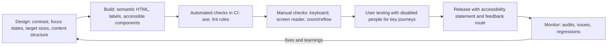

## TL;DR

- Accessibility (a11y) means people with disabilities — visual, motor, auditory, cognitive — can perceive, operate and understand your product. It also improves usability for everyone (captions, keyboard shortcuts, clear language).
- The standard is **WCAG** (current version 2.2), organised under **POUR**: Perceivable, Operable, Understandable, Robust. **Level AA** is the usual legal and contractual target.
- Start with **semantic HTML**: real buttons, links, headings, labels and landmarks give keyboard and screen-reader support for free. Use **ARIA** only to fill gaps — no ARIA is better than bad ARIA.
- Test with **automated tools** (axe) *and* **manual checks**: keyboard-only navigation, screen readers, zoom and contrast. Automation catches only part of the issues.
- Make it systemic: accessible design-system components, accessibility in the definition of done, training and ownership — and note legal drivers such as the **European Accessibility Act** (applies from June 2025) and the ADA.

## Core Concepts

### WCAG and POUR

| Principle | Meaning | Examples |
|---|---|---|
| Perceivable | Information can be perceived | Text alternatives for images, captions, sufficient contrast, content that reflows at 400% zoom |
| Operable | UI can be operated | Full keyboard access, visible focus, no keyboard traps, enough time, no seizure-inducing flashes, target sizes |
| Understandable | Content and UI are understandable | Clear labels and instructions, predictable navigation, error identification and suggestions |
| Robust | Works with assistive technologies | Valid semantics, correct name/role/value for components, status messages announced |

Conformance levels: **A** (minimum), **AA** (standard target), **AAA** (enhanced, not usually required wholesale). WCAG 2.2 (2023) added criteria such as **Focus Not Obscured**, **Target Size (Minimum)** (24×24 CSS pixels), **Dragging Movements** (single-pointer alternatives), **Accessible Authentication** (no cognitive tests like transcribing codes without alternatives) and **Redundant Entry**.

### Semantic HTML first

```html
<!-- Inaccessible: not focusable, no role, no keyboard support -->
<div class="btn" onclick="save()">Save</div>

<!-- Accessible by default: focusable, Enter/Space work, announced as a button -->
<button type="button" onclick="save()">Save</button>

<label for="email">Email address</label>
<input id="email" type="email" autocomplete="email" aria-describedby="email-hint" required>
<p id="email-hint">We'll send your receipt here.</p>
```

- Use `<button>` for actions, `<a href>` for navigation.
- Headings (`h1`–`h6`) in a logical hierarchy; landmarks (`header`, `nav`, `main`, `footer`, `aside`).
- Lists, tables with `<th scope>`, and form controls with associated `<label>`s.
- `lang` attribute on `<html>`; meaningful page `<title>`.

### Keyboard and focus

- Every interactive element reachable and operable with the keyboard (Tab, Shift+Tab, Enter, Space, arrows within composite widgets, Escape to close).
- **Visible focus indicators** with sufficient contrast — never remove outlines without a replacement (`:focus-visible`).
- Logical **focus order** matching visual order; avoid positive `tabindex`.
- **Focus management** in dynamic UIs: move focus into dialogs and return it on close; move focus to new content or headings after client-side navigation; skip links to main content.

### Colour and visual design

- Contrast: **4.5:1** for normal text, **3:1** for large text and for UI components/graphical objects (non-text contrast).
- Don't rely on colour alone (add icons, text or patterns for errors and states).
- Support **zoom to 200% and reflow at 320 CSS px width** without loss of content; respect user font-size settings (relative units).
- Respect **`prefers-reduced-motion`**; avoid auto-playing motion.

### ARIA

ARIA adds roles, states and properties for assistive technologies. Rules:
1. **Don't use ARIA if a native element provides the semantics.**
2. Don't change native semantics unnecessarily.
3. Interactive ARIA controls must be keyboard operable.
4. Don't hide focusable elements with `aria-hidden`.
5. All interactive elements need an **accessible name**.

Useful patterns: `aria-expanded` on disclosure buttons, `aria-controls`, `aria-current="page"` in navigation, `aria-live`/`role="status"` for announcements, `aria-describedby` for hints and errors, and the WAI-ARIA Authoring Practices for composite widgets (tabs, comboboxes, menus, tree views).

### Assistive technologies

Screen readers (NVDA and JAWS on Windows, VoiceOver on macOS/iOS, TalkBack on Android), screen magnifiers, voice control (Dragon, Voice Control), switch devices, and browser zoom/high-contrast modes. Test with at least one desktop and one mobile screen reader.

## How It Works



## When to Use / Trade-offs

| Practice | Use when | Avoid / caveat | Trade-off |
|---|---|---|---|
| Native HTML elements | Always as first choice | Heavily customised visuals (style the native element instead of replacing it) | Free accessibility vs styling effort |
| ARIA widgets (APG patterns) | Composite widgets HTML lacks (tabs, combobox, tree) | Re-implementing buttons/links | Capability vs complexity and testing burden |
| Automated testing (axe) | Every PR, component tests | As the only testing | Fast and cheap vs partial coverage |
| Manual screen-reader testing | Key journeys, new components | — | Real coverage vs time and skill |
| Accessibility overlays (third-party widgets) | — | Generally avoid; they don't fix underlying issues and can interfere with AT | Quick promise vs real accessibility |
| Accessible component library | All product teams | Rolling your own complex widgets per team | Consistency vs upfront investment |

## Common Pitfalls & Anti-patterns

- **Clickable `div`s** instead of buttons and links.
- **Removing focus outlines** without visible alternatives.
- **Placeholder text as labels** — disappears on input and often has low contrast.
- **Images without alt text** — or meaningless alt ("image123.jpg"); decorative images not marked `alt=""`.
- **Colour-only error states.**
- **Inaccessible custom widgets** — dropdowns, date pickers, modals with no keyboard support or focus management.
- **ARIA misuse** — `role="button"` on a div without keyboard handling, wrong roles, `aria-label` overriding visible text.
- **SPA navigation without focus/announcements** — screen-reader users don't know the page changed.
- **Accessibility overlays** promising compliance.
- **Accessibility as a final audit** — expensive retrofits.

## Real-world Scenario

**Context:** A financial services company received complaints and a legal letter: its online account opening was unusable with a screen reader, and several form steps trapped keyboard focus. The European Accessibility Act deadline was approaching for its EU customers.

**Decision:** Ran an audit (automated + expert manual testing + sessions with screen-reader users) of the top five journeys; prioritised blockers (keyboard traps, unlabeled controls, inaccessible date picker, missing error announcements, focus lost on step changes). Rebuilt the design-system form components accessibly (labels, `aria-describedby` errors, error summary with links, native date input with an accessible enhancement), fixed focus management between steps, and added axe tests to component and end-to-end suites. Introduced accessibility acceptance criteria in the definition of done, training for designers and engineers, and an accessibility statement with a feedback channel.

**Outcome:** The account-opening journey passed an external WCAG 2.2 AA audit; completion rates improved for all users (clearer errors helped everyone); new features shipped with far fewer accessibility defects.

**What I'd do differently:** Fix the design-system components first — most issues traced back to five shared components used across dozens of screens.

## Interview Questions

### What is WCAG, and what does POUR stand for? {#wcag-pour}

**Level:** Foundation

**Model answer:**
WCAG (Web Content Accessibility Guidelines, from the W3C) is the international standard for web accessibility, with testable success criteria at levels **A**, **AA** and **AAA**. Version **2.2** (2023) is current; most laws and contracts reference level **AA**. WCAG 3 is in development with a different structure (VERIFY: status).

**POUR** are the four principles:
- **Perceivable:** information must be presentable in ways users can perceive — text alternatives, captions, adaptable layouts, contrast.
- **Operable:** UI components must be operable — keyboard access, enough time, no seizure risks, navigable, input modalities beyond keyboard (pointer, targets).
- **Understandable:** information and operation must be understandable — readable, predictable, input assistance (error prevention and messages).
- **Robust:** content must work with current and future technologies, including assistive technologies — correct semantics, name/role/value, status messages.

**What the interviewer is looking for:**
What WCAG is, levels, current version and the four principles with examples.

**Follow-ups:**
- Name a criterion added in WCAG 2.2.
- Why is AAA rarely required in full?

**Red flags:**
- Treating accessibility as only screen-reader support.

### Why is semantic HTML so important for accessibility? {#semantic-html}

**Level:** Foundation

**Model answer:**
Browsers expose semantic HTML to assistive technologies through the **accessibility tree**, giving each element a role, name and state automatically:
- `<button>` is focusable, operable with Enter/Space and announced as "button".
- `<a href>` is a link with navigation semantics.
- Headings and landmarks let screen-reader users jump around the page (the most common navigation strategy).
- `<label>` associated with inputs gives fields accessible names and larger click targets.
- Lists and tables convey structure (counts, headers).

Rebuilding these with `div`s requires re-implementing keyboard handling, focus, roles and states with ARIA — and is usually done incompletely. Semantic HTML also helps SEO, reader modes and maintainability. Style native elements rather than replacing them.

**What the interviewer is looking for:**
Accessibility tree, free behaviour of native elements and the cost of reimplementation.

**Follow-ups:**
- How do you make a styled custom checkbox accessible?
- When should something be a link vs a button?

**Red flags:**
- `<div onClick>` as normal practice.

### How do you ensure keyboard accessibility and good focus management? {#keyboard-focus}

**Level:** Foundation

**Model answer:**
- **Everything interactive works with the keyboard:** Tab/Shift+Tab move between controls; Enter/Space activate; Escape closes overlays; arrow keys move within composite widgets (tabs, menus, grids) per the ARIA Authoring Practices.
- **Visible focus indicator** with good contrast on all interactive elements; style `:focus-visible` rather than removing outlines.
- **Logical focus order** following the visual/reading order; avoid positive `tabindex`; use `tabindex="-1"` to make non-interactive targets programmatically focusable (e.g. headings after navigation).
- **No keyboard traps** (except intentional modal containment with Escape to exit).
- **Focus management:** move focus into dialogs and return it to the trigger on close; after client-side route changes, move focus to the main heading or announce the change; after deleting an item, move focus somewhere sensible.
- **Skip link** to main content.
- **Focus not obscured** by sticky headers/footers (WCAG 2.2).

**What the interviewer is looking for:**
Keyboard operations, visible focus, order, traps and dynamic focus management.

**Follow-ups:**
- How do you test focus order?
- What is a roving tabindex?

**Red flags:**
- `outline: none` globally.

### What are the colour contrast requirements, and what else matters visually? {#colour-contrast}

**Level:** Foundation

**Model answer:**
WCAG AA contrast ratios:
- **4.5:1** for normal text.
- **3:1** for large text (≥ 24 px regular or ≥ ~18.66 px bold).
- **3:1** for user interface components and meaningful graphics (borders of inputs, focus indicators, icons, chart elements) — "non-text contrast".

Other visual requirements:
- **Don't use colour alone** to convey information — add text, icons or patterns (e.g. error icons and messages, not just red borders).
- **Resize and reflow:** text zoom to 200% and content reflowing at 320 CSS px width without horizontal scrolling (except for content like data tables or maps).
- **Text spacing** adjustments shouldn't break layouts.
- **Motion:** respect `prefers-reduced-motion`; avoid flashing more than three times per second.
- **Dark mode/themes** must meet contrast too.

Check with contrast tools in design tools and DevTools; encode accessible colour tokens in the design system.

**What the interviewer is looking for:**
Correct ratios including non-text contrast, colour-only rule, reflow and motion.

**Follow-ups:**
- How would you ensure all themes meet contrast requirements?
- Does placeholder text need to meet contrast?

**Red flags:**
- Light grey text on white as a brand choice without checking.

### When and how should you use ARIA? {#aria}

**Level:** Senior

**Model answer:**
ARIA (Accessible Rich Internet Applications) adds roles, states and properties to the accessibility tree when native HTML can't express the semantics.

Principles:
1. **Prefer native HTML** — the first rule of ARIA.
2. **ARIA changes semantics only, not behaviour** — `role="button"` doesn't add keyboard support; you must implement it.
3. **Every interactive element needs an accessible name** (visible label preferred; `aria-label`/`aria-labelledby` otherwise).
4. **Keep states in sync:** `aria-expanded`, `aria-selected`, `aria-checked`, `aria-pressed` must reflect reality.
5. **Don't hide focusable content** with `aria-hidden="true"`.

Common good uses:
- `aria-expanded` and `aria-controls` on disclosure buttons and menus.
- `aria-current="page"` in navigation.
- `aria-describedby` for hints and error messages.
- `aria-live="polite"`/`role="status"` for status updates (e.g. "3 results found", "Saved").
- Composite widgets (tabs, combobox, tree) following the WAI-ARIA Authoring Practices Guide patterns.

**What the interviewer is looking for:**
Native-first, semantics vs behaviour, naming, state sync and appropriate patterns.

**Follow-ups:**
- When would you use `aria-label` vs `aria-labelledby`?
- How do live regions work and what are their pitfalls?

**Red flags:**
- Adding ARIA roles to everything "to be safe".

### How do you build accessible forms? {#accessible-forms}

**Level:** Senior

**Model answer:**
- **Visible labels** associated with each control (`<label for>`), not placeholders; group related controls with `<fieldset>` and `<legend>` (radio groups, address sections).
- **Hints and requirements** linked via `aria-describedby`; indicate required fields in text, not just colour or an asterisk without explanation.
- **Appropriate input types and `autocomplete`** attributes (email, tel, postal-code, one-time-code) to help users and assistive tech.
- **Error handling:** identify errors in text, associate messages with fields (`aria-describedby`, `aria-invalid="true"`), provide suggestions, show an **error summary** at the top with links to fields on submit, and move focus to it.
- **Don't clear user input** on errors; avoid time limits or allow extensions.
- **Accessible authentication** (WCAG 2.2): allow paste and password managers; avoid cognitive tests without alternatives.
- **Avoid redundant entry:** pre-fill information already provided.
- **Custom controls** (date pickers, comboboxes) must follow APG patterns — or use native inputs where possible.

**What the interviewer is looking for:**
Labels, grouping, descriptions, error identification and summaries, autocomplete and WCAG 2.2 form criteria.

**Follow-ups:**
- How should inline validation behave for screen-reader users?
- Why shouldn't you block paste in password fields?

**Red flags:**
- Placeholder-only labels and colour-only errors.

### How do you test accessibility? {#testing-accessibility}

**Level:** Senior

**Model answer:**
A layered approach:
- **Linting:** `eslint-plugin-jsx-a11y` and framework equivalents catch common markup issues while coding.
- **Automated testing:** axe-core in component tests (e.g. `jest-axe`/`vitest-axe`), Playwright + axe for pages, Lighthouse accessibility audits in CI. Automated tools detect only a portion of WCAG issues (estimates commonly cited around a third — VERIFY), mostly structural ones.
- **Component tests using accessible queries:** Testing Library's `getByRole` with names fails when components lack proper semantics.
- **Manual testing:**
  - Keyboard-only walkthrough of key journeys.
  - Screen readers: NVDA or JAWS + a browser on Windows, VoiceOver on macOS/iOS, TalkBack on Android.
  - Zoom to 200%/400% and reflow at narrow widths; high-contrast/forced-colours mode; reduced motion.
- **Expert audits** against WCAG for major releases.
- **User testing with disabled participants** for critical journeys — finds usability barriers audits miss.

**What the interviewer is looking for:**
Automation limits, manual and assistive-technology testing, audits and user involvement.

**Follow-ups:**
- What kinds of issues can't automated tools catch?
- How would you integrate axe into CI without blocking on legacy issues?

**Red flags:**
- "We run Lighthouse, so we're accessible."

### What accessibility problems do single-page apps create, and how do you fix them? {#spa-accessibility}

**Level:** Senior

**Model answer:**
SPAs update content without full page loads, so the browser doesn't announce new pages or reset focus:
- **Route changes:** update `document.title`, move focus to the new page's main heading (with `tabindex="-1"`) or a skip target, and/or announce the change via a polite live region. Many routers/frameworks provide this; verify it.
- **Dynamic updates:** announce important asynchronous results (search results count, saved confirmations, errors) with `role="status"`/`aria-live`; don't over-announce.
- **Loading states:** indicate busy regions (`aria-busy`) and announce completion where meaningful.
- **Focus after actions:** deleting an item, closing a panel, infinite scroll — move focus predictably.
- **Infinite scroll:** provide alternatives (load more buttons, pagination) so keyboard users can reach the footer.
- **Client-rendered content:** ensure semantic HTML and headings are present, not just visual styling.

**What the interviewer is looking for:**
Route change handling, live regions, focus after actions and infinite scroll considerations.

**Follow-ups:**
- How does Next.js or React Router handle route announcements?
- When are live regions too noisy?

**Red flags:**
- Ignoring route change announcements.

### How do you build an accessible modal dialog? {#accessible-dialogs}

**Level:** Senior

**Model answer:**
Prefer the native **`<dialog>`** element with `showModal()`, which provides modal behaviour, `Escape` to close, and makes the background inert in modern browsers. Requirements either way:
- **Role and name:** `role="dialog"` (native dialog has it) with `aria-labelledby` pointing to the dialog title; `aria-describedby` for descriptive text if helpful.
- **Focus management:** move focus into the dialog on open (first meaningful control or the dialog itself); **trap focus** inside while open; **return focus** to the triggering element on close.
- **Background inert:** content behind isn't reachable by keyboard or screen readers (`inert` attribute or `aria-modal="true"` with proper handling).
- **Close mechanisms:** Escape key and a visible close button with an accessible name.
- **Scroll:** prevent background scrolling; ensure dialog content scrolls on small screens and when zoomed.
- **Don't use dialogs for content that should be a page** (long forms on mobile).

**What the interviewer is looking for:**
Native dialog, naming, focus in/trap/return, inert background and close mechanisms.

**Follow-ups:**
- What does the `inert` attribute do?
- How do you handle a confirmation dialog vs an alert dialog?

**Red flags:**
- Modals that leave focus behind on the page.

### How do you provide accessible alternatives for images and media? {#media-alternatives}

**Level:** Senior

**Model answer:**
- **Informative images:** concise `alt` text conveying the purpose/content in context ("Bar chart: revenue grew 20% in Q3").
- **Decorative images:** `alt=""` (or CSS backgrounds) so screen readers skip them.
- **Functional images** (icons in buttons/links): the alt or accessible name describes the action ("Search"), not the picture.
- **Complex images** (charts, diagrams): short alt plus a longer description nearby or a data table alternative.
- **SVG icons:** `aria-hidden="true"` when decorative; `role="img"` with a `<title>`/`aria-label` when meaningful.
- **Video:** synchronised captions, audio description for important visual information, transcripts; accessible player controls (keyboard, labels).
- **Audio:** transcripts.
- **Auto-playing media:** avoid, or provide pause/stop; no flashing content.
- **Text in images:** avoid; use real text.

**What the interviewer is looking for:**
Context-dependent alt text, decorative handling, complex images, media alternatives and controls.

**Follow-ups:**
- How would you make an interactive chart accessible?
- Who should write alt text — engineers or content authors?

**Red flags:**
- Filenames or "image of…" as alt text everywhere.

### How would you build an accessibility programme in an organisation? {#accessibility-programme}

**Level:** Architect

**Model answer:**
- **Commitment and policy:** executive sponsor, target standard (WCAG 2.2 AA), scope (web, mobile, documents), accessibility statement.
- **Baseline audit** of key journeys; prioritised remediation roadmap with owners.
- **Shift left:**
  - Accessible design system components and tokens (contrast, focus, motion).
  - Design reviews with accessibility checklists (annotations for headings, focus order, labels).
  - Definition of done including keyboard and screen-reader checks for new UI.
  - Automated checks in CI (lint, axe), with baselines for legacy.
- **Skills:** training for designers, engineers, QA, content authors and product managers; accessibility champions in teams; access to specialist auditors.
- **User involvement:** include disabled users in research and testing; a feedback channel for issues.
- **Procurement:** require accessibility conformance (VPAT/ACR) from vendors and third-party components.
- **Measure:** defects found per release, audit results, time to fix, coverage of components, user feedback.

**What the interviewer is looking for:**
Policy, baseline, shift-left mechanisms, skills, user involvement, procurement and measurement.

**Follow-ups:**
- How do you prioritise 800 audit findings?
- Who owns accessibility — a central team or product teams?

**Red flags:**
- An annual audit as the whole programme.

### How do you make a design system accessible? {#design-system-accessibility}

**Level:** Architect

**Model answer:**
- **Accessible foundations:** colour tokens meeting contrast in every theme; focus ring tokens; typography supporting zoom and spacing; motion tokens respecting reduced motion; minimum target sizes.
- **Components built on native elements** where possible; complex widgets implement **WAI-ARIA APG patterns** with keyboard support and correct states.
- **Built-in labelling APIs:** components require accessible names (e.g. icon buttons demand a label prop; form fields bundle label, hint and error wiring).
- **Documentation:** usage guidance including accessibility do's and don'ts, keyboard interactions, screen-reader behaviour.
- **Testing per component:** axe in unit tests, Storybook accessibility addon, visual tests for focus states, manual screen-reader verification for each release; test in forced-colours/high-contrast modes.
- **Versioning and migration:** accessibility fixes propagate to all consumers via updates; deprecate inaccessible components.
- **Governance:** accessibility specialist review for new components; feedback loop from product audits.

Because most UI is built from shared components, an accessible design system eliminates whole classes of defects across products.

**What the interviewer is looking for:**
Accessible tokens, native/APG components, enforced labelling, documentation, testing and propagation.

**Follow-ups:**
- How would you design an accessible combobox component API?
- How do you stop teams overriding focus styles?

**Red flags:**
- Design system components that look good but lack keyboard support.

### What legal requirements drive accessibility, and how do they affect engineering? {#accessibility-law}

**Level:** Architect

**Model answer:**
- **European Accessibility Act (EAA):** applies from **28 June 2025** to many products and services in the EU market — e-commerce, banking, e-books, transport ticketing, consumer devices, communications — referencing harmonised standard EN 301 549 (which incorporates WCAG). Requirements include accessible services, information and an accessibility statement; microenterprises have some exemptions for services (VERIFY: specifics and national enforcement).
- **EU Web Accessibility Directive:** public sector websites and apps.
- **US:** the **ADA** (courts have applied it to websites; frequent litigation), **Section 508** for federal agencies and contractors; the DOJ issued a rule (2024) adopting WCAG 2.1 AA for state and local government web content (VERIFY: compliance dates).
- **UK:** Equality Act 2010 and Public Sector Bodies Accessibility Regulations.
- **Other jurisdictions:** Canada (ACA, AODA), Australia (DDA) and more.

Engineering impact: WCAG 2.1/2.2 AA as the practical baseline; accessibility statements; documented conformance (ACR/VPAT) for B2B sales; procurement requirements for third-party components; remediation roadmaps with evidence; regression prevention.

**What the interviewer is looking for:**
Awareness of major laws, the EAA date and scope, standards referenced and engineering consequences.

**Follow-ups:**
- Your SaaS sells to EU consumers and US universities. What do you need?
- What's a VPAT/ACR?

**Red flags:**
- "Accessibility isn't legally required for us" without checking.

### An existing product fails most WCAG criteria. How do you remediate it? {#accessibility-remediation}

**Level:** Architect

**Model answer:**
1. **Audit** key user journeys (automated scans across pages + expert manual testing + quick user testing with assistive-tech users) to understand severity and patterns.
2. **Prioritise by impact:** blockers in critical journeys first (cannot sign up, pay, log in), then serious issues, then minor ones; consider legal exposure and traffic.
3. **Fix at the source:** most issues come from a few shared components and templates — fix the design system/shared components and global styles (focus, contrast tokens, headings in layouts), multiplying impact.
4. **Quick wins:** labels, alt text, contrast tokens, skip links, page titles, language attributes.
5. **Prevent regressions immediately:** lint rules and axe checks in CI for new code; accessibility in the definition of done.
6. **Plan the rest** in a roadmap with owners and dates; publish an honest accessibility statement and feedback route.
7. **Verify** with re-audits and user testing; track metrics (issues open by severity, journeys passing).
8. **Train** teams so new work doesn't reintroduce problems.

**What the interviewer is looking for:**
Audit, impact prioritisation, fixing at the component level, regression prevention, roadmap, transparency and verification.

**Follow-ups:**
- Would you consider an accessibility overlay as a quick fix?
- How do you handle third-party widgets that fail?

**Red flags:**
- Fixing page by page with no component strategy.

### How do you make complex widgets and data visualisations accessible? {#complex-widgets}

**Level:** Architect

**Model answer:**
**Complex widgets** (comboboxes, date pickers, tree views, grids, drag-and-drop):
- Prefer native controls or well-tested accessible libraries (React Aria, Radix-style primitives, accessible design systems) over custom builds.
- Follow **WAI-ARIA Authoring Practices** patterns: roles, keyboard interactions (arrow keys, Home/End, type-ahead), focus management (roving tabindex or `aria-activedescendant`), states.
- **Drag and drop:** provide keyboard and single-pointer alternatives (move up/down buttons, menus) — required by WCAG 2.2 Dragging Movements.
- Test with multiple screen readers — behaviour varies.

**Data visualisations:**
- Provide a **text summary** of the key insight and a **data table** alternative.
- Don't rely on colour alone: patterns, labels, direct annotations; sufficient contrast for lines and markers.
- **Keyboard-navigable** interactive charts with accessible names for data points; tooltips available on focus, not just hover.
- Consider sonification or structured navigation for complex charts in specialised products.
- Respect reduced motion for animated charts.

**What the interviewer is looking for:**
Use of proven libraries/patterns, keyboard and focus models, drag alternatives, and multi-modal chart alternatives.

**Follow-ups:**
- How does `aria-activedescendant` differ from roving tabindex?
- How would you make a Gantt chart accessible?

**Red flags:**
- Charts as images with no alternative.

## Cheat Sheet

- **POUR** — Perceivable, Operable, Understandable, Robust.
- **WCAG 2.2 AA** — the usual legal and contractual target.
- **Semantic HTML first** — buttons, links, labels, headings and landmarks give accessibility for free.
- **First rule of ARIA** — don't use it if a native element does the job; ARIA adds semantics, not behaviour.
- **Accessible name** — every interactive element needs one; visible labels preferred.
- **Contrast** — 4.5:1 text, 3:1 large text and UI components/graphics.
- **Colour alone** — never the only way to convey information.
- **Visible focus** — style `:focus-visible`; never remove outlines without replacement.
- **Focus management** — into dialogs and back; to headings after SPA route changes.
- **Live regions** — `role="status"`/`aria-live` to announce async results.
- **Reflow** — usable at 320 CSS px width and 200% zoom.
- **Target size** — at least 24×24 CSS px (WCAG 2.2 AA).
- **Testing** — axe automation catches only part; add keyboard, screen-reader and user testing.
- **Overlays** — don't fix underlying issues; avoid.
- **European Accessibility Act** — applies from 28 June 2025 to many EU consumer products and services.

## Further Reading

- [WCAG 2.2 (W3C)](https://www.w3.org/TR/WCAG22/) — the standard and its success criteria.
- [W3C: What's new in WCAG 2.2](https://www.w3.org/WAI/standards-guidelines/wcag/new-in-22/) — the criteria added in 2.2.
- [WAI-ARIA Authoring Practices Guide](https://www.w3.org/WAI/ARIA/apg/) — patterns for accessible widgets.
- [MDN: Accessibility](https://developer.mozilla.org/en-US/docs/Web/Accessibility) — practical guidance on semantics, ARIA and testing.
- [axe-core](https://github.com/dequelabs/axe-core) — the widely used automated accessibility engine.
- [GOV.UK Service Manual: Accessibility](https://www.gov.uk/service-manual/helping-people-to-use-your-service/making-your-service-accessible-an-introduction) — practical, well-tested guidance on building accessible services.
